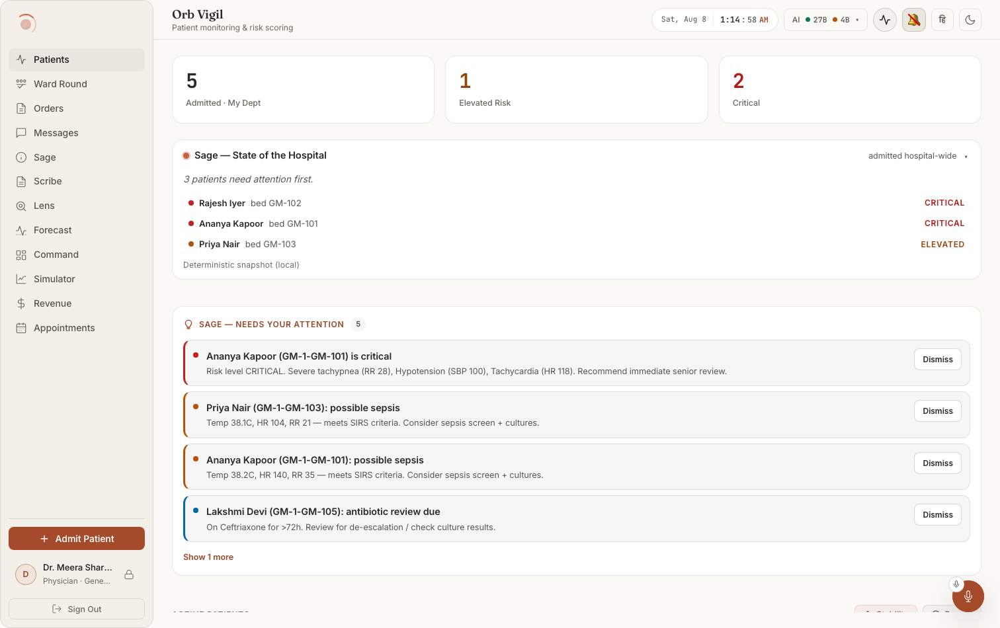
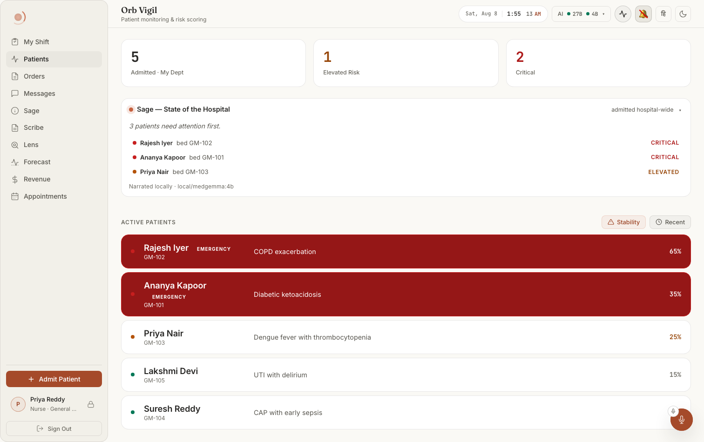

# Screen map 06: Vigil, the ward patient board

**What this is.** An index of every visible thing on the Vigil *board*, the list screen you land
on, before you open anybody's chart, and the exact code that puts it there. Read an entry, then
go to the file:line it names. Every citation in this file was opened and checked at that line.

**Scope.** This file covers the board only: `src/pages/panels/VigilPanel.tsx` lines **65–412**
(the `VigilPanel` component plus the `PatientRow` component it renders). The moment you click a
row, `VigilPanel` returns `PatientDetailView` instead (`VigilPanel.tsx:213-229`) and everything
below line 430 takes over, that is the patient chart, a different screen, a different file.

**How to get to this screen.** Left nav → **Patients**. The nav entry is declared at
`src/pages/ClinicianShell.tsx:51`, `id: 'vigil', label: 'Patients', pillar: 'Vigil'` with a
heartbeat-trace SVG at `:53-57`. Note the label a user sees is **"Patients"**, not "Vigil".
The panel is lazily imported at `src/pages/ClinicianShell.tsx:283` and mounted inside a tab panel
at `src/pages/ClinicianShell.tsx:510-514`:

```
{shouldRenderPanel('vigil') && (
  <div id={`panel-vigil`} role="tabpanel" aria-labelledby={`nav-vigil`} ...>
    <PanelErrorBoundary label="vigil"><VigilPanel role={user?.role} /></PanelErrorBoundary>
```

The `role` prop passed there is the **only** prop this panel takes, and it controls exactly one
thing on screen, the fourth metric tile (see §1.4).

**Who sees the tab.** Per-role tab lists at `src/pages/ClinicianShell.tsx:182-203`. `vigil` is
first in the list for `surgeon` (:189), `doctor` (:195-196), `admin` (:201) and the `default`
fallback (:203), and second for `nurse` (:200, behind `shift`). Because the shell opens
`accessibleTabs[0]` (`ClinicianShell.tsx:312`), **this board is the landing screen for doctors,
surgeons and admins.** A pharmacist never sees it at all (`:202` gives them helix /
pharmacy-verify / sage).

**Layout in one sentence.** Top to bottom in a single column (`.orb-panel`, root element at
`VigilPanel.tsx:242`): a row of 3–4 metric tiles, then the Sage ward-brief card, then the Sage
insights feed, then the "ACTIVE PATIENTS" section, its header with two sort chips on the right,
a staleness banner when degraded, the list of patient rows, and a "Load more" button underneath.

---

## What it looks like



**Notice the last line of the Sage card**: *"Deterministic snapshot (local)"*. That line is
the provenance of everything above it, and it changes, in `nur001-03-vigil-light.png` the
same card ends *"Narrated locally · local/medgemma:4b"*. One card, two generators, and that
line is the only way to tell which one you are reading. Notice too that every row of the
NEEDS YOUR ATTENTION feed carries its own **Dismiss**, the section header carries the count,
and a "Show 1 more" sits at the foot rather than a scrollbar. Dark twin:
`doc001-02-vigil-dark.png`.



**Notice how acuity is encoded in the row itself**: EMERGENCY rows are a **solid** red fill
with white text, everything else is an outline row with a small coloured status dot, and the
NEWS2 badge is right-aligned at the end of the row. The two sort chips (Stability /
Recent) live in the ACTIVE PATIENTS section header, not the page header.

> ⚠ The admin capture of this screen (`adm001-02-vigil-light.png`) shows all four metric
> tiles at 0, and "No patients on the deterioration watchlist", above a feed listing 13
> alerts, four of them named critical patients. That is a defect, not an admin-scope rule.
> See [`docs/screenshots/INDEX.md`](../../screenshots/INDEX.md).

---

# 1. The count summary: the metric tiles

The strip of tiles across the top. Container is `<div className="orb-panel-grid">` at
`VigilPanel.tsx:243`, styled at `src/pages/ClinicianShell.css:567-571`, an auto-fit grid of
`minmax(160px, 1fr)` columns with a 16px gap, so on a narrow tablet the tiles wrap rather than
shrink. Each tile is `.orb-metric-card.glass-card` (`ClinicianShell.css:573-578` for the padding
and stacking; `src/index.css:379-388` for the flat opaque surface and hairline border).

The numbers are computed in three lines at `VigilPanel.tsx:233-235`, immediately before the
return.

### "Admitted · My Dept": the big number
**Where:** first tile, top-left of the screen.
**Rendered by:** `src/pages/panels/VigilPanel.tsx:245`, 
`<span className="orb-metric-value metric-mono">{metric(admitted)}</span>`.
**Data from:** `const admitted = total || patients.length` (`VigilPanel.tsx:233`). `total` is
state set from the `X-Total-Count` response header in `loadPatients` (`:149`) and in `loadMore`
(`:178`); the fallback to `patients.length` covers a server that omitted the header (see
`fetchPatientsPage`, `:53-54`, which substitutes `items.length` when the header will not parse).
**API:** `GET /api/vigil/patients?limit=100&offset=0`, built at `VigilPanel.tsx:45`.
**Server:** `server/routes/vigil_routes.py:262-389` `list_patients`. The count itself is the
`SELECT COUNT(*)` at `:292-299` (department-scoped) or `:319-324` (unscoped), written to the
header at `:343`.
**Change this →** this is the **server-side match count for your department**, not the number of
rows on screen. If you are scoped to Cardiology with 214 admitted patients, this tile reads
**214** while the list below shows 100, that gap is exactly what the "Load more" button at the
bottom exists to close. It counts patients with `p.status = 'admitted'` **and** an `admissions`
row with `status = 'active'` (the JOIN at `:295`), so discharging a patient decrements it on the
next 30-second poll. It never counts a patient outside your department, `department_scope`
(`server/permissions.py:192-219`) reads the department off your *user row*, and the predicate
lives in the SQL (`:297`), so no query string can widen it. Delete the tile and nothing else
breaks; the value is used nowhere except here and in the Bed Occupancy tile below.

### "Admitted · My Dept": the label and its tooltip
**Where:** small grey caption directly under the big number in the first tile.
**Rendered by:** `VigilPanel.tsx:246`, `<span className="orb-metric-label" title="Patients
admitted under your department">Admitted · My Dept</span>`.
**Data from:** nothing; both the label and the `title` are literals.
**API / Server:** none.
**Change this →** the caption text and the native browser tooltip that appears after ~1s of
hover. Style at `ClinicianShell.css:596-600` (`--text-xs`, `--text-muted`, weight 500). This
tooltip is the disambiguator against the Ward Brief card below, whose own count says "admitted
**hospital-wide**" (`src/components/sage/WardBrief.tsx:67`), the two numbers legitimately
disagree and each one says why.

### "Elevated Risk" tile
**Where:** second tile.
**Rendered by:** `VigilPanel.tsx:249` for the value (`orb-metric-value--warn`) and `:250` for the
label.
**Data from:** `const elevated = patients.filter(p => p.risk_level === 'elevated').length`
(`VigilPanel.tsx:234`), a tally over the **loaded rows only**, not over the ward.
**API:** the same `GET /api/vigil/patients` page. `risk_level` is the `rs.level` column selected
at `vigil_routes.py:302` / `:327` and mapped into the response at `:357`.
**Server:** `server/services/vigil_service.py:334-339` decides the word `elevated`, see §7.
**Change this →** the number is amber (`--status-warn-text`: `#deb467` dark /`#964507` light /
`#ffc043` night, `src/index.css:79`, `:603`, `:693`) via `ClinicianShell.css:588-590`. Because
it counts loaded rows, **pressing "Load more" can make this number go up** even though no
patient deteriorated. That asymmetry against the "Admitted" tile beside it is deliberate and
commented at `VigilPanel.tsx:232`. Change `'elevated'` at `:234` to any other string and the tile
reads 0 forever.

### "Critical" tile
**Where:** third tile.
**Rendered by:** `VigilPanel.tsx:253` (`orb-metric-value--danger`) and `:254`.
**Data from:** `const critical = patients.filter(p => p.risk_level === 'critical').length`
(`VigilPanel.tsx:235`).
**API / Server:** as above.
**Change this →** red via `ClinicianShell.css:592-594` → `--status-danger-text` (`#ee9c94` /
`#ad1b1b` / `#ff6060`). The same `'critical'` string is the one thing that turns a row solid red
and floats it to the top of the list (`isEmergency`, `VigilPanel.tsx:364`; float sort at
`:203-209`), so this tile and the red rows are always consistent by construction. If it says 3,
there are exactly 3 red rows *among the loaded rows*.

### "Bed Occupancy" tile: admin only
**Where:** fourth tile. **Absent for every non-admin.**
**Rendered by:** `VigilPanel.tsx:256-261`, guarded by `{role === 'admin' && (…)}` at `:256`.
**Data from:** the `role` prop, supplied by the shell at `src/pages/ClinicianShell.tsx:512` as
`role={user?.role}`. The value is `Math.round((admitted / 35) * 100)` (`VigilPanel.tsx:258`).
**API / Server:** none of its own, it is arithmetic on the `admitted` number above.
**Change this →** **The 35 is a hardcoded literal, not a bed count from the site config.** A
hospital with 120 beds and 60 admitted patients sees "171%". Change the `35` at `:258` and the
percentage moves; change the `role === 'admin'` test at `:256` and the tile appears or vanishes
for that role entirely (there is no other guard, a doctor never renders this DOM node at all).

### The ": " that replaces every tile number
**Where:** in place of all three (or four) big numbers.
**Rendered by:** the `metric()` helper at `VigilPanel.tsx:239`, 
`const metric = (n: number | string) => (boardUnavailable ? ', ' : n)`, applied at `:245`, `:249`,
`:253` and `:258`.
**Data from:** `const boardUnavailable = !!loadError && patients.length === 0`
(`VigilPanel.tsx:238`). `loadError` is set in the `catch` of `loadPatients` (`:162`).
**API / Server:** whichever failure produced `loadError`, a non-2xx from
`GET /api/vigil/patients` throws at `VigilPanel.tsx:50`.
**Change this →** every tile shows an em-dash instead of a digit. This exists because the
alternative, "0 Critical", is a *lie shaped like reassurance*; the comment at `:236-237` says
so. The tiles only fall back when the board is **both** failing and empty: a refresh that fails
on top of rows you already have keeps the last-known numbers and puts the staleness banner (§4)
above the list instead.

---

# 2. The two Sage cards above the list (boundary)

These render on this screen but belong to the Sage pillar and have their own components. Listed
here so the screen inventory is complete; do not re-document them from this file.

### Ward Brief card
**Where:** full-width card between the metric tiles and the insights feed.
**Rendered by:** `<WardBriefCard />` at `VigilPanel.tsx:264`; component at
`src/components/sage/WardBrief.tsx` (root `.ward-brief.glass-card` at `:56`, failure variant at
`:37-49`, watchlist at `:100-118`).
**Change this →** it renders **nothing at all** on first load until a response arrives
(`WardBrief.tsx:35`, `if (!failed) return null`), so the board list jumps down when it appears.
Its "N admitted hospital-wide" count (`:67`) is a *different scope* from the Admitted tile.
**Its watchlist band is the board's band (ruled 2026-10-03).** The brief used to band from
`risk_scores`, which the simulator and the Scribe lane never write, so one screen showed "Priya
Nair, GM-103, ELEVATED" in the brief over her board row at NEWS2 8, critical. The narrator's
`_build_ward_snapshot` now reads `vigil_service.scored_admitted_patients`, the same rows, scorer,
overlay, scale and order as this list: the watchlist is the board's critical and elevated rows
in board order, and a scoped brief's risk mix equals the Critical and Elevated tiles. A patient
with no vitals is neither listed nor counted. The snapshot is rebuilt every 30 s (the board's
poll, `SNAPSHOT_REFRESH_SECONDS`); the LLM narrative keeps its old cadence, and the card refetches
only when a name, bed or band changes. Pinned by `server/tests/test_ward_brief_latest_vitals.py`.
Clicking a watchlist name fires the same `orb:open-patient` bus event this panel listens for at
`VigilPanel.tsx:120-125`, which is why opening a chart from there works.

### Sage insights feed
**Where:** directly below the ward brief.
**Rendered by:** `<SageInsightsFeed />` at `VigilPanel.tsx:266`; component at
`src/components/sage/SageInsightsFeed.tsx` (root `.sage-insights.glass-card` at `:111`).
**Change this →** it returns `null` when there is nothing to say (`SageInsightsFeed.tsx:106`), so
on a quiet ward this strip is simply not there. It polls on its own 20-second timer
(`:78`, `useVisiblePolling(load, 20000)`), independent of the board's 30-second poll.

---

# 3. The section header and the sort controls

Container `<div className="orb-section">` at `VigilPanel.tsx:268`; header row
`<div className="orb-section-header">` at `:269`, styled `ClinicianShell.css:616-621`
(flex, `space-between`) so the title sits left and the chips right.

### "ACTIVE PATIENTS" title
**Where:** small uppercase grey label above the list, on the left.
**Rendered by:** `VigilPanel.tsx:270`, `<h2 className="orb-section-title">Active Patients</h2>`.
**Data from:** literal.
**API / Server:** none.
**Change this →** the text renders uppercase because of `text-transform: uppercase` at
`ClinicianShell.css:613` (rule `.orb-section-title`, `:608-614`), not because of the string, editing it to "Active patients" changes
nothing visible. It is an `<h2>`, so it is also the landmark a screen-reader user jumps to.

### "Stability" sort chip
**Where:** first of two chips at the right end of the ACTIVE PATIENTS header row.
**Rendered by:** `VigilPanel.tsx:272-279`, a `<button className={`sort-btn ${sortBy ===
'stability' ? 'sort-btn--active' : ''}`}>` with a warning-triangle SVG at `:277` (a `<path>` plus
two `<line>` elements) and the text `Stability`. Its `title` is `"Sort by Risk Stability"`
(`:275`).
**Data from:** `sortBy` state, `useState<'stability' | 'recent'>('stability')` at
`VigilPanel.tsx:75`, **stability is the default**. Set by the `onClick` at `:274`.
**API:** none. The sort runs client-side over already-fetched rows.
**Server:** `vigil_service.board_order` (`vigil_service.py:808`) sorts every patient in scope with
the SAME key inside `scored_admitted_patients` (`:823`, sort at `:878`), and `list_patients` pages
only after that (`vigil_routes.py:361`), so page one is exactly the top of this sort.
**Change this →** clicking it re-runs the `useMemo` at `VigilPanel.tsx:553` and the rows
reorder in place. The comparator is `boardOrder` (`VigilPanel.tsx:845`), the client twin of
`vigil_service.board_order`: critical first, then NEWS2 high to low, then at an equal NEWS2 'elevated' (a
single parameter scoring 3) above 'stable', then patients with nothing recorded, then id. It
used to compare `risk_score`, the 0-1 index, which tied a single-parameter-3 patient with a
'stable' one at the same aggregate. Change one twin without the other and the order on page one
stops matching the order of the numbers shown (pinned on both sides:
`server/tests/test_vigil_board_news2.py`, `src/pages/panels/VigilPanel.board.test.tsx`). Visually the chip itself flips from the quiet
`.sort-btn` treatment (`ClinicianShell.css:632-644`: `--bg-glass`, `--border-subtle`,
`--text-secondary`) to `.sort-btn--active` (`:653-657`: `--accent-glow` background,
`--accent-text` label, `--accent-glow-strong` border). **Both chips can never be inactive**, 
`sortBy` is one of two literals, so exactly one is always tinted.

### "Recent" sort chip
**Where:** second chip, immediately right of Stability.
**Rendered by:** `VigilPanel.tsx:280-287`, same button shape, a clock SVG at `:285` (a
`<circle>` plus a `<polyline>` hand), text `Recent`, `title="Sort by Recently Added"` (`:283`).
**Data from:** the same `sortBy` state; `onClick` at `:282`.
**API / Server:** the field it sorts on, `admission_date`, comes from `vigil_routes.py:352`.
**Change this →** the comparator at `VigilPanel.tsx:195-197` sorts by
`new Date(b.admission_date || 0)` descending, newest admission first. A patient with a missing
or unparseable `admission_date` falls back to epoch 0 and sinks to the bottom.
**Both sorts are then overridden for critical patients**: the second `.sort()` at
`VigilPanel.tsx:203-209` floats every `risk_level === 'critical'` row to the top regardless of
which chip is lit. So switching to Recent does *not* move a critical patient off the top of the
board, that is the point, and the comment at `:200-202` records that this replaced a build which
pinned the demo patient `PAT007` there permanently.

**There is no filter control and no search box on this screen.** Filtering is done for you by
`department_scope` on the server (`server/permissions.py:192-219`); the only client-side control
over which rows you see is "Load more".

---

# 4. The staleness banner

### "Offline: not live" / "Can't reach Orb: not live"
**Where:** a full-width bordered strip between the ACTIVE PATIENTS header and the first patient
row. **Invisible whenever the board is live.**
**Rendered by:** `<OfflineBanner snapshot={boardOffline} what="patient board"
onRetry={loadPatients} />` at `VigilPanel.tsx:295`; the component is
`src/components/OfflineBanner.tsx` (root `.offline-banner` with `role="alert"` at `:90`, the
status dot at `:91`, the heading at `:93`).
**Data from:** `boardOffline`, the snapshot returned by
`useOfflineSnapshot('vigil:patients', loading || loadError ? null : livePatients, {...})` at
`VigilPanel.tsx:82-85`. The hook is `src/hooks/useOfflineSnapshot.ts:66-127`; the browser
online/offline signal comes from `src/hooks/useOfflineStatus.ts:37-65`.
**API / Server:** none of its own. It reports on the *board's* fetch, and reads the device cache
via `lib/offline/phiCache`.
**Change this →** four distinct things appear here, and which one you get is decided by
`source` and `unreachable`:

- **Nothing.** `source === 'live'` → `OfflineBanner.tsx:77` returns `null`. This is the normal
  state and the whole design depends on it staying rare (`OfflineBanner.tsx:24-25`).
- **"Offline, not live"**, the tablet lost its network. Heading literal at
  `OfflineBanner.tsx:83`, else-branch.
- **"Can't reach Orb, not live"**, the tablet has wi-fi but the appliance did not answer.
  Same line, `unreachable` branch. `unreachable` is `online && liveFailed`
  (`useOfflineSnapshot.ts:100`), and `liveFailed` is wired straight to this panel's `loadError`
  at `VigilPanel.tsx:83`. Different sentence because it is a different fix, walk to the station
  vs. call IT.
- **The dated line.** `"Showing the patient board saved at 14:32, 11 minutes old."`
  (`OfflineBanner.tsx:104-107`; `what="patient board"` is the string passed at
  `VigilPanel.tsx:295`). If the copy cannot be dated it degrades to "when it was saved is
  **unknown**" (`:97-102`). If there is no copy at all it becomes "There is **no saved copy** of
  the patient board on this device" (`:111-117`).

The age reading re-renders on a 20-second tick (`OfflineBanner.tsx:39`, `TICK_MS`) so it stays
true while someone stands looking at it. The third paragraph, "Nothing can be recorded until you
reconnect" (`:120-124`), is unconditional whenever the banner shows. The **"Try again"** button
(`:127-129`) calls this panel's `loadPatients` directly.

One deliberate subtlety worth knowing when you edit `VigilPanel.tsx:82`: the live value passed
to the hook is `loading || loadError ? null : livePatients`. Feeding the empty initial array
through a failed first load would overwrite a good cached ward with an empty one, and because
`patients` (`:86`) reads from the *snapshot*, not from `livePatients`, **there is no way to render
a cached board without this banner above it.**

---

# 5. The patient row: every cell

One row per patient. The list container is `<div className="vigil-patients-list">` at
`VigilPanel.tsx:296`, a vertical flex column with an 8px gap (`src/pages/Vigil.css:12-16`). Rows
come from `sortedPatients.map(...)` at `VigilPanel.tsx:313-318`.

The row component is `PatientRow`, `VigilPanel.tsx:370-412`, wrapped in `memo()`. It takes three
props: `patient`, `onSelect` (the stable `handleSelectPatient` callback from `:92-95`) and
`newSinceReview` (`unseen[p.id] ?? 0`, passed at `:317`).

**Desktop geometry:** `.patient-row` is a 4-column grid, `12px 220px 1fr 60px`
(`Vigil.css:18-30`), risk dot, name block, diagnosis, score. At ≤1024px the fixed 220px name
column becomes fluid (`Vigil.css:783-787`). At ≤768px it becomes a named two-row layout, 
`'risk info score' / 'risk meta score'` (`Vigil.css:829-841`), so the diagnosis drops under the
name and the score stays pinned right.

### The row itself (the tap target)
**Where:** each card in the list.
**Rendered by:** `VigilPanel.tsx:381-385`, it is a real `<button>`, not a div, with
`style={{ width: '100%', textAlign: 'left', cursor: 'pointer' }}` at `:384`.
**Data from:** one `Patient` object (type at `src/api/client.ts:597-612`).
**API:** `GET /api/vigil/patients` → the row dict built at `server/routes/vigil_routes.py:344-362`.
**Server:** `list_patients`, `vigil_routes.py:262-389`.
**Change this →** clicking (or pressing Enter/Space, because it is a button) calls
`onSelect(p.id)` at `:383` → `handleSelectPatient` (`:92-95`) → `setSelectedPatientId`, and the
**entire board is replaced by the patient chart**, `VigilPanel.tsx:213-229` returns early, so
the tiles, the ward brief and the list all disappear in one frame. The same handler fires
`prefetchSageContext(id)` (`:94`) with the error swallowed, so a failed prefetch never blocks the
chart from opening. Hover is a background + border shift only (`Vigil.css:32-35`), and it is
suppressed on emergency rows by the `:not(.patient-row--emergency)` guard at `:32`, so a red row
does not lighten under the cursor.

### The emergency row treatment (solid red card)
**Where:** replaces the ordinary card surface on the sickest rows.
**Rendered by:** the conditional class at `VigilPanel.tsx:382`, 
`` `patient-row glass-card ${isEmergencySurgery ? 'patient-row--emergency' : ''}` ``, where
`isEmergencySurgery = isEmergency(p)` (`:378`) and `isEmergency` is
`p.risk_level === 'critical'` (`VigilPanel.tsx:364`).
**Data from:** `risk_level` on the patient row.
**API / Server:** `rs.level` → `vigil_routes.py:357`; computed at
`server/services/vigil_service.py:334-339`.
**Change this →** the whole card fills with `color-mix(in srgb, var(--status-danger) 75%, #000)`
and takes a `--status-danger` border (`Vigil.css:704-707`, both `!important`). Every text field
in the row, name, bed, diagnosis, score, is forced to literal `#FFFFFF`
(`Vigil.css:716-721`). **Do not add an `opacity` or alpha colour to any of those four fields:**
the comment at `Vigil.css:709-715` records that an `0.88` override on bed and diagnosis dropped
the highest-acuity row in the product to 4.17:1 contrast. On a status fill, hierarchy here comes
from weight and size only. Flip the one string `'critical'` at `VigilPanel.tsx:364` and the red
disappears from the board entirely, along with the top-of-list float, which reads the same field
at `:204-205`.

### The risk dot
**Where:** far left of the row, an 8px circle, vertically centred.
**Rendered by:** `VigilPanel.tsx:386`, 
`` <div className={`patient-row__risk patient-row__risk--${p.risk_level}`} /> ``.
**Data from:** `p.risk_level`, a raw string interpolated into the class name.
**API:** `GET /api/vigil/patients`, field `risk_level` (`vigil_routes.py:403`), which is
`news2.level` for the same scored moment as the badge.
**Server:** `compute_news2` assigns the word; `score_vitals_row` may escalate it (CfC overlay).
**Change this →** three colours, from `Vigil.css:44-54`:
`critical` → `--status-danger`, `elevated` → `--status-warn`, `stable` → `--status-ok`
(`#66bb85` / `#047857` / `#3dff88` across dark, light and night, `src/index.css:63`, `:597`,
`:685`). **There is no fourth rule.** A patient with no vitals row at all comes back with
`risk_level: null`, the class becomes the literal `patient-row__risk--null`, no rule matches, and
the dot renders as an **invisible 8px gap**, the row still has its indent, but nothing coloured
in it. That is the current behaviour, and it is the one state a reader of this board cannot
distinguish from "not yet painted".

### The patient name
**Where:** the large text in the second column, top line.
**Rendered by:** `VigilPanel.tsx:388-389`, `<span className="patient-row__name">{p.name}</span>`.
**Data from:** `p.name`.
**API:** `vigil_routes.py:347`.
**Server:** the `patients.name` column, `SELECT p.*` at `vigil_routes.py:301` / `:326`.
**Change this →** 1.15rem / weight 600 / `--text-primary` with `-0.01em` tracking
(`Vigil.css:63-68`), dropping to 1rem on phones (`Vigil.css:843-845`). It is not truncated by any
rule of its own; the 220px column and the parent `min-width: 0` (`Vigil.css:60`) let a long name
wrap rather than clip. On an emergency row it becomes white (`Vigil.css:716`).

### The "EMERGENCY" badge
**Where:** a small red pill immediately to the right of the name, on red rows only.
**Rendered by:** `VigilPanel.tsx:390`, 
`{isEmergencySurgery && <span className="emergency-badge">EMERGENCY</span>}`.
**Data from:** the same `isEmergency(p)` test, `risk_level === 'critical'`.
**API / Server:** as the risk dot.
**Change this →** it appears and disappears in lockstep with the red card, one boolean drives
both, so you can never get a red row without the badge or vice versa. 10px, weight 700, 1px
letter-spacing, `color-mix(--status-danger 75%, #000)` fill with white text
(`Vigil.css:723-733`). It reads "EMERGENCY" because of a literal in the JSX, not a translation
key, this string is **not** in the i18n bundle.

### The "N NEW" badge
**Where:** an amber pill after the name (and after the EMERGENCY badge, when both are present).
**Rendered by:** `VigilPanel.tsx:391-398`, guarded by `newSinceReview > 0`. The label is
`{newSinceReview} NEW` at `:396`; the `title` at `:394` reads
`"N chart events since you last marked this chart reviewed"` (singular/plural handled inline).
**Data from:** the `unseen` record, `useState<Record<string, number>>({})` at
`VigilPanel.tsx:107`, indexed per row at `:317` with `unseen[p.id] ?? 0`. Loaded by `loadUnseen`
(`:108-110`), called on mount (`:111`) and again every time a chart is closed, the effect at
`:112` fires when `selectedPatientId` goes back to `null`.
**API:** `getUnseenCounts()` → `src/api/client.ts:1527-1530` → `GET /api/chart/unseen`.
**Server:** `server/routes/patient_timeline_routes.py:99-135` `unseen_counts` →
`server/services/patient_timeline_service.py:743-…` `unseen_counts_for_scope`.
**Change this →** amber fill (`--status-warn`) with the on-fill label token
(`--status-on-fill`), `Vigil.css:741-752`. That pairing is load-bearing: an opaque fill plus the
on-fill token stays legible **both** on an ordinary card and on the red emergency row, where the
row's own rule is forcing white text; a translucent wash would sample whichever it landed on and
fail one of them (`Vigil.css:735-740`). Three ways to make it vanish: (1) open the chart and mark
it reviewed, the count resets and, because closing the chart re-runs `loadUnseen` (`:112`), the
badge is gone by the time you are back on the board; (2) the endpoint fails, the `.catch` at
`:109` sets `{}` and **no badge draws anywhere**, which is the intended degraded state, not an
error; (3) you have never opened that chart on this account, such patients are *absent* from the
server's map entirely, not zero (`patient_timeline_routes.py:107-108`), because a badge on every
bed on day one is a badge nobody reads by day two. Note the counts are deliberately **not** on
the 30-second vitals poll (`VigilPanel.tsx:99-106`): the endpoint writes an audited PHI-read row
per call, and a per-tick encrypted-SQLite write is the exact shape behind the July loop stalls.

### The bed label
**Where:** the small grey line directly under the patient name.
**Rendered by:** `VigilPanel.tsx:400`, `<span className="patient-row__bed">{p.bed}</span>`.
**Data from:** `p.bed`.
**API:** `vigil_routes.py:349`.
**Server:** the `patients.bed` column.
**Change this →** 0.75rem, `--text-muted` (`Vigil.css:70-73`); white on emergency rows
(`Vigil.css:717`). It renders the bed string raw, no "Bed " prefix, no fallback. A patient with
a null bed renders an **empty line** that still occupies its 2px-gap slot in the flex column
(`Vigil.css:56-61`), so the name sits slightly high rather than the row collapsing.

### The diagnosis
**Where:** third column, single line, middle of the row.
**Rendered by:** `VigilPanel.tsx:402-404`, 
`<div className="patient-row__meta"><span className="patient-row__diagnosis">{p.diagnosis}</span></div>`.
**Data from:** `p.diagnosis`.
**API:** `vigil_routes.py:353`.
**Server:** the `patients.diagnosis` column.
**Change this →** 0.9rem `--text-secondary`, and critically `white-space: nowrap; overflow:
hidden; text-overflow: ellipsis` (`Vigil.css:81-87`). A long diagnosis is **truncated with an
ellipsis and there is no tooltip**, hovering shows nothing, and the full text is only visible in
the chart. Removing the `nowrap` at `Vigil.css:83` would let it wrap and rows would become
different heights. On phones it moves to its own grid row under the name (`Vigil.css:833`).

### The NEWS2 badge
**Where:** far right of the row, right-aligned.
**Rendered by:** `VigilPanel.tsx:899`, `<News2Badge news2={p.news2 ?? null} labelled={false} />`,
the same shared badge the nurse board and the doctor home use (`src/components/News2Badge.tsx`,
styles in `ClinicianShell.css` under `.news2`).
**Data from:** `p.news2`, the NEWS2 of the patient's latest vitals row.
**API:** `vigil_routes.py:378`, field `news2` (plus `news2_at`, that row's timestamp).
**Server:** `list_patients` calls `vigil_service.scored_admitted_patients` (`vigil_service.py:823`),
which picks each patient's latest vitals row (`ORDER BY timestamp DESC, id DESC`, `:863`) and
scores it through `vigil_service.score_vitals_row` (`:874`), on the patient's SpO2 scale and with
the CfC overlay, exactly as the chart and the nurse board do. The Sage ward brief above the board
reads the same helper (see §2, Ward Brief card).
**What it shows:**
- *The aggregate*, as the integer the RCP escalation table is keyed on, in a box filled by band:
  `.news2--critical` / `--elevated` / `--stable`. On the solid red emergency row the box gets an
  on-fill outline so it stays distinct (`Vigil.css:760`).
- *"≥5" for an incomplete set.* When `news2.complete` is false a vital was not measured, it
  scored 0, and the aggregate is a minimum. The label says it in words, worded as the server
  twin (`news2_text.py`) words it in alerts.
- *"Red score" under the number* when a single parameter scores 3.
- *"—" for nothing recorded*, announced as "NEWS2 not recorded". Never a zero.
- *The label* (`aria-label` and `title`) is `news2Description` (`src/lib/news2.ts`), for
  example "NEWS2 5 (elevated) · incomplete set, minimum".

**History (ruled 2026-10-03).** This cell used to print `{(p.risk_score * 100).toFixed(0)}%`.
`risk_score` is a 0-1 index of the aggregate (divided by 20), not a probability, and a patient
with no risk row printed "0%", because `(null * 100).toFixed(0)` is "0". The list also read
`risk_scores` through a `MAX(timestamp)` equality join, which listed a patient twice on a
timestamp tie and went stale because the simulator and the Scribe lane write vitals but no risk
row. `risk_score`, `risk_level` and `risk_drivers` are still returned for the round queue and the
patient picker, derived from the same `news2`; no surface may print `risk_score` as a percentage.

---

# 6. Board states

### "Loading patients…"
**Where:** in place of the entire list, in the same slot the rows occupy.
**Rendered by:** `VigilPanel.tsx:297-298`, 
`<div className="orb-panel-loading">Loading patients…</div>`.
**Data from:** `loading`, `useState(true)` at `VigilPanel.tsx:69`, cleared in the `finally` of
`loadPatients` (`:164`), so it clears on failure too, handing off to the error state below.
**API / Server:** the in-flight `GET /api/vigil/patients`.
**Change this →** the metric tiles and both Sage cards are already on screen while this shows, 
only the list slot is occupied. It appears exactly once per mount (the effect at `:97`); the
30-second poll never re-raises it, so a refresh is silent and the rows never blink. Note
`orb-panel-loading` has **no CSS rule anywhere in the project**, it renders as unstyled body
text. It is used as a hook by tests (e.g.
`src/pages/panels/RelayPanel.verify.test.tsx:149`), not by a stylesheet.

### The board-failure block
**Where:** replaces the whole list.
**Rendered by:** `VigilPanel.tsx:299-311`, a `<div className="orb-panel-loading" role="alert">`
containing three children:
- `:301`, **"The patient board could not be loaded."** in `--status-danger`, weight 600.
- `:302-304`, **"This is a load failure, not an empty ward, patient risk is unknown until it
  succeeds."** at 0.85rem, `--text-muted`.
- `:305-310`, a **Retry** button, inline-styled (`--btn-gradient` fill, `--btn-primary-text`
  label, `--border-glass` hairline) whose `onClick` is `loadPatients`.
**Data from:** `boardUnavailable` (`:238`), `loadError` set **and** zero rows.
**API:** the failed `GET /api/vigil/patients`. `fetchPatientsPage` throws
`Failed to load patients: <status>` at `VigilPanel.tsx:50`.
**Server:** `vigil_routes.py:262`. Note the `phi_access` write at `:369-387` is fail-closed, if
the audit row cannot be persisted, **no board is returned**, and this is the state you see.
**Change this →** it appears together with the four em-dashes in the tiles (§1, same
`boardUnavailable` flag), so the screen reads "unknown" in every place at once. Pressing Retry
re-runs `loadPatients`; on success `setLoadError(null)` at `:159` clears both this block and the
dashes in the same render. `role="alert"` means a screen reader announces it without the user
moving focus.

### 401: the session expired
**Where:** not on this screen, the app leaves it.
**Rendered by:** the dispatch at `VigilPanel.tsx:49`, 
`if (res.status === 401) window.dispatchEvent(new CustomEvent('orb:session-expired'))`. The
contract is documented at `src/api/client.ts:117-123`.
**Change this →** the board never renders a 401; the listener takes the user to login. Remove
that line and an expired session would instead surface as the generic failure block above with
"Failed to load patients: 401" in the console.

### 403: no permission
**Where:** would surface as the failure block above.
**Server:** `require_permission("patient.read_all")` at `vigil_routes.py:270`; the dependency is
`server/permissions.py:376-…`, which audits a `permission_denied` event **off the event loop**
(`:406`) and only then raises 403. Roles holding `PATIENT_READ_ALL` are `doctor`
(`permissions.py:106`), `nurse` (`:121`) and `admin` (`:142`); `pharmacist` (`:135`) and
`patient` (`:158`) do not.
**Change this →** in practice unreachable from the UI, because the shell never renders the tab
for a role that lacks it (`ClinicianShell.tsx:202`). A role added to the tab list but not to
`ROLE_PERMISSIONS` would land on the red "could not be loaded" block with a 403 in the message.

### The empty ward
**Where:** the list slot.
**Rendered by:** nothing. `sortedPatients.map(...)` at `VigilPanel.tsx:313-318` over an empty
array produces zero nodes, and there is no `length === 0` branch.
**Change this →** **a genuinely empty ward renders a blank gap** under the ACTIVE PATIENTS
header, no "no patients" message. The tiles above read `0 / 0 / 0` (not `, `, because
`boardUnavailable` requires `loadError`). This is the one state on the board with no words of its
own; the failure block's sub-line at `:303` exists specifically so the *other* zero is never read
as this one.

### "Load more (N of M)" / "Loading…"
**Where:** a full-width secondary button directly under the last row.
**Rendered by:** `VigilPanel.tsx:321-329`, guarded by `!loading && patients.length < total`
(`:321`). Label at `:327`: `loadingMore ? 'Loading…' : \`Load more (${patients.length} of
${total})\``.
**Data from:** `patients.length` (loaded rows) vs `total` (the `X-Total-Count` header);
`loadingMore` state at `VigilPanel.tsx:68`.
**API:** `GET /api/vigil/patients?limit=100&offset=<patients.length>`, `loadMore` at
`VigilPanel.tsx:173-188`, request built at `:177`.
**Server:** the same `list_patients`; `limit` is capped at 500 and `offset` floored at 0 by the
`Query` validators at `vigil_routes.py:268-269`.
**Change this →** the button **does not exist** when everything is loaded, `patients.length <
total` goes false and the node disappears, so there is no disabled-looking leftover. While a page
is in flight the label becomes `Loading…` and the button goes `disabled` (`:325`), which under
`Vigil.css:909-913` dims the label to `--text-muted` and swaps the border to
`--btn-disabled-border` while keeping a **normal cursor**, disabled here means "busy", never
"forbidden" (comment at `Vigil.css:906-908`). Page size is `VIGIL_PAGE_SIZE = 100`
(`VigilPanel.tsx:38`); raise it and both the button's arithmetic and the first page grow
together. New rows are deduped by id (`:180-181`) so a double-click cannot double a patient.
Base style `Vigil.css:884-898`, hover `:900-904`.

### What the 30-second poll does and does not disturb
`useVisiblePolling(loadPatients, 30000)` at `VigilPanel.tsx:171`; hook at
`src/hooks/useVisiblePolling.ts:18-61`. It **pauses entirely while the browser tab is hidden**
and fires once immediately on return (`useVisiblePolling.ts:44-47`). The merge at
`VigilPanel.tsx:150-158` refreshes **page one only** and preserves any extra pages you loaded, so
a poll never silently throws away rows you pressed "Load more" for.

### The live vitals tick (why a row changes colour without a reload)
`socket.on('vitals:update', …)` at `VigilPanel.tsx:502`, handler from `:469`. Ticks are batched
**per patient**: each patient's latest tick waits in a map, and the whole batch lands in one
render at most every `BOARD_TICK_MS` (2 s, `:815`). `applyBoardTick` (`:821`) copies the tick's
whole `risk` onto the row as `news2`, plus `risk_level`, `risk_score` and `risk_drivers`, using
`??` so a NEWS2 of 0 is a real value. A tick observed strictly before the row's `news2_at` is
ignored, and of two ticks for one patient inside a window the newer observation wins, so a
backfilled reading cannot paint over a newer set. Both use `observedBefore` (`src/lib/vitals.ts`),
the same rule the open chart uses: equal timestamps are not older (the later arrival wins, as the
server's `id DESC` does), and a stamp that does not parse never blocks a tick.
**History.** The handler used to keep ONE 2 s throttle for the whole ward, so a tick for one bed
swallowed every other bed's tick in the same window and most rows only moved on the 30 s poll;
and `newVital.risk?.score || p.risk_score` kept the stale score whenever the new one was 0.
**Change this →** when a patient deteriorates, their dot recolours, their badge re-reads and
refills, and, if the new level is `critical`, the row turns solid red, grows an EMERGENCY badge
and **jumps to the top of the list**, all inside one render, with no network request. The server
side is `emit_patient_vitals("vitals:update", …)` in `bot_service.py` (simulator, every 5 s),
`ingestion_service.py` (monitor feed) and the nurse observation path. Each carries the
`score_vitals_row` dict as `risk`, with `overlay=False`: once a CfC checkpoint is loaded, a tick
can show a lower band than the list's overlaid one until the next poll. `PatientRow`'s `memo()`
only bails because `onSelect` is a stable `useCallback`.

---

# 7. Where the risk number comes from: and what moves if you change it

**The function is `compute_news2`, `server/services/vigil_service.py:234-399`.** It is the single
implementation of the RCP NEWS2 table in the product; `escalation_service.py:28-31` states that a
second scorer is how two screens come to disagree about the same patient, and
`nurse_shift_service.py:669` says the same. It is called by `bot_service.py:200`,
`ingestion_service.py` (via `_persist_risk_score`, `:264-272`), `nurse_shift_service.py:374`,
`downtime_service.py:186`, `escalation_service.py:1269`, `command_center_service.py:177` and
`sage_service.py:1696`, so a threshold edit lands on the board, the nurse shift board, the
downtime pack, escalation and Sage's answers simultaneously.

**The board scores on read.** Since 2026-10-03 `list_patients` does not read `risk_scores` at
all: it scores each patient's latest vitals row through `score_vitals_row` on every request
(`vigil_service.scored_admitted_patients`, `vigil_service.py:823-879`, called at
`vigil_routes.py:361`). **So a threshold change shows on the next poll (within 30 s)**,
for every patient, without waiting for a new observation. The live tick still carries the score
its writer computed, so between polls a row can show the old threshold's result.

### The band cutoffs: `vigil_service.py:334-339`

```
if score >= 7:                    level = "critical"
elif score >= 5 or any_param_3:   level = "elevated"
else:                             level = "stable"
```

**Change the `7` →** every patient whose raw NEWS2 sits in the newly-included range flips to
`critical`. On screen, per patient: the left dot turns from amber to red (`Vigil.css:44-46`); the
NEWS2 badge's fill changes from `--status-warn` to `--status-danger` (`.news2--critical`,
`ClinicianShell.css`); **the whole card fills solid red and all four text fields turn white**
(`Vigil.css:704-721`); an **EMERGENCY** pill appears beside the name (`VigilPanel.tsx:390`); and
the row **jumps to the top of the board** regardless of which sort chip is lit
(`VigilPanel.tsx:203-209`). At the top of the screen, the "Critical" tile counts up and the
"Elevated Risk" tile counts down by the same amount. Lower the `7` and the board turns red;
raise it and red rows go amber and sink back into NEWS2 order.

**Change the `5` →** patients cross between amber and grey. The dot goes `--status-warn` ↔
`--status-ok`, the badge fill goes amber ↔ the green-tinted stable box, and the "Elevated Risk"
tile moves.
Nothing turns red and nothing floats.

**Change or remove `any_param_3` →** this is the NEWS2 single-parameter rule (set inside `add()`
at `vigil_service.py:259-260` whenever any one vital scores 3). Removing it makes a patient with,
say, SpO2 ≤ 91% but an otherwise clean chart drop from an amber row to a grey one, and lose the
"Red score" pill under its badge. The board shows no NEWS2 breakdown; that lives in the chart.

### The normalization constant: `vigil_service.py:230`

`_NEWS2_MAX_AGGREGATE = 20.0` decides the 0-1 `score` index. **Nothing on this board shows it
or sorts by it any more** (2026-10-03): the badge prints the raw aggregate and `boardOrder`
compares the aggregate. The index still travels as `risk_score` for the round queue and the
patient picker. Changing this constant changes no dot, badge, red row, order or tile count.

### The per-parameter tables: `vigil_service.py:271-331`

Respiratory rate `:272-277`, SpO2 scale 1 `:294-297` and scale 2 `:284-292`, supplemental oxygen
`:300-301`, systolic BP `:304-309`, pulse `:312-318`, temperature `:321-326`, ACVPU `:329-331`.
**Change any cutoff →** the aggregate moves, which cascades through *both* mechanisms above: the
badge number changes for every affected patient, and any patient the change pushes across 5 or 7
also changes colour, badge, sort position and tile counts. Widening the "normal" band of one
vital (say `rr <= 20` at `:275`) quietly de-escalates a slice of the ward on the next write.

### What the board does *not* show about the score
The route now returns the whole `score_vitals_row` dict as `news2`, including `drivers`,
`breakdown`, `missing_parameters` and `coverage_note`. The row uses only the aggregate, the
band, `single_param_3` (the "Red score" pill), `spo2_scale` (in the label) and `complete` (the
"≥"). It does **not** render `drivers`, the per-parameter breakdown, or WHICH parameters were
missing: an incomplete set says "minimum" but not what was skipped. Those live in the chart.

---

# 8. Things people look for on this board that are not there

Recording these so nobody hunts for the code that renders them. All were checked by reading
`PatientRow` (`VigilPanel.tsx:370-412`) top to bottom.

- **Age and sex.** `age` and `sex` are on the `Patient` type (`src/api/client.ts:605-606`) and
  the route returns them (`vigil_routes.py:354-355`), but no board cell reads them. `sexLabel`
  is imported at `VigilPanel.tsx:9` for the chart, not the board.
- **Ward.** Same, typed at `client.ts:602`, returned at `vigil_routes.py:350`, unrendered. The
  bed string is the only location shown.
- **MRN.** Returned at `vigil_routes.py:348`, unrendered. (It is still a PHI disclosure, which is
  why the read is audited at `:369-387`.)
- **The NEWS2 breakdown and drivers.** The route returns them inside `news2`, but the row shows
  only the aggregate, its band and its markers. The breakdown lives in the chart.
- **A trend arrow / delta.** There is none. Nothing in `PatientRow` compares two readings;
  `get_vitals_trend` (`vigil_service.py:481-…`) is a chart-side function and no board code calls
  it. The only motion signal on the board is the row jumping to the top when it turns critical.
- **Alert / escalation indicators.** No bell, no count, no colour beyond the risk band.
  `escalation_service` fires into Relay, not onto this row.
- **Risk drivers.** `risk_drivers` is typed (`client.ts:609`) and returned as a parsed list
  (`vigil_routes.py:358`), but never rendered here.
- **Attending doctor.** Returned at `vigil_routes.py:359`, unrendered.
- **A "what changed" timeline badge.** The only change indicator is the **"N NEW"** pill (§5),
  and it counts chart events since *you* marked the chart reviewed, not clinical change.
- **A search or filter box.** `.search-input` exists in `Vigil.css:696` but belongs to the chart's
  history modals, not the board.

---

## Reverse map contributions

- `src/pages/ClinicianShell.tsx::TABS` → "Patients" nav tab label; heartbeat-trace tab icon; Vigil as the landing tab for doctor/surgeon/admin
- `src/pages/ClinicianShell.tsx::getAccessibleTabs` → presence or absence of the Patients tab per role; tab ordering
- `src/pages/ClinicianShell.tsx::ClinicianShell` → Vigil tab panel mount; `role` prop that gates the Bed Occupancy tile
- `src/pages/panels/VigilPanel.tsx::fetchPatientsPage` → every patient row; "Admitted · My Dept" number; "Load more (N of M)" counts; board-failure block; session-expired redirect on 401
- `src/pages/panels/VigilPanel.tsx::VigilPanel` → panel root; metric tile strip; ", " unknown-metric fallback; ward brief mount; Sage insights mount; "ACTIVE PATIENTS" heading; sort chip pair; staleness banner mount; patient list container; "Loading patients…"; board-failure block; empty-board blank state; "Load more" button
- `src/pages/panels/VigilPanel.tsx::loadPatients` → patient rows; "Admitted · My Dept" number; board-failure block; Retry button behaviour; silent 30s refresh (no loading flash); preservation of extra loaded pages
- `src/pages/panels/VigilPanel.tsx::loadMore` → "Load more (N of M)" button; "Loading…" busy label; additional patient rows; row deduplication
- `src/pages/panels/VigilPanel.tsx::boardOrder` → row order under the Stability chip (twin of `vigil_service.board_order`)
- `src/pages/panels/VigilPanel.tsx::applyBoardTick` → a row's badge, dot, band and order moving on a live tick; a NEWS2 of 0 replacing an older score; older ticks ignored
- `src/pages/panels/VigilPanel.tsx::sortedPatients` → row order under the Stability chip; row order under the Recent chip; critical-patient float to top of board
- `src/pages/panels/VigilPanel.tsx::handleSelectPatient` → row click opening the patient chart; Sage context prefetch on open
- `src/pages/panels/VigilPanel.tsx::loadUnseen` → "N NEW" badge; badge refresh after closing a chart; no-badge degraded state
- `src/pages/panels/VigilPanel.tsx::isEmergency` → solid red emergency row; EMERGENCY badge; critical float to top of board
- `src/pages/panels/VigilPanel.tsx::PatientRow` → patient row tap target; risk dot; patient name; EMERGENCY badge; "N NEW" badge and its tooltip; bed label; diagnosis line; NEWS2 badge
- `src/components/News2Badge.tsx::News2Badge` → the row's NEWS2 number, band fill, "≥" for an incomplete set, "Red score" pill, "not recorded" dash, and spoken label
- `src/lib/news2.ts::news2Description` → the NEWS2 badge's aria-label and title sentence
- `src/pages/panels/VigilPanel.tsx::VIGIL_PAGE_SIZE` → number of rows on first load; "Load more" page size
- `src/pages/Vigil.css` → patient list spacing; patient row grid and hover; risk dot colours (critical/elevated/stable) and the unstyled null case; name/bed/diagnosis typography; diagnosis ellipsis truncation; emergency red fill and forced white text; the on-fill outline around the NEWS2 badge on emergency rows; EMERGENCY badge; "N NEW" badge fill and on-fill label; tablet and phone row layouts; "Load more" button base/hover/disabled
- `src/pages/ClinicianShell.css` → metric tile grid and card padding; metric value and label typography; warn/danger metric colours; "ACTIVE PATIENTS" uppercase section title; section header layout; sort chip base, hover and active tint
- `src/index.css` → `.glass-card` flat opaque surface and hairline; `.animate-fade-in` panel entry; status colour tokens behind every dot and badge in all three themes
- `src/components/OfflineBanner.tsx::OfflineBanner` → "Offline, not live" heading; "Can't reach Orb, not live" heading; "Showing the patient board saved at HH:MM" line; "unknown save time" variant; "no saved copy" variant; "Nothing can be recorded until you reconnect" line; "Try again" button; the banner's total absence when live
- `src/components/OfflineBanner.tsx::ageInWords` → the "N minutes old" age reading in the staleness banner
- `src/hooks/useOfflineSnapshot.ts::useOfflineSnapshot` → whether the board renders live or labelled-cached rows; which staleness heading appears; cached board on a cold offline start
- `src/hooks/useOfflineStatus.ts::useOfflineStatus` → offline vs unreachable wording in the staleness banner
- `src/hooks/useVisiblePolling.ts::useVisiblePolling` → 30-second silent board refresh; poll pause while the tab is hidden; immediate refresh on tab return
- `src/api/client.ts::buildHeaders` → authenticated board fetch (rows appear at all)
- `src/api/client.ts::getUnseenCounts` → "N NEW" badge
- `src/api/client.ts::prefetchSageContext` → faster first Sage answer after opening a row (no visible board element)
- `src/components/sage/WardBrief.tsx::WardBriefCard` → ward brief card above the list; "N admitted hospital-wide" count; deterioration watchlist; failed-brief retry strip
- `src/components/sage/SageInsightsFeed.tsx::SageInsightsFeed` → Sage insights strip above the list; its complete absence when there are no insights
- `server/services/vigil_service.py::board_order` → which patients land on page one; the order of the board under the Stability chip; the order of the Sage ward brief watchlist
- `server/services/vigil_service.py::scored_admitted_patients` → which vitals row each NEWS2 badge is scored from; the band, number and order of every row; the Sage ward brief watchlist and risk mix (the same rows)
- `server/routes/vigil_routes.py::list_patients` → every patient row and every field in it; which vitals row each NEWS2 badge is scored from; "Admitted · My Dept" count via X-Total-Count; "Load more" totals; department scoping of the whole board; board-failure block when the audited read cannot be written
- `server/permissions.py::department_scope` → which patients appear on the board at all; the "My Dept" scope of the Admitted tile
- `server/permissions.py::require_permission` → 403 board-failure block for a role lacking patient.read_all
- `server/services/vigil_service.py::score_vitals_row` → every NEWS2 badge on the board (scored on read, with the CfC overlay)
- `server/services/vigil_service.py::compute_news2` → risk dot colour; NEWS2 badge number and fill; solid red emergency row; EMERGENCY badge; critical float to top of board; "Elevated Risk" tile count; "Critical" tile count
- `server/services/bot_service.py::run_vitals_bot` → live recolouring of dots and badges without a reload; rows jumping to the top mid-shift
- `server/services/ingestion_service.py::_persist_risk_score` → nothing on the board since 2026-10-03 (the list scores vitals on read); the monitor feed's live ticks come from the same ingest
- `server/routes/patient_timeline_routes.py::unseen_counts` → "N NEW" badge; absence of the badge for never-reviewed charts
- `server/services/patient_timeline_service.py::unseen_counts_for_scope` → "N NEW" badge counts
- `server/services/vitals_source/simulator_source.py::SimulatorSource` → 5-second cadence of live risk changes on the board
