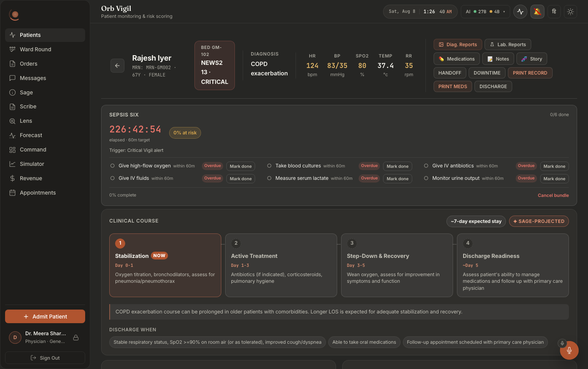
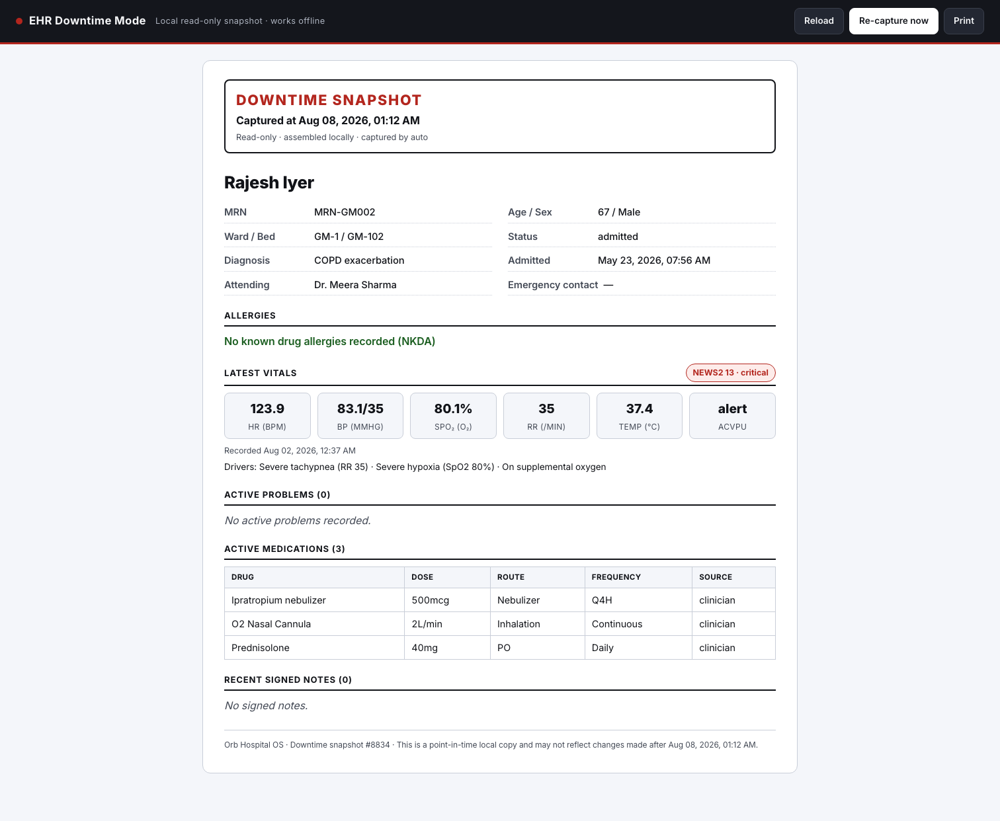

# Screen map 07: Vigil, the individual patient chart

**What this is.** An index of every visible thing on the Vigil *patient chart*, the screen you
land on after clicking a bed on the ward board, and the exact code that puts it there. Read an
entry, then go to the file:line it names. Every citation in this file was opened and checked at
that line.

**Scope.** This file covers `src/pages/panels/VigilPanel.tsx` lines **430–2060** (the
`PatientDetailView` component) plus the helper components below it that only this screen uses:
`ModalOverlay` (:350-362), `formatAdministeredTime` (:418-423), `PresenceChips` (:2083-2105),
`News2Attribution` (:2117-2167), `RiskGauge` (:2169-2198), `AiNarrative` (:2203-2334) and
`GlassWindow` (:2342-2460). The ward board that precedes it is documented in
[06-vigil-board.md](06-vigil-board.md) and covers lines 65–412.

**How to get to this screen.** Left nav → **Patients** → click any patient row, which runs
`handleSelectPatient` (`VigilPanel.tsx:94-97`). The board's `selectedPatientId` state flips and
`VigilPanel` returns `PatientDetailView` instead of the board (`VigilPanel.tsx:215-231`).
There is exactly one other entry point, and it reuses the same state path: the `orb:open-patient`
navigation-bus event (`VigilPanel.tsx:122-127`), which any surface can fire, Sage's ward-brief
watchlist, the command palette, a deep link. Both paths also call `prefetchSageContext`
(`:94`, `:123`) so the clinician's first Sage question streams faster, and because the detail view
fetches by id, a patient outside the loaded board page still opens. Closing the chart
(`selectedPatientId === null`) re-runs `loadUnseen` (`VigilPanel.tsx:114`), which is what refreshes
the ward board's `N NEW` badges.

> **The `key` matters.** `PatientDetailView` is mounted **keyed by patient id**
> (`VigilPanel.tsx:225-229`). Without the key, switching patients swapped the prop under a live
> component and every piece of state carried over, the previous patient's in-flight chart and
> eMAR responses landed in the new patient's view, and a modal left open (Add Medication,
> Discharge) stayed open and then acted on the *new* patient. If you ever remove that key you
> reintroduce a cross-patient data bug, not a render bug.

**One prop, and it is not `role`.** The chart takes `patientId` and `onBack`. Unlike the board, it
does **not** receive the user's role, so nothing on this screen is hidden or shown by role in the
client. Every role restriction on this screen is enforced server-side and arrives as a failed
request (see §9.5).

---

## What it looks like

**Notice the vertical order, because it is the argument the screen makes**: identity → the
bed / NEWS2 / diagnosis block → five raw vitals in a row → and only *then* the ten action
buttons (Diag. Reports, Lab. Reports, Medications, Notes, Story, HANDOFF, DOWNTIME, PRINT
RECORD, PRINT MEDS, DISCHARGE) packed into the top-right corner. Below that, the **SEPSIS
SIX** card puts a countdown and an `0/6 done` counter above six individually markable items
with their own Overdue chips, and the **CLINICAL COURSE** strip labels four stages with day
ranges under a `SAGE-PROJECTED` chip, closing with a DISCHARGE WHEN criteria row.

> ⚠ This is the **only** chart capture in the repo, and it records two faults. The Sepsis
> Six timer reads `226:42:54 elapsed · 60m target`, a 226-hour stopwatch against a one-hour
> bundle, and the identity strip says `67Y · FEMALE` for a patient every other screen calls
> 67y Male. Read the layout from it; do not read the values. There is no light-theme chart
> capture, and none of Notes, Story, Timeline, Medications or the report windows were ever
> photographed. See [`docs/screenshots/INDEX.md`](../../screenshots/INDEX.md).

**Notice** that DOWNTIME does not open a modal, it produces a whole print-shaped page that
renders on white in either theme, headed *"EHR Downtime Mode · Local read-only snapshot ·
works offline"*, with the capture instant stated **twice**: once in the banner and again in
the footer, as a warning that nothing after it is included. Everything on the page is text
and tables; the only controls are Reload, Re-capture now and Print.

---

## 0. The frame: what wraps everything

### 0.1 The chart container
**Where:** the whole scrollable area, right of the sidebar.
**Rendered by:** `VigilPanel.tsx:1171`, `
`.
The `detail` class is what distinguishes this from the board's `orb-panel`.
**Data from:** nothing; it is the static shell.
**API:** none.
**Server:** none.
**Change this →** removing `animate-fade-in` kills the entrance fade on chart open. Removing
`detail` unhooks `.detail__row`, `.detail__risk-panel` and `.detail__labs-panel` scoping in
`src/pages/Vigil.css` and the two-column risk/labs row collapses to unstyled stacked blocks.

### 0.2 The single fetch that fills the chart
Almost everything on this screen comes from **one** response. `loadPatientData`
(`VigilPanel.tsx:621-637`) calls `getPatientDetail(patientId)` → `src/api/client.ts:618` →
`GET /api/vigil/patients/{patient_id}` → `server/routes/vigil_routes.py:499` `get_patient` →
`server/routes/vigil_routes.py:35` `_load_patient_bundle` (the raw SQL) plus
`server/services/vigil_service.py:407` `get_patient_risk` and
`server/services/vigil_service.py:481` `get_vitals_trend`.

The response object (`vigil_routes.py:519-556`) has exactly these keys, and the whole screen is
built from them:

| key | what it feeds on screen |
|---|---|
| `patient` | name, MRN, age, sex, bed, ward, diagnosis, comorbidities, admission date |
| `risk` | bed badge, risk gauge, drivers, NEWS2 attribution table |
| `trend` | the Trend line under the gauge |
| `vitals` | the five vital cells and every hover sparkline (288 rows max, ~24h) |
| `notes` | Notes History, Lab Reports (lab_result docs), Lab Trends (real labs) |
| `scribe_notes` | Notes History (merged with `notes`) |
| `risk_history` | **fetched but never rendered on this screen** |
| `lens_analyses` | Diagnostic Reports, Lab Reports |
| `medications` | the Medications table, print views, discharge summary |

**Sequence-stamped.** `loadPatientData` is called on mount, on Retry, after a note is added and
after a med is added. Two overlapping calls used to let the *loser* win because it wrote last.
`detailSeqRef` (`VigilPanel.tsx:618`, checked at :624 and :630) lets only the newest write.

### 0.3 The offline snapshot wrapper
Every read below goes through `chartOffline` (`VigilPanel.tsx:437-440`), not through `liveData`
directly. `useOfflineSnapshot('vigil:patient:' + patientId, liveData, …)`
(`src/hooks/useOfflineSnapshot.ts:68`) hands back `data` that may be a cached copy.
**Change this →** if you ever read `liveData` instead of `data` in a render path, that value
renders **without** the staleness banner that dates it. That is the whole safety contract of this
hook: a cached NEWS2 read as current is worse than a blank screen.

### 0.4 Side effects the chart has on *other* screens
Opening this chart writes two contexts:
- `setActivePatient(patientId, name)`, `VigilPanel.tsx:449`, from
  `src/contexts/ActivePatientContext`.
- `setViewSelection({ kind: 'patient_chart', id, label, patientId })`, `VigilPanel.tsx:452-457`.
  The label is `"<name> (bed <bed>)"` when a bed exists, else the name or the id.

**Change this →** these are why Sage on any other tab scopes itself to this patient without the
clinician naming them. Both are cleared on unmount (`:456-459`), so leaving the chart returns Sage
to ward scope.

---

## 1. Staleness banner

### 1.1 "Offline: not live" / "Can't reach Orb: not live" banner
**Where:** full width, above the command bar, the first thing on the screen when it renders.
**Rendered by:** `VigilPanel.tsx:1174`, 
`<OfflineBanner snapshot={chartOffline} what="patient chart" onRetry={loadPatientData} />`.
The component is `src/components/OfflineBanner.tsx:64`.
**Data from:** `chartOffline` (`VigilPanel.tsx:437`). The heading picks between two strings at
`OfflineBanner.tsx:83`: `unreachable` → "Can't reach Orb, not live", otherwise "Offline, not
live".
**API:** none of its own, it reports on the chart fetch.
**Server:** none.
**Change this →** it renders **nothing at all** while `source === 'live'`
(`OfflineBanner.tsx:77`). When it does appear you get a red-dot heading, a line naming the clock
time the copy was saved and its age in words (`ageInWords`, `OfflineBanner.tsx:47`), a line saying
nothing can be recorded until you reconnect, and a **Try again** button
(`OfflineBanner.tsx:127`) wired to `loadPatientData`. The age re-renders every 20s
(`TICK_MS`, `OfflineBanner.tsx:40`) so it never sits frozen at "3 minutes old" while it is really
nine. Delete the `what="patient chart"` prop and the sentence becomes ungrammatical, that string
is interpolated straight into "Showing the **patient chart** saved at 14:32".

> Note: `PatientDetailView` does **not** pass `liveFailed` to `useOfflineSnapshot`, so
> `unreachable` never becomes true on this screen, the chart shows "Offline, not live" only.
> The board (`VigilPanel.tsx:297`) is the one that can say "Can't reach Orb".

---

## 2. The command bar (the sticky header)

The whole header is one flex row: `VigilPanel.tsx:1176-1268`, styled by
`src/pages/Vigil.css:121-127`, `position: sticky; top: 0; z-index: 100`, opaque
`--bg-primary` background and a hairline bottom border. It stays pinned while the chart scrolls.

### 2.1 Back arrow
**Where:** far left of the command bar, a 36×36 rounded square.
**Rendered by:** `VigilPanel.tsx:1177-1179`, `<button className="command-bar__back">` with an
inline left-arrow SVG. Styled `Vigil.css:128-134`.
**Data from:** the `onBack` prop.
**API:** none directly.
**Server:** none.
**Change this →** clicking runs `() => { setSelectedPatientId(null); loadPatients() }`
(`VigilPanel.tsx:228`), you return to the ward board **and the board refetches**, so a patient
you just discharged disappears from the list. Remove the `loadPatients()` and the board shows a
stale row for the patient you just changed.

### 2.2 Patient name
**Where:** immediately right of the back arrow, the largest text in the bar (1.2rem, bold).
**Rendered by:** `VigilPanel.tsx:1183`, `<h2 className="command-bar__name">{patient.name}</h2>`.
Styled `Vigil.css:136`.
**Data from:** `patient` destructured at `VigilPanel.tsx:1112` from `data`, which is the chart
snapshot.
**API:** `GET /api/vigil/patients/{patient_id}`.
**Server:** `vigil_routes.py:499` `get_patient` → `vigil_routes.py:37-44` (`SELECT p.*` on
`patients`). The column is `patients.name`.
**Change this →** the header title changes, and so does everything downstream that reads
`data?.patient?.name`: the Sage view-selection label (`:453`), the Discharge modal title
("Discharge **Ada Okafor**", `:1387`), the Add Note modal's Patient field (`:1752`), the
Administer modal's patient name (`:2006`), the Story modal title (`:2014`) and all three print
views. It never disappears, if the record has no name you get an empty `<h2>` and a bar that
looks broken; there is no fallback here.

### 2.3 The MRN · age · sex line
**Where:** directly under the name, small monospace grey.
**Rendered by:** `VigilPanel.tsx:1184-1186`, 
`MRN: {patient.mrn} · {patient.age}Y · {sexLabel(patient.sex)}`. Styled `Vigil.css:137`.
**Data from:** `patients.mrn`, `patients.age`, `patients.sex` in the same bundle.
**API:** `GET /api/vigil/patients/{patient_id}`.
**Server:** `vigil_routes.py:499` → `_load_patient_bundle` (`vigil_routes.py:35`).
**Change this →** the sex word is **not** the raw column. It runs through `sexLabel`
(`src/lib/demographics.ts:36`), which normalises the eight dialects that column actually holds
('Male', 'male', 'M', 'F', 'Female', 'Other', '', NULL) into `MALE` / `FEMALE` / `OTHER`, and
falls back to the literal string **`SEX NOT RECORDED`** when the record is empty. If you replace
`sexLabel(patient.sex)` with `patient.sex`, every seeded male patient renders as whatever dialect
the seed used, the exact bug this helper exists to prevent, one card above an AI assessment that
says "67-year-old male" about the same person. Age has no fallback: a null age renders
`Y` alone.

### 2.4 Presence chips: "…also viewing"
**Where:** a third line under the MRN line, only when someone else has this chart open. A green
dot, up to four overlapping initial-circles, then a sentence.
**Rendered by:** `VigilPanel.tsx:1187`, `<PresenceChips viewers={viewers} selfId={currentUser?.id} />`.
The component is `VigilPanel.tsx:2091-2113`; circles at :2093-2098, sentence at :2100-2102.
**Data from:** `viewers` state (`VigilPanel.tsx:490`), set only by the `presence:update` socket
handler at `VigilPanel.tsx:572-574`, and only when `data.patient_id === patientId`.
`currentUser` is `getUser()` at `:489`.
**API:** none, this is WebSocket, not REST. The client emits `enter_patient` on mount and on
reconnect (`VigilPanel.tsx:571`:573:575) and `leave_patient` on unmount (`:579`).
**Server:** `server/ws/realtime.py:473` `enter_patient` joins the room
`patient-presence:{patient_id}` and calls `_broadcast_presence` (`realtime.py:464-470`), which
emits `presence:update` with the deduped roster from `_roster` (`realtime.py:451`).
**Change this →** it renders **nothing** when you are the only viewer (`:2084-2085` filters out
`selfId` and returns null on an empty list), deliberately silent in the common case. With one
other viewer the text reads "*Priya Nair* also viewing"; with more it reads "*3* others viewing"
(`:2101`). The hover title lists every name and role (`:2090`). Only the first four initials
render (`:2093`, `.slice(0, 4)`); a fifth viewer is counted in the sentence but has no circle.
Note the server gates room entry on `PATIENT_READ_ALL` (`realtime.py:484-489`), a pharmacist or
patient socket silently never joins, so they never appear in anyone's roster.

### 2.5 Bed + risk badge
**Where:** the pill immediately right of the identity block, "BED 12" over "NEWS2 7 · CRITICAL".
**Rendered by:** `VigilPanel.tsx:1191-1196`. The wrapper class is
`` `command-bar__bed-badge command-bar__bed-badge--${risk.level}` `` (:1183), the bed label at
:1184, the score text at :1185-1187.
**Data from:** `patient.bed` and `risk` (destructured at `:1104`).
**API:** `GET /api/vigil/patients/{patient_id}`.
**Server:** `vigil_routes.py:499` → `vigil_service.py:407` `get_patient_risk`, which reads the
single latest vitals row (`vigil_service.py:417-427`, ordered `timestamp DESC, id DESC`, the
`id DESC` tie-break exists because two obs sets can share an observation time and SQLite was
returning the superseded benign one) and scores it with `compute_news2`
(`vigil_service.py:234`).
**Change this →** the badge's **border and background tint** come from the level, in
`Vigil.css:145-148`: `--stable`/`--low` green, `--elevated` amber, `--critical` red. The **text**
is `NEWS2 <n> · <LEVEL>` when `risk.raw_news2` is a number, and just `<LEVEL>` when it is not
(`:1186`), so a patient with no vitals shows `STABLE` with no number, because
`get_patient_risk` returns the early shape at `vigil_service.py:433-434` with no `raw_news2`.
The level itself is set by the NEWS2 bands at `vigil_service.py:334-339`: ≥7 critical, ≥5 or any
single parameter scoring 3 elevated, else stable. A trained CfC overlay can **escalate** it
further (`vigil_service.py:447-475`) but never lower it. The hover title is the disclaimer
"NEWS2 aggregate (RCP early-warning table), not a validated probability" (`:1185`).

### 2.6 Diagnosis block
**Where:** the widest section in the middle of the bar, separated by a hairline left border.
**Rendered by:** `VigilPanel.tsx:1199-1207`. Label at :1192, value at :1193.
Styled `Vigil.css:151-153`.
**Data from:** `patient.diagnosis`.
**API / Server:** the same chart bundle; column `patients.diagnosis`.
**Change this →** the **label above it changes wording by itself**: it reads `DIAGNOSIS &
COMORBIDITIES` when the patient has at least one recorded comorbidity, and plain `DIAGNOSIS`
otherwise (`:1192`). The diagnosis string also drives the *synthetic* lab panel selection
(§6.3), change a patient's diagnosis to contain "sepsis"/"perforated"/"peritonitis" and the
estimated Lab Trends switch to the septic panel (`VigilPanel.tsx:1020`).

### 2.7 Comorbidity tags
**Where:** small grey chips wrapping under the diagnosis text.
**Rendered by:** `VigilPanel.tsx:1202-1206`, one ``
per entry. Styled `Vigil.css:154-155`.
**Data from:** `patientC`, `VigilPanel.tsx:858-860`, which accepts `pData.comorbidities` **only
when it is an array of non-empty strings**.
**API / Server:** the same chart bundle.
**Change this →** the whole block **disappears** when `patientC.length === 0` (`:1194`), and the
label above reverts to `DIAGNOSIS`. This filter is a safety guard with history: a previous build
fabricated 2–4 conditions by hashing the MRN and rendered them unlabelled, so a clinician could
act on invented history. If you loosen `:856-858` to accept anything truthy, you re-open that
hazard.

### 2.8 The five vital cells (HR, BP, SPO2, TEMP, RR)
**Where:** a row of five stacked label/value/unit cells, right of the diagnosis block behind
another hairline.
**Rendered by:** `VigilPanel.tsx:1210-1241`, one `
` each:
HR :1203-1208, BP :1209-1214, SPO2 :1215-1220, TEMP :1221-1226, RR :1227-1232.
Styled `Vigil.css:156-162`.
**Data from:** `latest`, `VigilPanel.tsx:1113`, which is `latestVital || vitals[0] || {}`.
`latestVital` is set in two places: from the fetch (`:626`) and from the live
`vitals:update` socket handler (`:587`).
**API:** initial values via `GET /api/vigil/patients/{patient_id}`; updates via the
`vitals:update` socket event.
**Server:** `server/services/bot_service.py:358` emits `vitals:update` each simulator tick via
`server/ws/realtime.py:546` `emit_patient_vitals`, which scopes the emit to the patient's
department room plus `dept:__all__`, so a clinician on another ward never receives it. The
payload shape is built by `bot_service.py:132` `_next_reading` (the emit dict at
`bot_service.py:203-219`) and includes a full `risk` object from `compute_news2`
(`bot_service.py:200-201`). The HL7 ingestion path emits the same event at
`server/services/ingestion_service.py:1222`.
**Change this →**
- **Values.** HR/SPO2/RR render `.toFixed(0)`, TEMP `.toFixed(1)`, BP as
  `systolic/diastolic` both `.toFixed(0)`. Any missing value renders the em-dash `, `
  (`:1205`:1211:1217:1223:1229), so a BP with only a systolic reads `118/, `.
- **Amber warn state.** Each cell gets `command-bar__vital--warn` on its own inline threshold,
  and `Vigil.css:161` turns *only the number* amber (`--status-warn-text`). The thresholds are
  hardcoded in the JSX, **not** from NEWS2: HR >100 or <50 (`:1203`), systolic >160 or <90
  (`:1209`), SpO2 <94 (`:1215`), temp >38.5 (`:1221`), RR >24 (`:1227`). This means a cell can be
  amber while the NEWS2 badge says stable, and vice versa, they are two different rule sets.
- **Live movement.** The `vitals:update` handler (`:585-605`) also pushes the new reading into
  `data.vitals` so the sparklines extend, but only if ≥5 s has passed since the last stored point
  (`:596`) and it caps history at 2000 points (`:600`). Lower that throttle and the sparklines get
  denser and the chart re-renders more often; raise it and the sparkline stops tracking live.

### 2.9 Vital hover sparkline tooltips ("HR TREND (6H)")
**Where:** a small floating card 10px below whichever vital cell you hover.
**Rendered by:** `renderSparkline(label, dataKey)`, `VigilPanel.tsx:1116-1168`, called five times
at :1207:1213:1219:1225:1231. Note the BP cell's tooltip is labelled **SYS BP** and plots
`systolic_bp` only (`:1213`); diastolic is never plotted.
**Data from:** the `vitals` array (`VigilPanel.tsx:742`), reversed to oldest-first and clipped to
the last **40** points (`:1110`:1114).
**API / Server:** the chart bundle's `vitals` (max 288 rows, `vigil_routes.py:47-51`) plus live
socket points.
**Change this →**
- It **returns null**, no tooltip at all, when there are no vitals (`:1109`) or fewer than two
  numeric points for that key (`:1111`). A brand-new admission with one obs set has hoverable
  cells that do nothing.
- The visible parts are: a header `"<LABEL> TREND (6H)"` (`:1137`), a max/min y-axis pair on the
  left (`:1141-1142`, formatted to 1dp for TEMP and rounded otherwise at `:1132-1133`), two dashed
  boundary rules (`:1146-1147`), an 80×24 cyan polyline (`:1149`) and `-6h` / `now` x-labels
  (`:1155-1156`).
- **The "6H" label is a fixed string, not a computed window.** The code takes the last 40 samples
  regardless of their timestamps (`:1114`). At the simulator's tick rate that is roughly six
  hours; with sparse real observations it can be days. Changing `slice(-40)` changes how much
  history is drawn but not the label.
- Visibility is pure CSS: `Vigil.css:171` shows it on `.command-bar__vital:hover` only. There is
  **no `:focus-visible` rule** here, so this tooltip is mouse-only, unlike the Lab Trends
  tooltip, which was fixed (`Vigil.css:540-541`).

### 2.10 Action bar buttons
**Where:** the right-hand end of the command bar, behind a hairline, wrapping to a second row on
narrow windows (`Vigil.css:173`, `flex-wrap: wrap`).
**Rendered by:** `VigilPanel.tsx:1244-1267`. Styled `Vigil.css:174-188`.

| Button | Line | What it does | Server reached |
|---|---|---|---|
| **Diag. Reports** (image icon) | :1237-1240 | clears `diagSearchQuery`, opens the Diagnostic Reports modal (§7.1) | none, filters data already loaded |
| **Lab. Reports** (flask icon) | :1241-1244 | clears `labSearchQuery`, opens the Lab Reports modal (§7.2) | none |
| **💊 Medications** | :1245-1247 | opens the Medications modal (§7.3) | none |
| **📝 Notes** | :1248-1250 | opens Clinical Notes History (§7.4) | none |
| **🧬 Story** | :1251-1253 | opens `PatientStory` (§7.5) | `GET /api/vigil/patients/{id}/story` |
| **HANDOFF** | :1254 | `window.open('/handoff/{patientId}', '_blank')`, a new tab, not a modal | the handoff route |
| **DOWNTIME** | :1255 | `window.open('/downtime/{patientId}', '_blank')` | the downtime route |
| **PRINT RECORD** | :1256 | sets `printType='discharge'` → §8.2 | none |
| **PRINT MEDS** | :1257 | sets `printType='meds'` → §8.3 | none |
| **DISCHARGE** | :1258 | opens the Discharge modal (§7.6) | `POST …/discharge` on confirm |

**Data from:** all of these are pure state setters; none reads server data to decide whether to
render.
**Change this →** **every one of these buttons is always visible to every role that can open the
chart.** There is no role gate, no permission check and no disabled state in this JSX. A nurse
sees DISCHARGE; pressing it opens the modal and the refusal only arrives when the server rejects
`POST /api/vigil/patients/{id}/discharge` (which requires `discharge.generate`,
`vigil_routes.py:716`), and that refusal surfaces as a raw `alert('Discharge failed: …')`
(`:656`). If you want a role-aware action bar, `PatientDetailView` currently has no `role` prop to
work from; you would have to thread it in from `VigilPanel({ role })` at `:65`.
The two colour families are: `--diag` (accent wash, `Vigil.css:179`) for Diag. Reports only, and
the shared surface style for everything else (`Vigil.css:183-186`). PRINT RECORD / PRINT MEDS /
DISCHARGE additionally carry an inline `background: var(--accent-glow)` on two of the three
(`:1256`:1257), DISCHARGE does not, so it reads visually quieter than the two print buttons.

---

## 3. Care bundle card (Sepsis Six)

**Where:** full-width card immediately below the command bar.
**Rendered by:** `VigilPanel.tsx:1269`, `<CareBundleTimer patientId={patientId} />`. The
component is `src/components/vigil/CareBundleTimer.tsx:122`; its card style is inline at
`CareBundleTimer.tsx:408-416` (it carries no stylesheet).
**Data from:** `bundle` state (`CareBundleTimer.tsx:123`), loaded by `refetch`
(`:129-145`) on mount and then **every 15 seconds** (`POLL_MS`, `:25`; interval at `:154`).
**API:** `GET /api/bundles/patient/{patient_id}?active_only=true` via
`src/api/bundles.ts:70` `getPatientBundles`.
**Server:** `server/routes/bundle_routes.py:21` `patient_bundles` →
`server/services/sepsis_bundle_service.py:110` `get_bundles_for_patient` →
`sepsis_bundle_service.py:129` `_decorate`, which computes `elements[].state`,
`completed_count`, `total_count`, `completion_pct`, `compliance_pct` and `on_track`.

### 3.1 The live elapsed stopwatch
**Where:** large mono number on the left of the card.
**Rendered by:** `<ElapsedTimer triggeredAt={bundle.triggered_at} />` at
`CareBundleTimer.tsx:262`; the component is `:88-118`.
**Data from:** ticks client-side once a second (`:93`) off `bundle.triggered_at`.
**Change this →** it turns **red** the moment elapsed exceeds 60 minutes (`:99`:111). Under a
day it reads `MM:SS` or `H:MM:SS`; **past 24 hours it switches format to `9d 4h`**
(`formatDuration`, `:61-74`), deliberately, because `227:43:31` against a 60-minute target is not
a reading anyone can use. Under it sits `since <timestamp> · 60m target` (`:264`).

### 3.2 Compliance pill
**Where:** immediately right of the stopwatch.
**Rendered by:** `CareBundleTimer.tsx:267-290`; the text is at `:288-289`.
**Data from:** `bundle.completed_count`, `bundle.total_count`, `bundle.on_track`, all from
`_decorate` (`sepsis_bundle_service.py:157-169`). `on_track` is true only when **zero** elements
are breached (`sepsis_bundle_service.py:169`).
**Change this →** it is green when on track, amber otherwise (`:240`). The wording is deliberate:
it reads "**2 of 6 done · on track**" or "**0 of 6 done · past the 60-minute target**". It used to
read "0% at risk", which every reviewer read as "no risk" while sitting 200px from a NEWS2 16
CRITICAL badge on the same patient. If you shorten this string back to a percentage you restore
that misreading.

### 3.3 Trigger line
**Where:** a sentence under the timer row, above a hairline.
**Rendered by:** `CareBundleTimer.tsx:293-305`, `Trigger: {bundle.trigger_reason}`.
**Change this →** it **disappears** entirely when `trigger_reason` is empty (`:293`). A manually
started bundle carries "Manual start (Sepsis Six)" (`:179`); an auto-started one carries the NEWS2
reason written by `sepsis_bundle_service.py:174` `maybe_autostart` (aggregate ≥ 7).

### 3.4 The six-element checklist
**Where:** a grid that reflows into columns at ≥300px per column (`:309`).
**Rendered by:** `CareBundleTimer.tsx:310-374`. Per row: a ✓/○ glyph (`:332`), the element label
(`:342`), a `within Nm` target (`:345`), a state pill (`:360`) and a **Mark done** button
(`:363-370`).
**Data from:** `bundle.elements[]`, each carrying `key`, `label`, `target_min`, `completed_at`
and `state` from `sepsis_bundle_service.py:152-155`.
**Change this →** the state pill's word and colour come from `STATE_META`
(`CareBundleTimer.tsx:76-84`): Pending (grey), **Overdue (red)**, On time (green), Late (amber).
"Overdue" appears the moment elapsed passes that element's own target, before anyone touches it
(`sepsis_bundle_service.py:148-151`). A completed element gets a strike-through label at 0.75
opacity (`:338-339`) and **loses its Mark done button** (`:362`). Clicking Mark done calls
`POST /api/bundles/{bundle_id}/complete/{element}`
(`src/api/bundles.ts:106` → `bundle_routes.py:49`) then refetches, so the row flips to "On time"
or "Late" without a page change.

### 3.5 Card footer: percent complete and Cancel bundle
**Where:** bottom of the card, above nothing.
**Rendered by:** `CareBundleTimer.tsx:377-401`; percent at `:391`, Cancel at `:394-400`.
**Change this →** the left slot shows `NN% complete` **unless** an action failed, in which case the
error string replaces it in red (`:387-388`). `completion_pct` is elements-done-regardless-of-
timing, deliberately distinct from `compliance_pct` (`sepsis_bundle_service.py:163-168`), the
card never claims 100% compliance for a bundle that breached the hour. Cancel pops a native
`window.confirm` (`:183`) then `POST /api/bundles/{id}/cancel` (`bundle_routes.py:67`); on success
the whole card collapses to the empty state below.

### 3.6 Card states: loading, error, empty
**Where:** same slot.
**Rendered by:** loading `CareBundleTimer.tsx:190-198` ("Loading care bundle…"); error-with-no-
bundle `:200-214` (red message + **Retry**); empty `:217-238` ("No active care bundle" + a
**Start Sepsis Six** button).
**Change this →** the empty state is the common one, most patients have no bundle. Pressing
Start calls `POST /api/bundles/patient/{id}/start` (`src/api/bundles.ts:88` →
`bundle_routes.py:30` → `sepsis_bundle_service.py:42`) and the card becomes the full timer.
While any action is in flight the button reads "Starting…" and is disabled (`:229-231`).

---

## 4. Clinical Course timeline

**Where:** full-width card below the care bundle.
**Rendered by:** `VigilPanel.tsx:1274`, 
`<ClinicalCourseTimeline projection={projection} failed={projectionFailed} onRetry={loadProjection} />`.
The component is `src/components/ClinicalCourseTimeline.tsx:26`. Styled `Vigil.css:388-504`.
**Data from:** `projection` / `projectionFailed` state (`VigilPanel.tsx:505-506`), set by
`loadProjection` (`VigilPanel.tsx:552-558`).
**API:** `GET /api/vigil/patients/{patient_id}/timeline-projection` via
`src/api/client.ts:623`.
**Server:** `vigil_routes.py:925` `get_patient_timeline_projection` → reads the patient's latest
risk level (`_load_latest_risk`, `vigil_routes.py:92`) → `server/services/timeline_service.py:350`
`get_timeline_projection`.

### 4.1 "Clinical Course" heading + expected stay + provenance chip
**Where:** card header row.
**Rendered by:** heading `ClinicalCourseTimeline.tsx:83`; the `~N-day expected stay` chip
`:85-87`; the provenance chip `:88-90`.
**Data from:** `projection.expected_los_days` and `projection.source`.
**Server:** `source` is `"llm"` when Ollama answered (`timeline_service.py:386`) and
`"heuristic"` when it did not (`timeline_service.py:389-390`).
**Change this →** the provenance chip reads **"✦ Sage-projected"** (accent-coloured,
`Vigil.css:400`) only when `source === 'llm'`; **any** other value renders the grey
**"Estimated"** chip (`ClinicalCourseTimeline.tsx:89`, `Vigil.css:401`). The expected-stay chip
**disappears** when `expected_los_days` is null. With Ollama down, the heuristic
(`timeline_service.py:87-111`) produces a 4-day base course, +1 day per comorbidity up to 4.

### 4.2 The phase rail
**Where:** a horizontal row of numbered phase cards under the header.
**Rendered by:** `ClinicalCourseTimeline.tsx:94-109`. Per phase: a marker showing `✓` for past
phases and the 1-based index otherwise (`:99`), the phase name (`:101`), a **Now** badge on the
current phase (`:102`), typical days (`:104`) and focus text (`:105`).
**Data from:** `projection.phases[]` and `projection.current_phase_index`, clamped into range at
`:78`.
**Server:** the phases come from the LLM or the heuristic; the **current index is computed
separately from live risk** at `timeline_service.py:272-282`, `critical` → phase 0,
`elevated`/`high`/`warning` → the middle phase, `stable` → second-to-last.
**Change this →** this is the surprising one: **a patient deteriorating moves the "Now" marker
backwards to phase 1.** The marker is not a record of where the patient has been; it is a
function of the current risk band. Past phases get a green check and a green connector
(`Vigil.css:469-470`), the current one gets the accent treatment (`:472-480`), future ones get a
dashed marker (`:482`).

### 4.3 Rationale and discharge criteria
**Where:** below the rail.
**Rendered by:** rationale `ClinicalCourseTimeline.tsx:111-113`; the "Discharge when" label and
chips `:115-124`.
**Change this →** both blocks **disappear** when their fields are empty (`:111`, `:115`).

### 4.4 Loading and failure states
**Where:** the same card.
**Rendered by:** loading `ClinicalCourseTimeline.tsx:63-75`, a pulsing dot and "Sage is charting
the expected course…"; failure `:42-61`, "Clinical course unavailable, this is a display
failure, not a statement about this patient's course." plus a **Retry** button.
**Data from:** `projection === null` is loading; `failed && !projection` is failure.
**Change this →** these two states used to be one. The caller swallowed the rejection
(`VigilPanel.tsx:547-551` documents it), leaving `projection` null forever, so a failed
projection pulsed the loading line indefinitely. `loadProjection` now sets `projectionFailed`
explicitly (`:555`), and Retry re-runs it (`:54`). If you go back to `.catch(() => {})` you
restore the infinite pulse.

---

## 5. Left card: "Orb Risk Assessment"

**Where:** left half of the two-column row below the timeline. The row is
`VigilPanel.tsx:1277` `
`, a 1fr/1fr grid (`Vigil.css:368`).
The card itself is `VigilPanel.tsx:1278`.

### 5.1 Section title
**Rendered by:** `VigilPanel.tsx:1279`, `<h3 className="detail__section-title">Orb Risk
Assessment</h3>`. Styled `Vigil.css:369` (uppercase, letter-spaced, 0.8rem).

### 5.2 The risk gauge ring
**Where:** an 80×80 ring at the top-left of the card.
**Rendered by:** `VigilPanel.tsx:1282`, `<RiskGauge score={risk.score} level={risk.level}
rawNews2={risk.raw_news2} />`. The component is `VigilPanel.tsx:2177-2206`; the ring at
:2180-2191, the centre label at :2192-2195. Styled `Vigil.css:546-550`.
**Data from:** `risk` from the chart bundle.
**Server:** `vigil_service.py:407` `get_patient_risk` → `compute_news2` (`vigil_service.py:234`).
`score` is the 0–1 **normalized index** computed at `vigil_service.py:348`
(`min(1.0, score / _NEWS2_MAX_AGGREGATE)`); `raw_news2` is the integer aggregate.
**Change this →**
- **The ring fill** is proportional to `score` (`:2174`) and animates over 1s (`:2189`).
- **The number in the middle is `raw_news2`, never a percentage** (`:2193`). When `raw_news2` is
  not a number the centre shows an em-dash `, ` and the sub-label drops the word "NEWS2", leaving
  just `· stable` (`:2194`).
- **The colour** of both ring and number: red for `critical`, amber for `elevated`, green for
  everything else (`:2175`). Note this list is exhaustive-by-fallthrough, an unknown level
  renders green.
- The hover title is the same non-validation disclaimer as the bed badge (`:2179`).

### 5.3 Risk drivers list
**Where:** right of the gauge, a stack of short sentences with a left rule each.
**Rendered by:** `VigilPanel.tsx:1285-1287`, one `
` per string.
Styled `Vigil.css:381`.
**Data from:** `risk.drivers`.
**Server:** built inside `compute_news2` by the `add()` helper (`vigil_service.py:256-269`), one
human sentence per scoring parameter, e.g. `"Severe tachycardia (HR 138)"` (`vigil_service.py:318`)
or `"Severe hypoxia (SpO2 86%)"` (`:297`). **Worst first (points, then Severe before Moderate), ties in RCP chart order, capped at
three** (since 2026-10-02, the same order as the Relay alert's reason line; before that, the
first three in check order, which could leave out an ACVPU change).
**Change this →** the block renders nothing when `drivers` is missing (optional-chained at
`:1277`). When no parameter scored, the server substitutes a single line, either
`"All vitals within normal range"` or, when parameters were not measured,
`"Within range on what was measured (3/5 parameters)"` (`vigil_service.py:368-373`). A CfC overlay
escalation prepends its own driver, pushing a NEWS2 driver off the end of the three
(`vigil_service.py:468-469`).

### 5.4 Trend line
**Where:** a full-width tinted bar under the gauge row.
**Rendered by:** `VigilPanel.tsx:1290-1292`, class
`` `detail__trend detail__trend--${trend.trend}` ``.
**Data from:** `trend` from the chart bundle.
**Server:** `vigil_service.py:481` `get_vitals_trend`, comparing the mean of the last 6 hours
against the 6 hours before that (`vigil_service.py:500-521`).
**Change this →** the text is one of three: **↘ Deteriorating**, **↗ Improving**, **→ Stable**
(`:1283`). Colour follows: red tint for deteriorating, green for improving, neutral for stable
(`Vigil.css:383-385`). **There is no fourth branch.** The server can and does return
`trend: "insufficient_data"` (`vigil_service.py:523` and `:527-528`), for a patient with only one
observation window, which is every fresh admission, and this JSX renders that as **"→ Stable"**,
because the ternary's final arm is unconditional, while the CSS class becomes the unstyled
`detail__trend--insufficient_data`. That is a real gap: a just-admitted patient reads "Stable"
when the server said it does not know. The server-side comment at `vigil_service.py:484-497`
documents the twin bug it already fixed on the I-PASS side.

### 5.5 "Why NEWS2 n?: per-parameter contribution" disclosure
**Where:** a small collapsible row under the trend bar, above the AI assessment.
**Rendered by:** `VigilPanel.tsx:1296`, `<News2Attribution breakdown={risk.breakdown}
rawNews2={risk.raw_news2} singleParam3={risk.single_param_3} />`. The component is
`VigilPanel.tsx:2125-2175`; the toggle at :2125-2134, the table at :2137-2153.
**Data from:** `risk.breakdown`, an array of `{parameter, value, points, note}`.
**Server:** assembled per-parameter inside `compute_news2`'s `add()` (`vigil_service.py:263-269`)
and returned **sorted worst-first** at `vigil_service.py:396`.
**Change this →**
- The whole thing **renders nothing** unless `breakdown` is a non-empty array *and* `rawNews2` is
  a number (`:2119`).
- Collapsed by default (`open` starts false, `:2118`). The ▸ marker rotates 90° when open
  (`:2132`).
- The table shows **only parameters that scored** (`contributors`, `:2120`). If every parameter
  scored zero it shows the single row "All parameters within normal range (0 points)." (`:2140`).
- Point colour: red at ≥3, amber at 2, gold at 1 (`:2121`).
- A **⚠ single-parameter escalation** line appears only when `risk.single_param_3` is true
  (`:2154-2158`), the NEWS2 rule where one parameter scoring 3 escalates the patient regardless
  of total (`vigil_service.py:336`).
- The footer disclaimer ("Deterministic RCP NEWS2 scoring table… **not a clinically-validated
  deterioration probability**", `:2160-2161`) is always present when open. It is the safety
  statement for this whole card; do not remove it while the panel still reads as a score.

### 5.6 The AI assessment card ("✦ MedGemma AI Assessment")
**Where:** the bottom third of the risk card, above a hairline.
**Rendered by:** `VigilPanel.tsx:1298`, `<AiNarrative patientId={patientId}
onNarrativeReady={setAiNarrative} />`. The component is `VigilPanel.tsx:2211-2342`; the heading at
:2249-2251, the text block at :2282-2310.
**Data from:** `narrative` state (`:2204`), filled **incrementally** by the streaming callback at
`:2220-2225`.
**API:** `GET /api/vigil/patients/{patient_id}/analysis`, Server-Sent Events, via
`src/api/client.ts:1532` `getPatientAnalysis`.
**Server:** `vigil_routes.py:623` `get_patient_analysis` →
`server/services/vigil_service.py:570` `generate_patient_analysis`.

What that service actually does is worth knowing, because the code comment misleads. It first
assembles a deterministic English brief from the record, identity sentence
(`vigil_service.py:608`), day-of-admission (`:622`), a vitals sentence with named findings like
"tachycardia, hypoxemia" (`:636` plus `:650`), a NEWS2 sentence that deliberately reports
`"NEWS2 7"` and the band rather than a fabricated percentage (`:656-671`), a trend sentence
(`:673-680`), active medications (`:682-685`) and up to three truncated clinical notes
(`:687-703`). A comment at `vigil_service.py:604` calls this "DEMO MODE … (no LLM call)", 
**that comment is stale.** The assembled text is joined at `vigil_service.py:705` and used as the
*prompt* (`vigil_service.py:707`), and the streamed answer comes from Ollama over
`POST {OLLAMA_BASE_URL}/api/chat` (`vigil_service.py:731-747`) on whichever model
`select_chat_model()` returns (`vigil_service.py:727`).

**Change this →**
- **Loading.** While `loading && !narrative`, the heading carries an italic "Generating…"
  (`:2252`) and two shimmering grey bars render at 80% and 60% width (`:2254-2267`). The shimmer
  stops the instant the first chunk arrives, because `setLoading(false)` runs inside the chunk
  callback (`:2223`).
- **Error.** On a failed stream you get one italic line, "AI analysis unavailable: <message>"
  (`:2268-2272`), and the default message when the server gives none is "AI analysis unavailable, 
  ensure Ollama is running" (`:2234`). An `AbortError` is swallowed (`:2233`), so navigating away
  mid-stream shows nothing.
- **The text box.** A `<pre>` capped at 200px with its own scrollbar (`:2303-2305`). It is
  `tabIndex={0}` so keyboard users can scroll it. The comment at `:2275-2281` records why: the
  wrapper used to own the click handler and the `<pre>` carried `pointerEvents: 'none'`, so the
  scrollbar existed but every wheel gesture scrolled the chart behind it.
- **Expand to Glass Window** button (`:2315-2325`) opens §5.7.
- **It also feeds three other surfaces.** `onNarrativeReady` writes `aiNarrative`
  (`VigilPanel.tsx:1298` → `:491`), which becomes the AI assessment *and* the hospital course in
  the discharge preview (`:1416-1417`), the discharge print view (`:2033-2034`) and the handoff
  print view (`:2025`). Break the stream and all three print blank.
- **Server-side dedup.** Two tabs on the same patient do not fire two LLM calls: an in-flight lock
  (`vigil_routes.py:662-665`) makes the second request wait and replay the cached text word by word
  (`vigil_routes.py:667-676`). The 5-minute cache read is currently commented out
  (`vigil_routes.py:641-658`), so every *first* open does regenerate.

### 5.7 The Glass Window (full-screen AI assessment)
**Where:** a centred dialog over a dimmed page, up to 768px wide and 85vh tall.
**Rendered by:** `VigilPanel.tsx:2337` → the component at `:2342-2460`, portalled to
`document.body` (`:2458`).
**Data from:** the same `narrative` string.
**Change this →** visible parts are a 2px gold gradient hairline across the top (`:2393-2396`),
a ✦ glyph badge (`:2407-2416`), the title **"Orb AI Clinical Assessment"** (`:2417-2419`), a
round ✕ close button that tints red on hover (`:2421-2442`) and the full narrative at 1.05rem
(`:2444-2455`). It closes on backdrop click (`:2365`), on the ✕, and on **Escape**, the last via
`useFocusTrap(onClose)` (`:2343`), which also traps Tab and reference-counts the body-scroll lock.
The comment at `:2336-2341` records why it was split out: as a hand-rolled portal it had no dialog
role, no focus trap, no Escape, and an ad-hoc `document.body.style.overflow` lock that released a
lock a chart modal underneath was still holding.

---

## 6. Right card: "Lab Trends"

**Where:** right half of the `detail__row` grid. The card is `VigilPanel.tsx:1302`, styled
`Vigil.css:506-514`, note `overflow: visible !important` and `z-index: 15` (bumped to 30 on
hover, `:513`), which exist so the tile tooltips can escape the card.

### 6.1 Section title
**Rendered by:** `VigilPanel.tsx:1304-1309`, a flask SVG plus the words "Lab Trends".

### 6.2 The "ESTIMATED" badge
**Where:** top-right of the Lab Trends card header.
**Rendered by:** `VigilPanel.tsx:1310-1317`.
**Data from:** `labsAreEstimated`, `VigilPanel.tsx:1066`, which is simply
`realLabTrendData == null`.
**Change this →** it appears **only when the patient has no parseable lab documents at all**. Its
hover title says so: "No lab results on file for this patient, values are model-estimated from
diagnosis, not measured." When present it also switches every sparkline in the card to a **dashed**
stroke at 0.85 opacity (`:1364`), so the distinction is visible without reading the badge. If you
delete the badge you must not delete the dashing, they are two halves of one honesty signal.

### 6.3 Where the lab numbers come from (two sources, one shape)
`labTrendData` (`VigilPanel.tsx:1065`) is `realLabTrendData ?? syntheticLabTrendData`.

- **Real**, `realLabTrendData`, `VigilPanel.tsx:868-929`. Filters `data.notes` to
  `doc_type === 'lab_result'`, sorts oldest-first, and parses each line with the regex at
  `VigilPanel.tsx:879` against text like `"  WBC: 12.5 10³/µL  HIGH  (ref: 4.0-11.0)"`. It captures
  analyte, value, unit and both reference bounds, and **deliberately ignores the HIGH/LOW flag**, 
  status is recomputed from value vs range (`:905-910`). Returns `null` when no doc parses, which
  is what triggers the fallback.
- **Synthetic**, `syntheticLabTrendData`, `VigilPanel.tsx:932-1062`. Picks one of three
  hardcoded 20-analyte panels by diagnosis keyword (`:1016-1023`: sepsis/perforated/peritonitis →
  septic panel; mi/stemi/nstemi/infarct → cardiac panel; everything else → default), then walks
  each analyte forward one point per day of admission using an **MRN-seeded** pseudo-random
  generator (`:936-942`).

**Change this →** editing a `LabDef` row (say `{ name: 'Lactate', … base: 4.8, trend: 'up' }` at
`:1012`) changes the estimated tile for every septic patient with no real labs. Changing a
patient's `admission_date` changes the number of points and therefore the whole curve
(`:929-935`). Changing the MRN changes the noise. None of this touches a patient with real lab
documents.

### 6.4 Lab tiles
**Where:** an auto-filling grid of small tiles, min 130px wide (`Vigil.css:515`).
**Rendered by:** `VigilPanel.tsx:1320-1386`, one `<button className="lab-trend-block">` per
analyte. Per tile: name (`:1344`), current value + unit (`:1346`), a trend arrow (`:1347`) and the
reference range (`:1349`).
**Data from:** each entry of `labTrendData`.
**Change this →**
- **The left border and the value colour** encode status (`:1315`): red `critical`, amber `high`,
  blue `low`, green `normal`. "Critical" means past 1.5× the upper bound or below 0.7× the lower
  (`:908-909` for real labs, `:1040-1041` for synthetic).
- **The arrow** is `↑`/`↓`/`→` from the last two points (`:1316`), and it is coloured on a
  *different* axis from the value: up is amber, down is green, flat is muted (`:1347`). So a
  falling critical value shows a red number with a green arrow, that is intentional, not a bug.
- Each tile is a real `<button>` with an `aria-label` reading "Open trend chart for WBC, currently
  18.5×10³/µL" (`:1341`). The comment at `:1333-1335` records why: the tile is the only route to
  the full chart, and as a `
` it was mouse-only.
- **Disappears when:** never, on the current code. Even with no real labs there are always 20
  synthetic tiles. The grid can only be empty if a real-lab parse yields an entry list that then
  maps to nothing, which `:899` already guards against by returning null.

### 6.5 Lab tile hover sparkline
**Where:** a 200px card floating above the hovered tile.
**Rendered by:** `VigilPanel.tsx:1360-1383`. Header with analyte + unit (`:1353-1356`), a 180×70
SVG (`:1357-1370`), footer with the current value and the reference range (`:1371-1374`).
**Change this →** the green band inside the SVG is the reference range drawn as a `<rect>`
(`:1358`) with dashed bounds (`:1359-1360`); the line is `statusColor` and **dashed when
estimated** (`:1364`); every point gets a dot, with the last one larger and status-coloured
(`:1365-1369`). Unlike the vital-cell tooltips, this one opens on `:focus-visible` as well as
`:hover` (`Vigil.css:540-541`), so it is keyboard-reachable.

### 6.6 Full lab trend modal ("WBC Trend")
**Where:** a 700px centred dialog, opened by clicking any lab tile.
**Rendered by:** `VigilPanel.tsx:1884-1939`, gated on `selectedLabForGraph`
(set at `:1340`, state at `:539`).
**Data from:** the clicked lab object.
**API / Server:** none, the modal replots data already in memory.
**Change this →** the header shows a status-coloured pulse icon (`:1882`), "**<name> Trend**"
(`:1883`), "Reference Range: low, high unit" (`:1886`), and on the right the current value at
1.5rem in the status colour with the label "Latest Result" (`:1890-1893`). The chart itself is
recharts (`:1899-1922`) wrapped in `SizedChart` (`src/components/SizedChart.tsx:15`), which defers
mounting until the container has non-zero width, that wrapper is why you no longer see recharts
`cx NaN` console warnings on open. Axis, grid and tooltip colours come from `useChartTheme`
(`src/components/charts/useChartTheme.ts:71`), which reads `--chart-*` tokens off the document
root and re-reads them on `theme-changed`; recharts renders these as SVG presentation attributes,
which do **not** resolve `var()`, so hardcoding them here makes the axes invisible in light mode.
The green reference band is a `<ReferenceArea>` at 8% opacity (`:1909`). **The x-axis labels are
synthetic**: `T-0H`, `T-6H`, … generated from the point index at `:1900`, six hours apart
regardless of the real timestamps, which for the day-stepped synthetic series is simply wrong,
and for real labs is a guess. Closes via **Close Tracker** (`:1927`), backdrop click or Escape.

---

## 7. Modals opened from this screen

Every modal here is portalled to `document.body` by `ModalOverlay` (`VigilPanel.tsx:352-364`).
That component owns the shared dialog contract for the whole panel: `useFocusTrap` keeps Tab
inside the dialog, closes on **Escape**, restores focus to the trigger on unmount and locks body
scroll (`:351`); backdrop click closes (`:358`). Passing `onClose` as undefined, which several
modals do mid-submit, disables Escape without losing the trap. The portal exists because
`.shell__main` is an isolated stacking context at z-index 2, under the sidebar; without it the
scrim dimmed only part of the chrome (`:338-342`).

### 7.1 Diagnostic Reports modal
**Where:** a 900px dialog. Opened by **Diag. Reports**.
**Rendered by:** `VigilPanel.tsx:1625-1686`.
**Data from:** `filteredDiagReports` (`:817-830`) over `allDiagnosticReports` (`:786-790`), which
filters `data.lens_analyses` to entries whose `image_type` contains one of
`xray, x-ray, ct, mri, ultrasound, ecg, echo` (`IMAGING_TYPES`, `:783`), newest first.
**API / Server:** already loaded, `lens_analyses` in the chart bundle
(`vigil_routes.py:73-77`).
**Change this →** the title carries a live count "**N total**" (`:1623`) from
`allDiagnosticReports.length`, note that is the *unfiltered* count, so it does not move as you
type. The search box (`:1628-1635`) autofocuses and matches analysis text, image type, clinical
context or the formatted date; it also accepts `DDMMYYYY` and `DD/MM/YYYY` through
`parseDateSearch` (`:766-781`), despite the placeholder saying only "(DDMMYYYY)". A ✕ clear button
appears once you type (`:1636-1638`). Each card shows a 🩻 icon, the uppercased modality, the date
and time, the clinical context (falling back to the literal "AI Monitored Scan", `:1664`) and the
first 120 characters of the analysis with an ellipsis (`:1665`). **Empty state:** "No diagnostic
reports **match your search**" when a query is active, "No diagnostic reports **available**"
otherwise (`:1644`), under a faint 40px icon. Clicking a card closes this modal and opens the
report modal, remembering `reportOpenedFrom='diag'` (`:1654`) so closing the report **returns you
here** rather than to the chart (`:1514`).

### 7.2 Lab Reports modal
**Where:** a 900px dialog. Opened by **Lab. Reports**.
**Rendered by:** `VigilPanel.tsx:1689-1751`.
**Data from:** `filteredLabReports` (`:833-846`) over `allLabReports` (`:793-814`), which merges
two sources: non-imaging `lens_analyses`, and `notes` rows with `doc_type === 'lab_result'`
remapped into the same shape (`:798-804`). Duplicates are dropped on a
`context + first-16-chars-of-timestamp` key (`:807-812`).
**Change this →** identical mechanics to §7.1 with a 🔬 icon and a 180-character preview
(`:1729`). The one addition: any report whose text contains the literal string `"CRITICAL"`
(`:1712`) gets the `reports-modal__card--critical` treatment, a critical icon variant and a
**⚠️ CRITICAL** badge in the card header (`:1726`). That is a substring match on report text, not
a structured flag, a report that merely mentions the word is flagged.

### 7.3 Medications modal
**Where:** an 800px dialog. Opened by **💊 Medications**.
**Rendered by:** `VigilPanel.tsx:1787-1880`.
**Data from:** `medications` destructured at `:1104` from the chart bundle, plus `administrations`
(`:485`) for the Given chips.
**API:** medications arrive with the chart; administrations come from
`GET /api/emar/patients/{patient_id}/administrations` via `src/api/client.ts:1449`
`getAdministrations`, called by `loadAdministrations` (`VigilPanel.tsx:641-650`).
**Server:** meds, `vigil_routes.py:79-84` plus the `unverified` decoration at
`vigil_routes.py:547-556`. Administrations, `server/routes/emar_routes.py:116`
`get_patient_administrations` → `server/services/emar_service.py:1030` `list_administrations`.
**Change this →**
- **Header count.** "**N total**" from `medications?.length || 0` (`:1785`), plus a `+` button
  that opens Add Medication (`:1786-1788`).
- **Empty state.** "No medications prescribed" (`:1793`) replaces the whole table.
- **Columns.** Drug, Dose, Route, Frequency, Status, Administration (`:1798-1803`).
- **Drug cell.** Name plus an optional second line from `m.notes` (`:1814`), which disappears when
  the column is empty.
- **Route chip** carries a slugified class `detail__med-route--iv-infusion` etc. (`:1818`).
- **Status cell** renders one of exactly three strings with their own glyphs: **● Active**,
  **◌ PRN**, **○ D/C** (`:1825`). Any other status value falls through to `○ D/C`, so a status
  the server invents renders as discontinued.
- **"Given HH:MM" chip.** Green outlined pill (`:1831-1837`), shown only when the newest `given`
  record for that medication id exists (`lastGiven`, `:1809`, the history is newest-first so
  `.find()` returns the latest dose). Its hover title names who recorded it. The time is
  formatted by `formatAdministeredTime` (`:418-423`), which force-parses SQLite's
  `"YYYY-MM-DD HH:MM:SS"` as UTC before converting to local, without that `Z`, every dose chip
  showed UTC misread as local wall-clock.
- **Administer button.** Rendered only for `status === 'active'` meds (`:1839`). **Disabled when
  `m.unverified`** (`:1842`), with the title "Pharmacist verification required" (`:1843`).
  `unverified` is computed server-side at `vigil_routes.py:551-556`: source is `llm_extracted` or
  `agentic` **and** nobody has verified it. The inline style deliberately carries **no opacity**
  the comment at `:1844-1850` records that `opacity: 0.5` composited the label to 2.07:1 in dark
  and 1.65:1 in light, so a nurse could not read the button that was being withheld from her. The
  disabled look now comes from `.modal__btn:disabled` in `Vigil.css:602-608`.

### 7.4 Clinical Notes History modal
**Where:** an 840px dialog. Opened by **📝 Notes**.
**Rendered by:** `VigilPanel.tsx:1530-1575`.
**Data from:** `filteredHistoryNotes` (`:743-752`), `data.notes` and `data.scribe_notes`
concatenated and sorted newest-first, then filtered by content, formatted date, or doc type.
**API / Server:** both arrays come with the chart bundle (`vigil_routes.py:53-64`).
**Change this →** each row is a `<button className="detail__note">` (`:1546-1557`) with a type
badge, a date/time, and the note body (`structured_note || raw_transcript || content`, `:1556`).
Scribe notes show `scribe · <format>` in the badge (`:1553`). **Empty state:** "No clinical notes
match search" (`:1538`), note the wording is the same whether or not a query is typed, so an
empty chart reads as a failed search. The search state here is `notesSearchQuery`, deliberately
**separate** from `reportsSearchQuery` (`:500-501`); the comment at `:495-499` records why a single
shared query left Diagnostic Reports History opening pre-filtered by a term nobody typed there,
which reads as "this patient has no imaging".

### 7.5 Patient Story
**Where:** a full dialog. Opened by **🧬 Story**.
**Rendered by:** `VigilPanel.tsx:2021-2023` → `src/components/vigil/PatientStory.tsx:85`.
**Data from:** its own fetch, `getPatientStoryFeed(patientId)` (`PatientStory.tsx:102`), refreshed
live on the `patient:timeline_updated` socket event (`PatientStory.tsx:112`).
**API:** `GET /api/vigil/patients/{patient_id}/story`.
**Server:** `vigil_routes.py:466` `get_patient_story_route` →
`server/services/patient_story_service.py`.
**Change this →** it merges fifteen event types into one filterable chronological feed, each with
its own chip label and colour from `TYPE_META` (`PatientStory.tsx:51-68`), and **this is the only
place on the chart where allergies appear at all** (`PatientStory.tsx:65`). It also carries the
per-clinician "since you last looked" watermark that drives the `N NEW` badge back on the ward
board. A `StoryType` missing from `TYPE_META` is a crash, not a missing chip
(`PatientStory.tsx:48-50`).

### 7.6 Discharge modal
**Where:** a centred dialog. Opened by **DISCHARGE**.
**Rendered by:** `VigilPanel.tsx:1392-1468`, two distinct bodies.
**Data from:** `dischargeModal` / `discharging` / `dischargeSummary` (`:467-469`).
**API:** `POST /api/vigil/patients/{patient_id}/discharge` via `src/api/client.ts:1577`.
**Server:** `vigil_routes.py:713` `discharge_patient_route`. It requires the permission
`discharge.generate` (`:716`), checks the patient is `admitted` (`:733-734`), builds the timeline
(`server/services/discharge_service.py:23` `build_patient_timeline`), generates the summary
(`discharge_service.py:183` `generate_discharge_summary`, with a hardcoded plain-text fallback at
`vigil_routes.py:742-763` if the LLM is unavailable) and commits via
`discharge_service.py:806` `discharge_patient`.
**Change this →**
- **Before confirming** you see the title "Discharge <name>" (`:1387`), an explanatory paragraph
  (`:1390-1393`), and a four-line summary box: Diagnosis, Ward · Bed, Admitted date, and
  **Current NEWS2** rendered as `<level> (score N)` (`:1395-1398`). Buttons: Cancel and
  **Confirm Discharge**, which becomes "Generating Summary…" and disables both while in flight
  (`:1401-1404`). The confirm button is focused on open (`:530-532`).
- **After success** the body swaps to a green "✓ Patient discharged successfully" bar (`:1409`), a
  scrollable `DischargePrintView` preview (`:1413-1418`), a Timeline list (`:1421-1435`, hidden
  when the server returned no events), a QR block (`:1436-1450`) and three buttons: Print Summary
  Only, Print with Timeline, and **Done**, which closes the modal *and* returns to the ward board
  (`:1454`).
- **The QR image.** It cannot be a plain ``: the endpoint requires a JWT because the QR
  embeds the discharge access token, and a bare `` sends no Authorization header. So
  `getDischargeQrObjectUrl` (`src/api/client.ts:1593`) fetches it as a blob and the effect at
  `VigilPanel.tsx:665-682` hands back an object URL, revoking it on cleanup. While that is in
  flight the slot shows a faint "Loading QR…" box (`:1446`). Server:
  `vigil_routes.py:831` `get_qr_code`, which is gated on `discharge.read`, it previously had **no
  auth dependency at all**, making the discharge bearer secret publicly recoverable from a patient
  id.
- **Failure.** A rejected discharge surfaces as a browser `alert('Discharge failed: …')`
  (`:656`), no in-modal error UI exists.

### 7.7 Note detail modal
**Where:** a 640px dialog, opened by clicking a row in Notes History.
**Rendered by:** `VigilPanel.tsx:1471-1489`.
**Data from:** `selectedNote` (`:471`), set at `:1550`.
**Change this →** shows "Clinical Note" plus a type badge (`:1468-1470`), the full timestamp
(`:1473`) and the body with `white-space: pre-wrap` (`:1474`) in a 60vh scroll area.

### 7.8 Report detail modal
**Where:** 700px for labs, 840px for imaging (`:1488`).
**Rendered by:** `VigilPanel.tsx:1492-1527`.
**Data from:** `selectedReport` (`:472`) and `reportOpenedFrom` (`:543`).
**Change this →** the whole shape is decided by `isLabReport` at `:1485`, true when there is no
`image_path` or the type is `lab`. That flips the title between **🔬 Lab Report** and
**🩻 Diagnostic Report** (`:1490`), the section heading between "LAB RESULTS" and "AI FINDINGS"
(`:1508`), and whether a 45%-width scan image renders at all (`:1502-1504`). A **⚠️ CRITICAL**
badge appears in the title when the text contains that substring (`:1497-1499`). Closing returns
you to whichever list modal you came from (`:1487`:1514).

### 7.9 Add Clinical Note modal
**Where:** a 640px dialog, opened only from the `+` inside… nothing on this screen. It is reachable
via `addNoteModalOpen` (`:475`) which no visible control on the current chart sets, see §10.3.
**Rendered by:** `VigilPanel.tsx:1754-1783`.
**API:** `POST /api/vigil/patients/{patient_id}/notes` via `src/api/client.ts:1319`
`addClinicalNote`.
**Server:** `vigil_routes.py:598` `add_patient_note` (requires `patient.write` **and** ward scope)
→ `vigil_routes.py:127` `_insert_patient_note`, idempotent on the `Idempotency-Key` header.
**Change this →** it shows the patient name, the current local date/time (`:1753`), a textarea, and
the signing clinician's name from `getUser()` with the fallback string "Current Clinician"
(`:1764`). Save is disabled while submitting or while the textarea is blank (`:1769`).
`handleAddNote` (`:682-702`) calls `assertOnlineForWrite('save this note')` **first**, offline,
the note is refused with an explanatory alert and **the typed text stays in the box**
(`:686-691`), rather than being queued optimistically and possibly dropped on replay after the
author has read it back on screen.

### 7.10 Add Medication modal
**Where:** a 640px dialog, opened by the `+` in the Medications modal header (`:1786`).
**Rendered by:** `VigilPanel.tsx:1942-1996`.
**API:** `POST /api/vigil/patients/{patient_id}/medications` via `src/api/client.ts:1332`
`addMedication`.
**Server:** `vigil_routes.py:790` `add_patient_medication`, requires `medication.write` plus ward
scope, and runs `enforce_medication_safety`
(`server/services/medication_safety_gate.py`) **before any DB write** (`vigil_routes.py:816-822`).
**Change this →** fields are Drug Name (`:1946`), Dose and Route side by side (`:1948-1963`, route
is a fixed six-option select: Oral, IV, IV Infusion, IM, SC, Nebulizer), Frequency and Status
(`:1965-1978`, status is Active/PRN/Discontinued). A red `role="alert"` box appears above the
fields whenever `medError` is set (`:1939-1943`), including the client-side "Please fill out drug
name, dosage, and frequency." from `handleAddMed` (`:734`). Add Medication is disabled until all
three required fields are non-empty (`:1982`). Offline, the client refuses before sending
(`src/api/client.ts:1338-1340`): medication orders are online-required because the order-time
safety screen cannot run offline and a queued order would report "active" for something the
server may reject.

### 7.11 Drug-safety modal
**Where:** its own full-screen layer above the med modal.
**Rendered by:** `VigilPanel.tsx:1999-2008` → `src/components/vigil/SafetyAlertModal.tsx`
(title at `SafetyAlertModal.tsx:115`).
**Data from:** `medSafety` (`:482`), which carries a `mode`.
**Change this →** two different screens from one component. **`blocking`** is set when the POST
returns 428 (`:721-723`), severe alerts the clinician must acknowledge with a typed reason before
the order proceeds; acknowledging re-submits via `submitMedication({acknowledged, reason})`
(`:1997`). **`info`** is set *after* a successful order when sub-severe alerts were raised or the
drug was never screened (`:715-718`), surfaced once, informationally, and skipped on an
acknowledged re-submit because the clinician just reviewed them. The modal shows Allergy alerts
and interaction alerts as separate groups (`SafetyAlertModal.tsx:137`), and says explicitly "No
allergy or interaction alerts were raised." when both are empty (`:104`).

### 7.12 Administer modal (eMAR)
**Where:** its own layer, opened by an **Administer** button in the Medications table.
**Rendered by:** `VigilPanel.tsx:2011-2019` → `src/components/vigil/AdministerModal.tsx` (title at
`AdministerModal.tsx:120`).
**Data from:** `administerTarget` (`:486`), set at `:1852`. It also receives `patient.name` and
`patient.bed` (`:2006-2007`) so the five-rights check names the bed.
**Change this →** on success `onRecorded` (`:2009`) clears the target **and refetches the
administration history**, which is what makes the green "Given HH:MM" chip appear on that row
without a chart reload. The chip previously failed to appear because an older eMAR read landed
after the refresh, fixed by `adminSeqRef` (`:617`, checked at `:643`).

---

## 8. Print views (invisible until triggered)

All three are portalled to `document.body` so they escape any `display: none` on parent UI blocks.
The print itself fires from the effect at `VigilPanel.tsx:514-525`, which waits two animation
frames so the portal content is painted before `window.print()`, then clears `printType`.
`'meds'` is excluded from that effect because `MedListPrintView` owns its own print lifecycle and
resets the state through `onAfterPrint`, otherwise you get two print dialogs.

### 8.1 Handoff print view
**Rendered by:** `VigilPanel.tsx:2026-2036` → `src/components/HandoffPrintView.tsx`.
**Data from:** `patient`, `risk`, `latest` vitals, `notes`, `medications`, `aiNarrative`.
**Change this →** nothing on the current chart sets `printType='handoff'`, the HANDOFF button
opens `/handoff/{patientId}` in a new tab instead (`:1254`). This branch is currently unreachable
from this screen.

### 8.2 Discharge print view
**Rendered by:** `VigilPanel.tsx:2037-2046` → `src/components/DischargePrintView.tsx`.
**Triggered by:** **PRINT RECORD** (`:1256`), and from inside the discharge success body by
**Print Summary Only** (`:1452`) and **Print with Timeline** (`:1453`).
**Change this →** the timeline section is passed **only** for `'discharge-timeline'` (`:2035`), so
PRINT RECORD produces the summary without the event list. Both variants print `aiNarrative` as
both the AI assessment and the hospital course, a chart whose AI stream failed prints those two
sections blank.

### 8.3 Medication administration record print
**Rendered by:** `VigilPanel.tsx:2047-2065` → `src/components/print/MedListPrintView.tsx`,
lazy-loaded at `VigilPanel.tsx:30` so the print-only bundle is not pulled into the main Vigil
chunk until someone actually prints meds.
**Triggered by:** **PRINT MEDS** (`:1257`).
**Change this →** it receives a projected subset of each med, drug_name, dosage, route,
frequency, status, notes (`:2045-2052`). Adding a column to the printed MAR means adding the field
here too; the full medication object is not passed.

---

## 9. States

### 9.1 Loading
**Where:** replaces the entire screen.
**Rendered by:** `VigilPanel.tsx:1068`, 
`

Loading patient data…

`.
**Change this →** this early return sits **above** every hook-free render path but below all the
hooks, so it is safe. It shows on first mount and on every Retry. It does **not** show on a
background refresh after adding a note, because `setLoading(true)` runs at `:621`, actually it
does: `loadPatientData` sets loading on every call, so saving a note briefly blanks the chart to
this line. If you want a quieter refresh, gate `setLoading` on `!data`.

### 9.2 Patient not found (404)
**Where:** replaces the entire screen but **keeps a command bar**.
**Rendered by:** `VigilPanel.tsx:1074-1109`. The condition is `!data` with
`loadError?.status === 404` (`:1065`).
**Change this →** you get a back arrow, the heading "**Patient not found**" (`:1073`), the raw
`patientId` where the MRN line normally sits (`:1074`), the sentence "This record may have been
discharged, merged or removed since the link was created." (`:1080`) and a single **Back to ward
list** button. **No Retry**, retrying a 404 cannot help (`:1090`). The back control is always
rendered here on purpose: without it a stale id (a deep link, or a chart left open across a
reseed, which regenerates every `PAT-…` id) stranded the whole Vigil pillar until a browser
reload, because the selection survives tab switches.

### 9.3 Chart unavailable (any other failure)
**Rendered by:** the same block with `notFound === false`.
**Change this →** heading becomes "**Chart unavailable**" (`:1073`), the message is the server's
own `loadError.message` or the fallback "The patient chart could not be loaded." (`:1081`), and a
second **Retry** button appears beside Back (`:1091-1097`) wired to `loadPatientData`. The
container carries `role="alert"` (`:1077`) so a screen reader announces it.

### 9.4 Offline / stale
Covered in §1.1. The chart still renders in full from the cached snapshot; the banner is the only
visual difference. Writes are refused: notes by `assertOnlineForWrite` (`:691`), medications by
the client-side guard in `addMedication` (`src/api/client.ts:1338`).

### 9.5 No permission
**There is no permission-denied UI on this screen.** Every guard is server-side, and the client
surfaces each failure differently:
- **Opening a chart outside your department** returns **404, not 403**, deliberately, because a
  403 confirms the patient exists (`server/permissions.py:462-464`). So a cross-ward chart open
  renders the "Patient not found" screen of §9.2, indistinguishable from a deleted patient. The
  attempt is audited as `patient_scope_denied` before the 404 is raised
  (`permissions.py:487-499`).
- **Discharge without `discharge.generate`** → a browser `alert` (`:656`).
- **Adding a med without `medication.write`** → the red `medError` box in the Add Medication modal
  (`:1939`).
- **Adding a note without `patient.write`** → a browser `alert` (`:698`).
- **Care bundle actions without `alert.read`** → the red error line in the bundle card footer
  (`CareBundleTimer.tsx:388`).
- **Presence** silently never joins for a role without `PATIENT_READ_ALL`
  (`server/ws/realtime.py:484-489`), so the chips just never appear.

### 9.6 What gets audited when you open this chart
Opening the chart writes a `phi_access` row via the `audit_action` on the route dependency:
`patient_chart_viewed` (`vigil_routes.py:503`). The AI assessment writes
`patient_analysis_viewed` (`:627`), the story `patient_timeline_viewed` (`:930` for the
projection), care bundles `care_bundles_viewed` (`bundle_routes.py:25`) and the eMAR history
`emar_administrations_viewed` (`emar_routes.py:121`). The **vitals** endpoint deliberately
carries no audit action (`vigil_routes.py:564-567`), one fail-closed encrypted-SQLite write per
poll is the shape blamed for the 2026-07-30 loop stalls; the scope check is the control there.

---

## 10. Things that look like they should be here and are not

### 10.1 There is no allergy display on this chart
Grepped the panel, `src/components/vigil/` and `Vigil.css`: the only allergy surfaces reachable
from this screen are the **Allergy alerts** group inside the drug-safety modal
(`src/components/vigil/SafetyAlertModal.tsx:137`) and the **Allergies** filter chip in Patient
Story (`src/components/vigil/PatientStory.tsx:65`). The command bar shows name, MRN, age, sex, bed,
diagnosis and comorbidities, **no allergy band**. On a screen whose header is otherwise the
patient-identification banner, that is a gap worth naming rather than a documentation omission.

### 10.2 `forecast` is fetched and never rendered
`getPatientForecast(patientId).then(setForecast)` runs on every chart open
(`VigilPanel.tsx:564`), hitting `GET /api/forecast/patient/{id}` (`src/api/client.ts:638`). The
`forecast` state (`:502`) appears nowhere in the JSX, grep returns only the declaration and the
setter. It is a live request per chart open with no visible consequence.

### 10.3 `VitalCard` and the Add Note trigger are orphaned
`VitalCard` (`VigilPanel.tsx:2072-2081`) is defined and never rendered, the command bar's vital
cells are hand-written inline instead. `addNoteModalOpen` (`:475`) is set to `true` by no control
in the current render tree, so §7.9's modal is unreachable from the chart UI even though the
handler, the offline guard and the endpoint all work.

### 10.4 `risk_history` arrives and is discarded
The chart response carries up to 50 historical risk scores with drivers
(`vigil_routes.py:537-545`), and nothing on this screen reads them. There is no NEWS2-over-time
graph on the chart.

---

## Reverse map contributions

- `src/pages/panels/VigilPanel.tsx::PatientDetailView` → Chart container; Staleness banner mount; Back arrow; Patient name; MRN · age · sex line; Bed + risk badge; Diagnosis label; Diagnosis value; Comorbidity tags; HR vital cell; BP vital cell; SPO2 vital cell; TEMP vital cell; RR vital cell; Diag. Reports button; Lab. Reports button; Medications button; Notes button; Story button; HANDOFF button; DOWNTIME button; PRINT RECORD button; PRINT MEDS button; DISCHARGE button; Orb Risk Assessment title; Risk drivers list; Trend line; Lab Trends title; ESTIMATED badge; Lab tiles; Lab tile hover sparkline; Full lab trend modal; Discharge modal; Note detail modal; Report detail modal; Clinical Notes History modal; Diagnostic Reports History modal; Diagnostic Reports modal; Lab Reports modal; Medications modal; Given HH:MM chip; Administer button; Add Clinical Note modal; Add Medication modal; Loading screen; Patient not found screen; Chart unavailable screen
- `src/pages/panels/VigilPanel.tsx::renderSparkline` → HR/BP/SPO2/TEMP/RR hover sparkline tooltips; "TREND (6H)" tooltip header; sparkline min/max y labels; -6h / now x labels
- `src/pages/panels/VigilPanel.tsx::PresenceChips` → Presence chips; viewer initials circles; "N others viewing" sentence
- `src/pages/panels/VigilPanel.tsx::RiskGauge` → Risk gauge ring; NEWS2 number in the gauge; gauge level sub-label
- `src/pages/panels/VigilPanel.tsx::News2Attribution` → "Why NEWS2 n?" disclosure toggle; per-parameter contribution table; single-parameter escalation warning; RCP scoring disclaimer
- `src/pages/panels/VigilPanel.tsx::AiNarrative` → MedGemma AI Assessment heading; "Generating…" label; shimmer placeholder bars; AI narrative text block; "AI analysis unavailable" line; Expand to Glass Window button
- `src/pages/panels/VigilPanel.tsx::GlassWindow` → Glass Window dialog; Orb AI Clinical Assessment title; Glass Window close button; full-size narrative text
- `src/pages/panels/VigilPanel.tsx::ModalOverlay` → the scrim and focus trap behind every chart modal
- `src/pages/panels/VigilPanel.tsx::formatAdministeredTime` → "Given HH:MM" chip time
- `src/pages/panels/VigilPanel.tsx::realLabTrendData` → Lab tile values, units, reference ranges and status colours when real lab documents exist
- `src/pages/panels/VigilPanel.tsx::syntheticLabTrendData` → Lab tile values when no lab documents exist; ESTIMATED badge; dashed sparkline strokes
- `src/pages/panels/VigilPanel.tsx::VitalCard` → (defined, renders nothing on this screen)
- `src/components/ClinicalCourseTimeline.tsx::ClinicalCourseTimeline` → Clinical Course card; expected-stay chip; Sage-projected / Estimated provenance chip; phase rail markers; phase names; "Now" badge; typical-days line; phase focus text; rationale paragraph; "Discharge when" criteria chips; "Sage is charting the expected course…" loading line; "Clinical course unavailable" failure line; Clinical Course Retry button
- `src/components/vigil/CareBundleTimer.tsx::CareBundleTimer` → Care Bundle card; Sepsis Six title; "N/6 done" header count; compliance pill; trigger line; six-element checklist; per-element state pills; Mark done buttons; "NN% complete" footer; Cancel bundle button; "Loading care bundle…"; "No active care bundle"; Start Sepsis Six button; bundle Retry button
- `src/components/vigil/CareBundleTimer.tsx::ElapsedTimer` → live elapsed stopwatch; red breach tint past 60 minutes
- `src/components/vigil/CareBundleTimer.tsx::formatDuration` → stopwatch MM:SS / H:MM:SS / "9d 4h" formats
- `src/components/OfflineBanner.tsx::OfflineBanner` → staleness banner heading; "saved at HH:MM" line; age-in-words; "nothing can be recorded" line; Try again button
- `src/components/OfflineBanner.tsx::ageInWords` → the age phrase inside the staleness banner
- `src/components/vigil/PatientStory.tsx::PatientStory` → Story dialog; chronological event feed; type filter chips including Allergies; "since you last looked" watermark; Mark reviewed control
- `src/components/vigil/SafetyAlertModal.tsx::SafetyAlertModal` → drug-safety dialog; allergy alert group; interaction alert group; "No allergy or interaction alerts were raised."; acknowledgement reason field
- `src/components/vigil/AdministerModal.tsx::AdministerModal` → bedside administration dialog; five-rights check; type-to-confirm field
- `src/components/HandoffPrintView.tsx::HandoffPrintView` → printed handoff sheet (unreachable from this screen's buttons)
- `src/components/DischargePrintView.tsx::DischargePrintView` → discharge preview inside the discharge modal; printed discharge summary; printed discharge timeline
- `src/components/print/MedListPrintView.tsx::MedListPrintView` → printed medication administration record
- `src/components/SizedChart.tsx::SizedChart` → defers the full lab trend chart until its container has width
- `src/components/charts/useChartTheme.ts::useChartTheme` → axis, grid, tick and tooltip colours of the full lab trend chart; the status colour of its line
- `src/hooks/useOfflineSnapshot.ts::useOfflineSnapshot` → decides whether the chart renders live or cached, and therefore whether the staleness banner appears
- `src/hooks/useFocusTrap.ts::useFocusTrap` → Escape-to-close, Tab containment and scroll lock for every chart dialog and the Glass Window
- `src/lib/demographics.ts::sexLabel` → the MALE / FEMALE / OTHER / SEX NOT RECORDED word in the MRN line
- `src/lib/datetime.ts::formatUTCDate` → report and note dates in the history modals; Admitted date in the discharge modal
- `src/lib/datetime.ts::formatUTCDateTime` → note detail timestamp; report detail timestamp; discharge timeline event dates; care bundle "since" timestamp
- `src/lib/datetime.ts::formatUTCTime` → note and report times in the history and report-list modals
- `src/lib/offline/writeGuard.ts::assertOnlineForWrite` → the offline refusal alert when saving a clinical note
- `src/api/client.ts::getPatientDetail` → patient name; MRN/age/sex; bed badge; diagnosis; comorbidity tags; all five vital cells; sparklines; risk gauge; drivers; trend line; NEWS2 attribution; lab tiles; medications table; notes history; report lists
- `src/api/client.ts::getPatientAnalysis` → MedGemma AI Assessment text; Glass Window text; AI sections of the discharge and handoff printouts
- `src/api/client.ts::getAdministrations` → "Given HH:MM" chips in the medications table
- `src/api/client.ts::getTimelineProjection` → Clinical Course phases, expected stay, provenance chip, rationale, discharge criteria
- `src/api/client.ts::getPatientForecast` → (fetched, renders nothing)
- `src/api/client.ts::addClinicalNote` → saves the Add Clinical Note modal; refreshes Notes History
- `src/api/client.ts::addMedication` → saves the Add Medication modal; triggers the drug-safety dialog
- `src/api/client.ts::dischargePatient` → the discharge success body, timeline and QR block
- `src/api/client.ts::getDischargeQrObjectUrl` → the discharge QR image (and its "Loading QR…" placeholder)
- `src/api/client.ts::buildHeaders` → auth on the AI assessment stream and the QR blob fetch
- `src/api/bundles.ts::getPatientBundles` → every value in the Care Bundle card
- `src/api/bundles.ts::startBundle` → Start Sepsis Six button
- `src/api/bundles.ts::completeBundleElement` → Mark done buttons
- `src/api/bundles.ts::cancelBundle` → Cancel bundle button
- `src/pages/Vigil.css` → command bar stickiness and layout; bed badge tint by risk level; amber vital-value warn state; vital hover tooltip visibility; action button colour families; two-column risk/labs row; risk gauge sizing; trend line tints; lab tile and lab tooltip styling (including :focus-visible); course timeline rail; modal scrim, buttons and disabled button treatment
- `server/routes/vigil_routes.py::get_patient` → patient name; MRN/age/sex; bed badge; diagnosis; comorbidity tags; vital cells; sparklines; risk gauge; drivers; trend line; NEWS2 attribution; medications table; notes history; report lists; lab tiles
- `server/routes/vigil_routes.py::_load_patient_bundle` → the SQL behind every field above
- `server/routes/vigil_routes.py::get_patient_analysis` → MedGemma AI Assessment stream and its cross-tab dedup replay
- `server/routes/vigil_routes.py::add_patient_note` → Save Note
- `server/routes/vigil_routes.py::_insert_patient_note` → the note row that then appears in Notes History
- `server/routes/vigil_routes.py::add_patient_medication` → Add Medication; the 428 that opens the blocking drug-safety dialog
- `server/routes/vigil_routes.py::_insert_medication` → the new row in the medications table
- `server/routes/vigil_routes.py::discharge_patient_route` → discharge success bar; discharge summary preview; discharge timeline; QR block
- `server/routes/vigil_routes.py::get_qr_code` → the discharge QR image
- `server/routes/vigil_routes.py::get_patient_timeline_projection` → Clinical Course card contents
- `server/routes/vigil_routes.py::_load_latest_risk` → which Clinical Course phase is marked "Now"
- `server/routes/vigil_routes.py::get_patient_story_route` → Patient Story feed
- `server/routes/vigil_routes.py::get_patient_vitals` → (available; this screen uses the bundled vitals and the socket instead)
- `server/services/vigil_service.py::get_patient_risk` → bed badge level and NEWS2 number; risk gauge colour, ring fill and number; drivers list; CfC escalation of the level
- `server/services/vigil_service.py::compute_news2` → NEWS2 aggregate; risk band; driver sentences; per-parameter attribution table; single-parameter escalation warning; the 0-1 index the gauge ring fills to
- `server/services/vigil_service.py::get_vitals_trend` → Trend: Deteriorating / Improving / Stable line
- `server/services/vigil_service.py::generate_patient_analysis` → every sentence of the MedGemma AI Assessment
- `server/services/timeline_service.py::get_timeline_projection` → Clinical Course phases, expected stay, rationale, discharge criteria, provenance chip
- `server/services/timeline_service.py::_heuristic_projection` → the "Estimated" four-phase course shown when Ollama is unavailable
- `server/services/timeline_service.py::_current_phase_index` → which phase card shows the "Now" badge
- `server/services/discharge_service.py::build_patient_timeline` → the Timeline list in the discharge success body and the printed timeline
- `server/services/discharge_service.py::generate_discharge_summary` → the discharge summary text
- `server/services/discharge_service.py::generate_qr_code` → the discharge QR image
- `server/services/discharge_service.py::discharge_patient` → the "✓ Patient discharged successfully" bar
- `server/services/emar_service.py::list_administrations` → "Given HH:MM" chips and their recorded-by tooltip
- `server/routes/emar_routes.py::get_patient_administrations` → the same chips
- `server/routes/bundle_routes.py::patient_bundles` → every value in the Care Bundle card
- `server/routes/bundle_routes.py::start` → Start Sepsis Six
- `server/routes/bundle_routes.py::complete` → Mark done
- `server/routes/bundle_routes.py::cancel` → Cancel bundle
- `server/services/sepsis_bundle_service.py::get_bundles_for_patient` → Care Bundle card data
- `server/services/sepsis_bundle_service.py::_decorate` → per-element state pills; "N of 6 done"; on-track vs past-target wording; "NN% complete"
- `server/services/sepsis_bundle_service.py::maybe_autostart` → the Trigger line on an auto-opened bundle
- `server/services/medication_safety_gate.py::enforce_medication_safety` → the drug-safety dialog contents and the 428 that blocks the order
- `server/ws/realtime.py::emit_patient_vitals` → live movement of the five vital cells and the sparklines
- `server/ws/realtime.py::enter_patient` → presence chips appearing for other viewers
- `server/ws/realtime.py::_broadcast_presence` → the presence roster the chips render
- `server/ws/realtime.py::_roster` → dedup of one clinician with two tabs into a single chip
- `server/services/bot_service.py::_next_reading` → the simulated vital values and the risk object that arrive on `vitals:update`
- `server/services/ingestion_service.py` → the same `vitals:update` event from real HL7 monitor feeds
- `server/permissions.py::require_patient_access` → the "Patient not found" screen shown for a cross-ward chart; the audited `patient_chart_viewed` row on every open
