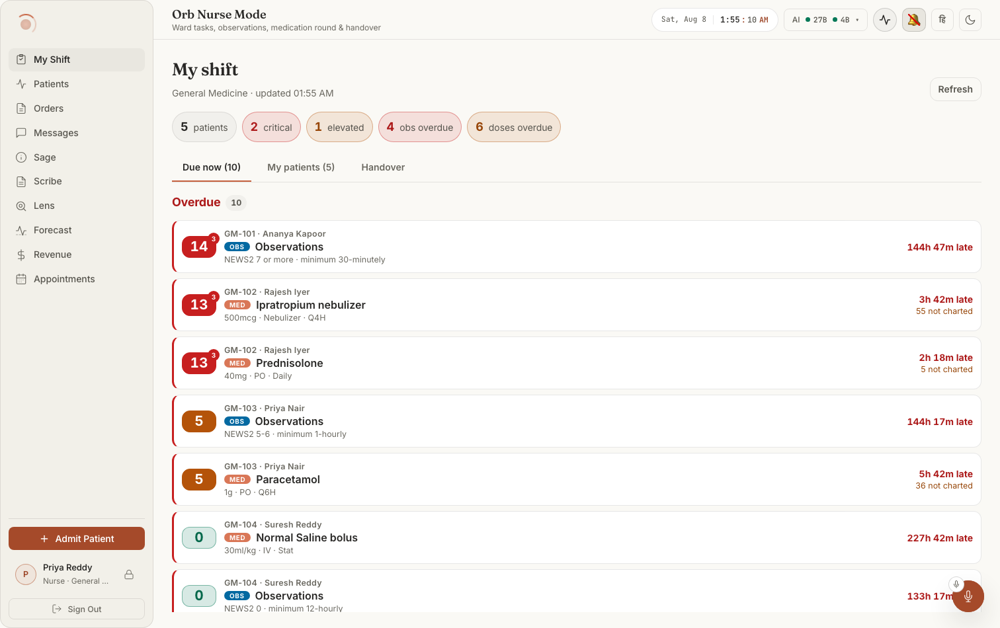
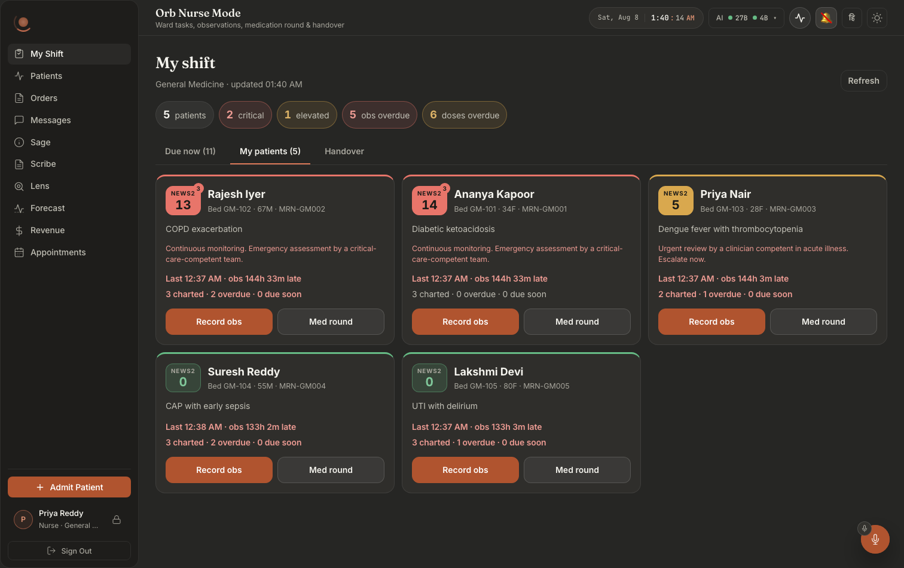

# Screen map 08: Nurse, the shift board

**What this is.** An index of every visible thing on the nurse's shift board and the exact code
that puts it there. Read an entry, then open the file at the line it names. Every citation below
was opened and checked at that line.

**Scope.** `src/pages/panels/nurse/NursePanel.tsx` (the whole file, 1–413) and the three surfaces
it renders: `News2Badge.tsx`, `HandoverSheet.tsx` (the third tab, rendered inline), and
`MedRoundSheet.tsx` (the modal a med task opens). `ObsEntrySheet.tsx`, the modal an obs task
opens, is covered here only as far as its entry point, its identity line and its exit behaviour;
it is a full bedside data-entry screen of its own and deserves its own file. The
`AdministerModal` that `MedRoundSheet` opens is the *same* modal the Vigil chart uses and belongs
to that screen's map.

**How to get to this screen.** Left nav → **My Shift**. The nav entry is declared at
`src/pages/ClinicianShell.tsx:33`, `id: 'shift', label: 'My Shift', pillar: 'Nurse Mode'`, with
a clipboard-with-a-tick SVG at `:35-37`. The panel is lazily imported at
`src/pages/ClinicianShell.tsx:122` and mounted at `src/pages/ClinicianShell.tsx:758-761`:

```
{shouldRenderPanel('shift') && (
  <div id={`panel-shift`} role="tabpanel" aria-labelledby={`nav-shift`} ...>
    <PanelErrorBoundary label="shift"><NursePanel /></PanelErrorBoundary>
```

`NursePanel` takes **no props at all** (`NursePanel.tsx:105`). Everything on this screen comes
from one API call.

**Who sees the tab.** Per-role tab lists at `src/pages/ClinicianShell.tsx:375-397`. `'shift'`
appears in exactly one list, `case 'nurse'` at `:366`, and it is **first**, so because the
shell opens `accessibleTabs[0]` (`ClinicianShell.tsx:505`) **this board is the landing screen for
every nurse**. No other role can reach it; a doctor, admin or pharmacist has no My Shift tab and
no route to `NursePanel`.

**Layout in one sentence.** Top to bottom in a single column (`.orb-panel.nurse-panel`, root at
`NursePanel.tsx:214`, flex-column with a 16px gap at `NursePanel.css:18-22`): the title block with
a Refresh button on the right, a wrapping strip of five count pills, a three-tab strip, then any
banners, then whichever of the three views is selected.

---

## What it looks like



**Notice that this is a *task* list, not a patient list.** Every row leads with a NEWS2
badge on the left edge, then the bed and patient as small grey text, then an **OBS** or
**MED** type chip, then the order detail, and the lateness is right-aligned in red. The
patient is context; the task is the subject. The five count pills above the tab strip
(patients / critical / elevated / obs overdue / doses overdue) are the whole shift on one
line. Dark twin: `nur001-02-shift-dark.png`.



**Notice** that the second tab re-cuts the same data by bed, and that each card carries the
escalation *sentence* NEWS2 mandates at that score, "Continuous monitoring. Emergency
assessment by a critical-care-competent team.", rather than only the number. The two
buttons at the foot of every card, **Record obs** and **Med round**, are the only entry
points to the two bedside sheets documented in screen map 09.

> The elapsed values in these captures ("obs 144h 33m late", "227h 42m late") are fixture
> arithmetic against a clock six days ahead of the last charted observation, not a UI fault.
> See [`docs/screenshots/INDEX.md`](../../screenshots/INDEX.md).

---

# 1. The header

### "My shift": the page title
**Where:** top-left, the largest text on the screen.
**Rendered by:** `src/pages/panels/nurse/NursePanel.tsx:217`, 
`<h1 className="nurse-panel__title">My shift</h1>`.
**Data from:** nothing. A literal.
**API / Server:** none.
**Change this →** the heading text only. Style at `NursePanel.css:33-39` (`--font-display`,
`--text-xl`, weight 600, −0.02em tracking). It never disappears, it is outside every
`{board && …}` guard, so it is on screen during load, during failure, and offline.

### The department + "updated HH:MM" subtitle
**Where:** small muted line immediately under "My shift".
**Rendered by:** `NursePanel.tsx:218-221`. Two parts:
`{board?.department ? board.department : 'All departments'}` then
`{board ? <> · updated {clockTime(board.generated_at)}</> : null}`.
**Data from:** `board`, which is `offline.data` (`:286`), **not** the raw `liveBoard` state. The
department is `ShiftBoard.department` (`src/api/nurse.ts:94`); the time is formatted by
`clockTime` (`src/pages/panels/nurse/time.ts:23-26`), a `toLocaleTimeString` with 2-digit hour and
minute.
**API:** `GET /api/nurse/board`, `getShiftBoard()` at `src/api/nurse.ts:142-144`. It takes **no
arguments and sends no query string**, deliberately (`:134-141`).
**Server:** `server/routes/nurse_routes.py:62-124` `get_board`. The department is
`department_scope(user)` at `:80` → `server/permissions.py:192-219`, which reads
`user["department"]` off the **authenticated user row** and returns `None` for a blank one.
`generated_at` is `_iso(now)` in `server/services/nurse_shift_service.py:618`.
**Change this →** the ward name a nurse sees, and how stale the board *claims* to be. Reading
**"All departments"** does not mean the nurse chose a wide scope, there is no such control on
this screen (`NursePanel.tsx:224-227` explains why). It means the signed-in user has **no
department on record**, and that account is genuinely reading every admitted patient in the
hospital; the same condition is recorded as `hospital_wide: true` in the audit row at
`nurse_routes.py:119`. The fix is to set a department on the user, not to touch this screen.
The "updated" time is the *server's* clock at build time, so if it lags your watch by minutes the
board is stale, but the offline banner (§4.1), not this line, is what says so loudly.

### "Refresh" / "Refreshing…" button
**Where:** top-right of the header, opposite the title.
**Rendered by:** `NursePanel.tsx:229-236`; the label is `{loading ? 'Refreshing…' : 'Refresh'}`
at `:217`, and `disabled={loading}` at `:216`.
**Data from:** the `loading` state (`:107`), set true at the top of `load()` unless called with
`{quiet:true}` (`:116`) and false in the `finally` (`:124`).
**API / Server:** as above, it calls `load()` with no options, so it is the *loud* refresh.
**Change this →** the button text flips to "Refreshing…" and greys out (disabled styling at
`NursePanel.css:251-256`) for the duration of the request; if there is no board yet, the
"Loading your shift…" line (§4.4) appears at the same time. This is the only refresh a nurse can
trigger. The board **also** refreshes itself silently every 60 seconds, `REFRESH_MS = 60_000`
at `:106`, the interval at `:293`, and that timer is **paused whenever either sheet is open**
(`if (obsFor || roundFor) return` at `:293`), so a board never re-renders under a nurse
mid-entry. It also refetches the instant the device reconnects (`onReconnect` at `:284`).

---

# 2. The count strip: five pills

**Where:** a wrapping row of rounded pills directly under the header.
**Rendered by:** `NursePanel.tsx:240-258`, a `<div className="nurse-totals" role="status">`.
Layout at `NursePanel.css:53-57` (flex, wraps); each pill at `:59-69` (`--radius-full`, glass
background, hairline border); the number inside is `<strong>` at `:71-76` (tabular numerals so
the digits do not jitter between refreshes).
**Whole strip disappears when:** `board` is null, the strip is wrapped in `{board && (…)}` at
`:222`. So during the very first load, and on a cold offline start with no cached copy, there are
no pills at all.

Every one of these five numbers is computed **server-side** in
`server/services/nurse_shift_service.py:621-628` and shipped in `ShiftBoard.totals`
(`src/api/nurse.ts:96-102`). Nothing on the client recounts them.

### "N patients"
**Where:** first pill.
**Rendered by:** `NursePanel.tsx:242-244`.
**Data from:** `board.totals.patients`.
**Server:** `nurse_shift_service.py:623`, `len(cards)`, one card per row returned by the patient
query at `:247-257`: `patients p JOIN admissions a ON a.patient_id = p.id AND a.status='active'`
where `p.status = 'admitted'`, plus `AND a.department = ?` when the user is ward-scoped
(`:250-252`).
**Change this →** the count of patients on your ward. It never has a colour, it has no
`--danger`/`--warn` modifier. It falls when a patient is discharged (either `patients.status`
leaves `'admitted'` or the `admissions` row stops being `'active'`), and it is the same number
shown in the "My patients (N)" tab label. A patient with no admission row at all is invisible to
this whole screen.

### "N critical"
**Where:** second pill.
**Rendered by:** `NursePanel.tsx:245-247`. The class is
`` `nurse-total ${board.totals.critical ? 'nurse-total--danger' : ''}` ``, the tint is applied
**only when the number is non-zero**.
**Data from:** `board.totals.critical`.
**Server:** `nurse_shift_service.py:624`, cards whose `news2.level == 'critical'`. The level
comes from `compute_news2` (`server/services/vigil_service.py:234`), banded at `:334-339`:
`score >= 7 → critical`.
**Change this →** a zero reads as a plain grey pill; the moment it becomes 1 the pill takes a 12%
red wash with a 40% red border and the digit turns `--status-danger-text`
(`NursePanel.css:78-82`). The score behind it is recomputed from the patient's **latest stored
vitals row** on every board build (`nurse_shift_service.py:537`, `:382-395`), it is not a stored
verdict, so fixing a bad vitals row changes this pill on the next refresh.

### "N elevated"
**Where:** third pill.
**Rendered by:** `NursePanel.tsx:248-250`, tinted amber when non-zero
(`nurse-total--warn`, `NursePanel.css:84-88`).
**Data from:** `board.totals.elevated`.
**Server:** `nurse_shift_service.py:625`, level `'elevated'`, `vigil_service.py:336`:
`score >= 5 or any_param_3`.
**Change this →** amber pill. The `or any_param_3` half is the one people miss: a patient whose
aggregate is 3 but who has **one** parameter scoring 3 lands here, not in "stable", and gets the
small red "3" flag on their badge (§6.1).

### "N obs overdue"
**Where:** fourth pill.
**Rendered by:** `NursePanel.tsx:251-253`, **red** when non-zero.
**Data from:** `board.totals.obs_overdue`.
**Server:** `nurse_shift_service.py:626`, cards with `obs_overdue` true. That flag is set at
`:536`: `obs_minutes_until_due is None or obs_minutes_until_due < 0`. There is **no grace period**
on observations, unlike medications.
**Change this →** red pill. It counts *patients*, not readings. Note the `is None` half: an
admitted patient with **no vitals row at all** has no due time and is counted as overdue by
definition (`:535` says so in a comment), so admitting a patient and not taking obs makes this
number go up immediately, and their task row reads "Not recorded" rather than a lateness.

### "N doses overdue"
**Where:** fifth pill.
**Rendered by:** `NursePanel.tsx:254-256`, **amber** when non-zero (`nurse-total--warn`), a
deliberate step down from the red used for obs.
**Data from:** `board.totals.meds_overdue`.
**Server:** `nurse_shift_service.py:626` sums each card's `meds_overdue` (`:561`), which counts
med tasks with `overdue` true. That flag is at `:463`:
`overdue = minutes_until is not None and minutes_until < -15`.
**Change this →** amber pill counting *doses across all patients*, not patients. The **15-minute
grace** is the thing to know: a dose one minute past its derived due time is not counted here and
does not colour anything red, it appears in the "Due within 30 minutes" section instead. Widen
that window at `:463-464` and the pill (and the whole Overdue section) empties out.

---

# 3. The three-tab strip

**Where:** a row of three text tabs under the pills, with a hairline rule beneath the whole strip.
**Rendered by:** `NursePanel.tsx:265-290`. The container is
`<nav className="nurse-views" role="tablist" aria-label="Nurse views">` at `:247-252`; the labels
come from the literal array at `:253-257` and each tab is the `<button role="tab">` at `:258-271`.
Style: strip at `NursePanel.css:91-95`, tab at `:97-108` (min-height `--tap-min`, i.e. a 44px
glove-friendly target), hover at `:110`, active at `:112-115` (`--text-primary` plus a 2px
`--accent-gold` underline).
**Data from:** the `view` state (`NursePanel.tsx:109`), initial `'tasks'`.
**API / Server:** none, switching tabs re-renders what is already loaded and fires no request.

### "Due now (N)" tab
**Rendered by:** the array entry at `NursePanel.tsx:272`, 
`` `Due now${overdueTasks.length ? ` (${overdueTasks.length})` : ''}` ``.
**Data from:** `overdueTasks` (`:324`) = `tasks.filter(t => t.overdue)`.
**Change this →** the bracketed count is the **overdue count only**. Tasks that are merely due
soon are on this tab but are not in its number, so "Due now" with no bracket can still open onto a
populated screen. When nothing is overdue the brackets vanish entirely (not "(0)").

### "My patients (N)" tab
**Rendered by:** `NursePanel.tsx:273`, `` `My patients${board ? ` (${board.totals.patients})` : ''}` ``.
**Change this →** same number as the first pill. Before the board loads the brackets are absent.

### "Handover" tab
**Rendered by:** `NursePanel.tsx:274`. Never carries a count.
**Change this →** opens the I-PASS list (§8). Note there is no badge for how many patients are
still un-handed-over, that count lives *inside* the tab (§8.1).

### Keyboard behaviour of the strip
**Rendered by:** `onKeyDown={rovingTabKeyDown(NURSE_VIEWS, view, setView, id => `nurse-tab-${id}`)}`
at `NursePanel.tsx:269`, with `NURSE_VIEWS` at `:39` and `tabIndex={view === id ? 0 : -1}` at
`:265`.
**Data from:** `src/lib/tablist.ts:19-43`, the shared roving-tabindex handler, also used by the
shell's pillar rail.
**Change this →** ←/→/↑/↓ move between tabs and wrap around; Home/End jump to first/last
(`tablist.ts:30-36`); the strip holds exactly **one** Tab stop. Break `NURSE_VIEWS` ordering at
`:39` and the arrows move in an order that does not match the visible strip.

---

# 4. Banners, notices and the load states

These sit between the tab strip and the selected view, in this order.

### 4.1 The staleness banner
**Where:** full-width block directly under the tab strip, red-flavoured, with a dot on the left.
**Rendered by:** `NursePanel.tsx:292`, `<OfflineBanner snapshot={offline} what="shift board" />`
→ `src/components/OfflineBanner.tsx:64-135`.
**Data from:** the `offline` snapshot built at `NursePanel.tsx:282-285`:
`useOfflineSnapshot('nurse:board', liveBoard, { liveFailed: !!error, onReconnect: … })` →
`src/hooks/useOfflineSnapshot.ts:68-131`.
**API / Server:** none of its own.
**Change this →** four distinct screens:
* **Live**, `OfflineBanner.tsx:77` returns `null`. Nothing renders at all.
* **Offline with data**, heading **"Offline, not live"** (`:83`) and the line "Showing the
  shift board saved at **HH:MM**, **N minutes old**." (`:103-107`); the age words come from
  `ageInWords` (`:47-58`) and re-render every 20s (`TICK_MS`, `:40`, effect `:71-75`).
* **Network up, Orb not answering**, heading **"Can't reach Orb, not live"**, same body. The
  switch is `unreachable`, set at `useOfflineSnapshot.ts:103` from `online && liveFailed`, and
  `liveFailed` is this panel's own `error` state. Different words because the fix is different:
  walk to the nurses' station vs. call IT.
* **Cold offline start, nothing cached**, "There is **no saved copy** of the shift board on this
  device" (`:111-117`).
  In every degraded case the third paragraph (`:120-132`) states that observations, doses, notes
  and handovers are **refused outright, never queued**, which is literally true, see
  `src/lib/offline/writeGuard.ts:43-48`.
  The board underneath is genuinely usable while this banner shows, because `board` is
  `offline.data` (`NursePanel.tsx:158`), the panel deliberately renders the *snapshot*, never
  `liveBoard`, so a cached board can never appear without this banner above it.

### 4.2 The green confirmation flash
**Where:** a green-tinted notice below the banner, for six seconds.
**Rendered by:** `NursePanel.tsx:294`, `{flash && <div className="nurse-note nurse-note--ok" role="status">{flash}</div>}`.
Style `NursePanel.css:165-177` + `:191-195`.
**Data from:** the `flash` state (`:113`), written by `showFlash` (`:160-163`) which clears itself
after `6000`ms. Two callers:
* after an observation is recorded, `:388-390`, text
  `"Observations recorded for {name}, NEWS2 {raw_news2} ({level}). {schedule.response}"`. The
  score and the escalation sentence are the **server's**, from
  `nurse_shift_service.record_observation` (`:987-993`) and `obs_schedule` (`:117-153`).
* after a dose is charted, `:403-407`, `"{drug_name} charted as given."` or
  `"… charted as not given."`, from the `AdministrationRecord` the eMAR write returned.
**Change this →** the sentence a nurse reads immediately after closing a sheet. The obs variant is
the only place on this board the RCP escalation *response* text appears outside a patient card.
It is `role="status"` (polite), so a screen reader announces it without interrupting.

### 4.3 The red error notice
**Where:** below the flash.
**Rendered by:** `NursePanel.tsx:299`, 
`{error && offline.online && <div className="nurse-note nurse-note--danger" role="alert">{error}</div>}`.
**Data from:** `error` state (`:108`), set in the `catch` of `load()` at `:122` to the thrown
message, or the literal fallback `'Could not load the shift board'`.
**API / Server:** the message is whatever `apiFetch` built (`src/api/client.ts:203-256`). For a
role missing `patient.read_all` or `vitals.read` the server answers 403 with
`{"error":"permission_denied","message":"Insufficient permissions", …}`
(`server/permissions.py:435-443`), and `apiFetch:210-224` surfaces `detail.message`, so the
notice reads **"Insufficient permissions"**. In practice only a nurse ever reaches this screen
(`ClinicianShell.tsx:393`) and the nurse role holds both permissions
(`server/permissions.py:117-134`), so the 403 path is reachable only after a role change.
**Change this →** the red line. Note the `&& offline.online` guard (`:278-281`): with the device
offline this notice is **suppressed**, because the banner above already says it in words a nurse
can act on and a raw "Failed to fetch" underneath adds only noise. A failure *with* a connection
still shows.

### 4.4 "Loading your shift…"
**Where:** centred, dashed-border box where the content would be.
**Rendered by:** `NursePanel.tsx:301`, `{loading && !board && <p className="nurse-empty">Loading your shift…</p>}`.
Style `NursePanel.css:154-162` (dashed `--border-subtle`, muted, centred).
**Change this →** shows only on the **first** load, the `!board` half means a manual Refresh with
a board already on screen shows "Refreshing…" on the button and leaves the board in place. The
60-second background refresh uses `{quiet:true}` (`:293`) and never sets `loading` at all
(`:116`), so the board never flashes on its own.

---

# 5. "Due now": the task list (default view)

**Where:** the whole area below the banners when the first tab is selected.
**Rendered by:** `NursePanel.tsx:303-330`, a
`<div className="nurse-section" id="nurse-panel-tasks" role="tabpanel" aria-labelledby="nurse-tab-tasks">`.
**Data from:** `tasks` (`:323`) = `buildTasks(board)` (`:158-201`), split into
`overdueTasks` (`:324`) and `soonTasks` (`:325`, `!t.overdue && t.dueSoon`).

## 5.0 What makes a task exist at all

`buildTasks` (`NursePanel.tsx:57-103`) flattens the per-patient board into one cross-patient list.
Two rules decide what is on this screen:

* **Every patient always contributes exactly one Observations task**, pushed unconditionally at
  `:61-74`. There is no filter. Obs tasks that are neither overdue nor due soon still exist in
  `tasks`, they just fall out of both rendered sections (`:324-325`), so they are invisible here
  while still counting toward nothing.
* **Medications contribute a task only if they pass two filters** (`:75-92`):
  `:79` drops `prn`, `continuous` and `unscheduled` orders outright, "they are real, but they are
  not things the nurse *owes* at a time"; `:80` drops anything that is neither `overdue` nor
  `due_soon`. So a q6h paracetamol due in four hours is simply not on this tab. It is still on the
  patient's med round (§9).

Sort order (`:94-102`): **deterioration first**, `critical(0) < elevated(1) < stable(2)`, with a
missing `news2` ranking 3 (last), then by `minutesUntilDue` ascending, nulls treated as `1e9` and
sorted last. A late paracetamol on a stable patient can never outrank obs on someone scoring 9.

**Change this →** reorder `rank` at `:94` and the entire visual priority of the ward inverts.
Remove the `:79` filter and every PRN order on the ward appears as a task; remove `:80` and every
scheduled dose for the next 24 hours floods in.

### 5.1 "Overdue" section heading + its count chip
**Where:** red-text heading above the first group of rows.
**Rendered by:** `NursePanel.tsx:310-312`, 
`<h2 className="nurse-section__title nurse-section__title--danger">Overdue<span className="nurse-section__count">{overdueTasks.length}</span></h2>`.
Style: heading `NursePanel.css:124-131`, the danger colour at `:133`, the pill-shaped count chip at
`:135-145`.
**Data from:** `overdueTasks.length`.
**Change this →** the heading text turns `--status-danger-text` and carries a grey rounded chip
with the count. The **entire section, heading, chip and rows, disappears** when
`overdueTasks.length === 0` (`:290`). Its number always equals `totals.obs_overdue` +
`totals.meds_overdue` from the pills, because both flags come from the same server fields.

### 5.2 "Due within 30 minutes" section heading + count chip
**Rendered by:** `NursePanel.tsx:318-320`. Same markup, **without** the `--danger` modifier, so
the heading stays `--text-primary`.
**Data from:** `soonTasks.length`.
**Change this →** disappears entirely at zero (`:298`). The "30 minutes" in the label is a
hard-coded string; the actual window is server-side and is **not symmetric between the two task
kinds**: obs are `0 <= minutes <= 30` (`nurse_shift_service.py:549`) but meds are
`-15 <= minutes <= 30` (`:464`). So a dose 10 minutes late lands *here*, under a heading that says
"due within 30 minutes", showing "10m late" in amber. Change `:463-464` and both the heading's
truthfulness and the Overdue section's population move together.

### 5.3 "Nothing overdue or due in the next 30 minutes."
**Where:** centred dashed box where the sections would be.
**Rendered by:** `NursePanel.tsx:305-307`, shown when **both** lists are empty.
**Change this →** this is the good state, not an error state. It does not mean the board is empty
"My patients (N)" can read 12 while this says nothing is due.

### 5.4 The task row (the tap target)
**Where:** each row of the two lists. Full-width, at least 44px tall, with a 3px colour bar down
the left edge.
**Rendered by:** `NursePanel.tsx:183-211`, `renderTaskRow`. The row is a `<button>` inside an
`<li>` (`:166-171`), so the whole row is one keyboard-reachable target with a visible focus ring
(`NursePanel.css:258-265`).
**Data from:** one `Task` (`:42-53`).
**Change this →** clicking anywhere on the row calls `openTask` (`:356-359`): an `obs` task sets
`obsFor` and opens the observation sheet; a `med` task sets `roundFor` with that
`medication_id`, which opens the med round **already focused on that drug**
(`MedRoundSheet.tsx:53-55`). Both also pause the 60-second refresh (`:293`).

### 5.5 The overdue / due-soon left bar
**Where:** the 3px vertical stripe on the left edge of a row.
**Rendered by:** the className at `NursePanel.tsx:187`, 
`` `task-row ${task.overdue ? 'task-row--overdue' : task.dueSoon ? 'task-row--soon' : ''}` ``.
Base border at `NursePanel.css:349-363` (`border-left: 3px solid var(--border-subtle)`), red at
`:367`, amber at `:368`.
**Change this →** red bar = overdue, amber bar = due soon, grey = neither (unreachable in the
rendered sections, but reachable if you loosen the `:324-325` filters). The bar is the fastest
scan signal on the screen and it is the **only** thing colour-coding the row body itself, the
row background does not change.

### 5.6 The NEWS2 badge on a task row
**Where:** leftmost element inside the row.
**Rendered by:** `NursePanel.tsx:190`, `<News2Badge news2={task.patient.news2} labelled={false} />`
→ `src/pages/panels/nurse/News2Badge.tsx:19-42`. See §6.1 for the badge's full anatomy.
**Change this →** `labelled={false}` (`:172`) removes the small "NEWS2" caption above the number,
so on a dense task row you see just the integer on a coloured tile. Flip it to `true` and every
row grows taller.

### 5.7 "Bed · Patient name" line
**Where:** small muted caption, first line of the row body.
**Rendered by:** `NursePanel.tsx:192-194`, 
`{task.patient.bed ? `${task.patient.bed} · ` : ''}{task.patient.name}`.
**Data from:** `NursePatientCard.bed` / `.name` (`src/api/nurse.ts:68-70`).
**Server:** `p.bed`, `p.name` selected at `nurse_shift_service.py:248` and copied onto the card at
`:560-563`.
**Change this →** with no bed recorded the row shows the bare name with no leading separator. Note
this is `bed` (a label like "GM-1"), not `ward` and not `department`, `ward` is fetched
(`api/nurse.ts:71`) but **never rendered anywhere on this screen**.

### 5.8 The "OBS" / "MED" kind chip
**Where:** a small uppercase pill immediately left of the task title.
**Rendered by:** `NursePanel.tsx:195-199`, 
`<span className={`task-row__kind task-row__kind--${task.kind}`}>{task.kind === 'obs' ? 'Obs' : 'Med'}</span>`.
Style `NursePanel.css:394-405`: uppercase, 0.62rem, `--status-on-fill` text on a filled
background, **blue** (`--status-info`) for obs at `:404`, **warm accent** for med at `:405`.
**Data from:** `Task.kind`, set literally at `NursePanel.tsx:63` (`'obs'`) and `:83` (`'med'`).
**Change this →** the two colours are the only way to tell the two task types apart at a glance
once you are past the badge. They are filled chips, so the text token must stay `--status-on-fill`
(the no-opacity rule, `NursePanel.css:9-13`).

### 5.9 The task title
**Where:** the largest text in the row, right of the kind chip.
**Rendered by:** `NursePanel.tsx:199`, `{task.title}`.
**Data from:** `Task.title`, the literal `'Observations'` for obs tasks (`:68`), or
`m.drug_name` for med tasks (`:89`).
**Server:** `drug_name` is selected at `nurse_shift_service.py:284` and returned at `:484`.
**Change this →** the drug name a nurse reads before walking to a bedside. It is passed straight
through with no normalisation on this screen.

### 5.10 The task detail line
**Where:** small muted line under the title, truncated with an ellipsis if too long
(`NursePanel.css:407-413`).
**Rendered by:** `NursePanel.tsx:201`, `{task.detail}`.
**Data from:** two different constructions:
* **obs** (`:69-73`): `` `${p.obs_band} · minimum ${…}-hourly|…-minutely` ``, e.g.
  "NEWS2 5-6 · minimum 1-hourly". The band string is the server's
  (`nurse_shift_service.py:101-153`); the hourly/minutely wording is computed **client-side** by
  dividing `obs_interval_minutes` by 60 and rounding.
* **med** (`:90`): `[m.dosage, m.route, m.frequency].filter(Boolean).join(' · ')`, e.g.
  "500 mg · PO · QDS". Any of the three that is null simply drops out.
**Change this →** for obs, the band label and the RCP minimum interval; the four bands are the
tuples at `nurse_shift_service.py:101-109` plus the 12-hourly zero band (`:111`, `:149-153`) and
the 60-minute single-parameter-3 override (`:114`, `:135-140`). Editing that table changes both
this line **and** when obs go overdue at all, because `obs_due_at` is `last_obs_at + interval`
(`:529-531`).

### 5.11 The lateness reading ("40m late" / "in 2h 10m" / "Not recorded")
**Where:** right-aligned, bold, tabular-numeral text at the far right of the row.
**Rendered by:** `NursePanel.tsx:204`, 
`{relativeMinutes(task.minutesUntilDue) || 'Not recorded'}`.
**Data from:** `relativeMinutes` (`src/pages/panels/nurse/time.ts:12-20`): returns `''` for
null/undefined, `'now'` under a minute, otherwise `"{h}h {m}m late"` or `"in {h}h {m}m"`. The
empty string falls through the `||` to the literal **"Not recorded"**.
**Server:** `obs_minutes_until_due` at `nurse_shift_service.py:544-546`, `minutes_until_due` for
meds at `:459`, both `round((due_at - now)/60)` against the **server's** clock at build time.
**Change this →** colour tracks the row modifier: `--status-danger-text` on an overdue row,
`--status-warn-text` on a due-soon row, `--text-secondary` otherwise
(`NursePanel.css:424-432`). **"Not recorded" appears only on an obs task for a patient with no
vitals row at all**, that is the `minutesUntilDue === null` case, and per
`nurse_shift_service.py:548` such a patient is unconditionally overdue, so this reads as a red
"Not recorded" in the Overdue section. A med task can never show it, because a med with a null
due time fails the `:80` filter and never becomes a task. Also note this number ages only on
refresh, the clock is the server's, computed once per board build, which is precisely why the
60-second timer at `:293` exists ("so lateness on screen stays true", `:288`).

### 5.12 "N not charted" (the missed-slot marker)
**Where:** small amber line under the lateness reading, right-aligned.
**Rendered by:** `NursePanel.tsx:205-207`, 
`{task.med?.missed_slots ? <span className="task-row__missed">{task.med.missed_slots} not charted</span> : null}`.
Style `NursePanel.css:434-438` (`--status-warn-text`).
**Data from:** `MedTask.missed_slots` (`src/api/nurse.ts:57`).
**Server:** `nurse_shift_service.py:456-462`. When the derived due time is already in the past the
service **rolls it forward to the current dosing slot** and records how many slots it skipped:
`skipped = int((now - due_at) / interval)`. The comment at `:445-448` says why, anchoring on an
order started three days ago would otherwise report the next dose as three days late and paint the
whole board red.
**Change this →** appears only on med tasks and only when a scheduled order has slots between its
anchor and now with no `'given'` administration recorded. On a ward that charts every dose it is
always absent. A non-zero value means doses are being given but not charted, or not given, 
exactly the gap a shadow-mode pilot is looking for. Delete the roll-forward at `:446-450` and
lateness readings become cumulative ("4320m late") instead.

### 5.13 The provenance footnote
**Where:** small muted paragraph at the very bottom of the tab.
**Rendered by:** `NursePanel.tsx:324-328`: "Observation intervals follow the RCP NEWS2 escalation
table. Medication due times are derived from each order's frequency and the last charted dose, 
Orb holds no prescriber-authored administration schedule."
**Data from:** literal.
**Change this →** the honesty statement for this entire tab, and it is accurate: see the module
docstring at `nurse_shift_service.py:19-29` ("DERIVED, NOT PRESCRIBED"). It renders even when both
sections are empty, because it sits outside both `{… > 0 && …}` guards. It never disappears while
the tasks tab is selected.

---

# 6. "My patients": the patient card grid

**Where:** a responsive grid of cards, `minmax(300px, 1fr)` auto-fill, collapsing to one column
below the phone breakpoint (`NursePanel.css:441-446`, `:1102`).
**Rendered by:** `NursePanel.tsx:825-937`.
**Data from:** `board.patients` in **server order**, the client does not re-sort this list. The
order is set by `_priority` at `nurse_shift_service.py:601-613` and applied at `:615`:
sickest level first, then obs-overdue first, then most meds overdue, then soonest obs due (a
patient with no obs at all is forced to `-10_000` so they sort with the most overdue, `:599`),
then bed label.

### 6.0 "No admitted patients in this scope."
**Rendered by:** `NursePanel.tsx:334`, when `board.patients.length === 0`.
**Change this →** the empty state for a real, successful, empty board. It is worded "in this
scope" on purpose, it distinguishes an empty ward from a failed fetch (which shows §4.3) and from
an offline cold start (which shows §4.1's "no saved copy" variant).

### 6.1 The NEWS2 badge (full anatomy)
**Where:** top-left of each patient card, and, unlabelled, on every task row and every handover
row.
**Rendered by:** `src/pages/panels/nurse/News2Badge.tsx:19-42`. Called from
`NursePanel.tsx:339` (labelled, on the card), `NursePanel.tsx:190` (unlabelled, task row),
`HandoverSheet.tsx:149` (unlabelled, handover row) and `ObsEntrySheet.tsx:473` (`size="lg"`).
**Data from:** the `News2` object (`src/api/nurse.ts:16-26`).
**Server:** `server/services/vigil_service.py:234-…`, returned at `:375-386`.
It has four visible parts:
* **"NEWS2" caption**, `News2Badge.tsx:38`, shown only when `labelled` is true (default).
  Style `NursePanel.css:282-288`.
* **The number**, `News2Badge.tsx:39`, `{news2.raw_news2}`, the **integer RCP aggregate**, never
  the 0-1 `score`. The docstring at `:3-11` and `vigil_service.py:341-347` both insist on this:
  `score` is a normalised index, not a probability, and must not be read as one at a bedside.
* **The tile colour**, `` className={`news2 news2--${size} news2--${news2.level}`} `` at `:31`.
  `--critical` is a **solid** `--status-danger` fill (`NursePanel.css:302-307`), `--elevated` a
  solid `--status-warn` fill (`:309-314`), `--stable` a 16% green wash with green text
  (`:316-320`).
* **The small red "3" flag**, `News2Badge.tsx:40`, an absolutely-positioned circle at the
  top-right corner (`NursePanel.css:325-339`), rendered only when `news2.single_param_3`. It
  carries `aria-label="Single parameter scores 3"`.
**The no-score state:** when `news2` is null the early return at `:20-27` renders a grey badge
showing **", "** with the native tooltip "No observations recorded". That is what an admitted
patient with no vitals row looks like.
**Its tooltip:** `:32-36` builds a `title` of
`"NEWS2 {raw} ({level})"`, plus `" · a single parameter scores 3"` when flagged, plus
`" · SpO₂ Scale 2"` when `spo2_scale === 2`.
**Change this →** the single most-scanned element on the screen. Two things worth knowing: the
"3" flag is the case a scan for big numbers misses (a patient can sit at aggregate 3 and need
urgent review, `vigil_service.py:336` promotes them to `elevated` for exactly this reason), and
the **Scale 2 mention appears only in the tooltip**, there is no visible on-screen marker for a
COPD patient on this board, though the observation sheet does show one (`ObsEntrySheet.tsx:367-371`).

### 6.2 The card's top colour bar
**Where:** a 3px stripe across the top edge of each card.
**Rendered by:** the `<li>` className at `NursePanel.tsx:337`, 
`` `patient-card patient-card--${p.news2?.level ?? 'none'}` ``.
Style `NursePanel.css:448-461`: red for `--critical`, amber for `--elevated`, green for
`--stable`.
**Change this →** with no NEWS2 the class is `patient-card--none`, for which **no rule exists**, 
the card keeps the neutral `--border-subtle` top border from `:455`. So "never scored" and
"scored but unclassifiable" both read as a plain grey card, which is the one level a colour scan
cannot tell from a styled state.

### 6.3 Patient name
**Rendered by:** `NursePanel.tsx:341`, `<span className="patient-card__name">{p.name}</span>`.
Style `NursePanel.css:475-479` (`--text-md`, weight 700).

### 6.4 The identity meta line ("Bed 12 · 74F · MRN00123")
**Rendered by:** `NursePanel.tsx:342-346`, 
`[p.bed && `Bed ${p.bed}`, p.age && `${p.age}${p.sex ? p.sex[0].toUpperCase() : ''}`, p.mrn].filter(Boolean).join(' · ')`.
**Server:** `p.bed`, `p.age`, `p.sex`, `p.mrn` selected at `nurse_shift_service.py:248` and copied
at `:561-566`.
**Change this →** each of the three parts drops out independently when null, separators and all.
`sex` is rendered as a **single uppercase initial glued to the age** ("74F"); a `sex` of "female"
and "F" produce identical output. `age` of `0` is falsy in JS, so a newborn shows neither age nor
sex initial.

### 6.5 Diagnosis line
**Rendered by:** `NursePanel.tsx:350`, `{p.diagnosis && <p className="patient-card__dx">{p.diagnosis}</p>}`.
**Server:** `p.diagnosis`, `nurse_shift_service.py:248` → `:579`.
**Change this →** the whole line disappears when the patient has no diagnosis recorded; the card
simply gets shorter (the grid tracks are `1fr`, so neighbouring cards do not change height).

### 6.6 "Allergies: …" strip
**Where:** amber-washed block inside the card.
**Rendered by:** `NursePanel.tsx:352-356`, rendered only when `p.allergies.length > 0`;
the text is `p.allergies.map(a => a.substance).join(', ')`.
Style `NursePanel.css:491-498` (`--status-warn-text` on a 10% amber wash).
**Server:** `nurse_shift_service.py:315-320`, `patient_allergies` where `status = 'active'`,
attached at `:571`.
**Change this →** this shows **substance names only**, the `reaction` and `severity` fields are
fetched (`src/api/nurse.ts:35-39`) and used elsewhere, but this strip flattens them away. Severity
is *not* reflected here: a severe anaphylaxis and a mild rash look identical on the card. The
severity split only appears once you open the med round (§9.3). Marking an allergy inactive in
`patient_allergies` removes it from this strip on the next refresh.

### 6.7 The escalation response line
**Where:** red small text on the card.
**Rendered by:** `NursePanel.tsx:358-360`, shown only when
`p.news2 && p.news2.level !== 'stable'`.
**Data from:** `p.obs_response`.
**Server:** `nurse_shift_service.py:588` ← `obs_schedule(news2)["response"]` (`:117-153`), the
literal RCP "clinical response to the NEWS trigger" wording, e.g. "Urgent review by a clinician
competent in acute illness. Escalate now." (`:107`) or "Continuous monitoring. Emergency
assessment by a critical-care-competent team." (`:104-105`).
**Change this →** appears only on non-stable patients, so a card either carries a red instruction
or does not. A patient with **no** NEWS2 at all also does not show it, even though the server
computed a response for them ("No NEWS2 on record, take a full set of observations.", the
no-score early return at `:124-129`), the `p.news2 &&` half of the guard at `:340` swallows it.
That sentence is unreachable on this screen.

### 6.8 The observations fact line
**Where:** first bullet of the two-line facts list at the bottom of the card.
**Rendered by:** `NursePanel.tsx:363-365`, 
`<li className={p.obs_overdue ? 'is-late' : ''}>{obsLabel(p.last_obs_at, p.obs_minutes_until_due)}</li>`.
**Data from:** `obsLabel` (`src/pages/panels/nurse/time.ts:52-60`), which produces one of three
strings: `"No observations recorded"` (no `lastObsAt`), `"Last 14:30"` (no due time), or
`"Last 14:30 · next obs in 1h 20m"` / `"Last 14:30 · obs 40m late"`, note the wording switches
between "next obs " and "obs " on the sign of the number (`time.ts:59`).
**Server:** `last_obs_at` is the timestamp of the newest `vitals` row
(`nurse_shift_service.py:265-280`, then `:540`), `obs_minutes_until_due` at `:544-546`.
**Change this →** when `obs_overdue` is true the line goes bold and `--status-danger-text`
(`NursePanel.css:515-518`). The tie-break at `nurse_shift_service.py:276-280` matters here: two
vitals rows at the identical timestamp resolve to the higher `id` (the later write), so a
correction charted at the same instant is the one this line reflects.

### 6.9 The medications fact line
**Where:** second bullet of the facts list.
**Rendered by:** `NursePanel.tsx:366-370`, 
`{p.medications.length === 0 ? 'No medications charted' : `${p.medications.length} charted · ${p.meds_overdue} overdue · ${p.meds_due_soon} due soon`}`,
with `className={p.meds_overdue ? 'is-late' : ''}`.
**Server:** `medications` from `nurse_shift_service.py:283-290` (`status IN ('active','prn')`),
built into tasks at `:540-548`; `meds_overdue` at `:549`, `meds_due_soon` at `:550`.
**Change this →** goes bold red when any dose is overdue. The "N charted" number counts **every**
active or PRN order including continuous infusions and PRNs, so it is routinely larger than
anything the task list shows for that patient, by design. Changing an order's `status` away from
`active`/`prn` (e.g. stopping it) drops it out of this count and out of the med round entirely.

### 6.10 "Record obs" button
**Where:** left of the two buttons at the bottom of the card; the pair share the width equally
(`NursePanel.css:520-526`).
**Rendered by:** `NursePanel.tsx:374-376`, primary style, `onClick={() => setObsFor(p)}`.
**Change this →** opens the observation sheet for this patient (§10). Never disabled, a patient
with no vitals, no diagnosis and no meds can still have obs recorded.

### 6.11 "Med round" button
**Rendered by:** `NursePanel.tsx:923-930`, secondary style,
`onClick={() => setRoundFor({ patient: p, medId: null })}`, and crucially
`disabled={p.medications.length === 0}` at `:927`.
**Change this →** opens the med round with **no drug focused** (`medId: null`), unlike a med task
row which focuses one. It greys out and becomes untappable for a patient with no active orders
(disabled tokens at `NursePanel.css:251-256`), which is why the "No active medications charted"
empty state inside the sheet (`MedRoundSheet.tsx:146-148`) is reachable only via a task row, never
via this button.

---

# 7. Handover: the tab wrapper

**Rendered by:** `NursePanel.tsx:393-397`, a bare
`<div id="nurse-panel-handover" role="tabpanel">` around
`<HandoverSheet patients={board.patients} />`.
**Change this →** `HandoverSheet` receives **only** the patient list. It has no offline snapshot
prop, so, unlike the tasks and patients views, the staleness banner at `:274` is the only thing
dating what it shows.

---

# 8. Inside the Handover tab

**Rendered by:** `src/pages/panels/nurse/HandoverSheet.tsx:34-247`.

### 8.1 "Shift handover" heading and its hint
**Rendered by:** `HandoverSheet.tsx:122` (heading, reusing `.nurse-section__title`) and `:123-126`
(the hint: "I-PASS drafted from each patient's last 12 hours. Review it, add what you are worried
about, and save, the incoming nurse reads the saved note.").
**Change this →** the hint is the only place the 12-hour window is stated to the user. The real
window is `HANDOFF_WINDOW_HOURS` in `server/services/ipass_service.py` (used by `build_ipass`,
`:391`); the two can drift apart because this string is a literal.

### 8.2 "N of M handed over" progress
**Where:** right side of the handover header.
**Rendered by:** `HandoverSheet.tsx:128-130`, `aria-live="polite"`.
Style `NursePanel.css:967-976`.
**Data from:** `handedOver` (`:116`) = `patients.filter(p => saved[p.patient_id]).length`, and
`patients.length`.
**Change this →** this counter is **session-local and in-memory only**. `saved` (`:38`) is
populated at `:102` when a save succeeds and is never seeded from the server, so switching tabs
keeps it (the panel stays mounted) but **a page reload resets it to "0 of M" even though the notes
are safely persisted**. It is a "what have I done in this sitting" tracker, not a ward-state
readout.

### 8.3 "No patients to hand over."
**Rendered by:** `HandoverSheet.tsx:133`, when `patients.length === 0`.

### 8.4 The per-patient accordion header
**Where:** one full-width row per patient; the whole row is a button.
**Rendered by:** `HandoverSheet.tsx:142-160`, with `aria-expanded={isOpen}` and
`aria-controls={`handover-body-${p.patient_id}`}`.
Style `NursePanel.css:990-1003`.
It contains four things:
* **NEWS2 badge**, unlabelled, `:149`.
* **Name**, `:150-151`, style `NursePanel.css:1006`.
* **Meta line**, `:152-154`: `[p.bed && `Bed ${p.bed}`, p.diagnosis].filter(Boolean).join(' · ')`
  with a literal `', '` fallback when both are missing.
* **State text**, `:156-158`: `"Handed over HH:MM"` (via `clockTime`, `time.ts:23-26`) once saved,
  otherwise the literal **"Not handed over"**. Style `NursePanel.css:1015-1016`; it turns green and
  bold on a done item. **It is hidden entirely on phone widths** (`NursePanel.css:1133`).
* **Chevron**, `:159`, a literal `−` when open and `+` when closed, `aria-hidden`.
**Change this →** clicking toggles the row (`toggle`, `:68-72`) and, the **first** time a row is
opened, fires the draft fetch. Re-collapsing and re-expanding does **not** refetch, the guard is
`if (next && !drafts[next])` at `:71`, so a draft is cached for the life of the panel. A saved row
also gets a green left border (`handover__item--done`, `NursePanel.css:988`).

### 8.5 "Drafting handover…"
**Rendered by:** `HandoverSheet.tsx:164`, while `state.status === 'loading'`.
**API:** `GET /api/ipass/{patientId}/draft`, `getIpassDraft` at `src/api/ipass.ts:98-100`.
**Server:** `server/routes/ipass_routes.py:24-35` `get_draft`, guarded by
`require_patient_access("vitals.read", audit_action="ipass_draft_viewed")` (`:27-29`), a
per-patient scope check that 404s rather than 403s for an out-of-ward patient. It calls
`server/services/ipass_service.py:391` `build_ipass`.
**Change this →** the placeholder while one patient's draft assembles. It is per-row, so several
rows can be in different states at once (`drafts` is a map keyed by patient id, `:36`).

### 8.6 The draft error notice and its "Retry" button
**Rendered by:** `HandoverSheet.tsx:165-172`, a red `nurse-note--danger` with `role="alert"`
carrying `state.message` (set at `:63` from the thrown error, or the literal 'Could not draft
handover'), plus a compact ghost **Retry** button that calls `loadDraft(p.patient_id)` again.
**Change this →** the only retry affordance in the handover tab. Nothing retries automatically.

### 8.7 The five I-PASS rows
**Where:** a definition list inside an expanded row.
**Rendered by:** `HandoverSheet.tsx:175-206`, style `NursePanel.css:1031-1057` region.
Each `<dt>`/`<dd>` pair, with the exact server function behind it:
* **"I, Illness severity"** (`:177-178`) ← `sections.illness_severity.text`, built by
  `server/services/ipass_service.py:147-164`, "{severity}, NEWS2 {n} ({level}). Key drivers: …".
* **"P, Patient summary"** (`:181-182`) ← `ipass_service.py:167-193`, name, age/sex, ward/bed,
  primary diagnosis, active problems, allergies (falling back to the literal "NKDA", `:180`).
* **"A, Action list"** (`:185-196`) ← `ipass_service.py:196-236`. Rendered as a `<ul>` of
  `outstanding_items` when there are any, otherwise the literal **"No outstanding actions
  recorded."** (`HandoverSheet.tsx:194`). Items are prefixed "OVERDUE (…)" or "Pending (…)" at
  `ipass_service.py:219-221`, and a severity-driven line is appended at `:225-230` so the list is
  never empty for a sick patient.
* **"S, Situation awareness"** (`:199-200`) ← `ipass_service.py:268-…` (trend, latest vitals,
  contingencies from `:239-266`).
* **"S, Synthesis"** (`:203-204`) ← `ipass_service.py:316-…`.
**Change this →** these five blocks are pure server text; the client renders `.text` verbatim and
does no formatting except the Action list's bullets. `active_medications`, `open_care_bundles`,
`latest_vitals`, `drivers`, `contingencies` and `read_back_required` are all in the payload
(`src/api/ipass.ts:35-75`) and **none of them are rendered here**, only the `text` summaries and
the action bullets.

### 8.8 "What are you worried about?" label + textarea
**Rendered by:** `HandoverSheet.tsx:208-218`. The label reads "What are you worried about? (added
to the handover under your name)"; the textarea is 3 rows with the placeholder "e.g. BP drifting
down since 14:00, recheck within the hour."
Style `NursePanel.css:1059-1082`.
**Data from:** the `notes` map (`:37`), written by `setNote` (`:74-80`).
**Change this →** every keystroke is mirrored to `localStorage` under
`orb:nurse:handover-note:{patientId}` (`noteKey`, `:32`; write at `:77`), and restored into the
form on mount by the effect at `:44-53`. Clearing the box to whitespace **removes** the stored
key (`:78`). The stored copy is deleted after a successful save (`:105`) so it does not reappear
on the next shift. Unlike the observation draft, this note is **not owner-stamped**, see
`ObsEntrySheet.tsx:41-47` for the contrasting session-scoped design.

### 8.9 The save-failure notice
**Rendered by:** `HandoverSheet.tsx:220-222`, red, `role="alert"`, from the `saveError` map set at
`:107-110`.
**Change this →** offline, the text is the writeGuard's sentence, "Cannot save this handover, 
this device is offline. Your entry has not been saved. Reconnect and enter it again."
(`src/lib/offline/writeGuard.ts:43-48`, thrown by `assertOnlineForWrite('save this handover')` at
`HandoverSheet.tsx:91`). The typed note survives that refusal because it is already in
localStorage.

### 8.10 The auto-draft caveat
**Rendered by:** `HandoverSheet.tsx:225-227`, "Auto-drafted from recorded data, read it against
the patient before handing over." Style `NursePanel.css:1094`.

### 8.11 "Save handover" / "Saving…" / "Save again"
**Rendered by:** `HandoverSheet.tsx:228-235`; the label is
`{saving === p.patient_id ? 'Saving…' : isSaved ? 'Save again' : 'Save handover'}` at `:234`, and
`disabled={saving === p.patient_id}` at `:232`.
**API:** `POST /api/ipass/{patientId}/save`, `saveIpass` at `src/api/ipass.ts:103-111`.
**Server:** `server/routes/ipass_routes.py:38-72` `save_draft`, guarded by
`require_patient_access("scribe.create_draft")` (`:43`), persisting via
`server/services/ipass_service.py:456` `save_ipass_handoff` as a scribe note with
`note_format='handoff'`, then writing an `ipass_handoff_saved` audit row (`:55-70`).
**Change this →** on success the row gets its green left border, the state text becomes "Handed
over HH:MM", the progress counter increments and the button relabels to "Save again", a second
save is explicitly allowed and creates another note. What gets sent is the draft's `plain_text`
with the nurse's note appended under a heading (`HandoverSheet.tsx:96-99`):
`"HANDOVER NOTE, {currentUserName()}, {locale date-time}\n{note}\n"`. The author name comes from
`currentUserName()` (`src/api/nurse.ts:198-200`), which falls back to the literal **"this shift"**
when no user is in the stored session. With an empty note the untouched draft is sent (`:100`).

---

# 9. The Medication round sheet (opened from a MED task row or "Med round")

**Rendered by:** `src/pages/panels/nurse/MedRoundSheet.tsx:90-400`, portalled to `document.body`
(`:88`, `:228`) over a 55%-black backdrop (`NursePanel.css:531-542`). Mounted from
`NursePanel.tsx:415-429` whenever `roundFor` is non-null.
Focus is trapped and Escape closes (`useFocusTrap`, `:60`), but `close` (`:59`) is a no-op while
the AdministerModal is open on top.

### 9.1 "Medication round" title + subject line
**Rendered by:** `:100` (title) and `:101-105`, `**{name}** · Bed {bed} · {mrn}`, each trailing
part dropped when null.

### 9.2 Close "×" and "Done"
**Rendered by:** `:107-109` (`aria-label="Close medication round"`) and `:204` (footer ghost
button). Both call `close`.
**Change this →** either one runs `NursePanel.tsx:420`, `setRoundFor(null)` **and** a quiet
`load()`, so the board behind is refreshed with whatever was just charted, and the 60-second timer
resumes.

### 9.3 The allergy banner / NKDA notice
**Rendered by:** `MedRoundSheet.tsx:198-212`. Two mutually exclusive forms:
* with allergies, a `nurse-note` that is **danger** (red, `role="alert"`) if any allergy has
  `severity === 'severe'` (`:166`, `:200-201`), otherwise **warn**; the text is
  `"{substance} ({reaction}), severe"` joined by " · " (`:204-206`).
* with none, a muted "No allergies recorded (NKDA). Confirm with the patient before
  administering." (`:129-131`).
**Change this →** this is the one place `reaction` and `severity` from `patient_allergies` become
visible; the board card (§6.6) shows substances only. It sits **below** the offline banner on
purpose (`:113-115`): whether anything on the screen can be believed has to be read first.

### 9.4 The five group headings and their counts
**Rendered by:** `MedRoundSheet.tsx:218-224`; the groups themselves are built at `:129-164`.
In order: **Overdue** ("Past the derived due time by more than 15 minutes"), **Due now** ("Due
within the next 30 minutes"), **Later this shift** (no hint), **As required (PRN)** ("Available
when indicated, never due, never late"), **Continuous** ("Running infusions and feeds, check, do
not chart on a clock"). Each heading carries a count chip (`:222`,
`NursePanel.css:892-901`) and `.filter(g => g.meds.length > 0)` at `:163` removes empty groups
entirely.
**Change this →** the classification is `schedule_kind` first, then `overdue`, then `due_soon`
(`:140-143`), so a PRN order can never appear in Overdue no matter how long since the last dose,
which is exactly what `parse_frequency` at `nurse_shift_service.py:200-201` enforces server-side
("PRN is checked FIRST and wins outright", `:190-193`). Within a group, rows sort by
`minutes_until_due` ascending with nulls last (`:146-147`).

### 9.5 The med row
**Rendered by:** `MedRoundSheet.tsx:236-344`. Style `NursePanel.css:906-936`; a red left border
when overdue (`:917`), green once charted in this sheet (`:918`).
Its parts:
* **Drug name**, `:241`.
* **Detail**, `:242-244`, `[dosage, route, frequency].filter(Boolean).join(' · ')`.
* **Timing**, `:245-261`. Starts with `dueLabel(med)` (`src/pages/panels/nurse/time.ts:35-49`),
  which is the vocabulary switch: **"As required"**, **"Continuous"**, **"Stat dose given"** /
  **"Stat, give now"**, **"No fixed schedule"**, or `"Due 14:00 · 40m late"`. Then, when present,
  `" · last given {date+time}"` (`:255`) and `" · N earlier dose(s) not charted"` in amber
  (`:258-260`).
* **The unverified block**, `:262-266`: "AI-extracted order, a pharmacist must verify it before
  it can be given." Style `NursePanel.css:926-935`.
**Change this →** `dueLabel`'s whole point (`time.ts:28-34`) is that a med we cannot time must
never look late, the four non-scheduled kinds say so in words instead of borrowing the overdue
vocabulary. `due_basis` (`src/api/nurse.ts:55`) tells you which anchor produced the time, 
`last_given` vs `order_start` vs `stat_pending`/`stat_given`
(`nurse_shift_service.py:447-469`), but **`due_basis` is never rendered anywhere**, so a due
time anchored on an order start (no dose ever charted) is visually identical to one anchored on a
real last dose.

### 9.6 The "Administer" button (and why it greys out)
**Rendered by:** `MedRoundSheet.tsx:192-201`, with `disabled={med.unverified}` at `:183` and the
native tooltip "Blocked: awaiting pharmacist verification" at `:184`.
**Data from:** `MedTask.unverified` (`src/api/nurse.ts:62`).
**Server:** `nurse_shift_service.py:478-480`, 
`med.source in ('llm_extracted','agentic') and not med.verified_by`.
**Change this →** opens `AdministerModal` (`:208-226` → `src/components/vigil/AdministerModal.tsx:109-126`,
titled "Administer medication"), which owns the five-rights summary and the type-the-drug-name
interlock and posts to `/api/emar`. This sheet deliberately owns **no** administration logic
(`MedRoundSheet.tsx:11-25`). Pharmacist-verifying an AI-extracted order is what un-greys the
button; until then `emar_service` would reject the write anyway, and greying it here is what stops
a nurse walking to a bedside to discover that.

### 9.7 "Given" / "Not given" result chip
**Rendered by:** `MedRoundSheet.tsx:187-190`, replaces the Administer button for any med charted
during this sheet's lifetime. Style `NursePanel.css:938-955`.
**Data from:** the `justGiven` map (`:57`), written at `:221` from the record the modal returned.
**Change this →** this is sheet-local, so closing and reopening the round loses the chip, but the
underlying board is refreshed on close (`NursePanel.tsx:420`), so the row's timing line changes
instead. The same record also fires the green flash on the board (§4.2).

### 9.8 "No active medications charted for this patient."
**Rendered by:** `MedRoundSheet.tsx:146-148`, when every group is empty. Reachable only from a med
task row, since the "Med round" card button is disabled at zero meds (§6.11).

### 9.9 The derived-schedule footnote
**Rendered by:** `MedRoundSheet.tsx:210-213`, "Due times are derived from each order's frequency
and the last charted dose … Treat them as a working list, not a prescription."

---

# 10. The Observation sheet: entry and exit only

**Opened by:** an OBS task row (`NursePanel.tsx:174`) or the card's "Record obs" button (`:356`);
mounted at `:973-988`.
**Rendered by:** `src/pages/panels/nurse/ObsEntrySheet.tsx:150-554`, portalled to `document.body`.
Its identity line is `:325-330`, title **"Record observations"** and
`**{name}** · Bed {bed} · {mrn}`.
**API:** `POST /api/nurse/patients/{id}/news2-preview` on every debounced keystroke
(`src/api/nurse.ts:156-173`) and `POST /api/nurse/patients/{id}/observations` on save
(`:186-195`).
**Server:** `server/routes/nurse_routes.py:127-162` and `:165-222`; both hang
`require_patient_access` off the path id (`:134`, `:177`), so the patient is not a scope the
caller can name.
**Change this → (as it affects this board):**
* **Closing without saving**, `onClose` at `NursePanel.tsx:403` sets `obsFor` to null and the
  60-second refresh resumes. The board is *not* reloaded.
* **Saving**, `onRecorded` at `:385-392` closes the sheet, fires the green flash carrying the
  server's NEWS2 and escalation sentence, then reloads quietly. That reload is what makes the
  patient's badge, colour bar, obs fact line, task lateness, "obs overdue" pill and even the
  card's **position in the grid** all change at once, the score feeds `obs_schedule`, which sets
  the next due time, which sets `obs_overdue`, which feeds `_priority`
  (`nurse_shift_service.py:601-613`).
* Recording obs can also make a **task disappear**: a fresh reading pushes `obs_due_at` forward,
  so the patient's obs task leaves both rendered sections until it comes round again.
* The sheet is passed `offline={offline}` (`:382`), the same board snapshot, so a nurse learns
  the round cannot be charted *before* typing six values, not after.

---

# 11. Sent by the server, rendered by nothing

Worth knowing, because a search for these strings in the UI finds nothing:

* **`allergy` on every med task**, `nurse_shift_service.py:509` attaches a full interlock verdict
  (`allow`/`warn`/`block`, plus any carried override) to each med, computed by the same code the
  bedside write runs (`_preview_allergy`, `:398-423`). **No element on this board or in the med
  round renders it**, and `MedTask` in `src/api/nurse.ts:43-63` does not even declare the field.
  A nurse still meets the block, but only at the AdministerModal.
* **`totals.meds_allergy_blocked`**, computed at `nurse_shift_service.py:627` and absent from the
  `ShiftBoard.totals` type at `src/api/nurse.ts:96-102`. There is no sixth pill.
* **`ward`, `department`, `attending_doctor_name`, `on_scale_2`, `obs_due_at`, `obs_band` (on the
  card), `news2.breakdown`, `news2.drivers`, `news2.score`**, all present in the payload; none
  reach this screen. `obs_band` reaches the task detail line (§5.10) but not the patient card;
  `on_scale_2` and `breakdown` are used only inside the observation sheet.

---

## Reverse map contributions

- `src/pages/ClinicianShell.tsx::TABS` → "My Shift" nav tab label; clipboard-with-tick tab icon; "Nurse Mode" pillar grouping
- `src/pages/ClinicianShell.tsx::getAccessibleTabs` → presence of the My Shift tab (nurse only); the shift board being the nurse's landing screen
- `src/pages/ClinicianShell.tsx::ClinicianShell` → shift tab panel mount; mount-on-first-view so the board does not fetch until visited
- `src/pages/panels/nurse/NursePanel.tsx::buildTasks` → every task row's existence; OBS vs MED kind chip; task title; task detail line; exclusion of PRN/continuous/unscheduled meds; exclusion of not-yet-due meds; sickest-first row ordering
- `src/pages/panels/nurse/NursePanel.tsx::NursePanel` → panel root; "My shift" title; department + "updated HH:MM" subtitle; Refresh/Refreshing… button; all five count pills and their danger/warn tints; three-tab strip and its counts; staleness banner mount; green confirmation flash; red error notice; "Loading your shift…"; "Nothing overdue or due in the next 30 minutes."; "Overdue" heading and count chip; "Due within 30 minutes" heading and count chip; RCP/derived-times footnote; "No admitted patients in this scope."; patient card grid; card top colour bar; patient name; identity meta line; diagnosis line; allergies strip; escalation response line; obs fact line; meds fact line; "Record obs" button; "Med round" button and its disabled state; handover tab panel; observation sheet mount; med round sheet mount
- `src/pages/panels/nurse/NursePanel.tsx::renderTaskRow` → task row tap target; overdue/due-soon left bar; unlabelled NEWS2 badge on rows; "Bed · Name" caption; OBS/MED chip; task title; task detail; lateness reading and "Not recorded" fallback; "N not charted" marker
- `src/pages/panels/nurse/NursePanel.tsx::load` → whether any board renders at all; "Refreshing…" label; red error notice text; 60-second silent refresh; refresh-on-reconnect; refresh after a sheet closes
- `src/pages/panels/nurse/NursePanel.tsx::openTask` → obs sheet opening focused on a patient; med round opening focused on one drug
- `src/pages/panels/nurse/NursePanel.tsx::showFlash` → the green "Observations recorded for … NEWS2 N (level). {response}" flash; the "… charted as given/not given." flash; their 6-second lifetime
- `src/pages/panels/nurse/News2Badge.tsx::News2Badge` → NEWS2 tile on task rows, patient cards and handover rows; "NEWS2" caption; the integer score; critical/elevated/stable fill colours; the ", " no-score badge; the red single-parameter-3 corner flag; the badge tooltip including the SpO₂ Scale 2 mention
- `src/pages/panels/nurse/time.ts::relativeMinutes` → "40m late" / "in 2h 10m" / "now" on every task row; the empty string that becomes "Not recorded"
- `src/pages/panels/nurse/time.ts::clockTime` → "updated HH:MM" in the subtitle; "Last HH:MM" on the card; "Handed over HH:MM" in the handover list
- `src/pages/panels/nurse/time.ts::obsLabel` → the observations fact line on every patient card; "No observations recorded"; the "next obs" vs "obs" wording switch
- `src/pages/panels/nurse/time.ts::dueLabel` → med row timing text; "As required"; "Continuous"; "Stat, give now"; "Stat dose given"; "No fixed schedule"; "Due HH:MM · 40m late"
- `src/pages/panels/nurse/HandoverSheet.tsx::HandoverSheet` → "Shift handover" heading and hint; "N of M handed over" counter; "No patients to hand over."; per-patient accordion rows; name and bed/diagnosis meta; "Not handed over" / "Handed over HH:MM"; +/− chevron; the five I-PASS rows; "No outstanding actions recorded."; "What are you worried about?" label and textarea; save-error notice; auto-draft caveat; "Save handover" / "Saving…" / "Save again"
- `src/pages/panels/nurse/HandoverSheet.tsx::loadDraft` → "Drafting handover…"; the draft error notice and Retry button; the I-PASS content itself
- `src/pages/panels/nurse/HandoverSheet.tsx::save` → green done border; "Handed over HH:MM"; progress counter increment; "Save again" relabel; the "HANDOVER NOTE, {author}" block appended to the saved note
- `src/pages/panels/nurse/HandoverSheet.tsx::setNote` → handover note persistence across an interruption; its removal when the box is cleared
- `src/pages/panels/nurse/MedRoundSheet.tsx::MedRoundSheet` → "Medication round" title and subject line; close × and Done; allergy danger/warn banner; NKDA notice; five group headings, hints and count chips; med rows; drug name, detail and timing lines; "N earlier doses not charted"; AI-extracted/unverified block; Administer button and its disabled tooltip; "Given"/"Not given" chip; "No active medications charted for this patient."; derived-times footnote
- `src/pages/panels/nurse/MedRoundSheet.tsx::groups` → which group a dose appears in; empty groups vanishing; within-group ordering by due time
- `src/pages/panels/nurse/ObsEntrySheet.tsx::ObsEntrySheet` → "Record observations" sheet title and subject line (entry point from this board); the board refresh and green flash on save
- `src/pages/panels/nurse/NursePanel.css` → totals pill shape and its danger/warn tints; tab strip underline and active gold rule; section title danger colour and count chip; dashed empty-state boxes; note danger/warn/ok/info colours; button primary/secondary/ghost/disabled states; 44px tap minimum; NEWS2 tile fills and the on-fill text rule; the "3" corner flag; task row left-border colours; OBS blue / MED warm chip fills; lateness text colours; "not charted" amber; patient card grid and top-border colours; allergy strip wash; is-late bold red facts; sheet backdrop and panel; med group and med row styling; handover accordion, done border and hidden-on-phone state text
- `src/components/OfflineBanner.tsx::OfflineBanner` → "Offline, not live" heading; "Can't reach Orb, not live" heading; "Showing the shift board saved at HH:MM" line; the unknown-save-time variant; the "no saved copy" variant; the "nothing can be recorded until you reconnect" paragraph; the banner's total absence when live
- `src/components/OfflineBanner.tsx::ageInWords` → the "N minutes old" reading in the staleness banner
- `src/hooks/useOfflineSnapshot.ts::useOfflineSnapshot` → whether the board renders live or labelled-cached; which staleness heading appears; the cached board on a cold offline start; refetch on reconnect
- `src/hooks/useOfflineStatus.ts::useOfflineStatus` → offline vs unreachable wording; suppression of the red error notice while offline
- `src/lib/tablist.ts::rovingTabKeyDown` → arrow/Home/End navigation of the three-tab strip; the strip holding one Tab stop
- `src/lib/offline/writeGuard.ts::offlineRefusalMessage` → the "Cannot save this handover, this device is offline…" text in the handover save-error notice
- `src/api/nurse.ts::getShiftBoard` → every element on this screen that is not a literal
- `src/api/nurse.ts::currentUserName` → the author name stamped into a saved handover note; the "this shift" fallback
- `src/api/ipass.ts::getIpassDraft` → the five I-PASS rows; "Drafting handover…"; the draft error notice
- `src/api/ipass.ts::saveIpass` → "Handed over HH:MM"; progress counter; "Save again"
- `src/api/client.ts::apiFetch` → the text of the red board-error notice; the "Insufficient permissions" wording on a 403
- `server/routes/nurse_routes.py::get_board` → every patient card, task row and count pill; the department shown in the subtitle; the board failing closed when its phi_access audit row cannot be written
- `server/routes/nurse_routes.py::record_observations` → the recorded NEWS2 and escalation sentence in the green flash; the board changes after saving obs
- `server/routes/nurse_routes.py::preview_news2` → the live score inside the observation sheet (no element on the board itself)
- `server/routes/ipass_routes.py::get_draft` → the five I-PASS rows
- `server/routes/ipass_routes.py::save_draft` → handover save success and its "Handed over HH:MM" stamp
- `server/services/nurse_shift_service.py::build_board` → all five count pills; patient card order; every card field; every task row
- `server/services/nurse_shift_service.py::_load_board_rows` → which patients appear at all; name/bed/MRN/age/sex/diagnosis; the latest-vitals row behind every NEWS2 badge; the allergy strip; the medication list on every round
- `server/services/nurse_shift_service.py::obs_schedule` → the obs task detail line ("NEWS2 5-6 · minimum 1-hourly"); the red escalation response on a patient card; when an obs task turns overdue at all
- `server/services/nurse_shift_service.py::parse_frequency` → which med round group a dose lands in; "As required" / "Continuous" / "Stat" / "No fixed schedule" wording; the exclusion of untimeable meds from the task list
- `server/services/nurse_shift_service.py::_build_med_task` → med task existence; the 15-minute overdue grace; the due-soon window; "N not charted"; the AI-extracted/unverified greyed Administer button; "last given" timestamp
- `server/services/nurse_shift_service.py::record_observation` → the NEWS2 and level in the green confirmation flash; the new obs fact line and badge after saving
- `server/services/vigil_service.py::compute_news2` → the number on every NEWS2 badge; critical/elevated/stable colours; the single-parameter-3 corner flag; the "critical" and "elevated" count pills; card top-border colour; sickest-first ordering of tasks and cards
- `server/services/ipass_service.py::build_ipass` → all five I-PASS rows
- `server/services/ipass_service.py::_build_illness_severity` → the "I, Illness severity" text
- `server/services/ipass_service.py::_build_patient_summary` → the "P, Patient summary" text; the "NKDA" fallback in it
- `server/services/ipass_service.py::_build_action_list` → the "A, Action list" bullets; "OVERDUE (…)"/"Pending (…)" prefixes; "No outstanding actions recorded." when empty
- `server/services/ipass_service.py::_build_situation_awareness` → the "S, Situation awareness" text
- `server/services/ipass_service.py::_build_synthesis` → the "S, Synthesis" text
- `server/services/ipass_service.py::save_ipass_handoff` → the persisted handover behind "Handed over HH:MM"
- `server/permissions.py::department_scope` → which patients appear on the board; the department (or "All departments") in the subtitle
- `server/permissions.py::require_permission` → the red "Insufficient permissions" notice in place of a board
- `server/permissions.py::require_patient_access` → the handover draft error notice for an out-of-ward patient; the observation sheet's save refusal for one
- `server/services/allergy_interlock.py::evaluate` → nothing visible on this screen (the verdict is computed and shipped but no element renders it)
