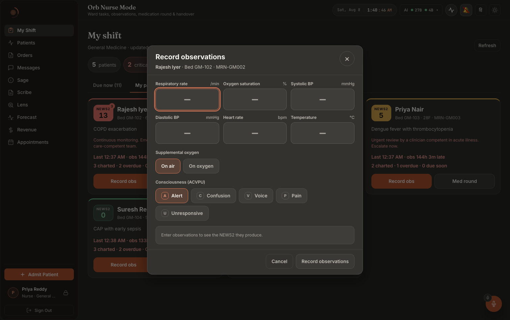
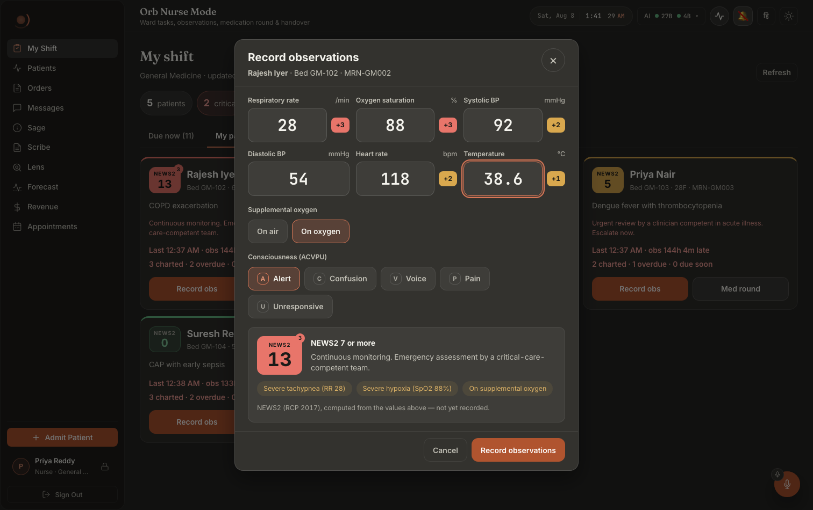
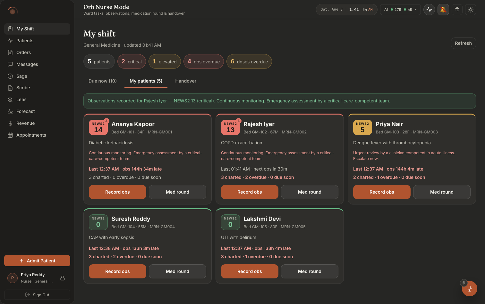
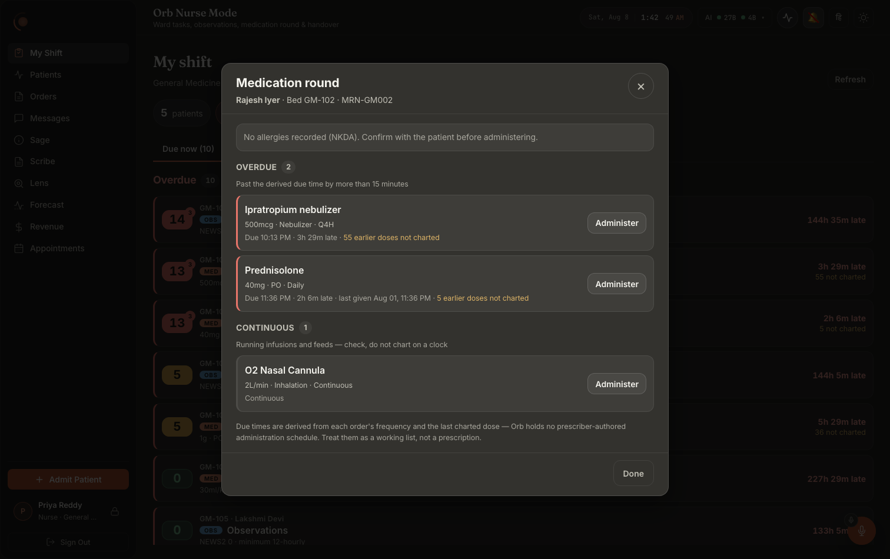

# Screen map 09: Nurse: vitals entry and the eMAR round

**What this is.** An index of every visible thing on the two bedside surfaces a ward nurse spends
her shift inside, the **observation entry sheet** and the **medication round sheet with its
five-rights confirmation modal**, and the exact code that puts each thing on screen. Read an
entry, then go to the file:line it names. Every citation in this file was opened and read at that
line.

**Scope.** Three components and nothing else:

| Surface | File | Lines |
|---|---|---|
| Observation (vitals) entry sheet | `src/pages/panels/nurse/ObsEntrySheet.tsx` | 150–554 |
| Medication round sheet (the eMAR) | `src/pages/panels/nurse/MedRoundSheet.tsx` | 51–230 |
| Five-rights administration modal | `src/components/vigil/AdministerModal.tsx` | 37–248 |

Two shared leaves are covered where they appear inside these surfaces:
`src/pages/panels/nurse/News2Badge.tsx` (the whole file, 43 lines) and
`src/pages/panels/nurse/time.ts::dueLabel` (35–49). The **shift board underneath**, task rows,
patient cards, the tab strip, handover, is a different screen and is not documented here beyond
the two buttons that open these sheets and the success flash they write back to.

**How you get to these surfaces.** Left nav → **My Shift** (`src/pages/ClinicianShell.tsx:27`,
`id: 'shift', label: 'My Shift', pillar: 'Nurse Mode'`; panel lazily imported at `:275`, mounted
at `:715-717`). For a nurse this is the **landing screen**, the per-role tab list at
`ClinicianShell.tsx:200` puts `'shift'` first and the shell opens `accessibleTabs[0]`. From
there, four different taps open the two sheets:

- a task row whose kind is `obs` → `setObsFor(task.patient)` (`NursePanel.tsx:156`);
- a task row whose kind is `med` → `setRoundFor({patient, medId})` (`NursePanel.tsx:157`), which
  **opens the round sheet with that one drug's confirmation modal already up** (see §B.0);
- **Record obs** on a patient card (`NursePanel.tsx:356-358`);
- **Med round** on a patient card (`NursePanel.tsx:359-366`), disabled when the patient has no
  charted medications.

Both sheets render through `createPortal(…, document.body)` (`ObsEntrySheet.tsx:316`/`552`,
`MedRoundSheet.tsx:88`/`228`), so they sit **above the whole app**, not inside the panel. The
`AdministerModal` portals a second time (`AdministerModal.tsx:108`/`246`), which is why it appears
over the round sheet rather than inside it.

**Layout in one sentence, each.** The obs sheet is a centred card (max ~560px) with a fixed
header, a scrolling body of banners → a 2-up grid of six numeric fields → two chip rows → the live
score block, and a fixed footer of two buttons. The round sheet is the same shell but wider
(`.nurse-sheet--wide`, `max-width: 760px`, `NursePanel.css:553`), its body a staleness banner → an
allergy strip → up to five titled drug groups → a footnote, with one footer button. The
administer modal is a narrow card: header, optional red error strip, a five-row definition list,
one text input, a hint, an optional amber "reason not given" block, and three buttons.

---

## What these surfaces look like

**Notice the placeholder where the score will be**: *"Enter observations to see the NEWS2
they produce."* The sheet tells you it is going to score you before you have typed anything.
Notice also that the identity line under the title is patient **and** bed **and** MRN, three
identifiers, on a modal that floats over a board showing five patients.

**Notice the per-field point chips**, `+3`, `+3`, `+2`, `+2`, `+1`, sitting beside the
individual values. The score is not a black box: each field shows what it contributed. The
panel underneath names the three drivers as chips ("Severe tachypnea (RR 28)", "Severe
hypoxia (SpO2 88%)", "On supplemental oxygen") and closes with the line that matters most:
**"computed from the values above, not yet recorded."** The number is live; the record is
not written.

**Notice where the confirmation goes.** The sheet has closed, so the feedback is on the
board: a green strip above the cards *and* the patient's own card flipping from "obs 144h
33m late" to "next obs in 30m".

**Notice the two sentences that define this screen's authority.** The group header defines
overdue precisely, *"Past the derived due time by more than 15 minutes"*, and the footnote
says where due times come from: *"derived from each order's frequency and the last charted
dose, Orb holds no prescriber-authored administration schedule. Treat them as a working
list, not a prescription."* The allergy strip sits at the top even when there is nothing to
report ("No allergies recorded (NKDA). Confirm with the patient before administering.").
`nurse-06-emar-dark.png` is the same sheet for a patient on continuous infusions only: no
overdue group at all, and the CONTINUOUS header reads "check, do not chart on a clock".

> ⚠ The five-rights `AdministerModal`, the safety-critical surface of this chapter, has
> **no working capture**. `nurse-08-emar-administered-dark.png` and
> `nurse-09-administer-modal-dark.png` are pixel-identical to the sheet above; the
> walkthrough never reached either state despite what the filenames claim. See
> [`docs/screenshots/INDEX.md`](../../screenshots/INDEX.md).

---

# A. The observation entry sheet: "Record observations"

Root: `
` at `ObsEntrySheet.tsx:317`, containing
`
` at `:319-325`.

## A.0 The sheet frame

### The dark scrim behind the sheet
**Where:** covers the entire viewport; the shift board is visible but dimmed underneath.
**Rendered by:** `ObsEntrySheet.tsx:317`, `
`.
Styled at `src/pages/panels/nurse/NursePanel.css:531-542`: fixed, full-viewport,
`background: rgba(0, 0, 0, 0.55)`, centred flex.
**Data from:** nothing, it exists whenever `obsFor` is non-null in `NursePanel` (`NursePanel.tsx:380`).
**API / Server:** none.
**Change this →** clicking the scrim runs `requestClose` (`:245-249`): with **any** value typed it
opens the discard confirmation (§A.8) instead of closing; with a pristine form it closes the sheet
outright. Setting `onClick` to nothing would make the sheet dismissable only by the × or Escape.
Body scroll behind the sheet is locked by `useFocusTrap` (`src/hooks/useFocusTrap.ts:16-27`), remove
the hook at `:251` and the board scrolls underneath while the nurse drags inside the sheet.

### "Record observations": the sheet title
**Where:** top-left of the sheet header.
**Rendered by:** `ObsEntrySheet.tsx:328`, `<h2 className="nurse-sheet__title" id="obs-sheet-title">Record observations</h2>`.
It is the dialog's accessible name via `aria-labelledby="obs-sheet-title"` (`:323`).
**Data from:** hardcoded.
**Change this →** the heading text changes and so does what a screen reader announces on open.

### The patient identity line
**Where:** directly under the title: **Name** · Bed 4 · MRN-00123.
**Rendered by:** `ObsEntrySheet.tsx:329-333`, `<strong>{patient.name}</strong>`, then
`· Bed {patient.bed}` only when `patient.bed` is truthy (`:331`), then `· {patient.mrn}` only when
`patient.mrn` is truthy (`:332`).
**Data from:** the `patient` prop, a `NursePatientCard` handed down from `NursePanel` state
(`NursePanel.tsx:381-382`), which came from the shift board.
**API:** `GET /api/nurse/board` (`src/api/nurse.ts:142-144`).
**Server:** `server/routes/nurse_routes.py:51-109` `get_board` → `nurse_shift_service.build_board`
(`server/services/nurse_shift_service.py:501-617`); the three fields are set at `:560-562`.
**Change this →** a patient with no bed loses the " · Bed N" segment entirely (no empty separator);
same for MRN. Both come from the board payload, so renaming a bed in admissions changes this line
on the next board refresh.

### The × close button
**Where:** top-right corner of the header.
**Rendered by:** `ObsEntrySheet.tsx:335-343`, a `<button className="nurse-sheet__close">` with
`aria-label="Close observation entry"` and the `&times;` glyph.
**Data from:** `disabled={saving}` (`:340`).
**Change this →** while a save is in flight the × greys out (`.nurse-btn:disabled` tokens,
`NursePanel.css:251-255` apply to `nurse-btn`; the close button's own disabled state comes from the
`:hover:not(:disabled)` rule at `NursePanel.css:594-597` no longer firing). Tapping it runs the same
`requestClose` as the scrim, so with typed values it raises the discard dialog rather than closing.
**Escape** does the same thing, `useFocusTrap(requestClose)` at `:251` wires Escape to `onClose`
(`src/hooks/useFocusTrap.ts:37`).

## A.1 The banner stack (top of the scrolling body)

These appear in a fixed order and any combination of them can be on screen at once.

### The staleness / offline banner
**Where:** first thing in the body, above everything else.
**Rendered by:** `ObsEntrySheet.tsx:351`, `{offline && <OfflineBanner snapshot={offline} what="patient details" />}`.
Component: `src/components/OfflineBanner.tsx`.
**Data from:** the `offline` prop, which is the **shift board's** snapshot passed straight through
(`NursePanel.tsx:383`, from `useOfflineSnapshot('nurse:board', liveBoard, …)` at `NursePanel.tsx:136-139`).
**Change this →** when the tablet has no network the banner reads **"Offline, not live"**; when the
network is up but the appliance did not answer it reads **"Can't reach Orb, not live"**
(`OfflineBanner.tsx`, `heading` assignment). Under it: *"Showing the patient details saved at
14:32, 9 minutes old"*, and always the write line *"Nothing can be recorded until you reconnect…
they are never held back to send later"*. It renders **nothing at all** when the view is live
(`if (!degraded) return null`). Dropping the `offline` prop removes the early warning but not the
refusal, `save()` still throws (§A.7).

### "Unsaved observations from HH:MM were restored. Check them before saving."
**Where:** a blue-tinted note under the offline banner, only on reopening an interrupted sheet.
**Rendered by:** `ObsEntrySheet.tsx:353-359`, `.nurse-note.nurse-note--info`, `role="status"`.
Blue tint at `NursePanel.css:197-201`.
**Data from:** `showRestoredNote` state (`:164`), seeded `true` when `readDraft` (`:130-148`) returned
a draft in the lazy initializer at `:160`. The time shown is `restored.savedAt` (`:165`), stamped by
the mirroring effect at `:204-218`, which writes the whole form to
`localStorage[obsDraftKey(patientId)]` on every keystroke.
**API / Server:** none, this is device-local only.
**Change this →** it **disappears the moment the nurse touches anything**: `setField` (`:305`), the
oxygen chips (`:434`) and the ACVPU chips (`:458`) all call `setShowRestoredNote(false)`. It never
appears for a draft belonging to a different user or one older than a shift, `isOwnFreshDraft`
(`src/lib/nurseDrafts.ts`) fails and the draft is **deleted** from localStorage (`:140-143`), which
is what keeps one nurse's in-progress PHI off the next nurse's shared tablet.

### "Severe allergy: Penicillin, Sulfa"
**Where:** a red note in the banner stack.
**Rendered by:** `ObsEntrySheet.tsx:361-365`, `.nurse-note.nurse-note--danger`, `role="alert"`,
listing `severeAllergies.map(a => a.substance).join(', ')`.
**Data from:** `severeAllergies = patient.allergies.filter(a => a.severity === 'severe')` (`:314`).
**API:** `GET /api/nurse/board`.
**Server:** allergies are loaded set-based in `nurse_shift_service._load_board_rows`
(`server/services/nurse_shift_service.py:234-367`) and attached to the card at `:571`.
**Change this →** with no `severity === 'severe'` allergy on file this note is **absent entirely**
(moderate and mild allergies do not raise it here, they do show on the round sheet, §B.2). It is
informational on this screen: nothing about an allergy blocks an observation.

### "SpO₂ scored on **Scale 2** (target 88–92%) for this patient."
**Where:** an amber note in the banner stack.
**Rendered by:** `ObsEntrySheet.tsx:367-371`, `.nurse-note.nurse-note--warn`, `role="note"`.
**Data from:** `patient.on_scale_2`.
**Server:** `patients.on_scale_2`, read into the card at `nurse_shift_service.py:570`, and read
again per-request by `_on_scale_2` (`:657-661`) so the preview and the recorded score use the same
scale.
**Change this →** flipping the patient off Scale 2 removes this note **and** re-bands the SpO₂
score: `compute_news2` switches from the Scale-2 ladder (`server/services/vigil_service.py::compute_news2`,
target 88–92, over-oxygenation on O₂ penalised) to Scale 1 (same function, target ≥96). It also
changes the breakdown's parameter label from `"SpO2 (Scale 2)"` to `"SpO2"` (same function)
which has a visible side effect described in §A.3.

### The red error line
**Where:** last note in the stack, immediately above the fields.
**Rendered by:** `ObsEntrySheet.tsx:373`, `{error && 
{error}
}`.
**Data from:** `error` state, set **only** in the catch of `save()` (`:294`).
**Change this →** three different sentences land here.
1. Offline: *"Cannot record these observations, this device is offline. Your entry has not been
   saved. Reconnect and enter it again."*, `assertOnlineForWrite('record these observations')`
   (`:281`) → `offlineRefusalMessage` (`src/lib/offline/writeGuard.ts`).
2. Server validation (422): the service's own words, e.g. *"heart_rate must be between 10 and 300
   bpm"* (`nurse_shift_service._clean_obs`, `server/services/nurse_shift_service.py:640-641`) or
   *"an observation set must contain at least one reading"* (`:652`), raised into an HTTPException at
   `server/routes/nurse_routes.py:200`.
3. Out-of-ward patient (404): `require_patient_access("vitals.write")` (`nurse_routes.py:177`)
   404s rather than 403s so the route never confirms the patient exists; the message surfaces here
   verbatim.
The line **disappears** on the next tap of Record observations (`setError('')`, `:272`).

## A.2 The six vitals fields

Container `
` at `ObsEntrySheet.tsx:375`; the fields are generated by
`FIELDS.map(...)` at `:376-419`. `FIELDS` is the ordered spec at `:92-99`, deliberately in the
order obs are physically taken, which is also the tab order.

| On screen | Unit shown | Accepted range | `scoreParams` |
|---|---|---|---|
| Respiratory rate | `/min` | 2–80 | `Respiratory rate` |
| Oxygen saturation | `%` | 30–100 | `SpO2`, `SpO2 (Scale 2)` |
| Systolic BP | `mmHg` | 40–300 | `Systolic BP` |
| Diastolic BP | `mmHg` | 10–200 | *(none, never scored)* |
| Heart rate | `bpm` | 10–300 | `Heart rate` |
| Temperature | `°C` | 25–45 (step 0.1) | `Temperature` |

### A field label and its unit
**Where:** above each input, e.g. "Respiratory rate  /min".
**Rendered by:** `ObsEntrySheet.tsx:381-384`, `<label className="obs-field__label" htmlFor={...}>{f.label}{f.unit}</label>`.
**Data from:** the `FIELDS` constant (`:92-99`). The unit is grey and lighter
(`NursePanel.css:648`).
**Change this →** editing `f.label` or `f.unit` changes only the words; editing `f.min`/`f.max`
changes the validation message text (§A.4) but **not** what the server accepts, the authoritative
bounds are `OBS_RANGES` at `server/services/nurse_shift_service.py:55-62`, and they currently match
the client exactly. Change one without the other and a value passes the field and is rejected by
the save.

### The numeric input
**Where:** the large box under each label.
**Rendered by:** `ObsEntrySheet.tsx:386-406`. Notable attributes: `inputMode="decimal"` (`:390`,
raises the tablet number pad), `size={4}` (`:397`, without it an `<input>`'s intrinsic 20-character
width forces the grid tracks wider than the sheet), `placeholder=", "` (`:399`), and
`autoFocus={index === 0}` (`:403`) so **Respiratory rate has the caret when the sheet opens**.
**Data from:** `values[f.key]` state (`:161`), written by `setField` (`:300-306`).
**Change this →** `setField` rejects any keystroke that does not leave the value matching
`/^\d*\.?\d*$/` (`:303`), a typed letter or a second decimal point simply **does not appear**. All
six inputs grey out and stop accepting input while `saving` is true (`:402`). Removing
`autoFocus` costs a tap per patient.

### The "+2" score chip beside a field
**Where:** immediately right of the input, a small filled pill, e.g. **+3**.
**Rendered by:** `ObsEntrySheet.tsx:407-414`, guarded by `points !== null`. The class is picked
inline at `:409`: `--danger` at 3+, `--warn` at 1–2, `--ok` at 0. Colours at
`NursePanel.css:706-717`, `--ok` is a soft green tint with green text, `--warn` is a **solid amber
fill with on-fill text**, `--danger` a **solid red fill**. `title` is `Contributes N to NEWS2`
(`:410`).
**Data from:** `pointsFor(f.scoreParams)` (`:308-312`), which looks the field's `scoreParams` up in
`shownPreview.news2.breakdown` by exact `parameter` string (SpO2 lists both scale names).
**API:** `POST /api/nurse/patients/{id}/news2-preview` (`src/api/nurse.ts:156-173`).
**Server:** `server/routes/nurse_routes.py:112-144` `preview_news2` →
`nurse_shift_service.score_observation` (`:664-683`) → `vigil_service.compute_news2` (`:234`). The
`breakdown` array is built by the inner `add()` at `server/services/vigil_service.py:256-269`.
**Change this →** three ways to make a chip vanish. (1) Clear the field, a parameter that is `None`
never calls `add()`, so it is absent from `breakdown` and `pointsFor` returns null. (2) Break the
form so no preview is scoreable (§A.6), `shownPreview` is null and **every** chip disappears at
once. (3) **Diastolic BP never shows a chip at all**, because its `scoreParams` is `[]` (`:96`) and
`pointsFor` short-circuits on an empty list (`:309`), correct, NEWS2 does not score DBP.
> **Fixed 2026-10-02.** For a patient **on Scale 2**, `compute_news2` labels the breakdown row
> `"SpO2 (Scale 2)"` (`vigil_service.py::compute_news2`). The field used to ask for `"SpO2"` only, so the Oxygen
> saturation field showed no +N chip for a Scale-2 patient. It now lists both names
> (`ObsEntrySheet.tsx:94`), pinned by `ObsEntrySheet.test.tsx`.

### The inline field error
**Where:** small red text directly under the offending input.
**Rendered by:** `ObsEntrySheet.tsx:416`, `{err}`.
Wired to the input by `aria-describedby` (`:404`) and `aria-invalid` (`:405`).
**Data from:** the `fieldErrors` memo (`:179-189`): `'Numbers only'` when `Number(raw)` is not
finite, otherwise `` `${f.min}–${f.max} ${f.unit}` ``, e.g. **"2–80 /min"**.
**Change this →** the field's border turns red and its background picks up an 8% red wash
(`.obs-field--error .obs-field__input`, `NursePanel.css:683-686`). While **any** field error exists:
the Record observations button is disabled (`:508`), its tooltip becomes *"Fix the highlighted
readings"* (`:509`), the live preview stops firing (`scoreable`, `:222`) and the score block reads
*"Fix the highlighted readings to see the NEWS2."* (`:493`).

## A.3 Supplemental oxygen: the two-chip row

### "Supplemental oxygen" legend
**Where:** below the six fields.
**Rendered by:** `ObsEntrySheet.tsx:423`, `<legend className="obs-segment__legend">`.

### "On air" / "On oxygen"
**Where:** two chips side by side under the legend.
**Rendered by:** `ObsEntrySheet.tsx:425-439`, from an inline two-item array (`:425-428`). Active
state is `obs-chip--active` (`:432`) plus `aria-pressed` (`:433`), a gold-tinted fill with a gold
border (`NursePanel.css:758-762`). Default is **On air** (`onOxygen` initial `false`, `:163`).
**Data from:** `onOxygen` state; sent as `on_oxygen` in `buildPayload` (`:194`).
**Server:** `compute_news2` adds a flat **+2** for supplemental oxygen at
`server/services/vigil_service.py:300-301`, with the driver text *"On supplemental oxygen"*.
**Change this →** tapping **On oxygen** re-fires the preview and the NEWS2 badge jumps by 2, a new
driver pill "On supplemental oxygen" appears in the drivers list, and the band/response text under
the badge can escalate (e.g. from *"NEWS2 1-4, Ward-based response"* to *"NEWS2 5-6, Urgent review
by a clinician competent in acute illness. Escalate now."*, `nurse_shift_service.py:105-108`). For a
**Scale-2** patient it also changes which SpO₂ ladder applies at ≥93% (`vigil_service.py:289-292`).
Note the +2 has **no chip of its own**, no field lists `'Supplemental O2'` in its `scoreParams`, so those
two points appear only in the aggregate and the drivers.

## A.4 Consciousness (ACVPU): the five-chip row

### "Consciousness (ACVPU)" legend, with an optional +3
**Where:** below the oxygen row.
**Rendered by:** `ObsEntrySheet.tsx:444-450`. The legend text is static; the `+3` pill next to it is
an inline IIFE at `:446-449` calling `pointsFor(['Consciousness (ACVPU)'])` and rendering
`.obs-field__points--danger` (solid red) when non-zero.
**Change this →** the pill is present **only** while a non-`alert` level is selected, `compute_news2`
adds the breakdown row only when `cons not in ("alert","a","")`
(`server/services/vigil_service.py:330-331`).

### The five ACVPU chips: Alert / Confusion / Voice / Pain / Unresponsive
**Where:** a wrapping row of five chips, each with a small letter key badge (A, C, V, P, U).
**Rendered by:** `ObsEntrySheet.tsx:452-464`, from the `ACVPU` constant at `:101-107`. The letter is
`` (`:461`), styled at `NursePanel.css:764-777`,
turning gold when the chip is active.
**Data from:** `consciousness` state, default `'alert'` (`:162`).
**Server:** validated against `ACVPU_LEVELS` (`server/services/nurse_shift_service.py:65`,
`:644-646`); anything else is a 422 *"consciousness must be one of [...]"*.
**Change this →** selecting anything other than **Alert** adds **+3** in one step
(`vigil_service.py:331`) and sets `single_param_3`, which (a) puts the small red **3** flag on the
NEWS2 badge (§A.5), (b) forces the level to at least `elevated` even at a low total
(`vigil_service.py:336`), and (c) rewrites the response line to *"A single parameter scoring 3
requires urgent review, escalate."* with a **60-minute** minimum obs interval
(`nurse_shift_service.py:135-148`). Selecting a non-alert level also counts as "has a value" for
`hasAnyValue` (`:174`), so it alone enables the save button and arms the discard prompt.

## A.5 The live NEWS2 block

Container `<section className="obs-score" aria-live="polite">` at `ObsEntrySheet.tsx:469`, the
`aria-live` is why a screen-reader user hears the score update as they type.

### The big NEWS2 badge
**Where:** left of the score block, a large number in a coloured tile.
**Rendered by:** `ObsEntrySheet.tsx:473`, `<News2Badge news2={shownPreview.news2} size="lg" />`;
component at `src/pages/panels/nurse/News2Badge.tsx:19-42`. The word "NEWS2" above the number is the
`labelled` default (`News2Badge.tsx:38`); the number is `news2.raw_news2` (`:39`), deliberately the
**integer aggregate**, never the 0–1 `score` index.
**Data from:** the preview response's `news2`.
**Server:** `vigil_service.compute_news2` return block, `server/services/vigil_service.py:375-400`.
**Change this →** the tile is **solid red** at level `critical` (`NursePanel.css:302-307`), **solid
amber** at `elevated` (`:309-314`), and a **soft green tint** at `stable` (`:316-320`). Level comes
from the bands at `vigil_service.py:334-339`: ≥7 critical, ≥5 **or any single parameter scoring 3**
elevated, else stable. A patient with no score at all renders the `news2--none` variant with an em
dash and the tooltip *"No observations recorded"* (`News2Badge.tsx:21-26`), on this sheet that
state is unreachable, because the badge is only rendered when a preview exists.

### The small red "3" flag on the badge
**Where:** top-right corner of the badge tile.
**Rendered by:** `News2Badge.tsx:40`, `{single3 && 3}`.
Solid red circle, on-fill text (`NursePanel.css:325-338`).
**Data from:** `news2.single_param_3`, set by `any_param_3` in `compute_news2`
(`server/services/vigil_service.py:259-260`, returned at `:380`).
**Change this →** it appears the instant **any one** vital scores 3, RR ≤8 or >24, SpO₂ ≤91
(Scale 1), SBP ≤90 or ≥220, HR ≤40 or >130, temp ≤35.0, or any non-alert ACVPU. It is the case most
likely to be missed by someone scanning for big totals, which is why it is a separate mark and not
just a colour.

### The badge tooltip
**Where:** hovering the badge.
**Rendered by:** `News2Badge.tsx:32-36`, `NEWS2 7 (critical)`, plus `· a single parameter scores 3`
when `single_param_3`, plus `· SpO₂ Scale 2` when `news2.spo2_scale === 2`.
**Change this →** the Scale-2 clause is the only place on this sheet, other than the amber banner,
where the active SpO₂ scale is stated.

### The band label and the RCP response
**Where:** right of the badge, a bold band line over a longer sentence.
**Rendered by:** `ObsEntrySheet.tsx:475-476` (`.obs-score__band`) and `:477` (`.obs-score__response`).
**Data from:** `shownPreview.schedule`, i.e. the preview response's `schedule` object.
**Server:** `nurse_shift_service.obs_schedule` (`server/services/nurse_shift_service.py:117-153`),
keyed off the `_OBS_ESCALATION` table at `:101-109`:

| Aggregate | Band shown | Response shown | Min interval |
|---|---|---|---|
| ≥7 | `NEWS2 7 or more` | "Continuous monitoring. Emergency assessment by a critical-care-competent team." | 30 min |
| 5–6 | `NEWS2 5-6` | "Urgent review by a clinician competent in acute illness. Escalate now." | 60 min |
| 1–4 | `NEWS2 1-4` | "Ward-based response, inform the registered nurse in charge." | 240 min |
| 0 | `NEWS2 0` | "Routine monitoring, minimum 12-hourly." | 720 min |
| any + single-3 | `<band> (single parameter 3)` | "A single parameter scoring 3 requires urgent review, escalate." | 60 min |

**Change this →** the same `interval_minutes` is what later decides whether this patient's
observations read as **overdue** on the shift board (`nurse_shift_service.py:529-537`), so a change
here changes the colour of a task row hours later.

### The driver pills
**Where:** a wrapping row of small amber pills under the badge, e.g. "Tachypnea (RR 26)".
**Rendered by:** `ObsEntrySheet.tsx:479-483`, one `<li>` per string in `news2.drivers`.
Styled amber-on-amber-tint, pill-shaped (`NursePanel.css:817-823`).
**Data from:** `news2.drivers`, built by `add()` whenever `points > 0 && msg`
(`server/services/vigil_service.py:261-262`) and **truncated to the first three** at `:381`.
**Change this →** with everything in range the list is not empty, `compute_news2` substitutes
*"All vitals within normal range"* (`vigil_service.py:370`) or, when some parameters were never
entered, *"Within range on what was measured (3/5 parameters)"* (`:371-372`). That second string is
the honest-coverage statement: a partial set can only under-score.

### "NEWS2 (RCP 2017), computed from the values above: not yet recorded."
**Where:** small grey caption at the bottom of the score block.
**Rendered by:** `ObsEntrySheet.tsx:484-486`.
**Change this →** it is the only thing distinguishing a previewed score from a charted one. It is
replaced wholesale by the placeholder below whenever there is no preview.

### The placeholder line (three variants)
**Where:** replaces the entire score block when `shownPreview` is null.
**Rendered by:** `ObsEntrySheet.tsx:489-495`.
- **"Scoring…"** while `previewing` is true (`:491`), set immediately before the fetch at `:232`.
- **"Fix the highlighted readings to see the NEWS2."** when `hasFieldErrors` (`:493`).
- **"Enter observations to see the NEWS2 they produce."**, the empty-form default (`:494`).
**Change this →** a *failed* preview request falls into the third message, not an error: the catch at
`:235-240` clears the preview and the previewing flag without setting `error`. That is deliberate, 
a failed preview is not a failed save, but it means **a nurse cannot tell "no values yet" from
"the preview call is broken"** from this line alone.

### How the preview actually fires
`ObsEntrySheet.tsx:228-243`: a 250 ms debounce, an `AbortController` aborted by the effect cleanup
so a slow response can never overwrite a fresher score, gated on `scoreable = hasAnyValue && !hasFieldErrors` (`:222`).
`shownPreview` is *derived* (`:226`), not stored, so there is no render in which a stale score sits
above edited values. The request carries every field including the nulls (`buildPayload`, `:193-200`).
Server-side this route **persists nothing** but is still ward-scoped by
`require_patient_access("vitals.read")` (`server/routes/nurse_routes.py:134`), and deliberately
audits nothing (`nurse_routes.py:130-133`) because one encrypted-SQLite write per keystroke is the
shape blamed for the July loop stalls.

## A.6 The footer buttons

### "Cancel"
**Where:** bottom-left of the sheet footer.
**Rendered by:** `ObsEntrySheet.tsx:501-503`, ghost style (`NursePanel.css:235-240`).
**Change this →** identical behaviour to the × and the scrim: with typed values it opens the discard
dialog, otherwise it closes. Disabled while saving.

### "Record observations" / "Recording…"
**Where:** bottom-right, the primary (dark accent) button.
**Rendered by:** `ObsEntrySheet.tsx:504-512`. Label flips to **"Recording…"** while `saving` (`:511`).
**Data from:** `disabled={saving || !hasAnyValue || hasFieldErrors}` (`:508`);
`title` is *"Enter at least one reading"* on a pristine form and *"Fix the highlighted readings"*
with a range error (`:509`).
**API:** `POST /api/nurse/patients/{id}/observations` with an `Idempotency-Key` header
(`src/api/nurse.ts:186-195`), routed through `apiFetch`, **not** through `offlineMutate`, so it can
never be optimistically queued.
**Server:** `server/routes/nurse_routes.py:147-200` `record_observations` →
`nurse_shift_service.record_observation` (`server/services/nurse_shift_service.py:827-996`).
**Change this →** on success the sheet **closes immediately** (`onRecorded`, `:292` →
`NursePanel.tsx:385-392`) and a green flash appears on the board underneath reading
*"Observations recorded for Asha Rao, NEWS2 7 (critical). Continuous monitoring. Emergency
assessment by a critical-care-competent team."* (`NursePanel.tsx:388-390`), auto-clearing after
6 seconds (`NursePanel.tsx:160-163`). The board then silently refreshes (`:391`). On failure the red
error line appears (§A.1) and the button becomes tappable again (`:295-296`).

## A.7 What the save does that is not visible here

Worth knowing because it changes **other** screens:

- One `vitals` row with `source='nurse_manual'` plus one `risk_scores` row, in a single transaction
  with a fail-closed audit entry (`nurse_shift_service.py:912-962`). The `risk_scores` row is what
  repaints the Vigil board's risk dot.
- **A Vigil alert into the patient's Relay case room** whenever the level is not `stable`
  (`dispatch_observation_alert`, `nurse_shift_service.py:710-824`), a message beginning
  `⚠️ VIGIL ALERT [NURSE OBS]: `. Stable sets dispatch nothing.
- A sepsis bundle may auto-start at NEWS2 ≥7 (`:967-971`).
- **Double-tap protection:** `taken_at` is stamped once per sheet in a ref (`:261`, `:273`) and the
  server dedupes on (patient, source, taken_at) **plus identical values** (`_same_reading`,
  `:686-707`). A second tap with the same numbers returns the existing reading; the same timestamp
  with *different* numbers is charted as a correction and the superseded row id is returned
  (`:895-904`, `:994-995`). The in-flight latch is also a ref (`:265`) because two taps 6 ms apart
  both read the same render's `saving === false`.

## A.8 The "Discard these observations?" confirmation

**Where:** a second, smaller dark overlay **inside** the sheet, covering it.
**Rendered by:** `ObsEntrySheet.tsx:515-549`, `.nurse-confirm` (`NursePanel.css:832-844`, a
`rgba(0,0,0,0.6)` scrim inside the sheet's rounded corners) containing `.nurse-confirm__box`.
`role="alertdialog"`.
**Data from:** `confirmDiscard` state, set only by `requestClose` when `hasAnyValue` (`:247`).

- **Title**, "Discard these observations?" (`:518`).
- **Body**, "These readings have not been recorded. They are kept as a draft for the rest of your
  session on this device, and cleared when you sign out, discarding removes them now." (`:519-523`).
- **"Keep entering"** (ghost, `:525-527`) → dismisses the dialog, sheet stays open, nothing lost.
- **"Keep draft & close"** (secondary, `:528-534`) → closes the sheet, leaves the localStorage draft
  in place; reopening this patient's sheet restores it and shows the blue restored note.
- **"Discard"** (red, `:535-545`) → `localStorage.removeItem(obsDraftKey(...))` then close. The
  values are gone.

**Change this →** removing the `hasAnyValue` guard at `:247` would make every close silently drop a
half-typed set of obs. Note the draft is also removed automatically when the form goes back to empty
(`:205-207`) and after a confirmed server write (`:291`).

---

# B. The medication round sheet: "Medication round"

Root: `MedRoundSheet.tsx:89` backdrop → `:91-97` the wide dialog.

## B.0 The frame

### The scrim and the wide sheet
**Where:** same full-viewport scrim as the obs sheet; the card is wider (760px).
**Rendered by:** `MedRoundSheet.tsx:89` and `:91` (`nurse-sheet nurse-sheet--wide glass-strong`).
**Change this →** the scrim's `onClick={close}` and the ×'s `onClick={close}` both run `close`
(`:59`), which is `if (!administering) onClose()`, so **while the five-rights modal is open the
round sheet cannot be dismissed by clicking outside it or pressing Escape**. That is the intended
behaviour: the confirmation modal owns the interaction until it is finished or cancelled.

### "Medication round" title and the patient identity line
**Where:** header, left.
**Rendered by:** `MedRoundSheet.tsx:100` (title, `id="med-round-title"`, the dialog's accessible
name via `:95`) and `:101-105` (name · Bed · MRN, same conditional pattern as the obs sheet).

### The × close button
**Where:** header, right.
**Rendered by:** `MedRoundSheet.tsx:107-109`, `aria-label="Close medication round"`.
**Change this →** unlike the obs sheet's ×, this one is never `disabled`, it is neutralised by
`close`'s own guard instead.

### Opening straight onto one drug
`MedRoundSheet.tsx:52-54`: `administering` is **initialised** from
`patient.medications.find(m => m.medication_id === focusMedicationId)`. So tapping a *med* task row
on the board opens the round sheet **with the five-rights modal already on top of it**. Opening the
round from the patient card passes `medId: null` (`NursePanel.tsx:362`) and the nurse sees the list
first.

## B.1 The staleness banner

**Where:** first thing in the body, above the allergies.
**Rendered by:** `MedRoundSheet.tsx:116`, `<OfflineBanner snapshot={offline} what="drug chart" />`.
**Data from:** the shift board's snapshot, passed in rather than re-derived (`NursePanel.tsx:400`).
**Change this →** it reads *"Showing the drug chart saved at 14:32, 9 minutes old. Anything that
changed since then is not here."* This is placed **above** the allergy strip on purpose (comment at
`:113-115`): allergies say what must not be given, this says whether anything on the screen can be
believed at all. "Last given 06:00" read as current, out of a cached copy, is how a drug gets given
twice.

## B.2 The allergy strip

### "Allergies: Penicillin (rash) · Sulfa: severe"
**Where:** directly under the banner, a full-width tinted strip.
**Rendered by:** `MedRoundSheet.tsx:118-127`. The class and the ARIA role both switch on whether any
allergy is severe: `nurse-note--danger` + `role="alert"` when `severeAllergies.length`, otherwise
`nurse-note--warn` + `role="note"` (`:120-121`). Each entry is composed at `:125` as
`substance` + ` (reaction)` when a reaction is recorded + `, severe` when severity is severe.
**Data from:** `patient.allergies` (`NurseAllergy[]`, `src/api/nurse.ts:35-39`);
`severeAllergies` at `:86`.
**Server:** `nurse_shift_service._load_board_rows` → card field at
`server/services/nurse_shift_service.py:571`.
**Change this →** red-and-alert vs amber-and-note is decided **only** by the recorded `severity`
column being exactly `'severe'`. The server's own interlock uses a smarter rule
(`allergy_interlock.effective_severity`, `server/services/allergy_interlock.py:211-232`, which
promotes anaphylaxis-shaped reaction text and fails safe on unknown severity), this strip does not.

### "No allergies recorded (NKDA). Confirm with the patient before administering."
**Where:** replaces the strip above when the list is empty.
**Rendered by:** `MedRoundSheet.tsx:128-132`, `.nurse-note.nurse-note--muted`, `role="note"`.
**Change this →** this is a coverage-honesty line, not a clearance: a patient with no allergy row may
be NKDA or may never have been asked, and Orb cannot tell those apart (same statement
`allergies_on_file` makes server-side, `allergy_interlock.py:319-324`).

## B.3 The drug groups

Built by the `groups` memo at `MedRoundSheet.tsx:62-84`, always in this order, and **a group with no
drugs is not rendered at all** (`.filter(g => g.meds.length > 0)`, `:83`).

| Group title | Hint under it | Which meds land here |
|---|---|---|
| **Overdue** | "Past the derived due time by more than 15 minutes" | `overdue` true (`:72`) |
| **Due now** | "Due within the next 30 minutes" | `due_soon` true (`:73`) |
| **Later this shift** | *(no hint)* | everything else scheduled (`:74`) |
| **As required (PRN)** | "Available when indicated, never due, never late" | `schedule_kind === 'prn'` (`:69`) |
| **Continuous** | "Running infusions and feeds, check, do not chart on a clock" | `schedule_kind === 'continuous'` (`:70`) |

### A group heading and its count chip
**Where:** a small uppercase-ish heading with a rounded count pill beside it.
**Rendered by:** `MedRoundSheet.tsx:140-143`, `<h3 className="med-group__title">{group.title}{group.meds.length}</h3>`.
**Change this →** the count is the length of that group only. Within Overdue / Due now / Later, rows
are sorted by `minutes_until_due` ascending with nulls last (`byDue`, `:75-76`); PRN and Continuous
keep the order the server sent.

### A group hint line
**Rendered by:** `MedRoundSheet.tsx:144`, rendered only when `group.hint` is non-empty, so **Later
this shift shows no hint**.

## B.4 A single drug row

`<li className="med-row …">` at `MedRoundSheet.tsx:149-152`. Two modifier classes:
`med-row--overdue` → a **red left edge** (`NursePanel.css:917`), `med-row--done` → a **green left
edge** (`:918`).

### The drug name
**Rendered by:** `MedRoundSheet.tsx:154`, `{med.drug_name}`.
**Server:** `medications.drug_name`, copied into the task at
`server/services/nurse_shift_service.py:472`.
**Change this →** this exact string is what the nurse must retype in the confirmation modal (§C.3), 
they are the same value, `med.drug_name`, handed across at `MedRoundSheet.tsx:212`.

### The dose · route · frequency line
**Rendered by:** `MedRoundSheet.tsx:155-157`, `[med.dosage, med.route, med.frequency].filter(Boolean).join(' · ')`.
**Server:** `nurse_shift_service.py:473-475`.
**Change this →** a med with no route charted simply loses that segment; there is no ", " placeholder
here (unlike the modal's Dose/Route rows, which do show a dash).

### The timing line
**Where:** the small grey third line of the row.
**Rendered by:** `MedRoundSheet.tsx:158-166`, composed from up to three pieces:
1. `dueLabel(med)` (`src/pages/panels/nurse/time.ts:35-49`), **"As required"** for PRN,
   **"Continuous"**, **"Stat, give now"** or **"Stat dose given"** depending on `due_basis`,
   **"No fixed schedule"** when unparseable or when `due_at` is null, otherwise
   **"Due 14:00 · 40m late"** / **"Due 18:00 · in 2h 10m"** (`relativeMinutes`, `time.ts:12-20`).
2. `· last given 14:03, 09 Aug` when `med.last_given_at` is set (`:160-162`).
3. `· 2 earlier doses not charted` when `med.missed_slots > 0` (`:163-165`), in amber
   (`.med-row__missed`, `NursePanel.css:434-439`), correctly singular/plural.
**Server:** all three derive from `_build_med_task`
(`server/services/nurse_shift_service.py:414-498`): `due_at` is rolled forward to the *current*
dosing slot (`:446-450`) so an old order does not read as three days late, `missed_slots` is the
number of slots skipped in doing so, `overdue` requires being **more than 15 minutes** late
(`:463`), and `due_soon` is the −15…+30 minute window (`:464`).
**Change this →** the whole clock vocabulary is **derived, not prescribed**, Orb holds no
prescriber-authored administration schedule; the interval is parsed out of the free-text frequency
by `parse_frequency` (`:179-228`). Anything it cannot read comes back `unscheduled` and is **never
shown as late** (it reads "No fixed schedule" and sits in *Later this shift*). Making the parser
more aggressive turns "No fixed schedule" rows into red overdue rows across the whole ward.

### "AI-extracted order: a pharmacist must verify it before it can be given."
**Where:** an amber inline strip inside the row, under the timing line.
**Rendered by:** `MedRoundSheet.tsx:167-171`, `.med-row__blocked` (`NursePanel.css:926-934`).
**Data from:** `med.unverified`.
**Server:** `_build_med_task` sets it at `server/services/nurse_shift_service.py:466-468`, 
`source in ('llm_extracted','agentic') AND verified_by IS NULL`.
**Change this →** this is the **one block a nurse sees before touching anything** (see §C.7). It also
disables the row's Administer button (`:183`) and gives it the tooltip *"Blocked: awaiting pharmacist
verification"* (`:184`). Once a pharmacist verifies the order, `verified_by` is set, the flag clears
on the next board load, the amber strip disappears and the button lights up.

### The "Administer" button
**Where:** right-hand end of the row.
**Rendered by:** `MedRoundSheet.tsx:179-187`, secondary + compact
(`NursePanel.css:228-233`, `:219`).
**Change this →** `disabled={med.unverified}` (`:183`) is the only client-side gate; every other
guard lives on the server and fires **after** the nurse has confirmed the dose. Tapping it sets
`administering` (`:182`) and mounts the five-rights modal (`:208-226`).

### The "Given" / "Not given" result chip
**Where:** replaces the Administer button in the same slot, once the dose has been charted **in this
sitting**.
**Rendered by:** `MedRoundSheet.tsx:174-177`, `.med-row__result--given` (green tint, green text,
`NursePanel.css:946-949`) or `.med-row__result--not_given` (amber, `:951-954`).
**Data from:** the `justGiven` map (`:57`), written in `onRecorded` (`:221`).
**Change this →** it is **session-local**: it only reflects doses charted while this sheet has been
open, so the nurse can work down the list without a full board refresh. Closing the sheet clears it
(the component unmounts), after that, the same information comes back as `last_given_at` on the
timing line once the board reloads (`NursePanel.tsx:401`). The row also gains its green left edge at
the same moment (`med-row--done`, `:150`).

## B.5 Round-sheet states

### "No active medications charted for this patient."
**Where:** centred dashed-border box where the groups would be.
**Rendered by:** `MedRoundSheet.tsx:134-136`, `.nurse-empty` (`NursePanel.css:154-163`).
**Change this →** shown when `groups.length === 0`, i.e. the patient has zero medications. From the
patient card this state is normally unreachable because the **Med round** button is disabled at
`NursePanel.tsx:363` when `p.medications.length === 0`.

### The derived-schedule footnote
**Where:** grey small print at the bottom of the body.
**Rendered by:** `MedRoundSheet.tsx:197-200`, "Due times are derived from each order's frequency and
the last charted dose, Orb holds no prescriber-authored administration schedule. Treat them as a
working list, not a prescription."
**Change this →** it is the honest caveat for everything in §B.4's timing line. Removing it would
leave the round looking like an authoritative MAR schedule, which it is not.

### "Done"
**Where:** the single footer button, bottom-left.
**Rendered by:** `MedRoundSheet.tsx:204`, ghost style, `onClick={close}`.
**Change this →** closing runs `NursePanel.tsx:401`, which clears `roundFor` **and** triggers a quiet
board reload, so the board's overdue counts and the patient card's "N charted · N overdue" line
update on return.

### What is *not* on this screen (verified absence)
The board payload carries a **per-medication allergy screen**, `MedTask.allergy` with
`decision: allow | warn | block`, the matched alerts, and any carried-forward override, computed by
`_preview_allergy` (`server/services/nurse_shift_service.py:386-411`) and attached at `:497`, plus a
`meds_allergy_blocked` count per patient (`:553-557`) and in the board totals (`:615`). **None of
this is consumed by the frontend.** The TypeScript `MedTask` interface (`src/api/nurse.ts:43-63`)
has no `allergy` field and `ShiftBoard.totals` (`:96-102`) has no `meds_allergy_blocked`;
`MedRoundSheet` renders neither. So a dose the server already knows it will block shows an ordinary,
fully-enabled **Administer** button, and the nurse discovers the block only after typing the drug
name and pressing **Given** (§C.6). The plumbing to grey the row out in advance, the way
`unverified` is greyed out, exists server-side and is one interface field away.

---

# C. The five-rights confirmation modal: "Administer medication"

`src/components/vigil/AdministerModal.tsx`, portalled to `document.body` (`:108`, `:246`), so it
paints **over** the round sheet. Shared with the Vigil patient chart, the same component, the same
guards, deliberately not duplicated for nurses (`MedRoundSheet.tsx:11-24`).

## C.1 The frame

### The scrim, the card, the title, the ×
**Where:** full-viewport scrim (`rgba(0,0,0,0.55)`, `AdministerModal.css:23`) with a narrow card
centred on it.
**Rendered by:** `AdministerModal.tsx:109` (backdrop, `onClick={close}`), `:111-117` (dialog),
`:119-121` (`<h2>Administer medication</h2>`, the accessible name via `:115`), `:122-124` (× with
`aria-label="Close"`).
**Change this →** `close` is `if (!busy) onClose()` (`:45-47`), so **once "Recording…" is showing,
the scrim, the × and Escape all do nothing**. `useFocusTrap(close)` (`:48`) keeps Tab inside the
modal and restores focus to the Administer button on unmount.

## C.2 The five-rights list

`<dl className="administer-modal__rights">` at `AdministerModal.tsx:135-159`, five stacked rows,
each a grey uppercase label over a value, hairline-separated (`AdministerModal.css:96-131`).

| Row | Value shown | Line | Source |
|---|---|---|---|
| **Patient** | `{patientName}` + ` · Bed 4` when a bed is known | `:136-142` | `MedRoundSheet.tsx:217-218` passes `patient.name` / `patient.bed` |
| **Drug** | `{med.drug_name}`, rendered in the emphasised `.administer-modal__drug-name` style (`AdministerModal.css:133-137`) | `:143-146` | `MedTask.drug_name` |
| **Dose** | `{med.dosage}` or **", "** | `:147-150` | `MedTask.dosage ?? ''` (`MedRoundSheet.tsx:213`) |
| **Route** | `{med.route}` or **", "** | `:151-154` | `MedTask.route ?? ''` (`:214`) |
| **Time** | `09 Aug, 14:32 (now)` | `:155-158` | `new Date()` evaluated at render |

**Change this →** the Time row is computed **at render**, not at submit, and is never re-rendered on
a timer, a modal left open for ten minutes still shows the time it was opened, while the row the
server writes uses the server's own `administered_at`. Dose and Route are also what get **sent** when
the nurse presses Given: `dose_given: med.dosage`, `route_given: med.route` (`:90-91`). There is no
field on this screen for giving a different dose or route than the one ordered, a deviation cannot
be charted from the nurse round.

## C.3 The barcode-style confirm field

### "Confirm drug name" label + the input
**Where:** under the five-rights list.
**Rendered by:** `AdministerModal.tsx:161-163` (label) and `:164-175` (input, `autoFocus` at `:174`).
Placeholder is literally `Type "Amoxicillin" to confirm` (`:170`).
**Data from:** `confirmText` state; the match test is
`confirmText.trim().toLowerCase() === med.drug_name.trim().toLowerCase()` (`:50`).
**Change this →** the moment the typed text matches, the input's border turns **green**
(`administer-modal__confirm--ok`, `AdministerModal.css:180-187`) and the **Given** button becomes
enabled (`:237`). Until then Given is greyed with the tooltip *"Type the drug name to confirm before
recording"* (`:238`). Case and surrounding whitespace do not matter; spelling does.

### The hint under it
**Rendered by:** `AdministerModal.tsx:176-178`, "Barcode-style check: type the drug name exactly as
charted (case-insensitive) to enable "Given"."

## C.4 The "Not given" path

### The "Not given" button (first press)
**Where:** middle of the three action buttons.
**Rendered by:** `AdministerModal.tsx:223-232`, `.administer-btn--secondary`, amber text and amber
border (`AdministerModal.css:254-257`).
**Change this →** pressing it does **not** submit anything. It sets `showNotGiven` (`:227`), which
(a) reveals the amber reason block described next and (b) **replaces this button itself** with the
red "Record not given" button (`:214-222`). There is no way back to the plain state without closing
the modal.

### "Reason not given": the select
**Where:** an amber-tinted block that appears between the hint and the buttons.
**Rendered by:** `AdministerModal.tsx:180-208`; block styling at `AdministerModal.css:196-204`.
The `<select>` (`:185-198`) is seeded with "Select a reason…" and the five options from
`NOT_GIVEN_REASONS` (`:35`): **Refused**, **Held, clinical decision**, **NPO**, **Unavailable**,
**Other**.
**Change this →** the option list is a frontend constant; the server accepts any non-empty string
(`server/services/emar_service.py:548-550`). Adding an option here needs no server change.

### The free-text detail input
**Rendered by:** `AdministerModal.tsx:199-206`. Its placeholder **changes with the selection**
(`:202`): *"Describe the reason (required)"* when Other is selected, *"Additional detail
(optional)"* otherwise.
**Change this →** `notGivenValid` (`:51`) requires a selected reason, and additionally requires
non-empty detail when the reason is **Other**. With Other selected and the box empty, **Record not
given** stays disabled. On submit (`:96-98`) the reason sent is the detail text for Other, otherwise
the option label, with the detail carried separately as `notes`.

### "Record not given" / "Recording…"
**Where:** replaces the "Not given" button once the reason block is open.
**Rendered by:** `AdministerModal.tsx:214-222`, `.administer-btn--danger`, a **dark red fill with
white text** (`AdministerModal.css:272-276`).
**Change this →** `disabled={busy || !notGivenValid}` (`:219`). On success the round row's chip reads
**"Not given"** in amber (`MedRoundSheet.tsx:176`) and the board flash reads *"Paracetamol charted as
not given."* (`NursePanel.tsx:402-408`). A `not_given` record **skips every safety interlock**: the
allergy screen, the dose guard and the discharged-patient guard are all gated on `status == "given"`
(`server/services/emar_service.py:604`, `:623`, `:645`), withholding a dose must always be easy.

## C.5 "Cancel" and "Given"

### "Cancel"
**Rendered by:** `AdministerModal.tsx:211-213`, ghost, disabled while busy. Returns to the round
sheet with nothing charted.

### "Given" / "Recording…"
**Where:** rightmost, the primary dark-accent button.
**Rendered by:** `AdministerModal.tsx:233-241`.
**Data from:** `disabled={busy || !confirmed}` (`:237`).
**API:** `POST /api/emar/medications/{id}/administer` via
`src/api/client.ts:1411-1446` `administerMedication`, which routes through `offlineMutate`
(`:1422-1445`) with a **stable idempotency key minted once per (modal, action)**
(`AdministerModal.tsx:67-69`), so a retry after a lost response cannot chart a second dose.
**Server:** `server/routes/emar_routes.py:51-113` `administer_medication` →
`emar_service.record_administration` (`server/services/emar_service.py:489-…`).
**Change this →** on success the modal closes, the row's chip flips to green **Given**, and the board
flash reads *"Amoxicillin charted as given."* Note `assertOnlineForWrite('chart this dose')` at
`:85` runs **before** `offlineMutate` can queue anything (`AdministerModal.tsx:75-84` explains why:
the optimistic `queued_offline` record renders as "Given" and the nurse walks away from a dose that
may never be charted).

## C.6 The error strip: where every guard lands

### The red error banner
**Where:** the very top of the modal body, above the five rights.
**Rendered by:** `AdministerModal.tsx:128-132`, `.administer-modal__error`, `role="alert"`, red text
on a 12% red wash with a red hairline (`AdministerModal.css:85-93`).
**Data from:** `error` state, set only at `:103` from `e.message`.
**Change this →** **this single line is the entire user interface for every server-side safety
control.** The modal has no allergy panel, no dose-alert panel and no override field. What the nurse
reads depends on which guard fired:

| What happened | HTTP | What the nurse sees in the red strip |
|---|---|---|
| Offline | n/a | "Cannot chart this dose, this device is offline. Your entry has not been saved. Reconnect and enter it again." |
| Order not active | 422 | "medication 41 is not an active order (status=discontinued)" (`emar_service.py:556-559`) |
| Unverified AI order | 422 | "unverified medication, pharmacist verification required" (`emar_service.py:560-561`) |
| Patient discharged | 422 | "patient P001 is not admitted (status=discharged), a dose cannot be administered to a discharged patient; record it as 'not_given' with a reason, or re-admit the patient first" (`emar_service.py:604-614`) |
| **Allergy interlock BLOCK** | **428** | "allergy interlock: Amoxicillin conflicts with a documented allergy (Penicillin), a typed reason is required to administer" (`allergy_interlock.py:494-499`) |
| **Allergy screen unreadable** | **428** | "allergy screening is unavailable, this dose has not been checked against the patient's allergies; a typed reason is required to proceed" (`allergy_interlock.py:488-493`) |
| **Dose guard BLOCK** | **428** | the joined block findings, e.g. "Insulin 100 units is at or above 100 units, no adult indication reaches this as a single dose. … Check for a decimal or unit error before proceeding." (`drug_safety_service.py:1259-1265`, joined at `emar_service.py:383-386`) |
| **Never-correct route** | **428** | "Concentrated potassium chloride must NEVER be given by IV push or bolus, it causes immediate fatal cardiac arrest. It must be diluted and infused." (`drug_safety_service.py:1129-1131`) |

The 428 message reaches the strip because `apiFetch` (`src/api/client.ts:247-263`) unwraps a
structured `detail` object to `detail.message` and re-throws it with `status` and the full `detail`
attached. The typed 428 branch above it (`:231-243`) matches only
`error === 'drug_safety_acknowledgement_required'` (the **order-time** gate), not
`allergy_acknowledgement_required` or `dose_acknowledgement_required`, so the eMAR's two 428s fall
through to the generic path and arrive as plain sentences.

## C.7 BLOCKED vs merely WARNED: exactly what a nurse sees

This is the part to be precise about.

**Blocked before she starts (the only pre-emptive block).** An AI-extracted order with no pharmacist
verification: the row shows an amber strip *"AI-extracted order, a pharmacist must verify it before
it can be given."* and the **Administer button is greyed out** with the tooltip *"Blocked: awaiting
pharmacist verification"* (`MedRoundSheet.tsx:167-171`, `:183-184`). She cannot open the modal at
all.

**Blocked at the moment of charting (allergy, dose, route, discharge, inactive order).** The
sequence a nurse actually experiences:
1. Row looks completely normal. Administer is enabled.
2. She opens the modal, reads the five rights, types the drug name, the border turns green.
3. She presses **Given**. The buttons say **"Recording…"** and the modal locks (scrim, ×, Escape and
   Cancel all inert while `busy`).
4. The request 428s. `busy` goes back to false (`AdministerModal.tsx:104`) and **a red strip appears
   at the top of the modal** with the sentence from the table above. Nothing else on screen changes:
   the five rights, the confirm field (still filled and green) and the buttons are all exactly as
   they were.
5. **There is no override control.** Pressing Given again re-sends the identical payload, same
   idempotency key, no `allergy_override_reason`, no `dose_override_reason`, and produces the same
   428 and the same red strip, indefinitely. From this UI the only ways forward are **Not given**
   with a reason, or an out-of-band fix (a pharmacist verifies the order, a doctor de-labels the
   allergy, the patient is re-admitted).

**The override path that exists server-side but has no UI.** `AdministerRequest` accepts
`allergy_override_reason` and `dose_override_reason` (`server/routes/emar_routes.py:44-48`). A
re-submission carrying one is validated against reflex clear-through, minimum **10 characters**, not
one of the junk list ("ok", "per doctor", "as prescribed", "urgent"…), not a single repeated
character (`allergy_interlock.validate_override_reason:424-446`;
`drug_safety_service.validate_dose_override_reason:1492-1513`), and, if it passes, the dose is
charted **and** an override row is written to `medication_allergy_overrides` /
`medication_dose_overrides` in the **same transaction** as the dose
(`allergy_interlock.record_override:502-536`, `emar_service.py:684-703`). A bad reason comes back as
another 428 with the validator's own sentence, e.g. *"an allergy override requires a clinical reason
(e.g. 'allergy de-labelled by immunology 12/06, challenge tolerated')"*. The frontend
`AdministerPayload` (`src/api/client.ts:1393-1400`) has neither field, so none of this is reachable
from the nurse round today.
**Both guards can be armed at once.** The allergy interlock runs first and owns the 428
(`emar_service.py:616-651`); the nurse would clear it and then see a **second** 428 for the dose
guard, two prompts, in severity order (`emar_routes.py:72-75`).

**A carried-forward override is invisible and silent.** If an earlier dose of the *same order*
against the *same allergy picture* was already justified, `find_carried_override`
(`allergy_interlock.py:391-421`) supplies it and the dose goes through with **no error strip and no
indication that an interlock fired**. It re-arms automatically if the fingerprint changes, a new
allergy, an escalated severity, an edited reaction (`_fingerprint`, `:252-271`). For the dose guard
the carry-forward only applies when the dose **matches the order** exactly; a bedside deviation is
never carried and must be justified afresh every time (`emar_service.py:365-378`).

**Merely warned: the nurse sees nothing.** A `warn` decision never stops the write and **never
reaches the screen**:
- a mild/moderate allergy match (`allergy_interlock.decide:235-249`, only *severe* blocks),
- a high-but-plausible dose (`warn_above`, e.g. insulin >50 units, `drug_safety_service.py:1272-1291`),
- a suspected duplicate, *"Paracetamol was already given to this patient 47 minutes ago. The order's
  schedule makes a repeat inside 3h implausible…"* (`drug_safety_service.py:1441-1462`),
- a check that could not run, `unavailable` is forced to at least WARN so it is never silent
  server-side (`emar_service.py:344-352`).

All of these are computed, summarised (`allergy_interlock.summarize:539-566`,
`drug_safety_service.summarize_dose_check:1548-1579`), **persisted onto the administration row** in
`allergy_check_json` / `dose_check_json` (`emar_service.py:658-667`) and written to the audit chain, 
and then the response comes back `200 {status: 'success', administration: …}`. `AdministerModal`
reads only `res.administration` (`:101`), so the modal closes, the chip goes green, and the warning
exists only in the database. **A nurse giving a second paracetamol 47 minutes after the first sees a
green "Given" chip and nothing else.**

---

# D. States, at a glance

| State | Obs entry sheet | Med round sheet | Administer modal |
|---|---|---|---|
| **Loading** | no spinner, the sheet opens instantly from board data already in memory; only the score block shows "Scoring…" (`ObsEntrySheet.tsx:491`) | none, renders from `patient.medications` | none |
| **Empty** | "Enter observations to see the NEWS2 they produce." (`:494`); save disabled with tooltip "Enter at least one reading" (`:509`) | "No active medications charted for this patient." (`MedRoundSheet.tsx:135`) | Dose/Route show ", " (`:149`, `:153`) |
| **Invalid** | red field border + "2–80 /min" + "Fix the highlighted readings to see the NEWS2." | n/a | Given disabled until the name matches; Record not given disabled until a reason is chosen |
| **Request failed** | red note above the fields (§A.1); the button re-enables | n/a (read-only surface) | red strip at the top of the modal (§C.6); buttons re-enable |
| **Offline** | OfflineBanner at the top **and** a hard refusal on save (`:281`) | OfflineBanner reading "Showing the drug chart saved at …" | hard refusal before the queue is reachable (`:85`) |
| **No permission** | nurse and doctor hold `vitals.write` (`server/permissions.py:106`, `:121`); an admin does **not** (`:142`) → 403 from `require_patient_access`, surfaced in the red note | board itself needs `patient.read_all` + `vitals.read` (`nurse_routes.py:56`) | needs `medication.write` (`emar_routes.py:55`), nurse and doctor hold it, pharmacist and admin do not |
| **Wrong ward** | 404 (never 403, a 403 would confirm the patient exists), `require_patient_access` (`server/permissions.py:453`) | n/a, the board never returns out-of-ward patients | n/a |

**Visible elements documented: 62.**

---

## Reverse map contributions

- `src/pages/panels/nurse/ObsEntrySheet.tsx::ObsEntrySheet` → observation sheet scrim; observation sheet card; "Record observations" title; patient identity line (name · bed · MRN); observation sheet × close button; offline banner slot; "unsaved observations restored" note; "Severe allergy" red note; "SpO₂ scored on Scale 2" amber note; red save-error line; the six vitals fields; field labels and units; numeric inputs; per-field "+N" score chips; inline field range errors; "Supplemental oxygen" legend; "On air"/"On oxygen" chips; "Consciousness (ACVPU)" legend; ACVPU legend "+3" pill; five ACVPU chips with letter keys; live NEWS2 score block; band label; RCP response line; driver pills; "not yet recorded" caveat; "Scoring…" placeholder; "Fix the highlighted readings" placeholder; "Enter observations to see the NEWS2" placeholder; Cancel button; "Record observations"/"Recording…" button and its tooltips; discard confirmation overlay; "Discard these observations?" title and body; "Keep entering"; "Keep draft & close"; "Discard"
- `src/pages/panels/nurse/ObsEntrySheet.tsx::FIELDS` → field order and tab order; field labels; units; accepted ranges in the error text; which fields get a score chip
- `src/pages/panels/nurse/ObsEntrySheet.tsx::ACVPU` → the five consciousness chips and their A/C/V/P/U key badges
- `src/pages/panels/nurse/ObsEntrySheet.tsx::readDraft` → restored draft values; "unsaved observations restored" note; silent deletion of another nurse's draft
- `src/pages/panels/nurse/ObsEntrySheet.tsx::pointsFor` → per-field "+N" chips (SpO₂ on either scale); ACVPU "+3" pill
- `src/pages/panels/nurse/ObsEntrySheet.tsx::save` → "Recording…" label; red error line; sheet closing on success; the green board flash
- `src/pages/panels/nurse/ObsEntrySheet.tsx::setField` → rejection of non-numeric keystrokes; dismissal of the restored-draft note
- `src/pages/panels/nurse/MedRoundSheet.tsx::MedRoundSheet` → round sheet scrim; wide round card; "Medication round" title; patient identity line; round × close button; staleness banner slot; allergy strip; NKDA strip; group headings and count chips; group hint lines; drug rows; drug name; dose·route·frequency line; timing line; "last given" clause; "N earlier doses not charted" clause; unverified-order amber strip; Administer button and its disabled tooltip; "Given"/"Not given" result chip; "No active medications charted" empty state; derived-schedule footnote; "Done" button
- `src/pages/panels/nurse/MedRoundSheet.tsx::groups` → the five group titles; group order; group hints; which rows appear in which group; absence of empty groups; within-group ordering by due time
- `src/pages/panels/nurse/News2Badge.tsx::News2Badge` → NEWS2 badge on the obs sheet; "NEWS2" caption; the integer aggregate; red/amber/green badge fill by level; the small red single-parameter "3" flag; the badge tooltip; the em-dash "no observations" variant
- `src/pages/panels/nurse/time.ts::dueLabel` → "As required"; "Continuous"; "Stat, give now"; "Stat dose given"; "No fixed schedule"; "Due 14:00 · 40m late"
- `src/pages/panels/nurse/time.ts::relativeMinutes` → "40m late"; "in 2h 10m"; "now"
- `src/pages/panels/nurse/time.ts::clockTime` → the "Due HH:MM" clock in the timing line
- `src/pages/panels/nurse/NursePanel.css` → sheet scrim and card; sheet header, body and footer layout; note colours (danger/warn/ok/info/muted); button styles (primary/secondary/ghost/danger/disabled); obs grid and field boxes; red error field border and wash; "+N" chip colours at 0/1-2/3+; chip and segmented-control styling; active chip gold fill; score block; amber driver pills; NEWS2 badge fills per level and the single-3 flag; discard-confirmation overlay and box; drug group headings and count chips; drug row layout; red overdue left edge; green done left edge; amber unverified strip; green/amber result chips; "N not charted" amber text; the full-screen sheet behaviour on a phone
- `src/components/vigil/AdministerModal.tsx::AdministerModal` → administer scrim; administer card; "Administer medication" title; modal × close; red error strip; five-rights list; Patient row; Drug row; Dose row; Route row; Time "(now)" row; "Confirm drug name" label; the type-to-confirm input and its placeholder; green border on match; barcode-style hint; "Reason not given" block; reason select and its five options; detail input and its switching placeholder; Cancel; "Not given"; "Record not given"/"Recording…"; "Given"/"Recording…" and its tooltip
- `src/components/vigil/AdministerModal.tsx::NOT_GIVEN_REASONS` → Refused / Held, clinical decision / NPO / Unavailable / Other
- `src/components/vigil/AdministerModal.tsx::submit` → "Recording…" state; the red error strip contents; modal closing and the green "Given" chip on success
- `src/components/vigil/AdministerModal.tsx::keyFor` → absence of a duplicate dose after a retry (no visible element, but it is why re-pressing Given is safe)
- `src/components/vigil/AdministerModal.css` → administer scrim and card; error strip red wash; five-rights list hairlines and label/value typography; emphasised drug name; confirm input; green confirmed border; amber "not given" block; button styles including the dark-red "Record not given"
- `src/components/OfflineBanner.tsx::OfflineBanner` → "Offline, not live" heading; "Can't reach Orb, not live" heading; "Showing the patient details saved at HH:MM" line; "Showing the drug chart saved at HH:MM" line; "no saved copy" variant; "Nothing can be recorded until you reconnect" line; the banner's complete absence when live
- `src/components/OfflineBanner.tsx::ageInWords` → the "9 minutes old" age reading in both banners
- `src/hooks/useOfflineSnapshot.ts::useOfflineSnapshot` → whether either sheet renders live or labelled-cached data; which staleness heading appears
- `src/hooks/useFocusTrap.ts::useFocusTrap` → Escape closing each sheet/modal; Tab staying inside; focus returning to the button that opened it; the page behind not scrolling
- `src/lib/offline/writeGuard.ts::assertOnlineForWrite` → "Cannot record these observations, this device is offline…" red note; "Cannot chart this dose, this device is offline…" red strip
- `src/lib/nurseDrafts.ts::obsDraftKey` → which patient's draft is restored into the obs sheet
- `src/lib/nurseDrafts.ts::isOwnFreshDraft` → refusal (and deletion) of another nurse's restored draft on a shared tablet
- `src/api/nurse.ts::previewNews2` → the entire live NEWS2 block; per-field "+N" chips; band and response lines; driver pills
- `src/api/nurse.ts::recordObservations` → charted observation set; the green board flash; the red error line on failure
- `src/api/nurse.ts::getShiftBoard` → patient identity lines on both sheets; allergy strip; every drug row and every field in it; Scale-2 note
- `src/api/nurse.ts::MedTask` → the fields available to a drug row, and, by omission of `allergy`, the absence of any pre-emptive allergy warning on the round
- `src/api/client.ts::administerMedication` → charting a dose; the green "Given"/amber "Not given" chip; stable idempotency key across retries
- `src/api/client.ts::apiFetch` → the sentence that appears in the red error strip for every 4xx/428 guard
- `src/api/client.ts::AdministerPayload` → what the Given/Not-given press sends, and, by omission of the two override fields, why a blocked dose cannot be cleared from this screen
- `src/pages/panels/nurse/NursePanel.tsx::NursePanel` → the "Record obs" and "Med round" buttons that open these sheets; the green success flash after a save; the disabled "Med round" button for a patient with no meds; the quiet board reload after either sheet closes
- `src/pages/ClinicianShell.tsx::TABS` → "My Shift" nav entry that leads to both surfaces
- `server/routes/nurse_routes.py::preview_news2` → the live NEWS2 badge; "+N" chips; band and response; driver pills; ward-scope 404 on a patient the nurse cannot open
- `server/routes/nurse_routes.py::record_observations` → charted observation set; the green flash text; the 422/404 messages in the red error note
- `server/routes/nurse_routes.py::get_board` → every value on both sheets' identity lines; allergy strip; drug rows
- `server/services/nurse_shift_service.py::score_observation` → the previewed NEWS2 and its schedule
- `server/services/nurse_shift_service.py::record_observation` → the charted reading; "replayed" behaviour on a double-tap; the correction path when the same time carries different values
- `server/services/nurse_shift_service.py::_clean_obs` → "must be between X and Y" and "an observation set must contain at least one reading" in the red error note
- `server/services/nurse_shift_service.py::obs_schedule` → the band label; the RCP response sentence; the single-parameter-3 wording; the interval that later makes obs read as overdue
- `server/services/nurse_shift_service.py::_build_med_task` → drug row name/dose/route/frequency; due time and "40m late"; "N earlier doses not charted"; red overdue left edge; the unverified amber strip and disabled Administer button
- `server/services/nurse_shift_service.py::parse_frequency` → which group a drug lands in; "As required"; "Continuous"; "Stat, give now"; "No fixed schedule"
- `server/services/nurse_shift_service.py::_preview_allergy` → the per-med allergy screen carried on the board payload (computed, currently not rendered)
- `server/services/nurse_shift_service.py::build_board` → the allergy strip contents; the Scale-2 note; every drug row on the round
- `server/services/nurse_shift_service.py::dispatch_observation_alert` → the "⚠️ VIGIL ALERT [NURSE OBS]" message that appears in Relay after a non-stable set is charted
- `server/services/vigil_service.py::compute_news2` → the NEWS2 number; badge colour; the single-parameter "3" flag; per-field "+N" chips; driver pills; "All vitals within normal range"; "Within range on what was measured (N/5 parameters)"; the SpO₂ Scale-2 tooltip clause
- `server/routes/emar_routes.py::administer_medication` → the green "Given" chip; the amber "Not given" chip; every 422 and 428 sentence in the modal's red strip
- `server/services/emar_service.py::record_administration` → "not an active order"; "unverified medication, pharmacist verification required"; "patient … is not admitted"; the charted dose behind the green chip; silent success on a carried-forward override
- `server/services/emar_service.py::_screen_dose` → the dose-guard block sentence in the red strip; the invisible duplicate/high-dose warnings; the "not fully checked" unavailable flag
- `server/services/allergy_interlock.py::screen_for_administration` → "allergy interlock: X conflicts with a documented allergy (Y)"; "allergy screening is unavailable"; silent pass on a carried-forward override
- `server/services/allergy_interlock.py::decide` → whether an allergy stops the dose (red strip) or passes silently
- `server/services/allergy_interlock.py::effective_severity` → which allergies count as blocking; the fail-safe treatment of unknown severity
- `server/services/allergy_interlock.py::validate_override_reason` → "an allergy override requires a clinical reason (e.g. …)" if an override is ever wired up
- `server/services/drug_safety_service.py::evaluate_dose` → "is at or above N, no adult indication reaches this as a single dose…"; the never-correct-route sentences; the silent high-dose warning
- `server/services/drug_safety_service.py::ROUTE_RULES` → "Concentrated potassium chloride must NEVER be given by IV push…"; "Vinca alkaloids given intrathecally are universally fatal."
- `server/services/drug_safety_service.py::evaluate_duplicate` → the "already given N minutes ago" warning that is recorded but never displayed
- `server/services/drug_safety_service.py::validate_dose_override_reason` → "a dose override requires a clinical reason (e.g. …)" if an override is ever wired up
- `server/permissions.py::require_patient_access` → 404 (not 403) in the red note when a nurse charts against a patient outside her ward
- `server/permissions.py::ROLE_PERMISSIONS` → whether the save and the Given button work at all for a given role
