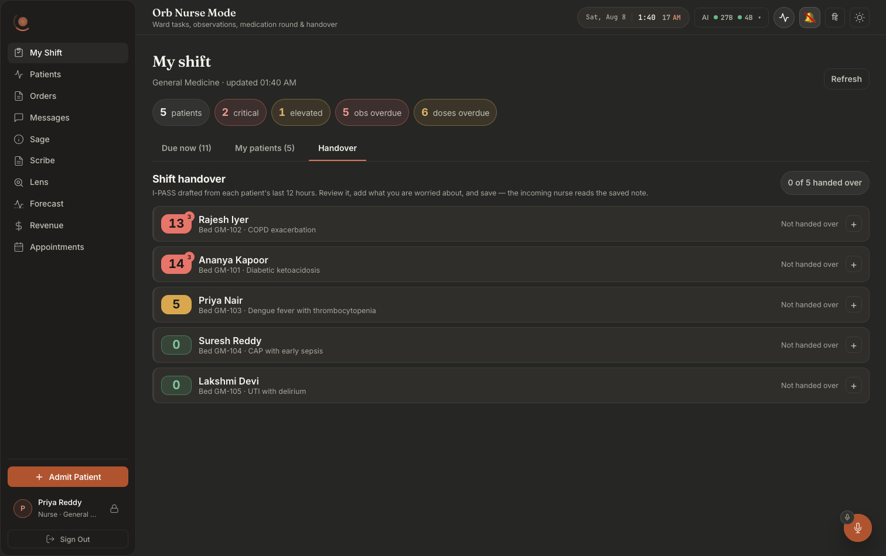
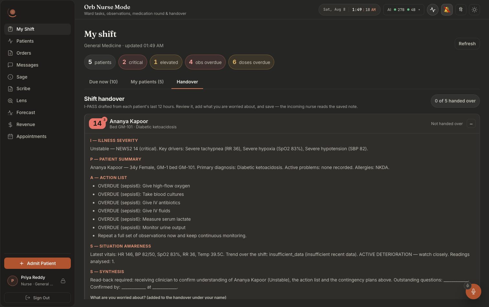
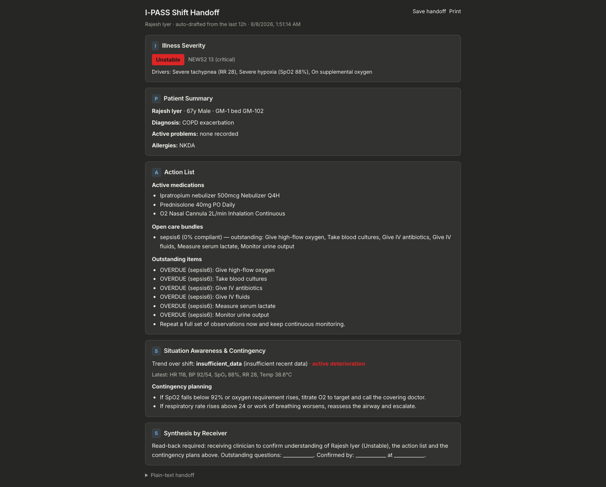

# Screen map 10: Nurse: the I-PASS handover

**What this is.** An index of every visible thing on the shift-handover surface, the **Handover**
tab of Nurse Mode, plus the full-page per-patient I-PASS sheet that the same server draft also
feeds, and the exact code that puts each thing on screen. Read an entry, then go to the file:line
it names. Every citation in this file was opened and read at that line.

**Scope.** Two surfaces, one server pipeline:

| Surface | File | Lines |
|---|---|---|
| Handover tab (the nurse's whole-list handover) | `src/pages/panels/nurse/HandoverSheet.tsx` | 34–247 |
| Full-page per-patient I-PASS sheet (`/handoff/:patientId`) | `src/components/handoff/IpassHandoffView.tsx` | 75–312 |
| Route wrapper for that page | `src/pages/HandoffPage.tsx` | 5–9 |

Both read the **same** endpoint (`GET /api/ipass/{patient_id}/draft`) and both write through the
**same** endpoint (`POST /api/ipass/{patient_id}/save`). The document itself is assembled in
`server/services/ipass_service.py` (whole file, 504 lines).

Two shared leaves are covered where they appear here: `src/pages/panels/nurse/News2Badge.tsx`
(whole file, 43 lines) and `src/pages/panels/nurse/time.ts::clockTime` (23–26). The shift board
underneath the tab strip, task rows, patient cards, obs entry, the drug round, is screens 08 and
09 and is not re-documented here beyond the tab that switches to this one.

---

## What it looks like



**Notice the counter top-right, "0 of 5 handed over", and that every row is closed by
default**, showing only a NEWS2 badge, bed, diagnosis, a `Not handed over` state and a `+`.
Before it is a document, this screen is a checklist of beds.



**Notice** that the five I-PASS letters are rendered as *labelled section headings*
(`I, ILLNESS SEVERITY`, `P, PATIENT SUMMARY`, `A, ACTION LIST` …) rather than as prose,
that the action list is the sepsis-six bundle with each outstanding item prefixed
**OVERDUE**, and that the final S deliberately ends in blanks, "Outstanding questions:
________. Confirmed by: ________ at ________.", for the receiving nurse to complete.
Underneath sits the one free-text prompt on the screen: *"What are you worried about? (added
to the handover under your name)"*.



**Notice what the full-page route adds over the tab**: **Save handoff** and **Print** in the
header, a coloured key badge per letter, a **Contingency planning** block with if/then lines
("If SpO2 is 91% or below (NEWS2 3 points) or oxygen requirement rises, titrate O2 to target
and call the covering doctor"; for a patient on SpO2 Scale 2 the line uses their 88-92% target
instead. The capture predates the 2026-10-03 wording, which read "falls below 92%"), and a "Plain-text handoff" disclosure at the foot for pasting elsewhere.
Same document, same two endpoints, different frame.

---

## The single most important thing on this screen

**Almost nothing here is typed by the nurse.** Five of the six blocks in the document are assembled
deterministically on the server from the database, no LLM is called
(`server/services/ipass_service.py:12-15`, and `build_ipass` at `:391-453` makes no model call).
The **only** human-authored field is the "What are you worried about?" textarea
(`HandoverSheet.tsx:211-218`). That text is never mixed into the drafted sections; it is appended
to the end of the saved note under an explicit `HANDOVER NOTE, <name>, <timestamp>` heading
(`HandoverSheet.tsx:96-100`) so a reader can always tell the machine's words from the nurse's.

**Three drafted fields exist in the payload but are invisible on the Handover tab.** They are saved
into the note and they are visible on the full-page sheet, but the nurse tab never renders them:

| Field | In the payload | On the Handover tab | On the full page | In the saved note |
|---|---|---|---|---|
| `action_list.active_medications` | yes | **not rendered** | §B.5 | yes (`ipass_service.py:356-364`) |
| `action_list.open_care_bundles` | yes | **not rendered** | §B.5 | yes (`ipass_service.py:365-368`) |
| `situation_awareness.contingencies` | yes | **not rendered** | §B.6 | yes (`ipass_service.py:377-379`) |

The Handover tab's "S, Situation awareness" row shows `situation_awareness.text`
(`HandoverSheet.tsx:200`), and that string, built at `ipass_service.py:300-304`, contains latest
vitals, trend and reading count but **no contingency lines**. So a nurse reading the tab sees the
trend but not the "if SpO2 falls below 92%…" plan, even though that plan is in the note she saves.

---

## How you get here

Left nav → **My Shift** (`src/pages/ClinicianShell.tsx:27`, `id: 'shift', label: 'My Shift',
pillar: 'Nurse Mode'`; mounted at `:715-717` inside a `PanelErrorBoundary`). For a nurse this is
the landing screen: the per-role tab list at `ClinicianShell.tsx:227` puts `'shift'` first and the
shell opens `accessibleTabs[0]`.

Inside that panel, the third tab in the strip, **Handover**, switches `view` to `'handover'`
(`NursePanel.tsx:37` declares the three views, `:256` is the label, `:258-271` the button). The tab
panel is rendered at `NursePanel.tsx:393-397`:

```
{board && view === 'handover' && (
  <div id="nurse-panel-handover" role="tabpanel" aria-labelledby="nurse-tab-handover">
    <HandoverSheet patients={board.patients} />
```

`board` is **not** raw state, it is `offline.data` from `useOfflineSnapshot` (`NursePanel.tsx:282-286`).
That matters twice: with no board at all the tab renders **nothing** (the `board &&` guard), and
with a cached board the handover list is built from a copy that the banner above it dates.

The full-page sheet at `/handoff/:patientId` is reached from a **different** screen: the `HANDOFF`
button on the Vigil patient command bar (`src/pages/panels/VigilPanel.tsx:1262`, 
`window.open('/handoff/' + patientId, '_blank')`). The route is registered at `src/AppRoot.tsx:186` and
is open to every signed-in non-patient role. **Nothing in Nurse Mode links to it.**

**Layout in one sentence.** The Handover tab is a header row (title + hint on the left, a pill
counter on the right), then a vertical stack of one collapsed row per patient, NEWS2 badge, name,
bed·diagnosis, handed-over state, a `+`/`−` chevron, each of which expands in place into a
five-row definition list, a textarea, a footnote and one primary button.

---

# A. The Handover tab

Root: `<div className="handover">` at `HandoverSheet.tsx:119`, styled at `NursePanel.css:957`
(column flex, `gap: var(--space-3)`).

## A.1 The header block

### "Shift handover": the heading
**Where:** top-left of the tab body, immediately under the Offline banner slot.
**Rendered by:** `HandoverSheet.tsx:122`, `<h2 className="nurse-section__title">Shift handover</h2>`.
Styled at `NursePanel.css:124-131` (flex row, `--text-md`, weight 700, `--text-primary`).
**Data from:** hardcoded.
**API / Server:** none.
**Change this →** the heading text changes. It is the only `<h2>` in the tab panel, so it is also
what a screen-reader user lands on when they jump by heading after activating the tab. Removing it
leaves the panel with no heading at all, the `aria-labelledby="nurse-tab-handover"` on the wrapper
(`NursePanel.tsx:394`) still names the region, but nothing inside it is a heading.

### The explanatory hint under the heading
**Where:** directly under "Shift handover", small muted text, two lines wide on a tablet.
**Rendered by:** `HandoverSheet.tsx:123-126`, `<p className="nurse-section__hint">I-PASS drafted
from each patient's last 12 hours. Review it, add what you are worried about, and save, the
incoming nurse reads the saved note.</p>`. Styled at `NursePanel.css:147-152` (`--text-xs`,
`--text-muted`).
**Data from:** hardcoded. The "last 12 hours" claim is a **literal**, not a binding: the actual
window is `HANDOFF_WINDOW_HOURS = 12` at `server/services/ipass_service.py:32`, defaulted into
`build_ipass(patient_id, window_hours=HANDOFF_WINDOW_HOURS)` at `:391`. The response carries the
real value as `window_hours` (`:449`) and this sentence does not read it.
**Change this →** the wording changes. Changing the server constant at `ipass_service.py:32`
**silently makes this sentence wrong**, the tab keeps saying "12 hours" whatever the draft used.
The full-page sheet does not have that problem: it prints `{draft.window_hours}` from the payload
(`IpassHandoffView.tsx:155-156`).

### "N of M handed over": the progress pill
**Where:** top-right of the header row, a rounded outlined chip with tabular figures.
**Rendered by:** `HandoverSheet.tsx:128-130`, `<span className="handover__progress"
aria-live="polite">{handedOver} of {patients.length} handed over</span>`. Styled at
`NursePanel.css:967-976` (`--radius-full`, `--bg-glass`, `font-variant-numeric: tabular-nums`).
**Data from:** `handedOver = patients.filter(p => saved[p.patient_id]).length`
(`HandoverSheet.tsx:116`). `saved` is a `Record<patientId, ISO timestamp>` set only at `:102`,
after a successful save. `patients.length` is `board.patients.length` from the shift board.
**API:** none directly, the count is a client-side tally of this session's successful
`POST /api/ipass/{id}/save` calls.
**Change this →** every successful save increments the left number and the pill re-announces itself
to screen readers (`aria-live="polite"`). **It is not persisted.** `saved` is component state; a
page refresh, a tab switch that unmounts the panel, or a logout resets it to `0 of M` and every row
below reverts to "Not handed over", even though the notes really were saved to the database. To
make it survive a reload you would have to read `GET /api/ipass/{id}/recent`
(`server/routes/ipass_routes.py:75-83`), which is implemented and exposed as
`getRecentHandoffs` (`src/api/ipass.ts:114-117`) but **has no caller anywhere in the frontend**.

## A.2 The empty state

### "No patients to hand over."
**Where:** where the list would be, a dashed-border centred panel.
**Rendered by:** `HandoverSheet.tsx:133`, `{patients.length === 0 && <p className="nurse-empty">No
patients to hand over.</p>}`. Styled at `NursePanel.css:154-162` (dashed `--border-subtle`, centred,
`--text-muted`).
**Data from:** `patients.length`, i.e. `board.patients` from `getShiftBoard()`.
**Server:** the board comes from the nurse shift-board route (screen 08); its patient set is scoped
server-side from the signed-in user's department, never from anything the screen sends
(`NursePanel.tsx:224-227`).
**Change this →** the sentence changes. Note the header and the empty pill still render above it, 
you will see "Shift handover", the hint, "0 of 0 handed over", and then this line. It disappears the
moment the board returns one patient.

## A.3 A collapsed patient row

The list is `<ul className="handover__list">` at `HandoverSheet.tsx:135` (`NursePanel.css:978`,
column flex, `gap: var(--space-2)`), one `<li>` per patient at `:141`.

### The row card itself
**Where:** full width of the tab, a bordered card with a 3px left edge.
**Rendered by:** `HandoverSheet.tsx:141`, 
`<li className={"handover__item " + (isSaved ? "handover__item--done" : "")} key={p.patient_id}>`.
Styled at `NursePanel.css:980-986` (surface background, `border-left: 3px solid var(--border-subtle)`,
`overflow: hidden` so the expanded body's top border does not escape the radius).
**Data from:** `isSaved = !!saved[p.patient_id]` (`HandoverSheet.tsx:139`).
**Change this →** once this patient's handover saves, the left edge turns **green**
(`.handover__item--done { border-left-color: var(--status-ok) }`, `NursePanel.css:988`). It is the
only persistent visual difference between a handed-over patient and one not yet touched, the rows
do **not** re-sort, so a saved patient stays exactly where it was in the list.

### The row button (the whole row is one target)
**Where:** the entire collapsed row.
**Rendered by:** `HandoverSheet.tsx:142-148`, a `<button type="button" className="handover__toggle"
onClick={() => toggle(p.patient_id)} aria-expanded={isOpen} aria-controls={`handover-body-${p.patient_id}`}>`.
Styled at `NursePanel.css:990-1001` (`min-height: var(--tap-min)`, 44px, gloved-hand target),
hover at `:1003`, focus ring at `:258-264` (`outline: 2px solid var(--focus-ring)`).
**Data from:** `isOpen = openId === p.patient_id` (`HandoverSheet.tsx:138`).
**Change this →** clicking runs `toggle` (`:68-72`): it sets `openId` to this patient or to `null`
if it was already open, and **fires `loadDraft` only if no draft is cached for that patient**
(`if (next && !drafts[next]) void loadDraft(next)`, `:71`). Two visible consequences:
`openId` is a single value, so **opening a second patient closes the first**; and **re-opening a row
never refetches**, the I-PASS you see the second time is the one drafted when you first opened it,
however long ago. New observations charted in between will not appear until the panel remounts.
Removing `aria-expanded` breaks the screen-reader announcement of open/closed while leaving the
visual `+`/`−` intact.

### The NEWS2 badge on the row
**Where:** far left of the row, a small filled square with a bare integer.
**Rendered by:** `HandoverSheet.tsx:149`, `<News2Badge news2={p.news2} labelled={false} />`.
The component is `src/pages/panels/nurse/News2Badge.tsx:19-43`; with `labelled={false}` the "NEWS2"
caption at `:38` is suppressed and only `<span className="news2__value">{news2.raw_news2}</span>`
(`:39`) shows.
**Data from:** `p.news2` on the shift-board card (`src/api/nurse.ts:78`), **not** from the I-PASS
draft. The board computes it server-side; the draft computes its own severity separately.
**Server:** ultimately `server/services/vigil_service.py::compute_news2` (`:234-399`), whose banding
is `>=7 → critical`, `>=5 or any single parameter scoring 3 → elevated`, else `stable`
(`:333-339`).
**Change this →** the fill follows the level: `critical` fills `--status-danger` with
`--status-on-fill` text (`NursePanel.css:302-307`), `elevated` fills `--status-warn` (`:309-314`),
`stable` is a 16% `--status-ok` wash with `--status-ok-text` (`:316-320`), and a patient with no
observations renders an em-dash in `--text-muted` (`News2Badge.tsx:21-26`, CSS `:322`). A small red
`3` flag pins to the top-right corner when `single_param_3` is true (`News2Badge.tsx:40`, CSS
`:325-333`), that is the patient whose aggregate looks unremarkable but who needs urgent review.
The hover tooltip is built at `News2Badge.tsx:32-36` and adds "· a single parameter scores 3" and
"· SpO₂ Scale 2" when they apply. **Because this badge reads the board and the document below reads
its own fresh draft, the two can disagree**, most visibly when the board is a cached copy.

### The patient name
**Where:** first line of the middle column.
**Rendered by:** `HandoverSheet.tsx:151`, `<span className="handover__name">{p.name}</span>`.
Styled at `NursePanel.css:1006` (`--text-base`, weight 600, `--text-primary`).
**Data from:** `NursePatientCard.name` (`src/api/nurse.ts:67`).
**Change this →** the name changes. The column is `min-width: 0` (`NursePanel.css:1005`) so a long
name shrinks the column rather than pushing the state text off the card.

### The bed · diagnosis meta line
**Where:** second line of the middle column, small and muted, truncated with an ellipsis.
**Rendered by:** `HandoverSheet.tsx:152-154`, 
`{[p.bed && \`Bed ${p.bed}\`, p.diagnosis].filter(Boolean).join(' · ') || ', '}`.
Styled at `NursePanel.css:1007-1013` (`--text-xs`, `--text-muted`, `white-space: nowrap`,
`text-overflow: ellipsis`).
**Data from:** `p.bed` and `p.diagnosis` on the board card (`src/api/nurse.ts:69`, `:73`).
**Change this →** with a bed and a diagnosis you see `Bed 7 · Community-acquired pneumonia`; with
only one of them, just that one, no separator; with **neither**, a single em-dash `, `. It never
wraps, a long diagnosis is cut with `…` rather than growing the row.

### "Not handed over" / "Handed over 19:42"
**Where:** right of the identity column, before the chevron; small muted text.
**Rendered by:** `HandoverSheet.tsx:156-158`, `<span className="handover__state">{isSaved ?
\`Handed over ${clockTime(saved[p.patient_id])}\` : 'Not handed over'}</span>`. Styled at
`NursePanel.css:1015`; the saved variant turns `--status-ok-text` and weight 600 via
`.handover__item--done .handover__state` (`:1016`).
**Data from:** `saved[p.patient_id]`, the ISO string written at `HandoverSheet.tsx:102`, formatted by
`clockTime` (`src/pages/panels/nurse/time.ts:23-26`, `toLocaleTimeString` with 2-digit hour and
minute, `', '` for null).
**Change this →** on a successful save the text flips to green "Handed over HH:MM" and the card's
left edge turns green at the same moment. **It disappears entirely below 560px**, 
`.handover__state { display: none }` inside the phone media query (`NursePanel.css:1133`, inside
`@media (max-width: 560px)` opened at `:1108`), so on a phone the green left edge is the *only*
signal that a patient has been handed over.

### The +/− chevron
**Where:** far right of the row, a 28×28 bordered square.
**Rendered by:** `HandoverSheet.tsx:159`, `<span className="handover__chevron"
aria-hidden="true">{isOpen ? '−' : '+'}</span>`. Styled at `NursePanel.css:1018-1029`.
**Data from:** `isOpen`.
**Change this →** it toggles between `+` and `−` on every click of the row. It is
`aria-hidden` on purpose, `aria-expanded` on the button already carries the state, so a screen
reader is not told "plus" twice. It is not a separate click target; the whole row is the button.

## A.4 The expanded body: its three states

The body is `<div className="handover__body" id={\`handover-body-${p.patient_id}\`}>` at
`HandoverSheet.tsx:163`, rendered only when `isOpen` (`:162`). Styled at `NursePanel.css:1031-1037`
(column flex, `border-top: 1px solid var(--border-subtle)`). Its `id` is the target of the button's
`aria-controls`.

### "Drafting handover…": the loading state
**Where:** inside the just-expanded row, a dashed centred panel where the document will be.
**Rendered by:** `HandoverSheet.tsx:164`, `{state.status === 'loading' && <p className="nurse-empty">Drafting handover…</p>}`.
**Data from:** `drafts[p.patient_id].status`, set to `'loading'` at `:56` as the first line of
`loadDraft`.
**API:** `GET /api/ipass/{patient_id}/draft`, `getIpassDraft` at `src/api/ipass.ts:98-100`, through
`apiFetch` (`src/api/client.ts:195-268`, `credentials: 'include'`, base `${API_HOST}/api` at `:10`).
**Server:** `server/routes/ipass_routes.py:24-35` → `build_ipass(patient_id)`
(`server/services/ipass_service.py:391-453`).
**Change this →** this is what a nurse stares at while the server reads six tables and runs NEWS2 +
the trend query. It disappears when the promise settles either way. If the request never resolves,
this is where the row stays, there is no timeout and no cancel.

### The red failure note and its Retry button
**Where:** replaces the document inside the expanded row; red-tinted bordered strip with a small
outlined button on its right.
**Rendered by:** `HandoverSheet.tsx:165-171`, `<div className="nurse-note nurse-note--danger"
role="alert">{state.message}<button … className="nurse-btn nurse-btn--ghost nurse-btn--compact"
onClick={() => void loadDraft(p.patient_id)}>Retry</button></div>`. Styled at `NursePanel.css:165-177`
plus the danger variant at `:179-183` (12% `--status-danger` wash, `--status-danger-text`); the
button at `:206-217`, `:219`, `:235-240`.
**Data from:** `state.message`, set in the `catch` at `HandoverSheet.tsx:60-65` to `e.message`, or
the literal `'Could not draft handover'` when the thrown value is not an `Error`.
**API / Server:** the message is whatever `apiFetch` threw:
- **404 "Patient not found"**, either the patient genuinely does not exist
  (`ipass_routes.py:32-35` converts the `ValueError` from `ipass_service.py:404`), **or** the
  patient is outside the caller's department and `require_patient_access` deliberately returns 404
  rather than 403 so the screen cannot confirm the patient exists
  (`server/permissions.py:462-464`, raise at `:499`).
- **403 "Insufficient permissions"**, the role lacks `vitals.read`
  (`ipass_routes.py:27-29`; `require_permission` builds the structured 403 at
  `server/permissions.py:435-440`, and `apiFetch` re-throws it with `.status = 403` at
  `src/api/client.ts:210-224`). In practice unreachable from Nurse Mode: `nurse` holds
  `VITALS_READ` (`server/permissions.py:121`).
- **"Failed to fetch"**, the appliance is unreachable.
- **"Session expired"**, a 401 also fires the re-auth modal (`src/api/client.ts:204-206`).
**Change this →** `role="alert"` means a screen reader interrupts and reads it as soon as it
appears. Pressing **Retry** puts the row straight back into "Drafting handover…" and re-issues the
same GET, it is the **only** way to force a refresh of an already-loaded patient, and it is only
reachable while the row is in the error state. A row that loaded successfully has no refresh
control at all.

### The success state
When `state.status === 'ready'` (`HandoverSheet.tsx:173`) the fragment at `:174-237` renders the
document, the textarea, the save error slot and the action row. Everything in §A.5–§A.8 lives
inside that fragment.

## A.5 The I-PASS document (the five rows)

The document is a definition list: `<dl className="ipass">` at `HandoverSheet.tsx:175`
(`NursePanel.css:1039`), five `<div className="ipass__row">` children (`:1041`). Every `dt` renders
uppercase, letter-spaced, weight 700, in `--accent-text` (`NursePanel.css:1043-1049`); every `dd` is
`--text-sm`, line-height 1.55, `--text-secondary` (`:1051-1055`).

### "I: Illness severity" and its sentence
**Where:** first row of the document.
**Rendered by:** `HandoverSheet.tsx:177` (the `dt` label, hardcoded) and `:178`, 
`<dd>{state.draft.sections.illness_severity.text}</dd>`.
**Data from:** `IpassDraft.sections.illness_severity.text` (`src/api/ipass.ts:36-43`).
**API:** `GET /api/ipass/{patient_id}/draft`.
**Server:** `server/services/ipass_service.py::_build_illness_severity` (`:147-164`). The sentence is
composed at `:152-156` as `"{severity}, NEWS2 {n} ({level}). Key drivers: {a, b, c}."`, for
example `Watcher, NEWS2 6 (elevated). Key drivers: Tachypnea (RR 23), Hypoxia (SpO2 93%).`
The severity **word** comes from `_SEVERITY_MAP` at `:35-39`: `critical → Unstable`,
`elevated → Watcher`, `stable → Stable`, defaulting to `Watcher` for anything unrecognised
(`:149`). `raw_news2` and `drivers` come from `get_patient_risk`
(`server/services/vigil_service.py:407-477`), which computes NEWS2 from the single most recent
vitals row (`:417-427`, ordered `timestamp DESC, id DESC` so a re-charted correction wins a tie)
and may be **escalated, never lowered, ** by the CfC overlay at `:449-475`.
**Change this →** this one `dd` is the entire illness-severity indicator on the nurse tab. There is
**no coloured severity chip here**, the colour cue is the NEWS2 badge up in the row header (§A.3),
and the full-page sheet is the surface that renders a filled chip (§B.4). If the patient has no
recorded vitals, `get_patient_risk` returns the stub at `vigil_service.py:433-434` and the sentence
reads `Stable, NEWS2 unavailable (stable). Key drivers: No vitals recorded.`, note it still says
"Stable". Change `_SEVERITY_MAP` and the leading word of this sentence changes everywhere the draft
is rendered, including inside the saved note.

### "P: Patient summary" and its paragraph
**Where:** second row.
**Rendered by:** `HandoverSheet.tsx:181` (label) and `:182`, 
`<dd>{state.draft.sections.patient_summary.text}</dd>`.
**Data from:** `sections.patient_summary.text` (`src/api/ipass.ts:44-55`). The structured siblings, 
`name`, `mrn`, `age`, `sex`, `ward`, `bed`, `diagnosis`, `problems[]`, `allergies[]`, are present in
the payload and **unused by this tab**.
**Server:** `ipass_service.py::_build_patient_summary` (`:167-193`), sentence built at `:175-181`:
`"{name}, {age}y {sex}, {ward} bed {bed}. Primary diagnosis: {dx}. Active problems: {…}.
Allergies: {…}."` Sources: `patients` row (`_get_patient`, `:63-66`), active rows of `problem_list`
(`_get_active_problems`, `:110-117`), active rows of `patient_allergies` (`_get_active_allergies`,
`:120-127`). Age prefers the stored `age` column and otherwise derives it from `date_of_birth`
(`_compute_age`, `:68-80`).
**Change this →** missing data degrades to explicit words rather than blanks: no diagnosis prints
`not documented`, no problems prints `none recorded`, no allergies prints **`NKDA`** (`:180`), and
an unknown age prints `?y` (`:174`). That NKDA is a **derived** claim, it means "no active row in
`patient_allergies`", not "someone asked the patient". Adding an active allergy row makes it appear
here by name with its reaction in brackets (`:170-173`).

### "A: Action list" and its bullets
**Where:** third row. Either a disc-bulleted list or a single fallback sentence.
**Rendered by:** `HandoverSheet.tsx:185-196`. The branch is at `:187`
(`outstanding_items.length > 0`); the list is `<ul className="ipass__actions">` at `:188` with one
`<li key={item}>{item}</li>` per string at `:189-191`; the fallback string
`'No outstanding actions recorded.'` is at `:194`. Styled at `NursePanel.css:1057` (disc bullets,
`padding-left: var(--space-5)`).
**Data from:** `sections.action_list.outstanding_items`, a flat `string[]` (`src/api/ipass.ts:59`).
**Server:** `ipass_service.py::_build_action_list` (`:196-236`). Each string is composed there:
- `OVERDUE (sepsis): Blood cultures`, one per bundle element whose state is `overdue` (`:218-219`).
- `Pending (sepsis): Lactate`, one per element still `pending` (`:220-221`).
- `Repeat a full set of observations now and keep continuous monitoring.`, appended when the risk
  level is `critical` (`:225-226`).
- `Recheck observations within the hour and review response to treatment.`, when `elevated`
  (`:227-228`).
- `Continue routine observations; no outstanding actions handed over.`, appended only when there
  are no meds, no bundles **and** no items (`:229-230`).
Bundle element states come from `server/services/sepsis_bundle_service.py::_decorate`
(`:122-163`), an element with no completion timestamp is `overdue` once elapsed minutes pass its
target, else `pending`. The bundles themselves are fetched at `ipass_service.py:420-425`, inside a
`try/except` that logs and falls back to `bundles = []` if the lookup throws.
**Change this →** each new outstanding string is one more bullet, in the order the server built
them: bundle items first (overdue before pending, bundle by bundle), then the severity line. **This
list is not the whole action list**, `active_medications` and `open_care_bundles` are in the same
payload object and are never rendered on this tab (they are in §B.5 and in the saved note). Because
of the fallback at `:229-230`, the on-screen `'No outstanding actions recorded.'` at
`HandoverSheet.tsx:194` is nearly unreachable: it only shows if `outstanding_items` is empty, which
requires the patient to have **at least one active medication or one open bundle** while being
`stable` with nothing overdue or pending.

### "S: Situation awareness" and its sentence (the trend line)
**Where:** fourth row.
**Rendered by:** `HandoverSheet.tsx:199` (label) and `:200`, 
`<dd>{state.draft.sections.situation_awareness.text}</dd>`.
**Data from:** `sections.situation_awareness.text` (`src/api/ipass.ts:61-69`). The siblings `trend`,
`trend_detail`, `active_deterioration`, `latest_vitals`, `readings_count` and **`contingencies`** are
all in the payload and unused by this tab.
**Server:** `ipass_service.py::_build_situation_awareness` (`:268-313`), text composed at `:300-304`:
`"Latest vitals: HR 104, BP 96/58, SpO2 93%, RR 22, Temp 38.4C. Trend over the shift: deteriorating
(HR +12.0, SBP -14.0). ACTIVE DETERIORATION, watch closely. Readings analysed: 9."`
- The vitals half is the **last row in the window** (`latest = vitals[-1]`, `:269`), formatted by
  `_num` (`:50-57`) which prints `--` for a missing value and one decimal for temperature.
- The window is `vitals` from `_get_vitals_window` (`:83-97`): everything at or after the 12h
  cutoff, ascending, and if that is empty, the single most recent reading of all time, so
  "Latest vitals" can be **days old** while `Readings analysed: 1`.
- `Trend over the shift` is `get_vitals_trend(patient_id, hours=window_hours // 2)`, 6h by
  default (`ipass_service.py:414`), computed in `server/services/vigil_service.py:481-567`. It
  compares the last 6h against the 6h before that; the label is `deteriorating` when at least two of
  {HR up >10, SBP down >10, SpO2 down >2} hold (`:543-553`), `improving` when SpO2 up >1 or SBP up
  >5 with no concerns (`:547-557`), else `stable`.
- `trend_detail` is the `+/-` deltas joined at `ipass_service.py:285-289`, or the literal
  `insufficient recent data` when no delta could be computed.
- `ACTIVE DETERIORATION, watch closely.` is inserted at `:302` when `active_deterioration` is true,
  which is `level in (critical, elevated) or trend == 'deteriorating'` (`:272`).
**Change this →** this is the trend/summary line the founder's brief asks about, and it is a single
uninterrupted sentence, there is no separate trend chip, arrow or colour on this tab. The most
important behaviour here is a **fix**, documented at `vigil_service.py:484-498`: a patient with only
one observation set now yields `trend: insufficient_data` and this line reads
`Trend over the shift: insufficient_data (insufficient recent data)`. Before that fix, `AVG()` over
zero rows returned a row of NULLs, so absolute values were reported as deltas from zero and a
just-admitted patient with SpO2 89 was handed over as **"improving (SpO2 +89.0)"**. If you change
either guard at `:522-528`, that failure returns, and it returns on exactly the patients an
oncoming nurse knows least about.
**The contingency plans are missing from this view.** `contingencies` is built by
`ipass_service.py::_contingencies`, one line per vital that scored in the NEWS2 breakdown, for
the side of normal its charted value sits on (ruled 2026-10-03; until then it keyword-matched
the drivers and handed SBP 225 the fluid-bolus line). Each number is the RCP chart's 3-point
threshold (`_VITAL_LINES`), e.g. `"If systolic BP is 90 mmHg or below (NEWS2 3 points), give a
fluid bolus per protocol and escalate to the registrar."`, pinned against `compute_news2` by
`server/tests/test_ipass_news2_contingency.py`, with a severity-based default when nothing
scored. To surface them on this tab you would add a row rendering
`state.draft.sections.situation_awareness.contingencies` the same way §A.5's action list does.
They already reach the incoming nurse, via the saved note (`:377-379`).

### "S: Synthesis" and its read-back sentence
**Where:** fifth and last row of the document.
**Rendered by:** `HandoverSheet.tsx:203` (label) and `:204`, 
`<dd>{state.draft.sections.synthesis.text}</dd>`.
**Data from:** `sections.synthesis.text` (`src/api/ipass.ts:70-74`).
**Server:** `ipass_service.py::_build_synthesis` (`:316-327`), text at `:317-322`:
`"Read-back required: receiving clinician to confirm understanding of {name} ({severity}), the
action list and the contingency plans above. Outstanding questions: ____________. Confirmed by:
____________  at ____________."`
**Change this →** the underscores are literal characters in the string, not inputs, there is
**nothing on this screen the receiving nurse can fill in**. `read_back_required` is hardcoded `True`
and `confirmed` hardcoded `False` (`:324-325`); neither is rendered and no endpoint sets them. The
blanks exist to be filled on paper after printing, which is why the sentence mentions "the
contingency plans above" that this tab does not show. Wire a real confirmation and this is the
string to replace.

## A.6 The nurse's own words

### "What are you worried about?": the label
**Where:** below the document, above the textarea.
**Rendered by:** `HandoverSheet.tsx:208-210`, `<label className="handover__note-label"
htmlFor={\`handover-note-${p.patient_id}\`}>What are you worried about? (added to the handover under
your name)</label>`. Styled at `NursePanel.css:1059-1063` (`--text-xs`, weight 600,
`--text-secondary`).
**Data from:** hardcoded. The `htmlFor` matches the textarea's `id` at `:212`, so clicking the label
focuses the box.
**Change this →** the prompt changes. The parenthetical is a promise the save path keeps literally, 
see §A.8.

### The worry textarea
**Where:** full width, three rows tall, resizable vertically only.
**Rendered by:** `HandoverSheet.tsx:211-218`, `<textarea id={\`handover-note-${p.patient_id}\`}
className="handover__note" rows={3} placeholder="e.g. BP drifting down since 14:00, recheck within
the hour." value={notes[p.patient_id] ?? ''} onChange={e => setNote(p.patient_id, e.target.value)} />`.
Styled at `NursePanel.css:1065-1076`; placeholder colour at `:1078`; the focus state at `:1080-1084`
swaps the border to `--focus-ring` and adds a 3px 22% `--accent-gold` glow.
**Data from:** `notes[p.patient_id]`, a controlled value. Written by `setNote` (`:74-80`), which does
two things on every keystroke: updates React state, and mirrors the text to
`localStorage` under `orb:nurse:handover-note:<patientId>` (key built at `:32`), removing the key
when the text is whitespace-only (`:77-78`). Restored on mount by the effect at `:44-53`, which
merges as `{...restored, ...prev}` (`:52`) so anything already typed in this session wins.
**API / Server:** none while typing, nothing leaves the device until Save.
**Change this →** this is **the only field on the screen a human writes**. Typing shows the text and
persists it immediately; a browser crash, a tab switch, a panel remount or a battery death all give
it back. Clearing the box to whitespace deletes the stored copy. A successful save also deletes it
(`:105`), deliberately, so last night's worry does not reappear on tonight's shift. Note two
differences from the observation draft on screen 09: this key is **not namespaced by user** and
carries **no timestamp**, so on a shared tablet a note typed by one nurse is restored for whoever
signs in next; the obs draft, by contrast, is owner-checked and deleted when it belongs to someone
else (`src/pages/panels/nurse/ObsEntrySheet.tsx:130-148`). Every `localStorage` call here is inside a
`try/catch` (`:47-50`, `:76-79`, `:105`), so a browser with storage disabled degrades to
in-memory-only with no visible error.

## A.7 The save-failure line

### The red save error
**Where:** between the textarea and the action row.
**Rendered by:** `HandoverSheet.tsx:220-222`, `{saveError[p.patient_id] && <div className="nurse-note
nurse-note--danger" role="alert">{saveError[p.patient_id]}</div>}`. Same styling as §A.4's failure
note (`NursePanel.css:165-183`) but with no Retry button, the Save button below is the retry.
**Data from:** `saveError[p.patient_id]`, cleared to `''` at the start of every save attempt
(`:86`) and set in the `catch` at `:106-110`.
**API / Server:** `POST /api/ipass/{patient_id}/save` (`src/api/ipass.ts:103-111`) →
`server/routes/ipass_routes.py:38-72`.
**Change this →** the three messages you can actually see here:
- **Offline:** `Cannot save this handover, this device is offline. Your entry has not been saved.
  Reconnect and enter it again.` Thrown *before* any request by `assertOnlineForWrite('save this
  handover')` (`HandoverSheet.tsx:91`); wording built at
  `src/lib/offline/writeGuard.ts:43-48`. The guard exists because Orb's offline mode is read-only by
  design, nothing is queued for later, and the message must never imply it is
  (`writeGuard.ts:33-42`). The typed note survives in `localStorage`, so retrying after reconnecting
  loses nothing.
- **403 Insufficient permissions:** the role lacks `scribe.create_draft` (`ipass_routes.py:43`).
  Unreachable for `nurse` and `doctor` (`server/permissions.py:107`, `:122`) but **reachable for an
  `admin`**, who holds `VITALS_READ` but not `SCRIBE_CREATE_DRAFT` (`:142-143`), an administrator
  can therefore open and read every I-PASS document on this tab and be refused at Save.
- **400 `content is required`:** only if the body arrives without `content` (`ipass_routes.py:47-48`).
Whatever the failure, `role="alert"` announces it, the row stays open, the textarea keeps its text,
and the row's state text stays "Not handed over".

## A.8 The action row

### The auto-draft caveat footnote
**Where:** bottom-left of the expanded row, sharing a line with the Save button.
**Rendered by:** `HandoverSheet.tsx:225-227`, `<span className="nurse-footnote">Auto-drafted from
recorded data, read it against the patient before handing over.</span>`. Styled at
`NursePanel.css:147-152` and given `flex: 1; min-width: 200px` at `:1094`.
**Data from:** hardcoded.
**Change this →** the sentence changes. It is the screen's only statement that the five rows above
were generated rather than written, and it sits deliberately next to the button that commits them
to the record. Below 560px the action row stacks (`NursePanel.css:1134`) and this footnote sits above
a full-width button (`:1135`).

### "Save handover" / "Saving…" / "Save again"
**Where:** bottom-right of the expanded row; the only primary-filled button on the tab.
**Rendered by:** `HandoverSheet.tsx:228-235`, `<button type="button" className="nurse-btn
nurse-btn--primary" onClick={() => void save(p.patient_id)} disabled={saving === p.patient_id}>
{saving === p.patient_id ? 'Saving…' : isSaved ? 'Save again' : 'Save handover'}</button>`. Styled at
`NursePanel.css:206-217` + `:221-226` (`--accent-deep` fill, `--btn-primary-text`), disabled state at
`:251-256` (`--btn-disabled-bg`, `cursor: not-allowed`), focus ring at `:258-264`.
**Data from:** `saving` (a single patient id or null, `:39`) and `isSaved`.
**API:** `POST /api/ipass/{patient_id}/save` with body `{ content: IpassDraft }`
(`src/api/ipass.ts:103-111`).
**Server:** `ipass_routes.py::save_draft` (`:38-72`), guarded by
`require_patient_access("scribe.create_draft")` (`:43`), which enforces the same ward scope and 404
rule as the draft route. It calls `save_ipass_handoff(patient_id, user["id"], content)`
(`ipass_service.py:456-490`), which takes `content["source_summary"]` as `raw_transcript` and
`content["plain_text"]` as `structured_note` (`:469-470`) and writes one `scribe_notes` row with
`note_format='handoff'`, `status='draft'`, `ai_generated=1` via
`server/services/scribe_service.py::save_scribe_note` (`:709-737`). It then writes an audit event
`ipass_handoff_saved` on the hash chain (`ipass_routes.py:55-70`) and returns
`{id, status:'draft', note_format:'handoff'}` (`:72`).
**Change this →** press it and the label becomes **"Saving…"** and the button greys out and refuses
clicks (`disabled` at `:232`, `saving` set at `:85` and cleared in `finally` at `:111-113`). On
success four things change at once: the row's state text becomes green **"Handed over HH:MM"**, the
card's left edge turns green, the header pill increments, and the button's resting label becomes
**"Save again"**. On failure the red line in §A.7 appears and nothing else moves.

**What is actually written, exactly.** At `HandoverSheet.tsx:92-100`:
- With an **empty** textarea, `payload = state.draft`, the server-rendered document, unchanged.
- With text, `plain_text` becomes the server's rendering plus
  `"\n\nHANDOVER NOTE, {currentUserName()}, {new Date().toLocaleString()}\n{note}\n"`. The name
  comes from `currentUserName()` (`src/api/nurse.ts:198-200`), which reads the stored session user
  and falls back to the literal **"this shift"** when there is none. That display name is
  **client-supplied**; the row's `author_id` is taken server-side from the authenticated session
  (`ipass_routes.py:51`), so the audit trail is trustworthy even if the heading is not.
- The **structured `sections` are never modified**, the worry text exists only inside `plain_text`,
  which is what lands in `structured_note`.
- The five `sections.*.text` strings the nurse just read on screen are the *same* strings the server
  put into `plain_text` (`_render_plain_text`, `:333-385`), so the saved note is a superset of what
  she reviewed: it additionally contains active medications (`:356-364`), open care bundles
  (`:365-368`) and the contingency block (`:374-379`).
- The client sends the payload it holds. Since a re-opened row never refetches (§A.3), **saving an
  hour after opening saves the hour-old draft**, timestamped `generated_at` from when it was drafted
  (`ipass_service.py:435`).
- Pressing **"Save again"** inserts a **second** `scribe_notes` row. There is no supersede link, 
  `save_scribe_note` is called without `supersedes_note_id` (`ipass_service.py:480-488`), so the
  patient accumulates one handoff note per press, all `status='draft'`.

---

# B. The full-page I-PASS sheet: `/handoff/:patientId`

Reached from Vigil's `HANDOFF` button (`src/pages/panels/VigilPanel.tsx:1262`), which opens a **new
browser tab**. The route is `src/AppRoot.tsx:186`, gated only on "signed in and not a patient";
`src/pages/HandoffPage.tsx:5-9` pulls `patientId` from the URL and renders
`<IpassHandoffView patientId={patientId} />`, or the bare text **"No patient specified."** (`:7`) if
the param is missing. This page is **outside `ClinicianShell`**, no sidebar, no top bar, no theme
toggle; just a centred 820px column (`IpassHandoffView.tsx:139`).

It is the same data as §A, laid out field-by-field instead of sentence-by-sentence, and it is the
only place the **Print** control exists.

## B.1 Page-level states

### "Drafting I-PASS handoff…"
**Where:** the whole page, 20px padding, nothing else.
**Rendered by:** `IpassHandoffView.tsx:118-120`.
**Data from:** `loading`, true from mount (`:77`) until the effect at `:96-98` → `load` (`:82-94`)
settles.
**Change this →** it is replaced wholesale by the sheet. There is no skeleton and no partial render.

### "Could not draft handoff: …" and its Retry
**Where:** the whole page.
**Rendered by:** `IpassHandoffView.tsx:122-129`, a `<p style={{color:'var(--status-danger-text)'}}>`
and an unstyled `<button onClick={() => void load()}>Retry</button>`.
**Data from:** `error`, set at `:89-91`; the fallback literal is `'Failed to draft handoff'`.
**Server:** same 404/403 semantics as §A.4.
**Change this →** Retry re-runs the same GET and returns the page to the loading state. Unlike §A.4
this button carries no `nurse-btn` class, so it renders as the browser default control.

### "No handoff data available."
**Where:** the whole page.
**Rendered by:** `IpassHandoffView.tsx:131-133`.
**Data from:** `draft === null` with `loading` false and `error` null.
**Change this →** in practice unreachable, `load` either sets `draft` or sets `error`. It is the
guard that lets everything below dereference `draft` safely.

## B.2 The page header

### "I-PASS Shift Handoff": the page title
**Rendered by:** `IpassHandoffView.tsx:151-153`, an `<h2>` at `1.2rem`.
**Change this →** the page's only heading. There is no `<title>` management, so the browser tab
still shows the app's title.

### The identity / provenance sub-line
**Where:** under the title, muted, one line.
**Rendered by:** `IpassHandoffView.tsx:154-157`, 
`{patientName || s.patient_summary.name || patientId} · auto-drafted from the last {draft.window_hours}h · {new Date(draft.generated_at).toLocaleString()}`.
**Data from:** the `patientName` prop (never passed, `HandoffPage.tsx:8` omits it), then the
drafted name, then the raw id; `window_hours` and `generated_at` from the payload
(`ipass_service.py:448-449`, `:435`).
**Change this →** unlike §A.1's hint, this reads the real window from the response, so changing
`HANDOFF_WINDOW_HOURS` (`ipass_service.py:32`) updates this line automatically. Because
`patientName` is never supplied, the fallback chain means a patient row with a null `name` displays
the raw patient id here.

### The save confirmation line
**Where:** under the header, info-coloured, small.
**Rendered by:** `IpassHandoffView.tsx:167-169`, `{saveMsg && <p style={{color:'var(--status-info)'}}>{saveMsg}</p>}`.
**Data from:** `saveMsg`, set to `Handoff saved as draft note #{res.id}.` at `:106` or to the error
message at `:108`.
**Change this →** the note id it prints is the `scribe_notes` primary key returned by the route
(`ipass_routes.py:72`). It is the only place in the app that shows a handoff note id. Success and
failure share one slot and one colour, so a failure here is **not** rendered in red.

## B.3 The header buttons

### "Save handoff" / "Saving…"
**Rendered by:** `IpassHandoffView.tsx:160-162`, inside `<div className="ipass-actions">` (`:159`).
**Data from:** `saving` (`:79`), toggled in `handleSave` (`:100-112`).
**API / Server:** identical to §A.8, `saveIpass(patientId, draft)` → `POST /api/ipass/{id}/save`.
**Change this →** the label becomes "Saving…" and the button disables; on settle, the line in §B.2
appears. **Two differences from the nurse tab:** there is no worry textarea, so `plain_text` is sent
exactly as the server rendered it, with no `HANDOVER NOTE` block; and there is **no offline guard**, 
`assertOnlineForWrite` is not called here, so an offline press fails with a raw network error
rendered in info-blue rather than the explicit "nothing was saved" wording.

### "Print"
**Where:** immediately right of Save, top-right of the page.
**Rendered by:** `IpassHandoffView.tsx:163`, `<button onClick={handlePrint}>Print</button>`;
`handlePrint` is `window.print()` (`:114-116`).
**Data from:** none.
**Change this →** it opens the browser print dialog. **What prints today is a blank page.** The
global print stylesheet (`src/print.css`, loaded app-wide at `src/main.tsx:13`) hides everything at
`@media print` with `body * { visibility: hidden !important }` (`:71-73`) and re-reveals only four
allow-listed subtrees: `.discharge-print-layout` and `.handoff-print-layout` (`:75-80`) and
`.medlist-print-layout` / `.orders-print-layout` (`:263-268`). Nothing in `IpassHandoffView` carries
any of those class names, its wrapper is a bare inline-styled `<div>` (`:139`), so the I-PASS
sheet is hidden along with everything else and the printed sheet contains only the browser's own
header and footer. The `.handoff-print-layout` markup those rules were written for is a **different
component**, `src/components/HandoffPrintView.tsx:61`, which VigilPanel portals to `document.body`
for its own PRINT RECORD flow. Giving this view a wrapping class of `handoff-print-layout`, or
adding an `.ipass`-prefixed pair of rules alongside `print.css:75-80` and `:84-103`, is what would
make this button produce paper.

## B.4 "I: Illness Severity" (the coloured indicator)

Every block on this page is a `<Section>` (`IpassHandoffView.tsx:36-73`): a bordered
`--bg-glass` card with a small square letter tag in `--status-info` on a 12% wash (`:56-67`) and the
section title beside it.

### The severity chip
**Where:** first line inside the I card, a bold filled pill reading `Unstable`, `Watcher` or `Stable`.
**Rendered by:** `IpassHandoffView.tsx:174-184`, a `<span>` whose `background` is `severityColor`
(`:136`) and whose text colour is `var(--status-on-fill)` (`:179`).
**Data from:** `sections.illness_severity.severity`, mapped through `SEVERITY_COLOR`
(`IpassHandoffView.tsx:30-34`): `Unstable → var(--status-danger)`, `Watcher → var(--status-warn)`,
`Stable → var(--status-ok)`, with `var(--text-muted)` for anything unmapped (`:136`).
**Server:** `_SEVERITY_MAP` (`ipass_service.py:35-39`) via `_build_illness_severity` (`:147-164`).
**Change this →** this is the illness-severity indicator proper, red / amber / green, driven by the
NEWS2 band. The comment at `IpassHandoffView.tsx:20-29` records why these are tokens and not hexes:
they were raw Tailwind hexes, which meant the marker rendered the same mid-weight red on ivory and
on true black, and sat outside the contrast gate entirely because the gate resolves tokens. If you
put a literal colour back here it will not follow the theme and the checker will not catch it.
`--status-on-fill` is the label token verified against all four fills in all three themes; the
`--status-*-text` variants are for status used *as text* and must not be used as a fill.

### "NEWS2 6 (elevated)"
**Rendered by:** `IpassHandoffView.tsx:185-189`, shown only when `news2 != null`.
**Data from:** `sections.illness_severity.news2` and `.news2_level`, i.e. `raw_news2` and `level`
from `get_patient_risk` (`ipass_service.py:150`, `:161`).
**Change this →** it vanishes entirely for a patient with no vitals, where `raw_news2` is absent and
the sentence form on the nurse tab would instead read "NEWS2 unavailable".

### "Drivers: …"
**Rendered by:** `IpassHandoffView.tsx:191-195`, shown only when the array is non-empty.
**Data from:** `sections.illness_severity.drivers`, worst first and capped at three by
`compute_news2` (Severe before Moderate since 2026-10-03, then RCP chart order).
**Change this →** each driver is a phrase built by `compute_news2`'s `add()` calls
(`vigil_service.py:256-269`), e.g. `Tachypnea (RR 23)`, `Severe hypotension (SBP 84)`,
`Altered consciousness (ACVPU)`. With nothing abnormal the list is the single fallback phrase from
`:368-373`, `All vitals within normal range`, or `Within range on what was measured (3/5
parameters)` when the observation set was partial. **These same strings are what
`_contingencies` keyword-matches on** (`ipass_service.py:241-256`), so renaming a driver phrase
silently changes which contingency lines the handover generates.

## B.5 "P", "A": the structured fields the nurse tab does not show

### Patient Summary fields
**Rendered by:** `IpassHandoffView.tsx:199-217`, four paragraphs: identity
(`name · {age}y {sex} · {ward} bed {bed}`, `:200-206`), **Diagnosis** (`:207-209`), **Active
problems** (`:210-213`), **Allergies** (`:214-216`).
**Data from:** the structured `sections.patient_summary` fields (`src/api/ipass.ts:44-55`) rather
than its `text`.
**Change this →** empty values print `not documented` (`:208`), `none recorded` (`:212`) and, for
allergies, whatever the server put in the array, which is `["NKDA"]` when there are no active rows
(`ipass_service.py:191`).

### "Active medications"
**Rendered by:** `IpassHandoffView.tsx:221-232`, a bulleted list of
`{drug_name} {dosage} {route} {frequency}` per entry, or the muted `None charted.` at `:231`.
**Data from:** `sections.action_list.active_medications` (`src/api/ipass.ts:57`).
**Server:** `_get_active_meds` (`ipass_service.py:100-107`), rows from `medications` with status
`active` or `prn`, ordered active-before-prn then newest `started_at`; reshaped at `:197-205`.
**Change this →** adding an active medication adds a bullet here and a line in the saved note
(`:356-364`), and changes **nothing** on the Handover tab.

### "Open care bundles"
**Rendered by:** `IpassHandoffView.tsx:234-246`, whole block hidden when the array is empty. Each
line is `{bundle_type} ({compliance_pct}% compliant), outstanding: …` or `all elements complete`.
**Data from:** `sections.action_list.open_care_bundles` (`src/api/ipass.ts:17-22`).
**Server:** `_build_action_list` (`ipass_service.py:207-221`) over
`sepsis_bundle_service.get_bundles_for_patient(patient_id, active_only=True)` (`:103-110`).
`compliance_pct` is elements completed **within** target, deliberately different from
`completion_pct` so a late-but-finished bundle never reads 100% compliant
(`sepsis_bundle_service.py:163-168`).
**Change this →** `compliance_pct` of `null` prints an em-dash (`IpassHandoffView.tsx:240`).
Completing a bundle element flips its line to `all elements complete` here and simultaneously
removes its `OVERDUE (…)` / `Pending (…)` bullet from the Handover tab's action list (§A.5).

### "Outstanding items"
**Rendered by:** `IpassHandoffView.tsx:248-257`, hidden when empty.
**Data from / Server:** identical to §A.5, the same `outstanding_items` array.
**Change this →** the same strings, rendered under an explicit heading instead of as the tab's only
action content.

## B.6 "S: Situation Awareness & Contingency"

### The trend line
**Rendered by:** `IpassHandoffView.tsx:262-268`, `Trend over shift: <strong>{trend}</strong>
({trend_detail})`, plus a bold red ` · active deterioration` (`--status-danger-text`) when
`active_deterioration` is true (`:265-267`).
**Data from:** `sections.situation_awareness.trend`, `.trend_detail`, `.active_deterioration`.
**Server:** `_build_situation_awareness` (`ipass_service.py:268-289`) over
`vigil_service.get_vitals_trend` (`:481-567`).
**Change this →** the raw enum is printed verbatim, so a patient with one observation set reads
`Trend over shift: insufficient_data (insufficient recent data)`, deliberately, per the fix
documented at `vigil_service.py:484-498`.

### The latest-vitals line
**Rendered by:** `IpassHandoffView.tsx:269-276`, `Latest: HR …, BP …/…, SpO₂ …%, RR …, Temp …°C`.
**Data from:** `sections.situation_awareness.latest_vitals` (`src/api/ipass.ts:24-33`), each field
falling back to `'--'` in the JSX.
**Server:** the last row of `_get_vitals_window` (`ipass_service.py:83-97`, `:269`).
**Change this →** this is the same underlying data as the nurse tab's sentence but formatted by the
client, so `--` here and `--` there come from two different places (`_num` at `ipass_service.py:50-57`
for the tab, the `??` fallbacks at `IpassHandoffView.tsx:270-275` for the page).

### "Contingency planning" and its bullets
**Where:** bottom of the S card, the field that has no equivalent on the Handover tab.
**Rendered by:** `IpassHandoffView.tsx:277-282`, a heading plus one `<li>` per string.
**Data from:** `sections.situation_awareness.contingencies` (`src/api/ipass.ts:67`).
**Server:** `_contingencies` (`ipass_service.py:239-265`), keyword matching over the joined,
lower-cased NEWS2 driver strings, yielding the oxygen line (`:245-246`), the fluid-bolus line
(`:247-248`), the ECG line (`:249-250`), the Sepsis Six line (`:251-252`), the ACVPU/glucose line
(`:253-254`) and the airway line (`:255-256`); when nothing matches, one severity-based default
(`:258-264`).
**Change this →** the list is never empty, the default branch guarantees at least one line. Because
the match is on driver *text*, a patient scoring on SpO2 gets the oxygen contingency and a patient
scoring only on heart rate gets the ECG one; a stable patient with no drivers gets `If new abnormal
vitals develop, repeat a full set of observations and reassess.` (`:264`).

## B.7 "S: Synthesis by Receiver"
**Rendered by:** `IpassHandoffView.tsx:286-288`, the same `synthesis.text` string as §A.5's fifth
row, in a plain paragraph.
**Change this →** same underscores, same absence of any input.

## B.8 The plain-text disclosure

### "Plain-text handoff": the collapsed `<details>`
**Where:** below the last card, a muted clickable summary line.
**Rendered by:** `IpassHandoffView.tsx:291-307`, `<details>` / `<summary>` (`:292-294`) wrapping a
`<pre style={{whiteSpace:'pre-wrap'}}>` (`:295-306`) that prints `draft.plain_text`.
**Data from:** `IpassDraft.plain_text` (`src/api/ipass.ts:83`).
**Server:** `_render_plain_text` (`ipass_service.py:333-385`), the `I-PASS SHIFT HANDOFF` banner
with the patient name and MRN (`:341-344`), then the five lettered blocks, including the medication
bullets (`:356-364`), the bundle lines (`:365-368`), the outstanding items (`:369-372`) and the
`Contingency planning:` block (`:377-379`).
**Change this →** expanding it shows the exact text that `POST /save` will store as
`structured_note`, this is the closest thing the app has to a preview of the saved record, and it
is the only place a clinician can see the *whole* document in one piece. On the nurse tab there is
no equivalent: the appended `HANDOVER NOTE` block is never displayed anywhere before or after
saving.

---

# C. Cross-cutting states

### While the shift board itself is loading
`NursePanel.tsx:301` renders `Loading your shift…` and the guard at `:374` (`board && view ===
'handover'`) means the **entire Handover tab is absent** until a board exists. The tab button is
still present and clickable, you switch to an empty region.

### Offline
`OfflineBanner` renders above the tab strip content at `NursePanel.tsx:292`
(`<OfflineBanner snapshot={offline} what="shift board" />`), so it sits above the handover list too.
Its wording is built in `src/components/OfflineBanner.tsx:83-132`: heading `Offline, not live` or
`Can't reach Orb, not live` (`:83`), then `Showing the shift board saved at 14:32, 9 minutes old.
Anything that changed since then is not here.` (`:104-107`), then the write line
`Nothing can be recorded until you reconnect. Observations, doses, notes and handovers are refused
outright…` (`:120-123`). It renders nothing when live (`:77`).
**What this means here concretely:** the collapsed rows still list patients from the cached board, so
a nurse can see who she has to hand over. Expanding a row issues a live GET which fails, so each row
shows §A.4's red note instead of a document. If she somehow has a loaded draft, Save is refused
before it leaves the device by `assertOnlineForWrite` (`HandoverSheet.tsx:91`) and her typed worry
survives in `localStorage`. With **no** cached board at all, `offline.data` is null, the tab body is
empty, and the banner reads `There is no saved copy of the shift board on this device, so there is
nothing to show.` (`OfflineBanner.tsx:111-117`).

### Background refresh
`NursePanel.tsx:163-167` re-fetches the board every 60s (`REFRESH_MS`, `:55`) unless an obs or med
sheet is open. That refreshes the row headers (name, bed, NEWS2 badge) but **never** the I-PASS
drafts, which are cached per patient in `drafts` and only ever fetched on first expand.

### Permission-denied
Reaching this tab at all requires the shell to grant the `shift` tab, which it does for `nurse`
(`ClinicianShell.tsx:227`). Within it: `GET /draft` needs `vitals.read` and `POST /save` needs
`scribe.create_draft`. The gap that matters is `admin`, which has the first and not the second
(`server/permissions.py:142-143`), an administrator sees every document and is refused at Save.
Every denial writes a `permission_denied` audit row before the 403 is raised
(`server/permissions.py:415-433`), and every cross-ward attempt writes `patient_scope_denied` before
the 404 (`:480-499`).

### Audit trail
Opening a row writes a `phi_access` row with action `ipass_draft_viewed`
(`ipass_routes.py:28`, executed at `permissions.py:510-520`). Saving writes
`ipass_handoff_saved` with the note id and the patient (`ipass_routes.py:55-70`). Both are on the
hash chain. Expanding five patients therefore leaves five PHI-read rows, one per expand, and, since
re-expanding a cached row does not refetch, exactly one per patient per panel mount.

---

## Reverse map contributions

- `src/pages/panels/nurse/HandoverSheet.tsx::HandoverSheet` → "Shift handover" heading; the I-PASS hint sentence; "N of M handed over" progress pill; "No patients to hand over." empty state; the handover list; per-patient row card; the full-row toggle button; the NEWS2 badge slot on each row; patient name; "Bed 7 · diagnosis" meta line; "Not handed over" / "Handed over HH:MM" state text; the +/− chevron; the expanded body; "Drafting handover…" loading line; the red draft-failure note; the Retry button; the I-PASS definition list; "I, Illness severity" label and sentence; "P, Patient summary" label and paragraph; "A, Action list" label; the outstanding-items bullet list; "No outstanding actions recorded." fallback; "S, Situation awareness" label and trend sentence; "S, Synthesis" label and read-back sentence; "What are you worried about?" label; the worry textarea and its placeholder; the red save-error line; the auto-draft caveat footnote; "Save handover" / "Saving…" / "Save again" button
- `src/pages/panels/nurse/HandoverSheet.tsx::loadDraft` → "Drafting handover…"; the red failure note's message; the document appearing; the fact that a re-opened row shows a stale draft
- `src/pages/panels/nurse/HandoverSheet.tsx::toggle` → which row is expanded; the previous row collapsing; the +/− flip; the one-and-only-one fetch per patient
- `src/pages/panels/nurse/HandoverSheet.tsx::setNote` → the typed worry text; its survival across a refresh; its deletion when the box is cleared
- `src/pages/panels/nurse/HandoverSheet.tsx::save` → "Saving…" label; the green "Handed over HH:MM"; the green left edge; the progress-pill increment; the "Save again" label; the offline refusal message; the red save-error line; the `HANDOVER NOTE, <name>, <timestamp>` block appended to the saved note; deletion of the local worry copy on success
- `src/pages/panels/nurse/HandoverSheet.tsx::noteKey` → which typed worry is restored into which row; the shared-tablet leak of one nurse's note to the next signed-in user
- `src/pages/panels/nurse/NursePanel.tsx::NursePanel` → the "Handover" tab button; the handover tab panel wrapper; whether the tab renders at all (the `board &&` guard); "Loading your shift…"; the Offline banner above the list; the 60-second board refresh behind the row headers
- `src/pages/panels/nurse/News2Badge.tsx::News2Badge` → the NEWS2 badge on every handover row; the bare integer with no "NEWS2" caption; red/amber/green fill by level; the em-dash no-observations variant; the small red single-parameter "3" flag; the badge tooltip
- `src/pages/panels/nurse/time.ts::clockTime` → the "HH:MM" inside "Handed over HH:MM"
- `src/pages/panels/nurse/NursePanel.css` → handover header layout; the progress pill's rounded outline and tabular figures; row card, its 3px left edge and the green done edge; 44px row target and hover; name and truncated meta typography; state text colour and its disappearance below 560px; the chevron square; the expanded body's top border; I-PASS `dt` accent caps and `dd` body text; the action bullets; the worry label and textarea, its placeholder and gold focus glow; the action row and its stacking on a phone; `nurse-empty` dashed panel; `nurse-note--danger` red wash; primary/ghost/disabled button styles; focus rings
- `src/api/ipass.ts::getIpassDraft` → every value in the five I-PASS rows on the nurse tab and every field on the full-page sheet
- `src/api/ipass.ts::saveIpass` → the saved handover; "Handed over HH:MM"; "Handoff saved as draft note #N."
- `src/api/ipass.ts::getRecentHandoffs` → nothing today (no caller); it is the endpoint that would let "N of M handed over" survive a refresh
- `src/api/nurse.ts::currentUserName` → the name in the saved note's `HANDOVER NOTE, <name>` heading; the literal "this shift" when no session user is stored
- `src/api/client.ts::apiFetch` → the wording of every draft/save failure message; the 403 permission error; the 401 re-auth modal
- `src/lib/offline/writeGuard.ts::assertOnlineForWrite` → "Cannot save this handover, this device is offline. Your entry has not been saved. Reconnect and enter it again."
- `src/components/OfflineBanner.tsx::OfflineBanner` → "Offline, not live" / "Can't reach Orb, not live" above the handover list; "Showing the shift board saved at HH:MM"; "no saved copy" variant; the "handovers are refused outright" write line
- `src/hooks/useOfflineSnapshot.ts::useOfflineSnapshot` → whether the handover list is built from live or cached patients; whether the tab body renders at all
- `src/components/handoff/IpassHandoffView.tsx::IpassHandoffView` → "I-PASS Shift Handoff" page title; the identity/provenance sub-line; "Save handoff" / "Saving…"; the **Print** button; "Handoff saved as draft note #N."; the coloured Unstable/Watcher/Stable severity chip; "NEWS2 n (level)"; "Drivers: …"; the patient identity, Diagnosis, Active problems and Allergies fields; "Active medications" list and "None charted."; "Open care bundles" list; "Outstanding items" list; the trend line and its red "· active deterioration"; the "Latest: HR/BP/SpO₂/RR/Temp" line; "Contingency planning" bullets; the Synthesis paragraph; the "Plain-text handoff" `<details>` and its `<pre>`; "Drafting I-PASS handoff…"; "Could not draft handoff: …" and Retry; "No handoff data available."
- `src/components/handoff/IpassHandoffView.tsx::SEVERITY_COLOR` → the red/amber/green fill of the severity chip
- `src/components/handoff/IpassHandoffView.tsx::Section` → the bordered card, the small letter tag (I/P/A/S/S) and the section titles
- `src/components/handoff/IpassHandoffView.tsx::handlePrint` → the browser print dialog (and, today, a blank printed page)
- `src/pages/HandoffPage.tsx::HandoffPage` → whether the full-page sheet renders; "No patient specified."
- `src/pages/panels/VigilPanel.tsx` → the `HANDOFF` command-bar button that opens the full-page sheet in a new tab
- `src/App.tsx` → the `/handoff/:patientId` route and its redirect to the staff login for patients
- `src/print.css` → what actually reaches paper when Print is pressed; the `body * { visibility: hidden }` rule and the four-class allow-list that currently excludes the I-PASS sheet
- `server/routes/ipass_routes.py::get_draft` → every drafted value on both surfaces; the 404 for an unknown or out-of-ward patient; the `ipass_draft_viewed` audit row
- `server/routes/ipass_routes.py::save_draft` → "Handed over HH:MM"; "Handoff saved as draft note #N."; the 400 "content is required"; the 403 for a role without `scribe.create_draft`; the `ipass_handoff_saved` audit row
- `server/routes/ipass_routes.py::recent_handoffs` → nothing visible today (no frontend caller)
- `server/services/ipass_service.py::build_ipass` → the whole document on both surfaces; `generated_at` in the page sub-line; the 12-hour window; the 404 "Patient not found"
- `server/services/ipass_service.py::_build_illness_severity` → the "I, Illness severity" sentence; the Unstable/Watcher/Stable word; "NEWS2 n (level)"; "Key drivers: …"; "NEWS2 unavailable"
- `server/services/ipass_service.py::_SEVERITY_MAP` → which of Unstable / Watcher / Stable is shown, and therefore which colour the severity chip takes
- `server/services/ipass_service.py::_build_patient_summary` → the "P, Patient summary" paragraph; the Diagnosis / Active problems / Allergies fields; "not documented"; "none recorded"; "NKDA"; "?y" for an unknown age
- `server/services/ipass_service.py::_compute_age` → the age in the patient summary
- `server/services/ipass_service.py::_build_action_list` → every "A, Action list" bullet; "OVERDUE (bundle): element"; "Pending (bundle): element"; "Repeat a full set of observations now…"; "Recheck observations within the hour…"; "Continue routine observations; no outstanding actions handed over."; the "Active medications" and "Open care bundles" lists on the full page
- `server/services/ipass_service.py::_build_situation_awareness` → the "S, Situation awareness" sentence; "Latest vitals: HR …"; "Trend over the shift: …"; "ACTIVE DETERIORATION, watch closely."; "Readings analysed: N"; the red "· active deterioration" marker on the full page
- `server/services/ipass_service.py::_contingencies` → every "Contingency planning" bullet on the full page and in the saved note
- `server/services/ipass_service.py::_build_synthesis` → the "S, Synthesis" read-back sentence and its blank underscores
- `server/services/ipass_service.py::_render_plain_text` → the "Plain-text handoff" `<pre>`; the exact text stored as `structured_note`; the medication, bundle and contingency blocks that appear only in the saved note
- `server/services/ipass_service.py::_get_vitals_window` → "Readings analysed: N"; the "Latest vitals" values (including the days-old fallback reading)
- `server/services/ipass_service.py::_get_active_meds` → the "Active medications" bullets
- `server/services/ipass_service.py::_get_active_problems` → "Active problems: …"
- `server/services/ipass_service.py::_get_active_allergies` → "Allergies: …" and the NKDA fallback
- `server/services/ipass_service.py::_num` → the "--" placeholders inside the situation-awareness sentence
- `server/services/ipass_service.py::save_ipass_handoff` → the saved note's contents; the note id printed on the full page
- `server/services/vigil_service.py::get_patient_risk` → the NEWS2 number and level behind the severity word; the driver phrases; the CfC escalation that can raise a quiet patient to Unstable
- `server/services/vigil_service.py::compute_news2` → the severity banding; the driver phrases ("Tachypnea (RR 23)", "Severe hypotension (SBP 84)", …); "All vitals within normal range"; "Within range on what was measured (n/5 parameters)"; the badge colour on each handover row
- `server/services/vigil_service.py::get_vitals_trend` → "Trend over the shift: deteriorating (HR +12.0, SBP -14.0)"; "insufficient_data"; "insufficient recent data"
- `server/services/sepsis_bundle_service.py::get_bundles_for_patient` → which bundles reach the action list
- `server/services/sepsis_bundle_service.py::_decorate` → whether an element reads OVERDUE or Pending; the "N% compliant" figure on the full page; "all elements complete"
- `server/services/scribe_service.py::save_scribe_note` → the persisted handoff row that makes "Handed over HH:MM" true; one extra row per "Save again" press
- `server/permissions.py::require_patient_access` → the 404 for an out-of-ward patient (never a 403); the `ipass_draft_viewed` PHI-read row; the `patient_scope_denied` row
- `server/permissions.py::require_permission` → the "Insufficient permissions" message; the admin's ability to read but not save a handover; the `permission_denied` audit row
- `server/permissions.py::ROLE_PERMISSIONS` → which roles can open the document (`vitals.read`) and which can save it (`scribe.create_draft`)
- `server/services/audit_service.py::log_audit_event` → the `ipass_handoff_saved` trail entry behind every save (no visible element, but it is what makes the save defensible)
