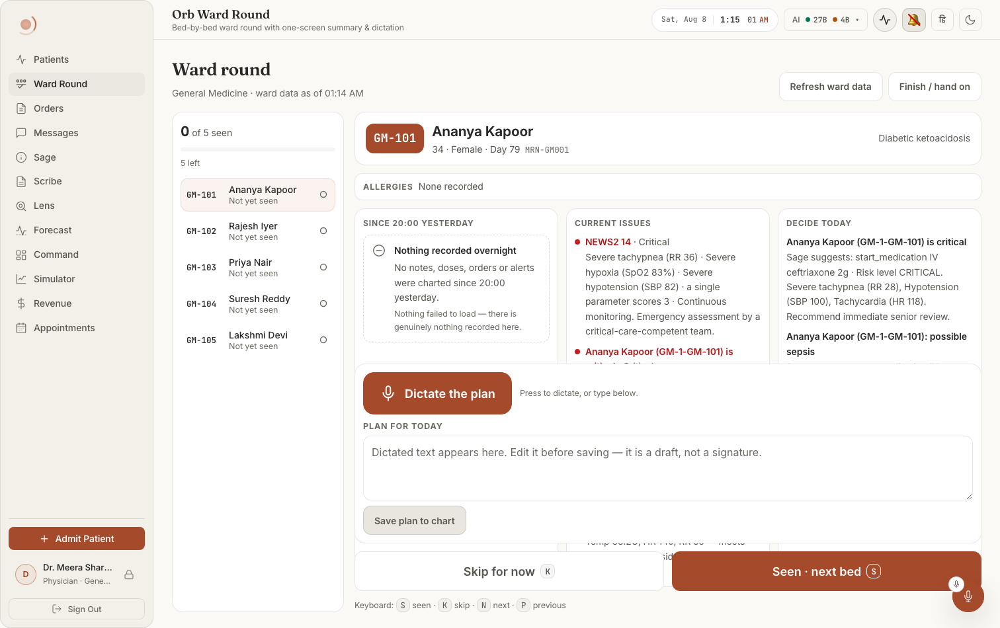
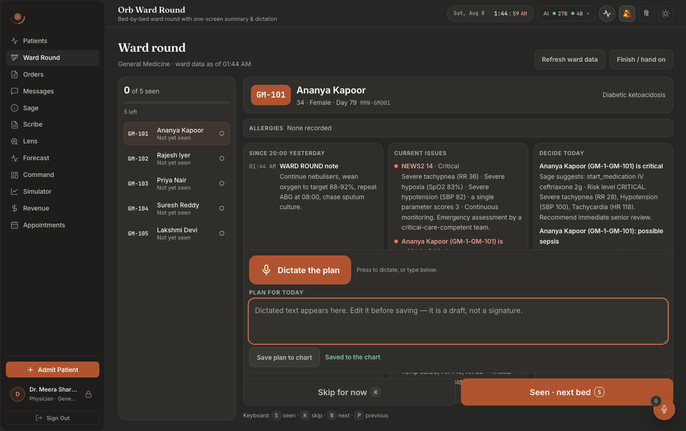

# Screen map 11: Ward round mode

**What this is.** An index of every visible thing on the ward round screen and the exact code that
puts it there. Read an entry, then open the file at the line it names. Every citation below was
opened and checked at that line.

**Scope.** `src/pages/panels/RoundPanel.tsx` (the whole file, 1–617) and the five components under
`src/components/round/`: `RoundQueueRail.tsx`, `RoundSummaryView.tsx`, `RoundDictation.tsx`,
`RoundHandoff.tsx`, `RoundStates.tsx`. The two logic modules that decide what the screen says, 
`roundQueue.ts` (sequence, progress, persistence) and `roundSummary.ts` (what earns a line), are
cited wherever a visible value comes out of them. Styling is `src/components/round/Round.css`
(1150 lines).

**How to get to this screen.** Left nav → **Ward Round**. The nav entry is declared at
`src/pages/ClinicianShell.tsx:58-67`, `id: 'round', label: 'Ward Round', pillar: 'Ward Round'`, 
with a "three beds along a corridor plus a tick" SVG at `:61-66`. The visible label is not that
`label` field: the nav renders `t('nav.round')` at `ClinicianShell.tsx:565`, which resolves through
`src/i18n/locales/en.json:7` → `"round": "Ward Round"` (Hindi in `hi.json`). The tooltip is
`t('nav.round') + ' · Orb Ward Round'` (`ClinicianShell.tsx:562`). The panel is lazily imported at
`ClinicianShell.tsx:116` and mounted at `ClinicianShell.tsx:515-518`:

```
{shouldRenderPanel('round') && (
  <div id={`panel-round`} role="tabpanel" aria-labelledby={`nav-round`} ...>
    <PanelErrorBoundary label="round"><RoundPanel /></PanelErrorBoundary>
```

`RoundPanel` takes **no props** (`RoundPanel.tsx:77`).

**Who sees the tab.** Per-role tab lists at `ClinicianShell.tsx:182-205`. `'round'` appears in
exactly three lists, all doctors: `case 'surgeon'` (`:189`), and both branches of `case 'doctor'`
(`:194-196`). It is **second** in every one of them, deliberately, the comment at `:190-193`
says the roster stays the landing tab because a doctor is not always rounding. A **nurse**
(`:200`), **admin** (`:201`), **pharmacist** (`:202`) and the `default` role (`:203`) have no Ward
Round tab and no route to `RoundPanel`. Because `shouldRenderPanel` requires both membership and a
visit (`ClinicianShell.tsx:325`), the panel does not even mount, and fires no requests, until the
tab is tapped once.

**Panel lifetime.** Once visited the panel stays mounted, hidden with `display:none`
(`ClinicianShell.tsx:516`). That is why the keyboard shortcuts are bound to the panel root and not
to `window`, see the comment at `RoundPanel.tsx:334-336`.

**Layout in one sentence.** A column (`.orb-panel.round-panel`, root at `RoundPanel.tsx:435-441`,
`Round.css:21`): header row, then any banners, then a two-column grid `.round-body`
(`Round.css:184-190`, `260px | 1fr`) whose left column is the queue rail and whose right column
(`.round-main`, `Round.css:192`) stacks the one-screen summary, the dictation block, the two big
action buttons and the keyboard hint. The hand-on screen **replaces** that whole grid rather than
overlaying it (`RoundPanel.tsx:490-498`).

**The no-scroll claim, and where it stops.** The three summary columns each scroll independently
(`Round.css:498-541`) with a scroll-shadow affordance, and their headings stick (`:544-549`). At
≤1100px the three columns become two (`Round.css:1102-1106`); at ≤900px they become one, the queue
rail flips to a horizontal strip, and `.round-panel` itself is allowed to scroll
(`Round.css:1108-1139`), the comment at `:1133-1135` states plainly that the no-scroll guarantee
is a landscape-tablet guarantee.

---

## What it looks like



**Notice the negative-evidence card in the left column**, because it is the whole reason
that column exists: *"Nothing recorded overnight … Nothing failed to load, there is
genuinely nothing recorded here."* An empty column and a broken column look identical
otherwise. Notice too that the footer buttons carry their keyboard letters inline
(**Skip for now `K`** / **Seen · next bed `S`**) with the full legend printed underneath,
and that the queue rail leads with progress, "0 of 5 seen", "5 left", rather than with
names. Dark twin: `doc001-03-round-dark.png` (`round-01-dictate-dark.png` is the same
image).



**Notice where the save is confirmed**: "Saved to the chart" appears *beside* the button,
and the note simultaneously appears in the left column as `01:44 AM WARD ROUND note`,
displacing the "nothing recorded overnight" card. The plan textarea's own placeholder is the
disclaimer, "Dictated text appears here. Edit it before saving, it is a draft, not a
signature."

> ⚠ Every round capture, in both themes, shows the dictation block **overlapping** the three
> summary columns: each column is cut mid-sentence (CURRENT ISSUES stops at "Ananya Kapoor
> (GM-1-GM-101) is") and a stray fragment of the clipped text bleeds out from behind the
> footer bar. Read the structure from these images, not the column heights. See
> [`docs/screenshots/INDEX.md`](../../screenshots/INDEX.md).

---

# 1. Whole-panel states

These three replace the entire screen. Nothing else on this page is rendered while one is up.

### "Loading the ward round…": the first-paint skeleton
**Where:** the whole panel area, a label with four grey animated bars under it.
**Rendered by:** `RoundPanel.tsx:394-400`, the `rosterPhase === 'loading'` early return, calling
`<RoundLoading label="Loading the ward round…" lines={4} />` at `:397`. The component is
`src/components/round/RoundStates.tsx:18-29`: a `role="status" aria-busy="true" aria-live="polite"`
div, the label at `:21`, and `lines` bars generated at `:23-25` with widths `88%, 72%, 56%, 40%`
(`88 - i * 16`).
**Data from:** `rosterPhase` state (`RoundPanel.tsx:89`), set to `'loading'` at the top of
`loadRoster` (`:136`) and to `'ready'`/`'error'` at `:180`/`:178`.
**API:** none of its own, it is up while the three roster calls are in flight.
**Server:** n/a.
**Change this →** the bar count, the label, or the animation. Style at `Round.css:654-681`; the
shimmer is `@keyframes` on `.round-skeleton__bar` (`:671`) and is **disabled** under
`prefers-reduced-motion` (`Round.css:1141-1145`). It disappears the moment either roster resolves.
Tapping **Refresh ward data** brings it back (`refresh` → `loadRoster` → `setRosterPhase('loading')`).

### "The ward round could not be loaded": the fatal error card
**Where:** the whole panel area; a warning-triangle icon, a title, the real error text, a red-rule
warning paragraph and a Retry button.
**Rendered by:** `RoundPanel.tsx:402-412` (`rosterPhase === 'error'`), calling `RoundError`
(`RoundStates.tsx:66-102`) with `title="The ward round could not be loaded"` and
`message={rosterError ?? 'Both the ward board and the patient board failed.'}` (`:406-407`).
**Data from:** `rosterError` (`RoundPanel.tsx:90`). Set **only** in the both-failed branch at
`:173-179`, `boardRes.status === 'rejected' && vigilRes.status === 'rejected'`. One roster failing
does *not* produce this card; it produces a degraded strip (§3).
**API:** `GET /api/nurse/board` **and** `GET /api/vigil/patients`, both rejected.
**Server:** `server/routes/nurse_routes.py:51-109` and `server/routes/vigil_routes.py:262-389`.
**Change this →** the words, or the threshold that triggers it. The most important thing on the
card is the fixed sentence at `RoundStates.tsx:90-93`, *"This is a display failure, not an
all-clear. Do not read the missing information as normal, check the chart directly."* It is
hard-coded and appears on every `RoundError`, including the per-column one in §6. Style:
`Round.css:697-715`, a 3px `--status-danger` left rule on a tinted surface, `role="alert"` at
`RoundStates.tsx:78`. It disappears when a retry makes either roster succeed.

### "Retry": the button on the fatal error card
**Where:** bottom-left of the error card.
**Rendered by:** `RoundStates.tsx:94-98`, rendered only when `onRetry` is passed; label defaults to
`'Retry'` (`:74`).
**Data from:** `onRetry={refresh}` (`RoundPanel.tsx:408`).
**API/Server:** re-runs all three roster calls (`RoundPanel.tsx:327-331` → `loadRoster`).
**Change this →** `refresh` also resets the clock (`setNow(new Date())`, `:328`) and **wipes every
cached patient story** (`setStories({})`, `:329`). So tapping Retry re-dates the overnight window
and forces the "Since 20:00 yesterday" column to reload for whichever bed is open.

### "No patients to round on": the empty ward
**Where:** the whole panel area; a dashed-outline card with a circle-minus icon, plus a "Check
again" button below it.
**Rendered by:** `RoundPanel.tsx:414-432`, the `queue.length === 0` branch. `RoundEmpty`
(`RoundStates.tsx:31-64`) with `title="No patients to round on"` and a `detail` that names the ward
when known: `` `There are no admitted patients in ${department} right now.` `` else *"There are no
admitted patients in your scope right now."* (`RoundPanel.tsx:419-423`).
**Data from:** `queue` (`RoundPanel.tsx:125`) = `mergeRoster(cards, vigil)`
(`src/components/round/roundQueue.ts:136-191`), the union of both rosters, so this shows only when
**both** came back empty. `department` (`:97`) is set from the board payload at `:149`.
**API:** `GET /api/nurse/board` (for `department`), `GET /api/vigil/patients`.
**Server:** `nurse_routes.py:80` derives the ward with `department_scope(user)`
(`server/permissions.py:192-219`) and echoes it back at `nurse_shift_service.py:607`.
`vigil_routes.py:289` uses the same function.
**Change this →** the third line is the load-bearing one: `RoundStates.tsx:38` supplies the default
`reassurance`, *"Nothing failed to load, there is genuinely nothing recorded here."*, and it
renders at `:60`. Remove it and an empty ward becomes indistinguishable from a broken one. Style:
`Round.css:684-693`, dashed border on purpose (`:683` comment). Disappears as soon as either roster
returns one patient.

### "Check again": the button under the empty ward card
**Where:** directly under the empty card, left-aligned.
**Rendered by:** `RoundPanel.tsx:425-429`, inside `.round-empty-actions` (`Round.css:735-738`).
**Data from:** `onClick={refresh}` (`:426`).
**Change this →** same `refresh` as above. Note this button lives in the *panel*, not in
`RoundEmpty`, the per-column empty states (§6) deliberately have no button.

---

# 2. The header

### "Ward round": the page title
**Where:** top-left, largest text on the screen.
**Rendered by:** `RoundPanel.tsx:444`, `<h1 className="round-head__h1">Ward round</h1>`.
**Data from:** nothing. A literal.
**API/Server:** none.
**Change this →** the heading text only. Style `Round.css:47-53` (`--font-display`, `--text-xl`,
weight 600). It is inside the main render, so it is **absent** during the loading, fatal-error and
empty-ward states above, those three replace the header too.

### The ward name + "ward data as of HH:MM" subtitle
**Where:** small muted line immediately under "Ward round".
**Rendered by:** `RoundPanel.tsx:445-448`. Two parts: `{department ?? 'Your ward'}` then, only when
`asOf` is set, `` ` · ward data as of ${new Date(asOf).toLocaleTimeString([], { hour: '2-digit',
minute: '2-digit' })}` ``.
**Data from:** `department` (`:97`) and `asOf` (`:98`), both set from the shift-board payload at
`:149-150` (`boardRes.value.department`, `boardRes.value.generated_at`).
**API:** `GET /api/nurse/board` → `ShiftBoard.department` / `.generated_at`
(`src/api/nurse.ts:92-103`, call at `:142-144`).
**Server:** `server/routes/nurse_routes.py:54-109`; `department` comes from
`permissions.department_scope(user)` at `:80`, **never from the request** (the docstring at
`:60-72` records that `?department=` and `?all_departments=true` were removed). `generated_at` is
stamped in `server/services/nurse_shift_service.py:606` (`_iso(now)`).
**Change this →** if the ward board request fails, `department` stays `null` and this line reads
**"Your ward"** with no timestamp (the degraded strip in §3 appears alongside). The time is
rendered in the tablet's local timezone. Style `Round.css:55-59`.

### "Refresh ward data": the quiet button, top-right
**Where:** top-right of the header, left of "Finish / hand on".
**Rendered by:** `RoundPanel.tsx:451-453`.
**Data from:** `onClick={refresh}` (`RoundPanel.tsx:327-331`).
**API:** re-issues all three: `getShiftBoard()`, `getPatients()`, `getSageInsights()`
(`:138-142`), plus a re-fetch of the current and next patient stories once the cursor effect at
`:246-251` re-runs against the emptied `stories` map.
**Server:** `nurse_routes.py:51`, `vigil_routes.py:262`, `sage_proactive_routes.py:14`.
**Change this →** three visible things move at once: the "as of HH:MM" time, every NEWS2 /
medication / allergy value in the summary, and the "Since 20:00 yesterday" column (because `now` is
re-read at `:328`, the overnight window boundary is recomputed by
`overnightWindow(now)` at `RoundSummaryView.tsx:95`). Your **round progress is not touched**, 
`statuses` and `cursor` survive; only `reconcileStatuses` (`:221-235`) prunes marks for patients no
longer on the roster. Style `Round.css:109-116`.

### "Finish / hand on": the quiet button, far right
**Where:** top-right corner, rightmost control.
**Rendered by:** `RoundPanel.tsx:454-460`.
**Data from:** `onClick={() => setShowHandoff(true)}` (`:457`); `showHandoff` state at `:104`.
**API/Server:** none, it is a pure view switch.
**Change this →** the entire body below the banners is replaced by the hand-on screen (§9),
because `showHandoff` gates the ternary at `RoundPanel.tsx:490`. The header, resume banner and
degraded strips stay visible above it. It is reachable at any point in the round, not just at the
end.

---

# 3. Resume and degradation banners

### "Resumed your round from earlier today: N already seen."
**Where:** a full-width line directly under the header, above the body grid.
**Rendered by:** `RoundPanel.tsx:464-475`, gated on `resumed`. Text at `:466` interpolates
`progress.seen`.
**Data from:** `resumed` state (`:103`), set **once on mount** at `:213`, 
`setResumed(Object.keys(saved.statuses).length > 0)`, where `saved` is
`loadRoundState(userId, dateKey)` (`:209`). `loadRoundState` is
`roundQueue.ts:302-323`: it reads `localStorage['orb_round_v1:<userId>:<YYYY-MM-DD>']`
(key builder at `:279-281`, prefix at `:72`), refuses a payload whose `userId`/`dateKey` do not
match (`:308`), and whitelists each status value (`:310-312`). `progress.seen` is
`progressOf(queue, statuses)` (`RoundPanel.tsx:131`, `roundQueue.ts:236-257`).
**API/Server:** none. Resume is entirely local, **no round state ever goes to the server.**
**Change this →** this banner is the only signal that Orb restored a round. It has
`role="status"` (`:465`) so a screen reader announces it. It disappears when "Start over" is
pressed (`setResumed(false)`, `:470`), and it never comes back within the same mount. Style
`Round.css:67-78`.

### "Start over": the tiny button inside the resume banner
**Where:** inline, at the end of the resume sentence.
**Rendered by:** `RoundPanel.tsx:467-473`, class `round-btn round-btn--quiet round-btn--xs`.
**Data from:** `onClick={() => { setStatuses({}); setResumed(false); setCursor(queue[0].id) }}`
(`:470`).
**Change this →** pressing it visibly resets three things at once: every rail row reverts to "Not
yet seen" with an open-circle icon, the progress bar drops to 0 and the count to "0 of N seen", and
the cursor jumps to the **first bed in walk order** (`queue[0]`, i.e. the lowest natural-sorted bed
`compareBeds` at `roundQueue.ts:97-120`). The persistence effect at `:239-242` then writes the
now-empty state to localStorage, so the reset survives a reload. `--xs` is visual weight only, not
target size, see the comment at `Round.css:138-141`.

### "Ward board unavailable (…)": degraded strip
**Where:** a compact full-width strip under the header (or under the resume banner), with a small
info-circle icon and a Retry chip at the right.
**Rendered by:** `RoundPanel.tsx:477-482`, `<RoundDegraded message={`Ward board unavailable
(${boardFailed}). Scores, medications and allergies are missing from this round.`} onRetry={refresh}
/>`. Component at `RoundStates.tsx:106-122`, `role="alert"` at `:107`.
**Data from:** `boardFailed` (`RoundPanel.tsx:94`), set at `:154` to the rejected promise's message
or `'Ward board request failed'`; cleared to `null` at `:151` on success.
**API:** `GET /api/nurse/board` rejected.
**Server:** `nurse_routes.py:51-109`. A 403 from `require_permission("patient.read_all",
"vitals.read")` (`:56`) surfaces here as the RBAC message lifted in `src/api/client.ts:210-224`; a
401 dispatches `orb:session-expired` (`client.ts:204-206, 122-124`) and the message reads "Session
expired".
**Change this →** the sentence names exactly what is now missing, and it is true: with no ward
board there is no `card` for any patient, so `AllergyStrip` flips to its **Unknown** variant
(`RoundSummaryView.tsx:52-60`) and `currentIssues` returns the single "No ward data for this
patient" warning (`roundSummary.ts:139-149`). The strip persists until a retry succeeds. Style
`Round.css:722-733`.

### "Patient board unavailable (…)": degraded strip
**Where:** same place; both strips can be on screen at once (they stack).
**Rendered by:** `RoundPanel.tsx:483-488`, message: *"Patient board unavailable (…). Admission day
and risk level are missing from this round."*
**Data from:** `vigilFailed` (`:95`), set at `:162`, cleared at `:159`.
**API:** `GET /api/vigil/patients` rejected. **Server:** `vigil_routes.py:262-389`.
**Change this →** the claim is exact: `mergeRoster` only takes `admission_date`, `risk_score`,
`risk_level`, `risk_drivers` from the Vigil roster (`roundQueue.ts:165-168`). With it gone,
`admissionDay()` returns `null` (`roundSummary.ts:292`) and the **"Day N"** fragment vanishes from
the patient meta line (§5). Patients present only on the ward board still appear in the queue, 
that is the whole point of `mergeRoster` (comment at `roundQueue.ts:128-135`).

### "Retry" chip on either degraded strip
**Where:** right end of the strip.
**Rendered by:** `RoundStates.tsx:115-119`, `round-btn--quiet round-btn--xs`.
**Data from:** `onRetry={refresh}` (`RoundPanel.tsx:480`, `:486`).
**Change this →** one retry re-runs **all three** roster calls, so it can clear both strips at once.

*(A third failure, Sage insights, deliberately does **not** get a panel-level strip. It shows
inside the "Current issues" column instead; see §6.)*

---

# 4. The queue rail (left column)

Component: `src/components/round/RoundQueueRail.tsx`, mounted at `RoundPanel.tsx:500-506` with
`queue`, `statuses`, `cursor`, `progress`, `onSelect={goTo}`. Root is a
`<nav aria-label="Round queue">` (`RoundQueueRail.tsx:57`), styled `Round.css:201-210`.

### "N of M seen": the progress count
**Where:** top of the rail, above the bar. The `N` is large and bold; " of M seen" is small.
**Rendered by:** `RoundQueueRail.tsx:59-62`, `<strong>{progress.seen}</strong><span> of
{progress.total} seen</span>`.
**Data from:** `progress` = `progressOf(queue, statuses)` (`RoundPanel.tsx:131`). `progressOf` is
`roundQueue.ts:236-257`: it walks the queue, counts `seen`/`skipped`/`pending` via `statusOf`
(`:74-79`, defaulting an unknown id to `'pending'`), and returns `total`, `remaining = skipped +
pending`, and `complete = queue.length > 0 && seen === queue.length`.
**API/Server:** none, computed on the device from the roster length and the local marks.
**Change this →** `progress.total` is `queue.length`, so a patient discharged between refreshes
drops the denominator (via `reconcileStatuses`, `roundQueue.ts:353-363`). `strong` is tabular-nums
(`Round.css:223-228`) so the number does not jitter as it counts up.

### The gold progress bar
**Where:** immediately below the count; a 6px full-width track.
**Rendered by:** `RoundQueueRail.tsx:65-74`. It is a real `role="progressbar"` with
`aria-valuenow={progress.seen}`, `aria-valuemin={0}`, `aria-valuemax={progress.total}` and
`aria-label={`${progress.seen} of ${progress.total} patients seen`}`. The fill is an inner span
whose `style={{ width: `${pct}%` }}` (`:73`) uses `pct` from `:54`, 
`progress.total > 0 ? Math.round((progress.seen / progress.total) * 100) : 0`.
**Data from:** same `progress`.
**Change this →** the bar tracks **seen only**. Skipping a patient moves nothing here, that is
intentional, a skip is still owed. Fill colour `--accent-gold` (`Round.css:237-242`), width
animated by `transition: width` and stilled under `prefers-reduced-motion` (`Round.css:1147-1149`).

### "N left · K skipped" / "Every bed seen": the remaining line
**Where:** small muted line under the bar.
**Rendered by:** `RoundQueueRail.tsx:75-79`. `progress.remaining === 0 ? 'Every bed seen' :
`${progress.remaining} left${progress.skipped ? ` · ${progress.skipped} skipped` : ''}``. It carries
`aria-live="polite"` (`:75`) so progress is announced after each action without hunting for it.
**Data from:** `progress.remaining` / `.skipped`.
**Change this →** "Every bed seen" appears when `skipped + pending === 0`, i.e. only when every bed
is marked **seen**, a skipped patient keeps this line counting. The "· K skipped" tail only
appears when at least one bed was skipped.

### One row per bed: the queue items
**Where:** the scrolling list filling the rest of the rail (a horizontal strip at ≤900px).
**Rendered by:** `RoundQueueRail.tsx:82-106`. Each is a real `<button>` (`:88-102`) inside an
`<li>`, navigation, so Tab/Enter/Space work and the target is `--tap-min` (44px) tall
(`Round.css:258-273`).
**Data from:** `queue` from `mergeRoster(cards, vigil)` (`RoundPanel.tsx:125`;
`roundQueue.ts:136-191`), ordered by `buildQueue` → `compareBeds` (`:123-125`, `:97-120`). Bed
order is the **physical walk**: digit runs compare numerically so "GM-9" precedes "GM-10"
(`bedTokens`, `:84-90`), and a patient with **no bed recorded sorts last** (`:100`) so the round
never opens on someone with nowhere to walk to. Ties break on `id.localeCompare`.
**API:** `GET /api/nurse/board` + `GET /api/vigil/patients`.
**Server:** ward-board rows are built in `nurse_shift_service.build_board` (`:501-617`) from
`_load_board_rows` (`:234`); the Vigil rows come from `vigil_routes.list_patients` (`:262-389`).
**Change this →** `onSelect(p.id)` → `goTo` (`RoundPanel.tsx:255-259`) sets the cursor and clears
any "unsaved plan" block. Tapping a row **navigates only**, it never marks anything.

### The bed number on a queue row
**Where:** left of each row, monospaced.
**Rendered by:** `RoundQueueRail.tsx:95`, `<span className="round-rail__bed">{p.bed || ', '}</span>`.
**Data from:** `RoundPatient.bed` (`roundQueue.ts:37`), taken from the ward board card
(`c.bed ?? ''`, `:146`) and back-filled from the Vigil row only if still blank (`:169`).
**Server:** `p.bed` column, `nurse_shift_service.py:563` / `vigil_routes.py:349`.
**Change this →** an em dash appears when no bed is recorded; that patient also sinks to the bottom
of the list. Style `Round.css:290-297` (min-width 56px, mono, so beds line up as a column).

### The patient name on a queue row
**Where:** middle of each row, top line.
**Rendered by:** `RoundQueueRail.tsx:97`.
**Data from:** `RoundPatient.name` (`roundQueue.ts:145` from the card, `:174` from Vigil).
**Change this →** truncates with an ellipsis on one line (`Round.css:307-314`).

### The status word on a queue row: "Seen" / "Skipped: still owed" / "Not yet seen"
**Where:** middle of each row, second line, small.
**Rendered by:** `RoundQueueRail.tsx:99`, `{STATUS_WORD[status]}`, the map at `:15-19`.
**Data from:** `statusOf(statuses, p.id)` (`:84`; `roundQueue.ts:74-79`).
**Change this →** this is the **word**, and it exists because colour alone fails a colour-blind
clinician and a sunlit ward window equally (comments at `RoundQueueRail.tsx:9-10` and
`Round.css:316-317`). It is coloured `--status-ok-text` when seen and `--status-warn-text` when
skipped (`Round.css:329, 331`); pending stays `--text-muted`. Deleting the word leaves the state
carried by colour and a small icon only.

### The status icon on a queue row: tick / arrow-to-a-bar / open circle
**Where:** right end of each row, 18×18.
**Rendered by:** `StatusMark` (`RoundQueueRail.tsx:21-43`), called at `:101`. Seen = a check path
(`:24-27`); skipped = an arrow running into a vertical bar (`:30-36`); pending = an open circle
(`:38-42`). All are `aria-hidden`, the row's own `aria-label` carries the meaning.
**Data from:** same `status`.
**Change this →** icon colour follows the same status tokens (`Round.css:328, 330`).

### The current-bed highlight
**Where:** the row you are standing at.
**Rendered by:** `RoundQueueRail.tsx:90` appends `round-rail__item--current`, and `:92` sets
`aria-current="true"`.
**Data from:** `cursor` (`RoundPanel.tsx:102`) compared at `:85` (`p.id === cursor`).
**Change this →** the row gets an `--accent-glow` fill and an `--accent-glow-strong` border
(`Round.css:284-288`), not opacity, per the file's no-opacity rule (`Round.css:8-12`). The cursor
is set from four places: the reconcile effect (`RoundPanel.tsx:227-230`), `goTo` (`:258`),
`markAndAdvance` (`:279`), and `savePlan(…, thenMarkSeen)` (`:318`).

### The screen-reader label on a queue row
**Where:** not visible; read aloud.
**Rendered by:** `RoundQueueRail.tsx:93`, `` `Bed ${p.bed || 'not recorded'}, ${p.name},
${STATUS_WORD[status]}. Position ${i + 1} of ${queue.length}.` ``.
**Change this →** this is the only place the queue position is spoken; the visible row does not show
an index.

---

# 5. The one-screen summary: identity block

Component: `src/components/round/RoundSummaryView.tsx`, mounted at `RoundPanel.tsx:511-522`. Root
is `<section aria-label={`Summary for ${patient.name}`}>` (`:102`), styled `Round.css:345-352`, 
it owns its own overflow so the dictation block below can never paint over it (the comment at
`Round.css:334-344` records that bug).

### The big bed chip
**Where:** far left of the patient header row.
**Rendered by:** `RoundSummaryView.tsx:104`, `{patient.bed || 'No bed'}`.
**Data from:** `RoundPatient.bed` (see §4).
**Change this →** reads literally **"No bed"** rather than going blank. Style `Round.css:370-378`.

### The patient name
**Where:** immediately right of the bed chip, largest text in the block.
**Rendered by:** `RoundSummaryView.tsx:106`, `<h2 className="round-patient__name">{patient.name}</h2>`.
**Data from:** `currentPatient` = `queue.find(p => p.id === cursor)` (`RoundPanel.tsx:378-381`),
name from `mergeRoster`.
**Server:** `patients.name`, selected in `nurse_shift_service._load_board_rows` (`:248`) and
`vigil_routes.py:347`.
**Change this →** the same string is also the dictation hint (`RoundPanel.tsx:539`, see §7) and
appears in the unsaved-plan warning (`:553`).

### "68 · M · Day 4": the meta line
**Where:** small muted line under the name.
**Rendered by:** `RoundSummaryView.tsx:107-114`, an array of `age`, `sex` and `` `Day ${day}` ``
filtered for truthiness and joined with `' · '`.
**Data from:** `patient.age` / `patient.sex` from `mergeRoster` (`roundQueue.ts:149-150`);
`day = admissionDay(patient.admission_date, now)` (`:99`), computed in
`roundSummary.ts:289-300`, the admission date is **day 1** and the count rolls over at local
midnight, not at the 24-hour mark; returns `null` when there is no admission date or it is in the
future.
**API:** the admission date arrives **only** from `GET /api/vigil/patients`
(`roundQueue.ts:165`, `Patient.admission_date` at `src/api/client.ts:603`).
**Server:** `vigil_routes.py:352` selects `p.admission_date`.
**Change this →** with the Vigil roster down, "Day N" silently disappears and only age and sex
remain, which is exactly what the degraded strip in §3 warns about. Any missing field just drops
out of the join, so a patient with no sex recorded reads "68 · Day 4".

### The MRN
**Where:** end of the meta line, monospaced.
**Rendered by:** `RoundSummaryView.tsx:113`, rendered only when `patient.mrn` is non-empty.
**Data from:** `mergeRoster` (`roundQueue.ts:148` / `:177`).
**Server:** `patients.mrn` (`nurse_shift_service.py:562`, `vigil_routes.py:348`).
**Change this →** style `Round.css:396-400`. Absent entirely when blank, no placeholder.

### The diagnosis line
**Where:** right end of the patient header row (left-aligned at ≤900px, `Round.css:1129-1131`).
**Rendered by:** `RoundSummaryView.tsx:116`, `{patient.diagnosis || 'No diagnosis recorded'}`.
**Data from:** ward-board `diagnosis` wins; the Vigil one only fills a blank
(`roundQueue.ts:151`, `:170`).
**Server:** `nurse_shift_service.py:567`, `vigil_routes.py:353`.
**Change this →** it never renders empty. It is also half of the dictation hint string
(`RoundPanel.tsx:539`), so changing it changes what the local Whisper pass is primed with.

---

# 6. The allergy strip and the three columns

### The allergy strip: "None recorded"
**Where:** full-width band directly under the patient header.
**Rendered by:** `AllergyStrip` (`RoundSummaryView.tsx:51-89`), called at `:119`. The
zero-allergy branch is `:62-69`: label "Allergies" + "None recorded".
**Data from:** `card.allergies`, `NursePatientCard.allergies` (`src/api/nurse.ts:77`), an array of
`NurseAllergy {substance, reaction, severity}` (`:35-39`).
**API:** `GET /api/nurse/board`.
**Server:** `nurse_shift_service.build_board:571` (`allergies_by_patient.get(pid, [])`), loaded in
`_load_board_rows` and returned in `extra["allergies"]` (`build_board:517`).
**Change this →** "None recorded" is a *positive* statement and only appears when the ward board
actually answered with an empty list. Style `Round.css:413-435`.

### The allergy strip: "Unknown: ward data unavailable. Check the chart before prescribing."
**Where:** same band.
**Rendered by:** `RoundSummaryView.tsx:52-60`, the `!card` branch, with `role="alert"` (`:54`).
**Data from:** `card` = `cardById.get(currentPatient.id) ?? null` (`RoundPanel.tsx:513`;
map built at `:126-130`). `null` when the ward board failed **or** simply did not carry this
patient (a Vigil-only patient).
**Change this →** this is the deliberate "wrong way to fail" guard described at
`RoundSummaryView.tsx:11-13`, an empty allergy row reads as "no allergies" to someone about to
prescribe. Style `Round.css:437-445`.

### Allergy chips
**Where:** the same band, as a wrapping row of chips.
**Rendered by:** `RoundSummaryView.tsx:73-88`. Sorted severe-first at `:70-72`, then each `<li>`
gets `round-chip--danger` when `severity === 'severe'`, otherwise `round-chip--warn` (`:80`). The
reaction, when present, renders as a `· reaction` sub-span (`:83`).
**Data from / Server:** as above.
**Change this →** severity drives colour only through the two classes at `Round.css:469-479`; the
substance text is always shown. A "moderate" and a "mild" allergy look identical (both `--warn`).

---

## Column 1: "Since HH:00 today/yesterday"

### The column heading
**Where:** top-left of the three-column band, uppercase, sticky while the column scrolls.
**Rendered by:** `RoundSummaryView.tsx:124-126`, `Since {window.sinceLabel}`.
**Data from:** `window = overnightWindow(now)` (`:95`), `roundSummary.ts:84-92`: the boundary is
**20:00 local** (`HANDOVER_HOUR`, `:28`) on the current day, stepped back a day if `now` is earlier
than that; the label is `"20:00 today"` or `"20:00 yesterday"`. `now` is read once per mount
(`RoundPanel.tsx:83`) and re-read by `refresh` (`:328`).
**Change this →** move `HANDOVER_HOUR` and this heading, the window the feed covers, and the empty
state's sentence all move together. Sticky heading at `Round.css:544-549`.

### An overnight event row
**Where:** the list under that heading; time on the left, title and detail on the right.
**Rendered by:** `RoundSummaryView.tsx:143-151`. Time: `formatUTCTime(e.timestamp)` (`:145`,
`src/lib/datetime.ts:58-63`, a UTC DB stamp rendered in tablet-local `HH:MM`). Title `:147`,
optional detail `:148`. The `<li>` carries `round-item--{e.type}` (`:144`).
**Data from:** `feed = changesSince(story, window, 5)` (`:96`), `roundSummary.ts:99-116`: events
with **no timestamp are dropped** (never assumed recent, `:106`), the rest are kept if `>= window.start`
and sorted newest-first. `story` is `stories[cursor].events` (`RoundPanel.tsx:516`, state at `:108`,
loaded by `loadStory` at `:183-204`).
**API:** `GET /api/vigil/patients/{id}/story` → `getPatientStory` (`src/api/client.ts:1487-1490`),
which unwraps `getPatientStoryFeed` (`:1495-1506`) and returns just `events`.
**Server:** `server/routes/vigil_routes.py:466-496`; the handler calls
`services.patient_story_service.get_patient_story` (`:494`), which is an adapter
(`patient_story_service.py:62-95`) over
`services.patient_timeline_service.build_chart_timeline(patient_id, user_id=None, limit=500)`
(`:82`). `user_id=None` is deliberate (`:73-77`): the round's feed must not change shape depending
on whose session it is. Event kinds come from the `SOURCES` table at
`patient_timeline_service.py:348-500`, admission, note, scribe, imaging, alert, medication,
administration, order, order_event, observation, bundle, problem, allergy, discharge.
**Access control:** `require_patient_access("patient.read_all",
audit_action="patient_story_viewed")` (`vigil_routes.py:470-472`), off-ward patients get **404,
not 403** (`permissions.py:453-455`), and each successful read writes a fail-closed `phi_access`
audit row.
**Change this →** a plan you save in this panel comes back into *this very list* as a note titled
**"Manual Entry"** (title supplied by `addClinicalNote` at `client.ts:1324`, rendered by
`_r_note` at `patient_timeline_service.py:169-176`, whose `detail` is the clipped note content), 
because `savePlan` calls `loadStory(patientId, true)` at `RoundPanel.tsx:307`.

### "N more events overnight: open the full chart to see them."
**Where:** below the event list, above a dashed rule.
**Rendered by:** `RoundSummaryView.tsx:153-158`, only when `feed.hidden > 0`; singular/plural at
`:156`.
**Data from:** `changesSince(..., 5)` caps the list at **5** (`RoundSummaryView.tsx:96`, note the
module default is 6, `roundSummary.ts:102`) and reports the remainder as `hidden`
(`roundSummary.ts:114`).
**Change this →** raise the limit at `RoundSummaryView.tsx:96` and this line disappears sooner.
Removing the line would make the screen silently truncate a chart, which is what the comment at
`:154` forbids. Style `Round.css:559-564`.

### "Loading overnight events…": column 1 loading
**Rendered by:** `RoundSummaryView.tsx:127-128` when `storyPhase === 'loading'` → `RoundLoading`
with the default 3 bars.
**Data from:** `storyPhase` = `currentStory?.phase ?? 'loading'` (`RoundPanel.tsx:514`). Set to
`'loading'` at `:189-192` and `'ready'` at `:195`.
**Change this →** this is usually invisible in practice, because the effect at
`RoundPanel.tsx:246-251` prefetches the **next** incomplete bed's story as soon as the cursor
moves, the comment at `:244-245` calls that the reason the walk between beds is off the critical
path.

### "Overnight events unavailable": column 1 failure, with a Retry
**Rendered by:** `RoundSummaryView.tsx:129-135` when `storyPhase === 'error'` → `RoundError` with
`message={storyError ?? 'The request failed.'}` and `onRetry={onRetryStory}`.
**Data from:** `storyError` from `stories[cursor].error`, set at `:199` from the caught error;
`onRetryStory={() => void loadStory(currentPatient.id, true)}` (`RoundPanel.tsx:517`), `force=true`
bypasses the "already ready" short-circuit at `:186`.
**API/Server:** as above. A patient outside your ward returns 404 here and the message reads as the
server's detail.
**Change this →** this is the case the whole `RoundStates` split exists for: without it, a failed
story request would render as **"Nothing recorded overnight"**, i.e. a quiet night. The
"display failure, not an all-clear" sentence (`RoundStates.tsx:90-93`) appears inside the column.

### "Nothing recorded overnight": column 1 empty
**Rendered by:** `RoundSummaryView.tsx:135-139`, `RoundEmpty` with detail
`` `No notes, doses, orders or alerts were charted since ${window.sinceLabel}.` ``
**Data from:** `feed.events.length === 0` after filtering.
**Change this →** it carries the default reassurance line (`RoundStates.tsx:38`), so it reads as a
positive statement rather than a gap.

---

## Column 2: "Current issues"

### The column heading
**Rendered by:** `RoundSummaryView.tsx:165`, `<h3 id="round-col-issues">Current issues</h3>`.

### "Sage surveillance flags could not be loaded: this list may be incomplete."
**Where:** a degraded strip **inside** column 2, above the list.
**Rendered by:** `RoundSummaryView.tsx:166-168`, gated on `insightsFailed`, `RoundDegraded` with
**no** retry button.
**Data from:** `insightsFailed` (`RoundPanel.tsx:96`), set `true` at `:170` when
`getSageInsights()` rejects.
**API:** `GET /api/sage/insights` (`src/api/client.ts:856-858`).
**Server:** `server/routes/sage_proactive_routes.py:14-18`, `require_permission("sage.query")`,
delegating to `sage_proactive_service.get_active_insights(user_id, role)`
(`:293-312`), active insights only, admin sees all, everyone else sees their own or untargeted
ones, severity-then-recency ordered, capped at 50.
**Change this →** insights failing is the one roster failure that does **not** get a panel-level
strip: the honest scope of the damage is this column and the "Decide today" column, so the warning
lives where the damage is. Retry only via **Refresh ward data** in the header.

### "NEWS2 7" (and its driver line): the score issue row
**Where:** first row in Current issues when the patient is scoring.
**Rendered by:** `RoundSummaryView.tsx:176-188`, the coloured dot (`:178`), the label (`:181`),
the `· critical` / `· warning` / `· info` severity word (`:183`), and the detail (`:185`).
**Data from:** `issues = currentIssues(card, insights)` (`:97`), `roundSummary.ts:133-222`. The
NEWS2 branch is `:151-182`: severity is the **server's** band, `critical` → critical,
`elevated` → warning, and the single-parameter-3 rule can only *raise* it (`:167`). The label is
`` `NEWS2 ${n.raw_news2}` `` (`:177`) and the detail joins `n.drivers`, plus *"a single parameter
scores 3"*, plus *"SpO₂ Scale 2"*, plus `card.obs_response` (`:171-175`).
**API:** `GET /api/nurse/board` → `NursePatientCard.news2` (`src/api/nurse.ts:78`, shape `News2`
at `:16-26`).
**Server:** `nurse_shift_service.build_board:525` → `_score_from_vitals` (`:370-384`) →
`services/vigil_service.compute_news2` (`:234-246`), the **one** scoring implementation, RCP
NEWS2 (2017), both SpO₂ scales. `obs_response` comes from `obs_schedule`
(`nurse_shift_service.py:117-155`, RCP escalation table at `:101-114`) and is attached at
`build_board:576`.
**Change this →** nothing about this score is computed in the frontend, see the rule at
`roundSummary.ts:10-15`. Change the band and the row changes colour (`Round.css:621-626`) *and* its
position, because the list is sorted `critical → warning → info` at `roundSummary.ts:221`. A
`stable` band with no single-param-3 produces **no row at all**.

### "No observations recorded": the missing-obs warning
**Rendered by:** the same `<li>` template; produced by `roundSummary.ts:152-159` when
`card.news2` is null. Detail: *"This patient has no scored observation set. That is missing data,
not a normal result, it does not mean the patient is stable."*
**Data from:** `card.news2 === null`, which `build_board` produces whenever there is no latest
vitals row (`_score_from_vitals` returns `None`, `nurse_shift_service.py:371-372`).
**Change this →** this is rule 2 of the module (`roundSummary.ts:17-21`) made visible: absence of
data is a finding. Delete it and a never-observed patient shows an empty issues column.

### "No ward data for this patient"
**Rendered by:** produced by `roundSummary.ts:139-149` when `card` is null, it **returns early**,
so it is the only row in the column. Detail: *"Observations, medications and scores could not be
matched to this bed. Check the chart directly."*
**Data from:** `cardById` miss (`RoundPanel.tsx:513`).
**Change this →** appears for a Vigil-only patient, and for every patient when the ward board is
down. Pairs with the "Unknown" allergy strip.

### "Observations overdue"
**Rendered by:** same template; produced by `roundSummary.ts:184-196`. Detail is either
`` `Last set at ${formatUTCDateTime(card.last_obs_at)} · due every ${card.obs_interval_minutes} min` ``
or just the interval when there is no last set.
**Data from:** `card.obs_overdue`, `card.last_obs_at`, `card.obs_interval_minutes`
(`src/api/nurse.ts:79-85`).
**Server:** `nurse_shift_service.build_board:528-537`, `obs_due_at = last_obs + interval`, where
the interval comes from `obs_schedule(news2)` (`:526`); **no obs at all is itself the overdue
state** (`:536`).
**Change this →** the comment at `roundSummary.ts:190-191` records that this line once printed a
raw `2026-08-01T19:07:35.972867+00:00` to a doctor mid-round; it now goes through
`formatUTCDateTime` (`src/lib/datetime.ts:31-33`).

### "N medications overdue"
**Rendered by:** same template; produced by `roundSummary.ts:198-209`. The detail is the
comma-joined `drug_name` of every overdue med.
**Data from:** `card.meds_overdue` and `card.medications[].overdue` (`src/api/nurse.ts:59, 88`).
**Server:** `nurse_shift_service._build_med_task` (`:414-500`) derives the due time from the order
frequency and the last charted dose (`:435-455`) and only calls a dose overdue once it is a clear
**15 minutes** late (`:461`, with the reasoning at `:459-460`); `build_board:549` counts them.
**Change this →** singular/plural is handled at `roundSummary.ts:202`. Severity is always
`warning`, so this row sits below any critical NEWS2 row.

### A Sage insight row in Current issues
**Rendered by:** same template; produced by `roundSummary.ts:211-219`, `label = i.title`,
`detail = i.detail ?? ''`, `severity = i.severity` straight from the server.
**Data from:** `openInsightsFor(card.patient_id, insights)` (`roundSummary.ts:119-124`), this
patient's insights minus any whose `state` is in `CLOSED_INSIGHT_STATES`
(`dismissed`, `acted`, `resolved`, `superseded`, `:31`).
**API:** `GET /api/sage/insights` → `SageInsight` (`src/api/client.ts:842-854`).
**Server:** `sage_proactive_service.get_active_insights:293-312`.
**Change this →** dismissing or acting on an insight elsewhere in Orb makes the row vanish from
this column on the next **Refresh ward data**. Severity `critical` sorts it above everything else.

### "No active issues": column 2 empty
**Rendered by:** `RoundSummaryView.tsx:170-173`, detail: *"The ward board scores this patient as
stable, observations are up to date and no medication is overdue."*
**Data from:** `issues.length === 0`, which per §above can only happen with a real `card` and a
real score.
**Change this →** the detail sentence is an explicit list of the three things that were checked,
which is why the empty state here is safe to show.

---

## Column 3: "Decide today"

### The column heading
**Rendered by:** `RoundSummaryView.tsx:195`, `<h3 id="round-col-decide">Decide today</h3>`.

### An unverified-medication decision row
**Where:** rows in column 3; label is `drug + dosage + route`.
**Rendered by:** `RoundSummaryView.tsx:203-210`, title at `:206`, detail at `:207`; the `<li>`
carries `round-item--decide round-item--src-{d.source}` (`:204`).
**Data from:** `decisions = decisionsToday(card, insights, hasPlanToday)` (`:98`),
`roundSummary.ts:232-272`. The medication branch is `:239-248`: any `m.unverified` med becomes a
row with the fixed detail *"AI-extracted and not yet verified by a pharmacist, it cannot be given
until it is."*
**API:** `GET /api/nurse/board` → `MedTask.unverified` (`src/api/nurse.ts:62`).
**Server:** `nurse_shift_service._build_med_task:465-467`, 
`unverified = med.source in ('llm_extracted','agentic') and not med.verified_by`. The comment at
`:471-474` explains it is surfaced so the round can show it rather than let a nurse hit a 422 at
the bedside.
**Change this →** a pharmacist verifying the drug removes the row on the next refresh.

### A Sage suggestion decision row
**Rendered by:** the same template. Produced by `roundSummary.ts:249-260`: only insights that carry
a `suggested_action_type` qualify (`:250`), and the detail is prefixed
**"Sage suggests: "** followed by the action type, the optional target and the insight detail.
**Data from:** `SageInsight.suggested_action_type` / `.suggested_action_target`
(`src/api/client.ts:850-851`).
**Server:** `sage_proactive_service.get_active_insights:293-312`.
**Change this →** the "Sage suggests:" prefix is provenance, not decoration, the comment at
`roundSummary.ts:254-256` states this is Sage proposing, not Orb instructing. Removing the prefix
removes the only cue that the line is machine-generated.

### "No plan documented today yet"
**Where:** last row in column 3, when it applies.
**Rendered by:** same template; produced by `roundSummary.ts:262-269`, detail *"Dictate the plan
below, this round is the record."*
**Data from:** `hasPlanToday` (`RoundPanel.tsx:388-392`), true if `planSaved[cursor]` (set at
`:304` the instant a save succeeds) **or** `documentedToday(currentStory.events, now)`
(`roundSummary.ts:278-284`), which counts only `note` and `scribe` events
(`DOCUMENTATION_TYPES`, `:34`) dated to the same **local** day.
**API/Server:** `GET /api/vigil/patients/{id}/story` (see column 1).
**Change this →** press **Save plan to chart** and this row disappears immediately, before the
story feed has caught up, because `planSaved` short-circuits the check. Doses given and orders
placed deliberately do **not** clear it (`roundSummary.ts:274-277`): treating a patient is not
reviewing one.

### "Nothing outstanding": column 3 empty
**Rendered by:** `RoundSummaryView.tsx:197-200`, detail: *"No unverified medications, no open Sage
suggestions, and today's plan is already documented."*
**Change this →** because the no-plan row is always appended when `hasPlanToday` is false, this
empty state can only appear **after** a plan exists for today.

---

# 7. The dictation control

Component: `src/components/round/RoundDictation.tsx`, mounted at `RoundPanel.tsx:536-548`. Root is
`<section aria-label="Dictate the plan">` (`:262`), styled `Round.css:744-753`.

**It is remounted for every bed.** `key={currentPatient.id}` at `RoundPanel.tsx:537`, and the
comment at `:524-535` explains why that is a safety boundary rather than an optimisation: without
it a failed transcription, its held audio behind "Retry transcription", and the transcribing lock
would walk to the next bed with the doctor.

### "Dictate the plan": the big microphone button
**Where:** top-left of the dictation block; the largest target on the screen (min-height 64px,
`Round.css:763-778`).
**Rendered by:** `RoundDictation.tsx:264-287`. Icon at `:271-283` (a mic outline when idle);
label at `:284-286`.
**Data from:** `recording` (`:59`), `transcribing` (`:60`). `onClick` is
`recording ? stopRecording : startRecording` (`:267`), `disabled={transcribing}` (`:268`),
`aria-pressed={recording}` (`:269`).
**API:** none until you stop, see below.
**Change this →** press-to-start / press-to-stop, not hold-to-talk, for the reason at
`RoundDictation.tsx:6-8` (gloves, and putting the tablet down). Disabled styling is a real
`--btn-disabled-*` fill with `cursor: progress`, never opacity (`Round.css:789-794`).

### "Stop · 0:12": the button while recording
**Rendered by:** the same button; the label becomes `` `Stop · ${mmss(elapsed)}` `` (`:285`,
`mmss` at `:48-52`) and the icon becomes a filled square (`:273-275`).
**Data from:** `elapsed` (`:61`), ticked by the `setInterval` started at `:229-232`.
**Change this →** the whole button turns `--status-danger` red via `round-mic--live`
(`RoundDictation.tsx:266`, `Round.css:796-804`).

### "Transcribing…": the button while the local pass runs
**Rendered by:** `:285`, the third arm of the ternary.
**Data from:** `transcribing` (`:60`), set true at `:96` and false at `:110`.

### The blinking "Recording" indicator
**Where:** right of the mic button.
**Rendered by:** `RoundDictation.tsx:290-295` inside a `aria-live="polite"` status div (`:289`), 
a 10px dot plus the word "Recording".
**Change this →** the dot pulses via `@keyframes round-blink` (`Round.css:826-837`), stilled under
`prefers-reduced-motion` (`Round.css:1141-1145`).

### "Transcribing on this appliance…"
**Rendered by:** `RoundDictation.tsx:296`.
**Change this →** the wording is a claim about where the audio went, and it is true: the accuracy
pass is always the local Whisper endpoint (module comment `:11-16`).

### "Press to dictate, or type below.": the idle hint
**Rendered by:** `RoundDictation.tsx:297-305`, shown only when not recording, not transcribing and
the draft is empty.
**Data from:** `localAsrAvailable` from `useSageRuntime()` (`:57`,
`src/contexts/SageRuntimeProvider.tsx:36`).

### "Local speech recognition is not installed on this appliance: type the plan below."
**Rendered by:** the same slot, `RoundDictation.tsx:302`, when `localAsrAvailable === false`.
**Data from:** `SageAiPosture.local_asr_available`.
**API:** `GET /api/sage/ai-posture` (`src/api/client.ts:992-994`), fetched once by the provider
(`SageRuntimeProvider.tsx:10-16`).
**Server:** `server/routes/sage_routes.py:2782-2788` → `services/ai_governance.ai_posture`
(`:342-364`), whose `local_asr_available()` (`:367-393`) reports **configuration**: the voice
daemon flag must be on and a `whisper*` checkpoint must exist under `server/models`.
**Change this →** it is said *before* the doctor speaks, on purpose (comment at
`RoundDictation.tsx:300-301`). If the posture request fails, `localAsrAvailable` stays `null`
(`SageRuntimeProvider.tsx:36`) and this line does **not** appear, the generic hint shows instead.

### The "Hearing …" live line
**Where:** a tinted italic strip under the controls, only while recording.
**Rendered by:** `RoundDictation.tsx:309-313`, gated on `recording && heard`.
**Data from:** `heard` (`:63`), fed by the browser's `SpeechRecognition` interim results
(`:213-219`).
**API:** **none of Orb's.** This is the browser's cloud recogniser and it runs **only** when
`cloudSpeechAllowed` is true (`:204-207`).
**Server:** `sage_routes.py:2782` → `ai_governance.ai_posture:353` → `config.CLOUD_SPEECH_ALLOWED`.
Until the posture arrives the context reports `false` (`SageRuntimeProvider.tsx:35`), fail-closed.
**Change this →** this text is **never written into the note** (`:204-206` and the module comment
at `:12-16`); only the local Whisper transcript is appended. Turn the posture off and this strip
never appears, while dictation still works. Style `Round.css:844-860`.

### The microphone / transcription error box
**Where:** a red-tinted box under the controls.
**Rendered by:** `RoundDictation.tsx:315-328`, `role="alert"`.
**Data from:** `micError` (`:62`). Set from **seven** distinct places, each with its own sentence:
- `:147-151` local ASR not installed, *"Dictation is unavailable on this appliance… Type the plan below, it saves to the chart exactly the same way."*
- `:156`, *"The microphone is in use by Sage. Stop it before dictating."* (`claimMic('round')` returned false; registry at `SageRuntimeProvider.tsx:18-23`)
- `:161-164`, no `navigator.mediaDevices` (insecure context)
- `:173`, permission denied
- `:191-194`, the browser could not start a `MediaRecorder`
- `:123`, *"That recording was too short to transcribe."* (blob < 800 bytes)
- `:103`, nothing came back; `:106-108`, *"Transcription failed: … The recording is still here, retry, or type the plan."*
**Change this →** the comment at `:135-142` records that three of these paths used to fail
**silently**, the button did nothing at all. Every exit now leaves a message. Style
`Round.css:862-874`.

### "Retry transcription"
**Where:** inside the error box, at the right.
**Rendered by:** `RoundDictation.tsx:318-326`, shown only when `lastBlobRef.current` holds audio
and nothing is transcribing.
**Data from:** `lastBlobRef` (`:72`), set at `:125` before the first attempt.
**API:** `POST /api/scribe/transcribe` again with the same blob.
**Change this →** it exists so a failed transcription does not force the doctor to say it all again
(`:70-71`). It disappears the moment you move to another bed, because the component is remounted.

### "Plan for today": the textarea and its label
**Where:** the bottom half of the dictation block.
**Rendered by:** `RoundDictation.tsx:330-340`. Label at `:331`; textarea at `:332-339` with
`rows={3}`, `spellCheck`, and the placeholder *"Dictated text appears here. Edit it before saving, 
it is a draft, not a signature."* (`:336`).
**Data from:** `draft` = `drafts[currentPatient.id] ?? ''` (`RoundPanel.tsx:540`; state at `:114`).
`onChange` → `onDraftChange` (`RoundDictation.tsx:335`) → `RoundPanel.tsx:541-544`, which also
resets that patient's `saveState` to `'idle'`.
**How the transcript gets in:** `runTranscription` (`RoundDictation.tsx:95-112`) calls
`transcribeAudio(blob, hints, false)` and `appendToDraft` (`:88-93`) joins it to any existing text
with a newline.
**API:** `POST /api/scribe/transcribe`, `src/api/client.ts:1086-1108`, multipart with the blob
plus `hints`.
**Server:** `server/routes/scribe_routes.py:310-363`, `require_permission("scribe.create_draft")`
(`:317`). The upload is size-capped (`:337-341`), the extension is picked from a server-side
allowlist (`:329-331`), the file is written encrypted (`:344`), and the ASR call is offloaded to a
thread (`:351-357`) into `services/scribe_service.transcribe_audio` (`:91-113`), warm Whisper
daemon first, subprocess worker as fallback, then RxNorm/LLM correction.
**Hints:** `hints={`${currentPatient.name}. ${currentPatient.diagnosis}`}` (`RoundPanel.tsx:539`), 
name and diagnosis, sent to the on-appliance endpoint that already holds this patient
(`RoundDictation.tsx:38-40`).
**Change this →** **the draft is never persisted to disk.** It lives in React state only
(`RoundPanel.tsx:114`), by the rule stated at `RoundPanel.tsx:28-30` and
`RoundDictation.tsx:18-21`. A page reload loses it, which is exactly what the hand-on screen warns
about (§9). Style `Round.css:890-911`.

### "Save plan to chart" / "Saving…"
**Where:** bottom-left of the dictation block.
**Rendered by:** `RoundDictation.tsx:343-350`. Label flips to "Saving…" at `:349`;
`disabled={busy || draft.trim() === ''}` (`:347`, `busy` at `:259`).
**Data from:** `saveState` = `saveStates[currentPatient.id] ?? 'idle'` (`RoundPanel.tsx:546`;
type at `RoundDictation.tsx:34`). `onSave` → `savePlan(currentPatient.id)` (`RoundPanel.tsx:545`).
**API:** `POST /api/vigil/patients/{id}/notes` via `addClinicalNote(patientId, text, 'Ward Round')`
(`RoundPanel.tsx:302`; `ROUND_DOC_TYPE` at `:75`; client at `src/api/client.ts:1319-1330`, which
sends `{content, doc_type, title: 'Manual Entry'}`).
**Server:** `server/routes/vigil_routes.py:598-620`, guarded by
`require_patient_access("patient.write")` (`:605`), charting on another ward's patient returns 404.
The insert is `_insert_patient_note` (`:127-161`): the Idempotency-Key lookup and the INSERT sit in
one hop so a replay cannot duplicate a note (`:129-132`), with a `DBIntegrityError` fallback at
`:150-159`.
**Change this →** `ROUND_DOC_TYPE = 'Ward Round'` is what makes a round plan identifiable in the
chart afterwards (comment at `RoundPanel.tsx:73-74`). On success (`:303-307`) four visible things
happen: the button's neighbour reads "Saved to the chart", the textarea **empties**
(`setDrafts(… '')`, `:305`), "No plan documented today yet" leaves column 3, and column 1 reloads
and shows the new note.

### "Saved to the chart"
**Rendered by:** `RoundDictation.tsx:351-353`, `role="status"`, green `--status-ok-text`
(`Round.css:920-924`).
**Data from:** `saveState === 'saved'` (`RoundPanel.tsx:303`).
**Change this →** it clears the moment you type again, because `onDraftChange` resets the state to
`'idle'` (`RoundPanel.tsx:543`).

### The inline save error: "… The text is still here: try again."
**Rendered by:** `RoundDictation.tsx:354-358`, `role="alert"`.
**Data from:** `saveError` = `saveErrors[patientId]` (`RoundPanel.tsx:547`), set at `:323`.
**The offline case is special.** `savePlan` calls `assertOnlineForWrite('save this plan')`
**before** the request (`RoundPanel.tsx:301`), so with no connection the message is
`offlineRefusalMessage` from `src/lib/offline/writeGuard.ts:43-48`, *"Cannot save this plan, this
device is offline. Your entry has not been saved. Reconnect and enter it again."* The long comment
at `RoundPanel.tsx:289-300` explains the refusal: `addClinicalNote` would otherwise queue the note
in localStorage and resolve as if filed, and that queue is deleted at sign-out, which is how a
ward round ends.
**Change this →** the draft text is deliberately left in the box on every failure path. There is no
'queued' save state at all any more (`RoundDictation.tsx:26-33`).

---

# 8. The two round decisions

### "Skip for now" with a **K** key cap
**Where:** bottom-left of the main column, an oversized button.
**Rendered by:** `RoundPanel.tsx:581-588`; the cap is `<span className="round-btn__key"
aria-hidden="true">K</span>` at `:587`.
**Data from:** `onClick={() => markAndAdvance('skipped')}` (`:584`).
**Change this →** three visible effects: that rail row's word becomes **"Skipped, still owed"**
with an amber arrow icon, the "N left · K skipped" line gains its skipped tail, and the cursor
jumps to the next bed. The progress bar does **not** move. Skipping is never blocked by an unsaved
plan (`RoundPanel.tsx:265-267`), a skip explicitly means "coming back". Style
`Round.css:150-181`.

### "Seen · next bed" with an **S** key cap
**Where:** bottom of the main column, right of Skip; the primary-filled button.
**Rendered by:** `RoundPanel.tsx:589-596`; cap at `:595`.
**Data from:** `onClick={() => markAndAdvance('seen')}` (`RoundPanel.tsx:261-281`).
**Change this →** the rail row turns to "Seen" with a green tick, the count and the gold bar both
advance, and the cursor moves. **Where it moves is decided by `nextIncomplete`**
(`roundQueue.ts:212-224`): a first pass over the circular walk (`walkFrom`, `:196-202`) looking
only for `pending` beds, then a second pass that returns to `skipped` ones once nothing is pending.
That two-pass rule is what makes a skip usable instead of a stall. If nothing is left,
`setShowHandoff(true)` (`:280`), the round **ends on the hand-on screen** rather than leaving the
doctor parked under a button that does nothing (comment at `:274-278`).

### The keyboard hint line
**Where:** the last line of the main column, small and muted.
**Rendered by:** `RoundPanel.tsx:599-601`, `Keyboard: <kbd>S</kbd> seen · <kbd>K</kbd> skip ·
<kbd>N</kbd> next · <kbd>P</kbd> previous`.
**Data from:** literal. The handler is `onKeyDown` (`:337-369`), bound to the panel root at `:439`.
`N` → `nextIncomplete` (`:349`), `P` → `previousInQueue` (`:354`, `roundQueue.ts:227-232`, a plain
step back through walk order that ignores status, because it is a correction), `S`/`K` →
`markAndAdvance`.
**Change this →** the handler bails out on modifier keys and on any event already handled (`:338`),
and on any `INPUT`/`TEXTAREA`/`SELECT`/contenteditable target (`:340-343`), which is why typing
"skipped" into the plan box does not skip four patients. It is bound to the panel root, **not**
`window`, so a stray "n" typed in another tab cannot advance the round (`:334-336`). The panel
grabs focus on mount so the keys are live without a click (`:372-374`); the focus ring is
`Round.css:29-36`. Style of the caps: `Round.css:956-964`; the caps on buttons at `:156-181`.

### "There is a dictated plan for … that has not been saved.": the blocked-seen warning
**Where:** an amber panel between the dictation block and the two action buttons.
**Rendered by:** `RoundPanel.tsx:550-578`, `role="alert"` (`:551`); the sentence at `:552-556`
interpolates the patient's name.
**Data from:** `seenBlocked === currentPatient.id`; state at `:123`, set at `:268` when
`markAndAdvance('seen')` finds a non-empty trimmed draft, cleared in `goTo` (`:257`), on a
successful save (`:306`) and after a successful mark (`:273`).
**Change this →** this is the interlock that makes "seen" mean something: completion cannot happen
while a dictated plan is sitting on a shared tablet. Style `Round.css:927-943`.

### "Save plan and mark seen"
**Rendered by:** `RoundPanel.tsx:558-565`, primary button inside the warning.
**Data from:** `onClick={() => void savePlan(currentPatient.id, true)}` (`:561`).
**API/Server:** the same note POST as §7.
**Change this →** the `thenMarkSeen` branch (`RoundPanel.tsx:308-320`) marks the patient seen
**and** ends the round on the hand-on screen if this was the last bed, the comment at `:311-317`
records that without it, saving a plan on the final patient left the doctor parked with no hand-on
list. If the save fails, the mark does not happen and the inline save error shows instead.

### "Discard plan and mark seen"
**Rendered by:** `RoundPanel.tsx:566-575`, quiet button.
**Data from:** `onClick` at `:568-572` clears that patient's draft, clears `seenBlocked`, then calls
`markAndAdvance('seen')`, which now passes the empty-draft check.
**Change this →** the dictated text is destroyed with no undo and no confirmation beyond this
button's own label. The patient's row then shows "Seen".

### "Round complete": the main column when every bed is done
**Where:** replaces the summary, dictation and action buttons.
**Rendered by:** `RoundPanel.tsx:603-608`, `RoundEmpty` with
detail `` `All ${progress.total} patients on this ward have been seen.` `` and **`reassurance={null}`**
(`:607`).
**Data from:** `currentPatient` is null **and** `progress.complete`.
**Change this →** `reassurance={null}` is the documented opt-out at `RoundStates.tsx:35-38`: this
empty state is an achievement, not an absence of clinical data, so the "nothing failed to load"
line would be noise. In practice the hand-on screen usually takes over first (`markAndAdvance`
sets `showHandoff`), so this is the state you land in after closing the hand-on screen on a
finished round.

### "Opening the next bed…"
**Rendered by:** `RoundPanel.tsx:609-611`, the final `else`, cursor points at nobody and the round
is not complete.
**Change this →** a transient state between the roster arriving and the reconcile effect
(`:221-235`) pointing the cursor at a live bed.

---

# 9. The hand-on screen

Component: `src/components/round/RoundHandoff.tsx`, rendered at `RoundPanel.tsx:491-497` in place of
the whole body grid. Root `<section aria-label="Round hand-on list">` (`:27`), styled
`Round.css:967-975`.

### "Round complete" / "Round so far": the hand-on title
**Rendered by:** `RoundHandoff.tsx:29-31`, `{progress.complete ? 'Round complete' : 'Round so far'}`.
**Data from:** `progress` passed at `RoundPanel.tsx:494`.
**Change this →** the title alone tells you whether you are looking at a finished round or an
interrupted one.

### "9 of 12 seen · 2 skipped · 1 not reached"
**Rendered by:** `RoundHandoff.tsx:32-36`. The skipped and not-reached fragments each render only
when non-zero.
**Data from:** `progress.seen/total/skipped/pending` (`roundQueue.ts:249-256`).
**Change this →** "not reached" is `pending`; the distinction from "skipped" exists solely for this
screen (module comment `RoundHandoff.tsx:4-8`).

### "Dictated but not saved": the unsaved-plans block
**Where:** a red-tinted block above the still-to-be-seen list; only present when it applies.
**Rendered by:** `RoundHandoff.tsx:39-58`, `role="alert"` (`:40`). Heading at `:41`, the warning
paragraph at `:42-45`: *"These plans exist only on this tablet. They are not in the chart and
nobody else can see them. Reloading this page will lose them."*
**Data from:** `unsavedDrafts` = `queue.filter(p => (drafts[p.id] ?? '').trim() !== '')`
(`RoundPanel.tsx:383-386`), passed at `:493`.
**Change this →** this is the honest statement of the memory-only draft policy
(`RoundPanel.tsx:28-30`). Every unsaved plan across the whole round shows here, not just the
current bed's. Style `Round.css:997-1011`.

### An unsaved-plan row, with its "Unsaved plan" tag
**Rendered by:** `RoundHandoff.tsx:47-55`, a `<button>` row (`:49`) with bed (`:50`), name (`:51`)
and a `round-handoff__tag--danger` tag reading "Unsaved plan" (`:52`).
**Data from:** as above; `onClick={() => onResume(p.id)}`.
**Change this →** `onResume` is `id => { setShowHandoff(false); goTo(id) }` (`RoundPanel.tsx:495`),
so tapping the row closes the hand-on screen and puts you back at that bed with the draft text
still in the box. Tag style `Round.css:1075-1078`.

### "Still to be seen": the section heading
**Rendered by:** `RoundHandoff.tsx:60`.

### A still-to-be-seen row, tagged "Skipped" or "Not reached"
**Rendered by:** `RoundHandoff.tsx:64-77`. The tag class is
`round-handoff__tag--{status === 'skipped' ? 'warn' : 'info'}` (`:70`) and the word is
`Skipped` / `Not reached` (`:71`).
**Data from:** `incomplete = handoffList(queue, statuses)` (`RoundPanel.tsx:492`),
`roundQueue.ts:260-267`, everyone whose status is not `seen`, **in walk order**.
**Change this →** tapping a row resumes the round at that bed. Tag styles `Round.css:1070-1083`.

### "Every patient on this ward was seen."
**Rendered by:** `RoundHandoff.tsx:61-63`, when `incomplete.length === 0`.
**Change this →** style `Round.css:1085-1088`.

### "Back to the round"
**Where:** bottom of the hand-on screen, primary button.
**Rendered by:** `RoundHandoff.tsx:79-83`, `onClick={onClose}`.
**Data from:** `onClose={() => setShowHandoff(false)}` (`RoundPanel.tsx:496`).
**Change this →** returns to the body grid at the same cursor. On a finished round that is the
"Round complete" main column (§8).

---

# 10. How an interrupted round is resumed

No visible element of its own, but it decides what §3 and §4 show on arrival. All of it is
`src/components/round/roundQueue.ts` plus four effects in `RoundPanel.tsx`.

**What is written, and when.** The effect at `RoundPanel.tsx:239-242` calls
`saveRoundState({ userId, dateKey, cursor, statuses })` on every change to any of them, guarded by
`hydratedRef` (`:240`, set at `:215`) so the empty initial state cannot overwrite a round still
being restored. `saveRoundState` (`roundQueue.ts:283-300`) writes an **explicit field list, not a
spread** (`:288-295`), the guarantee that no clinical text can reach the device by accident, and
swallows a quota/private-mode failure (`:296-299`) so the round keeps working in memory.

**The key.** `orb_round_v1:<userId>:<YYYY-MM-DD>` (`roundStateKey`, `:279-281`; prefix `:72`). The
date is the **local** calendar date (`todayKey`, `:274-277`), the comment at `:271-273` notes that
a UTC-derived key rolls over mid-round in IST.

**What is erased.** On mount, `purgeForeignRoundState(userId, dateKey)` (`RoundPanel.tsx:208`;
`roundQueue.ts:332-344`) **removes** every `orb_round_v1:` key that is not this clinician's round
for today, not merely ignores them. The reason is at `:325-331`: a ward tablet passes between
doctors, and which patients a named clinician visited is itself disclosure.

**What is restored.** `loadRoundState` (`RoundPanel.tsx:209`) → `setStatuses`, `setCursor`,
`setResumed` (`:210-214`). Corrupt JSON returns `null` rather than throwing on mount
(`roundQueue.ts:319-322`).

**What is reconciled.** The effect at `RoundPanel.tsx:221-235` runs when the roster arrives:
`reconcileStatuses` (`roundQueue.ts:353-363`) drops marks for patients no longer on the ward, so a
discharged patient stops counting toward "remaining"; a patient admitted mid-round simply has no
mark and reads as not-yet-seen. The cursor is validated against the live queue and otherwise
re-pointed at `nextIncomplete(...) ?? queue[0].id` (`:227-230`). `statuses` is deliberately excluded
from the dependency list (`:231-234`) so marking a patient does not re-point the cursor.

**What is never persisted:** dictated text, patient names, beds, diagnoses, anything clinical.
Only patient ids and a `seen`/`skipped`/`pending` mark.

---

## Reverse map contributions

- `src/pages/ClinicianShell.tsx::TABS` → Ward Round nav item (icon, label, tooltip)
- `src/pages/ClinicianShell.tsx::getAccessibleTabs` → Ward Round nav item visibility (doctor/surgeon only)
- `src/pages/ClinicianShell.tsx::ClinicianShell` → Ward Round panel mount; Ward Round panel error boundary
- `src/i18n/locales/en.json::nav.round` → Ward Round nav label; Ward Round nav tooltip
- `src/pages/panels/RoundPanel.tsx::RoundPanel` → "Loading the ward round…" skeleton; "The ward round could not be loaded" error card; "Retry" on the fatal error card; "No patients to round on" empty ward; "Check again" button; "Ward round" page title; ward name + "ward data as of HH:MM" subtitle; "Refresh ward data" button; "Finish / hand on" button; "Resumed your round from earlier today" banner; "Start over" button; "Ward board unavailable" degraded strip; "Patient board unavailable" degraded strip; "There is a dictated plan…" blocked-seen warning; "Save plan and mark seen"; "Discard plan and mark seen"; "Skip for now" button + K key cap; "Seen · next bed" button + S key cap; keyboard hint line; "Round complete" main column; "Opening the next bed…"; plan textarea contents (draft state); "Plan for today" save outcome ("Saved to the chart" / inline save error)
- `src/pages/panels/RoundPanel.tsx::loadRoster` → ward name subtitle; "ward data as of HH:MM"; both degraded strips; "The ward round could not be loaded" message; Sage degraded strip in Current issues
- `src/pages/panels/RoundPanel.tsx::loadStory` → "Since HH:00" event rows; "Loading overnight events…"; "Overnight events unavailable"; "Nothing recorded overnight"; "No plan documented today yet"
- `src/pages/panels/RoundPanel.tsx::markAndAdvance` → queue-row status word and icon; "N of M seen" count; progress bar; "N left · K skipped"; blocked-seen warning; hand-on screen appearance at the end of a round
- `src/pages/panels/RoundPanel.tsx::savePlan` → "Saving…" / "Saved to the chart"; inline save error; offline refusal message; "No plan documented today yet" disappearance; new note row in the overnight column
- `src/pages/panels/RoundPanel.tsx::refresh` → "ward data as of HH:MM"; every summary value; overnight column reload; both degraded strips clearing
- `src/pages/panels/RoundPanel.tsx::onKeyDown` → S / K / N / P keyboard actions behind the hint line
- `src/pages/panels/RoundPanel.tsx::goTo` → current-bed highlight; blocked-seen warning clearing
- `src/pages/panels/RoundPanel.tsx::hasPlanToday` → "No plan documented today yet"; "Nothing outstanding"
- `src/components/round/RoundQueueRail.tsx::RoundQueueRail` → "N of M seen" count; gold progress bar; "N left · K skipped" / "Every bed seen"; queue rows; bed number; patient name; current-bed highlight; queue-row screen-reader label
- `src/components/round/RoundQueueRail.tsx::STATUS_WORD` → queue-row status word ("Seen" / "Skipped, still owed" / "Not yet seen")
- `src/components/round/RoundQueueRail.tsx::StatusMark` → queue-row status icon (tick / arrow-to-bar / open circle)
- `src/components/round/RoundStates.tsx::RoundLoading` → "Loading the ward round…"; "Loading overnight events…"; "Opening the next bed…"
- `src/components/round/RoundStates.tsx::RoundEmpty` → "No patients to round on"; "Nothing recorded overnight"; "No active issues"; "Nothing outstanding"; "Round complete"
- `src/components/round/RoundStates.tsx::RoundError` → "The ward round could not be loaded"; "Overnight events unavailable"; "display failure, not an all-clear" warning; "Retry" button
- `src/components/round/RoundStates.tsx::RoundDegraded` → "Ward board unavailable" strip; "Patient board unavailable" strip; "Sage surveillance flags could not be loaded" strip; strip "Retry" chip
- `src/components/round/RoundSummaryView.tsx::RoundSummaryView` → big bed chip; patient name; age/sex/"Day N" meta line; MRN; diagnosis line; "Since HH:00 today/yesterday" heading; overnight event rows; "N more events overnight"; "Current issues" heading; issue rows (dot, label, severity word, detail); "Decide today" heading; decision rows
- `src/components/round/RoundSummaryView.tsx::AllergyStrip` → "Allergies" label; "None recorded"; "Unknown, ward data unavailable"; allergy chips with reaction sub-text
- `src/components/round/RoundDictation.tsx::RoundDictation` → "Dictate the plan" mic button; "Stop · M:SS"; "Transcribing…"; blinking "Recording" indicator; "Transcribing on this appliance…"; "Press to dictate, or type below."; "Local speech recognition is not installed…"; "Hearing …" live line; microphone/transcription error box; "Retry transcription"; "Plan for today" label and textarea; "Save plan to chart" / "Saving…"; "Saved to the chart"; inline save error
- `src/components/round/RoundDictation.tsx::startRecording` → "The microphone is in use by Sage."; insecure-context message; "Microphone access was denied."; recorder-start failure message; ASR-not-installed message
- `src/components/round/RoundDictation.tsx::stopRecording` → "That recording was too short to transcribe."
- `src/components/round/RoundDictation.tsx::runTranscription` → transcript appended to the plan textarea; "Nothing was transcribed from that recording."; "Transcription failed: …"
- `src/components/round/RoundDictation.tsx::mmss` → the elapsed timer inside "Stop · M:SS"
- `src/components/round/RoundHandoff.tsx::RoundHandoff` → "Round complete" / "Round so far" title; "N of M seen · K skipped · P not reached"; "Dictated but not saved" block and its warning; "Unsaved plan" rows and tags; "Still to be seen" heading; skipped / not-reached rows and tags; "Every patient on this ward was seen."; "Back to the round"
- `src/components/round/roundQueue.ts::mergeRoster` → queue rows; "No patients to round on"; patient identity block fields
- `src/components/round/roundQueue.ts::compareBeds` → queue row order; which bed the round opens on
- `src/components/round/roundQueue.ts::buildQueue` → queue row order
- `src/components/round/roundQueue.ts::progressOf` → "N of M seen"; progress bar; "N left · K skipped"; hand-on subtitle; "Round complete"
- `src/components/round/roundQueue.ts::statusOf` → queue-row status word and icon
- `src/components/round/roundQueue.ts::nextIncomplete` → which bed "Seen · next bed", "Skip for now" and N land on; hand-on screen appearing at the end
- `src/components/round/roundQueue.ts::previousInQueue` → which bed P lands on
- `src/components/round/roundQueue.ts::handoffList` → "Still to be seen" rows
- `src/components/round/roundQueue.ts::loadRoundState` → "Resumed your round from earlier today"; restored queue-row statuses; restored current-bed highlight
- `src/components/round/roundQueue.ts::saveRoundState` → survival of queue-row statuses and current bed across a reload
- `src/components/round/roundQueue.ts::purgeForeignRoundState` → absence of another clinician's round on a shared tablet
- `src/components/round/roundQueue.ts::reconcileStatuses` → "N of M seen" denominator after a discharge; queue rows after a mid-round admission
- `src/components/round/roundQueue.ts::todayKey` → whether yesterday's round is resumed or erased
- `src/components/round/roundSummary.ts::overnightWindow` → "Since HH:00 today/yesterday" heading; "Nothing recorded overnight" detail
- `src/components/round/roundSummary.ts::changesSince` → overnight event rows; "N more events overnight"
- `src/components/round/roundSummary.ts::currentIssues` → "NEWS2 N" row; "No observations recorded"; "No ward data for this patient"; "Observations overdue"; "N medications overdue"; Sage insight rows; issue severity word and ordering; "No active issues"
- `src/components/round/roundSummary.ts::decisionsToday` → unverified-medication rows; "Sage suggests: …" rows; "No plan documented today yet"; "Nothing outstanding"
- `src/components/round/roundSummary.ts::documentedToday` → "No plan documented today yet"
- `src/components/round/roundSummary.ts::admissionDay` → "Day N" in the patient meta line
- `src/components/round/Round.css` → two-column body grid; queue rail; current-bed highlight; gold progress bar; three-column summary band and its sticky headings and scroll shadows; allergy chips; loading / empty / failed shapes; degraded strip; mic button and its live red state; blinking record dot; plan textarea; blocked-seen amber panel; oversized action buttons and key caps; hand-on rows and tags; tablet breakpoints; reduced-motion behaviour
- `src/api/nurse.ts::getShiftBoard` → ward name subtitle; "ward data as of HH:MM"; queue rows; allergy strip; NEWS2 row; "Observations overdue"; "N medications overdue"; unverified-medication decision rows
- `src/api/client.ts::getPatients` → queue rows; "Day N"; "Patient board unavailable" strip
- `src/api/client.ts::getPatientStory` → overnight event rows; "N more events overnight"; "No plan documented today yet"
- `src/api/client.ts::getSageInsights` → Sage insight issue rows; "Sage suggests: …" decision rows; "Sage surveillance flags could not be loaded" strip
- `src/api/client.ts::addClinicalNote` → "Saved to the chart"; the new "Manual Entry" note in the overnight column
- `src/api/client.ts::transcribeAudio` → transcript text appearing in the plan textarea; "Transcription failed: …"
- `src/api/client.ts::getSageAiPosture` → "Local speech recognition is not installed…"; presence of the "Hearing …" live line
- `src/api/client.ts::getUser` → which stored round is restored (the resume banner)
- `src/api/client.ts::apiFetch` → the error text inside both degraded strips and the fatal error card; "Session expired"
- `src/lib/offline/writeGuard.ts::assertOnlineForWrite` → the offline refusal text in the inline save error
- `src/lib/offline/writeGuard.ts::offlineRefusalMessage` → "Cannot save this plan, this device is offline…"
- `src/lib/datetime.ts::formatUTCTime` → the time column on each overnight event row
- `src/lib/datetime.ts::formatUTCDateTime` → "Last set at …" inside "Observations overdue"
- `src/lib/datetime.ts::parseUTC` → overnight event filtering and ordering; "Day N"; "No plan documented today yet"
- `src/contexts/SageRuntimeContext.tsx::SageRuntimeProvider` → "Local speech recognition is not installed…"; the "Hearing …" line
- `src/contexts/SageRuntimeContext.tsx::claimMic` → "The microphone is in use by Sage."
- `server/routes/nurse_routes.py::get_board` → ward name subtitle; "ward data as of HH:MM"; queue rows; allergy strip; NEWS2 row; "Observations overdue"; "N medications overdue"; unverified-medication decision rows; "Ward board unavailable" strip
- `server/services/nurse_shift_service.py::build_board` → ward name subtitle; "ward data as of HH:MM"; queue rows; allergy chips; NEWS2 row; "Observations overdue"; "N medications overdue"
- `server/services/nurse_shift_service.py::_load_board_rows` → queue rows; bed number; patient name; diagnosis; allergy chips; medication rows
- `server/services/nurse_shift_service.py::_score_from_vitals` → "NEWS2 N" row; "No observations recorded"
- `server/services/nurse_shift_service.py::obs_schedule` → "due every N min" inside "Observations overdue"; the RCP response text appended to the NEWS2 driver line
- `server/services/nurse_shift_service.py::_build_med_task` → "N medications overdue"; unverified-medication decision rows
- `server/services/vigil_service.py::compute_news2` → "NEWS2 N" label; its severity colour and ordering; the driver list; "SpO₂ Scale 2"
- `server/routes/vigil_routes.py::list_patients` → queue rows for Vigil-only patients; "Day N"; "Patient board unavailable" strip
- `server/routes/vigil_routes.py::get_patient_story_route` → overnight event rows; "N more events overnight"; "Overnight events unavailable"
- `server/routes/vigil_routes.py::add_patient_note` → "Saved to the chart"; inline save error
- `server/routes/vigil_routes.py::_insert_patient_note` → "Saved to the chart" (and the absence of a duplicate note on replay)
- `server/services/patient_story_service.py::get_patient_story` → overnight event rows; "No plan documented today yet"
- `server/services/patient_timeline_service.py::build_chart_timeline` → overnight event rows (time, title, detail)
- `server/services/patient_timeline_service.py::_r_note` → the "Manual Entry" row a saved round plan produces in the overnight column
- `server/routes/sage_proactive_routes.py::list_insights` → Sage insight issue rows; "Sage suggests: …" decision rows; "Sage surveillance flags could not be loaded" strip
- `server/services/sage_proactive_service.py::get_active_insights` → Sage insight issue rows; "Sage suggests: …" decision rows
- `server/routes/scribe_routes.py::transcribe` → transcript text in the plan textarea; "Transcription failed: …"
- `server/services/scribe_service.py::transcribe_audio` → transcript text in the plan textarea
- `server/routes/sage_routes.py::get_ai_posture` → "Local speech recognition is not installed…"; presence of the "Hearing …" line
- `server/services/ai_governance.py::ai_posture` → "Local speech recognition is not installed…"; presence of the "Hearing …" line
- `server/services/ai_governance.py::local_asr_available` → "Local speech recognition is not installed…"; the mic button's refusal message
- `server/permissions.py::department_scope` → which patients appear as queue rows; the ward name in the subtitle
- `server/permissions.py::require_patient_access` → "Overnight events unavailable" (404 for an off-ward patient); inline save error on an off-ward plan save
