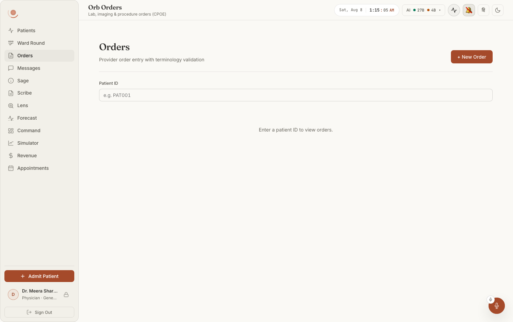
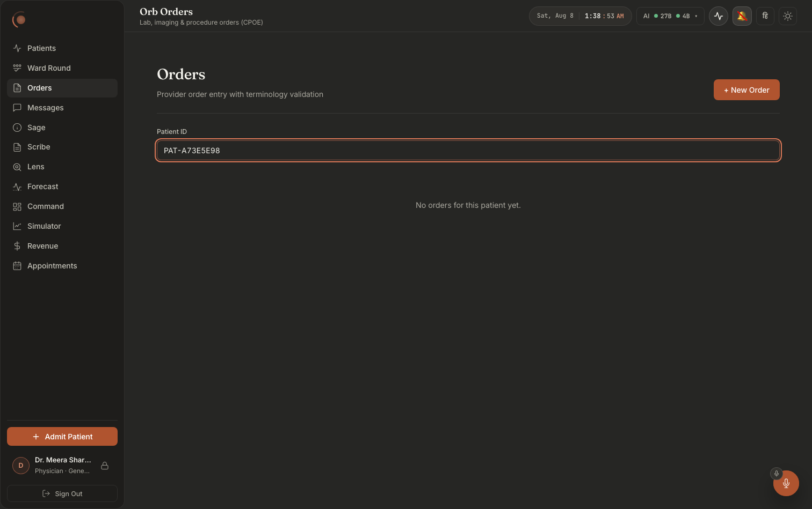
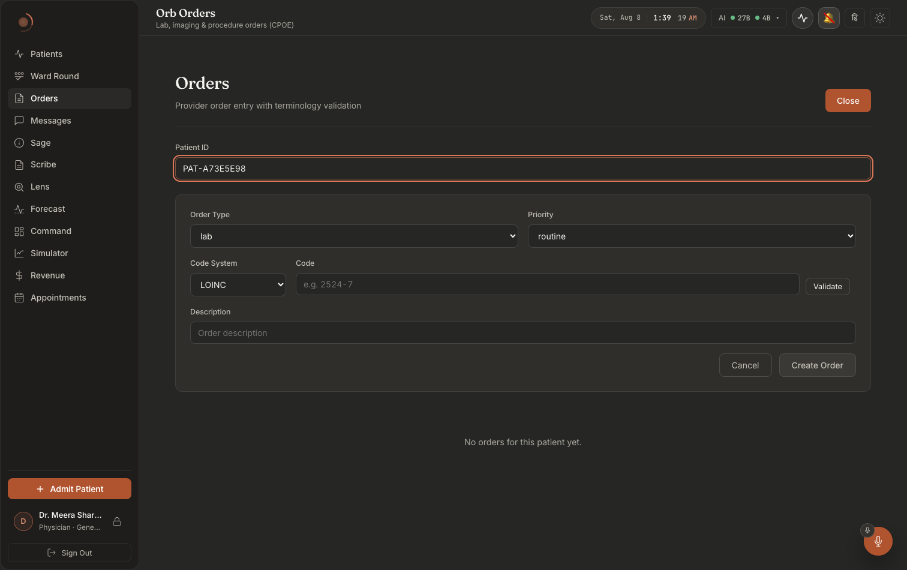

# Screen map 12: Orders and order sets

**What this is.** An index of every visible thing on the **Orders** tab, both of its sub-views,
**Individual orders** (CPOE-lite: a create form, a patient picker, a list of order cards with
status chips) and **Order sets** (the cited protocol library, its preview and its apply), and the
exact code that puts each thing on screen. Read an entry, then open the file at the line it names.
Every citation in this file was opened and read at that line.

**Scope.** Two panel components and their leaves:

| Surface | File | Lines |
|---|---|---|
| The whole Orders tab, incl. the view switch | `src/components/orders/OrdersPanel.tsx` | 16–402 |
| The create-order form | `src/components/orders/OrdersPanel.tsx` | 413–581 |
| The order-set library, preview and apply | `src/components/orders/OrderSetsPanel.tsx` | 45–390 |

Three shared leaves are covered where they appear inside these surfaces:
`src/components/common/PatientPicker.tsx` (whole file, 199 lines), used twice;
`src/components/vigil/SafetyAlertModal.tsx` (whole file, 158 lines), the drug-safety modal the
create form raises; and `src/components/print/OrdersPrintView.tsx` (whole file, 135 lines), the
print portal. Styling comes from `src/components/orders/Orders.module.css` (CSS Modules, 
`styles.x`) and `src/components/orders/OrderSets.css` (plain BEM, `order-sets__x`).

**How you get there.** Left nav → **Orders**. The nav entry is defined at
`src/pages/ClinicianShell.tsx:70` (`id: 'orders', label: 'Orders', pillar: 'Orders'`, with a
document-with-two-rules icon at `:70-74`); the panel is lazily imported at `:278` and mounted at
`:740-744` inside `<PanelErrorBoundary label="orders">`. The tab exists only for roles whose list
includes `'orders'`: **doctor** (`:195-196`) and **nurse** (`:200`). Admin (`:201`), pharmacist
(`:202`) and the raw `'surgeon'` fallback (`:188-189`) have no Orders tab at all, for them this whole
screen is unreachable through the shell. `shouldRenderPanel` (`:325`) means the panel is not even
mounted until the tab has been visited once, so first paint of this screen always starts from
`loading = false`, `orders = []`, `patientId = ''`.

**Two server permissions govern everything here**: `ORDER_READ` (`order.read`) and `ORDER_WRITE`
(`order.write`), defined at `server/permissions.py:79-80` and granted to `doctor` (`:112`) and
`nurse` (`:127`); `admin` holds `ORDER_READ` only (`:149`).

**Layout in one sentence, each.** *Individual orders* is a single scrolling column: a small
two-button segmented switch at the top-left, then a title/subtitle block with Print and
`+ New Order` on the right, then the patient picker, then (optionally) the create-order form card,
then a vertical stack of order cards, description and metadata on the left of each card, a status
chip and its action buttons on the right. *Order sets* is a two-column grid (`OrderSets.css:47-52`,
`minmax(240px,320px)` list + fluid detail, collapsing to one column below 900px): a scrolling list
of protocol cards on the left, a detail card on the right holding the citation, the per-item
verdicts and the Apply button, with a full-width "already applied" list underneath.

---

## What it looks like

**Notice that the screen refuses to show anything until it has a patient**: one field, a
placeholder shaped like a real id (`e.g. PAT001`), and the sentence "Enter a patient ID to
view orders". **+ New Order** is live before a patient is chosen; the list is not. Dark
twin: `doc001-04-orders-dark.png`.

**Notice the difference between *empty* and *failed*.** A real MRN returns "No orders for
this patient yet.", a statement about the patient, and the field ring turns accent to show
it resolved.

**Notice that terminology validation is its own step, not a submit-time check**: **Code
System** (LOINC) + **Code** (`e.g. 2524-7`) + a **Validate** button sit together on one row,
above the free-text Description, with Create Order as a separate action at the end. The
header button has flipped from "+ New Order" to **Close**.

> ⚠ `orders-01-badid-dark.png` shows an unknown id returning "Orders could not be loaded."
> with a **Retry** button, the wrong message for that cause, since retrying will never
> conjure the patient. The **Order sets** sub-view, the other half of this chapter, has no
> top-level capture at all. See
> [`docs/screenshots/INDEX.md`](../../screenshots/INDEX.md).

---

# A. The frame: both views share this

Root: `
` at `OrdersPanel.tsx:185` (sets view) and `:195` (orders
view). It is `display:flex; flex-direction:column; gap:24px; overflow-y:auto`
(`Orders.module.css:6-17`) with **zero padding**, the page gutter belongs to `.shell__body`, and
the comment at `Orders.module.css:1-5` records that adding padding here once slid the whole page
sideways when switching tabs.

### The "Individual orders" / "Order sets" segmented switch
**Where:** the very top-left of the panel, above the "Orders" title, a pill-shaped strip of two
buttons in a bordered tray.
**Rendered by:** `OrdersPanel.tsx:16-36` (`OrdersViewSwitch`). The tray is
`
` at `:31`; the two tabs
are produced by the `tab()` helper at `:19-29` and instantiated at `:32` (`tab('orders',
'Individual orders')`) and `:33` (`tab('sets', 'Order sets')`). Each is a real
`role="tab"` button with `aria-selected` (`:22-23`), so it is keyboard- and screen-reader
navigable.
**Data from:** `view` state, `useState<'orders' | 'sets'>('orders')` at `:104`, so
**Individual orders is always the landing view**. `onChange` is `setView`, wired at `:186`/`:196`.
**API:** none.
**Server:** none.
**Change this →** click **Order sets** and the entire body below the strip is replaced: the
"Orders" title, Print, `+ New Order`, the picker and the order list all vanish, and the protocol
library renders in their place (the early return at `:183-192`). The selected tab is filled with
`--accent-deep` and `--btn-primary-text` (`styles.viewTabOn`, `Orders.module.css:428-431`); the
unselected one is transparent with `--text-secondary` text (`:421-424`). While the lazy chunk
loads you get the fallback **"Loading protocols…"** (`:187`). The switch itself never disappears, 
it is rendered in both branches.

### "Loading protocols…" (view-switch fallback)
**Where:** a dashed-bordered, centred block filling the panel body, immediately under the switch.
**Rendered by:** `OrdersPanel.tsx:187`, `<Suspense fallback={
Loading
protocols…
}>`.
**Data from:** React `Suspense` on the lazy import at `:13` (`lazy(() => import('./OrderSetsPanel'))`).
**API:** none, this is the JS chunk, not data.
**Server:** static asset.
**Change this →** appears for the fraction of a second the first time you press **Order sets** in a
session, and never again (the chunk is cached). If the chunk 404s after a deploy the
`PanelErrorBoundary` at `ClinicianShell.tsx:552` takes over and shows the shell's own
updating/reload affordance (`ClinicianShell.tsx:263-267`) instead of this panel.

---

# B. Individual orders

## B.0 Header

### "Orders" page title
**Where:** top-left of the header row, under the view switch.
**Rendered by:** `OrdersPanel.tsx:199`, `<h2 className={styles.title}>Orders</h2>`.
**Data from:** literal.
**API / Server:** none.
**Change this →** it is Fraunces (`--font-display`) 1.75rem/500 with `-0.02em` tracking
(`Orders.module.css:33-41`), deliberately identical to the Order Sets title
(`OrderSets.css:24-32`, whose comment records that the two sibling tabs once shipped two different
title treatments). Change one and the two views stop looking like one product.

### "Provider order entry with terminology validation" subtitle
**Where:** directly under the title, muted grey, 0.875rem.
**Rendered by:** `OrdersPanel.tsx:200`, `
`.
**Data from:** literal. Styled at `Orders.module.css:43-48`.
**Change this →** cosmetic only. It is the screen's one-line claim: every coded order on this
screen is checked against the local `terminology` table before it is written.

### "Print" button
**Where:** header right, immediately left of `+ New Order`. Gradient fill (`--btn-gradient`).
**Rendered by:** `OrdersPanel.tsx:204-219`, inside `{orders.length > 0 && (…)}` at `:203`.
**Data from:** `printing` state (`:113`); label is `{printing ? 'Preparing…' : 'Print'}` at `:218`,
and `disabled={printing}` at `:207`.
**API:** none, it prints what is already loaded.
**Server:** none.
**Change this →** **the button does not exist at all when the list is empty** (`:203`), no
patient selected, no orders, or a failed load all remove it. Pressing it sets `printing = true`,
which (a) swaps the label to "Preparing…" and greys the cursor, and (b) mounts the print portal
(§B.7). It returns to "Print" when `onAfterPrint` fires (`:395`), which the browser raises whether
the user printed or cancelled (`OrdersPrintView.tsx:49-51`).

### "+ New Order" / "Close" button
**Where:** the rightmost control in the header. Solid `--accent-deep` fill.
**Rendered by:** `OrdersPanel.tsx:221-223`, `<button className={styles.newButton} onClick={() =>
setShowForm(v => !v)}>{showForm ? 'Close' : '+ New Order'}</button>`.
**Data from:** `showForm` state (`:112`).
**API / Server:** none.
**Change this →** the label flips to **"Close"** while the form is open. Pressing it opens the
create-order form card *only if a patient is selected*, the render guard at `:241` is
`showForm && patientId`, so on a fresh screen with no patient the button toggles state and
**nothing visibly happens**. The form also closes itself on a successful create (`:244`,
`setShowForm(false)`).

## B.1 The patient picker

### "Patient" picker (search by name, bed or MRN)
**Where:** full-width row directly under the header.
**Rendered by:** `OrdersPanel.tsx:230-239`, the whole block is wrapped in `{!patientIdProp && …}`
at `:230`, so it is present whenever the panel is mounted from the shell (which passes no props,
`ClinicianShell.tsx:552`) and absent when the panel is embedded in a chart that fixes the patient.
The control itself is `<PatientPicker value={patientId} onChange={setPatientId} label="Patient"
hint="Pick the patient whose orders you want to see." />` at `:232-237`; its markup is
`PatientPicker.tsx:88-197`.
**Data from:** `patientId` state (`:105`), seeded from the `patientIdProp` and re-synced by the
effect at `:119-121`. The picker's own list comes from `getPatients()` at `PatientPicker.tsx:48`.
**API:** `GET /api/vigil/patients` (`src/api/client.ts:614-616`).
**Server:** the Vigil patient roster route, already department-scoped for the signed-in
clinician, which is why the file header at `PatientPicker.tsx:18-21` states the picker shows
nothing the caller could not already read.
**Change this →** typing filters on name, bed, MRN, ward or diagnosis
(`PatientPicker.tsx:72-82`). Choosing an option calls `onChange(p.id)` (`:135`), which sets
`patientId` and immediately re-runs `loadOrders` through the `useCallback`/`useEffect` pair at
`OrdersPanel.tsx:127-142`; the list below repaints. It also **cancels any pending cancel
confirmation** (`:125`, `useEffect(() => { setCancelTarget(null) }, [patientId])`), a pending
confirm refers to the previous patient's order and must not survive the switch. The whole row
disappears if the panel is ever given a `patientId` prop.

### Picker sub-states: "Loading patients…", "No patient matches …", the selected-patient line, "Clear", "Enter an id"
**Where:** inside/below the picker input.
**Rendered by:** `PatientPicker.tsx:122` (loading row), `:123-127` (no-match row),
`:179-182` (selected line `name · bed · mrn`), `:108-117` (**Clear** button), `:186-194`
(**Enter an id** / **Search by name** toggle), `:152-163` (the raw-id input with placeholder
`Paste an Orb patient id (PAT-XXXXXXXX)`), `:175-178` (the red "No patient with that id is on your
ward list." warning), `:166-174` (the red list-load failure with **Retry** and **enter an id
instead**).
**Data from:** `patients`, `loading`, `loadError`, `query`, `open`, `manual` states
(`:37-42`); `unknownTypedId` is computed at `:85`.
**Change this →** the header comment at `PatientPicker.tsx:1-21` is the reason this is a picker at
all: the old control was a bare "Patient ID" field placeholdered `e.g. PAT001`, and typing exactly
that produced `404 /orders/patient/PAT001` and an empty screen, because real ids look like
`PAT-A73E5E98`. If `getPatients` fails, the picker degrades to the raw-id field rather than
blocking the screen.

## B.2 The create-order form

Mounted at `OrdersPanel.tsx:241-247`; the component is `CreateOrderForm` at `:413-581`. The card
is `styles.formCard`, surface background, 1px subtle border, 24px padding, 16px gaps
(`Orders.module.css:268-276`).

### "Order Type" dropdown
**Where:** first field, left half of the form's first row.
**Rendered by:** `OrdersPanel.tsx:488-497`, label at `:489`, `<select>` at `:490-496`.
**Data from:** `orderType` state, `useState('lab')` at `:414`. Options come from the module
constant `ORDER_TYPES = ['lab','imaging','medication','procedure','nursing','other']` at `:62`.
**API / Server:** none on change, but the value is sent as `order_type` on submit and re-validated
server-side at `server/services/orders_service.py:89-90`.
**Change this →** three things move at once. (1) Choosing **nursing** or **other**, the members of
`CODELESS` at `:65`, makes `needsCode` false (`:428`) and **the entire Code System + Code row
disappears** (`:506`), and `canSubmit` (`:445-449`) stops requiring a validated code. (2) Choosing
**medication** is what arms the drug-safety gate: the route only passes `pre_persist_gate` when
`req.order_type == "medication"` (`server/routes/orders_routes.py:265`), so only a medication order
can raise the safety modal. (3) The select also resets `valid` to `'idle'` (`:493`), wiping any
green ✓ next to the code field.

### "Priority" dropdown
**Where:** right half of the first form row.
**Rendered by:** `OrdersPanel.tsx:498-503`.
**Data from:** `priority` state, `useState('routine')` at `:418`; options from `PRIORITIES =
['routine','urgent','stat']` at `:64`.
**API:** sent as `priority` in the `POST /api/orders` body.
**Server:** validated at `orders_service.py:91-92`, anything outside `{stat, urgent, routine}` is a
`ValueError` → 400.
**Change this →** the value shows in the order card's metadata line afterwards, and **stat renders
in danger-red 600-weight, urgent in amber 600-weight, routine in plain muted grey**
(`OrdersPanel.tsx:314-317`; `Orders.module.css:248-249`).

### "Code System" dropdown
**Where:** first field of the second row, narrow (max-width 140px, set inline at `:508`).
**Rendered by:** `OrdersPanel.tsx:508-517`.
**Data from:** `codeSystem` state, `useState('LOINC')` at `:416`; options from `CODE_SYSTEMS =
['LOINC','SNOMED','ICD10']` at `:63`.
**Change this →** changing it resets `valid` to `'idle'` (`:513`), clearing the ✓/✗ hint. Note the
list deliberately does **not** include `LOCAL`, the code system the shipped protocols use
(`server/migrations.py:875-897`), you cannot hand-type a `LOCAL` code through this form, only
reach those codes through an order set.

### "Code" text input and the "Validate" button
**Where:** second field of the second row; the input flexes to fill, with **Validate** and a hint
to its right on the same baseline (`styles.validateRow`, `Orders.module.css:315-319`).
**Rendered by:** input at `OrdersPanel.tsx:521-528` (placeholder `e.g. 2524-7` at `:526`),
**Validate** button at `:529-531`.
**Data from:** `code` state (`:417`). Typing resets `valid` to `'idle'` (`:524`); blurring the
field fires `validateCode` (`:525`), as does the button.
**API:** `GET /api/orders/terminology/validate?code_system=…&code=…`
(`OrdersPanel.tsx:434-436`).
**Server:** `server/routes/orders_routes.py:211-224` (`validate_terminology`, guarded by
`require_permission(ORDER_READ)`), which calls
`server/services/terminology_service.py:55-64` (`validate_code`) and, when valid,
`:67-76` (`get_display`). Both are single indexed lookups against `terminology` with
`is_active = 1`.
**Change this →** a **valid** code paints a green **"✓ <display>"**, e.g. `✓ CBC panel - Blood by
Automated count`, at `:534` (`styles.valid` = `--status-ok-text`, `Orders.module.css:326`), and
**auto-fills the Description field if it is still empty** (`:439`). An **unknown** code paints a
red **"✗ unknown code"** at `:535` (`styles.invalid` = `--status-danger-text`, `:327`). While the
request is in flight the hint is a bare **"…"** (`:533`). A network failure is treated as invalid
(`:440-442`), the ✗ is shown, not an error. Until the hint reads ✓, the **Create Order** button
stays disabled for every order type except nursing/other (`:445-449`).

### "Description" text input
**Where:** third form row, full width. Placeholder `Order description`.
**Rendered by:** `OrdersPanel.tsx:545-550`.
**Data from:** `description` state (`:415`), which the code validator may fill for you (`:439`).
**API:** sent as `description`; **also used as the drug name** for medication orders, 
`orders_routes.py:249` passes `req.description` straight into `enforce_medication_safety` as
`drug_name`.
**Server:** required and stripped at `orders_service.py:103-104`.
**Change this →** an empty description keeps **Create Order** disabled (`:446`). For a medication,
the text you type here is literally what the allergy and interaction screen matches on, "Amoxicillin
500 mg PO TDS" is screened as that whole string by
`server/services/drug_safety_service.py:431-462`. It is also the heading of the resulting order
card (`:308`) and the label in the cancellation prompt's `aria-label` (`:351`) and the result
prompt (`:170`).

### Red form error line
**Where:** between the Description row and the Cancel/Create buttons.
**Rendered by:** `OrdersPanel.tsx:554`, `{error && 
{error}
}`.
**Data from:** `error` state (`:421`), set only in the non-428 branch of the submit catch at
`:477`.
**API / Server:** whatever `POST /api/orders` returned. The text is
`apiFetch`'s `detailMessage` (`src/api/client.ts:247-256`), so a 400 from
`orders_service.create_order` appears verbatim, e.g. **"Unknown LOINC code '9999-9', not present
in terminology. Codes must be validated before ordering."** (`orders_service.py:110-114`), or
**"order_type 'lab' requires a coded concept (code + code_system). Only ['nursing', 'other'] may
be free-text."** (`:115-119`). A 503 from a broken safety screen shows **"The drug-safety screen
could not run. Resolve the fault or use the pharmacist verification path."**
(`server/services/medication_safety_gate.py:141-148`). A 403 shows **"Insufficient permissions"**
(`client.ts:210-212`).
**Change this →** it clears on the next submit attempt (`:452`) and disappears when the form
closes.

### "Cancel" and "Create Order" buttons
**Where:** bottom-right of the form card, right-aligned (`styles.formActions`,
`Orders.module.css:329-333`).
**Rendered by:** `OrdersPanel.tsx:557` (Cancel) and `:558-560` (Create Order).
**Data from:** `canSubmit` (`:445-449`) and `submitting` (`:422`); label is
`{submitting ? 'Creating…' : 'Create Order'}`.
**API:** `createOrder(...)` → `POST /api/orders` (`client.ts:1365-1374`).
**Server:** `orders_routes.py:231-273` (`create_order`, guarded by
`require_permission(ORDER_WRITE)`) → `orders_service.create_order`
(`server/services/orders_service.py:69-143`), which validates the order type, the priority, the
initial status, the description and the code, runs the caller's `pre_persist_gate` **after all
validation and immediately before the write** (`:124-125`), inserts into `orders` with
`status='draft'`, and writes the first `order_events` row via `_record_event` (`:141`,
`:57-62`). After the write, `_shadow_clinical_action` (`orders_routes.py:293-344`) records a
`clinical.action` shadow event, but **only if a shadow episode is already open** (`:307-309`);
a routine order on a quiet patient records nothing.
**Change this →** the disabled state is a **colour swap, never opacity** (`Orders.module.css:351-358`
and its comment: opacity measured 1.11:1 contrast). On success with no safety payload the form
closes and the list reloads (`:244`, `onCreated`). The new order appears **at the top of the list**
with a grey **DRAFT** chip, `list_orders` orders by `created_at DESC`
(`orders_service.py:246-249`).

## B.3 The drug-safety modal (the allergy block, on screen)

Mounted at `OrdersPanel.tsx:563-578`; the component is `SafetyAlertModal`
(`src/components/vigil/SafetyAlertModal.tsx:134-319`), portaled to `document.body` (`:68`, `:156`)
so it sits above the whole app, with a focus trap (`:144`) and a click-away backdrop (`:69`).

### "Severe drug-safety alerts" modal (blocking mode): what an allergy block looks like
**Where:** centred over a dimmed page.
**Rendered by:** title at `SafetyAlertModal.tsx:115-117`
(`{blocking ? 'Severe drug-safety alerts' : 'Drug-safety review'}`); the card carries the extra
class `safety-modal--blocking` at `:71`.
**Data from:** `safetyModal` state in the form (`OrdersPanel.tsx:426`), set to
`{ safety: err.safety, mode: 'blocking' }` at `:476` when `isSafetyAckRequired(err)` is true
(`client.ts:1310-1312`).
**API:** the failed `POST /api/orders`, answered **428 Precondition Required**. `apiFetch` has a
dedicated branch for it (`client.ts:231-243`) that builds a typed error carrying the whole
`safety` payload.
**Server:** `medication_safety_gate.enforce_medication_safety`
(`server/services/medication_safety_gate.py:304-543`). It calls
`drug_safety_service.check_medication_safety` (`:114`; the service is at
`drug_safety_service.py:431-462`), and when `safety["blocking"]` is true, which means
`max_severity == "severe"` (`drug_safety_service.py:455`), and no valid acknowledgement is
present, it audits a `drug_safety_block` denial (`:150-151`) and raises the 428 at `:152-159`.
**Change this →** the body shows, in order: **"Screening result for <drug>"** in bold (`:88-92`,
the drug is the Description text you typed), a red lede **"This order is blocked until the alerts
below are reviewed. Acknowledging records your identity and justification on the audit chain."**
(`:94-99`), then the alert groups. Remove the `blocking` mode and the whole justification
apparatus below disappears, replaced by a single **Close** button.

### "Allergy alerts" / "Interaction alerts" groups and their severity chips
**Where:** stacked in the modal body under the lede.
**Rendered by:** `SafetyAlertModal.tsx:137-138` (two `<AlertGroup>` calls); the group component is
`:93-108`, an `<h3>` title at `:97` and one `<li>` per alert at `:100-103`, each a severity chip
plus the message.
**Data from:** `safety.allergy_alerts` / `safety.interaction_alerts` (`:146-147`), typed at
`client.ts:1286-1295`.
**Server:** allergy messages are built at `drug_safety_service.py:348`, 
**"Patient is allergic to <substance> (documented reaction: <reaction>)."**, plus class-share and
cross-reactivity variants at `:360` and `:374`. Interaction messages are
**"<drug> + <existing>: <mechanism>"** at `:425`.
**Change this →** the chip colour is decided by `severityClass` (`:86-91`): `severe` and
`contraindicated` render **danger red**; `mild`/`minor`/`low` render **ok green**; **everything
else, including `moderate` and `unknown`, renders amber**, the comment at `:89` records that this
is deliberate, so an unmapped severity never reads as "fine". A group with zero alerts renders
nothing at all (`:94`), and if both are empty you get the single line **"No allergy or interaction
alerts were raised."** (`:103-105`).

### "Not screened" coverage strip
**Where:** below the alert groups.
**Rendered by:** `SafetyAlertModal.tsx:143-151`, an amber chip reading **"Not screened"** beside
the coverage note.
**Data from:** `safety.interaction_screened === false`, a strict false check, so a missing field
does not trigger it.
**Server:** set at `drug_safety_service.py:449` (`interaction_screened = bool(classify_drug(...))`)
with the note text at `:458-461`: **"'<drug>' is outside the interaction knowledge base, drug–drug
interactions were NOT screened. Verify manually."** The docstring at `:435-440` states the reason:
an unscreened drug returning zero alerts previously looked identical to a clean screen.
**Change this →** this strip is the *only* on-screen difference between "screened and clean" and
"never screened". It also drives whether the info-mode modal appears at all (`OrdersPanel.tsx:467`).

### "Clinical justification" textarea and the "Acknowledge & Order" button
**Where:** bottom of the blocking modal.
**Rendered by:** label at `SafetyAlertModal.tsx:158-160`, textarea at `:122-131` (placeholder
**"Why is it clinically appropriate to proceed despite these alerts? (min 10 characters)"**),
buttons at `:132-144`, **Cancel** (ghost) and **Acknowledge & Order** (danger red).
**Data from:** local `reason` state (`:138`); `canAcknowledge` at `:66` requires
`reason.trim().length >= 10` (`MIN_REASON_LENGTH`, `:84`) **and** `!busy`. `busy` is the form's
`submitting` (`OrdersPanel.tsx:567`).
**API:** re-submits `POST /api/orders` with `safety_ack: { acknowledged: true, reason }`
(`OrdersPanel.tsx:569` → `client.ts:1369`).
**Server:** the same gate. `enforce_medication_safety` recomputes `acknowledged` from all three of
`safety_ack`, a non-empty trimmed `reason` and the `acknowledged` flag
(`medication_safety_gate.py:151-152`); on success it audits a `drug_safety_override` with
`outcome="partial_success"` (`:160-162`) and returns the safety payload with an `override`
block naming the actor and reason (`:163`).
**Change this →** until 10 characters are typed the red button is inert. While the re-submit is in
flight the label becomes **"Submitting…"** (`:142`) and both the close ✕ (`:82`) and the backdrop
click (`:168`) are disabled, so the modal cannot be dismissed mid-write. Pressing **Cancel**
closes the modal and **leaves the create form up with your values intact** (`OrdersPanel.tsx:570-576`:
`wasInfo` is false, so `onCreated()` is not called), nothing was ordered.

### "Drug-safety review" modal (info mode)
**Where:** same position, no red lede, one **Close** button.
**Rendered by:** the else branch at `SafetyAlertModal.tsx:186-192`.
**Data from:** `setSafetyModal({ safety, mode: 'info' })` at `OrdersPanel.tsx:468`, reached when the
create **succeeded** and either `safety.max_severity !== 'none'` or
`safety.interaction_screened === false` (`:467`), and only when this was not already an
acknowledged re-submit (`!safetyAck` in the same condition; the comment at `:464-466` explains the
clinician has just reviewed those alerts).
**Server:** the sub-severe path, `enforce_medication_safety` audits a `drug_safety_screen`
success and returns (`medication_safety_gate.py:174-176`); the route attaches it to the response as
`safety` (`orders_routes.py:269-270`).
**Change this →** **the order already exists** by the time this appears. Closing it therefore
*finishes* the create flow, `onClose` calls `onCreated()` because `wasInfo` is true
(`OrdersPanel.tsx:571-575`), so the form closes and the list reloads. That is the opposite of
what Cancel does in blocking mode, and it is the single most important behavioural difference
between the two modes.

> **What is NOT on this path:** the **dose guard never fires on an individual CPOE order.** This
> form has no dose, route or frequency field, and `orders_routes.create_order` runs only
> `enforce_medication_safety` (`orders_routes.py:244-252`), the allergy + interaction screen.
> `_dose_screen` (`order_sets_service.py:642-691`) is reached only from the order-set path (§C) and
> from the bedside eMAR. A 10x digoxin dose typed into the Description here is refused by nothing.

## B.4 List states

### "Loading orders…"
**Where:** fills the body below the header, min-height 220px, dashed border, centred.
**Rendered by:** `OrdersPanel.tsx:264-265`.
**Data from:** `loading` state (`:107`), set true at `:129` and false in the `finally` at `:138`.
**API:** `GET /api/orders/patient/{patientId}` (`:131`).
**Server:** `orders_routes.py:347-356` (`list_patient_orders`), guarded by
`require_patient_access(ORDER_READ, audit_action="patient_orders_viewed")`, which is
permission check + ward-scope check + a fail-closed `phi_access` audit row
(`permissions.py:454-525`), calling `orders_service.list_orders`
(`orders_service.py:237-250`).
**Change this →** it takes precedence over every other body state (`:264` is the first arm of the
ternary chain), so a refresh briefly hides even a failed load. It never appears when no patient is
selected: `loadOrders` returns early at `:128` without touching `loading`.

### "Orders could not be loaded" failure card
**Where:** same geometry as the loading and empty cards, but framed in danger red with a 10%
red wash (`styles.errorState`, `Orders.module.css:95-99`).
**Rendered by:** `OrdersPanel.tsx:269-278`, `role="alert"`, title at `:270`, body at `:271-274`,
**Retry** button at `:275-277`.
**Data from:** the second ternary arm at `:266`, `loadError && orders.length === 0`. `loadError`
is set in the catch at `:134-137`.
**API / Server:** as above. A ward-scope miss returns **404 "Patient not found"**
(`permissions.py:508`), deliberately not 403, because a 403 would confirm the patient exists.
**Change this →** the body copy is fixed and load-bearing: **"This is a display failure, not an
empty chart. Do not read it as 'no orders', check the chart directly if you cannot reload."** The
comment at `:266-268` and at `Orders.module.css:66-73` records why this card exists at all, one
grey line once served for both "no orders" and "could not load", and on a CPOE screen those two
must never be confusable. **Note:** the underlying error message is stored in `loadError` but is
**never rendered**, only `console.error` at `:135` sees it. **Retry** calls `loadOrders` again.

### "Could not refresh orders: showing the last successful load." banner
**Where:** a thin red line of text just above the list, with an underlined inline **Retry**.
**Rendered by:** `OrdersPanel.tsx:251-262`, guarded by `loadError && orders.length > 0` at `:251`.
`role="status"`, so it is announced politely rather than as an alert.
**Data from:** the same `loadError`, but in the case where a previous load succeeded.
**Change this →** this is the *other half* of the failure design: a refresh that failed on top of
an already-loaded list keeps the list visible but must not let it read as current (comment at
`:249-250`). It disappears the moment a reload succeeds (`:133`, `setLoadError(null)`), or if the
list empties.

### "No orders yet" / "No patient selected" empty state
**Where:** centred card with a dashed border and a round clipboard glyph.
**Rendered by:** `OrdersPanel.tsx:280-297`. The inline SVG clipboard is at `:282-287`; the title at
`:289-291`; the detail at `:292-296`.
**Data from:** `patientId` chooses both strings. With a patient: **"No orders yet"** / "Nothing has
been ordered for this patient. Use "New Order" to place the first one, it will be validated
against the terminology table and the safety gates before it is written." Without: **"No patient
selected"** / "Search above for a patient and their lab, imaging, medication and procedure orders
will appear here, newest first."
**Change this →** this is the state the panel opens in. It is deliberately *not* red and *not*
`role="alert"`, the geometry matches the failure card exactly so nothing jumps between states,
but the frame and tone differ (`Orders.module.css:74-99`).

## B.5 An order card

One `
` per order, rendered by the `orders.map` at
`OrdersPanel.tsx:300-379`. The card is a flex row: `.cardMain` on the left, `.cardRight` on the
right (`Orders.module.css:146-193`). Hovering lifts the border colour only (`:158-160`).

### Order description (card title)
**Where:** first line of each card, 0.95rem/500.
**Rendered by:** `OrdersPanel.tsx:308`, `
{order.description}
`.
**Data from:** `order.description` from the list fetch.
**Server:** the `orders.description` column, written by `orders_service.create_order`
(`orders_service.py:133-139`), either the text typed in the form, or the protocol item's
description when the order came from a set (`order_sets_service.py:932`).

### Order type
**Where:** first chip-less item of the small grey metadata line under the title.
**Rendered by:** `OrdersPanel.tsx:310`, `{order.order_type}`.
**Data from:** `order.order_type`, lower-case as stored.
**Change this →** it also decides whether **+ Result** appears (`RESULTABLE = {lab, imaging}` at
`:66`, used at `:302`).

### Code chip: "LOINC 2524-7"
**Where:** second item of the metadata line, in the mono face and accent colour.
**Rendered by:** `OrdersPanel.tsx:311-313`, guarded by `{order.code && …}`.
**Data from:** `order.code_system` + `order.code`. Styled at `Orders.module.css:183-186`.
**Server:** `code_system` is upper-cased on write (`orders_service.py:138`).
**Change this →** **it is absent entirely for nursing and other orders**, which are allowed to be
free-text (`orders_service.py:115-119`).

### Priority text
**Where:** third item of the metadata line.
**Rendered by:** `OrdersPanel.tsx:314-317`, a conditional class, not a chip.
**Data from:** `order.priority`.
**Change this →** `stat` → `styles.priorityStat` (danger-red, 600 weight); `urgent` →
`styles.priorityUrgent` (amber, 600); `routine` → empty class, so it inherits the muted grey of the
metadata row (`Orders.module.css:248-249`).

### Source tag
**Where:** last item of the metadata line, usually absent.
**Rendered by:** `OrdersPanel.tsx:318`, `{order.source !== 'clinician' && {order.source}}`.
**Data from:** `order.source`.
**Server:** defaults to `"clinician"` (`orders_routes.py:33`, `orders_service.py:78`); an order
written by an applied protocol is stored with `source="order_set"`
(`order_sets_service.py:937`).
**Change this →** this one word is how a clinician tells a hand-typed order from a protocol-placed
one on the list. Set `source` to `"clinician"` and it vanishes.

### "Result: …" line
**Where:** a separate line at the bottom of `.cardMain`, above a hairline rule.
**Rendered by:** `OrdersPanel.tsx:320-322`; styled at `Orders.module.css:195-201` (top border,
8px padding).
**Data from:** `order.result_text`.
**Server:** written by `orders_service.add_result` (`orders_service.py:222-225`), which sets
`result_text`, `result_at` and `status='resulted'` in one statement.

### Status chip
**Where:** first item in the card's right-hand cluster; a pill in uppercase 0.72rem with 0.06em
tracking (`Orders.module.css:204-215`).
**Rendered by:** `OrdersPanel.tsx:325-327`, `{order.status.replace('_', ' ')}`, so `in_progress`
displays as **IN PROGRESS**.
**Data from:** `order.status`; the class comes from the `CHIP_CLASS` map at `:68-75`.
**Server:** the `orders.status` column; the legal state machine is
`orders_service.LEGAL_TRANSITIONS` (`orders_service.py:32-39`).
**Change this →** the six looks, each a 10% wash + 28% border + `*-text` colour
(`Orders.module.css:217-246`): **draft** neutral glass/secondary text; **active** info-blue;
**in progress** amber; **completed** green; **resulted** gold (`--accent-gold`); **cancelled**
danger-red. A status with no entry in `CHIP_CLASS` renders as a bare bordered pill with no fill, 
the `|| ''` fallback at `:325`.

### "→ active" / "→ in progress" / "→ completed" advance button
**Where:** immediately right of the status chip.
**Rendered by:** `OrdersPanel.tsx:328-332`; the label is `→ {next.replace('_', ' ')}`.
**Data from:** `nextStatus(order)` at `:89-96`, `draft → active`, `active → in_progress`,
`in_progress → completed`, and **null for everything else**.
**API:** `POST /api/orders/{id}/transition` with `{ to_status }` (`:146-149`).
**Server:** `orders_routes.py:374-386` (`transition_order`, `require_permission(ORDER_WRITE)`) →
`orders_service.transition_order` (`orders_service.py:150-191`), which rejects an unknown target
(`:157-158`), treats a same-status move as an idempotent no-op with no event
(`:167-169`), rejects an illegal edge (`:171-176`), refuses `resulted` for a non-lab/imaging type
(`:178-183`), then updates the row and writes an `order_events` row (`:185-189`).
**Change this →** on success `loadOrders()` re-fetches (`:150`) and the chip changes colour in
place. **The button disappears when the order reaches a terminal status**, `nextStatus` returns
null for `completed`, `resulted` and `cancelled`. On failure the UI raises a **browser `alert()`
dialog** carrying the server's message (`:153`), e.g. "Illegal transition: completed ->
in_progress. Allowed from 'completed': []".

### "+ Result" button
**Where:** right cluster, after the advance button.
**Rendered by:** `OrdersPanel.tsx:333-337`.
**Data from:** `canResult` at `:302-303`, `RESULTABLE.has(order_type)` **and** status is `active`
or `in_progress`.
**API:** `POST /api/orders/{id}/result` with `{ result_text }` (`:173-176`).
**Server:** `orders_routes.py:389-400` (`add_result`) → `orders_service.add_result`
(`orders_service.py:198-230`): rejects blank text (`:200-201`), rejects a non-resultable order type
(`:208-212`), rejects an illegal source status (`:215-219`), then writes text + timestamp +
`status='resulted'` and records the transition event only if the status actually moved
(`:226-228`).
**Change this →** pressing it opens a **native `window.prompt()`** titled `Result for "<order
description>":` (`:170`), not a styled modal. Cancelling the prompt or entering an empty string
aborts silently (`:171`). On success the card's chip turns **gold RESULTED**, the "Result: …" line
appears, and **both the advance button and the Cancel button disappear** (`resulted` is terminal at
`:304` and in `TERMINAL_STATUSES`, `orders_service.py:40`). A failure raises `alert()` (`:179`).

### "Cancel" button (the arming step)
**Where:** rightmost control of the card.
**Rendered by:** `OrdersPanel.tsx:367-373`, inside `{!isTerminal && (…)}` at `:338`.
**Data from:** `isTerminal` at `:304`, `['completed','resulted','cancelled'].includes(status)`.
**Change this →** it carries a red-tinted border only, from the module constant
`CANCEL_BTN_STYLE` at `:80` (`borderColor: color-mix(in srgb, var(--status-danger) 28%,
transparent)`). The comment at `:77-79` is the reason: `cancelled` is terminal, there is no
un-cancel endpoint, so the control is visually separated from the adjacent forward-transition
button and **never fires on a single click**, it only arms the confirmation row.

### The inline cancel confirmation: "Cancel order?", reason field, "Confirm cancel", "Keep"
**Where:** replaces the Cancel button in place, in the card's right-hand cluster.
**Rendered by:** `OrdersPanel.tsx:339-365`. The prompt text **"Cancel order?"** at `:341`; the
reason input at `:342-354` (placeholder **"Reason (optional)"**, `aria-label` "Cancellation reason
for <description>", `autoFocus`, 150px wide); **Confirm cancel** at `:355-361`; **Keep** at
`:362-364`.
**Data from:** `cancelTarget` (`:116`), the id of the one order awaiting confirmation, and
`cancelReason` (`:117`). Armed by `askCancel` (`:157-160`), which also clears any stale reason.
**API:** `POST /api/orders/{id}/transition` with `{ to_status: 'cancelled', detail: reason }`, 
`confirmCancel` at `:162-167` passes the trimmed reason, or `undefined` if blank, and `transition`
at `:148` only includes `detail` when it is present.
**Server:** the same `transition_order`; the reason lands in the `order_events.reason` column via
`_record_event` (`orders_service.py:189`, `:57-62`).
**Change this →** **Confirm cancel** is the only solid-danger-filled button on the screen, 
`CONFIRM_CANCEL_BTN_STYLE` at `:81-86` sets `background: var(--status-danger)` with
`color: var(--status-on-fill)` and 600 weight. **Enter** in the reason field confirms and
**Escape** dismisses (`:346-349`). **Keep** just clears `cancelTarget` (`:362`). Because
`cancelTarget` holds a single id, arming a second order's Cancel silently disarms the first. After
success the chip turns red **CANCELLED** and every action button on that card disappears.

## B.6 The print view

### The print portal
**Where:** appended to `document.body`, outside the app tree.
**Rendered by:** `OrdersPanel.tsx:383-399`, `createPortal(<Suspense fallback={null}><OrdersPrintView
… /></Suspense>, document.body)`, guarded by `printing`.
**Data from:** `orders.map(...)` at `:387-394` projects each order down to six fields
(`order_type`, `description`, `priority`, `status`, `result_text`, `created_at`). Note
`patientName` is **not** passed (`:386` passes only `patientId`).
**Change this →** the component fires `window.print()` itself after a double `requestAnimationFrame`
so the portal has committed (`OrdersPrintView.tsx:54-59`), and listens for `afterprint` to tear
itself down once (`:49-51`). On screen the layout is momentarily visible as unstyled content at the
bottom of the page, every `.orders-print-layout` rule in `src/print.css` lives inside
`@media print` (the block runs `:34-379`; the orders allow-list is `:265-266`, the page reset
`:271-289`).

### Printed page furniture: "Orb Hospital System", "Active Orders List", "Generated: …", "CONFIDENTIAL MEDICAL RECORD"
**Where:** top of the printed sheet, branding left, meta right.
**Rendered by:** `OrdersPrintView.tsx:72-81`, then a rule at `:83`.
**Data from:** `generatedAt = new Date().toLocaleString()` at `:46`.

### Printed patient band
**Where:** under the rule.
**Rendered by:** `OrdersPrintView.tsx:87-88`, `<h2>{patientName || 'Patient'}</h2>` and
`Patient ID: {patientId}`.
**Change this →** because `OrdersPanel` never passes `patientName`, **the printed sheet always says
just "Patient"** above the raw id. Pass `patientName` from the picker's selected patient and the
real name prints.

### Printed orders table
**Where:** the body of the sheet, under an "Orders" heading (`:93`).
**Rendered by:** `OrdersPrintView.tsx:95-118`, column headers **Type, Description, Priority,
Status, Result, Created** at `:98-103`; rows at `:107-117`, with the description bolded (`:110`),
the status underscore-stripped (`:112`), a **, ** for a missing result (`:113`) and a localised
timestamp via `formatDateTime` (`:34-38`, `:114`).
**Change this →** an empty array prints **"No orders recorded for this patient."** (`:120`), but
the Print button itself only exists when `orders.length > 0`, so that arm is unreachable from this
screen.

### Printed signature block
**Where:** foot of the sheet.
**Rendered by:** `OrdersPrintView.tsx:125-132`, "Reviewed by:" and "Date / Time:" each above a
ruled line (`.orders-signature-line`, `src/print.css:373`).

---

# C. Order sets (protocols)

Reached by the **Order sets** tab (§A). Root `
` at
`OrderSetsPanel.tsx:200`. The file header (`:1-17`) states the rule the screen's shape enforces: a
set is applied **whole or not at all**, preview runs the identical gates apply runs, and **there is
deliberately no control anywhere on this screen that skips a gate**.

## C.0 Header

### "Order Sets" title
**Where:** top-left.
**Rendered by:** `OrderSetsPanel.tsx:203`. Styled at `OrderSets.css:24-32` to match the Orders
title exactly.

### The safety promise subtitle
**Where:** under the title, max 62ch.
**Rendered by:** `OrderSetsPanel.tsx:204-207`, "Cited protocols. Every item still goes through the
allergy interlock, the dose guard and terminology validation, and a set is applied whole or not at
all."
**Change this →** it is a literal claim the rest of the screen has to keep. `screen_items`
(`server/services/order_sets_service.py:694-797`) is where it is kept: the allergy/interaction
screen at `:742-745`, the dose guard at `:786`, and terminology for the whole set at
`:867-875`.

### "Apply to" patient picker
**Where:** header right, opposite the title; wraps below on narrow screens.
**Rendered by:** `OrderSetsPanel.tsx:209-216`, guarded by `{!patientIdProp && …}`. Label
**"Apply to"**, hint **"Choose the patient this protocol is for."**
**Data from:** `patientId` state (`:77`), synced from the prop at `:91`. When the panel is opened
from the Orders tab it receives `patientIdProp={patientIdProp || patientId || undefined}`
(`OrdersPanel.tsx:188`), so **a patient already chosen on the Individual-orders view carries over
and this picker is hidden**.
**API / Server:** `GET /api/vigil/patients`, as in §B.1.
**Change this →** changing the patient re-runs the effect at `:139-157`, which clears the preview,
the apply result, the blocked list and the apply error, then re-fetches the preview for the new
pair. Clearing the patient takes the whole verdict list down with it and drops the panel back to
the "No patient selected" placeholder, a regression test asserts exactly that
(`OrderSetsPanel.order.test.tsx:122-135`).

### "Protocols v1 · editable by …" provenance line
**Where:** a small muted line under the header, above the two columns.
**Rendered by:** `OrderSetsPanel.tsx:219`, `{configNote && 
…}`.
**Data from:** `configNote` state, built at `:103-106` as
`` `Protocols v${res.config.config_version} · editable by ${res.config.editable_by}` ``.
**API:** `GET /api/orders/sets` (`src/api/orderSets.ts:83-88`).
**Server:** `orders_routes.py:94-106` (`list_order_sets`, `require_permission(ORDER_READ)`),
which reads `order_sets_service.get_config()` (`order_sets_service.py:494-497`) and hard-codes
`editable_by` to **"an engineer, in the site configuration file, not through this API"**
(`orders_routes.py:104`). `config_version` comes from the site file and must equal 1
(`order_sets_service.py:442-446`).
**Change this →** the rendered line reads **"Protocols v1 · editable by an engineer, in the site
configuration file, not through this API"**. The comment at `OrderSetsPanel.tsx:99-102` says why
it is on screen at all: it is a claim a CIO will test. It disappears if the response has no
`config` key.

### "Order sets could not be loaded: …" banner
**Where:** full width, under the provenance line.
**Rendered by:** `OrderSetsPanel.tsx:221-225`, `role="alert"`, in the danger callout recipe
(`OrderSets.css:188-192`, 10% wash, 28% border, `--status-danger-text`).
**Data from:** `listError` (`:74`), set in the catch at `:108`.
**API / Server:** a failed `GET /api/orders/sets`. For a role with no `ORDER_READ` this is a 403
whose message is **"Insufficient permissions"** (`client.ts:210-212`).
**Change this →** it appears *in addition to* the left column's own message; because
`{!loadingSets && sets.length === 0 && !listError}` at `:230` excludes the error case, you never
see "No protocols are configured" and this banner at the same time.

## C.1 The protocol list (left column)

### "Loading protocols…"
**Where:** top of the left column.
**Rendered by:** `OrderSetsPanel.tsx:229`.
**Data from:** `loadingSets`, initialised **true** at `:75` so this is the column's first paint,
cleared in the `finally` at `:109`.

### "No protocols are configured for this site."
**Where:** same place, after loading finishes.
**Rendered by:** `OrderSetsPanel.tsx:230-232`.
**Change this →** this line should be effectively unreachable in a healthy deployment: the config
loader raises `OrderSetConfigError` at **import time** for a missing or empty file
(`order_sets_service.py:405-419`, `:452-455`) and the module is loaded at the bottom of the file
with no try/except (`:1086`), so a malformed protocol file stops the server before uvicorn binds a
port, deliberately, so a broken file can never present as a site with no protocols
(`:1078-1086`, `:99-101`).

### A protocol card
**Where:** the left column, one card per configured set, in file order.
**Rendered by:** `OrderSetsPanel.tsx:233-248`, a `<button>` with `aria-pressed`, carrying three
stacked lines: the name at `:241`, the indication at `:242`, and a meta line at `:243-246`.
**Data from:** the `sets` array (`:72`) from `listOrderSets()`.
**API:** `GET /api/orders/sets`.
**Server:** `order_sets_service.list_sets` (`:500-512`) returns id, name, indication, guideline,
`item_count` and `fingerprint` per set, **no PHI**, which is why the route needs only
`ORDER_READ`. `item_count` is computed at validation time (`:395`); `fingerprint` is a 16-char
SHA-256 prefix of the set (`:399-402`, applied at `:466-467`).
**Change this →** the meta line reads e.g. **"9 items · Surviving Sepsis Campaign 2021, 1-hour
bundle; UK Sepsis Trust 'Sepsis Six'"**, with correct singular/plural (`:244`) and the guideline
clause omitted when there is no `guideline.name` (`:245`). Selecting a card gives it an
**accent-coloured border and a 3px accent rule down its left edge**
(`OrderSets.css:84-89`); mere hover is only a quiet border shift (`:82`), and the comment at
`:79-81` records that hover used to jump straight to the accent, making passing the cursor look
like selecting. Selecting also triggers the preview effect (`OrderSetsPanel.tsx:139-157`).

## C.2 The detail column, before it can say anything

### "No protocol selected" placeholder
**Where:** the right column, filling it, a centred clipboard glyph, a title and a sentence.
**Rendered by:** `OrderSetsPanel.tsx:252-256` via the `Placeholder` component at `:45-61` (the SVG
is `:49-55`).
**Detail text:** "Pick one on the left and this panel lists every order it would place, with the
safety gates already run against it."
**Change this →** the comment at `:38-44` and `OrderSets.css:106-111` insist this must **not** look
like `.order-sets__error`: on a clinical screen "nothing to show" and "we could not look" must
never be confusable. It has no red wash and no `role="alert"`.

### "No patient selected" placeholder
**Where:** same slot, once a protocol is chosen but no patient is.
**Rendered by:** `OrderSetsPanel.tsx:257-261`.
**Detail text:** "The safety gates are patient-specific, allergies, weight, renal function, so
there is nothing honest to show until Orb knows whose chart this is. Choose a patient above."
**Change this →** this state is enforced, not merely displayed: the preview effect returns early
without fetching when either input is missing (`:143`), and a test asserts `previewOrderSet` is
never called with a protocol alone (`OrderSetsPanel.order.test.tsx:113-120`).

## C.3 The detail column, with both inputs

### Protocol name (detail heading)
**Rendered by:** `OrderSetsPanel.tsx:264`, `<h3 className="order-sets__detail-title">`.
**Data from:** `selectedSet.name`.

### Guideline citation
**Where:** small secondary text directly under the heading.
**Rendered by:** `OrderSetsPanel.tsx:265-267`, guarded by `selectedSet.guideline?.citation`.
**Data from:** the `guideline.citation` string from the site file, e.g. "Evans L, Rhodes A,
Alhazzani W, et al. Surviving Sepsis Campaign… Crit Care Med 2021;49(11):e1063-e1143."
(`server/site_config/order_sets.json:26`).
**Server:** the citation is **mandatory**, an absent one is a startup failure, not a warning
(`order_sets_service.py:349-374`, especially the comment at `:349-353`).

### "This protocol has not yet been signed off by a named consultant at this site." warning
**Where:** an amber callout under the citation.
**Rendered by:** `OrderSetsPanel.tsx:268-272`, `role="note"`; the condition is
`(selectedSet.guideline?.reviewed_by || '').startsWith('SITE TO COMPLETE')`.
**Data from:** `guideline.reviewed_by` in the site file.
**Server:** every one of the five shipped protocols currently carries
`"reviewed_by": "SITE TO COMPLETE, name the consultant who signed this set off"`
(`order_sets.json:27`, `:112`, `:221`, `:312`, `:392`), so **out of the box this warning shows on
every protocol**. Fill the field with a consultant's name in the site file and it disappears.

### "Running the safety gates…"
**Where:** a muted line where the item list will be.
**Rendered by:** `OrderSetsPanel.tsx:274`.
**Data from:** `previewing` (`:81`), set at `:146` and cleared at `:154`.
**API:** `POST /api/orders/sets/{setId}/preview` with `{ patient_id }` (`orderSets.ts:94-103`).
**Server:** `orders_routes.py:119-148` (`preview_order_set`, `require_permission(ORDER_WRITE)`).
It calls `enforce_patient_scope(user, req.patient_id)` at `:134`, the body-shaped equivalent of
the path guard, 404 not 403 (`permissions.py:301-326`), then
`order_sets_service.preview_set` (`:800-826`), then writes an `order_set_previewed` PHI-read audit
row naming the blocked descriptions (`:140-147`).
**Change this →** `preview_set` runs `get_set` → `require_orderable_patient` → `resolve_items` →
`screen_items(..., honour_acks=False)` and returns `items`, `blocked`, `would_apply` and
`unknown_codes`. `honour_acks=False` means **a preview can never quietly consume an override**
(`:709-712`).

### "Preview failed: …" with an inline "Retry"
**Where:** danger callout in the detail column.
**Rendered by:** `OrderSetsPanel.tsx:275-282`, `role="alert"`; the **Retry** link-button at
`:278-280` calls `runPreview(selectedSet)` (`:162-174`).
**Data from:** `previewError` (`:82`).
**Server messages you can land on here:** **"Patient <id> is not admitted (status=discharged), an
order set cannot be applied to a discharged patient. Re-admit them first, or order individually if
this is deliberate follow-up."** (`order_sets_service.py:634-638`, via
`require_orderable_patient`); **"Patient <id> not found"** (`:631`) or the scope guard's
**"Patient not found"**; **"Unknown order set '<id>'. Configured sets: [...]"** (`:519-522`); or
**"Insufficient permissions"** for a role with `ORDER_READ` but not `ORDER_WRITE` (an admin, if
they could reach this screen).
**Change this →** the route maps `OrderSetError` to 404 for "not found"/"Unknown order set" and 400
for everything else (`orders_routes.py:83-91`), deliberately 404 for the patient case so the
response cannot confirm a patient exists.

### "N code(s) in this protocol are not loaded in this deployment's terminology table: …"
**Where:** an amber callout above the item list.
**Rendered by:** `OrderSetsPanel.tsx:286-292`, `role="note"`; the codes are joined as
`` `${c.code_system} ${c.code}` `` at `:290`.
**Data from:** `preview.unknown_codes`.
**Server:** `order_sets_service.unknown_codes` (`:526-549`), one indexed point lookup per distinct
code, deliberately never a full scan of `terminology`, because a site that bulk-loaded real LOINC
has millions of rows and this runs on every preview (`:537-539`).
**Change this →** it is a **warning in preview but a hard refusal at apply**:
`apply_set` re-checks and raises before writing anything (`:864-875`), with the message "Order set
'<id>' names N code(s) this deployment cannot resolve: … Load them into the terminology table, or
correct the protocol file. No orders were created.", which arrives on screen as the generic
`applyError` line (§C.6). The shipped protocols' `LOCAL` codes are seeded by migration
(`server/migrations.py:866-870`, list at `:875-897`), so this note stays hidden on a
migrated database.

## C.4 The item list: one row per order the set would place

### An item row
**Where:** a bordered row in the detail column; description and metadata left, verdict chip right.
**Rendered by:** `OrderSetsPanel.tsx:295-321` (`preview.items.map`), keyed by `v.index`.
**Data from:** `preview.items`, one `OrderSetVerdict` per item (`orderSets.ts:33-51`).
**Server:** built by `order_sets_service.screen_items` (`:694-797`); the item's own fields come
from `resolve_items` (`:556-612`), which is also where clinician edits would be merged (the UI
currently sends none, `applyOrderSet(selectedSet.id, patientId)` at `OrderSetsPanel.tsx:181`
passes no `items`).

### Item description
**Rendered by:** `OrderSetsPanel.tsx:302`, `{v.description}`,
0.875rem/600.

### Item metadata line
**Where:** under the description, in the **mono** face (`OrderSets.css:233`, so doses and codes
stay scannable in a column).
**Rendered by:** `OrderSetsPanel.tsx:303-307`, four parts joined by ` · `, each dropped when
falsy: `order_type`, `priority`, the space-joined `dose route frequency`, and
`` `${code_system} ${code}` ``.
**Change this →** a Sepsis Six ceftriaxone row reads **"medication · stat · 2 g IV once daily ·
LOCAL ORB-MED-CEFTRIAXONE"**; a nursing item with no code and no dose reads just **"nursing ·
stat"**.

### Item note
**Where:** a third line under the metadata, same muted colour.
**Rendered by:** `OrderSetsPanel.tsx:308`, guarded by `v.note`.
**Data from:** the optional `note` field of a protocol item (`order_sets_service.py:275`).
**Change this →** e.g. the ceftriaxone item ships with **"EMPIRICAL CHOICE, replace with this
hospital's own antibiotic policy for suspected sepsis of unknown source."**
(`order_sets.json:80`). The note is also carried into the created order's `detail_json`
(`order_sets_service.py:916`).

### "Cleared" chip
**Where:** right side of a passing item row.
**Rendered by:** `OrderSetsPanel.tsx:318`, `Cleared`.
**Styling:** green text on a 10% green wash with a 28% border (`OrderSets.css:255-259`).

### "STOPPED" chip and the reason beside it: what an allergy block and a dose-guard block look like
**Where:** right side of a blocked row, inside a `role="alert"` block, above the reason text
(max 42ch, `OrderSets.css:235`).
**Rendered by:** `OrderSetsPanel.tsx:310-316`, the chip at `:312`, the reason at `:313-315` with
the fallback chain `v.block_reason || v.block_kind || 'A safety check stopped this item.'`.
**Data from:** `v.blocked`, `v.block_reason`, `v.block_kind`.
**Server:** `screen_items` sets them. **Allergy / interaction block:** the call to
`enforce_medication_safety` raises `HTTPException` 428, caught at `order_sets_service.py:746`;
`block_kind` becomes `"drug_safety_acknowledgement_required"` (`:751-753`) and **`block_reason`
is built from the alert messages themselves**, joined (`:766-774`), so the row reads
**"Patient is allergic to Ceftriaxone (documented reaction: anaphylaxis)."** The long comment at
`:754-765` records why: it used to show the HTTP envelope's procedural sentence ("Severe
drug-safety alerts must be acknowledged with a reason…"), which never named the finding, so on the
most-demoed screen in the product a charted anaphylaxis read as boilerplate. **Dose-guard block:**
`_dose_screen` (`:642-691`) returns `DOSE_BLOCK` and `block_kind` becomes `"dose_guard_block"`
(`:788-790`), with `block_reason` joined from the blocking findings (`:791-794`), e.g.
**"Concentrated potassium chloride must NEVER be given by IV push…"**
(`drug_safety_service.py:1168`) or a magnitude message like **"<drug> <dose> is at or above <limit>
no adult indication reaches this as a single dose. <basis> Check for a decimal or unit error
before proceeding."** (`:1259-1265`). **Screen unavailable:** a 503 gives
`block_kind = "drug_safety_screen_unavailable"` (`:752-753`).
**Change this →** the whole row changes, not just the chip: `.order-sets__item--blocked` adds a
**28% danger border, a 10% danger wash and a 3px danger rule down the left edge**
(`OrderSets.css:222-226`), and the chip itself is the one **solid-filled** danger chip on the
screen (`--status-danger` background, `--status-on-fill` text, `:248-251`), the comment at
`:220-221` says the point is legibility across a demo room. A blocked row also flips
`preview.would_apply` to false (`order_sets_service.py:817-824`), which disables Apply.

## C.5 Apply

### "Apply N order(s)" button
**Where:** below the item list, left of its explanatory note.
**Rendered by:** `OrderSetsPanel.tsx:325-332`, label
`{applying ? 'Applying…' : `Apply ${preview.items.length} order(s)`}`.
**Data from:** `disabled={applying || previewing || !preview.would_apply}` at `:329`.
**API:** `POST /api/orders/sets/{setId}/apply` with `{ patient_id }` (`orderSets.ts:105-114`).
**Server:** `orders_routes.py:151-193` (`apply_order_set`, `require_permission(ORDER_WRITE)` plus
`enforce_patient_scope` at `:165`) → `order_sets_service.apply_set` (`:829-983`). Its documented
order of operations (`:839-853`): resolve items and check the patient is orderable; check
terminology for the **whole** set; screen **every** item so the clinician gets one complete list
rather than a fix-one-restart loop; **if anything is blocked, raise and write nothing**; write the
`order_set_applications` ledger row **before** the orders (`:889-900`) so a mid-flight crash leaves
a readable account; create each order individually through `orders_service.create_order` with
`status="draft"` and `source="order_set"` (`:929-940`); back-fill the ledger and stamp
`orders.order_set_application_id` (`:959-968`); then write one `order_set_applied` audit event
naming the set and every order id (`:971-974`, `_audit_set` at `:986-1054`). The route then emits a
shadow `clinical.action` per created order (`orders_routes.py:191-192`).
**Change this →** the disabled look is called out in `OrderSets.css:283-297` as "THE most important
disabled state in the product": the rule used to be `cursor: not-allowed` and nothing else, so a
**blocked Sepsis Six rendered an Apply button in full accent clay, indistinguishable from a live
one**. It now swaps to the flat neutral disabled triple (`--btn-disabled-bg/text/border`). Note the
label counts `preview.items.length`, i.e. **every** item including blocked ones, and since a
blocked set cannot be applied at all, the number is only ever pressed when all of them will be
written.

### "N item(s) are stopped by a safety check…" note
**Where:** to the right of (or wrapped under) the Apply button, in amber.
**Rendered by:** `OrderSetsPanel.tsx:333-339`, shown when `!preview.would_apply`.
**Data from:** `blockedNow = preview?.blocked ?? []` at `:197`.
**Full text:** "N item(s) are stopped by a safety check. A set is applied whole or not at all, 
resolve these on the individual orders, where the override is recorded against the dose it applies
to."
**Change this →** this sentence is the screen's answer to "how do I override?", and it is a
redirect, not a control. There is no acknowledgement field anywhere on this panel; the override
machinery lives on the individual order (§B.3), where the per-dose ack and its audit row are.

### "Applied: N draft order(s) created and audited."
**Where:** a green callout under the item list.
**Rendered by:** `OrderSetsPanel.tsx:344-348`, `role="status"`.
**Data from:** `applyResult` (`:85`), set from `(res.orders || []).length` at `:182`.
**Change this →** after a successful apply the panel also refreshes the application history
(`loadApplications()` at `:183`) and **re-runs the preview** (`void runPreview(selectedSet)` at
`:184`), so the gates you are looking at are the post-apply ones. The orders themselves are
**drafts**, switch to Individual orders for the same patient and they are all at the top of the
list with grey DRAFT chips and the source tag **order_set**.

### "Nothing was ordered." blocked-apply callout with its per-item list
**Where:** a danger callout under the item list.
**Rendered by:** `OrderSetsPanel.tsx:350-363`, the bold lead **"Nothing was ordered."** at `:352`,
the server's message at `:353-354`, then a `<ul>` of `<strong>{description}</strong>, {block_reason
|| block_kind}` at `:355-361`.
**Data from:** `applyBlocked` (`:86`), set at `:188` only when the thrown error's structured
`detail.error === 'order_set_blocked'`.
**API:** the 428 or 422 from apply. `apiFetch` keeps the **structured** body on the error
(`client.ts:258-262`), the comment there records that flattening it to a sentence threw away the
per-item verdicts, which are the entire clinical value of the response.
**Server:** `orders_routes.py:172-185` builds the detail: `error: "order_set_blocked"`, the fixed
message **"This order set was NOT applied, no orders were created. A safety check stopped at least
one item, and a set is applied whole or not at all."**, plus `blocked` and `items`. The status is
chosen by `OrderSetBlocked.status_code` (`order_sets_service.py:124-133`): **428 when every block
is an acknowledgeable severe alert, 422 when anything harder is in the list**, a dose-guard stop
is deliberately not acknowledgeable here, because it means the protocol *file* encodes a lethal
dose and the fix is to correct the file, not to click past it once per patient. A blocked apply
still writes an audit row (`order_set_blocked`, outcome `denied`, `:881-884`).
**Change this →** in practice you reach this only in a race, the Apply button is already disabled
whenever the preview says blocked. If an allergy is charted between preview and apply, this is what
you see. The honest limit is recorded at `:854-858`: there is a sub-millisecond window between the
screen and the write, closed at the bedside by the eMAR's own re-screen but not here.

### Generic apply error line
**Where:** same slot, a plain danger callout.
**Rendered by:** `OrderSetsPanel.tsx:365-367`.
**Data from:** `applyError` (`:87`), the `else` branch at `:190`, anything that is not a structured
`order_set_blocked`.
**Change this →** this is where the unresolved-terminology refusal
(`order_sets_service.py:869-875`), a 400 `ValueError`, a 404, a 403 "Insufficient permissions" or a
raw network failure land, as one sentence with no per-item detail.

## C.6 The application history

### "Already applied to this patient" section
**Where:** full width, below both columns.
**Rendered by:** `OrderSetsPanel.tsx:373-387`, guarded by `patientId && applications.length > 0`;
heading at `:375`, list at `:376-385`.
**Data from:** `applications` (`:89`), loaded by `loadApplications` (`:112-118`) on every patient
change (`:120`) and after each successful apply (`:183`).
**API:** `GET /api/orders/sets/applications/{patientId}` (`orderSets.ts:116-120`).
**Server:** `orders_routes.py:196-204`, guarded by
`require_patient_access(ORDER_READ, audit_action="order_set_applications_viewed")` →
`order_sets_service.list_applications` (`:1057-1075`), newest-id-first, capped at 50 (clamped
1–200), which parses `order_ids_json` into `order_ids` and **drops `safety_json` from the payload**
(`:1073`).
**Change this →** each row reads `<strong>set name</strong> · <local date-time> · <applied_by> · N
order(s)`, with each clause omitted when its field is absent (`:379-382`). The timestamp goes
through `formatUTCDateTime` (`src/lib/datetime.ts:31-33`), which localises a UTC string. A **failed**
history fetch is swallowed to an empty array (`:117`) with the comment "A missing history list must
not look like a failed apply", so the whole section simply disappears rather than showing an
error.

---

# D. Every safety refusal a clinician can hit on this screen

| # | What stops you | Where it is enforced | What you see |
|---|---|---|---|
| 1 | **Unvalidated / unknown code** | `orders_service.py:110-114` (also blocked client-side by `canSubmit`, `OrdersPanel.tsx:445-449`) | red **"✗ unknown code"** beside the field; **Create Order** stays disabled; if forced, a red form line quoting the code |
| 2 | **Coded type with no code** | `orders_service.py:115-119` | red form line: "order_type 'lab' requires a coded concept…" |
| 3 | **Severe allergy or interaction (single order)** | `medication_safety_gate.py:150-167`, HTTP 428 | the **blocking modal**, red title "Severe drug-safety alerts", the alert with the substance and documented reaction, a mandatory ≥10-char justification, **Acknowledge & Order** |
| 4 | **Sub-severe alerts, or a drug outside the interaction KB** | `medication_safety_gate.py:174-176`; UI condition `OrdersPanel.tsx:467` | the **info modal** "Drug-safety review", read-only, with an amber **Not screened** strip when applicable, *the order already exists* |
| 5 | **Drug-safety screen itself failed** | `medication_safety_gate.py:386-412`, HTTP 503 | red form line: "The drug-safety screen could not run. Resolve the fault or use the pharmacist verification path." |
| 6 | **Severe allergy on an order-set item** | `order_sets_service.py:746-776` | the item row turns red with a solid **STOPPED** chip and the allergy sentence; **Apply is disabled**; the amber note explains the whole-or-nothing rule |
| 7 | **Dose-guard block on an order-set item** | `order_sets_service.py:786-794` (`_dose_screen`, `:642-691`) | identical **STOPPED** treatment, reason quoting the dose/route rule; **not acknowledgeable anywhere in the UI** (`OrderSetBlocked.status_code`, `:124-133`) |
| 8 | **Dose-guard block inside the protocol file** | `order_sets_service.py:294-308` at import | **the server does not start**, "THE DOSE GUARD STOPS THIS ITEM, it must not ship in a protocol." No screen at all |
| 9 | **Discharged / unknown patient** | `require_orderable_patient`, `order_sets_service.py:615-639` | "Preview failed: Patient <id> is not admitted (status=…), an order set cannot be applied to a discharged patient…" |
| 10 | **Codes the deployment cannot resolve** | preview `:526-549` (warning) / apply `:864-875` (refusal) | amber note listing the codes; on apply, the generic red error line, "No orders were created." |
| 11 | **Patient outside your ward** | `enforce_patient_scope` `:134`/`:165`; `require_patient_access` `permissions.py:475-508` | **404 "Patient not found"**, never 403, so the response cannot confirm the patient exists. In the orders list this surfaces as the red "Orders could not be loaded" card |
| 12 | **Missing permission** | `require_permission`, `permissions.py:385-447` (audits a `permission_denied` row before answering) | "Insufficient permissions", in the form's red line, or as "Preview failed: Insufficient permissions" |
| 13 | **Expired session** | `apiFetch`, `client.ts:204-206` | `notifySessionExpired()` fires the shell's global session-expiry handling |
| 14 | **Illegal state transition** | `orders_service.py:171-183` | a browser **`alert()`** quoting "Illegal transition: X -> Y. Allowed from 'X': [...]" |
| 15 | **Result on a non-lab/imaging order** | `orders_service.py:208-212` | **+ Result** is not rendered at all (`OrdersPanel.tsx:302`); via API, an `alert()` with "Cannot result order_type '…'" |
| 16 | **Accidental cancellation** | UI-only, `OrdersPanel.tsx:157-167`, `:338-375` | Cancel never fires on one click, it arms an inline "Cancel order?" row with an optional reason, a solid-red **Confirm cancel** and **Keep** |

---

## Reverse map contributions

- `src/components/orders/OrdersPanel.tsx::OrdersViewSwitch` → "Individual orders" tab; "Order sets" tab; the segmented switch tray; selected-tab accent fill
- `src/components/orders/OrdersPanel.tsx::OrdersPanel` → "Orders" title; "Provider order entry with terminology validation" subtitle; Print button and its "Preparing…" label; "+ New Order"/"Close" button; "Loading protocols…" lazy fallback; the Patient picker row; "Could not refresh orders, showing the last successful load." banner and its Retry; "Loading orders…" block; "Orders could not be loaded" failure card, its body copy and Retry; "No orders yet"/"No patient selected" empty card and clipboard glyph; the order-card list; order description; order type; code chip; priority text; source tag; "Result: …" line; status chip; "→ active"/"→ in progress"/"→ completed" button; "+ Result" button and its window.prompt; Cancel button; "Cancel order?" confirmation row; reason input; "Confirm cancel"; "Keep"; the print portal; transition-failure alert() dialogs
- `src/components/orders/OrdersPanel.tsx::CreateOrderForm` → the create-order card; "Order Type" select; "Priority" select; "Code System" select; "Code" input; "Validate" button; "…" / "✓ display" / "✗ unknown code" hints; "Description" input; red form error line; "Cancel" button; "Create Order"/"Creating…" button and its disabled look; the drug-safety modal mount
- `src/components/orders/OrdersPanel.tsx::nextStatus` → whether the advance button exists on a card; its label ("→ active", "→ in progress", "→ completed"); its disappearance on terminal orders
- `src/components/orders/OrdersPanel.tsx::CHIP_CLASS` → the six status-chip looks (draft grey, active blue, in progress amber, completed green, resulted gold, cancelled red)
- `src/components/orders/OrdersPanel.tsx::CODELESS` → whether the Code System + Code row is shown; whether Create Order requires a validated code
- `src/components/orders/OrdersPanel.tsx::RESULTABLE` → whether "+ Result" appears on a card
- `src/components/orders/OrdersPanel.tsx::PRIORITIES` / `ORDER_TYPES` / `CODE_SYSTEMS` → the option lists in the three form dropdowns; the absence of LOCAL from the code-system list
- `src/components/orders/OrdersPanel.tsx::CANCEL_BTN_STYLE` / `CONFIRM_CANCEL_BTN_STYLE` → the red-tinted Cancel border; the solid-danger "Confirm cancel" fill
- `src/components/orders/OrdersPanel.tsx::loadOrders` → the order list contents and order; "Loading orders…"; both failure surfaces; the empty state
- `src/components/orders/OrdersPanel.tsx::transition` → chip colour changes after an advance or a cancel; the alert() on failure
- `src/components/orders/OrdersPanel.tsx::addResult` → the native result prompt; the "Result: …" line; the gold RESULTED chip
- `src/components/orders/OrdersPanel.tsx::submit` → "Creating…" label; the red form error line; the blocking modal; the info modal; the form closing and the list reloading
- `src/components/orders/OrdersPanel.tsx::validateCode` → the ✓/✗/… validation hint; the auto-filled Description
- `src/components/orders/OrderSetsPanel.tsx::OrderSetsPanel` → "Order Sets" title; the safety-promise subtitle; "Apply to" picker; "Protocols v1 · editable by …" line; "Order sets could not be loaded: …" banner; "Loading protocols…"; "No protocols are configured for this site."; protocol cards (name, indication, "N items · guideline"); selected-card accent rule; protocol detail heading; guideline citation; "not yet been signed off by a named consultant" warning; "Running the safety gates…"; "Preview failed: …" and its Retry; the unknown-codes amber note; item rows; item description; item metadata line; item note; "Cleared" chip; "STOPPED" chip and reason; blocked-row red wash; "Apply N order(s)" button and its disabled state; the "N item(s) are stopped by a safety check…" note; "Applied, N draft order(s) created and audited."; "Nothing was ordered." blocked callout and its per-item list; the generic apply-error line; "Already applied to this patient" section and its rows
- `src/components/orders/OrderSetsPanel.tsx::Placeholder` → "No protocol selected" card; "No patient selected" card; the clipboard glyph in both
- `src/components/orders/OrderSetsPanel.tsx::runApply` → "Applying…" label; the success callout; the blocked callout; the generic error line; the refreshed history and re-run preview
- `src/components/orders/OrderSetsPanel.tsx::runPreview` → the item list after a Retry or an apply; "Running the safety gates…"
- `src/components/orders/OrderSets.css` → blocked-row red wash and left rule; solid STOPPED chip; green Cleared chip; the disabled Apply button's neutral pair; the warn/error/ok callout recipe; the two-column layout and its 900px collapse
- `src/components/orders/Orders.module.css` → status-chip colours; stat/urgent priority colours; the dashed empty/loading frame vs the red error frame; the disabled Create Order colours; the view-switch tab styling
- `src/components/common/PatientPicker.tsx::PatientPicker` → "Patient" and "Apply to" labels; the search input and its placeholder; the results dropdown; option name/bed/ward/MRN/age lines; option diagnosis line; "Clear" button; "Loading patients…"; "No patient matches …"; the selected-patient footer line; "No patient with that id is on your ward list."; the patient-list failure line with Retry and "enter an id instead"; the "Enter an id"/"Search by name" toggle and the raw-id input
- `src/components/vigil/SafetyAlertModal.tsx::SafetyAlertModal` → "Severe drug-safety alerts" title; "Drug-safety review" title; the ✕ close; "Screening result for <drug>"; the red blocked lede; "No allergy or interaction alerts were raised."; the "Not screened" coverage strip; "Clinical justification" label and textarea; "Cancel"; "Acknowledge & Order"/"Submitting…"; the info-mode "Close"
- `src/components/vigil/SafetyAlertModal.tsx::AlertGroup` → "Allergy alerts" heading; "Interaction alerts" heading; one row per alert
- `src/components/vigil/SafetyAlertModal.tsx::severityClass` → red chips for severe/contraindicated; green for mild/minor/low; amber for moderate/unknown
- `src/components/print/OrdersPrintView.tsx::OrdersPrintView` → "Orb Hospital System"; "Active Orders List"; "Generated: …"; "CONFIDENTIAL MEDICAL RECORD"; the "Patient"/patient-id band; the Type/Description/Priority/Status/Result/Created table; the ", " for a missing result; "No orders recorded for this patient."; "Reviewed by:"/"Date / Time:" signature lines; the automatic print dialog
- `src/pages/ClinicianShell.tsx::TABS` → the left-nav "Orders" entry and its document icon
- `src/pages/ClinicianShell.tsx::getAccessibleTabs` → whether the Orders tab exists at all for the signed-in role (doctor and nurse only)
- `src/api/client.ts::apiFetch` → the typed 428 that raises the blocking safety modal; the structured `order_set_blocked` detail behind the per-item blocked list; the "Insufficient permissions" text; the message shown in the form's red error line; session-expiry handling
- `src/api/client.ts::createOrder` → the created order; the `safety` payload behind the info modal; the acknowledged re-submit
- `src/api/client.ts::getPatients` → every row in both patient pickers
- `src/api/orderSets.ts::listOrderSets` → the protocol cards; the "Protocols v1 · editable by …" line
- `src/api/orderSets.ts::previewOrderSet` → the item rows; the Cleared and STOPPED chips; the unknown-codes note; whether Apply is enabled
- `src/api/orderSets.ts::applyOrderSet` → "Applied, N draft order(s) created and audited."; the blocked callout
- `src/api/orderSets.ts::listOrderSetApplications` → the "Already applied to this patient" rows
- `src/lib/datetime.ts::formatUTCDateTime` → the timestamp in each application-history row
- `server/routes/orders_routes.py::list_order_sets` → the protocol cards; the provenance line's "editable by …" text
- `server/routes/orders_routes.py::preview_order_set` → the item rows and their verdicts; "Preview failed: …"; the 404 for an out-of-ward patient
- `server/routes/orders_routes.py::apply_order_set` → the apply success callout; the "Nothing was ordered." callout and its message; the generic apply error
- `server/routes/orders_routes.py::list_order_set_applications` → the "Already applied to this patient" rows
- `server/routes/orders_routes.py::validate_terminology` → the "✓ <display>" / "✗ unknown code" hint; the auto-filled Description
- `server/routes/orders_routes.py::create_order` → every new order card; the 428 that opens the blocking modal; the `safety` payload behind the info modal; the red form error line
- `server/routes/orders_routes.py::list_patient_orders` → the order list; the empty state; the "Orders could not be loaded" card
- `server/routes/orders_routes.py::transition_order` → the status chip after an advance; the cancelled chip; the failure alert()
- `server/routes/orders_routes.py::add_result` → the "Result: …" line; the gold RESULTED chip
- `server/routes/orders_routes.py::_order_set_status` → whether a bad set/patient shows as a 404-shaped or 400-shaped preview failure
- `server/routes/orders_routes.py::_shadow_clinical_action` → nothing visible on this screen (it feeds the shadow scorecard)
- `server/services/orders_service.py::create_order` → the new order card and its DRAFT chip; the "Unknown <system> code" and "requires a coded concept" error lines
- `server/services/orders_service.py::transition_order` → legal advance buttons; the "Illegal transition" alert; idempotent no-ops
- `server/services/orders_service.py::add_result` → the "Result: …" line; the RESULTED chip; the "Cannot result order_type" refusal
- `server/services/orders_service.py::list_orders` → the order list and its newest-first order
- `server/services/orders_service.py::LEGAL_TRANSITIONS` / `TERMINAL_STATUSES` / `RESULTABLE_ORDER_TYPES` / `CODELESS_ORDER_TYPES` → which action buttons a card shows; when they all disappear
- `server/services/terminology_service.py::validate_code` → the ✗ / ✓ validation hint; the rejection of an unknown code on create
- `server/services/terminology_service.py::get_display` → the text after "✓" and the auto-filled Description
- `server/services/medication_safety_gate.py::enforce_medication_safety` → the blocking modal; the info modal; the "Not screened" strip; the 503 "drug-safety screen could not run" line; the STOPPED reason on a medication order-set item
- `server/services/drug_safety_service.py::check_medication_safety` → the alert lists in both modals; the max-severity that decides blocking vs info; `interaction_screened` behind the "Not screened" strip and its coverage note
- `server/services/drug_safety_service.py::evaluate_dose` → the dose-guard STOPPED reasons on order-set items; the startup refusal of a lethal protocol item
- `server/services/order_sets_service.py::list_sets` → protocol card name, indication, item count and guideline name
- `server/services/order_sets_service.py::get_set` → the detail heading; the citation; the "Unknown order set" preview failure
- `server/services/order_sets_service.py::unknown_codes` → the amber unresolved-codes note; the apply refusal that names them
- `server/services/order_sets_service.py::resolve_items` → which items appear in the preview list and with what dose/route/frequency
- `server/services/order_sets_service.py::require_orderable_patient` → the "not admitted"/"not found" preview failure
- `server/services/order_sets_service.py::screen_items` → every Cleared and STOPPED chip; every block reason sentence
- `server/services/order_sets_service.py::_dose_screen` → dose-guard STOPPED reasons; the silent WARN when the guard itself could not run
- `server/services/order_sets_service.py::preview_set` → the whole item list; `would_apply`, which enables or disables Apply
- `server/services/order_sets_service.py::apply_set` → "Applied, N draft order(s) created and audited."; the draft orders that then appear on the Individual-orders list with source "order_set"; the unresolved-code apply refusal
- `server/services/order_sets_service.py::OrderSetBlocked` → the blocked-apply callout; whether it arrives as 428 or 422
- `server/services/order_sets_service.py::list_applications` → the "Already applied to this patient" rows and their set name, time, actor and order count
- `server/services/order_sets_service.py::load_config` → whether the screen has any protocols at all; the "Protocols v1" version string; the mandatory citation on every card
- `server/services/order_sets_service.py::_validate_item` → the startup refusal of a protocol item the dose guard stops; the fields available on every preview row
- `server/site_config/order_sets.json` → every protocol name, indication, citation, item description, dose/route/frequency and note; the "SITE TO COMPLETE" sign-off warning on all five shipped sets
- `server/migrations.py::_ORDER_SET_LOCAL_CODES` → whether the amber "codes not loaded in this deployment's terminology table" note appears for the shipped protocols
- `server/permissions.py::require_permission` → the "Insufficient permissions" message on create, preview and apply
- `server/permissions.py::require_patient_access` → the 404 behind the "Orders could not be loaded" card and the empty applications list for an out-of-ward patient
- `server/permissions.py::enforce_patient_scope` → the 404-shaped "Preview failed" for an out-of-ward patient on preview and apply
- `server/permissions.py::ROLE_PERMISSIONS` → whether a role can read the order list, create orders, or preview/apply a set
- `src/print.css` → the printed orders sheet's black-on-white reset, table rules and signature lines
