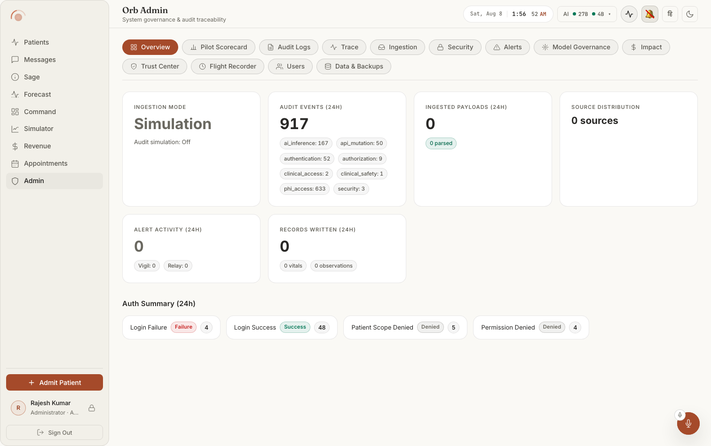
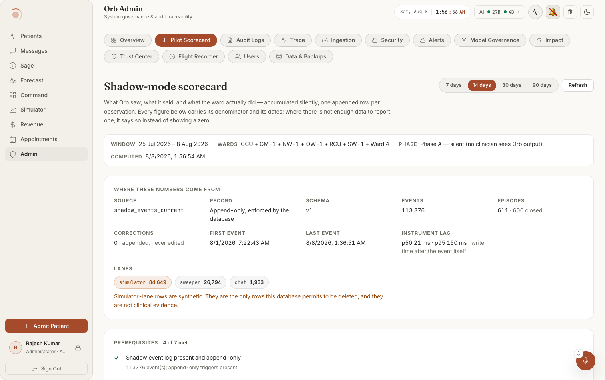
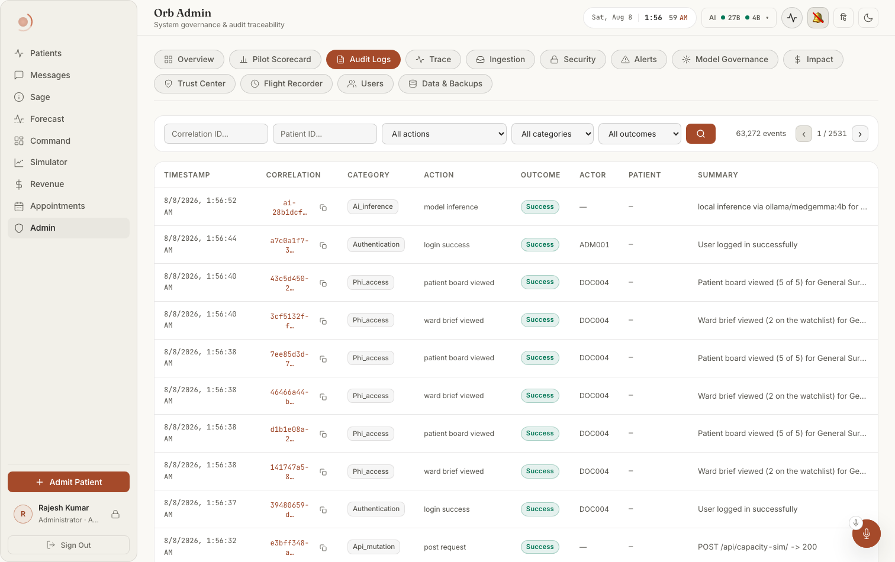
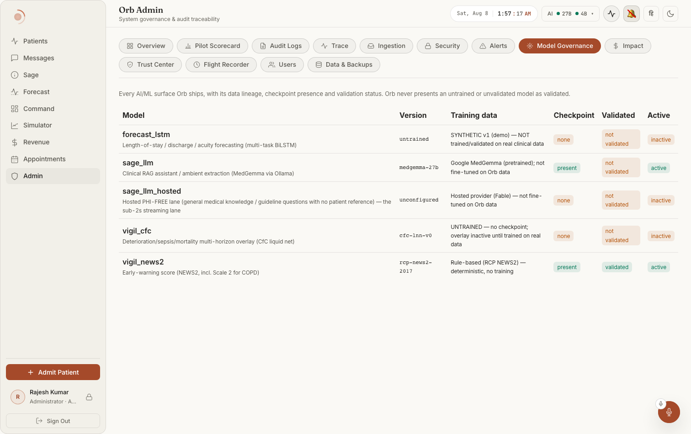
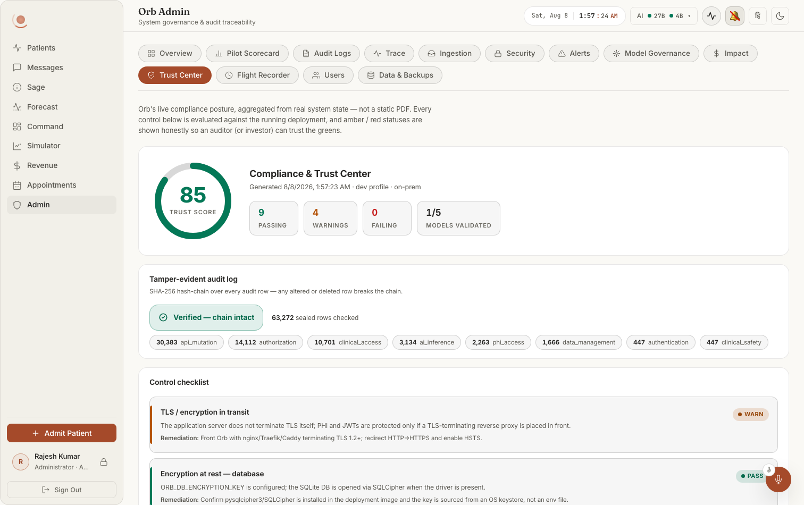
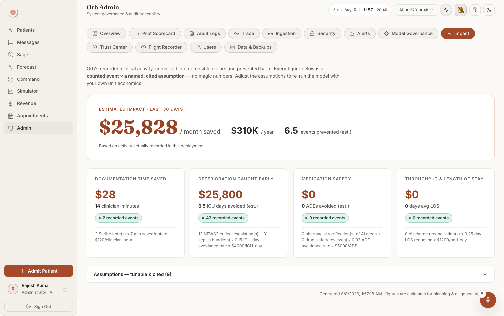
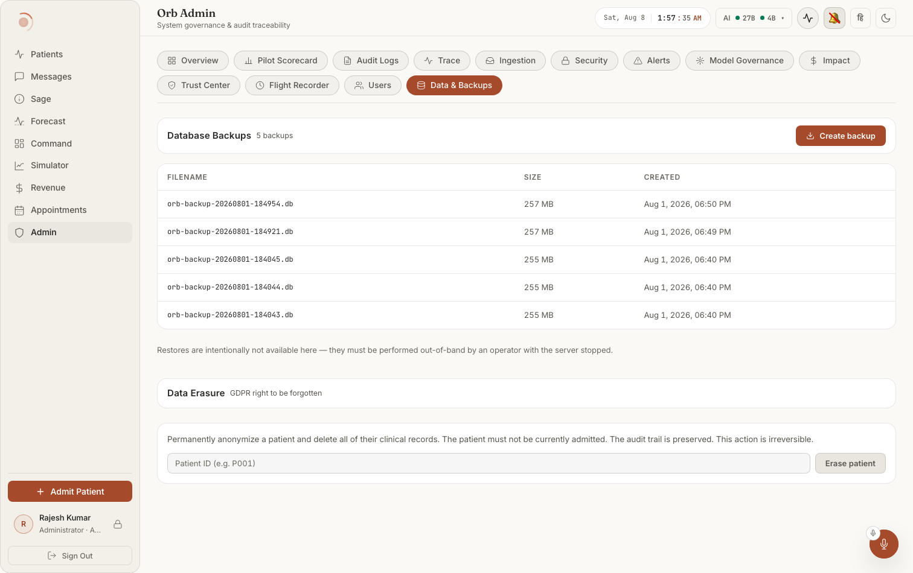
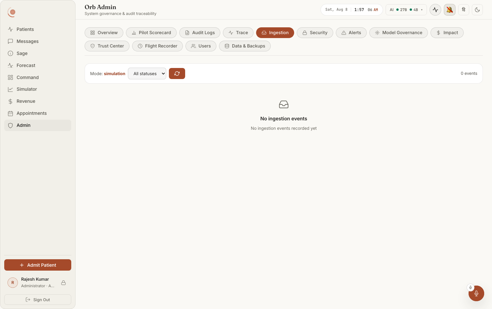

# 13: Admin (users, roster, scorecard, security, audit)

> Every file:line in this document was opened and read at that line. Paths are
> repo-relative to `/Users/samuelmorningstar/Documents/Projects/Orb`.

---

## What it looks like

The two-row tab strip is identical on all fourteen tabs, so read each capture for what sits
*under* it. Every tab exists in both themes; the light file is named below and the dark twin
is the same name with `-dark`.

**Notice that the first thing Overview states is the *mode***, "INGESTION MODE: Simulation"
before any count, and that the audit total (789) is immediately broken out by category
rather than left as one number. The Auth Summary at the foot is the honest one: **Login
Failure 4** sits beside Login Success 35, not hidden behind it.

**Notice the "WHERE THESE NUMBERS COME FROM" block, which is the point of the screen**: the
source table, the "append-only, enforced by the database" record model, the schema version,
first/last event timestamps, `CORRECTIONS 0 · appended, never edited`, and the instrument lag
(p50 21 ms). Then the three lanes, with `simulator 84,649` called out in red as synthetic and
explicitly not clinical evidence. And read the header before the figures: **PHASE, Phase A, 
silent (no clinician sees Orb output)** and **PREREQUISITES 4 of 7 met**.

**Notice** the correlation id in its own column with a copy affordance on *every* row. That
id is the sole input to the Trace tab, which is otherwise the empty box in
`admin-03-trace-light.png`, and which says so: "Click a correlation ID in the Audit Logs tab
or paste one above."

> **The capture is stale (8 Aug 2026), and so was the appliance until 2026-09-07.** It shows
> five rows because `sage_llm_hosted` was still in the registry. That row left the CODE on
> 2026-08-09, but `list_models()` runs the cleanup only when the registry table is empty
> (`if n == 0`), so an existing database kept serving it. This box read five until
> `seed_default_models()` was called by hand on 2026-09-07; it now reads **1 of 4**. A
> database reseed does not clear it. Fixed in code the same day (migration 38 plus a
> reconcile in `main.py`'s lifespan), so a current build cannot drift this way again.
> Recapture needed.

**Notice that two of the four models declare themselves untrained, not validated and
inactive in their own rows**, `forecast_lstm` ("SYNTHETIC v1 (demo), NOT trained/validated
on real clinical data") and `vigil_cfc` ("UNTRAINED, no checkpoint"). The only row marked
`validated` is the rule-based NEWS2 scorer. The sentence above the table states the rule the
table is keeping.

**Notice the score is decomposed beside itself**, 9 passing / 4 warnings / 0 failing /
**1 of 4 models validated** (the 8 Aug capture above still reads `1 of 5`, see the note on the
model-governance image), and that every control in the checklist carries a
**Remediation** line whether it passed or not. The TLS row is a WARN with its reason stated
plainly ("The application server does not terminate TLS itself"). A compliance screen that
only ever goes green is the thing this one is arguing against.

**Notice that two of the four contributing cards read $0** with "0 recorded events", and that
the headline is qualified twice, "Based on activity actually recorded in this deployment"
directly under the number, and a tunable "Assumptions, tunable & cited (9)" drawer at the
foot.

**Notice the sentence under the table**: *"Restores are intentionally not available here, 
they must be performed out-of-band by an operator with the server stopped."* The dangerous
half of backup is deliberately absent from the UI. Data Erasure is a separate block below it
with its own irreversibility warning and its own patient-ID field.

**Notice that the empty state explains rather than showing a zero**: `Mode: simulation`, "0
events", "No ingestion events recorded yet". `admin-06-alerts-light.png` is the same shape
and correct for the same reason, no ingestion, so no ingestion-driven alerts.

> ⚠ Three admin captures record defects and must not be read as normal behaviour:
> `admin-05-security-light.png` (claims there are no security events while Overview counts 39
> authentication events on the same data), `admin-10-flight-recorder-light.png` (row
> timestamps overprint the action names, and the RAW RECORD pane never leaves "Loading…"),
> and `admin-11-users-light.png` (three placeholder users named `Dr U-A-5313F0`,
> `Dr U-B-5313F0`, `Dr U-C-5313F0`, though the same capture correctly shows **MFA Off on all
> 19 accounts**, which is real and worth acting on). See
> [`docs/screenshots/INDEX.md`](../../screenshots/INDEX.md).

---

## How you get here

The **Admin** item in the left sidebar of the clinician shell. It is a role-gated
tab: `getAccessibleTabs()` in `src/pages/ClinicianShell.tsx:228` returns
`'admin'` **only** for `case 'admin'`. A doctor, nurse or pharmacist has no
Admin item in the sidebar at all, it is not greyed out, it does not exist.

The panel itself is lazy-loaded (`src/pages/ClinicianShell.tsx:318`) and mounted
inside a per-panel error boundary at `src/pages/ClinicianShell.tsx:605-609`. If
`AdminPanel` throws during render, the boundary labelled `"admin"` replaces the
whole screen rather than blanking the app.

Server-side, almost everything on this screen is gated on the single permission
`admin.overview` (`server/permissions.py:95`), which only the `admin` role holds
(`server/permissions.py:156`). Audit reading additionally uses `audit.read`
(`server/permissions.py:92`), also admin-only. A denied call is written to the
audit log as `event_category='authorization'`, `action_type='permission_denied'`,
`outcome='denied'` **before** the 403 is raised
(`server/permissions.py:415-433`, then the 403 at `:426-434`), which is why
permission denials show up on this screen's own Security tab.

---

## The screen frame

### Admin sub-navigation bar (the pill row)
**Where:** the very top of the Admin screen, a single horizontal row of rounded
pill buttons that wraps onto a second line on narrow windows and scrolls
horizontally otherwise (`.admin-tabs`, `src/pages/panels/admin/Admin.css:26-34`).
**Rendered by:** `src/pages/panels/AdminPanel.tsx:102-114`, `<nav className="admin-tabs">`
mapping `ADMIN_TABS`.
**Data from:** the module constant `ADMIN_TABS`
(`src/pages/panels/AdminPanel.tsx:24-98`). Fourteen entries, in this on-screen
order: Overview, Pilot Scorecard, Audit Logs, Trace, Ingestion, Security,
Alerts, Model Governance, Impact, Trust Center, Flight Recorder, Users, Roster
Import, Data & Backups. Each carries an inline SVG icon rendered to the left of
its label (`src/pages/panels/AdminPanel.tsx:161`).
**API:** none. The bar is static.
**Server:** none.
**Change this →** Reordering `ADMIN_TABS` reorders the pills left-to-right and
changes nothing else; the landing tab is fixed separately by
`useState<AdminTab>('overview')` at `src/pages/panels/AdminPanel.tsx:114`. Delete
an entry from the array and the pill disappears but the panel is still
reachable in code, the `activeTab === '<id>'` guards at
`src/pages/panels/AdminPanel.tsx:174-189` are separate. Delete the guard instead
and clicking the pill shows an empty content area.

### Active-tab highlight
**Where:** exactly one pill in the row.
**Rendered by:** `src/pages/panels/AdminPanel.tsx:157`, `admin-tab--active` is
appended when `activeTab === tab.id`.
**Data from:** `activeTab` state, `src/pages/panels/AdminPanel.tsx:114`; set by
the pill's own `onClick` (`:158`) and also programmatically by `handleTraceClick`
(`:120-123`).
**Change this →** The active pill is filled solid with `--accent-deep` and its
label flips to `--btn-primary-text` (`Admin.css:64-68`); inactive pills are
glass with `--text-secondary`. Remove `admin-tab--active` and every pill looks
identical, you lose all indication of where you are.

### Each sub-panel body
**Where:** everything below the pill row.
**Rendered by:** `src/pages/panels/AdminPanel.tsx:117-132`, a column flex
container `.admin-content`.
**Change this →** Only one panel is mounted at a time (these are `&&` guards,
not CSS hiding), so switching tabs **remounts** the panel and re-runs its
`useEffect` fetch. Every tab below therefore re-fetches on every visit; there is
no cache. Turning a guard into a `display:none` toggle would make tabs
instant but keep stale data on screen.

---

## Tab: Overview

`src/pages/panels/admin/AdminOverview.tsx`. Single fetch on mount
(`:20`) → `getAdminOverview()` (`src/api/client.ts:1829-1831`) → `GET
/api/admin/overview` → `server/routes/admin_routes.py:28-133`
(`admin_overview`). All figures are a rolling **24 hours** from
`cutoff_24h` (`server/routes/admin_routes.py:33`).

### "Ingestion Mode" stat card
**Where:** first card, top-left of the six-card responsive grid
(`.admin-cards-grid`, min column 240px, `Admin.css:104-108`).
**Rendered by:** `AdminOverview.tsx:33-39`. The big word is `:35`.
**Data from:** `data.ingestion_mode`; the label mapping is
`AdminOverview.tsx:26`, `'hybrid'` → **Hybrid**, `'ingestion'` → **Ingestion**,
anything else → **Simulation**. Colour from `:27`: amber `--status-warn` for
hybrid, green `--status-ok` for ingestion, grey `--text-muted` otherwise.
**API:** `GET /api/admin/overview`.
**Server:** `admin_routes.py:113` returns `INGESTION_MODE`, read from
`server/config.py`.
**Change this →** Set the mode env to `ingestion` and this card's word turns
green and reads "Ingestion"; leave it unset and it reads a grey "Simulation".
Nothing else on the screen changes with it.

### "Audit simulation: On/Off" sub-line
**Where:** small grey line under the Ingestion Mode word.
**Rendered by:** `AdminOverview.tsx:36-38`.
**Data from:** `data.audit_simulation_enabled` ← `AUDIT_SIMULATION_EVENTS`
(`admin_routes.py:114`).
**Change this →** Flipping it to On means simulator-generated activity also
writes audit rows, which inflates the "Audit Events (24h)" number on the card
next to it and adds rows to the Audit Logs tab.

### "Audit Events (24h)" stat card
**Where:** second card in the grid.
**Rendered by:** `AdminOverview.tsx:41-49`; the number at `:43`.
**Data from:** `data.audit_total_24h`, summed server-side at
`admin_routes.py:44`.
**Change this →** The number is a plain locale-formatted count with no colour
rule, it never goes red. It reads 0 only on a genuinely silent appliance.

### Audit category chips
**Where:** row of small grey chips inside the Audit Events card.
**Rendered by:** `AdminOverview.tsx:44-48`, one ``
per category, printed as `category: count` with the **raw** snake_case enum
(this card does *not* use `humaniseEnum`, unlike the Audit Logs table).
**Data from:** `data.audit_categories`, from the `GROUP BY event_category`
at `admin_routes.py:37-45`.
**Change this →** Add a new `event_category` anywhere in the server and a new
chip appears here the next day with no frontend change. This is the fastest way
to confirm a category name, the Security tab's three-category filter
(`authentication,authorization,security`) was fixed by reading these chips.

### "Ingested Payloads (24h)" stat card + parsed/failed/dupes chips
**Where:** third card.
**Rendered by:** `AdminOverview.tsx:51-59`; total at `:53`, chips at `:55-57`.
**Data from:** `data.ingestion.{total,parsed,failed,duplicates}` from the single
aggregate query at `admin_routes.py:57-68`.
**Change this →** The green "N parsed" chip is always shown. The red "N failed"
and amber "N dupes" chips appear **only when non-zero** (`:56`, `:57`), so a
clean hour shows one chip, not three. A failure also populates the "Recent Parse
Failures" table lower on this same tab.

### "Source Distribution" stat card
**Where:** fourth card.
**Rendered by:** `AdminOverview.tsx:61-73`. The headline is a count of distinct
sources at `:63-65` ("2 sources"), rendered smaller than the other cards
(inline `fontSize: '1.3rem'`).
**Data from:** `data.source_mix` (`admin_routes.py:71-77`).
**Server:** `GROUP BY source_type` over `ingestion_events`.
**Change this →** Each source renders as a coloured `SourceBadge` followed by
its count (`:69`). Badge labels/colours are in
`src/pages/panels/admin/AdminBadges.tsx:21-26`: `simulated` → grey "Simulated",
`ingested_hl7` → blue "HL7", `ingested_json` → indigo "JSON", `csv_replay` →
amber "CSV Replay". An unrecognised `source_type` falls through to the default
at `AdminBadges.tsx:29` and prints the raw string in a plain glass badge, that
is your signal that a new source type shipped without a badge.

### "Alert Activity (24h)" stat card
**Where:** fifth card.
**Rendered by:** `AdminOverview.tsx:75-84`. Number at `:78`.
**Data from:** `data.alerts.vigil + data.alerts.relay`, counted at
`admin_routes.py:80-88` from `action_type IN ('vigil_alert_generated',
'relay_alert_generated')`.
**Change this →** This is the only stat card with a conditional colour: the
number turns **red** (`--status-danger`) the moment the sum is greater than zero
and is grey at zero (`:77`). Split counts appear as two chips below (`:81-82`).

### "Records Written (24h)" stat card
**Where:** sixth card.
**Rendered by:** `AdminOverview.tsx:86-93`.
**Data from:** `data.ingestion.total_vitals + data.ingestion.total_observations`
(`admin_routes.py:63-64`, `SUM(COALESCE(...))`).
**Change this →** Two chips below break it into vitals and observations. If
payloads are arriving (card 3) but this stays at 0, parsing is succeeding and
writing is not.

### "Recent Parse Failures" section and table
**Where:** below the card grid; **absent entirely** when there are no failures.
**Rendered by:** `AdminOverview.tsx:97-123`, guarded by
`data.recent_failures.length > 0` at `:97`. Columns: **Time · Source · Error ·
Correlation** (`:104-107`).
**Data from:** `data.recent_failures`, the last **5** failed rows,
`admin_routes.py:91-96` (`ORDER BY received_at DESC LIMIT 5`).
**Change this →** Time is a bare local *time* (no date, `:113`). The correlation
cell is truncated to 12 characters plus an ellipsis (`:116`) and is **not**
clickable here, unlike the Audit Logs tab, there is no trace link. Fix a parser
and this whole section vanishes on the next load.

### "Auth Summary (24h)" section
**Where:** bottom of the tab; absent when empty.
**Rendered by:** `AdminOverview.tsx:126-139`, guarded at `:126`. One glass chip
per (action, outcome) pair: the action with underscores replaced by spaces, an
`OutcomeBadge`, then the count (`:131-135`).
**Data from:** `data.auth_events`, `admin_routes.py:102-110`, 
`GROUP BY action_type, outcome` restricted to
`event_category IN ('authentication','authorization')`.
**Change this →** This is the fix-scar noted at `admin_routes.py:99-101`: the
filter used to be the single value `'auth'`, which matches nothing, so this
section was permanently absent. If it disappears again, check that filter first.

### Overview loading state
**Rendered by:** `AdminOverview.tsx:22` → `AdminLoadingState message="Loading overview..."`
(`src/pages/panels/admin/AdminEmptyState.tsx:11-18`): a centred spinner with the
message under it. The whole tab is replaced, no skeleton cards.

### Overview error state
**Rendered by:** `AdminOverview.tsx:23` → `AdminErrorState`
(`AdminEmptyState.tsx:20-35`): a red warning circle, the fixed title
**"Something went wrong"**, the raw error message underneath, and a **Retry**
button that re-runs `fetchData`.
**Change this →** A 403 from `require_permission` surfaces here as the server's
structured message (lifted by `apiFetch` at `src/api/client.ts:210-225`), so a
non-admin who somehow reached this panel sees "Insufficient permissions" in the
message slot, not a blank page.

---

## Tab: Pilot Scorecard

`src/pages/panels/admin/Scorecard.tsx` (view) +
`src/api/scorecard.ts` (the whole contract) + `src/pages/panels/admin/Scorecard.css`.
Fetch: `getScorecard({days, ward})` (`src/api/scorecard.ts:541-561`) →
`GET /api/admin/shadow/scorecard?days=N` →
`server/routes/shadow_routes.py:304-356` (`get_scorecard`) →
`server/services/shadow_scorecard_service.py:1743` (`scorecard`) →
`_scorecard` (`:1757-1846`). `ward` is hard-wired to `null` in the view today
(`Scorecard.tsx:564`).

### Screen title and standfirst
**Where:** top-left of the tab.
**Rendered by:** `Scorecard.tsx:592-599`, "Shadow-mode scorecard" plus the
three-sentence explanation of denominators.
**Data from:** static copy.
**Change this →** Pure text. It is the sentence that tells a reader why zeros
are absent; deleting it removes the only in-product statement of the rule.

### Observation-window buttons: 7 / 14 / 30 / 90 days
**Where:** top-right, a four-button segmented group.
**Rendered by:** `Scorecard.tsx:601-613`, from `WINDOWS` (`:44-49`). The
selected one gets `is-active` and `aria-pressed`.
**Data from:** `days` state (`:559`, default **14**). Changing it re-runs the
effect at `:578-580`.
**API:** the `days` query param; clamped server-side to 1–365 at
`shadow_routes.py:306` and again by `_days()` (`:191-192`).
**Change this →** Every figure, every date range under every figure, the scope
line, the ledger and the export links all recompute. A metric that was
"Reported" at 90 days can drop to "Insufficient data" at 7, that is the design,
not a bug.

### Refresh button
**Where:** right of the window group.
**Rendered by:** `Scorecard.tsx:614-621`.
**Change this →** While loading it is disabled and its label becomes
**"Reading…"**. Note the first load shows a full-panel spinner
("Reading the shadow-event log…", `:584`) but a *refresh* keeps the old card on
screen (`loading && !card`), so the page never flashes empty.

### Scope line (Window · Wards · Phase · Computed)
**Where:** a single row of four key/value pairs directly under the header.
**Rendered by:** `Scorecard.tsx:626-647`.
**Data from:** `card.period` → `formatRange()` (`:73-78`, "14 Jul 2026, 31 Jul
2026"); `card.wards`, which prints **"none under observation"** when empty
(`:634`); `card.phase_label`; `card.generated_at` → `formatUTCDateTime`, or
**"not computed"**.
**Server:** `phase_label` from `PhaseSchedule.label(...)`
(`shadow_scorecard_service.py:1838`); wards from `_wards_in_scope` (`:1805`).
**Change this →** This line is what qualifies every number below it. If Wards
reads "none under observation" while metrics show figures, the ward resolution
is broken, not the metrics.

### "No shadow data on this appliance" banner
**Where:** full-width block between the scope line and the provenance strip.
**Rendered by:** `Scorecard.tsx:650-659`, only when `card.unavailable` is set.
**Data from:** `unavailable` is **never sent by the server**, it is set purely
client-side by `emptyScorecard()` (`src/api/scorecard.ts:481-511`) when every
scorecard path 404s (`:557-560`).
**Change this →** When it shows, the four metric bands below still render with
their definitions and caveats but carry no measurement at all. Adding a path
alias in `SCORECARD_PATHS` (`src/api/scorecard.ts:516`) is explicitly warned
against in that file's header: a silent path drift would present a clean,
plausible, false zero-state instead of this banner.

### Provenance strip: "Where these numbers come from"
**Where:** a definition grid immediately under the header/banner.
**Rendered by:** `Scorecard.tsx:321-378` (`<Provenance>`), nine `<dt>/<dd>`
pairs at `:331-377`: **Source** (mono), **Record** ("Append-only, enforced by
the database" or the shouted **"NOT append-only"**), **Schema**, **Events**,
**Episodes** (+ "· N closed"), **Corrections** (+ "· appended, never edited"),
**First event**, **Last event**, **Instrument lag** (p50 / p95, formatted by
`formatLag` at `:80-84`, ms under a second, otherwise seconds to 1dp, or "not
reported").
**Data from:** `card.instrument`, normalised at
`src/api/scorecard.ts:430-444`; produced by `_instrument()`
(`shadow_scorecard_service.py:1456`) and topped up by `instrument_health()`
(`:1569`) plus `_attach_stats()` (`shadow_routes.py:359-384`).
**Change this →** If the append-only trigger is dropped, **Record** flips to
"NOT append-only" and the "Shadow event log present and append-only"
prerequisite below turns to a ✗. `append_only` defaults to *true* in the client
normaliser (`scorecard.ts:433`, `!== false`), so a server that omits the field
reads as append-only.

### Lanes list (and the simulator warning)
**Where:** under the provenance grid.
**Rendered by:** `Scorecard.tsx:380-398`; sorted descending by count at `:323`.
The `simulator` row carries `is-simulator`.
**Change this →** The moment `lanes.simulator > 0`, an amber note appears
(`:391-396`) stating simulator rows are synthetic and not clinical evidence.
Drop simulator events and both the row and the note disappear.

### "Prerequisites: N of M met" checklist
**Where:** below the provenance section; omitted when `readiness` is empty
(`Scorecard.tsx:663`).
**Rendered by:** `Scorecard.tsx:528-554` (`<Readiness>`). Each row is a ✓/✗
mark, a label, a screen-reader-only ", met"/", not met" (`:546`), and a
detail string.
**Data from:** `card.readiness` ← `_readiness()`
(`shadow_scorecard_service.py:1578-1614`). The seven fixed items are:
`instrument`, `clinical_data`, `outcome_capture`, `adjudication`, `coverage`,
`negatives`, `no_dropped_events`.
**Change this →** `coverage` flips to met only when the covered ward-shift ratio
reaches `ORB_SCORECARD_COVERAGE_THRESHOLD` (default 0.9,
`shadow_scorecard_service.py:280-281`). `no_dropped_events` goes ✗ the instant
any shadow write is dropped in this process, and the same condition adds a
`health_warning` string to the instrument block (`shadow_routes.py:380-384`).

### Metric band: eyebrow "Metric N of 4" and the Proxy chip
**Where:** the left column of each of the four metric bands.
**Rendered by:** `Scorecard.tsx:220-223`. The chip renders only when
`metric.is_proxy`.
**Data from:** the four metrics are always rendered, in the fixed order of
`METRIC_ORDER` (`src/api/scorecard.ts:68-73`): detection lead time, false-alert
rate, agreement, time saved. `is_proxy` is true only for `time_saved` in the
fallback spec (`src/api/scorecard.ts:268`).
**Change this →** The count is positional (`index + 1` of 4) and hard-codes "4".
Adding a fifth metric to `METRIC_ORDER` would print "Metric 5 of 4".

### The figure itself (value, unit, denominator, scope)
**Where:** the large number at the top-left of each band.
**Rendered by:** `Scorecard.tsx:124-171` (`<Figure>`); the value at `:133-136`,
the denominator line at `:137-140` ("12 of 108 episodes with a recorded clinical
outcome"), the scope line at `:141` ("Ward A + Ward B · 14 Jul 2026, 31 Jul
2026").
**Data from:** `figureProps()` (`:174-196`) narrowing a normalised metric.
**Change this →** This is the only component allowed to print a metric value,
and its props are a discriminated union (`:103-122`), the `reported` arm
*requires* a non-null denominator, a denominator label and a period. You cannot
render a bare percentage here without a type error. Delete the `denominator`
prop and the build fails; that is deliberate.

### The state pill (Reported / Insufficient data / Not yet adjudicated / Not computable)
**Where:** replaces the number when the metric is not reportable.
**Rendered by:** `Scorecard.tsx:149`, labels from `STATE_LABEL` (`:86-91`).
**Data from:** `normalizeMetric()` in `src/api/scorecard.ts:305-390`. The state
is **derived defensively, not copied** (`:320-326`): a server that says
`reported` while sending no display *and* no value is downgraded to
`not_computable`; a null or non-positive denominator downgrades to
`insufficient_data`; `n_observed < n_required` downgrades to
`insufficient_data`; **any** non-empty `blockers` array forces `not_computable`.
**Change this →** Under `insufficient_data` the sub-line reads "N <denominator
label> recorded · at least M before a figure is reported" (`Scorecard.tsx:151-154`).
Under `unadjudicated` it reads "N recorded · none reviewed by a clinician"
(`:157-159`). Under `not_computable` a bulleted blockers list replaces it, or the
fallback single bullet "No prerequisite recorded for this metric." (`:163`).

### Spread line (p25 · median · p75)
**Where:** directly under the figure, in the left column.
**Rendered by:** `Scorecard.tsx:226-230`. Shown only when the metric is
`reported` **and** `spread.p50` is non-null; missing quartiles print as ", ".
**Server:** `_spread()`/`_percentile()`
(`shadow_scorecard_service.py:408-431`), computed in Python because SQLite has
no median, as stated in the scorecard's own notes (`:1822-1823`).

### Metric title, definition and "What this cannot show"
**Rendered by:** `Scorecard.tsx:235-238` (title + definition) and `:310-313`
(the caveat block, always rendered, never behind a tooltip).
**Data from:** server-supplied `label`/`definition`/`caveat` with a documented
fallback in `METRIC_SPEC` (`src/api/scorecard.ts:230-270`).
**Change this →** Blank the server strings and the fallback prose from
`docs/SHADOW_MODE.md` §5 appears instead, the page never shows an unlabelled
metric.

### "The same count, per other denominators"
**Where:** first block in the band's right column; hidden when the array is empty.
**Rendered by:** `Scorecard.tsx:243-258`. The primary row is flagged
`is-primary` and carries the inline tag "reported figure" (`:251`); a null
display prints "not reported".
**Change this →** This exists so the flattering denominator can never be quoted
on its own. Remove the block and a per-alert rate stops being visibly comparable
to a per-bed-day rate.

### Adjudication meter and note
**Where:** under the alternative denominators.
**Rendered by:** `Scorecard.tsx:260-286`. The bar is a `role="img"` with a
spelled-out `aria-label` (`:263-268`); the fill width is `adjPct ?? 0`.
**Data from:** `metric.adjudication`; `adjPct` at `:216` is `null`, not 0, 
when `total` is 0.
**Change this →** With zero episodes the note reads "0 of 0 reviewed" with **no
percentage** and the bar sits empty; the comment at `:212-215` explains that
printing "(0 %)" there is the exact bare-zero this screen exists to prevent. The
note also states adjudicator count ("no named adjudicator" when zero) and
blinding ("· blinded" / "· not blinded"). When `total > adjudicated`, an amber
line appears: "N unadjudicated, reported as unadjudicated, never as correct."
(`:280-284`).

### Disagreements line
**Rendered by:** `Scorecard.tsx:288-293`; shown only when `disagreements` is
non-null (agreement metric only, per `src/api/scorecard.ts:156`).

### "Assumptions behind this figure"
**Rendered by:** `Scorecard.tsx:296-308`; each row is label / value / source,
where a missing source defaults to the string "stated assumption"
(`src/api/scorecard.ts:364`).

### Episode ledger: "Recorded" vs "Materialised negatives"
**Where:** two columns below the four metric bands.
**Rendered by:** `Scorecard.tsx:405-454` (`<Ledger>`), fed
`card.instrument.kinds` at `:672`. The split is the module constant
`NEGATIVE_KINDS` (`:54-63`): `alert.suppressed`, `alert.dropped`,
`alert.expired`, `sage.refused`, `sage.failed`, `action.declined`,
`action.abandoned`, `outcome.none_confirmed`.
**Change this →** Each column prints "none" when its side is empty (`:433`,
`:447`); with no events at all the whole grid is replaced by the single line
"No events recorded in this window." (`:421`). Move a kind out of
`NEGATIVE_KINDS` and it silently migrates to the left column, which is exactly
how a system starts reporting only its successes.

### Export panel: the de-identification manifest
**Where:** below the ledger.
**Rendered by:** `Scorecard.tsx:458-524` (`<ExportPanel>`). The manifest list is
`:481-491`: each row is the field (mono), a treatment chip
(`sc-deid__treatment--<treatment>`), and an optional note.
**Data from:** `card.export`. The route **overwrites** whatever the aggregation
layer claimed with what the export code actually does
(`shadow_routes.py:323-340`): `formats` from `exporter.FORMATS`
(`server/services/shadow_export_service.py:86`), `deidentification` from
`exporter.deidentification_manifest()` (`:262`), and a default note quoting the
small-cell threshold `exporter.small_cell_k()` (`:109`).
**Change this →** With an empty manifest the list is replaced by "No
de-identification manifest has been declared, so no export is offered."

### Download / "Export unavailable" buttons
**Rendered by:** `Scorecard.tsx:497-521`. `offerable` requires **both**
`export.available` and a non-empty manifest (`:461`).
**Data from:** href built by `scorecardExportUrl()`
(`src/api/scorecard.ts:567-569`) → `/api/admin/shadow/export/scorecard?days=…&format=…`.
**Server:** `server/routes/shadow_routes.py:973-980` (`export_scorecard`),
admin-gated, and audited **before** the body is returned, an unaudited
disclosure never leaves the process (`:981-992`).
**Change this →** One `<a download>` per format (JSON and CSV today). When not
offerable you get a single **disabled** "Export unavailable" button plus one of
two explanations (`:515-519`): manifest withheld, or "No scorecard data has been
recorded, so there is nothing to export."

### Scorecard footnote
**Rendered by:** `Scorecard.tsx:676-680`. The standing disclaimer that this is
not a controlled comparison.

---

## Tab: Audit Logs

`src/pages/panels/admin/AuditLogTable.tsx`. Fetch: `getAuditLogs(filters)`
(`src/api/client.ts:1837-1850`) → `GET /api/audit/logs?…` →
`server/routes/audit_routes.py:11-79` (`get_audit_logs`, permission
`audit.read`). There is no service layer, the handler builds SQL directly
against `audit_logs` (`:26-72`).

### "Correlation ID..." search box
**Where:** first control in the filter bar across the top.
**Rendered by:** `AuditLogTable.tsx:71-77`.
**Data from:** local `searchCorrelation` state (`:34`), folded into the request
at `:41`. **Enter** triggers `fetchLogs()` (`:76`); typing alone does not.
**Server:** exact match, `audit_routes.py:32-34`.

### "Patient ID..." search box
**Rendered by:** `AuditLogTable.tsx:78-84`; state at `:35`; server match at
`audit_routes.py:29-31`.
**Change this →** Both boxes are exact-match, not prefix or fuzzy. A partial id
returns the empty state, which looks identical to "no such events".

### "All actions" dropdown
**Rendered by:** `AuditLogTable.tsx:85-88`; options from `ACTION_TYPES`
(`:11-18`) with underscores displayed as spaces.
**Change this →** This is a **hand-maintained list**. Any `action_type` the
server writes that is not in that array cannot be selected here, it will still
appear in the table, just not in the filter. Changing it resets `offset` to 0
(`:52`) so you jump back to page 1.

### "All categories" dropdown
**Rendered by:** `AuditLogTable.tsx:89-92`; options from `CATEGORIES` (`:20-25`).
**Server:** `audit_routes.py:38-52` accepts a **comma-separated list** and
switches between `=` and `IN (...)`. This dropdown only ever sends one value;
the multi-value path is what the Security tab uses.

### "All outcomes" dropdown
**Rendered by:** `AuditLogTable.tsx:93-96`; `OUTCOMES` at `:26`, success,
failure, partial_success, denied.

### Magnifier / apply-filters button
**Rendered by:** `AuditLogTable.tsx:97-99`, `title="Apply filters"`.
**Change this →** Selecting from any dropdown already refetches (state change →
`useEffect` at `:49`); this button exists for the two text boxes, which do not.

### "N events" count and pager
**Where:** second row of the filter bar.
**Rendered by:** `AuditLogTable.tsx:101-110`. Count at `:102`
(locale-formatted, singular/plural). The `‹ page/total ›` pager renders **only
when `totalPages > 1`** (`:103`).
**Data from:** `total` from the response; `limit` fixed at 25 (`:33`).
**Server:** the total is a rewritten COUNT of the same WHERE clause,
`audit_routes.py:70-72`.
**Change this →** `limit` is capped at 1000 server-side
(`audit_routes.py:20`). Raise the client's 25 and the pager disappears sooner.

### Audit table columns
**Where:** the main table.
**Rendered by:** `AuditLogTable.tsx:128-137`. Eight columns in this order:
**Timestamp · Correlation · Category · Action · Outcome · Actor · Patient ·
Summary**.
**Data from:** one `AuditLog` per row (`src/api/client.ts:1803-1820`).
Timestamp is `toLocaleString()` in mono (`:142`); Actor and Patient print ", "
when null (`:167-168`); Summary is truncated with `admin-td--truncate` (`:169`).
**Server:** `SELECT * FROM audit_logs … ORDER BY timestamp DESC LIMIT ? OFFSET ?`
(`audit_routes.py:26-64`).

### Correlation cell: trace link + copy button
**Rendered by:** `AuditLogTable.tsx:143-159`. The link shows the first 10
characters plus "…" (`:150`) and is a real `<button>` titled "View full trace".
Next to it, a clipboard icon button titled "Copy correlation ID" calls
`copyCorrelation` (`:62-64`).
**Change this →** Clicking the link calls `onTraceClick` → `handleTraceClick` in
`src/pages/panels/AdminPanel.tsx:120-123`, which stores the id **and switches the
active tab to Trace**. You leave this tab. The copy button gives no visual
confirmation, a failed clipboard write is swallowed (`:63`).

### Category chip
**Rendered by:** `AuditLogTable.tsx:164`, `humaniseEnum(log.event_category)`
from `src/lib/humanise.ts`.
**Change this →** This is the reason the table reads "PHI access" and "API
mutation" rather than `Phi_access` / `Api_mutation`. The acronym table is
`src/lib/humanise.ts` `ACRONYMS`; add a token there and every enum on this
screen that uses the helper re-cases at once. The wire format is untouched.

### Outcome badge
**Rendered by:** `AuditLogTable.tsx:166` → `OutcomeBadge`
(`src/pages/panels/admin/AdminBadges.tsx:11-18`). Colours at `:4-9`: success
green, failure red, partial_success amber, denied grey; **an unknown outcome
falls back to the grey "denied" style** while still printing its own text
(`:12`).

### Audit empty state
**Rendered by:** `AuditLogTable.tsx:119-123`, a document icon, "No audit events
found", "Try adjusting your filters or wait for new events".

### Audit loading / error states
**Rendered by:** `AuditLogTable.tsx:115` ("Loading audit logs...") and `:117`
(`AdminErrorState` with a working **Retry**).

---

## Tab: Trace

`src/pages/panels/admin/CorrelationTrace.tsx`. Same endpoint as Audit Logs,
filtered to one correlation id with `limit: 100` (`:38`), then sorted
**ascending** by timestamp client-side (`:39`) so the pipeline reads top-down.

### Correlation search bar + "Trace" button
**Rendered by:** `CorrelationTrace.tsx:69-82`. Enter also fires (`:79`).
**Data from:** `searchId`, seeded from the `correlationId` prop
(`:31`, `:44-49`), which is what the Audit Logs link sets.

### Trace timeline nodes
**Rendered by:** `CorrelationTrace.tsx:101-143`. Each node is a coloured dot
(`:122`, colour from `getNodeColor` at `:56-64`), a vertical connector to the
next node (`:117-119`), then the action name, an `OutcomeBadge`, a
millisecond-precision time (`:51-54`), the summary, and a meta row with Patient
/ Target / Actor when present (`:134-138`).
**Change this →** A `failure` or `denied` outcome adds `admin-trace__node--failure`
and turns the connector red (`:109`, `:118`). Nodes fade in staggered by 60 ms
each (`:114`).

### Trace empty states (two of them)
**Rendered by:** `CorrelationTrace.tsx:89-99`. With no id typed: "Enter a
correlation ID" plus the hint to click one in Audit Logs. With an id that
matched nothing: "No events found" and the id echoed back.
**Change this →** `PIPELINE_ORDER`/`stepIndex` (`:11-25`) are defined but never
called, ordering is purely chronological today.

---

## Tab: Security

`src/pages/panels/admin/SecurityActivity.tsx`. Same audit endpoint, but with
`event_category: 'authentication,authorization,security'`, `limit` 25, page
offset (`:21-25`).

### "N security events" bar and pager
**Rendered by:** `SecurityActivity.tsx:50-61`; pager only when `totalPages > 1`.

### Security table columns
**Rendered by:** `SecurityActivity.tsx:65-76`. Eight columns:
**Timestamp · Action · Outcome · Actor · Role · IP Address · Path · Summary**.
Cells at `:80-87`; Role, IP and Path each print ", " when null.
**Change this →** This is the only table on the screen showing `actor_role`,
`ip_address` and `request_path`. Those three come straight from the audit row
(`src/api/client.ts:1811,1818-1819`) and are written by
`log_audit_event(...)` at the call sites, e.g. the denial writer at
`server/permissions.py:415-433` and the user-management writer at
`server/routes/admin_users_routes.py:134-149`.

### Failed-row tint
**Rendered by:** `SecurityActivity.tsx:79`, `admin-tr--failure` when
`outcome === 'failure'`, a 6 % red wash across the row
(`Admin.css:268-270`).
**Change this →** A burst of failed sign-ins reads as a block of red rows
without needing to scan the Outcome column.

### Security empty state
**Rendered by:** `SecurityActivity.tsx:38-46`: padlock icon, "No security
events", "No authentication or permission events recorded yet".
**Change this →** The comment at `SecurityActivity.tsx:17-20` is the scar: this
tab used to ask for the single category `'auth'`, which matches none of the
three real categories, so it showed this empty state while the Overview tab on
the same screen counted 39 + 3 events. If it goes empty again, compare against
the Overview category chips before believing it.

### Where lockout actually lives
There is **no lockout or unlock control on this screen.** Nothing in
`src/pages/panels/admin/` posts to a lockout endpoint. The nearest things that
exist are:
- **Session revocation**, which happens implicitly: Deactivate and both password
  resets bump `token_version` (`server/routes/admin_users_routes.py:919-925`,
  `:970-976`, `:1402-1408`), killing every outstanding JWT immediately.
- **Signing-PIN lockout state**, cleared server-side when a new PIN is
  provisioned, `pin_security.clear_pin_failures(user_id)`
  (`server/routes/admin_users_routes.py:1035`). The `POST
  /api/admin/users/{id}/pin` endpoint (`:988-1056`) has **no UI on this screen**.
- **Failed-login counts per user**, computed by the list endpoint as
  `failed_logins_24h` (`server/routes/admin_users_routes.py:205-216`), sent to
  the browser and then **not rendered**; see the Users table note below.

---

## Tab: Users

`src/pages/panels/admin/UsersPanel.tsx`. Fetch on mount:
`apiFetch<{users}>('/admin/users')` (`:330`) → `GET /api/admin/users` →
`server/routes/admin_users_routes.py:170-234` (`list_users`, permission
`admin.overview`). Hashes, PINs and TOTP secrets are never returned (`:134`).

### "User Management" heading and user count
**Where:** left of the top bar of the tab.
**Rendered by:** `UsersPanel.tsx:487-488`, the title, then "N user(s)" with
correct singular/plural.
**Data from:** `users.length` (client-side, not a server total, there is no
pagination on this endpoint).

### "Create user" button
**Where:** right of the same bar, with a plus icon.
**Rendered by:** `UsersPanel.tsx:748-751`. Sets `showCreate`.

### Users table columns
**Rendered by:** `UsersPanel.tsx:764-773`. Seven columns:
**Name · ID · Role · Department · MFA · Status · Actions** (Actions
right-aligned).
**Server ordering:** `ORDER BY role, name`
(`server/routes/admin_users_routes.py:185`), so the list is grouped by role
alphabetically (admin, doctor, nurse, patient, pharmacist), not by recency.

### Name and ID cells
**Rendered by:** `UsersPanel.tsx:778-779`. Name is `--text-primary` at weight
500; ID is mono and small.

### Role chip
**Rendered by:** `UsersPanel.tsx:780` → `RoleChip` (`:178-185`). Colour map at
`:161-176`: doctor = accent, nurse = cyan, admin = amber, pharmacist = green,
patient = grey, and **any unrecognised role falls back to the grey patient
style** (`:179`) while still printing its own text.
**Change this →** The five roles here (`ROLES`, `:18`) are mirrored server-side
by `ALLOWED_ROLES` (`server/routes/admin_users_routes.py:70`), which itself
mirrors the `users.role` CHECK constraint. Adding a role in one place only gives
you either a 400 ("Invalid role 'x'. Allowed: …", `:163-167`) or a grey chip.

### Department cell
**Rendered by:** `UsersPanel.tsx:781`, the department, or a grey em-dash when
null.

### MFA chip (On / Off)
**Rendered by:** `UsersPanel.tsx:790` → `MfaChip` (`:278-293`).
**Data from:** `totp_enabled`, read as `COALESCE(totp_enabled, 0)`
(`server/routes/admin_users_routes.py:182`).
**Change this →** **On** is a green chip. **Off** is deliberately *not* muted
grey: the comment at `UsersPanel.tsx:135-137` records that `--text-muted` measured
1.56:1 on the amber-tinted failure rows, so Off uses `--text-primary` on
`--bg-glass` to stay readable on every row tint. There is **no enrol/reset-MFA
control here**, this column is read-only. Aggregate MFA adoption by role lives
on the Trust Center tab.

### Status chip (Active / Disabled)
**Rendered by:** `UsersPanel.tsx:791` → `StatusChip` (`:263-276`): green "Active",
red "Disabled".
**Data from:** `is_active` (`server/routes/admin_users_routes.py:181`).

### Deactivated-row tint
**Rendered by:** `UsersPanel.tsx:777`, `admin-tr--failure` on any row where
`is_active` is false, the same 6 % red wash as a failed audit row.
**Change this →** Deactivate a user and their whole row goes pink immediately
after the list refetches; the row does not move position.

### Row actions: "Role", "Reset password", "Deactivate"/"Activate"
**Rendered by:** `UsersPanel.tsx:792-819`. The third button is conditional
(`:813-817`): active users get a **red** "Deactivate"; disabled users get a
ghost "Activate".

### Create User modal
**Where:** centred over a dimmed overlay; focus-trapped
(`useFocusTrap`, `:108`), Escape closes unless submitting.
**Rendered by:** `UsersPanel.tsx:333-421`. Fields: **User ID** (autofocused,
placeholder "e.g. DR-0142"), **Full name**, **Role** select, **Department
(optional)**, **Temporary password** (plain text input, `minLength 8`).
**API:** `POST /api/admin/users` (`:118-127`) →
`server/routes/admin_users_routes.py:817-894` (`create_user`), 201 on success.
**Change this →** The password is validated twice: client-side at `:115`
("Password must be at least 8 characters." appears in red above the buttons)
and by Pydantic at `server/routes/admin_users_routes.py:87`. A duplicate id
returns **409** and the modal shows "A user with this id already exists"
(`:224`, `:232`). On success the modal closes, the toast reads "User created",
and the table refetches (`UsersPanel.tsx:668`). Every create writes an audit row
`user_created` (`:234-238`), visible on the Audit Logs tab under category
`user_management`.

### Reset Password modal
**Rendered by:** `UsersPanel.tsx:431-487`. Body text names the target and warns
"This revokes all of their active sessions." (`:459-461`). Inline row: the
password input, a **Generate** button and a **Copy** button.
**Data from:** `generatePassword()` (`:182-187`), 16 characters from a
confusables-free alphabet via `crypto.getRandomValues`.
**API:** `POST /api/admin/users/{id}/reset-password` (`:202-205`) →
`server/routes/admin_users_routes.py:957-982`.
**Change this →** **Copy** is disabled until there is a password, and its label
flips to **"Copied"** on success (`:471-472`); typing or re-generating resets it to
"Copy" (`:467`, `:469`). Submit turns the button into "Saving…". Server-side the
reset bumps `token_version`, so the target user is signed out everywhere on
their next request.

### Change role & department modal
**Rendered by:** `UsersPanel.tsx:490-545`. Two fields: **Role** (select,
autofocused, same five roles) and **Department** (free text).
**API:** `PATCH /api/admin/users/{id}` (`:509-512`) →
`server/routes/admin_users_routes.py:1062-1143` (`patch_user`).
**Change this →** This is the only role-editing surface in the product. On save,
the toast reads "User updated", the table refetches and the row's Role chip
changes colour. The department is trimmed and an empty string becomes NULL
server-side (`:1072`), so clearing the box turns the Department cell into a grey
em-dash. Note the ordering side-effect: because the server sorts by role, a
promoted user **jumps to a different part of the list**.

### Deactivate / Activate confirmation dialog
**Rendered by:** `UsersPanel.tsx:296-330` (`ConfirmDialog`), wired at `:869-882`.
Title is "Deactivate user?" or "Activate user?"; the body spells out the
consequence, for deactivation, "…will be blocked from logging in and all their
active sessions will be revoked." (`:873`). The confirm button is red for
deactivation (`:320`) and reads "Working…" while busy (`:324`).
**API:** `POST /api/admin/users/{id}/deactivate|activate`, built at
`UsersPanel.tsx:470` → `server/routes/admin_users_routes.py:900-951`.
**Change this →** Deactivating **yourself** is refused server-side with a 400,
"You cannot deactivate your own account"
(`server/routes/admin_users_routes.py:910-911`), the UI does not hide the
button, so the message arrives as a toast. Note the security caveat recorded in
that file's docstring (`:48-52`): `auth_routes` does not currently reject
`is_active=0` at login, so deactivation kills existing tokens but a fresh login
may still succeed.

### Toast
**Where:** floating, `role="status"`.
**Rendered by:** `UsersPanel.tsx:663`; driven by `flash()` (`:319-323`) with a
**3.5 s** auto-dismiss; the timer is cleared on unmount (`:325`).
**Change this →** Every failed action also surfaces here (`:349`), a failed
deactivation shows the server's message as a toast, not as an inline error.

### Users empty / loading / error states
**Rendered by:** `UsersPanel.tsx:754-759`. Loading: "Loading users…". Error:
`AdminErrorState` with Retry. Empty: "No users" / "Create the first user to get
started.", a state that in practice only appears if the seed never ran.

### Fields fetched but not shown
`registration_number`, `created_at`, `last_login` and `failed_logins_24h` are
all returned by `list_users` (`server/routes/admin_users_routes.py:224-230`)
and none of them is rendered, `AdminUser` in `UsersPanel.tsx:23-40` does not
declare `last_login` or `failed_logins_24h` at all. The brute-force column the
server query at `:165-176` was written for **does not exist on screen yet**.

---

## Tab: Roster Import

`src/pages/panels/admin/RosterImport.tsx` + `src/api/rosterImport.ts`. A
three-step wizard: preview → dry run → commit. All three POST the **same file**;
the commit recomputes the plan server-side from the uploaded bytes
(`src/pages/panels/admin/RosterImport.tsx:10-20`,
`server/routes/roster_import_routes.py:211-221`).

### "Roster import" heading and hint
**Rendered by:** `RosterImport.tsx:218-224`, "Load a ward list from CSV.
Nothing is written until you commit, and the commit only ever writes what the
dry run showed you."

### Step 1: "Choose the roster file"
**Where:** numbered badge "1" then the title, then a file input.
**Rendered by:** `RosterImport.tsx:227-252`. The `<input type="file">` accepts
`.csv,text/csv,text/plain` (`:236`).
**Change this →** Picking a file immediately calls `resetFrom('file')`, which
clears preview, mapping, header line, dry run and commit result (`:103-113`), 
and fires the preview request (`:141-147`). Everything below Step 1 disappears
and re-derives.

### Chosen-file chip and limits line
**Rendered by:** `RosterImport.tsx:241-245` (name + size in KB to 1dp) and
`:247-250` ("Limits: 20,000 rows, 5.0 MB").
**Data from:** `catalogue.max_rows` / `max_bytes` ← `GET
/api/admin/roster-import/fields` (`server/routes/roster_import_routes.py:113-122`),
values from `server/services/roster_import.py:107-108`.

### Step 2: delimiter and row-count line
**Rendered by:** `RosterImport.tsx:262-266`. Prints the sniffed delimiter in a
`<code>` (a tab renders as the literal `\t`), the data-row count, and
"· N unreadable" only when `rejected_row_count > 0`.
**Server:** `roster_import.sniff` (`server/services/roster_import.py:548`) via
`server/routes/roster_import_routes.py:127-149`.

### "Which line holds the column names?" buttons
**Where:** between the delimiter line and the mapping table; appears **only**
when `preview.header_confident` is false (`RosterImport.tsx:269`).
**Rendered by:** `RosterImport.tsx:270-284`. One button per candidate: "Line N, 
M recognised".
**Change this →** Clicking one resets everything downstream and re-previews with
that `header_line` (`:277`). The chosen answer then travels with the dry run and
the commit (`src/api/rosterImport.ts:202`, `:225`). The sniffer asks instead of
guessing, the route 422s rather than guessing on the dry run
(`server/routes/roster_import_routes.py:172-173`).

### "Still unmapped and required: …" warning
**Rendered by:** `RosterImport.tsx:286-290`, amber
(`--status-warn-text`). Computed at `:208` against `catalogue.required`
(`server/services/roster_import.py:189`), with labels resolved by `labelFor`
(`:213-214`).
**Change this →** While this line is visible the **Dry run** button is disabled
(`:369`). It is the single gate between step 2 and step 3.

### Column-mapping table
**Rendered by:** `RosterImport.tsx:292-334`. Three columns: **Column in file ·
Sample · Orb field**. The sample cell joins up to two non-empty values from
`sample_rows` with " · " and falls back to ", " (`:305-307`).
**Data from:** `mapping`, seeded by inverting the server's
`suggested_mapping` (orb_field → header) into header → orb_field at
`RosterImport.tsx:124-132`.
**Change this →** Every select carries `title={fieldNote(...)}` (`:320`), the
catalogue's own note, which is the only place that explains e.g. that a wrong
`department` hides the patient from that department's boards. Changing any
select calls `resetFrom('mapping')` (`:317`), which **invalidates the dry run**;
see the warning element below.

### Orb-field select options
**Rendered by:** `RosterImport.tsx:322-327`. First option is the literal
", not imported, " (value `__unmapped__`, `:42`); then every catalogue field by
label, required ones suffixed with " *".

### "Date order", "Default department", "Update patients that already exist"
**Rendered by:** `RosterImport.tsx:336-364`. Date order options come from the
server (`auto`, `dmy`, `mdy`, `server/routes/roster_import_routes.py:119`).
The checkbox defaults to **checked** (`:67`).
**Change this →** All three call `resetFrom('mapping')` on change, so touching
any of them re-locks the commit button. Unchecking "Update patients that already
exist" turns rows that would have been amber `update` into `skip` in the plan
table below.

### "Dry run: show me what would happen" button
**Rendered by:** `RosterImport.tsx:366-372`. Disabled while busy or while any
required field is unmapped; label becomes "Checking…".
**API:** `POST /api/admin/roster-import/dry-run` →
`server/routes/roster_import_routes.py:154-194` → `roster_import.plan`
(`server/services/roster_import.py:856`). Writes nothing, but **is** audited as
`roster_import_dry_run` (`roster_import_routes.py:188-193`).

### Step 3: count chips and "nothing has been written yet"
**Rendered by:** `RosterImport.tsx:390-395`. One chip per key in
`dryRun.counts`, coloured by `actionClass` (`:51-56`): `create` green,
`update` amber, anything else neutral. The reassurance text sits inline at the
end of the row.

### File-issues list
**Rendered by:** `RosterImport.tsx:397-405`; the **first 12** only. Colour from
`issueTone` (`:44-49`): error/fatal red, warning/warn amber, otherwise
secondary. Each line is prefixed "Line N: " when the issue carries a line.

### Plan table
**Rendered by:** `RosterImport.tsx:407-427`. Six columns: **Line · MRN · Name ·
Action · Why · Admission**. Action is the same coloured chip as the counts;
Admission prints "yes" or ", ".
**Change this →** Only the **first 100** rows render (`:415`); when there are
more, the line "Showing the first 100 of N rows. The commit applies all of them."
appears below (`:428-432`). The table is a preview of the plan, never the plan
itself.

### "N patient(s) … are not in this file" block
**Rendered by:** `RosterImport.tsx:434-443`, shown only when
`absent_from_roster.count > 0`. Lists the wards and prints the server's note.
**Change this →** This block is **displayed but never actionable**, by design, 
`RosterImport.tsx:22-24` states that offering a "discharge these" button next to
this list would be the single most dangerous control in Orb. Absence from a
roster is not a discharge.

### "Note for the audit trail" input
**Rendered by:** `RosterImport.tsx:445-455`. Placeholder "e.g. Monday morning GM
roster". Sent only on commit (`src/api/rosterImport.ts:227`) and stored on the
run row, where it shows up in the history table's **Note** column.
**Change this →** Unlike every other control in step 3, editing this does **not**
invalidate the dry run, `onChange` only sets `note` (`:453`).

### "The mapping changed since this dry run" warning
**Rendered by:** `RosterImport.tsx:457-461`, amber, shown when
`dryRunIsCurrent` is false (`:86`, comparing the serialized mapping key at
`:82-85`).
**Change this →** This is rule 2 of the design made visible: the commit button
is disabled whenever it shows, so an admin cannot read one plan and commit a
different one.

### "Apply this import" button
**Rendered by:** `RosterImport.tsx:463-469`. Disabled while busy or while the
dry run is stale; label becomes "Applying…".
**API:** `POST /api/admin/roster-import/commit` →
`server/routes/roster_import_routes.py:199-255` → `roster_import.apply_import`
(`server/services/roster_import.py:1479`). One transaction; writes the admission
alongside the patient.
**Change this →** A DB constraint violation returns **409** with "Import
rejected by a database constraint and NOTHING was written: …"
(`roster_import_routes.py:233-241`), which lands in the error block at
`RosterImport.tsx:376-380`. Success writes an audit row
`roster_import_committed` and refreshes the history table (`:195-196`).

### Commit result block
**Rendered by:** `RosterImport.tsx:473-487`. Green line "Import applied · run
<run_id>", then a green chip per summary key and a neutral chip per admissions
key ("N admission created").

### "Applied imports" history table
**Rendered by:** `RosterImport.tsx:490-520`. Five columns: **When · File · By ·
Rows · Note**. The Rows cell is the compact form `{c}c · {u}u · {n}= · {s}s`
(`:511`).
**Data from:** `listRosterRuns(20)` (`:90`) → `GET
/api/admin/roster-import/runs?limit=20` →
`server/routes/roster_import_routes.py:260-266` → `roster_import.list_runs`
(`server/services/roster_import.py:1636`).
**Change this →** Empty state: "No imports yet" / "Applied imports appear here.
Dry runs are not recorded." A failure to load the history is **swallowed
silently** (`RosterImport.tsx:91-94`) so it can never block an import, the
table simply stays empty.

### Roster catalogue loading / error states
**Rendered by:** `RosterImport.tsx:204-205`. If the field catalogue fails, the
**entire tab** is replaced by `AdminErrorState` with no Retry button, you must
switch tabs and back. While it loads: "Loading field catalogue…". A preview in
flight shows "Reading the file…" inline under step 1 (`:251`).

---

## The remaining tabs

These are on the same screen and reachable from the same pill row. Documented at
tab level here; each is a candidate for its own page.

### Tab: Ingestion
**Rendered by:** `src/pages/panels/admin/IngestionMonitor.tsx`. Filter bar shows
`Mode: <mode>` in accent text (`:32`), a status select (All / Parsed / Failed /
Duplicate, `:33-38`), a refresh button (`:39-41`) and an "N events" count
(`:43-45`). Table columns: **Time · Source · Source Name · Status · Vitals · Obs
· Correlation · Error** (`:59-66`); the Error cell turns red when non-empty
(`:79`); the correlation is truncated to 12 chars and is not clickable.
**API:** `getIngestionStatus(50, status)` (`src/api/client.ts:1852-1856`) →
`GET /api/ingest/status` → `server/routes/ingestion_routes.py:250-255`
(`ingestion_status`), note this one requires **`ingest.monitor`**, not
`admin.overview`.
**Change this →** Changing the status select refetches (`:22`). Empty state
message changes with the filter: `No events with status "failed"` vs "No
ingestion events recorded yet" (`:51`).

### Tab: Alerts
**Rendered by:** `src/pages/panels/admin/AlertOperations.tsx`. A type select
(All / Vigil Alerts / Relay Alerts, `:66-70`), count + pager, and a table:
**Timestamp · Type · Patient · Outcome · Risk Level · Summary** (`:88-93`). Type
renders as a red "Vigil" or indigo "Relay" badge (`:103-111`); Risk Level is
parsed out of `metadata_json` (`:44-47`, `:115-123`) and coloured
critical/elevated/other, or ", " when absent.
**API:** `getAuditLogs({event_category:'ingestion', limit:200})` (`:23-28`).
**Change this →** Pagination here is **client-side over a 200-row fetch**
(`:33-34`), an appliance with more than 200 ingestion-category audit rows in
the window silently loses the older alerts, and the "N alerts" count is the
filtered length, not a server total.

### Tab: Model Governance
**Rendered by:** `src/pages/panels/admin/ModelGovernance.tsx`. Intro paragraph
(`:49-52`) then a table: **Model · Version · Training data · Checkpoint ·
Validated · Active** (`:57-62`). The Model cell stacks `model_key` bold over
`task` in secondary text (`:69-70`). The last three cells are green/amber pill
badges from the local `badge()` helper (`:39-45`): present/none,
validated/not validated, active/inactive.
**API:** `getModelRegistry()` (`src/api/client.ts:1833-1835`) → `GET
/api/admin/models` → `server/routes/model_governance_routes.py:20-23` →
`server/services/model_governance_service.py::list_models`.
**Change this →** This tab does **not** use the shared state components: loading
is the bare string "Loading model registry…" (`:35`), error is the raw message
in `role="alert"` with **no retry** (`:36`), empty is "No models registered."
(`:37`).

### Tab: Impact
**Rendered by:** `src/pages/panels/admin/ImpactDashboard.tsx` with
`ImpactDashboard.module.css`. Hero block (`:141-159`): "Estimated impact · last
N days", a monthly-savings headline, an annual figure and an
"events prevented (est.)" figure. Then a card grid (`:169-184`), one card per
metric: label, money amount, value + unit, an evidence pill counting recorded
events, and the assumption sentence. Then a collapsible
"Assumptions, tunable & cited (N)" panel with numeric inputs (`:187-215`).
**API:** `GET /api/admin/impact/` with assumption overrides as query params
(`:104`) → `server/routes/impact_routes.py:21-53` →
`server/services/impact_service.py::compute_impact`.
**Change this →** When `has_data` is false the hero sub-line switches to
"No qualifying activity in this window yet…" (`:155-158`) and a separate
no-data block appears (`:161-166`), the model degrades to zero rather than
inventing numbers. Editing an assumption input and applying re-runs the whole
model server-side; the drafts are then reset to what the server actually used
(`:107-110`).

### Tab: Trust Center
**Rendered by:** `src/pages/panels/admin/TrustCenter.tsx` +
`TrustCenter.css`. Sections: an intro (`:121-125`); a hero with an SVG **trust
score ring** (`:128-158`) whose stroke colour follows the score and whose stat
row shows Passing / Warnings / Failing / "Models validated"; a
**"Tamper-evident audit log"** badge reading "Verified, chain intact",
"Broken, tampering detected" or "Unknown", plus sealed-row count and top
categories (`:161-190`); a **"Control checklist"** where each control shows a
status rail, name, evidence and remediation (`:193-210`); and **"MFA adoption"**
(`:212-236`), a per-role bar with `enrolled/total · pct`, a "required" tag on
mandated roles, and the header line `N/M users (P%)`.
**API:** `GET /api/admin/compliance/` (`:88`) →
`server/routes/compliance_routes.py:125-128` →
`server/services/compliance_service.py::compliance_report`.
**Change this →** This is the aggregate counterpart to the Users tab's per-user
MFA chip. Enrol one user in TOTP and their row's chip flips to green **and** the
matching role bar here moves. Loading/error/empty are again bare `admin-empty`
strings with no retry (`:101-103`).

### Tab: Flight Recorder
**Rendered by:** `src/components/FlightRecorder.tsx`, title "Flight Recorder"
and subtitle "Replay the audit + event stream and verify chain integrity."
(`:137-138`).
**API:** three endpoints, `/flight-recorder/timeline`, `/flight-recorder/verify`
and `/flight-recorder/event/{source}/{id}` (`:68-69`, `:89`) →
`server/routes/flight_recorder_routes.py:21-46`.

### Tab: Data & Backups
**Rendered by:** `src/pages/panels/admin/DataPanel.tsx`. Two cards.
**Database Backups** (`:201-244`): a "N backup(s)" count, a **Create backup**
button with a download icon, a table of **Filename · Size · Created**
(`:222-226`), and the standing note "Restores are intentionally not available
here, they must be performed out-of-band by an operator with the server
stopped." (`:241-244`). **Data Erasure** (`:246-301`): the sub-label "GDPR right
to be forgotten", an explanatory paragraph, a Patient ID input and a red
**Erase patient** button, disabled until the field is non-empty (`:273`).
**API:** `GET /api/admin/backups` (`:153`) and `POST /api/admin/backups`
(`:164`) → `server/routes/backup_routes.py:113-114` and `:158-159`;
`POST /api/admin/patients/{id}/erase` with an `Idempotency-Key` header
(`:183-186`) → `server/routes/admin_routes.py:265-266` (`erase_patient`), whose
deletion plan is derived from the live schema by `_build_erase_plan`
(`server/routes/admin_routes.py:171`).
**Change this →** Both destructive actions go through their own confirm dialogs
(`:53`, `:90`). The erase result renders as a green status block reading either
"Patient P001 erased, N clinical record(s) removed." or "Patient P001 was
already erased." (`:296-298`); a failure renders as a red inline error (`:281`).
`audit_logs` is deliberately **kept** during erasure
(`server/routes/admin_routes.py:148-153`), the audit trail is what makes the
erasure provable and it is hash-chained.

---

## Ops / health: not on this screen

There is an ops health endpoint, `server/routes/ops_routes.py:80` (`/api/ops/status`)
and `:94` (`/api/ops/status.txt`), but **nothing under `src/` calls it**. A
grep for `/ops/` across the frontend returns no matches. The health-adjacent
information that *is* surfaced on the Admin screen is: the Overview tab's
ingestion/audit/alert counters, the Trust Center's audit-chain badge and control
checklist, the Data & Backups tab's backup list, and the Scorecard's
"Instrument lag" / "No shadow writes dropped" prerequisites. If someone asks
"where is ops health in the UI", the honest answer today is: nowhere.

---

## States, in one place

| State | What you see | Where it comes from |
|---|---|---|
| Loading (most tabs) | Centred spinner + a tab-specific message | `AdminEmptyState.tsx:11-18` |
| Loading (Models, Trust) | A bare grey line of text, no spinner | `ModelGovernance.tsx:35`, `TrustCenter.tsx:101` |
| Error (most tabs) | Red circle icon, "Something went wrong", the raw message, **Retry** | `AdminEmptyState.tsx:20-35` |
| Error (Models, Trust) | Raw message in `role="alert"`, **no retry** | `ModelGovernance.tsx:36`, `TrustCenter.tsx:102` |
| Error (Roster catalogue) | Whole tab replaced by `AdminErrorState`, no retry | `RosterImport.tsx:204` |
| Empty | Optional icon, a title, an optional message | `AdminEmptyState.tsx:1-9` |
| No permission | Arrives as a 403 → the error state's message slot shows the server's "Insufficient permissions" text (`server/permissions.py:439`) | `src/api/client.ts:210-225`, `server/permissions.py:405-443` |
| Session expired | A 401 fires `notifySessionExpired()` globally rather than rendering here | `src/api/client.ts:204-206` |
| Panel crash | The `"admin"` error boundary replaces the screen | `src/pages/ClinicianShell.tsx:606-608` |

---

## Reverse map contributions

- `src/pages/ClinicianShell.tsx::getAccessibleTabs` → Admin sidebar item (admin role only)
- `src/pages/ClinicianShell.tsx::ClinicianShell` → Admin panel mount; admin panel error boundary
- `src/pages/panels/AdminPanel.tsx::AdminPanel` → Admin sub-navigation pill row; the 14 tab pills; active-tab highlight; sub-panel body; Audit-Logs-to-Trace tab jump
- `src/pages/panels/admin/Admin.css` → tab pill shape and active fill; stat-card grid; table wrapper and scroll; failure-row red wash; modal overlay
- `src/pages/panels/admin/AdminOverview.tsx::AdminOverview` → Ingestion Mode card; Audit simulation sub-line; Audit Events (24h) card; audit category chips; Ingested Payloads (24h) card; parsed/failed/dupes chips; Source Distribution card; Alert Activity (24h) card; Vigil/Relay chips; Records Written (24h) card; vitals/observations chips; Recent Parse Failures table; Auth Summary (24h) chips; overview loading and error states
- `src/pages/panels/admin/AdminEmptyState.tsx::AdminEmptyState` → shared empty state (icon, title, message)
- `src/pages/panels/admin/AdminEmptyState.tsx::AdminLoadingState` → shared spinner + loading message
- `src/pages/panels/admin/AdminEmptyState.tsx::AdminErrorState` → shared error icon, "Something went wrong", message, Retry button
- `src/pages/panels/admin/AdminBadges.tsx::OutcomeBadge` → outcome badge in Audit Logs, Security, Trace, Alerts and Auth Summary
- `src/pages/panels/admin/AdminBadges.tsx::SourceBadge` → source badge in Source Distribution, Recent Parse Failures, Ingestion table
- `src/pages/panels/admin/AdminBadges.tsx::ParseStatusBadge` → Status badge in the Ingestion table
- `src/pages/panels/admin/Scorecard.tsx::ScorecardView` → scorecard title and standfirst; 7/14/30/90 window buttons; Refresh button; scope line (Window/Wards/Phase/Computed); "No shadow data" banner; scorecard footnote
- `src/pages/panels/admin/Scorecard.tsx::Figure` → metric value and unit; denominator line; scope line under each figure; state pill; insufficient/unadjudicated sub-lines; blockers list
- `src/pages/panels/admin/Scorecard.tsx::MetricBand` → "Metric N of 4" eyebrow; Proxy chip; spread line; metric title and definition; alternative-denominators list; adjudication meter and note; unadjudicated warning; disagreements line; assumptions list; "What this cannot show" caveat
- `src/pages/panels/admin/Scorecard.tsx::Provenance` → provenance grid (Source, Record, Schema, Events, Episodes, Corrections, First/Last event, Instrument lag); lanes list; simulator-lane warning
- `src/pages/panels/admin/Scorecard.tsx::Readiness` → "Prerequisites, N of M met" checklist rows
- `src/pages/panels/admin/Scorecard.tsx::Ledger` → episode ledger "Recorded" and "Materialised negatives" columns; "No events recorded in this window."
- `src/pages/panels/admin/Scorecard.tsx::ExportPanel` → de-identification manifest list; Download de-identified JSON/CSV buttons; "Export unavailable" disabled button and its explanation
- `src/pages/panels/admin/AuditLogTable.tsx::AuditLogTable` → Correlation ID box; Patient ID box; All actions/categories/outcomes selects; apply-filters magnifier; "N events" count; audit pager; 8 audit table columns; correlation trace link; copy-correlation button; humanised category chip; audit empty/loading/error states
- `src/pages/panels/admin/CorrelationTrace.tsx::CorrelationTrace` → correlation search bar; Trace button; trace timeline nodes (dot, connector, action, outcome badge, ms time, summary, meta row); failure-tinted node; both trace empty states
- `src/pages/panels/admin/SecurityActivity.tsx::SecurityActivity` → "N security events" bar; security pager; 8 security table columns (incl. Role, IP Address, Path); failed-row tint; security empty state
- `src/pages/panels/admin/UsersPanel.tsx::UsersPanel` → "User Management" heading; user count; Create user button; 7 user table columns; Name/ID/Department cells; deactivated-row tint; Role / Reset password / Deactivate / Activate row buttons; toast; users empty/loading/error states
- `src/pages/panels/admin/UsersPanel.tsx::RoleChip` → role chip colours per role
- `src/pages/panels/admin/UsersPanel.tsx::StatusChip` → Active / Disabled chip
- `src/pages/panels/admin/UsersPanel.tsx::MfaChip` → MFA On / Off chip
- `src/pages/panels/admin/UsersPanel.tsx::CreateUserModal` → Create User dialog (User ID, Full name, Role, Department, Temporary password, inline error, Create user button)
- `src/pages/panels/admin/UsersPanel.tsx::ResetPasswordModal` → Reset password dialog; Generate button; Copy/Copied button; session-revocation warning
- `src/pages/panels/admin/UsersPanel.tsx::ChangeRoleModal` → Change role & department dialog
- `src/pages/panels/admin/UsersPanel.tsx::ConfirmDialog` → Deactivate/Activate confirmation dialog and its red confirm button
- `src/pages/panels/admin/RosterImport.tsx::RosterImport` → roster heading and hint; Step 1 file input, file chip and limits line; Step 2 delimiter/rows line; header-candidate buttons; "Still unmapped and required" warning; column-mapping table and Orb-field selects; Date order / Default department / Update-existing controls; Dry run button; Step 3 count chips; file-issues list; plan table; "first 100 of N" line; absent-from-roster block; audit-note input; "mapping changed" warning; Apply this import button; commit result chips; Applied imports history table; roster loading and error states
- `src/pages/panels/admin/IngestionMonitor.tsx::IngestionMonitor` → Mode label; status select; refresh button; "N events" count; 8 ingestion table columns; red parse-error cell; ingestion empty state
- `src/pages/panels/admin/AlertOperations.tsx::AlertOperations` → alert-type select; alert count and pager; 6 alert table columns; Vigil/Relay type badge; risk-level badge; alerts empty state
- `src/pages/panels/admin/ModelGovernance.tsx::ModelGovernance` → model governance intro; 6 model table columns; checkpoint/validated/active pill badges; bare loading, error and empty lines
- `src/pages/panels/admin/ImpactDashboard.tsx::ImpactDashboard` → impact intro; hero monthly/annual/events-prevented figures; no-data block; metric cards (label, money, value, evidence pill, assumption); tunable assumptions expander and inputs
- `src/pages/panels/admin/TrustCenter.tsx::TrustCenter` → trust score ring; Passing/Warnings/Failing/Models-validated stats; tamper-evident audit badge and sealed-row count; audit coverage pills; control checklist rows (rail, name, evidence, remediation); MFA adoption bars and header line
- `src/pages/panels/admin/TrustCenter.tsx::StatusChip` → control status chip (pass/warn/fail/unknown)
- `src/pages/panels/admin/DataPanel.tsx::DataPanel` → Database Backups heading and count; Create backup button; 3 backup table columns; restores-are-out-of-band note; Data Erasure heading; patient-id input; Erase patient button; erase result block; erase error line; backups empty/loading/error states
- `src/components/FlightRecorder.tsx::FlightRecorder` → Flight Recorder title and subtitle; timeline and chain-verification surface
- `src/lib/humanise.ts::humaniseEnum` → humanised category chip text in the Audit Logs table
- `src/api/client.ts::apiFetch` → every Admin panel's error message text; 403 permission message; 401 session-expired dispatch
- `src/api/client.ts::getAdminOverview` → all six Overview stat cards; Recent Parse Failures; Auth Summary
- `src/api/client.ts::getAuditLogs` → Audit Logs table and pager; Security table; Trace timeline; Alerts table
- `src/api/client.ts::getIngestionStatus` → Ingestion table and Mode label
- `src/api/client.ts::getModelRegistry` → Model Governance table
- `src/api/scorecard.ts::getScorecard` → the whole Pilot Scorecard tab
- `src/api/scorecard.ts::normalizeScorecard` → provenance grid values; wards/phase/computed scope line; readiness list; export descriptor
- `src/api/scorecard.ts::normalizeMetric` → metric state pill (including the defensive downgrades to Insufficient data / Not computable)
- `src/api/scorecard.ts::emptyScorecard` → "No shadow data on this appliance" banner; four definition-only metric bands
- `src/api/scorecard.ts::METRIC_SPEC` → fallback metric labels, definitions, caveats and denominator labels
- `src/api/scorecard.ts::scorecardExportUrl` → Download de-identified JSON/CSV link targets
- `src/api/rosterImport.ts::getRosterFields` → Orb-field select options; required-field warning; limits line
- `src/api/rosterImport.ts::previewRoster` → delimiter/row-count line; header-candidate buttons; mapping table rows and samples
- `src/api/rosterImport.ts::dryRunRoster` → Step 3 count chips; file-issues list; plan table; absent-from-roster block
- `src/api/rosterImport.ts::commitRoster` → commit result chips and run id
- `src/api/rosterImport.ts::listRosterRuns` → Applied imports history table
- `server/routes/admin_routes.py::admin_overview` → Ingestion Mode card; Audit simulation line; Audit Events (24h) card and category chips; Ingested Payloads card and chips; Source Distribution card; Alert Activity card and Vigil/Relay chips; Records Written card; Recent Parse Failures table; Auth Summary chips
- `server/routes/admin_routes.py::erase_patient` → erase result block on Data & Backups
- `server/routes/admin_routes.py::_build_erase_plan` → number of clinical records reported as removed
- `server/routes/audit_routes.py::get_audit_logs` → Audit Logs table rows and total; Security table rows and total; Trace timeline events; Alerts table rows
- `server/routes/admin_users_routes.py::list_users` → user count; every user table row; Role chip; MFA chip; Status chip; deactivated-row tint
- `server/routes/admin_users_routes.py::create_user` → Create User dialog outcome, duplicate-id error, "User created" toast
- `server/routes/admin_users_routes.py::deactivate_user` → Deactivate confirmation outcome; Status chip flip to Disabled; "cannot deactivate your own account" toast
- `server/routes/admin_users_routes.py::activate_user` → Activate confirmation outcome; Status chip flip to Active
- `server/routes/admin_users_routes.py::reset_password` → Reset password dialog outcome; "Password reset" toast
- `server/routes/admin_users_routes.py::patch_user` → Change role & department outcome; Role chip colour; Department cell; row reordering
- `server/routes/roster_import_routes.py::get_fields` → Orb-field options; required-field warning; row/byte limits line; date-order options
- `server/routes/roster_import_routes.py::preview` → delimiter and row-count line; header-candidate buttons; mapping table and samples
- `server/routes/roster_import_routes.py::dry_run` → Step 3 count chips; file-issues list; plan table; absent-from-roster block
- `server/routes/roster_import_routes.py::commit` → commit result block; 409 "NOTHING was written" error; history table refresh
- `server/routes/roster_import_routes.py::runs` → Applied imports history table
- `server/services/roster_import.py::field_catalogue` → Orb-field select labels and their hover notes
- `server/services/roster_import.py::sniff` → delimiter, header line, header candidates, suggested mapping, sample rows
- `server/services/roster_import.py::plan` → planned Line/MRN/Name/Action/Why/Admission rows; counts; absent-from-roster list
- `server/services/roster_import.py::apply_import` → run id; created/updated/unchanged/skipped summary; admissions summary
- `server/services/roster_import.py::list_runs` → Applied imports history rows
- `server/routes/shadow_routes.py::get_scorecard` → every Pilot Scorecard figure; export descriptor; instrument health block
- `server/routes/shadow_routes.py::_attach_stats` → dropped/error event counts behind the "No shadow writes dropped" prerequisite
- `server/routes/shadow_routes.py::export_scorecard` → the file delivered by the Download de-identified JSON/CSV buttons
- `server/services/shadow_scorecard_service.py::scorecard` → the four metric bands; period; wards; phase label; coverage; bed-days
- `server/services/shadow_scorecard_service.py::_readiness` → the seven Prerequisites rows
- `server/services/shadow_scorecard_service.py::instrument_health` → provenance grid values; instrument lag
- `server/services/shadow_export_service.py::deidentification_manifest` → "What the export removes" list
- `server/services/shadow_export_service.py::small_cell_k` → the small-cell suppression note under the export
- `server/routes/ingestion_routes.py::ingestion_status` → Ingestion table rows and the Mode label
- `server/routes/model_governance_routes.py::get_models` → Model Governance table rows
- `server/services/model_governance_service.py::list_models` → model key, version, task, training data, checkpoint/validated/active flags
- `server/routes/compliance_routes.py::get_compliance_report` → trust score ring; control checklist; audit-chain badge; MFA adoption bars
- `server/services/compliance_service.py::compliance_report` → every Trust Center figure and control status
- `server/routes/impact_routes.py::get_impact` → Impact hero figures; metric cards; assumption values
- `server/services/impact_service.py::compute_impact` → monthly/annual savings, events prevented, per-metric amounts and evidence counts
- `server/routes/backup_routes.py::list_backups` → backup table rows and count
- `server/routes/backup_routes.py::create_backup` → "Backup created" toast and the new backup row
- `server/routes/flight_recorder_routes.py::timeline` → Flight Recorder event stream
- `server/routes/flight_recorder_routes.py::verify` → Flight Recorder chain-integrity result
- `server/permissions.py::require_permission` → the 403 message shown in every Admin error state; the `permission_denied` rows listed on the Security tab
- `server/permissions.py::ROLE_PERMISSIONS` → whether the Admin sidebar item exists at all; which Admin tabs return data
