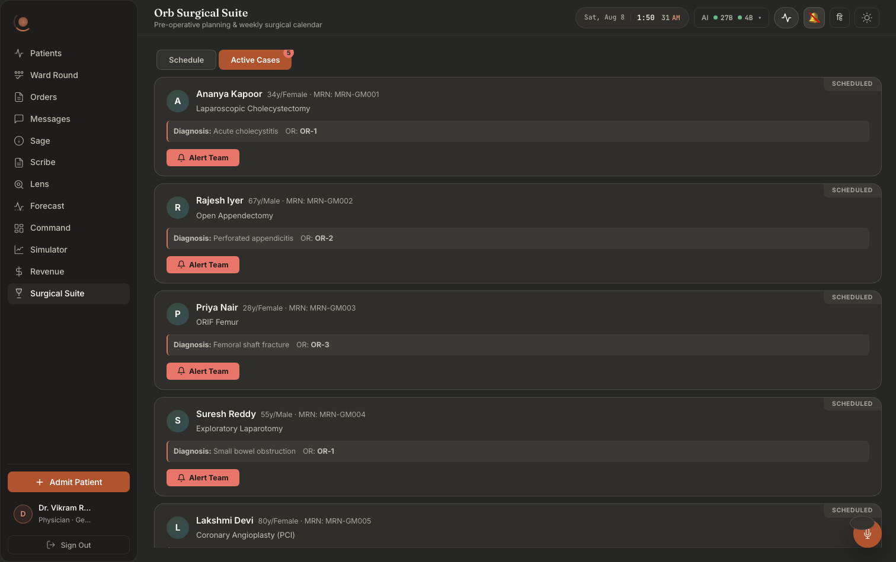
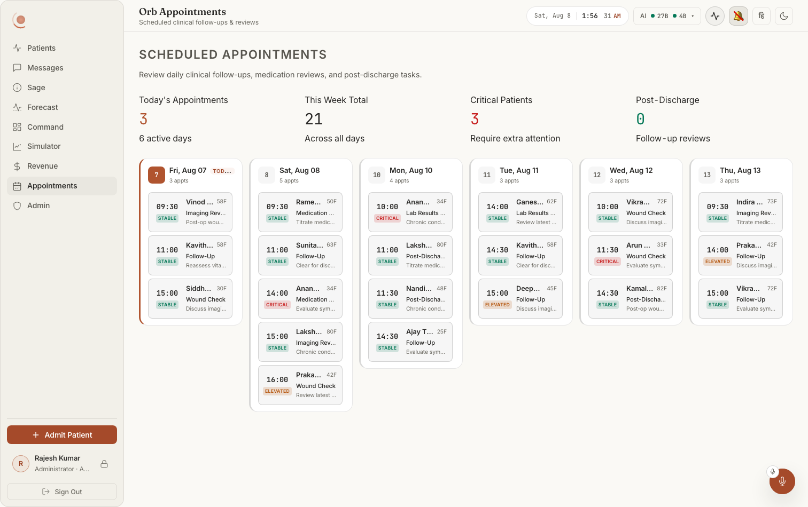

# Screen map 14: Surgical Suite and Appointments

**What this is.** An index of every visible thing on two scheduling screens, the **Surgical Suite**
(a three-tier drill-down: week strip → day agenda → case detail, plus an Active Cases queue and an
emergency banner) and **Appointments** (a day-column board with a summary strip), and the exact
code that puts each thing on screen. Read an entry, then open the file at the line it names. Every
citation in this file was opened and read at that line.

**Scope.**

| Surface | File | Lines |
|---|---|---|
| Surgical Suite, the whole panel, all three tiers | `src/pages/panels/SurgicalSuitePanel.tsx` | 94–1267 |
| Surgical Suite, styling (plain BEM, `suite__x`) | `src/pages/panels/SurgicalSuitePanel.css` | 1–1243 |
| Emergency intake dialog (raised by the Suite) | `src/components/surgery/EmergencyIntakePopup.tsx` | 1–74 |
| Appointments, the whole panel | `src/pages/panels/AppointmentsPanel.tsx` | 1–236 |

**How you get there.** Left nav → **Surgical Suite** or **Appointments**.

- The **Appointments** nav entry is `src/pages/ClinicianShell.tsx:148` (`id: 'appointments',
  label: 'Appointments', pillar: 'Appointments'`, calendar-with-dots icon at `:150-156`). The panel
  is lazily imported at `:289` and mounted at `:785-789` inside
  `<PanelErrorBoundary label="appointments">`.
- The **Surgical Suite** nav entry is `src/pages/ClinicianShell.tsx:160` (`id: 'surgical-suite',
  label: 'Surgical Suite', pillar: 'Surgical Suite'`, scalpel icon at `:162-169`). The panel is
  lazily imported at `:290` and mounted at `:790-794` inside
  `<PanelErrorBoundary label="surgical-suite">`.

**Who sees which one.** `getAccessibleTabs` (`src/pages/ClinicianShell.tsx:182-205`) makes these two
tabs mutually exclusive for doctors, keyed on department:

| Role | Surgical Suite | Appointments | Line |
|---|---|---|---|
| `surgeon` (raw-role safety net) | yes | **no** | `:188-189` |
| `doctor` with department `Surgery` / `General Surgery` | yes | **no** | `:194-195` |
| `doctor`, any other department | **no** | yes | `:196` |
| `nurse` | **no** | yes | `:200` |
| `admin` | **no** | yes | `:201` |
| `pharmacist` | **no** | **no** | `:202` |

`shouldRenderPanel` (`:325`) is `accessibleTabs.includes(tab) && visitedTabs.has(tab)`, neither
panel is mounted until its tab has been clicked once, so first paint always starts from
`loading = true`.

**Server permissions.** Everything on the Surgical Suite is behind `surgery.read`
(`server/permissions.py:66`) for reads and `surgery.write` (`:68`) for the four mutations; both are
granted to `doctor` (`:111`), `nurse` (`:126`) and `admin` (`:147`), and to nobody else. Appointments
is behind `forecast.read` (`:65`), granted to the same three roles. `require_permission`
(`server/permissions.py:376-438`) audits every denial off the event loop and returns a structured
403 (`:426-434`).

**Layout in one sentence, each.** *Surgical Suite Tier 1* is a horizontally-scrolling strip of tall
360 px day cards (`SurgicalSuitePanel.css:75-88`, `:102-118`) under a two-button view switch, with a
red emergency banner above them when there is one. *Tier 2* is a back chip, a day heading, then a
vertical timeline of full-width case cards. *Tier 3* is a back chip and a red Prep button on one
row, a patient bar, then a two-column grid (`SurgicalSuitePanel.css:765-770`), risk / complications
/ team on the left, checklist / instruments on the right. *Appointments* is a title block, a
four-card summary strip, then one equal-width column per day, each column a scrolling list of
appointment rows.

---

## What they look like

**Notice that the tab itself carries the count** (**Active Cases** with a `5` badge), and
that each case card ends in a single red **Alert Team** button, the only action offered from
the queue. The Diagnosis + OR strip is an inset band *inside* the card, so the theatre
assignment reads as data rather than as part of the procedure name, and the status chip
(`SCHEDULED`) is pinned to the card's top-right corner.

**Notice that the summary strip asks four *different* questions**, Today's Appointments /
This Week Total / Critical Patients / Post-Discharge, rather than four slices of one, each
with its own explanatory sub-line ("6 active days", "Across all days", "Require extra
attention", "Follow-up reviews"). Then the day columns: equal width, the current day marked
`TODAY` and outlined, each row packing a time, an acuity chip, a truncated name, an age badge
and a reason into a single line. Dark twin: `adm001-09-appointments-dark.png`.

> ⚠ The Schedule tab capture (`doc004-02-surgical-suite-light.png`) shows **0 Surgeries on
> every day** while the Active Cases tab beside it holds five scheduled cases with assigned
> ORs, and its week strip overflows its container, the fourth column is cut off mid-word
> with no scroll affordance. Use it for the layout, not the counts. The day agenda and the
> case detail, tiers two and three of the drill-down documented below, have no capture at
> all. See [`docs/screenshots/INDEX.md`](../../screenshots/INDEX.md).

---

# Part A: Surgical Suite

## A0. Panel states before anything renders

### Loading skeleton: seven pulsing grey cards
**Where:** Fills the whole panel body on first open, before any data arrives.
**Rendered by:** `src/pages/panels/SurgicalSuitePanel.tsx:335-345`, `if (loading)` returns
`
` containing `[...Array(7)].map(...)` of
`
` (`:339-341`).
**Data from:** `loading` state (`:98`), set `true` inside `loadSchedule` (`:209`) and cleared in its
`finally` (`:216`). `loadSchedule` runs once from the mount effect at `:161`.
**API:** none yet, this is what shows *while* `GET /api/surgery/schedule?days=14` is in flight.
**Server:** n/a.
**Change this →** the seven cards are a 200 px-minimum auto-fill grid, 240 px tall, opacity-pulsing
between 1 and 0.5 on a 1.5 s cycle (`SurgicalSuitePanel.css:21-38`), each starting 80 ms after the
last. Change `Array(7)` and you change how many placeholder cards appear; change the CSS
`grid-template-columns` minmax and they get wider or narrower. It DISAPPEARS the instant
`setLoading(false)` runs, which happens whether the fetch succeeded or threw.

### Failed-to-load banner: "⚠️ &lt;message&gt;" with a Retry button
**Where:** Centred in the panel body, replacing everything else.
**Rendered by:** `:347-356`, `if (error && !schedule.length)` returns
`
` with `⚠️ {error}` (`:351`) and
`<button onClick={loadSchedule} className="suite__retry">Retry</button>` (`:352`).
**Data from:** `error` state (`:99`), set from `e.message` in the `loadSchedule` catch (`:214`).
**API:** `GET /api/surgery/schedule?days=14`, `src/api/client.ts:1691-1693`.
**Server:** `server/routes/surgery_routes.py:67-115` (`get_surgery_schedule`). A 403 from
`require_permission("surgery.read")` surfaces here as "Insufficient permissions"
(`server/permissions.py:430`); a network failure surfaces as the browser's fetch message.
**Change this →** the banner is danger-coloured text on a card (`SurgicalSuitePanel.css:40-47`) with
a clay-filled Retry chip (`:49-62`). Clicking Retry re-runs the same fetch and the skeleton returns.
**The `&& !schedule.length` half of the guard matters:** once the schedule has loaded, this banner
can never appear again in that session. `handleSurgeryClick` also does `setError(e.message)`
(`:296`), so if opening a case fails, the message is stored but **nothing appears on screen**; the
loading overlay simply vanishes and the user is left on the week view with no explanation.

## A1. View switch (Tier 1 only)

### "Schedule" tab button
**Where:** Top-left of the panel, first of two pill buttons, only while on the week view.
**Rendered by:** `:364-375`, inside the `{tier === 1 && (...)}` guard at `:362`. Label text at `:374`.
**Data from:** `activeView` state (`:102`); the click sets it to `'schedule'` (`:365`).
**API / Server:** none, pure client state.
**Change this →** when selected it is filled `var(--accent-deep)` with `var(--btn-primary-text)` and
no border; when not, `var(--bg-glass)` with a hairline border and muted text (`:369-371`). It
DISAPPEARS the moment you drill into a day (Tier 2) or a case (Tier 3), because the whole strip is
gated on `tier === 1`.

### "Active Cases" tab button
**Where:** Immediately right of Schedule.
**Rendered by:** `:376-399`. Label at `:387`.
**Data from:** `activeView`; the click handler both sets the view and force-refreshes the list, 
`onClick={() => { setActiveView('cases'); loadCases(); }}` (`:377`).
**API:** `GET /api/surgery/cases` via `getSurgeryCases` (`src/api/client.ts:1744-1746`).
**Server:** `server/routes/surgery_routes.py:131-159` (`get_surgery_cases`), one query for all
surgeries whose status is not `completed`/`cancelled` (`:139`), then a second query that attaches
`surgery_team_assignments` rows per case (`:148-157`).
**Change this →** same selected/unselected treatment as Schedule. Switching to it swaps the entire
body below for the Active Cases list.

### Red count bubble on the Active Cases tab
**Where:** Overlapping the top-right corner of the Active Cases button.
**Rendered by:** `:388-398`, an 18×18 circle, `background: var(--status-danger)`,
`color: var(--status-on-fill)`, absolutely positioned at `top: -4, right: -4`. Number at `:396`.
**Data from:** `activeCases.length` (`:107`), filled by `loadCases` (`:186-196`).
**API / Server:** as above.
**Change this →** the number is the count of every surgery not yet completed or cancelled, 
including plain `scheduled` future cases, not just live ones. It DISAPPEARS when
`activeCases.length === 0` (the `&&` at `:388`), and also whenever you leave Tier 1.

## A2. Active Cases view

### "Loading surgical cases…" line
**Where:** Where the case list would be.
**Rendered by:** `:406-407`, shown only when `casesLoading && activeCases.length === 0`, so a
background refresh of an already-populated list never blanks it.
**Data from:** `casesLoading` (`:108`), toggled in `loadCases` (`:187`, `:194`).
**Change this →** plain text in the shared `orb-panel-loading` class. Note this class has **no CSS
rule anywhere in the repo**, it renders as unstyled body text.

### Empty state: calendar outline + "No active surgical cases"
**Where:** Centred card in the body.
**Rendered by:** `:408-414`, `
` with a 36 px stroked
calendar SVG (`:410-412`) and the sentence at `:413`.
**Data from:** `activeCases.length === 0` after loading finished.
**Change this →** 60 px of vertical padding, muted text, icon stroked in `var(--text-muted)`
(`SurgicalSuitePanel.css:64-73`). It DISAPPEARS as soon as one surgery exists in any status other
than completed/cancelled, which for a seeded database is essentially always.

### Case card: outer frame and its coloured border
**Where:** One per active case, stacked vertically with 12 px gaps.
**Rendered by:** `:424-429`.
**Data from:** `isEmergency` = `(c.status || '').startsWith('emergency')` (`:420`); `isInProgress` =
`c.status === 'in_progress'` (`:421`).
**Server:** `surgeries.status`, the allowed values are pinned by the CHECK constraint at
`server/database.py:307`: `scheduled`, `in_progress`, `completed`, `cancelled`,
`emergency_pending`, `emergency_context_generating`, `emergency_ready`, `emergency_acknowledged`,
`emergency_staged`.
**Change this →** an emergency case gets a 28 %-danger border, an in-progress case a 28 %-ok border,
everything else the plain hairline (`:426`). Move a case to `completed` and the whole card
disappears from this list on the next refresh, because `/cases` filters it out server-side
(`server/routes/surgery_routes.py:139`).

### Status ribbon: "● In Progress" / "emergency ready" / "scheduled"
**Where:** Top-right corner of every case card, notched into the corner.
**Rendered by:** `:431-440`. The text is
`{isInProgress ? '● In Progress' : c.status?.replace(/_/g, ' ')}` (`:439`).
**Data from:** `surgeries.status`.
**Change this →** in-progress renders green on a 10 %-ok tint; any `emergency_*` status renders red
on a 10 %-danger tint; everything else is muted text on `var(--bg-glass)` (`:435-436`). Because the
non-in-progress branch just swaps underscores for spaces, the ribbon reads exactly like the raw DB
value, "emergency context generating", "emergency acknowledged". Rename a status in the schema and
this label changes with it, with no frontend edit.

### Patient initial avatar
**Where:** Left end of the card's header row, a 38 px circle.
**Rendered by:** `:444-451`; the letter is `{(c.patient_name || '?')[0]}` (`:450`).
**Data from:** `patients.name` via the join at `server/routes/surgery_routes.py:136`.
**Change this →** a green→cyan 20 %-tinted gradient disc. A patient with no name falls back to `?`.

### Patient name, "42y/M · MRN: …", procedure name
**Where:** Right of the avatar, three lines stacked.
**Rendered by:** name at `:454`; the grey suffix `{c.age}y/{c.sex} · MRN: {c.mrn}` at `:456`;
procedure at `:460`.
**Data from:** `p.age`, `p.sex`, `p.mrn`, `s.procedure_name`, all from the `/cases` SELECT
(`server/routes/surgery_routes.py:136-137`).
**Change this →** `sex` is printed raw from the column here (unlike Appointments, which normalises
it), whatever string is in `patients.sex` appears verbatim.

### Diagnosis strip with the gold left rule
**Where:** Full-width band under the header, indented text on a glass background.
**Rendered by:** `:466-469`, `borderLeft: '2px solid var(--accent-gold)'`; label `Diagnosis:` at
`:467`, then `{c.diagnosis}`; `OR: <strong>{c.operating_room}</strong>` appended at `:468`.
**Data from:** `surgeries.diagnosis`, `surgeries.operating_room` (`server/database.py:302`, `:306`).
**Change this →** the "OR:" fragment DISAPPEARS entirely when `operating_room` is null, the `&&`
at `:468`. The diagnosis text has no such guard and would render blank.

### "TEAM ASSIGNMENTS" label
**Where:** Small uppercase caption above the team chips.
**Rendered by:** `:474-476`.
**Data from:** gated on `team.length > 0` (`:472`), where `team = c.team || []` (`:417`).
**Change this →** the entire block (label + chips) DISAPPEARS when no one has been alerted yet.

### Team member chip: "Lead Surgeon: DOC004 (confirmed)"
**Where:** A wrapping row of pill chips, each with a small status dot at its left.
**Rendered by:** `:478-504`. The dot is `:496-500`; the text is
`{t.role_name}, {t.user_id}` (`:501`) followed by `({t.status})` (`:502`).
**Data from:** the `team` array attached per case at `server/routes/surgery_routes.py:156`, read from
`surgery_team_assignments` (`:148-151`). Its `status` column is CHECK-constrained to
`pending | alerted | confirmed | declined` with default `pending` (`server/database.py:325`).
**API:** written by `POST /api/surgery/{id}/alert-team` and `POST /api/surgery/{id}/team-response`.
**Server:** `server/routes/surgery_routes.py::_persist_alerts` (`:280-365`) inserts every member at
`status='alerted'` (`:338`); `surgical_team_response` (`:403-486`) flips one row to
`confirmed`/`declined` (`:429-432`).
**Change this →** four colour states, all applied to background, text and border together
(`:483-494`): confirmed = green, declined = red, alerted = amber, anything else (i.e. `pending`) =
neutral glass. **The chip prints the raw `user_id`, not the person's name**, "Lead Surgeon, 
DOC004". `surgical_team_response` looks up `user['name']` for the Relay system message (`:441`) but
the `/cases` payload never joins `users`, so the chip cannot show it.

### "Alert Team" button (red, with a bell icon)
**Where:** First button in the action row at the bottom of a case card.
**Rendered by:** `:513-532`; bell SVG at `:530`, label at `:531`.
**Data from:** shown only when `team.length === 0 && !isInProgress` (`:512`).
**API:** `POST /api/surgery/{id}/alert-team` with a **hardcoded** roster, 
`[{ user_id: 'DOC004', role: 'Lead Surgeon' }, { user_id: 'anesthetist_1', role: 'Anesthetist' }]`
(`:516-519`), via `alertSurgicalTeam` (`src/api/client.ts:1748-1753`).
**Server:** `server/routes/surgery_routes.py:368-401` (`alert_surgical_team`, requires
`surgery.write`) → `_persist_alerts` (`:280-365`) off the loop via `run_db`, then a domain audit
event (`:380-382`), then a live Socket.IO `message:new` emit to the case room and to each targeted
user's personal room (`:386-400`).
**Change this →** on success the button disappears (because `team.length` is no longer 0 after
`loadCases()` at `:520`) and is replaced by "Awaiting Confirmations"; two amber chips appear in the
Team Assignments row; the alerted clinicians get a Relay message in the patient's case room.
`_persist_alerts` validates the whole roster **before** deleting the old one (`:301-320`), so a bad
member id returns 422 and leaves the existing team intact. **If `DOC004` or `anesthetist_1` does not
exist in this deployment, the server returns 422 "no such user" and the frontend swallows it in
`catch (e) { console.error(e) }` (`:521`), the button stays put and nothing visible happens.**

### "Start Surgery" / "Awaiting Confirmations" button
**Where:** In the action row, where Alert Team was.
**Rendered by:** `:537-563`. Play-triangle icon at `:561`; the label is
`{allConfirmed ? 'Start Surgery' : 'Awaiting Confirmations'}` (`:562`).
**Data from:** `allConfirmed` = `team.length > 0 && team.every(t => t.status === 'confirmed')`
(`:418`); `hasAlerted` = `team.some(t => t.status === 'alerted')` (`:419`). `disabled={!allConfirmed
|| hasAlerted}` (`:546`). Shown only when `!isInProgress && team.length > 0` (`:536`).
**API:** `POST /api/surgery/{id}/start` via `startSurgery` (`src/api/client.ts:1762-1764`).
**Server:** `server/routes/surgery_routes.py:488-528` (`start_surgery`, requires `surgery.write`).
It reads the row first (`:497`), returns `already_in_progress` if it is already running (`:500`),
409s if the status is not in `_STARTABLE_STATUSES` = `{scheduled, emergency_ready,
emergency_acknowledged, emergency_staged}` (`:24-25`, `:502-506`), and 400s unless there is at least
one `confirmed` assignment and zero `alerted`/`pending` ones (`:514-518`). Success flips the row to
`in_progress` (`:520`) and writes a `surgery_started` audit event (`:524-527`).
**Change this →** enabled it is clay-filled (`var(--accent-deep)` / `var(--btn-primary-text)`);
disabled it uses the neutral `--btn-disabled-bg` / `--btn-disabled-text` pair, which the comment at
`:548-552` records was chosen after the previous muted-on-glass treatment measured **1.92:1** in the
light theme. After a successful start the ribbon flips to "● In Progress", the card border turns
green, this button disappears and "Complete Surgery" takes its place. A server refusal is surfaced
by a native browser `alert()` dialog (`:543`), the only `alert()` on either of these screens.

### "Complete Surgery" button (green, tick icon)
**Where:** In the action row, only while the case is running.
**Rendered by:** `:568-585`; tick SVG at `:583`, label at `:584`. Gated on `isInProgress` (`:567`).
**API:** `POST /api/surgery/{id}/complete` via `completeSurgery` (`src/api/client.ts:1766-1768`).
**Server:** `server/routes/surgery_routes.py:530-602` (`complete_surgery`, requires
`surgery.write`). Idempotent, a repeat returns `already_completed` without writing a second note
(`:540-541`). It flips the status (`:543`), then writes a post-op Scribe note in a separate
transaction (`:571-578`) with a compensating status rollback if the note write fails (`:579-595`).
The note's body depends on `DEMO_MODE` (`:548-554`): demo writes an illustrative operative note,
production writes "_Operative note pending, to be authored by the operating surgeon._".
**Change this →** on success the case vanishes from Active Cases (the `/cases` filter excludes
`completed`) and a post-op note appears in that patient's Scribe/document list. The count bubble on
the tab decrements.

### "↻ Refresh Status" button
**Where:** Rightmost in the action row, an outlined amber chip.
**Rendered by:** `:590-599`; label at `:598`. Shown only when some member declined and the case is
not running, `team.some(t => t.status === 'declined') && !isInProgress` (`:589`).
**Data from / API:** it does **not** re-alert anyone; `onClick={() => loadCases()}` (`:591`) just
re-fetches `GET /api/surgery/cases`.
**Change this →** transparent background, amber text and 28 %-amber border. The real re-routing on a
decline happens server-side in `surgical_team_response` (`:454-479`), which, only when `DEMO_MODE`
is on and the decliner is `anesthetist_1`, inserts `anesthetist_2` as a new `alerted` assignment and
posts a "SAGE SUGGESTION" message. Press this button after that, and a new amber chip appears.

## A3. Tier 1: the week strip

### Emergency banner: pulsing dot + "2 Emergency Cases Pending"
**Where:** A red-tinted card above the day strip, full width.
**Rendered by:** `:614-656`. The 8 px pulsing dot is `:622`; the headline is `:623`, 
`{emergencyQueue.length} Emergency Case{emergencyQueue.length > 1 ? 's' : ''} Pending`.
**Data from:** `emergencyQueue` state (`:96`), filled by `loadEmergencyQueue` (`:198-206`).
**API:** `GET /api/surgery/emergency-queue` via `getEmergencyQueue` (`src/api/client.ts:1735-1737`).
**Server:** `server/routes/surgery_routes.py:117-129` (`get_emergency_queue`), statuses
`emergency_pending`, `emergency_ready`, `emergency_context_generating` only (`:126`).
**Refresh:** two paths, both wired in the mount effect (`:160-184`), a Socket.IO listener on
`surgery:emergency_intake` (`:172`) which re-fetches immediately, and a 10-second fallback poll
(`:175-178`) for missed events after a reconnect or tab switch. The socket event is emitted by
`server/services/sage_handoff_service.py:552` and `:602`.
**Change this →** border and background are inline 28 %- and 10 %-danger mixes (`:616-617`); the CSS
class only supplies the radius (`SurgicalSuitePanel.css:302-304`). The dot animates on the shared
`pulse` keyframe. The whole banner DISAPPEARS when the queue is empty (`:614`).

### Emergency case row: "URGENT", duration, procedure, "Pending", diagnosis, patient · bed, "EMERGENCY"
**Where:** Stacked buttons inside the emergency banner.
**Rendered by:** `:628-652`. "URGENT" at `:635`; duration at `:636`; procedure heading at `:643`;
the readiness chip at `:644`; diagnosis at `:646`; `{s.patient_name} · Bed {s.bed}` at `:648`; the
red "EMERGENCY" tag at `:649`.
**Data from:** each row of the emergency-queue payload, `s.estimated_duration_min`,
`s.procedure_name`, `s.status`, `s.diagnosis`, `s.patient_name`, `s.bed`. `p.bed` is selected at
`server/routes/surgery_routes.py:122`.
**Change this →** clicking a row calls `handleSurgeryClick(s.id)` (`:631`) and drills straight to
Tier 3, leaving `selectedDayIdx` null, which is why the Tier-3 back chip then reads "Surgical
Suite" instead of a day name (`:801`). The duration is run through `formatDuration` (`:76-80`), so
150 becomes "2h 30m" and 45 becomes "45m". **The readiness chip at `:644` can only ever read
"Pending" or "Ready"**: it tests for `emergency_acknowledged` first, but that status is excluded
from the endpoint's `WHERE` clause, so an acknowledged case has already left this list.

### Empty week: calendar outline + "No surgeries scheduled this week"
**Where:** Centred card where the day strip would be.
**Rendered by:** `:658-666`; 40 px calendar SVG at `:660-664`, sentence at `:665`.
**Data from:** `schedule.length === 0`.
**Change this →** in practice **unreachable**: `get_surgery_schedule` builds one entry per requested
day whether or not it has surgeries (`server/routes/surgery_routes.py:104-113`), so a successful
14-day request always returns 14 objects. You would see this only if the request returned a literal
empty array.

### Day card (the week strip's unit)
**Where:** One 360 px-wide, 480 px-tall card per day, scrolling horizontally.
**Rendered by:** `:669-724`, a `<button>` with id `suite-day-${day.date}` (`:679`).
**Data from:** `schedule` state (`:95`), filled by `loadSchedule` (`:208-218`) from
`getSurgerySchedule(14)` (`:211`).
**API:** `GET /api/surgery/schedule?days=14`, `src/api/client.ts:1691-1693`.
**Server:** `server/routes/surgery_routes.py:67-115`. `days` is `Query(7, ge=1, le=90)` (`:69`), 
the 90-day ceiling exists because an unbounded value would make a DB worker build that many empty
day objects (`:30-33`).
**Change this →** each card enters with a 16 px rise, staggered 60 ms per index (`:674`,
`SurgicalSuitePanel.css:120-123`). Hover shifts background and border only, nothing lifts
(`:129-132`). Clicking runs `handleDayClick(idx)` (`:672`), which sets `animState='expanding'`,
waits 450 ms, then switches to Tier 2 (`:221-228`).

### "Today" badge on a day card
**Where:** Pushed to the right end of a day card's header row.
**Rendered by:** `:684`, `{day.is_today && Today}`.
Also `:743` for the same badge on the Tier-2 heading.
**Data from:** `day.is_today`, declared on the `DaySchedule` interface at `:31`.
**Server:** **nothing supplies it.** `get_surgery_schedule` builds each day object with exactly three
keys, `date`, `day_label`, `surgeries` (`server/routes/surgery_routes.py:109-113`). The only
`is_today` in the entire server tree is `server/services/surgery_service.py:43`, inside
`get_weekly_schedule`, which no route, service or test calls (verified by repo-wide grep).
**Change this →** as shipped, `day.is_today` is always `undefined`, so **the "Today" badge never
appears on this screen, and neither does the `suite__day-card--today` treatment**, the clay border,
the tinted background and the 2 px gold top rule at `SurgicalSuitePanel.css:134-148`. To make today
visible you either add `"is_today": day == today` to the route's day dict, or compute it client-side
with `localDateKey()` from `src/lib/datetime.ts:53-58` the way AppointmentsPanel does.

### Day name and date: "Monday" / "Aug 11"
**Where:** Left of the day-card header row.
**Rendered by:** `:682` (`{day.day_label}`) and `:683` (`{formatDate(day.date)}`).
**Data from:** `day_label` is `day.strftime("%A")` server-side (`server/routes/surgery_routes.py:111`);
`formatDate` (`:88-91`) parses `date + 'T00:00:00'`, local midnight, so no off-by-one, and formats
it `en-IN`, `{ month: 'short', day: 'numeric' }`.
**Change this →** change the locale string at `:90` and every date on the week strip and Tier-2
heading re-formats. **The window itself is computed in UTC**:
`today = datetime.now(timezone.utc).date()` (`server/routes/surgery_routes.py:74`). In IST (UTC+5:30)
that is the previous calendar day between 00:00 and 05:30 local, so a surgeon opening the app at
03:00 sees the strip start on *yesterday*, and yesterday's finished list occupies the first card.

### Day count: big number + "Surgeries"
**Where:** Under the header, the card's headline figure.
**Rendered by:** `:686-689`, the number at `:687`, and the singular/plural label at `:688`
(`{day.surgeries.length === 1 ? 'Surgery' : 'Surgeries'}`).
**Data from:** `day.surgeries.length` from the grouped payload
(`server/routes/surgery_routes.py:93-102`).
**Change this →** the numeral is 2.4 rem, tabular (`SurgicalSuitePanel.css:209-221`). An empty day
shows a bare "0 Surgeries" and no footer.

### Day list row: time · coloured dot · procedure · "patient · OR-2"
**Where:** The scrollable middle of each day card, one row per surgery.
**Rendered by:** `:691-700`. Time at `:693`; dot at `:694`; procedure at `:696`;
`{s.patient_name} · {s.operating_room}` at `:697`.
**Data from:** `formatTime(s.scheduled_time)` (`:69-74`) converts `"14:30"` to `"2:30 PM"`;
`riskColor(s.risk_level)` (`:82-86`) maps `critical`→danger, `elevated`→warn, anything else→ok.
**Server:** `risk_level` is **not** a surgical field. The schedule query LEFT JOINs the patient's
most recent `risk_scores` row (`server/routes/surgery_routes.py:84-87`) and the route defaults a
missing one to `"stable"` (`:101`). So **the dot is the patient's Vigil deterioration level, not an
operative risk**, the same number that colours their ward-board row.
**Change this →** the procedure name is hard-truncated at 35 characters with an ellipsis (`:696`),
so a longer name is cut in the strip but shown whole on Tier 2. Change a patient's NEWS2/risk score
in Vigil and this dot changes colour on the next load of this panel.

### Day summary footer: "6h 30m Total OR Time / 2 Elevated Risk / 3 Active Rooms"
**Where:** Pinned at the bottom of each day card, three columns.
**Rendered by:** the IIFE at `:703-723`. Values at `:710`, `:714`, `:718`; labels at `:711`, `:715`,
`:719`.
**Data from:** computed in the browser at `:704-706`, `totalMins` sums
`estimated_duration_min`; `highRisk` counts `risk_level` of `critical` or `elevated`; `activeORs` is
`new Set(day.surgeries.map(s => s.operating_room)).size`.
**Change this →** the whole footer DISAPPEARS on a day with no surgeries (`:703`). "Active Rooms"
counts *distinct strings*, so `null` counts as one room, and "OT 1" and "OT-1" count as two. A
surgery with a null `estimated_duration_min` makes the total `NaN`, which `formatDuration` renders as
"NaNh NaNm".

## A4. Tier 2: the day agenda

### "← Week Overview" back chip
**Where:** Top-left of the day view.
**Rendered by:** `:733-738`, id `suite-back-week`; arrow SVG at `:734-736`, label at `:737`.
**Data from / API:** none, `handleBackToWeek` (`:231-238`) plays a 400 ms collapse then resets
`tier` to 1 and `selectedDayIdx` to null.
**Change this →** a neutral surface chip with a hairline border (`SurgicalSuitePanel.css:331-351`).

### Day heading: day name, "Today" badge, date, "4 scheduled procedures"
**Where:** Under the back chip, three stacked lines.
**Rendered by:** `:740-747`. Day name at `:742`; the badge at `:743` (same dead `is_today` as
above); date at `:745`; count line at `:746`.
**Data from:** `schedule[selectedDayIdx]`, guarded at `:731`.
**Change this →** the count sentence has no pluralisation guard, one surgery reads "1 scheduled
procedures".

### Case card on the timeline
**Where:** A vertical stack of full-width cards under the heading.
**Rendered by:** `:751-787`, id `suite-surgery-${s.id}` (`:756`), 80 ms stagger (`:755`).
**Change this →** clicking runs `handleSurgeryClick(s.id)` (`:754`) which fetches the detail and
moves to Tier 3.

### Case-card time block: "2:30 PM" over "2h 30m"
**Rendered by:** `:758-761`, time at `:759`, duration at `:760`.
**Data from:** `formatTime` (`:69-74`) and `formatDuration` (`:76-80`).
**Change this →** `formatTime` returns its input unchanged if it contains no colon (`:70`), so a
malformed `scheduled_time` prints raw rather than "NaN:NaN".

### Case-card timeline dot and connector stem
**Where:** The narrow column between the time block and the body.
**Rendered by:** dot at `:764` (filled with `riskColor(s.risk_level)` plus a 25 %-tinted glow);
stem at `:765`, rendered only for cards that are not the last (`i < surgeries.length - 1`).
**Change this →** the last card in a day has no stem below its dot, which is what makes the column
read as a timeline that ends.

### Procedure heading and OR tag
**Rendered by:** procedure at `:770`, `{s.operating_room}` at `:771`.
**Data from:** `surgeries.procedure_name`, `surgeries.operating_room`.
**Change this →** unlike the week strip, the procedure is not truncated here.

### Diagnosis line
**Rendered by:** `:773`.
**Data from:** `surgeries.diagnosis`, the *surgical* diagnosis column
(`server/database.py:302`), not the patient's admission diagnosis.

### Patient line with the person icon
**Rendered by:** `:775-778`, icon at `:776`, then `{s.patient_name} · {s.age}y/{s.sex}` at `:777`.
**Data from:** joined `patients` columns (`server/routes/surgery_routes.py:79`).

### Risk glyph and word: "⬤ critical" / "◉ elevated" / "○ stable"
**Rendered by:** `:779-781`. The glyph choice is at `:780`; the colour is `riskColor(s.risk_level)`.
**Data from:** the patient's latest `risk_scores.level`, defaulted to `"stable"` at
`server/routes/surgery_routes.py:101`.
**Change this →** the glyph is a real Unicode character, not an icon font, it changes weight with
the text. The word is printed lowercase exactly as stored.

### Success probability: "94% success"
**Rendered by:** `:782-784`.
**Data from:** `surgeries.success_probability`, a REAL column (`server/database.py:314`), written by
the escalation packagers, 72.5 at `server/services/surgery_escalation_service.py:280` and 78.5 at
`server/services/sage_handoff_service.py:569`.
**Change this →** three colour bands, all inline at `:782`: ≥95 green, ≥85 amber, below that red.
The value is printed with no rounding and no unit conversion, so a row storing `0.85` renders
"0.85% success" in red.

## A5. Tier 3: case detail

### Back chip: "← Monday Agenda" or "← Surgical Suite"
**Where:** Top-left of the detail view.
**Rendered by:** `:797-802`, id `suite-back-day`; the label at `:801` is
`{selectedDayIdx !== null ? `${schedule[selectedDayIdx]?.day_label} Agenda` : 'Surgical Suite'}`.
**Data from:** `selectedDayIdx` (`:112`).
**Change this →** `handleBackToDay` (`:305-317`) returns to Tier 2 if you arrived from a day card,
or all the way to Tier 1 if you arrived from the emergency banner (which never sets
`selectedDayIdx`). It also clears `riskText` (`:314`), so re-opening the same case re-streams the
assessment from scratch.

### "Prep for Surgery" button → spinner → "✓ Alert Sent"
**Where:** Top-right of the detail view, opposite the back chip.
**Rendered by:** `:804-822`. Three states: spinner (`:810`), tick + "Alert Sent" (`:813-814`),
shield-check icon + "Prep for Surgery" (`:818-819`).
**Data from:** `prepLoading` (`:121`) and `prepSuccess` (`:122`); `disabled={prepLoading ||
prepSuccess}` (`:807`). `prepSuccess` self-clears after 5 s (`:326`).
**API:** `POST /api/surgery/{id}/prep` via `prepForSurgery` (`src/api/client.ts:1731-1733`).
**Server:** `server/routes/surgery_routes.py:605-628` (requires `surgery.write`) →
`server/services/surgery_service.py::trigger_surgery_prep` (`:255-366`). It resolves recipients from
`surgery_team_assignments` first (`:274-281`), falls back to ids embedded in the surgery's
`staff_required` package (`:287-290`), and only then to a narrow `["doctor"]` role target (`:294`).
It de-duplicates: a second press within 4 hours returns `{"status": "duplicate"}` without sending
anything (`:320-333`). On success it posts a structured alert to the `dept-surgery` channel
(`:336-343`) and to the patient's case room (`:348-364`).
**Change this →** the button is danger-red at rest (`SurgicalSuitePanel.css:549-564`) and turns green
in the success state (`:570-572`); `min-width: 140px` stops it resizing between states. A **duplicate
still shows "Alert Sent"**, the frontend does not read the returned status. A **failure shows
nothing at all**: the catch is `console.error(e)` (`:328`), so the button simply returns to
"Prep for Surgery".

### Patient bar: avatar initial, name, "58y · M · MRN: … · Bed …"
**Where:** A full-width card directly under the nav row.
**Rendered by:** avatar at `:829`; name at `:832`; the grey sub-line at `:833`.
**Data from:** the detail payload from `GET /api/surgery/{id}`.
**Server:** `server/routes/surgery_routes.py:161-229` (`get_surgery_detail`, requires
`surgery.read`).
**Change this →** the avatar is a 44 px clay-tinted disc (`SurgicalSuitePanel.css:600-613`). **The
bed number is always blank here.** The detail query selects `p.name, p.mrn, p.age, p.sex` and
`p.diagnosis` (`server/routes/surgery_routes.py:166-167`) but **not** `p.bed`, and `surgeries` has
no bed column (`server/database.py:297-317`), so `selectedSurgery.bed` is `undefined` and the line
ends with a dangling "· Bed". The same is true of `ward` and `admission_date`, which are declared on
the `SurgeryFull` interface (`:42-43`, `:47`) but neither returned nor rendered. Adding `p.bed` to
that SELECT is the whole fix.

### Co-morbidity pills (red)
**Where:** A wrapping row under the patient name.
**Rendered by:** `:837-839`.
**Data from:** `selectedSurgery.co_morbidities`.
**Server:** `server/routes/surgery_routes.py:185-201`, it reads `surgeries.co_morbidities` first
(the snapshot the agentic flow writes at case creation), skipping the sentinel values `""`, `"[]"`
and `"Reviewing context..."` (`:190`), and only falls back to `patient_profiles.comorbidities`
(`:196-200`). Both branches tolerate a JSON array or a comma-separated string.
**Change this →** 10 %-danger fill, 28 %-danger border, danger text
(`SurgicalSuitePanel.css:681-696`). The row DISAPPEARS when both sources are empty.

### Allergy pills: "⚠ Penicillin" (strong red)
**Where:** Same wrapping row, after the co-morbidities.
**Rendered by:** the IIFE at `:840-869`; the pill itself at `:852-854`, with
`title="Drug allergy"`.
**Data from:** the normaliser at `:844-850` accepts an array, a JSON string, or a comma-separated
string, the comment at `:841-843` records why: the same field arrives parsed from the detail
endpoint and raw from intermediate fetches, and "a missed allergy is a safety hazard".
**Server:** `server/routes/surgery_routes.py:203-213` parses `patient_profiles.allergies`
(joined at `:171`) into a list.
**Change this →** deliberately louder than a co-morbidity, 16 % fill, 42 % border, weight 700
(`SurgicalSuitePanel.css:697-709`).

### "Allergies not recorded" pill (amber)
**Where:** In place of the allergy pills when the list is empty.
**Rendered by:** `:862-867`, with a long `title` explaining that this is not a statement of no
allergies (`:864`).
**Data from:** the empty branch of the same IIFE.
**Change this →** amber, never green (`SurgicalSuitePanel.css:711-718`). The comment at `:856-861`
and the CSS comment at `:704-710` both record the reasoning: Orb cannot distinguish "NKDA, confirmed"
from "nobody ever asked", because there is no allergy-status column and the admission path never
requires one, so an absence of data must read as an open pre-op item, not a clearance.

### OR pill and time pill
**Where:** Right end of the patient bar, stacked.
**Rendered by:** OR at `:873` (`suite__detail-meta-pill--ot`); time at `:874-876`, 
`{formatTime(scheduled_time)} ({estimated_duration_min}m)`.
**Change this →** the OR pill is the clay-tinted variant (`SurgicalSuitePanel.css:663-669`); the time
pill is neutral glass (`:649-661`). The duration here is raw minutes with an "m", not the
`formatDuration` "2h 30m" form used on Tiers 1 and 2.

### "Clinical Handoff Context (Medicine)" card
**Where:** Top of the left column of the detail grid, gold-bordered.
**Rendered by:** `:888-929`. Title at `:892`; the four blocks are "Active Medications" (`:897`),
"Recent Vitals" (`:905`), "Recent Labs" (`:913`) and "Scribe Notes" (`:921`, rendered in italics
inside typographic quotes at `:923`).
**Data from:** `selectedSurgery.imported_context`, gated at `:888`.
**Server:** `server/routes/surgery_routes.py:221-227` sets it **only** from
`json.loads(notes).imported_context`.
**Change this →** **this card never appears in the running application.** A repo-wide grep finds
exactly two writers of `surgeries.notes`, `server/services/surgery_escalation_service.py::_finalize_surgery`
(`:209-211`, writing `ai_package_status` / `reason` / `finalized_at`) and
`server/services/sage_handoff_service.py:591-594` (writing `ai_package_status` / `finalized_at`).
Neither ever writes an `imported_context` key, so the guard at `:888` is always false. The only place
this shape exists is the visual-test fixture at `tests/visual/fixtures.cjs:753-758`. Note that
`server/services/surgery_service.py::get_surgery_detail` **does** build a real
`imported_context` from `_assemble_patient_context` (`:105`, `:136`), but that function is only
reached by the risk-assessment SSE route (`server/routes/surgery_routes.py:685-688`), never by the
detail endpoint the panel calls. Pointing the detail route at that service, or writing the key into
`notes`, is what would light this card up.

### "AI Risk Assessment" heading + "MEDGEMMA" badge
**Where:** Left column, the panel's largest card.
**Rendered by:** heading at `:940`, badge at `:941`.
**Change this →** the badge is filled `var(--accent-deep)` with `--btn-primary-text`; the CSS comment
at `SurgicalSuitePanel.css:819-822` records that gold was rejected because a white label on it
measures 3.12:1 in dark, and this pair is the one the contrast gate asserts.

### "AI GENERATED" / "FALLBACK" enrichment badge
**Where:** Right after the MedGemma badge in the same heading.
**Rendered by:** the IIFE at `:942-947`, green "AI Generated" when `ai_package_status` is
`generated` (`:944`), amber "Fallback" when it is `fallback`, `failed` or `timeout` (`:945`),
nothing otherwise (`:946`).
**Data from:** `getAiPackageStatus` (`:130-136`), which JSON-parses `selectedSurgery.notes` and reads
`.ai_package_status`, returning null on any parse failure.
**Server:** only two values are ever written, `"generated"`
(`server/services/surgery_escalation_service.py:320`, `server/services/sage_handoff_service.py:592`)
and `"failed"` (`server/services/surgery_escalation_service.py:328`, the 60-second timeout path at
`:325`). `"fallback"` and `"timeout"` are dead branches.
**Change this →** green pill vs amber pill (`SurgicalSuitePanel.css:844-855`). The amber badge is
reachable only by one route: open a case while it is still `emergency_context_generating`, then let
the Tier-3 hydration poll (`:139-158`) replace the record with a finished-but-failed one. Clicking
into an already-failed case never gets here at all, `handleSurgeryClick` intercepts that status and
shows the "Feature under development" dialog instead (`:288-290`).

### Amber fallback banner: "⚠ AI-generated surgical package unavailable…"
**Where:** A full-width strip directly under the risk-card heading.
**Rendered by:** the IIFE at `:968-978`; the sentence at `:973`.
**Data from / Server:** same `ai_package_status` as the badge above, same reachability caveat.
**Change this →** 10 %-amber fill, 28 %-amber border, amber text
(`SurgicalSuitePanel.css:857-867`).

### Spinner in the risk-card header
**Where:** Left of the chevron, top-right of the risk card.
**Rendered by:** `:950`, shown when `selectedSurgery.status.includes('generating') || riskLoading`.
**Change this →** a 12 px ring with a gold leading edge (`SurgicalSuitePanel.css:906-913`).

### Expand/collapse chevron
**Where:** Top-right corner of the risk card.
**Rendered by:** the `<button className="suite__risk-toggle">` at `:955-963`, with
`aria-expanded={riskExpanded}` and an aria-label that flips between "Expand"/"Collapse" (`:958-959`).
The chevron SVG is `:962`; `suite__exp-icon--up` rotates it 180°.
**Data from:** `riskExpanded` (`:119`).
**Change this →** the comment at `:951-954` records why this is a real `<button>` and not a bare
`<svg>`: collapsed, the card is clipped to 160 px, so without a focusable control the rest of the
assessment was pointer-only. It is sized to the 44 px target floor
(`SurgicalSuitePanel.css:892-904`) with negative margins so it does not visually grow the header.
The card's own `onClick` (`:934`) still toggles too; the button calls `e.stopPropagation()` (`:960`)
so the two do not cancel each other.

### "Generating risk assessment via MedGemma…" + three shimmer bars
**Where:** The body of the risk card.
**Rendered by:** `:981-987`, the sentence at `:983`, then bars at 100 %, 80 % and 60 % width
(`:984-986`).
**Data from:** `selectedSurgery.status.includes('generating')`.
**Change this →** while this is showing, the Tier-3 poll at `:144-155` re-fetches the detail every
3 s and stops itself once the status leaves `emergency_context_generating`/`emergency_pending`.

### Three shimmer bars with no caption
**Where:** Same place, the other loading state.
**Rendered by:** `:988-993`, shown when `riskLoading && !riskText`, i.e. the SSE stream is open but
no token has arrived yet.
**Change this →** each bar is 12 px tall on the same 1.5 s opacity pulse
(`SurgicalSuitePanel.css:946-952`).

### The risk assessment text itself
**Where:** The body of the risk card, formatted into headings, numbered items, bullets and paragraphs.
**Rendered by:** the parser at `:996-1049`. Source string is
`riskText || selectedSurgery.risk_assessment || ''` (`:996`); runs of 2+ spaces are collapsed
(`:997`); every `*` is stripped (`:1004`). Then per line: a leading `N.` becomes a numbered item with
the text up to a colon bolded when that colon is within 60 characters (`:1008-1031`); a leading `-`
or `•` becomes a `✦` bullet (`:1034-1041`); a line ending in `:` becomes an `<h5>` heading
(`:1044-1046`); everything else is a paragraph (`:1048`).
**Data from:** `riskText` (`:118`), appended token-by-token by the SSE reader.
**API:** `GET /api/surgery/{id}/risk`, a Server-Sent Events stream read by
`getSurgeryRiskAssessment` (`src/api/client.ts:1699-1729`), which accumulates `data.content` and
calls `onChunk` with the running total (`:1721-1724`).
**Server:** `server/routes/surgery_routes.py:665-682`. The detail load happens **before** the
generator is handed to `StreamingResponse` (`:675`), via `run_db(_load_risk_detail, ...)`
(`:685-688`), the comment at `:669-674` records that the previous inline load ran an encrypted
eight-query fan-out on the event loop and blocked the whole API for the duration of every risk-panel
open. The generator is `server/services/surgery_service.py::generate_risk_assessment` (`:140-233`):
it builds an eight-section pre-op prompt (`:158-179`), picks a model through
`select_chat_model` so it cannot resurrect an operator-evicted 27B (`:188-189`), takes a queue slot
at priority 2 (`:191`), and streams from Ollama with `num_predict: 800, temperature: 0.3` (`:201`).
Any exception falls through to a static fallback assessment (`:220-231`) that ends
"⚠️ AI-assisted assessment (offline fallback), requires clinical verification."
**Change this →** the stream is fired exactly once per (surgery id, tier) pair by the effect at
`:274-277`, and `loadRiskAssessment` (`:243-267`) aborts any previous stream before starting a new
one (`:244-248`). If the request throws for a reason other than an abort, the body is replaced with
the single line "Risk assessment unavailable, AI service offline." (`:260`). Because the card falls
back to `selectedSurgery.risk_assessment` when `riskText` is empty, the pre-generated package text
shows first and is then overwritten live by the stream.

### Blinking cursor at the end of the streaming text
**Rendered by:** `:1050`, `{riskLoading && }`.
**Change this →** it DISAPPEARS the moment the stream closes and `setRiskLoading(false)` runs
(`:264`).

### Fade mask over the collapsed risk card
**Where:** The bottom 60 px of the risk card while collapsed.
**Rendered by:** `:1054`, `{!riskExpanded && 
}`.
**Change this →** a transparent-to-`--bg-surface` gradient with `pointer-events: none`
(`SurgicalSuitePanel.css:925-933`). Collapsed the card is capped at 160 px, expanded at 1200 px
(`:875-881`), so an assessment longer than 1200 px is still clipped when "expanded", with no mask
to signal it.

### "Possible Complications" list
**Where:** Left column, below the risk card.
**Rendered by:** heading at `:1061`; each item at `:1064-1068` with a small dot at `:1066`.
**Data from:** `selectedSurgery.possible_complications`, JSON-parsed server-side at
`server/routes/surgery_routes.py:215-219` (which also parses `surgical_checklist`,
`instruments_required` and `staff_required`, defaulting each to `[]` on a parse failure).
**Change this →** an empty array renders the heading with nothing under it, there is no empty state.

### "Surgical Team" cards
**Where:** Bottom of the left column.
**Rendered by:** heading at `:1077`; each member at `:1080-1088`, initial avatar (`:1082`), name
(`:1084`), role (`:1085`).
**Data from:** `selectedSurgery.staff_required`, the *package* roster written by the enrichment
services (e.g. `server/services/surgery_escalation_service.py:308-317`), **not** the live
`surgery_team_assignments` rows. The two are different lists: this one has names and no statuses;
the Active Cases chips have statuses and no names.
**Change this →** `s.name.charAt(0)` (`:1082`) throws if an entry is a plain string rather than a
`{role, name}` object, a shape the server tolerates elsewhere via
`server/services/surgery_service.py::_staff_display_names` (`:235-252`). A string roster here would
be caught by `PanelErrorBoundary` and show "This panel hit an error and couldn't be shown."
(`src/pages/ClinicianShell.tsx:263-264`).

### "Surgical Checklist (12)" heading with a count
**Where:** Top of the right column.
**Rendered by:** `:1099-1102`, the count is `selectedSurgery.surgical_checklist.length` (`:1101`).

### Success-probability donut gauge
**Where:** Top-right of the checklist card.
**Rendered by:** `:1103-1114`, background arc at `:1105`, filled arc at `:1106-1111`, the "%" label
at `:1113`.
**Data from:** `selectedSurgery.success_probability` drives both
`strokeDasharray: `${value}, 100`` (`:1108`) and the stroke colour (`:1109`): ≥95 green, ≥85 amber,
else red.
**Change this →** because the dash array is the raw number out of 100, a value stored as a fraction
(0.85) draws an almost-empty red ring and prints "0.85%". A value above 100 wraps the arc.

### Checklist rows: "01 Confirm patient identity, MRN, and consent"
**Rendered by:** `:1117-1122`; the zero-padded index at `:1119`
(`String(i + 1).padStart(2, '0')`), the step text at `:1120`.
**Change this →** the numbering is positional, not stored, reorder the array server-side and the
numbers follow. These are the package steps, **not** the WHO Surgical Safety Checklist; that lives
behind `GET /api/surgery/checklist/template` and `GET|POST /api/surgery/{id}/checklist`
(`server/routes/surgery_routes.py:236-277`) and has **no UI on this screen**.

### "Instruments Required" chips
**Where:** Bottom of the right column.
**Rendered by:** heading at `:1130`; each chip at `:1133-1135`.
**Data from:** `selectedSurgery.instruments_required`.

### Full-panel loading overlay
**Where:** Covers the entire panel while a case detail is being fetched.
**Rendered by:** `:1144-1148`, a scrim (`SurgicalSuitePanel.css:1132-1144`) with a spinner
(`:1146-1153`).
**Data from:** `surgeryLoading` (`:114`), set in `handleSurgeryClick` (`:281`) and cleared in its
`finally` (`:299`).

## A6. Dialogs raised from this screen

### Emergency Intake popup: "EMERGENCY INTAKE", patient, procedure, indication
**Where:** A centred modal over the whole panel.
**Rendered by:** mounted from `SurgicalSuitePanel.tsx:1150-1166`; the component is
`src/components/surgery/EmergencyIntakePopup.tsx`. Pulsing "EMERGENCY INTAKE" badge at `:32-35`;
"Escalated from Relay" caption at `:36`; patient name at `:40`; the Procedure and Indication rows at
`:42-49`.
**Data from:** `intakePopupData` (`:97`), set by the socket handler at `:169`. The display fields are
hydrated by looking the surgery up in the already-loaded emergency queue (`:1152`), with fallbacks
"Incoming Emergency" / "Loading..." / "Escalated from Relay" (`:1156-1158`) for the race where the
socket event beats the queue refetch.
**API / Server:** raised by `sio.emit("surgery:emergency_intake", ...)` from
`server/services/sage_handoff_service.py:552` (when generation starts) and `:602` (when the package
is finished), so the same case fires this popup twice.
**Change this →** "Acknowledge" (`EmergencyIntakePopup.tsx:54-60`, label at `:59`, showing
"Acknowledging..." while in flight) calls `POST /api/surgery/emergency/{id}/acknowledge`
(`src/api/client.ts:1739-1741`) → `server/routes/surgery_routes.py:631-662`, which 404s an unknown
id, returns `already_acknowledged` on a repeat (`:649`), 409s unless the status is in
`_ACKNOWLEDGEABLE_STATUSES` (`:27-28`, `:651-656`), then calls
`server/services/surgery_escalation_service.py::acknowledge_emergency` (`:358-360`) and audits it.
Acknowledging moves the case out of the emergency banner, because
`emergency_acknowledged` is not in the queue endpoint's status list. "Open Case"
(`EmergencyIntakePopup.tsx:61-69`) acknowledges *and* drills to Tier 3 (`:64-65`). A failed
acknowledge only re-enables the button (`:22-25`), no message is shown.

### "Feature under development" dialog
**Where:** A centred modal on a 60 %-black scrim, covering the viewport.
**Rendered by:** `SurgicalSuitePanel.tsx:1168-1264`. Amber warning disc at `:1197-1214`; title
"Feature under development" at `:1224`; body "AI-generated surgical package is currently offline.
This clinical assessment module is under active development." at `:1232`; "Acknowledge" button at
`:1236-1261`.
**Data from:** `showDevPopup` (`:123`), set inside `handleSurgeryClick` when the fetched detail's
`ai_package_status` is `fallback`, `failed` or `timeout` (`:288-290`).
**Change this →** this dialog is what a user gets **instead of** Tier 3 when the enrichment failed, 
`setTier(3)` is skipped (`:292-293`), so the case cannot be opened at all until its package is
regenerated. The scrim is the canonical no-blur `rgba(0,0,0,0.6)` (`:1175-1176`); the card enters on
the shared `scale-up` keyframe, which lives in `src/index.css` precisely so this dialog can use it
without Scribe's stylesheet having been loaded (see `src/pages/panels/ScribePanel.css:453-456`).
"Acknowledge" only closes the dialog (`:1237`) and returns you to whichever tier you were on.

## A7. Not on this screen

- **Confirm / Decline** for a surgical assignment. `surgicalTeamResponse`
  (`src/api/client.ts:1755-1760`) is called only from `src/pages/panels/RelayPanel.tsx:401`, the
  alerted clinician responds from the Relay message, and the result shows up here as a green or red
  team chip. There is no accept/decline control anywhere in `SurgicalSuitePanel.tsx`.
- **The WHO Surgical Safety Checklist.** Three routes exist
  (`server/routes/surgery_routes.py:236-277`); nothing on this screen calls them.
- `getUser` is imported at `SurgicalSuitePanel.tsx:5` and never used, the panel renders identically
  for every role that can reach it.

---

# Part B: Appointments

**What this screen is now.** A read-only diary of **booked** appointments for the next seven
hospital-local days, in the caller's department. Until 2026-10-03 the server padded the list with
three to five "appointments" a day drawn from admitted patients by a date-seeded random generator
(random type, reason and clock time); the panel rendered them as bookings and counted them in every
tile. That synthesis is gone: `get_appointments` returns rows from the `appointments` table only
(`server/services/forecast_service.py:996`, docstring at `:997-1014`), and the panel keeps only rows
tagged `source === 'booked'` (`src/pages/panels/AppointmentsPanel.tsx:85`), so a stale cached response cannot slip a
generated row back in.

**Data path in one line.** The panel has its own private `apiFetch` (`src/pages/panels/AppointmentsPanel.tsx:8-16`)
not the shared client, which fetches `/api/forecast/appointments` with `credentials: 'include'`
and `buildHeaders('GET')`, and throws `API ${status}` on any non-2xx.

**Styling note.** The `forecast-*` tile classes, `metric-mono` and `detail__section-title` now have
rules in the eagerly loaded shell stylesheet (`src/pages/ClinicianShell.css:33`, `:38`, `:732`,
`:738`), as do `orb-panel-loading`, `orb-panel-error` and the `orb-state` empty state (`:1279`,
`:1296`, `:1884`). They used to live only in `Vigil.css` or nowhere, so this screen's numerals
changed font depending on whether Vigil had been opened first; that no longer happens.

### "Loading appointments..." line
**Where:** Alone in the panel body.
**Rendered by:** `src/pages/panels/AppointmentsPanel.tsx:100`, `if (loading) return 
Loading appointments...
`.
**Data from:** `loading` (`:78`), set in `fetchAppointments` (`:83`) and cleared in `finally` (`:91`).
**Change this →** It DISAPPEARS whether the fetch succeeded or failed.

### Error card: red sentence + "Retry"
**Where:** Replacing the whole screen.
**Rendered by:** `:102-109`, an `orb-panel-error` block with `role="alert"`. The message is always the
same literal string, "Failed to load appointments. Please check connection." (`:89`); the real
error is only `console.error`d (`:88`). The Retry button re-runs `fetchAppointments` (`:106`).
**API:** `GET /api/forecast/appointments`.
**Server:** `server/routes/forecast_routes.py:142-176`, `require_permission("forecast.read")`
(`:146`), `days` defaults to 7 and is clamped to 1..14 (`:157`), the scope is the caller's
department (`department_scope`, `:155`), any exception is re-raised as a 500, and a non-empty result
is audited as a PHI read, `appointments_schedule_viewed`, with the patient ids (`:161-175`).
**Change this →** a 403 (a role without `forecast.read`) and a dropped Wi-Fi connection produce the
identical sentence; the message does not distinguish "you can't see this" from "the server is
down".

### Title: "Booked appointments"
**Where:** Top-left of the panel.
**Rendered by:** `:128`, `<h2 className="detail__section-title">` with an inline `fontSize: '1.4rem'`.

### Subtitle: "Appointments booked for the next 7 days."
**Rendered by:** `:129`, static text in `var(--text-secondary)`.

### Summary card: "Today"
**Where:** First of four cards in the strip under the title.
**Rendered by:** the `MetricCard` component (`:61-74`); this instance is `:134-139`, subtitle
"Booked for today".
**Data from:** `appointments.filter(a => a.date === today).length` (`:136`), where
`today = localDateKey()` (`:117`), the **local** calendar date (`src/lib/datetime.ts:210`).
**Server:** each row's `date` is the booking's `scheduled_date`, and the window starts at
`hospital_today()` (`server/services/forecast_service.py:1018`), the hospital-local date, so the
client and server now compare like with like. (The board used to mark Friday as TODAY while the
header said Saturday, because the server's date was UTC; `localDateKey`'s docstring records it.)
**Change this →** the number is `var(--accent-text)` at 1.8 rem.

### Summary card: "Next 7 days"
**Rendered by:** `:140-145`. Value is `appointments.length` (`:142`); the subtitle names how many
days have bookings, "3 days with bookings" (`:144`).
**Change this →** rendered in `var(--text-primary)`. The route can return up to 14 days if a
caller passes `days`, but this panel never does.

### Summary card: "Critical patients"
**Rendered by:** `:146-151`; subtitle "Latest risk score critical".
**Data from:** the number of distinct `patient_id`s whose `acuity` is `critical` (`:120-122`):
patients, not rows, so one critical patient booked on three days counts once.
**Server:** `acuity` is the patient's latest `risk_scores.level`, read `ORDER BY timestamp DESC, id
DESC` per booking (`server/services/forecast_service.py:1045-1048`), or `None` when the patient has
never been scored (it is never defaulted to `stable`).
**Change this →** rendered in `var(--status-danger-text)`.

### Summary card: "Patient requests"
**Rendered by:** `:152-157`; subtitle "Time still to confirm".
**Data from:** rows whose `origin` is `patient` (`:123`), bookings a patient asked for through the
portal rather than ones staff made.
**Server:** `appointments.origin`, defaulting to `staff` (`server/services/forecast_service.py:1062`).

### Empty state: "No appointments booked for the next 7 days."
**Where:** In place of the board, under the four zeroed cards.
**Rendered by:** `:160-165`, the shell's `orb-state orb-state--empty` block.
**Change this →** this replaces the old behaviour, where zero rows left a grid with no children and
blank space.

### Day column card
**Where:** The board below the strip, one card per date that has bookings.
**Rendered by:** the grid at `:170` (`repeat(auto-fill, minmax(240px, 1fr))`), each column at
`:177`.
**Data from:** `grouped`, built at `:111-115` by reducing `appointments` on `a.date`, keyed in
first-seen order, which is date-then-time order, because the service sorts before returning
(`ORDER BY ap.scheduled_date, ap.scheduled_time, p.name`, `server/services/forecast_service.py:1040`).
**Change this →** columns **wrap** instead of scrolling sideways (the comment at `:167-169`: six
fixed 240px columns overflowed a laptop screen behind a scrollbar that never showed, so later days
were simply missing). A day with no bookings has no column; there is no Sunday skip any more.

### Today's column highlight: the amber left edge
**Where:** The 3 px left border of one column.
**Rendered by:** `:177`, `borderLeft: isToday ? '3px solid var(--accent-amber)' : '3px solid
var(--border-glass)'`, where `isToday = date === today` (`:172`).

### Weekday chip: "Fri"
**Where:** Left of each column's header, a 32 px rounded box.
**Rendered by:** `:182-190`; the text is the short weekday of the column's date (`:174`), parsed as a
**local** date by `keyToLocalDate` (`:44-47`), because `new Date('2026-10-03')` is UTC midnight and
renders as the previous day anywhere west of Greenwich.
**Change this →** today's chip is filled with `var(--btn-gradient)` and uses
`var(--btn-primary-text)`; every other day is `var(--bg-glass)` with secondary text. It shows the
weekday, not the day of the month: a column of bare numbers read as a sequence count (`:180-181`).

### Day label: "3 Oct 2026"
**Rendered by:** `:195`, `formatClinicalDate(day)` (`src/lib/datetime.ts:67`), `nowrap` with ellipsis
and the full label in `title`.

### "Today" chip
**Where:** Inline, immediately after the day label.
**Rendered by:** `:196`, `{isToday && Today}`, a pill in `var(--accent-glow)` with
`var(--accent-text)`. It sits **outside** the ellipsized span (`:192-193`), so it can no longer be
clipped to "TOD…".

### "4 appointments" count
**Rendered by:** `:198-200`, singular "1 appointment".

### Appointment row
**Where:** Inside a day column, a two-column mini-card (64 px time gutter + the rest).
**Rendered by:** `:211-251`, keyed by the booking id (or `patient_id` and index).
**Change this →** the row is **not** clickable; there is no drill-down from an appointment to a
patient chart, and no hover effect.

### Appointment time: "02:30 PM"
**Rendered by:** `:222`, `formatClinicalClock(appt.time)` (`src/lib/datetime.ts:97`), which turns the
stored 24-hour `HH:MM` into the clinical 12-hour form and returns anything it cannot parse as is.
**Data from:** `appointments.scheduled_time`, documented as `HH:MM (24h)` at
`server/database.py:348`.

### Acuity chip: "Critical" / "Elevated" / "Stable" / "Not scored"
**Where:** Under the time, in the same gutter.
**Rendered by:** `:223-229`. Text colour from `ACUITY_TEXT` (`:49-53`, the `-text` tokens, because the
chip is small text) and a 12 % tint from `ACUITY_TINT` (`:54-58`). A patient with no risk score reads
"Not scored" in muted text (`:207-209`, `:228`), never a green "Stable".
**Server:** the patient's latest `risk_scores.level`, or `None`
(`server/services/forecast_service.py:1045-1048`, `:1066`).

### Patient name
**Rendered by:** `:235-237`, `nowrap` with ellipsis and the full name in `title`.
**Data from:** `patients.name`, joined to the booking (`server/services/forecast_service.py:1024-1027`).

### Age + sex: "58M"
**Rendered by:** `:238-240`, `{appt.age ?? ''}{sexShort(appt.sex, '')}`.
**Data from:** `sexShort` (`src/lib/demographics.ts:30-33`) normalises the raw column to `M`/`F`/`O`;
the explicit `''` fallback means an unrecorded sex prints the age alone.

### Appointment type: the bold line
**Rendered by:** `:242-244`.
**Data from:** `appointments.appointment_type`, defaulting to "Follow-up"
(`server/services/forecast_service.py:1060`).

### Reason line
**Rendered by:** `:245-249`, only when the booking has a reason; the smallest, faintest line on the
row.
**Data from:** `appointments.reason` (`server/services/forecast_service.py:1061`).

### Fields fetched but never shown
`ward`, `bed`, `diagnosis` and `department` are on the `Appointment` interface
(`src/pages/panels/AppointmentsPanel.tsx:22-40`) and are returned by the service; nothing on this screen renders
them.

### Panel-level crash state
**Where:** Replaces either panel entirely.
**Rendered by:** `PanelErrorBoundary` (`src/pages/ClinicianShell.tsx:236-273`), "This panel hit an
error and couldn't be shown." with a "Reload panel" button (`:263-267`), or the quieter "Updating to
the latest version..." (`:259`) when the throw was a stale-chunk error and a one-shot reload is in
flight (`:250-253`).

---

## Reverse map contributions

- `src/pages/panels/SurgicalSuitePanel.tsx::SurgicalSuitePanel` → seven-card loading skeleton; failed-to-load banner and Retry; Schedule tab; Active Cases tab; red count bubble; "Loading surgical cases…"; "No active surgical cases" empty state; case-card frame and its emergency/in-progress border; status ribbon; patient initial avatar; patient name and "42y/M · MRN"; procedure name; diagnosis strip with gold rule; "OR:" fragment; "TEAM ASSIGNMENTS" caption; team member chips and their four colour states; Alert Team button; Start Surgery / Awaiting Confirmations button; Complete Surgery button; Refresh Status button; emergency banner and pulsing dot; "N Emergency Cases Pending"; emergency case rows (URGENT, duration, procedure, Pending/Ready chip, diagnosis, patient·bed, EMERGENCY tag); "No surgeries scheduled this week"; day cards; Today badge (never renders); day name and date; day count and Surgery/Surgeries label; day list rows with risk dot; day summary footer (Total OR Time, Elevated Risk, Active Rooms); Week Overview back chip; Tier-2 day heading and "N scheduled procedures"; timeline case cards; case-card time and duration; timeline dot and connector stem; procedure heading and OR tag; diagnosis line; patient line; risk glyph and word; "% success"; Tier-3 back chip; Prep for Surgery / spinner / Alert Sent button; patient bar avatar, name and demographic sub-line (with the blank Bed); co-morbidity pills; allergy pills; "Allergies not recorded" pill; OR pill; time+duration pill; Clinical Handoff Context card (never renders); AI Risk Assessment heading; MEDGEMMA badge; AI Generated / Fallback badge; fallback warning banner; risk header spinner; expand/collapse chevron; "Generating risk assessment via MedGemma…"; risk shimmer bars; risk assessment body formatting (headings, numbered items, bullets, paragraphs); streaming cursor; collapsed-card fade mask; Possible Complications list; Surgical Team cards; Surgical Checklist heading and count; success donut gauge; checklist rows; Instruments Required chips; full-panel loading overlay; Feature-under-development dialog
- `src/pages/panels/SurgicalSuitePanel.css` → skeleton card pulse; error banner and Retry chip; empty-state card; horizontal week strip; 360×480 day cards and their enter/dismiss/expand animations; today card treatment and gold top rule (unreachable); Today badge pill; day count numeral; day list rows; day footer stats; emergency banner radius; day-view enter/fade; back chip; day-view heading sizes; timeline; case cards and hover; time block; timeline dot and stem; procedure/OR/diagnosis/meta typography; risk and success colours; detail enter/exit; detail top nav; Prep button (danger→ok, 140px min-width, spinner); patient bar; avatar disc; meta pills and the clay OR pill; co-morbidity pills; allergy pill; "Allergies not recorded" amber pill; two-column detail grid; section titles; MEDGEMMA badge; enrichment badges; fallback label; risk card 160px/1200px clamp; 44px chevron button; risk spinner; fade mask; risk shimmer; risk body typography; blinking cursor; success gauge; checklist rows; instrument chips; complication dots; loading overlay and spinner; staff cards; handoff blocks
- `src/components/surgery/EmergencyIntakePopup.tsx::EmergencyIntakePopup` → EMERGENCY INTAKE badge and pulse; "Escalated from Relay" caption; patient name; Procedure row; Indication row; Acknowledge button and its "Acknowledging..." state; Open Case button
- `src/pages/panels/AppointmentsPanel.tsx::AppointmentsPanel` → "Loading appointments..."; error card and Retry; "Booked appointments" title; subtitle; empty state; wrapping day-column grid; day column cards and the amber today edge; weekday chip; day label; Today chip; "N appointments" count; appointment rows; appointment time; acuity chip and "Not scored"; patient name; age+sex; appointment type; reason line; the filter that drops any row not tagged booked
- `src/pages/panels/AppointmentsPanel.tsx::MetricCard` → Today card; Next 7 days card; Critical patients card; Patient requests card; all four labels, values, and subtitles
- `src/pages/panels/AppointmentsPanel.tsx::apiFetch` → whether the Appointments board loads at all; the "Failed to load appointments" sentence
- `src/lib/datetime.ts::localDateKey` → which day column gets the amber left edge and the Today chip; the Today count
- `src/lib/datetime.ts::formatClinicalDate` / `formatClinicalClock` → each day column's date label; the 12-hour time on every appointment row
- `src/lib/demographics.ts::sexShort` → the "M"/"F"/"O" suffix after the age on every appointment row
- `src/api/client.ts::getSurgerySchedule` → the whole week strip; day cards; day counts; day list rows; day summary footers
- `src/api/client.ts::getSurgeryDetail` → the entire Tier-3 detail screen; the Tier-3 progressive-hydration refresh; whether the Feature-under-development dialog opens instead
- `src/api/client.ts::getSurgeryRiskAssessment` → the streamed AI Risk Assessment body; the streaming cursor; "Risk assessment unavailable, AI service offline."
- `src/api/client.ts::getEmergencyQueue` → the emergency banner; its case count; its case rows; the Emergency Intake popup's patient/procedure/indication text
- `src/api/client.ts::getSurgeryCases` → the Active Cases list; the red count bubble; every team chip
- `src/api/client.ts::alertSurgicalTeam` → what the Alert Team button does; the amber team chips that appear after it
- `src/api/client.ts::startSurgery` → the Start Surgery button; the "● In Progress" ribbon; the green card border
- `src/api/client.ts::completeSurgery` → the Complete Surgery button; the case's disappearance from Active Cases
- `src/api/client.ts::prepForSurgery` → the Prep for Surgery button and its "Alert Sent" state
- `src/api/client.ts::acknowledgeEmergency` → the Emergency Intake popup's Acknowledge and Open Case buttons; the case leaving the emergency banner
- `src/api/client.ts::buildHeaders` → whether either screen authenticates at all (the 401/403 error states)
- `src/api/client.ts::apiFetch` → the "Insufficient permissions" text behind every Surgical Suite failure
- `src/api/client.ts::socket` → the live emergency banner refresh; the Emergency Intake popup appearing unprompted
- `src/pages/ClinicianShell.tsx::getAccessibleTabs` → whether a user sees Surgical Suite, Appointments, or neither
- `src/pages/ClinicianShell.tsx::shouldRenderPanel` → that both panels always first paint from their loading state
- `src/pages/ClinicianShell.tsx::PanelErrorBoundary` → "This panel hit an error and couldn't be shown."; "Updating to the latest version..."
- `src/pages/ClinicianShell.css` → the mono/tabular numerals on the Appointments summary cards and times; the "Booked appointments" title treatment; the summary tiles; the loading line, error card and empty state on the Appointments screen
- `src/index.css` → `.glass-card` surfaces used by every card on both screens; `.animate-fade-in` on the Appointments board and Active Cases list; the `scale-up` keyframe the Feature-under-development dialog enters on; every `--status-*`, `--accent-*` and `--btn-*` token both screens read
- `server/routes/surgery_routes.py::get_surgery_schedule` → the week strip's 14 day cards; day labels and dates; the surgeries inside each day; the risk dot colour; the UTC-based start of the window; the absent `is_today` that kills the Today badge
- `server/routes/surgery_routes.py::get_emergency_queue` → the emergency banner and its count; each emergency row; why the "Acknowledged" chip is unreachable
- `server/routes/surgery_routes.py::get_surgery_cases` → every Active Cases card; the red count bubble; the team chips
- `server/routes/surgery_routes.py::get_surgery_detail` → the whole Tier-3 screen; co-morbidity pills; allergy pills and the "Allergies not recorded" fallback; the blank Bed in the patient sub-line; the never-rendering Clinical Handoff Context card
- `server/routes/surgery_routes.py::_persist_alerts` → the amber team chips after Alert Team; the 422 that silently does nothing when DOC004 or anesthetist_1 is missing
- `server/routes/surgery_routes.py::alert_surgical_team` → the Alert Team button's effect; the Relay message the alerted clinician receives
- `server/routes/surgery_routes.py::surgical_team_response` → whether a team chip turns green or red; the Sage re-route chip that appears after a decline
- `server/routes/surgery_routes.py::start_surgery` → whether Start Surgery succeeds; the native alert() text on refusal; the "● In Progress" ribbon
- `server/routes/surgery_routes.py::complete_surgery` → the Complete Surgery button; the case leaving Active Cases; the post-op note that appears in Scribe
- `server/routes/surgery_routes.py::prep_for_surgery` → the Prep for Surgery button's success and its silent failure
- `server/routes/surgery_routes.py::acknowledge_emergency_surgery` → the Emergency Intake popup's Acknowledge; the case leaving the emergency banner
- `server/routes/surgery_routes.py::surgery_risk_assessment` → the streamed AI Risk Assessment body
- `server/routes/surgery_routes.py::_load_risk_detail` → the patient facts the risk assessment is written about
- `server/routes/surgery_routes.py::_audit_surgery` → nothing visible on this screen; every state change here lands on the audit trail
- `server/services/surgery_service.py::generate_risk_assessment` → the AI Risk Assessment text; the "⚠️ AI-assisted assessment (offline fallback)" tail when Ollama is unreachable
- `server/services/surgery_service.py::get_surgery_detail` → the risk prompt's patient facts; the real `imported_context` that the detail route does not use
- `server/services/surgery_service.py::trigger_surgery_prep` → who receives the prep alert; the silent "duplicate" that still shows "Alert Sent"
- `server/services/surgery_service.py::_staff_display_names` → the team names inside the prep alert payload
- `server/services/surgery_service.py::get_weekly_schedule` → nothing (dead code; the only `is_today` producer in the tree, called by no route)
- `server/services/surgery_escalation_service.py::_finalize_surgery` → the AI Generated / Fallback badge; the risk text, complications, checklist, instruments and team on a generated emergency case
- `server/services/surgery_escalation_service.py::generate_surgical_prep_package_async` → the "Generating risk assessment via MedGemma…" state and its exit; the 60-second ceiling that turns it into the Feature-under-development dialog
- `server/services/surgery_escalation_service.py::acknowledge_emergency` → the case leaving the emergency banner after Acknowledge
- `server/services/surgery_escalation_service.py::FALLBACK_DATA` → the generic checklist, instruments and "Assigned on arrival" team shown after a failed enrichment
- `server/services/sage_handoff_service.py::generate_transfer_surgery_package_async` → the Emergency Intake popup appearing (twice per case); the emergency banner refreshing live; the transfer case's risk text, complications, checklist, instruments and team
- `server/services/sage_handoff_service.py::_persist_package` → the "AI Generated" badge on a transfer-created case
- `server/routes/forecast_routes.py::appointments_schedule` → whether the Appointments board loads; the department scope on which bookings appear; the 14-day clamp; the PHI-read audit row
- `server/services/forecast_service.py::get_appointments` → every appointment row (booked rows only); every day column; the hospital-local date window; acuity chips; appointment types and reasons; the Today, Next 7 days, Critical patients and Patient requests counts
- `server/permissions.py::require_permission` → the "Insufficient permissions" text behind the Surgical Suite error banner; the generic "Failed to load appointments" sentence for a role without forecast.read
- `server/permissions.py::department_scope` → which department's bookings the Appointments board shows
- `server/permissions.py::ROLE_PERMISSIONS` → whether a role can open either screen, and whether the four Surgical Suite mutation buttons succeed
- `server/database.py` (schema, `surgeries`) → the status values the ribbon prints; the absence of a bed column behind the blank Bed in the Tier-3 patient bar
- `server/database.py` (schema, `surgery_team_assignments`) → the four team-chip statuses and the `pending` default that shows as a neutral chip
- `server/database.py` (schema, `appointments`) → the stored 24-hour time and the type/reason on every row; the `status` value that makes a booking appear or disappear
