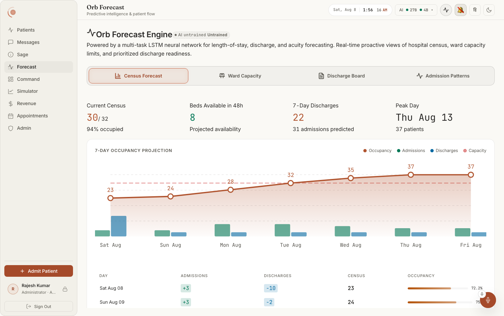
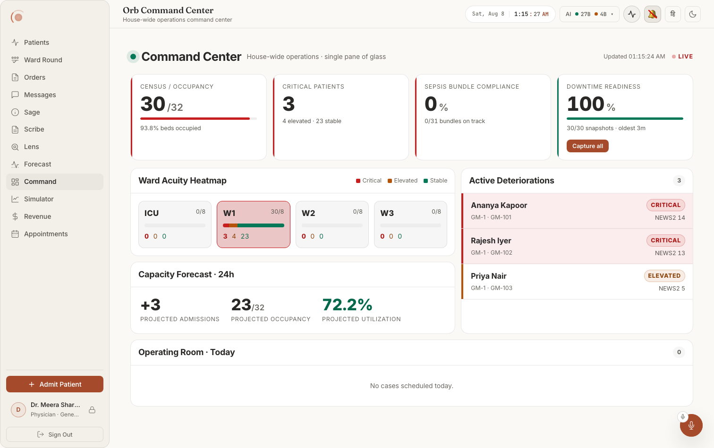
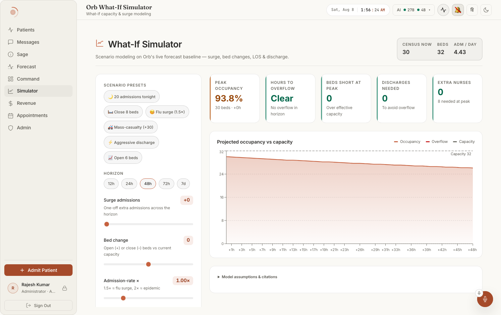
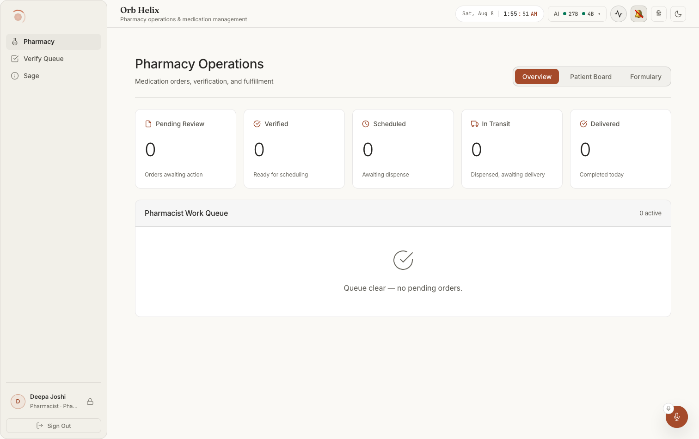
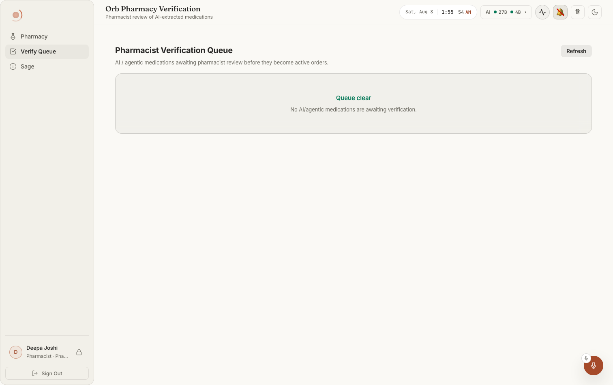
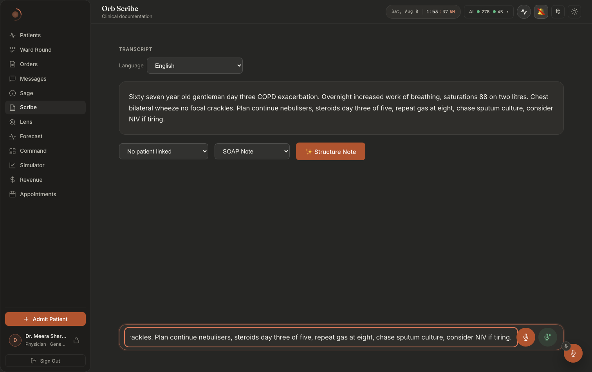
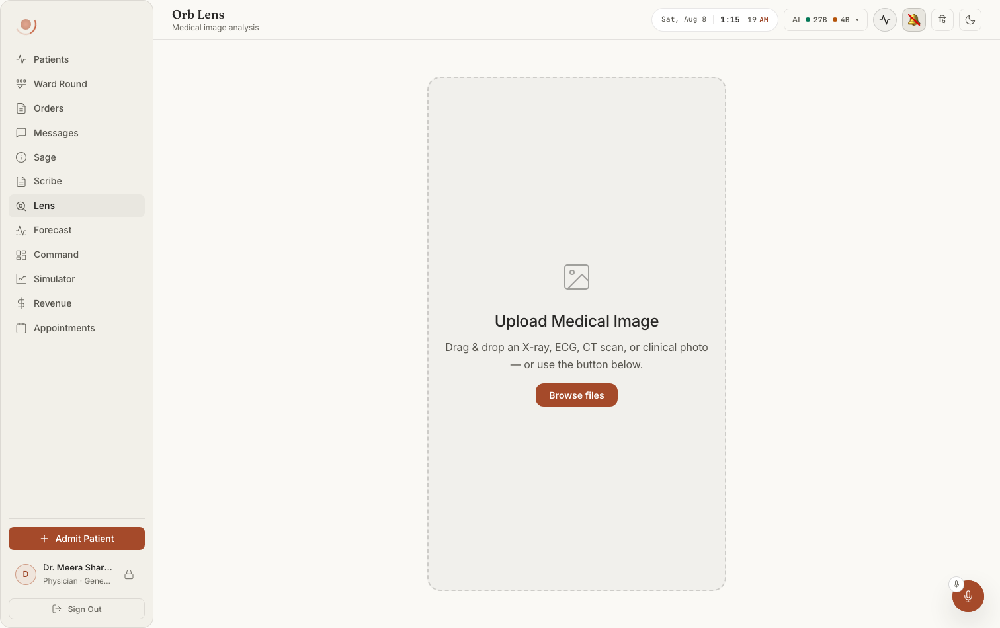
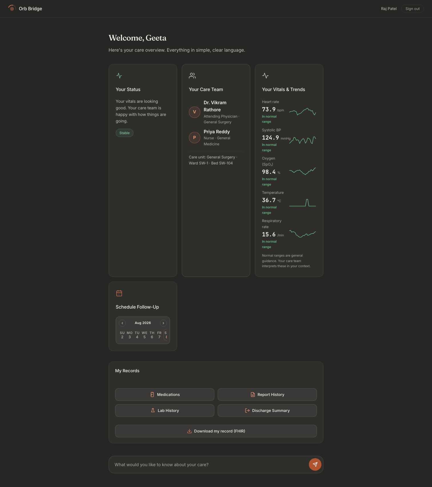

# 15: Forecast, Command Center, Pulse, Helix/Pharmacy, Scribe, Lens, Patient Bridge

The remaining panels, in one pass. Every visible element below names the file and function
that produces it. Depth is lighter than the clinical screens (Vigil / Nurse / Round / Orders),
but every citation was opened and verified at the stated line.

**How to reach each screen.** All of them except Bridge are tabs in the clinician shell,
declared in `src/pages/ClinicianShell.tsx:31` (`TABS`) and mounted in the `shell__body`
section:

| Screen | Tab id | Sidebar label | Mounted at |
|---|---|---|---|
| Forecast | `forecast` | "Forecast" (`shellConfig.tsx:454`) | `ClinicianShell.tsx:843` |
| Command Center | `command` | "Command" (`shellConfig.tsx:463`) | `ClinicianShell.tsx:808` |
| Pulse |, (header icon, not a tab) | heartbeat-line button in the top bar | `ClinicianShell.tsx:822` |
| Helix / Pharmacy | `helix` | "Pharmacy" (`shellConfig.tsx:374`) | `ClinicianShell.tsx:765` |
| Pharmacist Verify Queue | `pharmacy-verify` | "Verify Queue" (`shellConfig.tsx:382`) | `ClinicianShell.tsx:770` |
| Scribe | `scribe` | "Scribe" (`shellConfig.tsx:433`) | `ClinicianShell.tsx:833` |
| Lens | `lens` | "Lens" (`shellConfig.tsx:444`) | `ClinicianShell.tsx:838` |
| Patient Bridge | n/a | separate app shell for `role === 'patient'` | `src/pages/PatientShell.tsx:105` |

Every panel is lazy-loaded and wrapped in `PanelErrorBoundary`, so a crash inside one panel
shows that boundary's fallback instead of blanking the app. While the chunk is still
downloading you see the plain text **"Loading panel..."** (`ClinicianShell.tsx:748`).

---

## What they look like

**Notice the badge beside the title, before you look at the chart: `AI untrained`.** The
panel leads with the fact that the LSTM behind it is not trained, then shows the projection
anyway. The chart's dashed horizontal line is the capacity ceiling; the table below repeats
the same series as numbers with a per-row occupancy meter. (The badge prints its label twice
"untrained Untrained", which is cosmetic; see
[`docs/screenshots/INDEX.md`](../../screenshots/INDEX.md).)

**Notice the Active Deteriorations rail on the right**, named patients with ward, bed and
NEWS2, each row tinted by acuity. That rail is the payload; the four KPI tiles above it are
context. Notice also that the Ward Acuity Heatmap shows four wards of which only W1 has
anyone in it (30/8), and that "Operating Room · Today" is a *labelled* empty section rather
than a hidden one.

**Notice that the inputs are named scenarios first and sliders second**, 20 admissions
tonight, Close 8 beds, Flu surge 1.5×, Mass-casualty +30, Aggressive discharge, Open 6 beds, 
and that the outputs sit in one strip across the top (Peak occupancy, Hours to overflow, Beds
short at peak, Discharges needed, Extra nurses), each with a one-line explanation underneath.
**Model assumptions & citations** is a disclosure at the foot, not a footnote.

**Notice the five counters are the *stages of a dispense*, left to right**, Pending Review,
Verified, Scheduled, In Transit, Delivered, each with its own sub-label ("Orders awaiting
action", "Ready for scheduling", …). The work queue underneath states "Queue clear, no
pending orders" with a tick, rather than rendering an empty table.

**Notice the scope sentence under the title**: this queue holds *"AI / agentic medications
awaiting pharmacist review **before they become active orders**"*. That clause is the safety
boundary the whole screen exists to enforce.

**Notice the three controls between the transcript and the output**: patient link (defaulting
to **"No patient linked"**), note type (SOAP Note), and **Structure Note**. A note can be
structured without ever being attached to a patient, and unlinked is the default.
`doc001-07-scribe-light.png` is the empty state and shows the composer's **two** mic buttons
record and live.

**Notice that the entire panel is one drop target**, and that it names the accepted inputs in
the prompt itself, "an X-ray, ECG, CT scan, or clinical photo". No result state was ever
captured.

**Notice how different the frame is from the clinician shell**: no sidebar, a plain top bar
with the patient's name and Sign out, and a promise in the subtitle, "Everything in simple,
clear language." Every vital carries a sparkline, an "In normal range" label, and the closing
caveat "Normal ranges are general guidance. Your care team interprets these in your context."
(This capture predates 2026-10-03. The card now shows no status label and no colour, and its
closing line reads "Your care team reviews every reading in the context of your condition. If
you feel worse, tell your nurse straight away." See the card section below.)
The records block ends in **Download my record (FHIR)**, and the ask box at the foot is
phrased as a patient would phrase it: "What would you like to know about your care?" This is
the one genuinely full-page capture in the set (1512 × 1706).

> ⚠ Two captures in this chapter record defects: `scribe-02-soap-dark.png` (an empty black
> panel fills the right half of the structured-note area, and a bare `✕` renders on its own
> line under the card title) and `adm001-06-command-light.png` (the Active Deteriorations
> rail says "No active deteriorations. House is stable." beside a tile reading 3 critical
> patients, the doctor's capture of the same screen populates it correctly). See
> [`docs/screenshots/INDEX.md`](../../screenshots/INDEX.md).

---

# SCREEN 1: Forecast

Whole screen: `src/pages/panels/ForecastPanel.tsx` (default export at line 125).
Four server calls fire together on mount and then every 5 minutes
(`fetchAll`, lines 134–158; `setInterval(fetchAll, 300000)` at line 156).

### Hero banner: "Orb Forecast Engine"
**Where:** the full-width card at the very top, with a pulse-line icon on the left.
**Rendered by:** `ForecastPanel.tsx:214-228`; the title text is at line 220, the paragraph at
lines 223–226.
**Data from:** nothing, static copy.
**Change this →** edits the marketing sentence under the title. Deleting the `
` removes the entire banner and the four section pills move to
the top of the page.

### Model provenance chip (next to "Orb Forecast Engine")
**Where:** immediately right of the hero title.
**Rendered by:** `<ProvenanceChip modelKey="forecast_lstm" />` at `ForecastPanel.tsx:221`;
the chip itself is `src/components/ProvenanceChip.tsx`.
**Data from:** a process-wide cached fetch, `loadProvenance()` in `ProvenanceChip.tsx:32`.
**API:** `GET /api/admin/models/provenance` (`ProvenanceChip.tsx:35`).
**Server:** `server/routes/model_governance_service`-backed admin route; the chip reads
`validated` / `checkpoint_present` and maps them through `statusOf()`
(`ProvenanceChip.tsx:53`) to "Validated" / "Unvalidated" / "Untrained".
**Change this →** flipping the registry row to `validated=1` turns the chip from the amber
"Untrained"/"Unvalidated" wording to "Validated". If the provenance request fails the chip
renders nothing at all (the catch at `ProvenanceChip.tsx:41` returns `{}` and deliberately
does not poison the cache, so the next chip that mounts retries).

### Section pills: Census Forecast / Ward Capacity / Discharge Board / Admission Patterns
**Where:** a single rounded bar of four equal buttons under the hero.
**Rendered by:** `ForecastPanel.tsx:231-260`; the four entries are declared inline at lines
237–240 and rendered by the `.map` at 241.
**Data from:** `activeSection` state (`ForecastPanel.tsx:132`), default `'census'`.
**API:** none, pure client state.
**Change this →** the active pill gets `--accent-glow` fill, `--accent-text` label, an inset
glow and a gold outline (lines 250–253); the others are transparent with secondary text.
Clicking swaps which of the four sections below is mounted. Removing an entry from the array
removes both the pill and the ability to reach that section.

### KPI tile: "Current Census"
**Where:** first of four tiles in the Census section's KPI strip.
**Rendered by:** `<MetricCard>` at `ForecastPanel.tsx:267-273`; the `MetricCard` component is
at line 110.
**Data from:** `hospitalData.current_occupancy` over `total_capacity`, sub-line
`current_occupancy_pct`.
**API:** `GET /api/forecast/hospital` (`ForecastPanel.tsx:137`).
**Server:** `forecast_routes.hospital_forecast` (`server/routes/forecast_routes.py:33`) →
`forecast_service.predict_hospital_flow` (`server/services/forecast_service.py:540`).
The number is `len(patients)` for `status = 'admitted'` (line 470/496); capacity is
`TOTAL_CAPACITY = sum(WARD_CAPACITY.values())` (`forecast_service.py:77`).
**Change this →** admitting or discharging a patient moves the big amber number and the
"% occupied" sub-line, but not for up to an hour: `predict_hospital_flow` caches its whole
result for `HOSPITAL_FLOW_CACHE_TTL` (`forecast_service.py:550`), so the panel's 5-minute
refresh usually re-renders the same figures.

### KPI tile: "Beds Available in 48h"
**Where:** second tile.
**Rendered by:** `ForecastPanel.tsx:274-279`.
**Data from:** `summary.beds_available_in_48h`.
**Server:** computed at `forecast_service.py:677` as
`TOTAL_CAPACITY - daily_forecasts[1].predicted_occupancy` (day 2 of the forecast), floored at 0.
**Change this →** the number turns **red** (`--status-danger`) the moment it drops to 2 or
below; above 2 it is green (`--status-ok`), the ternary at line 277.

### KPI tile: "7-Day Discharges"
**Where:** third tile; sub-line reads "N admissions predicted".
**Rendered by:** `ForecastPanel.tsx:280-285`.
**Data from:** `summary.total_predicted_discharges_7d` and `total_predicted_admissions_7d`.
**Server:** summed over the seven daily rows at `forecast_service.py:662` and `:676`.
**Change this →** raising `avg_admission_rate` (driven by the last 30 days of
`admission_history`, `forecast_service.py:577-589`) raises the sub-line number.

### KPI tile: "Peak Day"
**Where:** fourth tile; shows a date label like "Tue Aug 12", sub-line "N patients".
**Rendered by:** `ForecastPanel.tsx:286-291`.
**Data from:** `summary.peak_day` / `summary.peak_occupancy`.
**Server:** `max(daily_forecasts, key=predicted_occupancy)` at `forecast_service.py:663`.
**Change this →** with no forecast loaded the tile shows an em-dash `, ` and "0 patients"
(the `|| ', '` fallback at line 288).

### 7-day occupancy chart
**Where:** the large SVG card under the KPI strip, titled "7-Day Occupancy Projection".
**Rendered by:** `ForecastPanel.tsx:295-399`. The `<svg>` viewBox is at line 308.
Its parts, top to bottom:
- **Grid lines**, four dashed horizontals, `ForecastPanel.tsx:310-313`.
- **Capacity ceiling**, the dashed red horizontal, `capacityLine` memo at line 177, drawn at
  line 316–325.
- **Occupancy area + line**, amber gradient polygon and 2.5px polyline, `occupancyPath` memo
  at line 165, drawn at lines 328–348.
- **Admission bars (green) and discharge bars (blue)**, paired rects per day,
  lines 351–367. Green is `--status-ok` (admissions), blue is `--status-info` (discharges).
- **Data-point dots + value labels**, circles with the occupancy number above each,
  lines 370–382.
- **X-axis date labels**, lines 385–396. The server sends `day_label` as `"%a %b %d"`
  (`forecast_service.py:649`) and the panel drops the weekday token so ticks read "Aug 09".
**Data from:** `hospitalData.daily_forecasts`.
**API/Server:** same `GET /api/forecast/hospital` → `predict_hospital_flow`.
**Change this →** the y-axis auto-scales to `max(total_capacity + 2, max predicted_occupancy)`
(line 168), so raising ward capacity flattens the curve. If `daily_forecasts` is empty both
memos return `''` and the chart renders as bare grid lines with no line, no bars and no labels.

### Chart legend
**Where:** top-right of the chart card, four dotted labels.
**Rendered by:** `ForecastPanel.tsx:298-303`, Occupancy (amber), Admissions (green),
Discharges (blue), Capacity (dashed red).
**Change this →** these are hard-coded spans; changing a legend dot's colour here does **not**
change the chart, the series colours are set separately at lines 320, 343, 361, 364.

### Daily breakdown table
**Where:** directly below the chart, inside the same card.
**Rendered by:** `ForecastPanel.tsx:402-431`. Column headers `Day | Admissions | Discharges |
Census | Occupancy` at lines 406–410; the body `.map` at line 414.
**Data from:** the same `daily_forecasts` rows.
**Change this →** any row whose `occupancy_pct > 90` gets a red tint and a 2px red left border
(line 415), that is the visible "we are about to run out of beds" signal. The Occupancy cell's
mini-bar (the `MiniBar` component at line 94) is amber under 70%, `--status-warn` from 70–90%,
and `--status-danger` above 90% (line 423).

### Ward Capacity cards
**Where:** the "Ward Capacity" section, one card per ward in a responsive grid.
**Rendered by:** `ForecastPanel.tsx:437-513`; the per-ward `.map` at line 440.
**Data from:** `capacity.current[ward]` and `capacity.projected_48h[ward]`.
**API:** `GET /api/forecast/capacity` (`ForecastPanel.tsx:139`).
**Server:** `forecast_routes.capacity_forecast` (`forecast_routes.py:68`) →
`forecast_service.get_bed_capacity_forecast` (`forecast_service.py:688`). Current occupancy is
a per-ward count of admitted patients (line 610); the 48h projection subtracts every patient
whose predicted LoS is `<= 2.0` days (line 628).
**Change this →** the whole card turns red-tinted with a red border the moment
`utilization_pct >= 90` (lines 442, 448–449).

### Ward status badge: "⚠ FULL" / "HIGH" / "OK"
**Where:** top-right of each ward card.
**Rendered by:** `ForecastPanel.tsx:454-462`; the label ternary is at line 461.
**Change this →** `>= 90%` → "⚠ FULL" in danger red; `> 70%` → "HIGH" in warn amber;
otherwise "OK" in green. These thresholds are inline literals, not tokens.

### Bed grid (the little bed icons)
**Where:** the middle of each ward card, one square per bed.
**Rendered by:** `ForecastPanel.tsx:466-485`; `Array.from({length: data.total})` at line 470,
and a bed is "occupied" when its index `i < data.occupied` (line 471).
**Change this →** occupied beds are amber-tinted with an amber bed glyph, free beds green.
Hovering shows the native tooltip "Occupied" / "Available" (the `title` at line 473). This is
**positional, not per-patient**, bed 3 lighting up does not mean bed 3 is the occupied one.

### Ward "Now" / "48h" stats
**Where:** the two-column footer of each ward card.
**Rendered by:** `ForecastPanel.tsx:488-509`.
**Change this →** when the 48h projection frees beds, the "48h" figure turns green and gains a
`↓` arrow (`willFreeUp` at line 443, rendered line 503).

### Capacity totals strip
**Where:** the single wide card at the bottom of the Ward Capacity section, four big numbers.
**Rendered by:** `ForecastPanel.tsx:516-537`: Total Occupied, Available Now, Total Capacity,
Utilization Rate.
**Data from:** `capacity.total`, from `forecast_service.py:758-762`.
**Change this →** the Utilization Rate number flips to red once occupied/capacity exceeds 0.85
(line 531).

### Discharge Readiness board
**Where:** the "Discharge Board" section, a header row plus one row per patient.
**Rendered by:** header `ForecastPanel.tsx:545-550` ("Discharge Readiness, Next 72 Hours" plus
"N patients · Sorted by discharge likelihood"); column header row lines 553–560
(`Patient | Ward/Bed | Days In | Est. Remaining | Discharge Prob. | Trajectory`); rows at
lines 562–588.
**Data from:** `dischargeBoard` state.
**API:** `GET /api/forecast/discharge-board` (`ForecastPanel.tsx:138`).
**Server:** `forecast_routes.discharge_board` (`forecast_routes.py:79`) →
`forecast_service.get_discharge_board` (`forecast_service.py:766`), sorted by
`discharge_probability` descending (line 697). **The route then filters the service's output
to the caller's own department** (`forecast_routes.py:109-114`) and writes a PHI-read audit
entry naming every patient id returned (`log_phi_read`, lines 106–118).
**Change this →** a nurse on W2 sees only W2 patients; an account with no department on record
sees everyone (and the audit line says so explicitly). The **top five rows** get the
`--likely` row modifier (line 563). The trajectory column reads "↗ Improving" (green),
"↘ Worsening" (red) or "→ Stable" (amber) from `acuity_trajectory` (lines 564, 584–586).
"Est. Remaining" turns green at `<= 2` days (line 572). The probability mini-bar is green
above 50% and amber below (line 578). Diagnosis text is truncated at 35 characters with an
ellipsis (line 568).
**Empty state:** there is none, an empty board renders the header and column titles over
blank space with "0 patients" in the subtitle.

### Admission Patterns summary cards
**Where:** three tiles at the top of the "Admission Patterns" section.
**Rendered by:** `ForecastPanel.tsx:598-602`, "30-Day Admissions", "Avg Length of Stay",
"Discharge Rate".
**API:** `GET /api/forecast/admission-patterns` (`ForecastPanel.tsx:140`).
**Server:** `forecast_routes.admission_patterns` (`forecast_routes.py:129`) →
`forecast_service.get_admission_patterns` (`forecast_service.py:837`). `total_30d` is
literally `len(history)` over the whole `admission_history` table (line 773), `avg_daily`
divides that by a hard-coded 30 (line 774), `discharge_rate` is the percentage of history rows
with `discharged` set (line 778).
**Change this →** with an empty `admission_history` table the service returns the all-zero
shape at `forecast_service.py:851-859` and all three tiles read 0.

### "Admissions by Day of Week" bar chart
**Where:** left card of the two-column row in Admission Patterns.
**Rendered by:** `ForecastPanel.tsx:606-626`; bars at lines 614–622.
**Data from:** `patterns.daily_summary` (`forecast_service.py:1233-1243`), Mon→Sun.
**Change this →** the last two bars (index ≥ 5, i.e. Sat/Sun) render in flat
`--bg-glass-hover` grey instead of the amber gradient, and their day label is muted
(`isWeekend` at line 612).

### "Distribution Analysis": By Severity / By Ward
**Where:** right card of that row.
**Rendered by:** `ForecastPanel.tsx:629-654`; severity rows 634–641, ward rows 646–652.
**Data from:** `patterns.severity_distribution` / `ward_distribution`
(`forecast_service.py:911-912`).
**Change this →** severity labels are colour-coded inline: `critical` red, `elevated` amber,
anything else green (line 636). Bars are scaled against `total_30d`, so a large history makes
every bar short.

### Loading state: "Initializing Orb Forecast engine..."
**Where:** replaces the whole panel.
**Rendered by:** `ForecastPanel.tsx:183-192`, with the `.forecast-loading-pulse` element.
**Change this →** shows until the first `Promise.all` settles; `setLoading(false)` runs in the
`finally` at line 150, so it clears on failure too.

### Error state + Retry
**Where:** replaces the whole panel.
**Rendered by:** `ForecastPanel.tsx:194-205`, "⚠ {message}" in danger red with a **Retry**
button that calls `fetchAll` again.
**Change this →** any one of the four requests failing (`res.ok === false` → `API {status}` at
`ForecastPanel.tsx:30`) blanks all four sections, not just the failing one, `Promise.all`
rejects as a unit. A 403 from `require_permission("forecast.read")` therefore shows
"API 403" here.

### Footer disclaimer
**Where:** last line of the panel, small text with an info circle.
**Rendered by:** `ForecastPanel.tsx:663-668`.
**Change this →** this is the honesty statement that the Forecast model is rule-based and not
a validated neural prediction. It renders in every section, always.

---

# SCREEN 2: Command Center

Whole screen: `src/components/command/CommandCenter.tsx` (default export line 56).
One request on mount, then every 20 seconds (`REFRESH_MS = 20_000`, line 22; interval at
line 82).

### Title block: "Command Center" + "House-wide operations · single pane of glass"
**Where:** top-left of the page, with a pulsing dot to its left.
**Rendered by:** `CommandCenter.tsx:159-164`.

### "Updated HH:MM:SS" + LIVE pill
**Where:** top-right of the header.
**Rendered by:** `CommandCenter.tsx:167-170`.
**Data from:** `lastUpdated` state, set on every successful load (`CommandCenter.tsx:100`).
**Change this →** the timestamp only advances when a fetch **succeeds**. If a refresh fails
while a snapshot is already on screen, an extra amber **"reconnecting…"** chip appears to the
left of the timestamp (line 135) and the page keeps showing stale numbers rather than blanking.

### KPI tile: "Census / Occupancy"
**Where:** first of four tiles in the KPI row.
**Rendered by:** `CommandCenter.tsx:228-233`; the value/unit at line 147, the fill bar at 148.
**Data from:** `snap.census.total_admitted` / `total_capacity` / `occupancy_pct`.
**API:** `GET /api/command-center/` (`CommandCenter.tsx:97`).
**Server:** `command_center_routes.get_house_snapshot`
(`server/routes/command_center_routes.py:68`) → `command_center_service.house_snapshot`
(`server/services/command_center_service.py:368`) → `_census_and_acuity`
(`command_center_service.py:125`).
**Change this →** the tile's colour class comes from `pctTone` (line 24): green under 75%,
amber 75–89%, red at 90%+. The bar width is clamped to 100% so an over-capacity ward cannot
overflow the tile.

### KPI tile: "Critical Patients"
**Where:** second tile; sub-line "N elevated · N stable".
**Rendered by:** `CommandCenter.tsx:235-243`.
**Data from:** `snap.acuity.critical / elevated / stable`, tallied in `_census_and_acuity`
(`command_center_service.py:136-142`).
**Change this →** the tile is red whenever `critical > 0` and green otherwise (line 152), 
there is no amber middle state on this one.

### KPI tile: "Sepsis Bundle Compliance"
**Where:** third tile; sub-line "N/N bundles on track".
**Rendered by:** `CommandCenter.tsx:218-222`.
**Server:** `command_center_service._bundles` (`command_center_service.py:232`) →
`sepsis_bundle_service.get_active_bundles`. "Compliant" means the bundle's `on_track` flag is
set, nothing has breached its 1-hour target (line 210).
**Change this →** `complianceTone` (line 30) inverts the usual direction: **high is good**
(≥90% green, ≥70% amber, below that red). With zero active bundles the service returns 100%
(line 211), so an idle hospital reads green.

### KPI tile: "Downtime Readiness" + "Capture all" button
**Where:** fourth tile; sub-line "N/N snapshots · oldest 3.2h".
**Rendered by:** `CommandCenter.tsx:224-243`; the button at lines 170–179.
**Data from:** `snap.downtime_readiness`, from `command_center_service._downtime_readiness`
(`command_center_service.py:269`). "Recent" means a snapshot newer than
`DOWNTIME_RECENT_WINDOW_MIN` = 24 hours (`command_center_service.py:71`). The age string is
formatted by `ageLabel` (`CommandCenter.tsx:77`): minutes under an hour, hours under a day,
then days.
**API (button):** `POST /api/downtime/capture-all` (`CommandCenter.tsx:127`).
**Change this →** clicking swaps the label to "Capturing…" with a spinner and disables the
button (lines 177–178). On success a green note "N snapshots captured" appears beside it and
self-clears after 6 seconds (lines 99–100, 180); the tile then reloads and the percentage
jumps. On failure a red note appears with `role="alert"` (line 181) and does **not** self-clear.
Tone thresholds are `readinessTone` (line 36): ≥80 green, ≥50 amber, below red.

### Ward Acuity Heatmap
**Where:** the large card on the left of the grid below the KPIs.
**Rendered by:** `CommandCenter.tsx:304-355`; the per-ward cell `.map` at line 199.
**Data from:** `snap.acuity.heatmap` (one row per ward from `command_center_service.py:155`),
cross-referenced against `census.by_ward` for the occupancy line (line 200).
**Change this →** each cell shows the ward name, `occupied/capacity` (or `, ` if that ward is
missing from the census), a three-segment stacked bar whose segment widths are the raw
critical/elevated/stable counts used as `flexGrow` (lines 214–216), and the three counts as
bold/plain/italic (line 219). Background intensity comes from `heatIntensity`
(`CommandCenter.tsx:71`), a weighted load of `crit*3 + elev*1.5 + stable*0.4` normalised
against a ceiling of 12, pushed into CSS as `--heat`. Any ward with at least one critical
patient also gets the `--crit` modifier class (line 205). Hovering shows the native tooltip
with the exact three counts (line 207).

### Active Deteriorations list
**Where:** card to the right of the heatmap, with a count badge in its header.
**Rendered by:** `CommandCenter.tsx:318-342`; the count at line 232, rows at 238–250.
**Data from:** `snap.deteriorations`.
**Server:** `command_center_service._deteriorations` (`command_center_service.py:178`), every
patient at `critical` or `elevated`, annotated with a live NEWS2 from their latest vitals via
`vigil_service.compute_news2` (line 177), sorted critical-first then by NEWS2 descending
(line 199). **The route then filters this list to the caller's department**
(`command_center_routes.py:116-129`) and audits the read (lines 131–150). The aggregate tiles
above are deliberately left house-wide; only this list is scoped.
**Change this →** each row is a coloured stripe + name (falling back to the patient id if the
name is null) + "Ward · Bed" (or `, ` when both are missing, line 243) + a level badge + a
"NEWS2 n" chip that reads "NEWS2, " when vitals are missing (line 247). Discharging a patient
or their level dropping to `stable` removes the row and decrements the header count.
**Empty state:** "No active deteriorations. House is stable." (line 236).

### Capacity Forecast · 24h strip
**Where:** the third card in the grid, three big numbers side by side.
**Rendered by:** `CommandCenter.tsx:345-363`: "+N projected admissions",
"N/N projected occupancy", "N% projected utilization".
**Server:** `command_center_service._forecast` (`command_center_service.py:316`), which calls
`forecast_service.predict_hospital_flow(days_ahead=1)` and reads day 1 out of it, the same
cached model that drives the Forecast screen.
**Change this →** the utilization percentage is the only toned number here: `pctTone` again,
so it goes amber at 75% and red at 90% (line 268). If the forecast section is missing its own
capacity the component falls back to the census's capacity (line 264).

### Operating Room · Today table
**Where:** the last card in the grid.
**Rendered by:** `CommandCenter.tsx:415-442`; columns `Time | Procedure | Patient | OR |
Status` at line 288, rows at 291–299.
**Server:** `command_center_service._or_today` (`command_center_service.py:309`), surgeries
whose `scheduled_date` is today (UTC), left-joined to patients for the name, ordered by time.
**Change this →** every cell falls back to `, ` when null. The status cell renders
`status.replace(/_/g,' ')` as its label and takes its colour class from the **first
underscore-separated token** of the status (line 297), so `in_progress` and `in_review` share
one class.
**Empty state:** "No cases scheduled today." (line 284).

### Loading state: "Assembling house-wide operating picture…"
**Rendered by:** `CommandCenter.tsx:142`. Only shown when there is no snapshot yet.

### Error state: "Command Center unavailable." + Retry
**Rendered by:** `CommandCenter.tsx:144-152`, `role="alert"`, with the raw error message
underneath and a Retry button.
**Change this →** this only replaces the page when there is **no** snapshot at all. Once one
has loaded, later failures degrade to the "reconnecting…" chip described above. Note that
`house_snapshot()` never raises, each section falls back to zeros with an `error` note
(`command_center_service.py:386-408`), so this screen is far more likely to show
zeroed tiles than this error page.

---

# SCREEN 3: Pulse

Pulse is an overlay, not a tab: **Season and conditions** for the hospital's state, from the
seasonal calendar built into Orb. Rebuilt on 6 October 2026 under the strictly-offline rule
(ruling R030 in `docs/RULINGS_NEEDED_2026-10.md`). Component: `src/components/PulseWidget.tsx`;
client call `src/api/pulse.ts::fetchPulseSeason`. Everything this screen used to show (alerts,
weather, 7-day strip, AQI, flu, FDA recalls, the location button and the five detail overlays
in `PulseDetail.tsx`, now deleted) is gone. Citations below are by function name because the
rebuilt file was still settling when this was written.

### Trigger button (heartbeat line)
**Where:** the top bar of the clinician shell, next to the alert permission button.
**Rendered by:** `PulseWidget` (`id="btn-pulse"`, tooltip "Pulse: season and conditions");
mounted at `ClinicianShell.tsx:822`.
**Change this →** clicking toggles the panel. There is no badge: nothing in Pulse is an alert.

### Panel header: "Pulse" / "Season and conditions"
**Where:** top of the panel, with an **X** close button on the right.
**Rendered by:** `PulsePanel`. The panel is a modal dialog with a focus trap
(`useFocusTrap`): Escape, the **X**, or a click on the backdrop closes it.
**Change this →** the panel is mounted only while open, so every opening reads the calendar
afresh. There is no polling and no Refresh button: the date changes once a day.

### Place and date line
**Where:** under the header.
**Rendered by:** `PulsePanel` via `placeName`.
**Data from:** `state` and `zone` in the response, and `date` (the hospital's calendar day).
**Change this →** shows "Maharashtra", or "Maharashtra (Konkan)" when the calendar is kept for
one zone of a state; "State not set" when `[site] state` is missing.

### Review status
**Rendered by:** `CalendarStatus`.
**Data from:** `calendar.status`, `reviewed_by`, `reviewed_on`.
**Change this →** "Draft: not yet reviewed by a clinician" for anything other than
`reviewed`, so an unknown status cannot lose the label; "Reviewed by [name] on [date]" once
the clinical lead has reviewed the calendar.

### This season
**Rendered by:** `SeasonBody` and `SeasonCard`, one card per entry in `active`.
**API:** `GET /api/pulse/season` (`server/routes/pulse_routes.py::pulse_season`) →
`server/services/seasonal_calendar.py::season_report`.
**What each card shows:** the title; a **Peak now** chip when `in_peak`; the period in words
(`periodInWords`: "June to September", "15 October to 30 November", "All year"); the summary;
"Typically rises: ..."; and "Source:" or "Sources:" with names only, never links, because
there is no internet to follow them to.
**Empty state:** "Nothing in the calendar covers today."

### Coming up
**Rendered by:** `UpcomingList`, from `upcoming` (entries that start within 60 days,
`seasonal_calendar.UPCOMING_DAYS`).
**Change this →** one line per entry, "Tomorrow: ..." or "In 12 days: ..." (`whenInWords`).
The section is left out when the list is empty.

### State not set
**Rendered by:** `SeasonBody` when `setup_needed` is true.
**Data from:** `setup_message`, which asks for `[site] state = "Maharashtra"` in `site.toml`.
No guess, no geolocation.

### Footer
**Rendered by:** `PulsePanel`: "Built into Orb. Calendar compiled [date]." Hidden while the
state is not set.

### Loading / error states
**Rendered by:** `PulsePanel`: "Loading the seasonal calendar…" while loading; on failure
"The seasonal calendar could not be loaded." with the server's sentence beneath and a
**Try again** button. A missing or refused calendar file is a 503 from the route with
`CalendarError.public_message` ("Pulse's seasonal calendar is not installed on this Orb..." or
"... has errors, so Orb is not showing it. Ask the person who installed Orb to check it."). The
technical detail (the file path and each problem) goes to the server log, not the ward screen.

---

# SCREEN 4: Helix / Pharmacy

Screen shell: `src/pages/panels/HelixPanel.tsx` (default export line 11). Three parallel
requests on mount (`loadData`, lines 23–41).

### Header: "Pharmacy Operations" / "Medication orders, verification, and fulfillment"
**Rendered by:** `HelixPanel.tsx:69-70`.

### View tabs: Overview / Patient Board / Formulary
**Where:** top-right of the header.
**Rendered by:** `HelixPanel.tsx:154-171`.
**Data from:** `activeView` state (line 12), default `'dashboard'`.
**Change this →** the active tab gets `styles.activeTab`; switching swaps which of the three
child components renders (lines 94–102). No refetch happens on switch, all three views read
the same already-loaded `orders` / `inventory` / `catalog` arrays.

### Metric tiles: Pending Review / Verified / Scheduled / In Transit / Delivered / Rejected
**Where:** the bento grid at the top of the Overview view.
**Rendered by:** `src/components/helix/HelixDashboard.tsx:41-48`; the `MetricCard` component is
at line 175.
**Data from:** client-side status filters over `orders` (`HelixDashboard.tsx:25-34`).
"Pending Review" is the sum of `pending + reviewing + substitute_suggested` (line 41).
**API:** `GET /api/helix/orders` (`HelixPanel.tsx:28`).
**Server:** `helix_routes.get_all_orders` (`server/routes/helix_routes.py:50`) →
`helix_service.get_all_orders` (`server/services/helix_service.py:66`), every order joined to
the medication master, the patient, the prescriber and (if set) the substitute drug.
**Change this →** the **Rejected** tile only exists when at least one order is rejected
(line 46) and renders with the critical card styling. Transitioning an order between states
moves the count from one tile to another instantly, because `handleTransitionComplete`
(`HelixPanel.tsx:59`) re-runs `loadData`.

### Pharmacist Work Queue table
**Where:** the main table of the Overview view.
**Rendered by:** `HelixDashboard.tsx:52-122`; columns
`Patient | Medication | Prescriber | Time | Status` at lines 72–76; rows at 80–117.
**Data from:** `activeQueue` = pending + reviewing + substitute_suggested
(`HelixDashboard.tsx:34`); the header shows "N active" (line 55).
**Change this →** the Patient cell is a real `<button>` (line 90), the row's `onClick` is a
mouse convenience only, so this button is the keyboard path into the review modal. The Time
cell normalises a timestamp without a timezone marker by appending `Z` before formatting
(line 109); the Status cell renders the badge from `getStatusBadge`
(`HelixOrderReviewModal.tsx:43`), driven by the `STATUS_CONFIG` map at line 32.
**Empty state:** a green tick and "Queue clear, no pending orders." (`HelixDashboard.tsx:57-66`).

### Fulfillment Pipeline table
**Where:** below the work queue, only when something is in flight.
**Rendered by:** `HelixDashboard.tsx:125-169`; columns
`Patient | Medication | Ward / Bed | Status` at line 137.
**Data from:** `inFlight` = verified + scheduled + dispensed (line 35); header shows
"N in-flight".
**Change this →** the Medication cell prefers `substitute_name` over `medication_name`
(line 157), so a substituted order shows the substitute here. The whole card disappears when
nothing is in flight (the guard at line 125).

### Patient Medication Board
**Where:** the "Patient Board" view.
**Rendered by:** `src/components/helix/HelixPatientBoard.tsx`; columns
`Patient | Medications | Fulfillment | Stock` at lines 78–81; rows at 85–139.
**Data from:** orders grouped by `patient_name` client-side (`HelixPatientBoard.tsx:31-37`).
**Change this →** the **Fulfillment** cell reads "delivered/active", where `active` excludes
rejected orders (`getFulfillmentSummary`, line 45), plus an "N in transit" sub-line when
anything is dispensed. The **Stock** cell sums inventory lots matched **by medication name**
(`checkStock`, line 39) and renders a red "Out of Stock" pill at 0, an amber "Low (n)" pill
below 100 units, and plain "n units" otherwise (lines 125–131). Note the grouping key is the
patient's *name*, so two patients with identical names would merge into one row.
**Empty state:** a people icon and "No active patients with medication orders."
(`HelixPatientBoard.tsx:61-72`).

### Medication Formulary & Inventory table
**Where:** the "Formulary" view.
**Rendered by:** `src/components/helix/HelixFormulary.tsx`; columns
`Medication | Formulation | Available Stock | Active Lots | Status` at lines 49–53.
**Data from:** `catalog` joined to `inventory` by `medication_id` (line 24).
**API:** `GET /api/helix/catalog` and `GET /api/helix/inventory` (`HelixPanel.tsx:28-29`).
**Server:** `helix_routes.get_catalog` / `get_inventory` (`helix_routes.py:35` and `:40`) →
`helix_service.get_medication_catalog` (`helix_service.py:35`) and `get_inventory`
(`helix_service.py:41`).
**Change this →** the Status pill is red "Out of Stock" at 0, amber "Low Stock" under **30**
units, green "In Stock" otherwise (lines 27–28, 76–82). That 30 is a different threshold from
the Patient Board's 100, the same drug can read "Low (45)" on one tab and "In Stock" on the
other. The Active Lots cell lists lot numbers comma-separated, or the literal "None"
(line 72).

### Order Review modal
**Where:** centred overlay, opened by clicking any queue or pipeline row.
**Rendered by:** `src/components/helix/HelixOrderReviewModal.tsx`; mounted at
`HelixPanel.tsx:121-128`.
**Its parts:**
- **Title "Order Review" + close ✕**, lines 115–120. Focus is trapped by `useFocusTrap`
  (line 87), which also wires Escape.
- **Current Status badge**, lines 126–129.
- **Order Details rows**, Patient, Ward / Bed, Medication, Dosage, Frequency, Route,
  Prescriber, and conditionally Substitute and Notes (lines 134–176). Missing values render
  as `, `.
- **Substitute chooser**, a `<select>` of every catalog item except the ordered drug, shown
  **only while status is `reviewing`** (lines 179–196).
- **Pharmacist Notes textarea**, shown for `pending`, `reviewing` and `substitute_suggested`
  (lines 199–212).
- **Action buttons**, from `getNextActions` (line 49): `pending` → Begin Review;
  `reviewing` → Verify / Reject / Suggest Substitute; `substitute_suggested` → Return to
  Review; `verified` → Schedule; `scheduled` → Dispense; `dispensed` → no pharmacy action (the
  ward signs for the drug on the nurse's Deliveries tab under `helix.receive`; a pharmacist
  cannot close their own dispatch). Any other status shows no buttons at all.
**API:** `POST /api/helix/orders/{id}/transition` via `transitionHelixOrder`
(`src/api/client.ts:1895`).
**Server:** `helix_routes.transition_order` (`helix_routes.py:207`) →
`helix_service.transition_order_status` (`helix_service.py:130`), which enforces the legal
transition table (`_is_legal_transition`, line 26) and, on `scheduled → dispensed`, decrements
inventory atomically via `_atomic_dispense` (`helix_service.py:290`).
**Change this →** while a transition is in flight every action button's label becomes
"Processing..." and all are disabled (line 229). "Suggest Substitute" stays disabled until a
substitute is picked (line 227). A rejected transition surfaces its message as red text above
the button row (line 215). On success the modal closes and the whole panel reloads.

### Helix loading / error states
**Rendered by:** `HelixPanel.tsx:95-105`. Loading shows "Connecting to Helix...". A failure
shows a `role="alert"` block headed **"Pharmacy queue did not load."** whose body explicitly
says this is a connection failure and not an empty queue, plus a **Retry** button, the point
being that a silently-empty pharmacist queue is indistinguishable from "nothing to verify".

---

# SCREEN 4b: Pharmacist Verify Queue (separate tab)

Whole screen: `src/components/helix/PharmacyVerifyQueue.tsx` (default export line 174).
Self-contained: takes no props, loads once on mount (`load`, line 183).

### Header: "Pharmacist Verification Queue" + Refresh
**Rendered by:** `PharmacyVerifyQueue.tsx:296-306`. The sub-line reads "AI / agentic
medications awaiting pharmacist review before they become active orders."

### Queue table
**Where:** the body of the page.
**Rendered by:** `PharmacyVerifyQueue.tsx:339-480`; columns
`Patient | Drug | Dose | Route | Frequency | Source | Safety alerts | Actions` at lines 343–350.
**API:** `GET /api/pharmacy/pending` (`src/api/pharmacy.ts:93`).
**Server:** `pharmacy_routes.get_pending` (`server/routes/pharmacy_routes.py:53`) →
`pharmacy_verification_service.list_pending_verification`
(`server/services/pharmacy_verification_service.py:78`).
**Change this →** Dose / Route / Frequency are **editable inputs**, not text. On load, any
value containing "REVIEW" is blanked so the pharmacist types a real value rather than editing
a placeholder (`clean()` at line 193). The Source cell renders "AI extracted" or "Agentic"
(`SourceBadge`, line 153).

### Safety alerts cell
**Rendered by:** `SafetyCell` (`PharmacyVerifyQueue.tsx:129`).
**Change this →** three distinct visual outcomes, and the distinction is the point:
a red outlined **"Screening unavailable"** pill when `screen_failed`; an amber **"Not
screened"** pill when the drug is outside the interaction knowledge base; otherwise the alert
list (`SafetyAlerts`, line 100) coloured severe-red / moderate-amber / muted. A green
"No alerts" is **never** rendered for a coverage gap (the guard at line 146).

### Verify / Reject buttons and the acknowledgement row
**Rendered by:** buttons at `PharmacyVerifyQueue.tsx:394-409`; the expanded acknowledgement row
at 412–474.
**API:** `POST /api/pharmacy/{id}/verify` and `POST /api/pharmacy/{id}/reject`
(`src/api/pharmacy.ts:111` and `:147`).
**Server:** `pharmacy_routes.verify` (`pharmacy_routes.py:59`) and `reject`
(`pharmacy_routes.py:149`) → `pharmacy_verification_service.verify_medication`
(`pharmacy_verification_service.py:126`) / `reject_medication` (line 224). Both write an
audit event (`pharmacy_routes.py:121` and `:162`).
**Change this →** a severe (or failed) safety re-screen comes back **428** and, instead of an
error, the row expands into a red-bordered acknowledgement block: a heading that distinguishes
"screening unavailable" from "severe safety alerts" (line 426), the server's message, the
alert list, and a required free-text reason. "Acknowledge & verify" stays disabled until the
reason is non-empty (line 454). Rejecting uses a `window.prompt` for the reason (line 259) and
aborts if it is blank. A successful verify or reject removes the row and shows a green flash
line "Verified X for Y" (lines 250, 266).

### Verify Queue loading / empty / error states
**Rendered by:** `PharmacyVerifyQueue.tsx:327-338`, "Loading verification queue…" while
loading; a green **"Queue clear"** panel with "No AI/agentic medications are awaiting
verification." when the list is empty; and a red bordered error box above the table
(lines 311–325) for any failure.

---

# SCREEN 5: Scribe

Whole screen: `src/pages/panels/ScribePanel.tsx` (default export line 20).

### Empty state: Orb logo, "Orb Scribe", explainer
**Where:** the centre of the panel before anything has been dictated.
**Rendered by:** `ScribePanel.tsx:268-273`.
**Change this →** shown only while `!transcript && !structuredNote && !recording && !refining`
(line 268). The first character typed into the input replaces it with the Transcript section.

### Transcript section header + live badges
**Where:** above the transcript box.
**Rendered by:** `ScribePanel.tsx:277-293`.
**Change this →** four things can appear beside the word "Transcript":
- a red **"🔴 m:ss"** timer while recording (line 279), driven by the interval at line 131 and
  formatted by `formatTime` (line 263);
- a **"🧠 Refining…"** chip while the Whisper accuracy pass runs (line 280);
- the **live streaming indicator** (lines 281–292), a dot plus the word Speaking / Processing
  / Listening, an audio-level bar whose width is `audioLevel * 100`%, and an utterance count.
  All of that comes from `useStreamingTranscription`
  (`src/hooks/useStreamingTranscription.ts:33`), which talks to the server over Socket.IO
  events `scribe:start_session` / `scribe:audio_chunk` / `scribe:end_utterance` and receives
  `scribe:transcript`, handled in `server/ws/scribe_stream.py` (handlers at lines 168, 195,
  209; emit at line 142).

### Language selector
**Where:** a small labelled `<select>` above the transcript box.
**Rendered by:** `ScribePanel.tsx:294-308`; options English / Hindi (हिन्दी) / Auto-detect.
**Change this →** disabled while recording or refining (line 300). The value is sent as the
`language` form field on the Whisper call, so it sets the language the local engine
transcribes in. (A browser Web Speech live pass, hard-coded to `en-US`, used to run alongside it;
it was removed on 4 October 2026, Orb is strictly offline.)

### Transcript box
**Where:** the bordered card under the header.
**Rendered by:** `ScribePanel.tsx:309-316`.
**Change this →** shows the transcript text; while recording with nothing yet captured it
shows a faded "Recording. The transcript appears when you stop." (there is no interim text:
the browser recogniser that produced it was removed on 4 October 2026); a blinking block cursor `▍` is appended while
recording or refining (line 313). The box auto-scrolls to the bottom on every change
(the effect at line 65).

### Action row: patient select, format select, "✨ Structure Note"
**Where:** below the transcript, only once there is a transcript and nothing is recording.
**Rendered by:** `ScribePanel.tsx:317-340`.
**Data from:** the patient list comes from `getPatients()` on mount (line 40) →
`GET /api/vigil/patients`. Format options are SOAP Note / Discharge Summary / I-PASS Handoff
(lines 326–328).
**Change this →** "No patient linked" is the default option (line 320); picking a patient sets
`patient_id` on the structure request, which is what later scopes the note's ward checks.
The Structure button's label becomes "Processing..." and it disables while a note streams
(line 331). Two extra buttons, **"✨ Admit to Vigil"** and **"View Note"**, appear here only
when a structured note exists *and* its modal is closed (lines 333–338).

### Text input + record button + live-stream button
**Where:** the fixed composer bar at the bottom of the panel.
**Rendered by:** `ScribePanel.tsx:347-377`. The text input is line 348, the mic button 351–362,
the streaming button 363–376.
**Change this →** the mic button's glyph swaps from a microphone to a filled square while
recording, and gains the `--active` class (lines 351–360). Pressing it calls `startRecording`
(line 71), which first claims the shared microphone (Sage panel voice mode and Ward Round
dictation use the same claim; the floating orb never takes it), if Sage holds it, the status line reads "Microphone is in use by Sage, stop it before dictating."
(line 74) and nothing starts. A denied browser permission shows "Microphone access denied."
(line 82). Typing in the input clears any structured note (line 349). The two buttons are
mutually exclusive: each is disabled while the other is running (lines 352, 367), and both are
disabled, with "Voice dictation is not available on this system" as their label, when the
local speech engine is not installed.

### Status line
**Where:** a single line between the output area and the composer.
**Rendered by:** `ScribePanel.tsx:345`.
**Change this →** this is the running narration: "🔴 Recording, speak now…", "🧠 Refining
with medical AI…", "✅ Medical transcription complete", "⚠️ Nothing was transcribed from that
recording. Try again, or type the note.", "⚠️ Transcription failed on this appliance. Try again,
or type the note.", "Recording too short", "Structuring failed: …". Set from a dozen places; the
transcription outcomes are at lines 143–149.

### Structured note modal: "✨ Structured AI Note"
**Where:** an 800px-wide, 80vh-tall centred dialog.
**Rendered by:** `StructuredNoteModal` (`ScribePanel.tsx:625`); mounted at lines 389–436.
Title at line 753.
**API:** `POST /api/scribe/structure`, streamed as SSE (`src/api/client.ts:1134`).
**Server:** `scribe_routes.structure` (`server/routes/scribe_routes.py:423`), it streams the
draft token-by-token from `scribe_service.structure_transcript_stream`, saves the note
**before** verification (`save_scribe_note`, line 466), emits the `done` event with the note id
immediately, then dispatches hallucination verification as a **background task** (lines
489–504).
**Change this →** the note body streams in live with a trailing `▍` cursor while `processing`
(line 774); before any content arrives it reads "Waiting for content...". The close ✕ and the
Close button are disabled while processing or while a clinical action is in flight
(lines 757, 815).

### Note status badge: Draft / Signed / Rejected / Superseded
**Rendered by:** `renderStatusBadge` (`ScribePanel.tsx:675-682`).
**Change this →** "📝 Draft" amber, "✅ Signed" green, "❌ Rejected" red, "📁 Superseded" grey.
Nothing renders while the note is still streaming.

### Verification badge: Verifying… / ⚠ Verification unavailable / ⚠️ Review suggested / ✅ Verified
**Rendered by:** `renderVerificationBadge` (`ScribePanel.tsx:684-719`).
**Data from:** `verificationData`, initially from the SSE `done` event and then from polling.
**API (poll):** `GET /api/scribe/notes/{id}/verification` every 3 seconds, up to
`MAX_POLL_ATTEMPTS = 20` (`ScribePanel.tsx:175`, poller at 187–213).
**API (retry):** `POST /api/scribe/notes/{id}/verify` (`handleRetryVerification`, line 216).
**Server:** `scribe_routes.get_note_verification` (`scribe_routes.py:572`) and
`retry_verification` (`scribe_routes.py:596`). Both go through `_note_in_scope_or_404`
(`scribe_routes.py:516`), which refuses a note whose patient is not on the caller's ward, 
and 404s rather than 403s, deliberately, so a distinct status cannot confirm a patient exists.
**Change this →** while pending, a spinning ring plus "Verifying…". After 20 failed polls the
badge flips itself to "⚠ Verification unavailable" with the message "Verification timed out, 
try again later" (line 195) and an **↻ Retry** button appears next to it. When complete, the
badge is a real `<button>`: green "✅ Verified" and disabled when there is nothing to show;
amber "⚠️ Review suggested ▾" and clickable when there are warnings or omissions. Its
`title` shows the confidence percentage.

### Verification Findings panel
**Where:** an amber block between the header and the note body, only when the warnings badge is
expanded.
**Rendered by:** `ScribePanel.tsx:760-768`.
**Change this →** lists each warning as `[Section] text (type)` and each omission as
`[Omission] text`. Collapsing the badge hides it again.

### Signed banner
**Where:** a green strip under the header once the note is signed.
**Rendered by:** `ScribePanel.tsx:759`, "Signed and finalized, this note is read-only. To
make changes, create a revision."

### Modal action row: Edit / Save / Cancel / Sign & Finalize / Reject / Create Revision / Close / Admit to Vigil
**Rendered by:** `ScribePanel.tsx:808-817`.
**APIs & servers:**
- **Edit → Save**: `PATCH /api/scribe/notes/{id}` → `scribe_routes.edit_note`
  (`scribe_routes.py:681`) → `scribe_service.update_scribe_note_content`; drafts only, 409
  otherwise.
- **Sign & Finalize**: `POST /api/scribe/notes/{id}/sign` → `scribe_routes.sign_note`
  (`scribe_routes.py:745`). This carries the **sign gate**: if the persisted verification
  verdict is blocking (`_verification_verdict`, `scribe_routes.py:717`), the server returns
  **428** and the note cannot be one-click signed without an explicit
  `acknowledge_unverified`. A note with no verification at all is treated as blocking.
- **Reject**: `POST /api/scribe/notes/{id}/reject` → `scribe_routes.reject_note`
  (`scribe_routes.py:831`); a reason is mandatory (400 without one).
- **Create Revision**: `POST /api/scribe/notes/{id}/revise` → `scribe_routes.revise_note`
  (`scribe_routes.py:872`) → `scribe_service.create_revision_from_signed`.
**Change this →** **Sign and Reject are hidden entirely for nurses**, `canSignNote`
(`ScribePanel.tsx:665`) allows only `doctor` and `clinician`, mirroring the backend's
`scribe.sign` / `scribe.reject` permissions, so the buttons are absent rather than failing
after the click. While any action is in flight every button swaps to the flat neutral disabled
pair (`actionBtn`, line 729) and the active one's label changes to "Signing…" / "Saving…" /
"Rejecting…" / "Creating…". A failure renders a red `role="alert"` banner above the row
(line 785), the handlers deliberately throw when the server does not confirm, e.g. "The
server did not confirm the signature, the note is still a draft." (`ScribePanel.tsx:412`).
Rejecting first reveals an inline reason input with Confirm / Cancel (lines 778–784).

### Pipeline timing footer
**Where:** bottom-left of the modal, small muted text.
**Rendered by:** `ScribePanel.tsx:797-806`.
**Change this →** prints only the stages that actually ran, "Pipeline: ASR 3.1s · Draft 8.4s ·
Verify 5.2s". A typed (never-dictated) note has no ASR stage, so that segment is omitted
rather than printing a broken "ASR -s".

### Quick Admission modal
**Where:** opened by "✨ Admit to Vigil".
**Rendered by:** `QuickAdmitModal` (`ScribePanel.tsx:441`); form at lines 574–619.
**Fields:** Patient Name, Age, Sex, Attending Doctor (from the `DOCTORS` constant in
`src/constants.ts`), Ward, Bed Number, Initial Diagnosis.
**Change this →** on open it shows a pulsing "Auto-filling from context..." chip (line 571)
while it asks Sage to extract demographics out of the note as JSON (`extractDetails`, lines
452–495); whatever parses fills the form. Submitting calls `createPatient`
(`src/api/client.ts:1771`) → `POST /api/vigil/patients`. A failure shows the message in a red
`form-msg--error` strip (line 615).

### One-time Bridge credential hand-off screen
**Where:** replaces the Quick Admission form after a successful admission that returned a
temporary password.
**Rendered by:** `ScribePanel.tsx:525-564`.
**Change this →** shows Login ID and One-time password in monospace, a "Copy credentials"
button that flips to "Copied ✓" (line 554), and a **Done** button. There is deliberately no
timer and no backdrop dismissal, the password is unrecoverable once this screen closes. If
the server returns no `temporary_password`, the modal instead shows "Patient admitted
successfully!" and auto-closes after 1.5s (lines 512–513).

---

# SCREEN 6: Lens

Whole screen: `src/pages/panels/LensPanel.tsx` (default export line 10).
Note: this screen has **no image list or gallery**. It is a single-image upload → analyse →
review → file workflow. The stored-analyses endpoint exists
(`GET /api/lens/analyses`, `getLensAnalyses` in `src/api/client.ts:1664`) but the panel only
calls it as a last-resort fallback when the streamed analysis id is missing
(`LensPanel.tsx:92-94`); past reads surface on the patient's Vigil record and on Bridge's
"Lab & Imaging History", not here.

### Dropzone: "Upload Medical Image"
**Where:** fills the panel before any image is chosen.
**Rendered by:** `LensPanel.tsx:117-152`; title at 128, hint at 129.
**Change this →** dragging a file over it adds the `--over` class (line 119). Dropping a
non-image is silently ignored (`file?.type.startsWith('image/')` at line 63). The **"Browse
files"** button (line 136) is the keyboard path, the `<input>` is `sr-only`, visually hidden
but focusable, rather than `hidden`, which would have removed the only entry point to the
whole feature from the tab order.

### Image preview + "✕ Clear"
**Where:** top of the workspace once an image is loaded.
**Rendered by:** `LensPanel.tsx:155-163`.
**Change this →** Clear revokes the object URL and resets image, analysis, assignment form and
analysis id (lines 157–160), returning the panel to the dropzone.

### Controls row: image type, clinical context, "Analyze Image"
**Where:** directly under the preview.
**Rendered by:** `LensPanel.tsx:165-179`. Type options: X-Ray, ECG, CT Scan, MRI, Clinical
Photo, Other (lines 167–172).
**API:** `POST /api/lens/analyze`, multipart, streamed as SSE
(`analyzeLensImage`, `src/api/client.ts:1613`).
**Server:** `lens_routes.analyze_image` (`server/routes/lens_routes.py:88`) →
`lens_service.analyze_image_stream` (`server/services/lens_service.py:63`). The route
validates the upload three ways, extension allowlist (415), magic-byte signature check (415)
and a 25 MB cap (413), then writes the file **encrypted at rest**
(`write_encrypted`, line 142). After the stream ends it saves the row via
`lens_service.save_lens_analysis` (`lens_service.py:146`) and emits the new
`analysis_id` as a final JSON event before `[DONE]` (lines 161–173).
**Change this →** the button's label becomes "Analyzing…" and disables while streaming
(line 177). **If `ORB_LENS_ENABLED` is false the server returns 403** with an explanatory
message (`lens_routes.py:101-107`), which surfaces on screen as the analysis text
"Analysis failed: …" (`LensPanel.tsx:79`), because the panel has no dedicated error region.

### AI Reference Read card
**Where:** below the controls, once analysis text exists.
**Rendered by:** `LensPanel.tsx:181-201`.
**Its parts:** the title "AI Reference Read" (line 185); the pill
**"DRAFT · CLINICIAN REVIEW REQUIRED"** (line 186); a `ProvenanceChip` for `sage_llm` in
compact mode (line 187); the disclaimer paragraph "Decision-support reference for a clinician
**not a diagnosis**…" (lines 189–192); and an **editable textarea** holding the findings
(line 193).
**Change this →** the textarea is the record, `reviewedText` is what gets filed, not the raw
model output. The server also appends its own non-model disclaimer banner
(`LENS_DISCLAIMER_BANNER`, `lens_service.py:18`) to every analysis, so that text arrives inside
the box.

### "📋 Assign to Patient Record" form
**Where:** below the analysis card, after a successful analyse.
**Rendered by:** `LensPanel.tsx:204-301`.
**Its parts:** a patient search input (line 213); a filtered results list of buttons showing
name and bed (lines 232–249) with "No matching patients" when nothing matches (line 251); a
"Selected: Name · Bed X" confirmation strip (lines 256–264); the **clinician-responsibility
checkbox** (lines 266–269); and **Confirm & File to Record** / **Skip** (lines 272–298).
**Data from:** `getPatientsList()` (`src/api/client.ts:1685`), which wraps
`GET /api/vigil/patients`; loaded only after the analysis completes (`LensPanel.tsx:77`).
Filtering is client-side on name or bed (line 108).
**API:** `PATCH /api/lens/analyses/{id}/assign` (`assignLensToPatient`,
`src/api/client.ts:1669`).
**Server:** `lens_routes.assign_to_patient` (`lens_routes.py:238`) → `_assign_analysis`
(`lens_routes.py:29`), which verifies the patient, reassigns the row and reads back the Relay
case-room channel in **one** DB session. It then posts a system message into that channel
(lines 248–271) whose header changes based on whether reviewed text was supplied:
"🩻 Clinician-reviewed AI imaging reference" versus "🩻 AI imaging reference (investigational
not a diagnostic read)".
**Change this →** the Confirm button stays in the flat neutral disabled colours until **both**
a patient is selected and the checkbox is ticked (lines 274–283); it reads "Filing…" while the
request is in flight. Skip just hides the form. The results list only renders while there is a
search term and no patient selected (line 226).

### Assignment result strip
**Where:** replaces the assign form after a filing attempt.
**Rendered by:** `LensPanel.tsx:304-314`.
**Change this →** green-tinted "✓ Report added to {name}'s Vigil record" or red-tinted
"✗ Assignment failed: {message}", the tint is chosen by testing whether the string starts
with "✓" (lines 307–310).

---

# SCREEN 7: Patient Bridge

Whole screen: `src/pages/PatientShell.tsx` (default export line 105). This is a separate shell
for accounts with `role === 'patient'`; every endpoint it touches is self-scoped server-side by
`require_patient_self()`.

### Header: Orb logo, "Orb Bridge", patient name, "Sign out"
**Rendered by:** `PatientShell.tsx:301-322`.
**Change this →** the name shown is `status.patient_name` and falls back to the **account**
name only when no clinical record has loaded (line 315). That single-identity rule is
deliberate: printing the account name beside the record name on a patient portal reads as
"I am looking at someone else's chart".

### Welcome heading
**Rendered by:** `PatientShell.tsx:325-332`, "Welcome, {first name}" plus "Here's your care
overview. Everything in simple, clear language."

### Card: "Your Status"
**Where:** first card in the top card row.
**Rendered by:** `PatientShell.tsx:335-348`.
**Data from:** `status` state, refreshed every 30 seconds (`PatientShell.tsx:251`).
**API:** `GET /api/bridge/status` (`getBridgeStatus`, `src/api/client.ts:1226`).
**Server:** `bridge_routes.patient_status` (`server/routes/bridge_routes.py:88`) →
`bridge_service.get_patient_status_simple` (`server/services/bridge_service.py:114`). The
message text is a fixed three-way lookup keyed by the latest risk level, stable / elevated /
critical, at `bridge_service.py:144-148`; the patient never sees a raw score.
**Change this →** the badge states `statusLevel` in words (Stable / Elevated / Critical) and
is **neutral: no status colour on the badge or the icon** (ruled 2026-10-03, with the vitals
card; until then stable → green, elevated → amber, critical → red). There is no stand-in
level: before the first response, or if the request fails, there is **no badge at all** (it
used to default to "Stable"). The body reads "Loading your status…", then the server message,
or the fallback "Your care team is monitoring you." if the request failed. Pinned by
`src/pages/PatientShell.status.test.tsx`.

### Card: "Your Care Team"
**Where:** second card.
**Rendered by:** `src/components/bridge/CareTeamCard.tsx`.
**API:** `GET /api/bridge/care-team` (`src/api/bridgeClient.ts` → `getCareTeam`).
**Server:** `bridge_routes.patient_care_team` (`bridge_routes.py:260`), the attending
physician from `patients.attending_doctor_id`, plus a best-effort ward nurse (one from the same
department, else any nurse; lines 288–299), plus the care unit.
**Change this →** each member renders as a circular initial (first letter after stripping a
"Dr." prefix, `CareTeamCard.tsx:47`), name, and "Role · Department". The unit footer line
"Care unit: X · Ward Y · Bed Z" only appears when a ward or bed exists (line 58). States:
"Loading…" before the response (line 30), "Unable to load your care team right now." on
failure (line 28), and "Your care team will appear here once assigned." when the list is empty
(line 35).

### Card: "Your Vitals & Trends"
**Where:** third card.
**Rendered by:** `src/components/bridge/VitalsTrendsCard.tsx`.
**API:** `GET /api/bridge/vitals-trends` (`getVitalsTrends`).
**Server:** `bridge_routes.patient_vitals_trends` (`bridge_routes.py:316`), the last 48 vitals
rows (newest first with an `id DESC` tiebreak, then reversed to oldest-first), one entry per
vital in `_PORTAL_VITALS`, each with `current` and a `series` AS CHARTED
(`vital_charting.as_charted`: whole numbers, temperature to a tenth), `measured_at`, and the
series capped at the last 24 points. **No status and no normal range** (ruled 2026-10-03: the
old portal bands called SBP 90, NEWS2 3 points, "In normal range"; see
`server/tests/test_bridge_vitals_no_verdict.py`).
**Change this →** vitals render in a fixed order, heart rate, systolic BP, SpO2, temperature,
respiratory rate, each as label, big mono number (printed with `vitalWhole` /
`vitalTemperature` from `src/lib/vitals.ts`, so a JSON 37.0 still reads "37.0"), unit, and the
time it was measured, or "No recent reading" when the vital was never measured. Nothing is
coloured by value; the sparkline is drawn in `--text-secondary`. The sparkline
(`Sparkline`, line 18) is a 96×28 polyline auto-scaled to that series' own min/max; **with
fewer than two readings it degrades to a single em-dash** (line 19). The footer line "Your care
team reviews every reading in the context of your condition. If you feel worse, tell your nurse
straight away." always renders.

### Card: "Schedule Follow-Up"
**Where:** fourth card in the row.
**Rendered by:** `PatientShell.tsx:355-517`.
**Its parts, in the order they unfold:**
- **Your upcoming appointments**, only when the list is non-empty (line 390); each row shows
  "Aug 12 · 2:00 PM" and the type, with a **Cancel** button (lines 394–408).
- **Week strip calendar**, month/year label with prev/next chevrons (lines 415–423) and seven
  day cells (425–435). Past dates and **every Sunday** are disabled (`isDateDisabled`,
  line 150); today gets the `--today` modifier and the picked day `--selected`.
- **"Pick a time"**, six fixed slots from `TIME_SLOTS` (line 85), revealed once a date is
  chosen (line 440).
- **"Department"**, five buttons with emoji from `DEPARTMENTS` (line 86), revealed once a slot
  is chosen (line 458).
- **"Note for your doctor (optional)"** textarea, revealed once a department is chosen
  (line 477).
- **"Confirm Appointment"**, only rendered when date + slot + department are all set
  (`canBook`, line 245).
**API:** `GET /api/appointments/mine` on mount (`PatientShell.tsx:168`), `POST /api/appointments`
with an `Idempotency-Key` header (line 181), `DELETE /api/appointments/{id}` (line 203).
**Server:** `appointments_routes.my_appointments`
(`server/routes/appointments_routes.py:239`), booked, not-past, own patient only;
`appointments_routes.book_appointment` (line 115), which resolves the patient from the login
and **ignores any patient_id in the body** for a patient caller (line 130), dedupes on the
idempotency key (line 169) **and** on an identical patient/date/time slot (line 183) returning
the existing booking rather than a 409; and `appointments_routes.cancel_appointment` (line 293),
which is a soft cancel and refuses to cancel a `completed` appointment (line 330).
**Change this →** while booking, the button shows a spinner and disables (lines 494–500). On
success the whole card is replaced by an animated tick, the word **"Confirmed"**, the date/time
and type, and a **New** button that resets the form (lines 367–386). A failure shows a red
`role="alert"` line under the button (line 512). Cancelling optimistically removes the row and
then re-fetches to reconcile with the server regardless of outcome (line 208).
Note the client's `bridgeClient.ts` also exposes `/bridge/appointments` helpers, those are
**not** what this card uses.

### "My Records" panel
**Where:** the full-width card below the card row.
**Rendered by:** `PatientShell.tsx:521-559`. Four buttons in a 2×2 grid, **Medications**,
**Report History**, **Lab History**, **Discharge Summary** (lines 525–540), plus
**"Download my record (FHIR)"** (lines 542–555).
**Data from:** `reports` state, loaded once on mount (`loadReports`, line 266).
**API:** `GET /api/bridge/reports` (`getBridgeReports`, `src/api/client.ts:1230`).
**Server:** `bridge_routes.patient_reports` (`bridge_routes.py:143`), four queries scoped to
the patient resolved from the login (`_resolve_patient_id`, `bridge_routes.py:70`): active
medications, the 20 most recent clinical documents, the latest discharge summary, and every
Lens imaging analysis filed to them.
**Change this →** each button opens its modal. The FHIR button is disabled until
`reports.patient_id` exists (line 545) and shows a spinner while downloading; it hits
`GET /api/fhir/patient/{id}/$everything` and triggers a browser download of
`orb-record-{id}.json` (lines 218–227). A failure prints a red line under it (line 556).

### Records modals: Medication History / Clinical Report History / Lab & Imaging History / Discharge Summary
**Rendered by:** `PatientShell.tsx:598-756`, all through the shared `PortalModal` wrapper
(line 22), which supplies Escape, Tab containment, focus restore and a body scroll lock via
`useFocusTrap`.
**Change this →** every list row is a real `<button>` (not a div) so the whole list is
reachable by keyboard. Rows show:
- **Medications**, drug name, "dosage · route · frequency", and a status pill (lines 626–631).
- **Report History**, title and "docType · date" (lines 666–669).
- **Lab & Imaging**, "XRAY, context" and the date (lines 705–709).
- **Discharge Summary**, a single row with a green "Ready" pill (lines 737–748).
**Loading state:** three (or one) shimmering skeleton bars while `reportsLoading`
(lines 610, 655, 694, 733).
**Empty states:** "No medications on record", "No documents on record", "No lab or imaging
reports yet", "No discharge summary available yet." (lines 612, 657, 696, 735).
Closing animates out over 250 ms via `closeModal` (line 123).

### Report detail modal
**Where:** opens on top of a list modal when a row is clicked.
**Rendered by:** `PatientShell.tsx:759-789`.
**Change this →** the title and body switch on `selectedReportDetail.type`: a medication prints
a Drug/Dosage/Route/Frequency/Status block (line 778); a document prints its `content`; a lab
prints its `analysis` or "No analysis available."; a discharge prints its `summary` or "Summary
not available." A meta footer prints the type and timestamp (lines 783–787).

### "Ask" bar and answer card
**Where:** the composer pinned at the bottom of the page, with the answer appearing above it.
**Rendered by:** input and send button `PatientShell.tsx:575-594`; the answer card
`PatientShell.tsx:565-573`.
**API:** `POST /api/bridge/ask`, streamed as SSE (`askBridge`, `src/api/client.ts:1246`).
**Server:** `bridge_routes.patient_ask` (`bridge_routes.py:109`) → `bridge_service.
answer_patient_question` (`server/services/bridge_service.py:171`). **Every question is first
run through a deterministic red-flag screen** (`screen_for_red_flags`,
`bridge_service.py:56`); emergency or self-harm input is short-circuited to a fixed safe
escalation message, an emergency event is emitted (`_emit_emergency_event`, line 75), and the
text is **never** passed to the model (lines 178–186).
**Change this →** Enter sends (line 583); the input and button disable while a request is in
flight. The answer streams into a `<pre>` under an "Orb Bridge" header with the Orb logo. A
connection failure replaces the answer with "Sorry, I couldn't connect to the assistant. Please
ask your nurse or doctor directly." (line 287).

---

## Cross-screen notes worth knowing

- **Permission gate.** Forecast, Command Center and Pulse all sit behind the *same*
  `forecast.read` permission (`forecast_routes.py:32`, `command_center_routes.py:64`,
  `pulse_routes.py::pulse_season`). That permission is held by nurses, which is why the two
  identity-bearing surfaces, the Forecast discharge board and the Command Center
  deterioration list, carry their own department filter and PHI-read audit at the **route**
  layer rather than inside the service.
- **A 403 has no dedicated UI on these screens.** Forecast shows "API 403" in its red error
  block; Command Center shows it as the detail line under "Command Center unavailable.";
  Helix shows it inside "Pharmacy queue did not load."; Lens shows it as analysis text.
- **Caching.** `predict_hospital_flow` caches for an hour, so the Forecast panel's 5-minute
  poll and the Command Center's 20-second poll frequently re-render identical forecast numbers.

---

## Reverse map contributions

- `src/pages/ClinicianShell.tsx::TABS` → Forecast sidebar tab; Command sidebar tab; Pharmacy sidebar tab; Verify Queue sidebar tab; Scribe sidebar tab; Lens sidebar tab
- `src/pages/ClinicianShell.tsx::ClinicianShell` → panel mount points for Forecast/Command/Helix/Verify Queue/Scribe/Lens; Pulse trigger button in the top bar; "Loading panel..." Suspense fallback
- `src/pages/panels/ForecastPanel.tsx::ForecastPanel` → Orb Forecast Engine hero banner; section navigation pills; Current Census tile; Beds Available in 48h tile; 7-Day Discharges tile; Peak Day tile; 7-day occupancy chart; chart legend; daily breakdown table; Ward Capacity cards; ward status badge; bed grid; ward Now/48h stats; capacity totals strip; Discharge Readiness board; Admission Patterns summary cards; Admissions by Day of Week chart; Distribution Analysis panel; Forecast loading state; Forecast error state and Retry; footer disclaimer
- `src/pages/panels/ForecastPanel.tsx::MetricCard` → Current Census tile; Beds Available in 48h tile; 7-Day Discharges tile; Peak Day tile; 30-Day Admissions tile; Avg Length of Stay tile; Discharge Rate tile
- `src/pages/panels/ForecastPanel.tsx::MiniBar` → daily-table occupancy bar; ward Now/48h bars; discharge-probability bar; severity distribution bars; ward distribution bars
- `src/pages/panels/ForecastPanel.tsx::apiFetch` → Forecast error message text ("API 403"/"API 500")
- `src/components/ProvenanceChip.tsx::ProvenanceChip` → Forecast hero provenance chip; Lens AI Reference Read provenance chip
- `src/components/ProvenanceChip.tsx::loadProvenance` → provenance chip label (Validated/Unvalidated/Untrained)
- `src/components/command/CommandCenter.tsx::CommandCenter` → Command Center title block; Updated timestamp and LIVE pill; reconnecting chip; Census/Occupancy tile; Critical Patients tile; Sepsis Bundle Compliance tile; Downtime Readiness tile and Capture all button; Ward Acuity Heatmap; Active Deteriorations list; Capacity Forecast 24h strip; Operating Room Today table; Command Center loading state; Command Center error state and Retry
- `src/components/command/CommandCenter.tsx::pctTone` → Census/Occupancy tile colour; projected utilization colour
- `src/components/command/CommandCenter.tsx::complianceTone` → Sepsis Bundle Compliance tile colour
- `src/components/command/CommandCenter.tsx::readinessTone` → Downtime Readiness tile colour
- `src/components/command/CommandCenter.tsx::heatIntensity` → heatmap cell background intensity
- `src/components/command/CommandCenter.tsx::ageLabel` → "oldest 3.2h" snapshot age text
- `src/components/PulseWidget.tsx::PulseWidget` → Pulse trigger button
- `src/components/PulseWidget.tsx::PulsePanel` → Pulse panel header and close; place and date line; Pulse footer; Pulse loading state; Pulse error state and Try again
- `src/components/PulseWidget.tsx::CalendarStatus` → "Draft: not yet reviewed by a clinician" / "Reviewed by" line
- `src/components/PulseWidget.tsx::SeasonBody` → This season section; Coming up section; "Nothing in the calendar covers today."; state-not-set message
- `src/components/PulseWidget.tsx::SeasonCard` → season card title, Peak now chip, period, summary, Typically rises, Sources
- `src/components/PulseWidget.tsx::UpcomingList` → Coming up lines
- `src/api/pulse.ts::fetchPulseSeason` → the one Pulse request
- `src/pages/panels/HelixPanel.tsx::HelixPanel` → Pharmacy Operations header; Overview/Patient Board/Formulary tabs; Helix loading state; "Pharmacy queue did not load" error block and Retry; Order Review modal mount
- `src/components/helix/HelixDashboard.tsx::HelixDashboard` → Pending Review tile; Verified tile; Scheduled tile; In Transit tile; Delivered tile; Rejected tile; Pharmacist Work Queue table; queue-clear empty state; Fulfillment Pipeline table
- `src/components/helix/HelixDashboard.tsx::MetricCard` → Helix Overview bento metric tiles
- `src/components/helix/HelixPatientBoard.tsx::HelixPatientBoard` → Patient Medication Board table; fulfillment count cell; stock pills (Out of Stock / Low / units); patient-board empty state
- `src/components/helix/HelixFormulary.tsx::HelixFormulary` → Medication Formulary & Inventory table; Available Stock cell; Active Lots cell; formulary status pills
- `src/components/helix/HelixOrderReviewModal.tsx::HelixOrderReviewModal` → Order Review modal; Current Status badge; order detail rows; substitute chooser; pharmacist notes textarea; transition action buttons; transition error text
- `src/components/helix/HelixOrderReviewModal.tsx::getStatusBadge` → order status badges across the work queue, pipeline, patient board and modal
- `src/components/helix/HelixOrderReviewModal.tsx::getNextActions` → Begin Review / Verify / Reject / Suggest Substitute / Return to Review / Schedule / Dispense buttons (a `dispensed` order returns no actions: the ward signs for it on the nurse's Deliveries tab under `helix.receive`)
- `src/components/helix/PharmacyVerifyQueue.tsx::PharmacyVerifyQueue` → Pharmacist Verification Queue header and Refresh; queue table; editable dose/route/frequency inputs; Verify button; Reject button; acknowledgement row; verify-queue loading state; "Queue clear" empty state; verify-queue error box; success flash line
- `src/components/helix/PharmacyVerifyQueue.tsx::SafetyCell` → Safety alerts cell; "Screening unavailable" pill; "Not screened" pill; coverage note
- `src/components/helix/PharmacyVerifyQueue.tsx::SafetyAlerts` → per-alert severity lines
- `src/components/helix/PharmacyVerifyQueue.tsx::SourceBadge` → "AI extracted" / "Agentic" source pill
- `src/pages/panels/ScribePanel.tsx::ScribePanel` → Scribe empty state; Transcript section header; recording timer; Refining chip; live streaming indicator; language selector; transcript box; patient select; format select; Structure Note button; Admit to Vigil button; View Note button; text input; record button; live-stream button; status line
- `src/pages/panels/ScribePanel.tsx::StructuredNoteModal` → Structured AI Note modal; note status badge; verification badge and Retry; Verification Findings panel; signed banner; note body/edit textarea; reject reason input; action error banner; Edit/Save/Cancel/Sign & Finalize/Reject/Create Revision/Close/Admit buttons; pipeline timing footer
- `src/pages/panels/ScribePanel.tsx::QuickAdmitModal` → Quick Admission modal; auto-fill chip; admission form fields; admission error message; one-time Bridge credential hand-off screen; Copy credentials button
- `src/hooks/useStreamingTranscription.ts::useStreamingTranscription` → Speaking/Processing/Listening indicator; audio level bar; utterance count
- `src/pages/panels/LensPanel.tsx::LensPanel` → Lens dropzone; Browse files button; image preview and Clear; image type select; clinical context input; Analyze Image button; AI Reference Read card; DRAFT review-required pill; Lens disclaimer paragraph; editable findings textarea; Assign to Patient form; patient search results; clinician-responsibility checkbox; Confirm & File button; Skip button; assignment result strip
- `src/pages/PatientShell.tsx::PatientShell` → Bridge header and patient name; Sign out button; welcome heading; Your Status card; Schedule Follow-Up card; upcoming appointments list; week strip calendar; time slots; department buttons; note textarea; Confirm Appointment button; booking confirmation view; booking error line; My Records panel; Medications/Report History/Lab History/Discharge buttons; Download my record (FHIR) button; records modals; report detail modal; Ask bar; Bridge answer card
- `src/pages/PatientShell.tsx::PortalModal` → focus trap, Escape handling and scrim for every Bridge modal
- `src/components/bridge/CareTeamCard.tsx::CareTeamCard` → Your Care Team card; member initials avatar; care unit line; care-team loading/error/empty states
- `src/components/bridge/VitalsTrendsCard.tsx::VitalsTrendsCard` → Your Vitals & Trends card; per-vital value and unit; plain-language status word; vitals disclaimer
- `src/components/bridge/VitalsTrendsCard.tsx::Sparkline` → per-vital sparkline (and its em-dash fallback)
- `src/api/client.ts::apiFetch` → data behind Command Center, Helix, Bridge status/reports and appointment calls
- `src/api/client.ts::structureNote` → Structured AI Note streaming body; note id; initial verification badge; pipeline timing footer
- `src/api/client.ts::transcribeAudio` → refined transcript text after recording stops
- `src/api/client.ts::getScribeNoteVerification` → verification badge state during polling
- `src/api/client.ts::signScribeNote` → Signed badge; signed banner
- `src/api/client.ts::rejectScribeNote` → Rejected badge
- `src/api/client.ts::reviseScribeNote` → new draft after Create Revision
- `src/api/client.ts::editScribeNoteDraft` → saved note body after Save
- `src/api/client.ts::analyzeLensImage` → AI Reference Read text; analysis id used by Confirm & File
- `src/api/client.ts::assignLensToPatient` → assignment result strip
- `src/api/client.ts::getPatientsList` → Lens patient search results
- `src/api/client.ts::getPatients` → Scribe patient-link dropdown
- `src/api/client.ts::createPatient` → Quick Admission result and one-time credential screen
- `src/api/client.ts::transitionHelixOrder` → Helix order state changes and badge updates
- `src/api/client.ts::askBridge` → Bridge answer card streaming text
- `src/api/client.ts::getBridgeStatus` → Your Status card text and badge; Bridge header patient name
- `src/api/client.ts::getBridgeReports` → Medications / Report History / Lab History / Discharge modal contents; FHIR button enablement
- `src/api/bridgeClient.ts::getCareTeam` → Your Care Team card contents
- `src/api/bridgeClient.ts::getVitalsTrends` → Your Vitals & Trends card contents
- `src/api/pharmacy.ts::getPendingVerifications` → Pharmacist Verification Queue rows
- `src/api/pharmacy.ts::verifyMedication` → Verify button outcome; 428 acknowledgement row
- `src/api/pharmacy.ts::rejectMedication` → Reject button outcome
- `server/routes/forecast_routes.py::hospital_forecast` → Current Census tile; Beds Available in 48h tile; 7-Day Discharges tile; Peak Day tile; 7-day occupancy chart; daily breakdown table
- `server/routes/forecast_routes.py::capacity_forecast` → Ward Capacity cards; ward status badge; bed grid; ward Now/48h stats; capacity totals strip
- `server/routes/forecast_routes.py::discharge_board` → Discharge Readiness board rows (department-scoped); discharge-board PHI read audit entry
- `server/routes/forecast_routes.py::admission_patterns` → 30-Day Admissions tile; Avg Length of Stay tile; Discharge Rate tile; Admissions by Day of Week chart; Distribution Analysis panel
- `server/services/forecast_service.py::predict_hospital_flow` → Current Census; Beds Available in 48h; 7-Day Discharges; Peak Day; occupancy chart series; daily breakdown rows; Command Center Capacity Forecast 24h strip
- `server/services/forecast_service.py::get_bed_capacity_forecast` → Ward Capacity cards; 48h projection column; capacity totals strip
- `server/services/forecast_service.py::get_discharge_board` → Discharge Readiness board rows and their sort order
- `server/services/forecast_service.py::get_admission_patterns` → Admission Patterns tiles; day-of-week bars; severity and ward distribution bars
- `server/services/forecast_service.py::_get_cached_or_predict` → per-patient predicted remaining days; discharge probability; acuity trajectory
- `server/services/forecast_service.py::_normalize_ward` → ward grouping in capacity cards and ward distribution
- `server/routes/command_center_routes.py::get_house_snapshot` → entire Command Center page; deteriorations department scoping; command-center PHI read audit entry
- `server/services/command_center_service.py::house_snapshot` → all Command Center sections and their zeroed fallbacks
- `server/services/command_center_service.py::_census_and_acuity` → Census/Occupancy tile; Critical Patients tile; Ward Acuity Heatmap cells
- `server/services/command_center_service.py::_deteriorations` → Active Deteriorations rows; NEWS2 chip; critical-first ordering
- `server/services/command_center_service.py::_bundles` → Sepsis Bundle Compliance tile
- `server/services/command_center_service.py::_forecast` → Capacity Forecast 24h strip
- `server/services/command_center_service.py::_downtime_readiness` → Downtime Readiness tile; snapshot counts; oldest-snapshot age
- `server/services/command_center_service.py::_or_today` → Operating Room Today table rows and count badge
- `server/routes/pulse_routes.py::pulse_season` → every Pulse panel section; the 503 error sentence
- `server/services/seasonal_calendar.py::season_report` → place and date line; review status; This season cards and their order; Coming up lines; state-not-set message
- `server/services/seasonal_calendar.py::CalendarError.public_message` → the sentence under "The seasonal calendar could not be loaded."
- `server/site_config/seasonal_calendar.json` → every card's words, periods, peaks and sources; the review record
- `server/routes/helix_routes.py::get_all_orders` → Helix metric tiles; Pharmacist Work Queue; Fulfillment Pipeline; Patient Medication Board
- `server/routes/helix_routes.py::get_catalog` → Formulary rows; substitute chooser options
- `server/routes/helix_routes.py::get_inventory` → Available Stock cell; Active Lots cell; patient-board stock pills
- `server/routes/helix_routes.py::transition_order` → order status badge changes after a modal action
- `server/services/helix_service.py::get_all_orders` → order rows with patient name, ward, bed, prescriber and substitute name
- `server/services/helix_service.py::get_medication_catalog` → Formulary medication and generic name cells
- `server/services/helix_service.py::get_inventory` → lot quantities behind stock pills
- `server/services/helix_service.py::transition_order_status` → legal-transition enforcement behind the modal buttons; transition error text
- `server/services/helix_service.py::_atomic_dispense` → inventory decrement visible as reduced Available Stock after dispense
- `server/routes/pharmacy_routes.py::get_pending` → Pharmacist Verification Queue rows
- `server/routes/pharmacy_routes.py::verify` → Verify outcome; 428 acknowledgement row heading and message
- `server/routes/pharmacy_routes.py::reject` → Reject outcome
- `server/services/pharmacy_verification_service.py::list_pending_verification` → queue row fields including source, screen_failed, interaction_screened, coverage_note and safety alerts
- `server/services/pharmacy_verification_service.py::verify_medication` → severe-acknowledgement gate behind the 428 row
- `server/services/pharmacy_verification_service.py::reject_medication` → row removal after Reject
- `server/routes/scribe_routes.py::transcribe` → refined transcript text; "Recording too short" and refinement failure statuses
- `server/routes/scribe_routes.py::structure` → Structured AI Note streaming body; note id; Draft status; initial Verifying badge; pipeline timing footer
- `server/routes/scribe_routes.py::get_note_verification` → verification badge during polling
- `server/routes/scribe_routes.py::retry_verification` → verification badge after ↻ Retry
- `server/routes/scribe_routes.py::_note_in_scope_or_404` → 404 that hides out-of-ward notes from the verification badge
- `server/routes/scribe_routes.py::edit_note` → saved note body after Save
- `server/routes/scribe_routes.py::sign_note` → Signed badge; signed banner; 428 sign-gate on unverified notes
- `server/routes/scribe_routes.py::_verification_verdict` → whether Sign & Finalize is blocked
- `server/routes/scribe_routes.py::reject_note` → Rejected badge
- `server/routes/scribe_routes.py::revise_note` → new draft after Create Revision
- `server/ws/scribe_stream.py::handle_start_session` → live streaming indicator entering Listening
- `server/ws/scribe_stream.py::handle_audio_chunk` → audio level bar movement
- `server/ws/scribe_stream.py::handle_end_utterance` → Processing state and utterance count increment
- `server/routes/lens_routes.py::analyze_image` → AI Reference Read text; analysis id; 413/415/403 messages surfaced as "Analysis failed: …"
- `server/routes/lens_routes.py::assign_to_patient` → assignment result strip; Relay case-room imaging message
- `server/routes/lens_routes.py::_assign_analysis` → patient name in the success strip
- `server/routes/lens_routes.py::list_analyses` → fallback analysis lookup when the streamed id is missing
- `server/services/lens_service.py::analyze_image_stream` → streamed findings text in the editable textarea
- `server/services/lens_service.py::save_lens_analysis` → the analysis row that Confirm & File updates
- `server/services/lens_service.py::get_lens_analyses` → Bridge "Lab & Imaging History" rows
- `server/routes/bridge_routes.py::patient_status` → Your Status card text and badge; Bridge header patient name
- `server/routes/bridge_routes.py::patient_reports` → Medications / Report History / Lab History / Discharge modal contents; FHIR button enablement
- `server/routes/bridge_routes.py::patient_care_team` → Your Care Team members and care unit line
- `server/routes/bridge_routes.py::patient_vitals_trends` → Your Vitals & Trends values, status words and sparklines
- `server/routes/bridge_routes.py::_resolve_patient_id` → the 404 that produces the Bridge cards' error/empty text for an unlinked account
- `server/routes/bridge_routes.py::patient_ask` → Bridge answer card streaming text
- `server/services/bridge_service.py::get_patient_status_simple` → Your Status message wording; status level shown as the badge word (no colour since 2026-10-03)
- `server/services/bridge_service.py::answer_patient_question` → Bridge answer text
- `server/services/bridge_service.py::screen_for_red_flags` → fixed emergency escalation answer shown instead of a model reply
- `server/routes/appointments_routes.py::my_appointments` → "Your upcoming appointments" list
- `server/routes/appointments_routes.py::book_appointment` → Confirmed view date/time/type; duplicate-slot and idempotent replay behaviour
- `server/routes/appointments_routes.py::cancel_appointment` → appointment row removal; cancel error line
