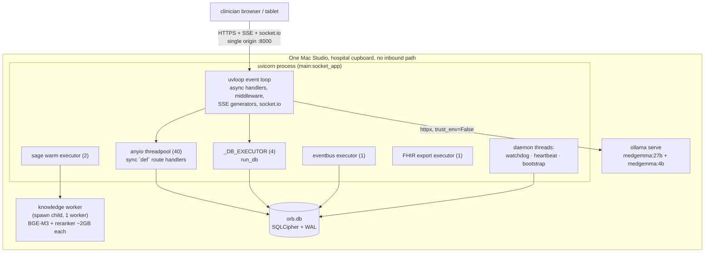
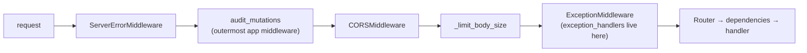
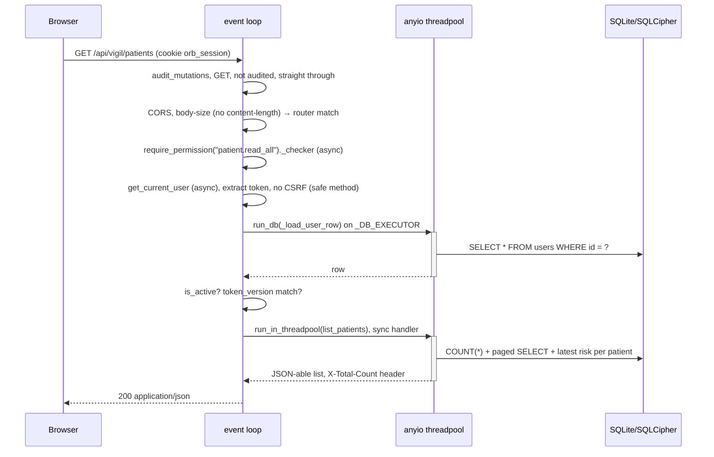
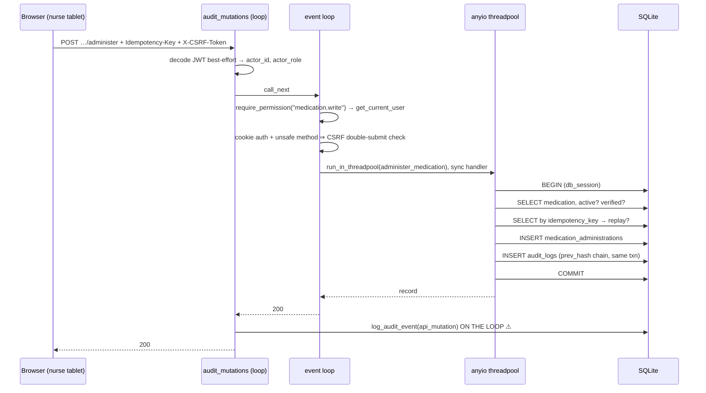

# Chapter 1: Architecture and the Request Lifecycle

*This chapter is the map. Everything later in the manual, Vigil's scoring loop, Sage's
retrieval, the audit chain, the shadow instrument, happens somewhere on the topology
described here, and most of the odd-looking decisions in those chapters are downstream of
three facts established here: there is exactly one machine, exactly one SQLite writer, and
exactly one event loop that must never block.*

Everything below is traced to source. Where the code and the prose documentation disagree,
the disagreement is recorded in §1.11 rather than smoothed over.

---

## 1.1 What Orb is, architecturally

Orb is a **single-process ASGI application plus two helper processes**, running on one
Apple-silicon Mac Studio inside a hospital, serving both the clinical API and the compiled
web UI from one origin, with all data in one SQLite file and all inference on the same box.

Concretely, at runtime an installed Orb is:

| Piece | What it is | Where it comes from |
|---|---|---|
| The API + UI process | one `uvicorn` process running `main:socket_app` | `server/main.py:1113-1126` |
| The knowledge worker | one `spawn`-context child process holding BGE-M3 + a cross-encoder | `server/services/knowledge_worker.py:196-210` |
| Ollama | a separate daemon, reached over loopback HTTP, holding MedGemma 27B and 4B | `server/config.py:82` |
| The database | one SQLite file, optionally SQLCipher-encrypted, plus `-wal`/`-shm` sidecars | `server/config.py:22`, `server/database.py:841-880` |
| The UI | a Vite-built React SPA served as static files by the same uvicorn process | `server/main.py:1030-1073` |

There is no load balancer, no message broker, no cache tier, no second node, and no cloud
dependency of any kind on the clinical path. `socket_app` is a Socket.IO ASGI wrapper around
the FastAPI app (`server/main.py:1078`), so WebSocket traffic and HTTP traffic terminate in
the same process, on the same event loop, sharing the same authentication code
(`server/ws/realtime.py:143-195` re-implements the REST revocation checks deliberately, see
§1.9.3).



The two isolation boundaries in that diagram, the knowledge worker child and Ollama, exist
for the *same* reason, stated twice in the code: heavy model work holds the GIL, and the GIL
is what the event loop needs to answer `/api/health`. `server/services/knowledge_worker.py:6-21`
records the diagnosis in full.

---

## 1.2 Why an appliance

### 1.2.1 The constraint set the decision was made against

Five constraints do most of the architectural work in this repo, and they are worth naming
before the alternatives, because each alternative fails against a specific one:

1. **PHI must not leave the building.** Stated as the product thesis in
   `server/config.py:136-146`: "Orb's thesis is 'PHI never leaves the building': the local
   Ollama/MedGemma instance configured above is the ONLY inference engine, so no model call
   can carry patient data off the box." The one residual egress path, the browser's Web
   Speech API, which streams microphone audio to a cloud ASR, is gated OFF by default
   (`CLOUD_SPEECH_ALLOWED`, `server/config.py:146`) and the frontend reads that posture
   before it will start cloud speech.
2. **No inbound network path.** The pilot's operating model is "on-site only access (no
   inbound remote); outbound no-PHI heartbeat + alerts" (`docs/PILOT_ROADMAP.md:28`). The
   appliance sits behind hospital NAT and nobody can SSH in. This is why observability is an
   *outbound* daemon-thread beacon (`server/services/heartbeat_service.py:1-9`) rather than a
   scrape endpoint.
3. **The buyer is an Indian district hospital CIO with a basic incumbent HIS.** The hospital
   *buys the hardware* (`docs/PILOT_ROADMAP.md:19`), which makes the unit economics a
   licence+hardware sale rather than a per-seat subscription.
4. **One solo operator and a hard Week-13 date** (`docs/PILOT_ROADMAP.md:12,14`).
5. **Clinical safety**: draft-and-approve only, hash-chained tamper-evident audit
   (`server/database.py:428-453`), fail-closed on compliance paths
   (`server/services/audit_service.py:36`).

### 1.2.2 Alternative A: cloud SaaS, multi-tenant

The default shape for a hospital product in 2026: a multi-tenant SaaS with per-hospital data
isolation, GPU inference in a managed region, a thin browser client.

Why it loses here:

* **It is not sellable to this buyer.** India's DPDP regime and, more decisively, the CIO's
  own review process treat "our patients' charts leave our premises" as the first and
  hardest question. Orb's entire security posture document is built on the claim that they
  do not (`docs/SECURITY_ONEPAGER.md`). Once PHI is in a cloud tenancy, every subsequent
  control is a mitigation of a risk the appliance model does not take.
* **It fails on connectivity.** The downtime design in this repo is not theatre: the appliance
  writes hourly local snapshots of every admitted patient (`server/main.py:116-144`,
  `patient_snapshots` at `server/database.py:745-753`) and a nightly FHIR `$everything`
  self-export "so the ward keeps a safe view when the EHR/network/LLM is down, a capability
  cloud-only systems structurally cannot offer" (`server/database.py:741-744`). A district
  hospital's uplink is not a dependency you can put a ward round behind.
* **The economics invert.** MedGemma 27B at ward-level utilisation on rented GPU is a
  recurring cost per hospital forever; a Mac Studio the hospital already bought is a
  one-time cost they own.

What it would have won: horizontal scale, a single deployment to operate, no key-escrow
ceremony, no restore drill, no per-site install runbook. For a one-person team those are
real losses, and §1.2.6 counts them honestly.

### 1.2.3 Alternative B: on-prem server, cloud AI

Keep the database on-prem; call a hosted frontier model for the AI surfaces. This is the
pragmatic compromise most teams take, because it buys a far better model than 27B-on-a-Mac.

Why it loses here:

* **It re-opens the egress question for the highest-value data.** A Sage turn carries the
  assembled patient chart, the most sensitive payload in the system.
* **The repo carries the vocabulary of a hosted lane, but not the lane.** This distinction
  matters and an earlier draft of this chapter got it wrong, so it is worth stating
  precisely. What genuinely existed until 2026-09-04: a fail-closed audit category `ai_egress`
  (`server/services/audit_service.py:36`; removed from the set that day because no call site
  ever emitted it, `ai_inference` took its place) whose comment reserved it for the case where "a
  hosted AI call may only proceed once its per-inference record is durably on the hash
  chain" (`:33-36`), a query-sensitivity classifier that `ai_governance.py:173` calls "an
  egress boundary", and a posture endpoint `GET /api/sage/ai-posture`
  (`server/routes/sage_routes.py:2007`).
  What does **not** exist: any hosted provider (`services/llm_providers.py` defines exactly
  one `ChatProvider`, Ollama), any cloud AI SDK in `server/requirements.txt`, and **any host
  allowlist anywhere in the tree**, grep finds none. `ai_governance.record_inference` hard
  codes `"lane": "local"` (`:307`) with the comment "local IS the only engine" (`:294`), and
  the module docstring at `:4` states outright that there is "no lane a request can take off
  the" appliance. The one real egress switch, `CLOUD_SPEECH_ALLOWED` (`:353`), governs
  *browser speech recognition*, not inference, a different surface.
  So the honest reading is: Alternative B was built, then **removed in July 2026**, leaving
  the governance scaffolding behind. Re-enabling it would be a build, not a configuration
  change. Do not describe those remnants as "switches that are off", a reviewer who greps
  for the allowlist will not find it, and will then reasonably doubt every other claim in
  this manual. (`docs/USER_MANUAL.md` §1.2 carried exactly that overstatement until it was
  corrected on 2026-08-01.)
* **Latency is not obviously better.** The measured local numbers are 2.7–3.2 s to first
  words for non-retrieval questions (`docs/perf/SAGE_SPRINT_2026-07-31.md:244`). A hosted
  call over a district-hospital uplink is not reliably faster, and it is *unavailable*
  exactly when the ward is stressed.

### 1.2.4 Alternative C: hybrid with edge caching

An on-prem cache/edge node that holds recent charts and serves reads, with the system of
record in the cloud and writes replicating up.

Why it loses here:

* **Two systems of record is the failure mode, not the feature.** The moment the edge can
  serve a read the cloud has not confirmed, you own a reconciliation problem in a clinical
  record. Orb's medication administration table is explicitly append-only with corrections
  as new rows (`server/database.py:226-247`) because a faithful history matters more than a
  tidy one; a replicating cache makes "what did the chart say at 03:12" ambiguous.
* **It buys scale Orb does not need.** Two wards, 20–60 beds (`docs/PILOT_ROADMAP.md:11`).
  The 15-minute 60-bed soak passes every SLO with `/api/health` p99 at 41 ms over 1,797
  probes (`docs/PILOT_ROADMAP.md:169-170`). There is no read volume to shard.
* **It triples the operational surface for one operator.**

### 1.2.5 Why the appliance wins, in this system's terms

The appliance is chosen because it converts the hardest sales objection into a structural
property rather than a promise, and because at this scale the thing it gives up (horizontal
scale) is worth nothing. Three specific properties fall out of it that no other option gives:

* **The security story is short.** "The data is on that box, encrypted, and the box has no
  inbound path" is a claim a CIO can verify by walking to the cupboard.
* **Downtime resilience is free.** When the hospital's HIS or network dies, Orb keeps
  working, because nothing it needs is outside the room.
* **Latency is bounded by hardware you control.** Warm models stay warm
  (`server/main.py:352-389` re-warms every 5 minutes and skips the ping entirely when the
  queue is busy), and no request crosses a WAN.

### 1.2.6 What the appliance costs: the honest ledger

* **No horizontal scale.** Every request, every background sweep, every model call, and every
  DB write shares one process and one SQLite writer. The entire §1.7 discipline exists
  because of this. The `db_backend` seam (`server/db_backend.py:24-40`) reserves the escape
  hatch, `ORB_DB_BACKEND=postgres` fails fast with an actionable message rather than
  silently half-working, but it is scaffolding, not a wired path.
* **One machine's failure domain.** The mitigation is a second Mac as a warm standby plus
  rotating encrypted SSDs (`docs/PILOT_ROADMAP.md:24`, `docs/WARM_STANDBY.md`), and the
  roadmap is explicit that this tier "is insurance, designed to never be used"
  (`docs/PILOT_ROADMAP.md:46-50`).
* **Model size is capped by one GPU's unified memory.** MedGemma 27B is ~17 GB resident
  (`server/main.py:1004` notes "a 17 GB teardown"), and the two-tier design exists to stop
  the ambient work from evicting the interactive model (`server/config.py:112-117`). The
  admin unload endpoint exists so an operator can reclaim memory, and it lists exactly
  which clinician-facing features stop working when they do (`server/main.py:901-914`),
  because the alternative is an operator freeing memory and a clinician discovering the
  consequence at a bedside.
* **Every install is a site visit.** Key ceremony, restore drill, roster import, monitor
  integration, all Samuel-lane work with hospital-side dependencies
  (`docs/PILOT_ROADMAP.md:60-65`).

---

## 1.3 Process topology

### 1.3.1 The uvicorn process and uvloop

`main.py` under `__main__` starts uvicorn itself rather than expecting an external command
(`server/main.py:1113-1126`), and `run-orb.sh` simply execs `python main.py`
(`run-orb.sh:43`). Three things are set there and each is load-bearing:

```python
# server/main.py:1113-1126
uvicorn.run(
    "main:socket_app",
    host=HOST, port=PORT,
    reload=is_dev,
    reload_excludes=[str(_SRV / ".venv"), str(_SRV / "uploads"), str(_SRV / "adapters"), "*.db"],
    log_level="info", **ssl_kwargs,
)
```

* **One worker.** `uvicorn.run` is called without `workers=`, so there is exactly one
  process. This is not an oversight: SQLite allows one writer, the Socket.IO presence roster
  is an in-process dict (`server/ws/realtime.py:302-306`, "A single process backs the
  demo/pilot; a multi-process deployment would move this to Redis"), and the LLM admission
  queue is an in-process asyncio primitive (`server/services/llm_queue_service.py:65`).
  Adding a second worker would silently break all three.
* **uvloop.** `uvicorn[standard]==0.34.2` (`server/requirements.txt:2`) pulls in
  `uvloop 0.22.1` (present in the venv), and uvicorn's default `loop="auto"` selects it on
  macOS. It is never named in application code, the only place it surfaces is in the
  post-mortems, where the wedged main thread is described as
  `MAIN (uvloop) uv__run_timers -> PyGILState_Ensure -> take_gil -> cvwait`
  (`server/services/loop_watchdog.py:10-11`).
* **Reload is profile-gated,** and the exclude list is absolute paths, not globs, with a
  precise explanation of why the glob form silently failed: uvicorn's `FileFilter` only turns
  absolute existing directories into `exclude_dirs`; `".venv/*"` stays a right-anchored
  `PurePath.match` that matches only direct children, so "every site-packages `.py` still
  passed the `*.py` include and any pip/uv install triggered a reload storm"
  (`server/main.py:1105-1111`).

**Alternative: asyncio's default event loop.** Not chosen, and effectively not choosable, 
it comes with `uvicorn[standard]` and would have to be actively disabled. uvloop is roughly
2× faster on socket I/O, which matters for the SSE and Socket.IO fan-out. The one cost is
diagnostic: uvloop's C frames do not appear in Python tracebacks, which is why the watchdog
fingerprints the *Python* frames immediately above the C ones instead
(`server/services/loop_watchdog.py:151-172`).

**Alternative: gunicorn with multiple uvicorn workers.** Rejected by the storage model. With
SQLite/SQLCipher there is one writer; N workers would contend the same file lock, and the
2026-08-01 deadlock (§1.7.2) was *caused* by multi-thread open/close churn on that file
inside a single process. Multiplying processes multiplies exactly the wrong thing.

### 1.3.2 The anyio threadpool: where `def` handlers run

FastAPI dispatches a non-coroutine route handler through
`starlette.concurrency.run_in_threadpool` → `anyio.to_thread.run_sync`
(`starlette/concurrency.py:34-36`), whose default capacity limiter is **40 tokens**
(`anyio/_backends/_asyncio.py:3097`). So:

> Every plain `def` route handler in Orb runs on a shared, process-wide pool of at most 40
> threads. Blocking there costs a slot, not the loop.

This is the pool that carries the overwhelming majority of Orb's HTTP surface. Counting
top-level `async def` definitions per route module, **28 of the 40 route modules have none at
all**; `shadow_routes.py` has 18 sync definitions and zero async, `admin_users_routes.py` 11,
`helix_routes.py` 9. Only `vigil_routes.py` (13 async / 13 sync) and the streaming modules
(`sage_routes.py`, `scribe_routes.py`, `relay_routes.py`) are meaningfully async. That ratio is
the convention of §1.7 made visible.

### 1.3.3 The private executors: and why the shared pool was not enough

There are four private `ThreadPoolExecutor`s, each created because sharing was measured to
hurt:

| Executor | Size | Owner | Reason it is private |
|---|---|---|---|
| `_DB_EXECUTOR` | 4 | `server/database.py:1092` | "a background storm cannot drain the shared default executor" (`:1084`) |
| eventbus DB lane | 1 | `server/services/event_bus.py:60` | ordered, single-writer bookkeeping; "an alert burst could occupy every slot in it and stall unrelated work" (`:56-59`) |
| Sage warm compiles | 2 | `server/services/nervous_system_triggers.py:69` | a ward-wide alert storm "parked every default-executor thread in compiles, and unrelated to_thread work, chart opens' risk/trend computation, queued behind them for 10–25 s (measured by `scripts/soak_test.py` at 60-bed census)" (`:61-68`) |
| FHIR self-export | 1 | `server/services/downtime_service.py:342` | a multi-second GIL-heavy `json.dump` job that must not hold DB threads |

The `_DB_EXECUTOR` sizing note is the most instructive, because it argues against both
extremes:

```python
# server/database.py:1080-1086
# Sizing: a SMALL private pool, not one worker and not the asyncio default
# executor. WAL lets readers run concurrently, and writers already serialize on
# SQLite's own lock with busy_timeout=30s: hand-serializing every caller
# behind one thread would convoy interactive reads behind background writes.
```

Four workers is chosen because WAL permits concurrent readers, SQLite already serialises
writers, and a single-worker lane would make an interactive chart read wait behind a
background write for no benefit. The event bus takes the *opposite* choice for the opposite
reason, its delivery ledger depends on ordered execution.

### 1.3.4 The daemon threads

Three daemon threads run outside asyncio entirely, and all three exist because an asyncio
task cannot report on a dead event loop:

* **Loop watchdog monitor** (`server/services/loop_watchdog.py:686-689`). Compares a
  loop-written monotonic beat against wall time and, on a stall, writes a pre-diagnosed
  incident file naming which threads are in the DB layer.
* **Outbound heartbeat** (`server/services/heartbeat_service.py:850`). Blocking stdlib HTTP,
  its own `threading.Event` timer, and it reads the watchdog's `status.json` **from disk**, 
  so it still reports while the loop is starved. The rationale is stated as the load-bearing
  design decision of that module (`server/services/heartbeat_service.py:33-45`): a heartbeat
  that runs as an asyncio task is useless for the freeze case, because the absence of a beat
  is indistinguishable from "the ward's internet is down", which in an Indian district
  hospital is a nightly event, and an alarm that cries wolf every evening gets muted.
* **Bootstrap access check** (`server/services/bootstrap_service.py:699`). Sweeps the staff
  table with bcrypt to answer "is there a login-capable admin" and "is any account still
  holding a shipped demo password". It is on a thread because "bcrypt over the staff table is
  ~minutes on a cold box and must never sit in front of `/api/health`"
  (`server/main.py:461-463`).

Plus a fourth inside the child process: the knowledge worker's parent-death watchdog
(`server/services/knowledge_worker.py:91-98`), which `os._exit(0)`s if its parent PID
changes, a 2–4 GB orphan surviving a dev reload is a named ops hazard in this repo.

### 1.3.5 The knowledge-worker child process

This is the single most consequential isolation boundary in the codebase, and its docstring
is the primary source for the first production freeze:

```
# server/services/knowledge_worker.py:6-14
The BGE-M3 embedder and the bge-reranker cross-encoder are ~2 GB each and run
fp16-on-CPU. … Running them inside the API process (even under
``asyncio.to_thread``) starved the uvloop event loop of the GIL: with the
vitals simulator generating critical alerts (each one triggers a guideline
prefetch), ``GET /api/health`` timed out for MINUTES and SIGTERM was ignored
(a starved loop cannot run its signal handlers). Diagnosed 2026-07-30 with
macOS ``sample``: main thread stalled in ``take_gil``, hot frames in
``tokenizers.abi3.so`` / libomp.
```

The mechanism is worth being precise about, because it is *not* the naive "blocking call on
the loop" story. `asyncio.to_thread` was already being used. The problem is that the HuggingFace
Rust tokenizer and torch hold the GIL for most of their wall time, so moving them to a thread
moved the *call* off the loop but not the *GIL contention*. The loop thread then could not
acquire the GIL to run at all, hence `take_gil` in the dump, and hence SIGTERM being ignored
(signal handlers are Python code and need the GIL).

The fix is a process, not a thread: `ProcessPoolExecutor(max_workers=1, mp_context=spawn,
initializer=_worker_init)` (`server/services/knowledge_worker.py:206-208`). Callers block only
their worker *thread* on `fut.result(timeout=…)` (`:245`), and a thread waiting on a future
releases the GIL.

Four details that matter for reimplementation:

1. **`spawn`, never `fork`** (`:203-205`): "the API process runs an event loop + threads, and
   forking that is undefined behaviour city." A forked child inherits the loop's fds and any
   lock held at fork time by a thread that does not exist in the child.
2. **The module top stays import-light** (`:32-33`), because the spawn child imports this
   module and anything imported here runs in both processes.
3. **Native thread caps in the initializer** (`:74-83`): `OMP_NUM_THREADS=4`,
   `TOKENIZERS_PARALLELISM=false`, `torch.set_num_threads(4)`, "on an appliance already
   running Ollama that oversubscribes the box."
4. **Bounded restart budget** (`:190-257`): a `BrokenProcessPool` costs one of two restarts,
   after which the worker is disabled and every caller degrades to lexical-only retrieval.
   The failure is *always* `KnowledgeWorkerError`, never a silent empty result, so the
   degradation is a documented path rather than a mystery.

Generous timeouts (420 s for both embed and rerank, `:49-50`) are justified on exactly this
basis: "A slow worker blocks only the calling thread, never the event loop, so patience is
cheap."

**Alternatives.** *In-process threads* was the status quo and is what broke; it survives only
as `ORB_KNOWLEDGE_INPROCESS=1` for tests and constrained environments (`:57-58`), and the test
suite sets it by default (`server/tests/conftest.py:32-34`) because spawning a 2 GB model child
per test session is slow and meaningless for those assertions. *A long-lived daemon with a
socket protocol*, the shape `whisper_daemon.py` uses, was the acknowledged model ("the same
isolation philosophy as `whisper_daemon`", `:16-17`) but `ProcessPoolExecutor` gets the same
isolation with no protocol to write, which for a solo builder on a hard date is the right
trade. *Moving embeddings to Ollama* would have avoided the second process entirely, but the
retrieval quality bar is set by BGE-M3 and the reranker, and swapping the embedder changes
retrieval behaviour in a system whose grounding is being measured (`docs/perf/SAGE_SPRINT_2026-07-31.md:112-125`).

### 1.3.6 Ollama as a separate process

Ollama is never embedded; it is reached over loopback HTTP at `OLLAMA_BASE_URL`
(`server/config.py:82`, default `http://localhost:11434`). `run-orb.sh:27-31` will start it if
it is not already answering, and treats it as optional at boot, "the app degrades to errors on
AI calls without it".

Two configuration facts shape everything downstream:

* **Model resolution happens at import time, over the network.** `_resolve_llm_model`
  (`server/config.py:87-111`) does a 2-second `urllib.request.urlopen` against
  `/api/tags` and falls back to any installed `medgemma` variant if the configured name is
  not pulled. The reason is stated: "Modules `from config import LLM_MODEL` by value, so this
  must resolve at import time, a missing model otherwise 404s every AI feature (Sage, Lens,
  Vigil analysis) with no visible error in the UI." The cost is that **importing `config` performs
  network I/O**, which is why `loop_watchdog` refuses to import it: "does NOT import config
  (config import has side effects: it probes Ollama)" (`server/services/loop_watchdog.py:197-199`).
* **Two tiers, one GPU.** `LLM_MODEL` (27B interactive) and `AMBIENT_LLM_MODEL` (4B background)
  default to the same model and are separated by operator config
  (`server/config.py:111-117`). They are separate Ollama runner processes with separate KV
  caches, a fact that killed a plausible latency theory (§1.7.2).

Admission to the single GPU is controlled in-process by `PriorityLLMQueue`
(`server/services/llm_queue_service.py:65`), which runs two independent lanes, a bounded
interactive semaphore of 1 and a background priority queue of 1, over a ref-counted GPU gate
shared with in-process torch/MLX work (`server/services/gpu_coordinator.py:16-24`). The
measurement that forced the two-lane design is recorded verbatim: with a single non-preemptive
slot, "a clinician's question sat **31 s** in this queue before generation began, against a
model that decodes the answer in ~2 s" (`server/services/llm_queue_service.py:68-76`).

### 1.3.7 Threads vs processes vs async, as actually decided here

The repo does not have one answer; it has a rule per workload class, and each is defensible:

| Workload | Mechanism | Why not the others |
|---|---|---|
| HTTP handlers doing SQLite | `def` handler → anyio threadpool | async would put SQLCipher page I/O on the loop; a process per request is absurd |
| SQLite from async code (SSE, socket handlers, background loops) | `run_db` → private 4-thread pool | the work releases the GIL in C (SQLite), so threads are sufficient |
| Embedding / reranking | spawn child process | threads do **not** help, the GIL is held in Python/Rust extension code (§1.3.5) |
| LLM inference | separate daemon (Ollama), HTTP | already a process; nothing to decide |
| Whisper streaming | separate daemon over IPC (`server/config.py:290`) | same GIL argument as embeddings |
| Liveness observation | OS daemon threads + a C-level timer | asyncio cannot observe a dead asyncio |

The generalisable rule the codebase converged on: **threads for work that releases the GIL in
C; processes for work that does not.** SQLite and HTTP release it; tokenizers, torch and
`sqlite3_close_v2`-on-this-SQLCipher-build do not (§1.7.2).

---

## 1.4 Boot: `main.py` from top to bottom

### 1.4.1 Import time, before anything is served

Import-time work in `main.py` is small but not zero, and the order matters:

1. **`faulthandler.register(signal.SIGUSR1)`** (`server/main.py:11-14`), wrapped in a
   try/except that swallows platform failures because it is "purely diagnostic, never fatal".
   This single line is the reason three production incidents have Python stack evidence:
   `kill -USR1 <pid>` dumps every thread's stack without killing the process.
2. **Logging config** at INFO with a fixed format (`:17-20`).
3. **`from config import …`** (`:25`), which, as noted, probes Ollama over the network and
   may `raise ValueError` and abort the boot (§1.8).
4. **Forty route module imports** (`:31-71`). These transitively import most services, so
   most of the process's memory footprint and most import-time side effects land here.
5. **`from ws.realtime import sio`** (`:75`), which constructs the Socket.IO server and, at the
   bottom of that module, imports `ws.scribe_stream` for its event registrations
   (`server/ws/realtime.py:491`).

### 1.4.2 The lifespan, in execution order

`lifespan` (`server/main.py:185-546`) is an `asynccontextmanager`; everything before `yield`
(`:506`) runs before uvicorn accepts traffic. Two categories are visible in the code and the
distinction is the whole design:

**Synchronous, on the critical path** (the API does not answer until these finish):

| Step | Line | Notes |
|---|---|---|
| `init_db()` | `:189` | schema + every additive migration + versioned migrations + `chmod 0600` |
| register nervous-system triggers | `:196-200` | event-bus subscriptions |
| register ward narrator | `:205-209` | plus its idle loop as a task |
| `event_bus.start_replay_poller()` | `:215-218` | started **after** all subscribers register, "so replay can find their callbacks" |
| `init_helix_db()` | `:221-224` | non-fatal |
| `refresh_formulary_terms_from_db()` | `:233-237` | read **once**, here, because the mutation gate "runs inline on the event loop for every Sage turn and must stay a pure function (a sync SQLite read on the loop is the known wedge class)" |
| `seed_terminology()` | `:241-244` | LOINC/SNOMED/ICD-10 for CPOE validation |
| `interaction_db.ensure_seeded()` | `:248-251` | drug–drug interaction pairs |
| `reconcile_stale_pending_verifications()` | `:255-258` | repairs Scribe jobs orphaned by a crash |

Every one of these is wrapped in `try/except` that logs a warning and continues. `init_db()`
is the sole exception, it is not guarded, so a schema failure aborts the boot. That is the
right asymmetry: a half-migrated PHI database should not serve traffic, but a missing drug
interaction seed should not stop a ward from working.

**Deliberately off the critical path** (spawned as tasks or threads and awaited by nobody):

| Step | Line | Why it is off the path |
|---|---|---|
| clinical knowledge base init | `:266-273` | "on a corpus change this embeds the whole corpus (now inside the knowledge worker subprocess), and the API must answer `/api/health` while that happens", until it finishes, "Sage retrieval simply degrades (lexical-only or LLM-only), which every caller already handles" |
| LLM warmup + keep-warm loop | `:388-389` | a 27B cold load is ~a minute; warmup acquires the queue at **priority 5**, the lowest, so it defers to everything |
| torch checkpoint warmup | `:395-405` | "their lazy first load (3× `torch.load` + MPS device init) was measured at ~12 s by the soak harness, paid by whichever clinician opened the FIRST patient chart after boot" |
| voice agent warmup | `:408-419` | MedGemma 4B into unified memory |
| Sage proactive sweep | `:422` | sleeps 8 s first, then every 15 s |
| downtime snapshot sweep | `:423` | sleeps 30 s first, then hourly |
| shadow negatives sweeper | `:435-441` | see below |
| loop watchdog | `:451-457` | started **LAST**, on purpose |
| bootstrap access check | `:468-471` | own daemon thread; bcrypt is minutes |
| outbound heartbeat | `:480-483` | own daemon thread |
| vitals sources | `:490-496` | `start_all` never raises |

Three of these deserve individual attention.

**The shadow sweeper's comment is a design lesson in itself:**

```
# server/main.py:426-434
# THE NEGATIVES DO NOT EXIST UNTIL THIS LOOP RUNS. Nothing in Orb writes a
# row when an alert is never opened, a Sage proposal is never actioned or an
# episode simply ends … Without it the scorecard silently scores the successes
# only, which is the single most flattering failure mode the instrument has.
# … asserted by tests/test_shadow_producers.py: a docstring claiming
# "registered from main.py's lifespan" is what let its absence pass review once already.
```

That last clause is the reason this manual's Rule 1 exists. A prose claim of registration had
previously substituted for the registration.

**The watchdog is started last** so "a slow first boot is never mistaken for a stall"
(`server/main.py:449-450`), the synchronous seeds above can legitimately take tens of
seconds on a cold box, and a watchdog that fires during boot is a watchdog that gets disabled.

**The warmup prompt is not "hi".** `_warm_one` (`server/main.py:280-337`) sends Sage's *own*
system prompt for the primary tier, because llama.cpp restores only exact prompt matches on
this build: "6.9 s cold vs 0.4 s warm, the difference between missing and meeting the ≤5 s
first-words bar on question one" (`:286-288`). The comment goes further and names the
failure mode of getting it wrong: priming with a *different* system prompt actively **evicts**
the one Sage is about to use, and since the heartbeat repeats every 5 minutes, a mismatch
means the clinician pays a cold prefill on most turns (`:291-298`). The corroborating
measurement is in `docs/perf/SAGE_SPRINT_2026-07-31.md:31-38` and `:155-156`.
`num_ctx: 4096` is also explicit, because without it Ollama loads at the model default, 
128K for medgemma, "which ballooned the 4B runner to ~10 GB and OOM-pressured the box"
(`server/main.py:319-323`).

**Background tasks are held by strong reference.** `_BG_TASKS` plus `_spawn`
(`server/main.py:87-95`) exists because "the event loop keeps only a WEAK reference to a task,
so a task whose `create_task()` result is dropped can be garbage-collected mid-execution, the
loops below would then stop silently (no exception, no log line)."

### 1.4.3 Shutdown, and why the order is what it is

After `yield` (`server/main.py:506`), teardown runs in a deliberately non-obvious order
(`:508-546`):

1. **Disarm the watchdog first**, "an orderly shutdown drains the loop, and a dead-man timer
   still armed through that drain would write a dump for a stall that never happened."
2. **Stop the heartbeat**, "a 'healthy' beat sent while the process is on its way down is a
   lie an operator would act on."
3. **Stop and reset the vitals registry**, before the generic task cancellation, because "a
   monitor feed holds a bound TCP port, and leaving it open across a reload is what turns
   'restart Orb' into 'port already in use' on the appliance."
4. **Cancel and gather all lifespan tasks** (`:536-538`).
5. **Reap the knowledge worker child** (`:539-545`) "so reloads/shutdowns never leave an
   orphaned 2-4 GB model process holding memory."

Each step is a specific bug that happened once.

---

## 1.5 The middleware stack: its real order, not its written order

Starlette's `add_middleware` inserts at position 0 of `user_middleware`
(`starlette/applications.py:131`), and the stack is built by iterating that list in reverse.
**The last middleware registered is the outermost.** `main.py` registers, in source order,
`_limit_body_size` (`:579`), `CORSMiddleware` (`:612` or `:621`), `audit_mutations` (`:634`),
so the actual runtime nesting is:



Consequences worth knowing:

* **Audit sees the final status, including CORS rejections and unhandled 500s.** The audit
  middleware logs inside a `finally` with `status` defaulted to 500
  (`server/services/audit_middleware.py:61-86`), so a handler that raises an unhandled
  exception is still audited, the exception then propagates out to `ServerErrorMiddleware`.
* **The body-size 413 still gets CORS headers,** because CORS wraps it.
* **`@app.exception_handler(json.JSONDecodeError)`** (`server/main.py:565-567`) fires in
  `ExceptionMiddleware`, i.e. innermost, so its clean 400 is what audit records. It exists
  because "several routes call `await request.json()` directly; a malformed body raises
  `json.JSONDecodeError` which would otherwise surface as a 500" (`:557-559`).
* **Both custom middlewares are `BaseHTTPMiddleware`**, whose `dispatch` runs on the event
  loop. `_limit_body_size` is pure header arithmetic (`server/main.py:580-591`) and
  `audit_mutations`' own work is a best-effort JWT decode plus a `log_audit_event` call, and
  that call is a **synchronous SQLite write executed on the event loop**. See §1.7.5; this is
  a known, deliberate-looking exception to the repo's own rule that nothing in this chapter
  can explain away.

### 1.5.1 CORS, and the one response header that had to be exposed

CORS is profile-split (`server/main.py:611-628`): `prod` uses the configured origin list with
`allow_credentials=True`; dev uses `["*"]` with `allow_credentials=False` (which the CORS spec
requires). Both expose one response header:

```python
# server/main.py:598-609
_EXPOSE_HEADERS = [MFA_ENROLL_TICKET_HEADER]
```

The comment is a good example of the class of bug that only appears off the happy path:
`allow_headers` governs *request* headers and does nothing for reading response headers, so
without an explicit expose list `fetch()` silently returns `null`. The header in question
carries the MFA self-enrolment ticket, which "is the only way an account in
`ORB_MFA_REQUIRED_ROLES` with no TOTP factor can ever enrol, and on a fresh appliance that
account is the FIRST AND ONLY admin." Single-origin worked by accident; the Vite dev server on
:5173 did not, and the failure was invisible. The client-side half is at
`src/api/client.ts:194-202`, which lifts the header off the `Response` before `apiFetch`
discards it, and the comment there says the omission "hard-locked the first (and only) admin
out of a fresh appliance, with no second admin to 'contact'."

### 1.5.2 CSRF is *not* middleware, on purpose

There is a conspicuous absence: no CSRF middleware. The comment at `server/main.py:637-642`
explains that the check lives inside `auth.get_current_user`, "the single point every
session-protected route passes through, so it fires ONLY for requests actually authenticated
by the session cookie, and never falsely blocks public/alt-auth endpoints (discharge access,
X-API-Key ingestion) that a logged-in clinician's browser might POST to while carrying a
session cookie."

This is the right call and worth generalising: a middleware sees *requests*, but the security
property here is a function of *how the request was authenticated*, which is only known after
the auth dependency runs. The implementation is the standard double-submit
(`server/auth.py:79-87`), with `hmac.compare_digest`, and bearer-authenticated requests are
exempt because an explicit header cannot be forged cross-site (`server/auth.py:192-199`).

---

## 1.6 The request lifecycle, traced three ways

### 1.6.1 Trace 1: a simple read: `GET /api/vigil/patients`

The ward board. The most-hit clinical endpoint in the product.



Step by step, with anchors:

1. **Middleware.** `audit_mutations` computes `should_audit` as
   `method in {"POST","PUT","PATCH","DELETE"} and path.startswith("/api/") and path not in _SKIP_PATHS`
   (`server/services/audit_middleware.py:49-56`); a GET short-circuits to `await call_next`.
   Read-only GETs are "intentionally not logged here (too high-volume, and reads are better
   audited at the sensitive-endpoint level)" (`:11-13`). This is a real coverage gap, taken
   knowingly: PHI *reads* through the ordinary API are not on the generic audit trail. The
   two places PHI reads *are* audited are the media route (§1.6.2's fail-closed pattern,
   `server/main.py:759-779`) and route-level events in individual modules.
2. **Routing.** `vigil_router` was included at `server/main.py:647`, well before the SPA mount
   at `:1072`, so `/api/…` can never be shadowed by static files.
3. **Dependency resolution, on the event loop.** `require_permission("patient.read_all")`
   returns an `async def _checker` (`server/permissions.py:214-217`) which itself depends on
   `get_current_user` (`server/auth.py:185`). FastAPI awaits async dependencies on the loop.
4. **Token extraction and CSRF.** `_extract_token` prefers the `Authorization: Bearer` header
   and falls back to the `orb_session` cookie (`server/auth.py:95-104`). Because the method is
   GET, the CSRF branch at `:198` does not fire.
5. **The one DB read every authenticated request pays.** `await run_db(_load_user_row, user_id)`
   (`server/auth.py:210`). The comment is the clearest statement of the whole convention:

   ```python
   # server/auth.py:206-209
   # Off the loop. This is the single highest-traffic blocking call in the
   # process: every authenticated request pays it, and since encryption at
   # rest each page read also costs HMAC-SHA512 + AES, so on the loop it
   # serialises the whole API behind one SQLite lock.
   ```

   `_load_user_row` is deliberately **one session, one statement** (`server/auth.py:165-182`):
   three decisions (exists / `is_active` / `token_version`) are made from the same snapshot,
   because splitting the read would put an `await` between them and let an admin deactivation
   or a logout-driven version bump land in the gap.
6. **Authorisation.** `_checker` diffs the required permissions against
   `ROLE_PERMISSIONS[role]` (`server/permissions.py:218-220`). `doctor` and `nurse` both hold
   `patient.read_all`; `pharmacist` and `patient` do not (`server/permissions.py:94-138`).
7. **The handler runs in the threadpool.** `list_patients` is a plain `def`
   (`server/routes/vigil_routes.py:257`) with the convention stated inline:

   ```python
   # server/routes/vigil_routes.py:254-256
   @router.get("/patients")
   # Plain def on purpose (no awaits): FastAPI runs sync routes in its threadpool,
   # keeping SQLCipher page I/O off the asyncio event loop.
   ```

   It scopes by the caller's department, pages with `limit`/`offset`, and returns an array body
   with the total in `X-Total-Count` so existing callers are not broken
   (`server/routes/vigil_routes.py:263-268`).
8. **The DB layer.** `db_session()` → `get_db()` → `db_backend.get_pooled(...)`. With pooling
   on (the default since 2026-08-01, `server/db_backend.py:127-151`) the thread reuses its
   existing connection after a `SELECT 1` liveness probe (`server/db_backend.py:200-207`),
   skipping the eight PRAGMAs of `_build_connection` (`server/database.py:976-992`). On success
   `db_session` commits and, for a pooled handle, **does not close** (`server/database.py:1064-1070`).

**Cost model.** One `_DB_EXECUTOR` hop + one threadpool hop, two SQLite transactions, no LLM,
no network. Measured under the 60-bed soak, the sibling `/api/health` probe sits at p99 41 ms
over 1,797 probes (`docs/PILOT_ROADMAP.md:169-170`), and under the deliberately hostile
16-worker repro load, p50 22.5 ms / p95 40.3 ms / p99 68.6 ms / max 86.4 ms
(`server/services/loop_watchdog.py:111-113`).

**Concurrency.** Up to 40 of these can be in the threadpool at once, but they contend on WAL
readers (cheap, concurrent) and on the pooled per-thread connection (one per thread, so no
contention). The failure mode is threadpool exhaustion, not lock contention, which is exactly
why the background executors are private (§1.3.3).

### 1.6.2 Trace 2: a mutation that writes audit: `POST /api/emar/medications/{med_id}/administer`

A nurse charts that a dose was given. This is the shape every safety-relevant mutation in Orb
takes, and it demonstrates the three interlocks: idempotency, guard-before-write, and
audit-in-the-same-transaction.



1. **The generic audit safety net.** `audit_mutations` decodes the bearer JWT best-effort
   (`server/services/audit_middleware.py:30-41`, note it reads only the `Authorization`
   header, so a *cookie*-authenticated browser mutation is recorded with
   `actor_user_id = None`; the route-level audit is what carries identity in that case), takes
   or mints a correlation id (`:58`), then wraps `call_next` in try/finally so a 500 is still
   audited (`:61-86`).
2. **CSRF fires here, and only here.** The request is a cookie-authenticated POST, so
   `get_current_user` requires a matching `X-CSRF-Token` (`server/auth.py:198-199`), which
   `buildHeaders` attaches for unsafe methods (`src/api/client.ts:154-157`).
3. **The handler is `def`.** `administer_medication` (`server/routes/emar_routes.py:33`) does
   no awaiting; the whole transaction happens in one threadpool slot.
4. **Guards, then idempotency, then write**, all inside one `db_session`
   (`server/services/emar_service.py:84-125`):
   * the medication must exist and be `active`;
   * an AI-sourced med (`llm_extracted`/`agentic`) with `verified_by IS NULL` is **not
     administrable** (`:92-93`), this is the pharmacist interlock;
   * a `not_given` record requires a non-empty reason (`:81-82`);
   * an existing `idempotency_key` returns the prior record flagged `replayed`
     (`:99-105`), and a concurrent replay that races past that check is caught by
     `DBIntegrityError` against the partial unique index
     (`server/database.py:250-251`) and resolved the same way (`:116-125`).
5. **Audit inside the caller's transaction.** `log_audit_event(..., db=db, ...)`
   (`server/services/emar_service.py:137-163`). The rationale is precise:

   ```
   # server/services/emar_service.py:129-136
   # clinical_access is fail-closed: the administration row and its audit
   # row commit or roll back TOGETHER, so an audit-write failure can never
   # leave a committed-but-unaudited dose (which an idempotent replay
   # would otherwise return forever without auditing).
   ```

6. **The hash chain.** `log_audit_event` reads the current chain head and computes
   `row_hash = SHA256(prev_hash || canonical_json(20 fixed fields))`
   (`server/services/audit_service.py:45-68, 140-163`). Two writers chaining off the same head
   is a fork; the partial `UNIQUE` index on `audit_logs(prev_hash)` makes the DB reject the
   second writer (`server/database.py:1264-1267`) and the service retries **once** against the
   fresh head (`server/services/audit_service.py:186-191`). Standalone writes (not passed a
   `db=`) take `BEGIN IMMEDIATE` before the SELECT so sealers serialise (`:192-235`), unless
   the pooled handle is already in a transaction, in which case they join it, because
   `BEGIN IMMEDIATE` would raise and the except-ROLLBACK would destroy the outer frame's work
   (`:204-219`). And `isolation_level` is restored in a `finally` (`:236-243`), because leaving
   it at `None` on a pooled handle "put the whole thread in autocommit, turning every later
   `db_session` rollback into a silent no-op (an eMAR administration survived its failed audit
   write exactly this way)".

   That last parenthesis is the single best argument in the repo for why connection pooling is
   subtle: a state leak on a shared handle converted a *fail-closed* control into a no-op, in
   the exact endpoint being traced here.
7. **Append-only is enforced at two layers.** DB triggers `RAISE(ABORT)` on any UPDATE or
   DELETE against `audit_logs` (`server/database.py:440-453`), and the hash chain makes
   file-level tampering detectable via `verify_audit_chain` (`server/database.py:1713-1755`).
8. **The middleware's own audit row is written last, on the event loop.** `log_audit_event` in
   `audit_middleware`'s `finally` (`server/services/audit_middleware.py:71-86`) is a synchronous
   SQLite write with no `run_db`. Category `api_mutation` is not in `_FAIL_CLOSED_CATEGORIES`
   (`server/services/audit_service.py:36`), so a failure is swallowed, but the *cost* is not:
   every mutation in the system pays an encrypted-page write on the loop. See §1.7.5.

**Offline behaviour.** The client routes this through `offlineMutate`
(`src/api/client.ts:352-368, 1210-1242`), one `Idempotency-Key` minted once and reused for
the direct call and any replay. The safety boundary is stated explicitly: bedside charting of
an already-ordered, already-verified med is queueable; a *new* medication order is not,
because the drug-safety 428 cannot be acknowledged offline (`src/api/client.ts:344-350, 1136-1144`).

### 1.6.3 Trace 3: an SSE stream: `POST /api/sage/query`

The clinician asks Sage a question. This is the only request shape in Orb where the handler
*must* be `async def`, and it is where the most careful work in the repo lives.

```mermaid
sequenceDiagram
    participant B as Browser
    participant L as event loop
    participant DBX as _DB_EXECUTOR
    participant TT as to_thread
    participant KW as knowledge worker (proc)
    participant O as Ollama
    B->>L: POST /api/sage/query (query, patient_id, view_context)
    L->>L: require_permission("sage.query")
    L->>L: await request.json(); resolve effective_patient_id
    L->>L: _safety_refusal(query), pure, inline
    alt refused
        L-->>B: SSE: content + metadata + done (then shadow row)
    end
    L->>L: detect_mutation_intent(query), pure regex
    L->>DBX: run_db(get_conversation_history)
    L->>DBX: run_db(classify_query_sensitivity)
    L-->>B: StreamingResponse opens (text/event-stream)
    L-->>B: data: {"stage":"retrieving"}
    L->>TT: to_thread(_prepare_context)
    TT->>KW: embed + rerank (blocks this thread only)
    TT->>DBX: shadow context.compiled (own txn)
    TT-->>L: context, scope, sources, episode
    L-->>B: data: {"stage":"generating","retrieval_ms":…}
    loop per chunk
        O-->>L: token
        L->>L: sanitizer / marker streamer
        L-->>B: data: {"content": safe_piece}
        L->>L: await request.is_disconnected()
    end
    L-->>B: data: {"metadata": …} then {"done": true}
    L->>DBX: run_db(_save_turn) in finally
    L->>DBX: shadow sage.drafted / sage.failed
```

The specific decisions:

* **The handler is `async def`** (`server/routes/sage_routes.py:1157`) because it must
  `await request.json()`, `await` the Ollama stream, and `await request.is_disconnected()`.
  There is no sync equivalent of an SSE generator that can also detect client disconnect.
* **Guard rails run before anything expensive.** `_safety_refusal` is pure, no DB, no state, 
  and `tests/test_sage_guardrails.py:302` asserts exactly that, because "it runs inline on the
  event loop for every Sage turn". Same for `detect_mutation_intent`
  (`server/routes/sage_routes.py:1204`); this is why the formulary lexicon is loaded once at
  boot (§1.4.2) rather than queried per turn.
* **Every DB touch goes through `run_db` or `to_thread`.** History at `:1211`, sensitivity
  classification at `:1286`, the whole retrieval + shadow-episode bundle inside
  `_prepare_context` dispatched via `asyncio.to_thread` at `:1319`, and the conversation save
  in the generator's `finally` at `:1708`.
* **Retrieval was moved *into* the stream.** The comment records the before state:

  ```
  # server/routes/sage_routes.py:1213-1219
  # Previously get_relevant_context() ran HERE, synchronously in the async
  # handler: it blocked the event loop for the whole embed+rerank pass
  # (10–30s on this hardware) and the client saw zero bytes until it was done.
  ```

  Now it runs on a worker thread bracketed by SSE `stage` events so the UI can show honest
  progress. The client consumes those at `src/api/client.ts:765-767`.
* **The shadow episode is created on the same worker hop as retrieval** (`:1247-1259`), for two
  reasons: the thread is already off the loop, and the episode must exist before generation
  starts because the action-state override later in the stream needs somewhere to hang
  `action.proposed`.
* **Raw model output never reaches the client.** The invariant is stated at `:1262-1274`: the
  model can assert "I've added X, order placed" before the end-of-stream policy override
  lands. Historically the fix was to buffer the entire generation (first byte ≈ total time);
  the incremental sanitizer restores streaming *without* weakening the guarantee, only
  sentence-complete, forbidden-phrase-stripped text is released, and mutation turns emit
  nothing until the buffered override has rewritten the answer.
* **Disconnect is checked every chunk** (`:1342-1345`) so an abandoned tab stops paying for
  27B decode.
* **The `finally` is the single accounting point.** Every exit, the prose fast-path `return`,
  the XML path, a disconnect, an exception, lands there (`:1710-1717`), and the row it writes
  differs by outcome: a disconnect becomes `sage.drafted` with `cancelled=True` (excluded from
  the time-saved metric but visible as abandonment), an exception becomes `sage.failed`, an
  empty generation becomes `sage.failed("empty_response")` rather than a zero-content draft
  that would be counted as an answer (`:1718-1727`). Awaiting inside an async generator's
  `finally` is safe here specifically because an executor await does not yield a value, so
  `aclose()` on disconnect still lets the save complete (`:1703-1707`).
* **The observational log never breaks the clinical path** (`:1782-1785`), the whole shadow
  block is wrapped in a bare `except: pass` and is the last thing the generator does. This is
  the fail-open half of the repo's fail-closed/fail-open split.

**Cost model.** Retrieval 0.7–5.0 s; prefill at ~155 tok/s and decode at ~15 tok/s on this
appliance (`docs/perf/SAGE_SPRINT_2026-07-31.md:7-8`). Shipped medians: 2.7–3.2 s to first
words for non-retrieval questions, 8–12 s for guideline-backed recall, 13.3 s for patient
scope (`docs/perf/SAGE_SPRINT_2026-07-31.md:242-248`).

**Why SSE and not WebSockets or polling.** All three exist in this codebase, which makes the
comparison unusually concrete:

* **SSE for LLM output.** One-directional, plain HTTP, works through the same auth and CORS
  path as every other request, and, decisively, carries the session cookie automatically
  with `credentials: 'include'`. `readSSEEvents`/`parseSSEData` (`src/api/client.ts:273-299`)
  are 25 lines shared by seven streaming call sites (Sage, Sage voice, Scribe, Bridge, Vigil
  analysis, Lens, Surgery risk); the comment notes they were copy-pasted with "subtly different
  error handling" before being centralised. Note this is *not* the browser `EventSource` API, 
  it is `fetch` + a manual reader, because `EventSource` cannot POST a body or set headers.
* **WebSockets (via Socket.IO) for push.** Used where the *server* initiates: vitals ticks,
  Relay messages, presence, Sage insight notifications. That is genuinely bidirectional and
  fan-out-shaped, and Socket.IO brings rooms, which Orb uses for authorisation scoping
  (§1.9.3).
* **Polling.** Used nowhere on the clinical path, and it would be the wrong shape twice over:
  a 15 s poll for a deteriorating patient is 15 s of latency in the one workflow the product
  exists for, and on an appliance with a 27B model competing for GPU, N clients polling is N
  wasted encrypted DB reads per interval.

---

## 1.7 `async def` vs `def`: the most consequential convention in this codebase

### 1.7.1 What FastAPI actually does with each

* `async def` handler → **awaited on the event loop**. Any blocking call inside it blocks
  every other request, every SSE stream, every Socket.IO event, and `/api/health`.
* `def` handler → **`run_in_threadpool`** → anyio's 40-token limiter. Blocking costs one of 40
  slots.
* **Dependencies do not follow the handler.** `async def` dependencies are always awaited on
  the loop regardless of the handler's colour. So `get_current_user` and every
  `require_permission` checker run on the loop even for a sync handler, which is why
  `get_current_user` uses `run_db` (`server/auth.py:210`) and why the audit write on the
  *denial* path of `require_permission` (`server/permissions.py:222-241`) is a loop-blocking
  call (§1.7.5).

### 1.7.2 Three production freezes

This repo has shipped three separate freezes from the same family, with three different
mechanisms. Understanding that they are *different* is the point; a single rule would not have
caught all three.

**Freeze 1, 2026-07-30: GIL starvation from in-process ML.**
`/api/health` timed out for minutes and SIGTERM was ignored. Diagnosed with macOS `sample`:
main thread in `take_gil`, hot frames in `tokenizers.abi3.so` / libomp
(`server/services/knowledge_worker.py:6-14`). The work was already on a thread; the GIL was the
resource being starved. **Fix:** move BGE-M3 and the reranker into a spawn child process
(§1.3.5). The same sweep moved 43 loop-thread DB sites off the loop via `run_db` and
route-downgrades (`docs/PILOT_ROADMAP.md:163-166`).

**Freeze 2, 2026-08-01: a true deadlock in SQLCipher's connection close.**
The process sat at 0.2% CPU, `/api/health` dead, and needed `kill -9`. Three `kill -USR1`
dumps 8 seconds apart were byte-identical, the definition of a deadlock rather than slowness
(`server/services/loop_watchdog.py:5-21`):

```
MAIN (uvloop)  uv__run_timers -> PyGILState_Ensure -> take_gil -> cvwait
THREAD A       event_bus._mark_delivered -> db_session.__exit__ -> conn.close()
               -> sqlite3WalClose -> unixLock -> __psynch_mutexwait
THREAD B       sage_narrator._build_ward_snapshot -> get_db -> openDatabase
               -> unixOpen -> findReusableFd -> __psynch_mutexwait   (SAME mutex)
```

The root cause is specific to the shipped driver and is documented in
`server/db_backend.py:127-149`: on `sqlcipher3-wheels`, `pysqlite_connection_close` **holds the
GIL across `sqlite3_close_v2`**, verified by disassembling the shipped binary; upstream
CPython's `_sqlite3` releases it there, this fork does not. `sqlite3_close_v2` by the last
closer checkpoints the WAL, so the process freezes for ~1 ms per MB of WAL (measured: 17.5 MB
→ 17.0 ms of GIL denied to every other thread, linear to 300 MB). Under ward churn on a 213 MB
encrypted DB, two threads contending the per-inode VFS mutex while one held the GIL deadlocked
the box permanently.

**Fix:** make connection pooling the default so there is no per-query close
(`server/db_backend.py:150-151`), inverting the previous reasoning:

> Safety must not depend on remembering a line in .env, an appliance that boots without it
> would silently run the freeze-prone path with no warning. So the safe path is the default and
> `ORB_DB_POOL=0` is the explicit opt-out. (`server/db_backend.py:143-145`)

And the honesty note that follows it is the most important sentence in that file:

> NOTE the test-suite blind spot this creates: the suite runs PLAINTEXT stdlib sqlite3, whose
> close DOES release the GIL, so it can never reproduce the above. **Green tests are not
> evidence about this failure mode.** (`server/db_backend.py:147-149`)

**Freeze 3, 2026-08-01: `httpx.AsyncClient.__init__` on the loop.**
`/api/health` timed out, once for 3.5 hours. Three dumps caught the main thread in the identical
frame (`server/tests/test_httpx_client_config.py:5-24`):

```
httpx.AsyncClient.__init__ -> _get_proxy_map -> get_environment_proxies
  -> urllib.request.getproxies -> getproxies_macosx_sysconf   <-- STUCK
```

`httpx.AsyncClient.__init__` is **synchronous**. Writing `async with httpx.AsyncClient(...)`
still runs the whole constructor on the loop thread, and with the default `trust_env=True` that
constructor resolves proxy configuration, on macOS an IPC round-trip into `configd` with no
timeout and no async form. Orb constructed a fresh client at ~30 sites and set `trust_env` at
none. The wedging site was `model_router.probe_residency`.

**Fix:** a rule enforced by an AST-walking test rather than a comment, because "those 30 sites
drifted apart over months" (`server/tests/test_httpx_client_config.py:26-27`). Loopback clients
must pass `trust_env=False`; genuinely external clients must be listed in `EXTERNAL_LANES` and
pass an explicit `transport=`, deliberately *not* `trust_env=False`, because a hospital may
require `HTTP_PROXY` to reach the internet and may pin a private CA via `SSL_CERT_FILE`
(`:36-48`). You can see the rule applied in `main.py` itself: every `httpx.AsyncClient` in the
warmup, keep-warm, model-status and load/unload paths passes `trust_env=False`
(`server/main.py:310, 364, 872, 957, 988, 1007`).

The test also documents what it deliberately does *not* require, shared module-level client
singletons, and why: per-call construction throws away the connection pool, but that handshake
is on loopback (tens of microseconds), while an httpx client owns a pool bound to the loop that
created it, and this repo already carries scar tissue from loop-bound state
(`server/tests/test_httpx_client_config.py:52-64`). That is a well-reasoned "not now".

### 1.7.3 The rules as actually practised

1. **A route handler that touches SQLite and does not need to await is `def`.** Stated inline at
   `server/routes/vigil_routes.py:255-256` and `server/main.py:846-851`.
2. **A route handler that must await is `async def`, and every blocking body inside it is
   dispatched via `run_db` or `to_thread`.** Traced in §1.6.3.
3. **Blocking bodies live at module level as pure sync functions, never as closures.**
   `vigil_routes.py:17-25` gives both reasons: it keeps "no DB call inside an async def"
   mechanically checkable, and "it forces each body to be a single, self-contained unit of work
   a whole read-then-write stays inside ONE session in ONE executor hop, so introducing the
   await cannot open a window between the check and the write."
   `nervous_system_triggers.py:93-98` adds the third: "a module-level function cannot
   accidentally capture a value that an await invalidated."
4. **A read-then-write pair is one `run_db` hop.** `_insert_patient_note` and
   `_insert_medication` both do the idempotency SELECT and the INSERT in one function
   (`server/routes/vigil_routes.py:119-153, 194-228`) precisely so "a replay landing in the gap"
   cannot duplicate a note or a drug order.
5. **`run_db` rejects coroutine functions loudly.** `server/database.py:1112-1117`, and the
   reason is a near-miss worth quoting:

   ```python
   # server/database.py:1106-1111
   # This is not hypothetical: nine call sites pass `log_audit_event` through
   # here. If that function ever became async, every one of those tamper-evident
   # audit rows would stop being written and the only symptom would be an
   # audit log that is quietly missing entries.
   ```
6. **Where the loop lost its implicit serialisation, an explicit lock replaces it.** Moving
   read-modify-write sequences to a 4-thread pool removed the single-threading they relied on,
   so `nervous_system_triggers` keeps a per-patient `asyncio.Lock`
   (`server/services/nervous_system_triggers.py:73-90`), acquired only from the loop thread, 
   which is why it does not need to be thread-safe.

### 1.7.4 How the convention is enforced today

Honestly: **partially**, and by three unrelated mechanisms.

* **A router-level assertion, for one module.** `tests/test_shadow_routes.py:207-217` walks
  `shadow_routes.router.routes` and fails on any `inspect.iscoroutinefunction(endpoint)`. Its
  docstring names the rule as "the rule most likely to rot. Asserted over the router, not by
  reading." It covers `shadow_routes` only, 18 handlers out of a few hundred.
* **An AST scan of every `.py` under `server/`,** for httpx lanes
  (`server/tests/test_httpx_client_config.py`) and for driver-agnostic exception aliases
  (`server/db_backend.py:71-74`, "never write `except sqlite3.<X>Error` in this codebase";
  enforced by `tests/test_db_exception_aliases.py`).
* **A runtime type check** in `run_db` (`server/database.py:1112-1117`).

There is **no repo-wide test that asserts no `async def` route handler opens a `db_session`.**
Given that the `shadow_routes` test explicitly calls this "the rule most likely to rot", and
given that §1.7.5 lists live violations, generalising that test to every router is the highest-
value small change available in this area.

### 1.7.5 Where the rule is currently broken

These are read off the code, not inferred. Each is a synchronous SQLite or crypto operation
reached from the event loop.

1. **`audit_mutations` writes on the loop.** `server/services/audit_middleware.py:71-86` calls
   `log_audit_event` directly, with no `run_db`, in the `finally` of a `BaseHTTPMiddleware`
   dispatch. Every POST/PUT/PATCH/DELETE to `/api/` pays one encrypted-page audit INSERT on the
   event loop. Under the 2026-08-01 mechanism this is also a `conn.close()` on the loop when
   pooling is disabled, although with pooling now default-on
   (`server/db_backend.py:150-151`), the close is neutered (`server/database.py:946-964`) and
   the residual cost is the write itself. Plausible reasons it was left: middleware cannot
   easily be made to await a thread hop without changing the response ordering, and the category
   is fail-soft so a failure is invisible. No recorded rationale exists in the file.
2. **`require_permission` audits denials on the loop.** `server/permissions.py:222-241`, inside
   an `async def _checker`. A permission denial is (correctly) an audited security event, but
   the write is synchronous on the loop. Same for `require_patient_self`
   (`server/permissions.py:271-297`). This is a small blast radius, denials should be rare, 
   but it is also the path an attacker probing the API would drive hardest.
3. **`GET /uploads/{filename}` does three loop-blocking things.** `server/main.py:732-798` is
   `async def` and calls `_resolve_media_patient` (two `db_session` queries, `:711-729`),
   `log_audit_event` (fail-closed `phi_access`, `:766-777`), and `read_decrypted`, a whole-file
   read plus AES-GCM decrypt of a medical image or consultation audio (`:788`). A large Lens
   image decrypted on the event loop is a multi-hundred-millisecond stall for every other
   request. This one has no defensible reason: the handler awaits nothing, so it could simply
   be `def`.
4. **The Socket.IO layer is outside the convention entirely.** `ws/realtime.py` handlers are all
   `async def` and run on the loop, and several do synchronous DB work: `_authenticate` on every
   handshake (`server/ws/realtime.py:177-179`), `_self_patient_id` (`:205-209`),
   `_patient_department` on every vitals emit, mitigated by a 60-second TTL cache
   (`server/ws/realtime.py:269-289`), `_user_can_access_channel` → `get_channels_for_user`
   (`:295`, a plain sync function at `server/services/relay_service.py:11`), and `new_message` →
   `send_message` (`:382`, sync at `server/services/relay_service.py:344`). At pilot volume, 
   two wards, a handful of sockets, one vitals tick every 5 seconds
   (`server/config.py:228`), this is affordable, and the dept cache bounds the hottest one.
   It is nonetheless the largest uncovered surface of the rule that produced three freezes.

None of these are catastrophic at 60 beds. All four are worth naming, because the pattern in
this repo's history is that loop-blocking work is affordable right up until an alert storm
makes it not.

---

## 1.8 Configuration and deployment profiles

`server/config.py` is a flat module of module-level constants read at import. There is no
settings class, no pydantic `BaseSettings`, no layered file merge. That is a deliberate
simplification with one real consequence: **modules import values, not a settings object**, so
nothing can be reconfigured after import, which is exactly the constraint that forced
`_resolve_llm_model` to do network I/O at import time (`server/config.py:87-111`).

### 1.8.1 The profile

```python
# server/config.py:11-15
DEPLOYMENT_PROFILE = os.getenv("ORB_DEPLOYMENT_PROFILE", "prod").strip().lower()
if DEPLOYMENT_PROFILE not in ("dev", "prod"):
    raise ValueError(...)
```

Three things are right here and each was learned:

* **It is resolved first**, because the fail-closed guards below depend on it.
* **It is `.strip().lower()`ed**, because "systemd/.env values routinely carry trailing
  whitespace or CRLF".
* **It is validated against an allowed set**, so a typo like `"production"` "can never be
  mistaken for a non-prod profile and silently unlock the dev JWT secret, the dev ingestion key,
  wildcard CORS and auto-reload on a real PHI deployment."
* **The default is `prod`.** Fail-safe by default; dev is the thing you opt into.

### 1.8.2 What refuses to boot

Exactly two things raise:

| Guard | Line | Condition |
|---|---|---|
| `ORB_JWT_SECRET` missing | `server/config.py:49-56` | profile != dev and not under pytest |
| `ORB_INGESTION_API_KEY` missing | `server/config.py:240-250` | profile != dev and not under pytest |

Both take the same shape and both use the same pytest escape hatch
(`"pytest" in sys.modules or os.getenv("PYTEST_CURRENT_TEST")`). The ingestion key guard's
comment names why it is on the same footing as the JWT secret: it "protects a real-patient-data
write path (`/api/ingest/*`)". Callers must compare it with `hmac.compare_digest`
(`server/config.py:238-239`).

A third refuses at import from a different module: an unsupported or unwired `ORB_DB_BACKEND`
(`server/db_backend.py:29-40`), with `postgres` given its own actionable message rather than a
generic one.

Notably, **TLS does not refuse to boot.** Running prod without `ORB_TLS_CERT`/`ORB_TLS_KEY`
produces a warning that TLS must be terminated at a reverse proxy (`server/main.py:1096-1100`).
That is a judgement call, an appliance that will not start is worse for patients than one that
starts and warns, the same reasoning `bootstrap_service` applies to a missing admin
(`server/services/bootstrap_service.py:41-45`), but it means "PHI must not travel in
cleartext" is enforced by runbook, not by code.

### 1.8.3 What the profile changes

| Setting | dev | prod | Source |
|---|---|---|---|
| CORS | `["*"]`, no credentials | configured origins, credentials | `server/main.py:611-628` |
| uvicorn reload | on | off | `server/main.py:1104` |
| `DEMO_MODE` | on | off | `server/config.py:167` |
| `LENS_ENABLED` | on | off (opt-in) | `server/config.py:174` |
| Scribe correction/verify models | MLX 4B | `LLM_MODEL` via Ollama | `server/config.py:176-181` |
| JWT secret / ingestion key | shipped dev default | must be set | `server/config.py:49-56, 240-250` |

`LENS_ENABLED`'s comment is the clearest statement of clinical honesty in the config file:
Lens "ships NO validated imaging model, it is a general-purpose vision LLM writing reference
prose, in the most regulated space Orb touches", so it is demo-only in prod unless an operator
explicitly opts in, "accepting that it is clinician decision-support reference only and never a
diagnostic device" (`server/config.py:171-174`).

`DEMO_MODE` and `INGESTION_MODE` are separate switches on purpose: `INGESTION_MODE` defaults to
`"ingestion"`, real data only, simulation bots disabled, and `"simulation"` "must be opted
into explicitly" (`server/config.py:230-234`). The bots are further gated on `DEMO_MODE` so
"fabricated clinical data can never be written into a real deployment"
(`server/config.py:163-167`). The monitor feed is deliberately *not* on that switch: "it carries
real patient data and is gated solely on `ORB_MONITOR_ENABLED`", and manual entry is always
registered because it is the redundancy layer (`server/main.py:164-169`).

**Alternative considered elsewhere in the ecosystem: pydantic-settings.** Not used. For a flat
module of ~80 constants with two fail-closed guards and one import-time network probe, the
validation pydantic would add is mostly type coercion this file does inline
(`int(os.getenv(...))`, `.lower() in ("1","true",…)`). The cost of *not* having it is real
though: the `.strip().lower()` and allowed-set discipline applied to `DEPLOYMENT_PROFILE` is
applied inconsistently elsewhere, `INGESTION_MODE` (`:234`) is neither stripped nor validated,
so `ORB_INGESTION_MODE="simulation "` silently falls through to the safe branch, and
`ORB_INGESTION_MODE="Simulation"` disables the bots without saying so.

---

## 1.9 The frontend/backend seam

### 1.9.1 Single origin in production, proxy in development

In production the built SPA is served by the same uvicorn process from `../dist`
(`server/main.py:1030-1073`). Before this existed, "NO shipped path served the frontend:
main.py mounted no static route, docker-compose had no proxy, and install.sh started only the
backend, so the UI was reachable only via `npm run dev`" (`:1022-1025`).

The mount is a `StaticFiles` subclass with SPA history fallback, and three details matter:

* **It is registered LAST**, after every API router and the authenticated `/uploads` route, and
  `StaticFiles` only handles GETs that did not match an earlier route, "so it can't shadow
  /api, /uploads, or /socket.io" (`:1027-1029`).
* **The fallback is path-shaped, not blanket.** `_should_spa_fallback` (`:1037-1043`) refuses
  to fall back for `api`, `uploads`, `socket.io` prefixes, and requires no file extension in the
  last segment, "an unmatched `/api/*` must keep its JSON 404, not be masked by the SPA".
  Starlette's `StaticFiles` *raises* rather than returns a 404, so both the exception and the
  return path are handled (`:1051-1061`).
* **Cache policy is split by content-addressing** (`:1062-1069`): hashed `assets/*` get
  `max-age=31536000, immutable`; everything else, `index.html`, `sw.js`, the workbox files,
  the manifest, icons, gets `no-cache`, "otherwise a stale cached index.html can reference
  chunks a rebuild has deleted."

In development the Vite server proxies `/api`, `/uploads` and `/socket.io` (with `ws: true`) to
`localhost:8000` (`vite.config.ts:63-77`), so the browser still sees one origin and cookies
still work. The client derives its base from `window.location.origin`
(`src/api/client.ts:9-10`), which is why the same build works on localhost, on the LAN, and
behind ngrok without a rebuild.

### 1.9.2 Auth on the wire

The session is an **HttpOnly cookie**, not a localStorage token. `login()` explicitly does not
persist the JWT (`src/api/client.ts:481-484`): "Storing the JWT in localStorage is exactly the
XSS-exfiltration hole this change closes." A Bearer header is still attached *if* a token
happens to exist, for machine clients and backward compatibility
(`src/api/client.ts:146-159`), and the server prefers the header when both are present
(`server/auth.py:98-104`).

Two consequences the client code had to absorb:

* **CSRF.** A JS-readable `orb_csrf` cookie is echoed in `X-CSRF-Token` for unsafe methods
  (`src/api/client.ts:127-130, 154-157`), matching `server/auth.py:79-87`.
* **Element `src` attributes cannot authenticate.** Browsers do not send `Authorization` on a
  plain ``, and `/uploads/*` now requires auth, so PHI media must be fetched as blobs.
  The discharge QR does this (`src/api/client.ts:1333-1346`), and the server-side TODO
  acknowledges the frontend half is not fully done for Lens/Scribe media
  (`server/main.py:694-699`).

**Session expiry does not reload the page.** A 401 dispatches an `orb:session-expired`
CustomEvent and throws, so App.tsx can render a re-auth modal over the current screen, "a
reload would destroy unsaved clinical input (draft notes, in-progress med orders)"
(`src/api/client.ts:108-120`). This is a small thing that is exactly right for the domain.

### 1.9.3 Socket.IO: authorisation by room

`socketio.ASGIApp(sio, app)` (`server/main.py:1078`) puts Socket.IO in front of FastAPI for
`/socket.io` and delegates everything else. The handshake authenticates from the `auth` payload
*or* the HttpOnly cookie parsed out of `HTTP_COOKIE` (`server/ws/realtime.py:31-140`), and
rejects by returning `False` from `connect` (`:127-129`).

The authorisation model is rooms, and the scoping rules mirror REST exactly:

* `user:{id}`, personal room for targeted delivery (`:139`).
* `dept:{dept}` or `dept:__all__`, joined only if the role holds `vitals.read`, **not** merely
  on authentication. The comment names the hole this closed: "Patient-portal and pharmacist
  logins are ordinary rows in the same users table and pass the handshake, so authentication
  alone would hand them the live vitals feed the REST layer denies them" (`:141-151`).
* `patient-self:{id}`, for patient accounts, resolved from the DB, never from client input
  (`:152-157`).
* `patient-presence:{id}`, gated on `patient.read_all` (`:246-250`).
* Channel rooms, gated by reusing `get_channels_for_user`, "so WS room membership matches what
  the user can see over HTTP" (`:288-299`).

And identity is re-derived from the session on every event, never trusted from the payload
(`:340-345`, `:384-389`). The socket also mirrors REST revocation, `is_active` and
`token_version`, because without it "a revoked or deactivated session kept streaming PHI
(vitals, relay, scribe audio) until the 24h JWT expiry" (`server/ws/realtime.py:185-194`).

The presence roster is an in-process dict with an explicit note that a multi-process deployment
would need the Redis adapter (`:206-210`). That is the honest form of a single-process
assumption: written down where it would break.

---

## 1.10 Summary: the invariants a later chapter can rely on

1. **One process, one loop, one SQLite writer.** Any design that assumes otherwise is wrong.
2. **The event loop is sacred.** Blocking it has cost this project three production outages
   with three different mechanisms (§1.7.2). The rule is: `def` for blocking handlers,
   `run_db`/`to_thread` for blocking work reached from async code, and a separate *process* for
   work that holds the GIL in native code.
3. **Fail-closed on compliance, fail-open on observation.** `security`, `clinical_access`,
   `phi_access`, `authentication`, `ai_inference` audit failures raise `AuditWriteError`
   (`server/services/audit_service.py:43-45`; set corrected 2026-09-04, `auth` and `ai_egress`
   were never emitted). The action aborts unless the caller catches the error, which the
   `record_inference` callers do; the shadow instrument's failures are swallowed
   (`server/routes/sage_routes.py:1782-1785`).
4. **Mutations are idempotent and audited in the same transaction as the write.**
5. **Nothing is warm by accident.** Model residency, torch checkpoints and prompt prefixes are
   all warmed at boot and re-warmed on a schedule, because the alternative is a clinician paying
   the cold path.
6. **Degradation is a designed path, not an exception.** Missing knowledge worker → lexical
   retrieval. Ollama down → labelled failure. Monitor VLAN down → manual entry. Network down →
   local snapshots and FHIR self-export.

---

## 1.11 Documentation discrepancies found while writing this chapter

Recorded per Rule 1. These are places where prose in the repo contradicts the code as of
2026-08-02.

1. **`server/config.py:23-26` claims encryption at rest is unimplemented.** The comment reads
   "DEFERRED … orb.db and UPLOAD_DIR hold PHI in cleartext on disk. HIPAA addressable
   encryption-at-rest is unmet." It is met: `DB_ENCRYPTION_KEY` and `UPLOAD_ENCRYPTION_KEY` are
   defined 45 lines below (`:71-74`), `_open_raw_connection` opens via SQLCipher
   (`server/database.py:863-877`), `sqlcipher3-wheels` is pinned in `requirements.txt`, and
   `server/database.py:1192-1203` records the implementation as done on 2026-07-30. The stale
   comment sits directly above `UPLOAD_DIR` and would mislead a reviewer reading top-down.
2. **`server/database.py:1205-1214` keeps the *historical* deferral reasons as if current.**
   The block correctly starts "IMPLEMENTED 2026-07-30" and then says "Recommended approach
   (tracked as a deferred cross-cutting task)" listing FileVault-or-SQLCipher options, including
   the claim that "pysqlcipher3 is incompatible with the sqlite-vec loadable extension", which
   `:854-860` explicitly refutes ("VALIDATED 2026-07-30 … SQLCipher coexists with the sqlite-vec
   loadable extension AND FTS5 AND WAL mode"). Two adjacent blocks in one file disagree.
3. **`server/database.py:1171-1175` says the file-permission hardening is the only at-rest
   control.** "It does NOT provide encryption-at-rest. See the deferred SQLCipher TODO below for
   the real fix." The TODO below is now a completion notice.
4. **`docs/DATA_LAYER.md` says connection pooling is "Off by default".** It has been **on** by
   default since 2026-08-01 (`server/db_backend.py:150-151`), and the inversion is safety-
   critical: the doc's phrasing, "The default per-call-connect model is correct and thread-safe,
   and is what the test suite exercises", describes the exact configuration that deadlocked the
   appliance. Anyone acting on the doc would set `ORB_DB_POOL=0`.
5. **`docs/DATA_LAYER.md` describes the SQLite backend as "Per-call `sqlite3` connections".**
   Same root cause as (4).
6. **`server/permissions.py`'s usage examples show `async def` handlers**
   (`server/permissions.py:10-16, 209-212`). Harmless as illustration, but it demonstrates the
   convention the repo's own tests forbid for DB-touching routes
   (`server/tests/test_shadow_routes.py:207-217`), in the module every route author reads first.
7. **`server/main.py:1019`, a stale breadcrumb.** "(uploads now served via the authenticated
   `/uploads/{filename}` route above)" is correct but the comment above it at `:694-699` still
   describes the per-patient authorisation as a TODO, while the route at `:754-757` now enforces
   a registered-media allowlist and resolves the owning patient. The TODO's remaining truth is
   only the frontend blob-fetch half; as written it reads as though no scoping exists.

---

*Chapter 2 continues with the data layer, the schema, the migration framework, SQLCipher key
handling, and the backup pipeline that quietly destroyed itself.*
