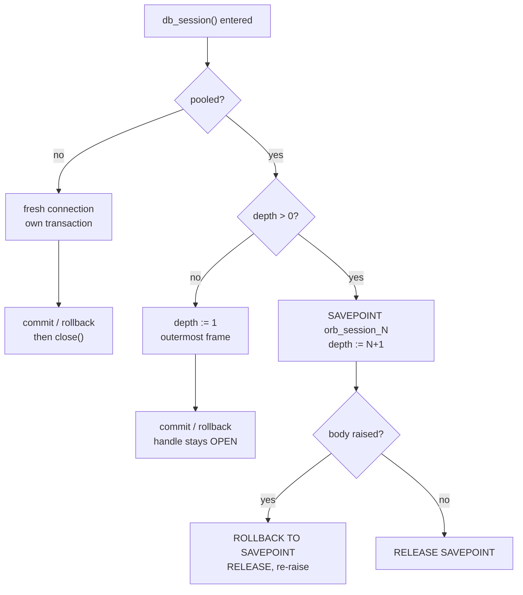
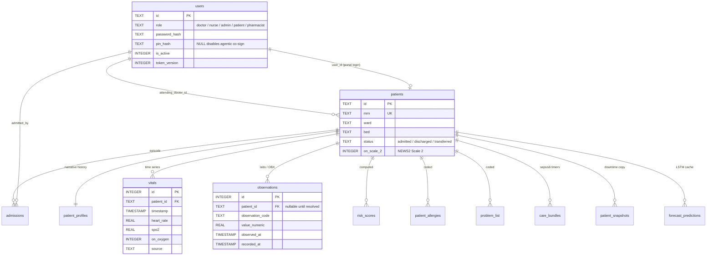
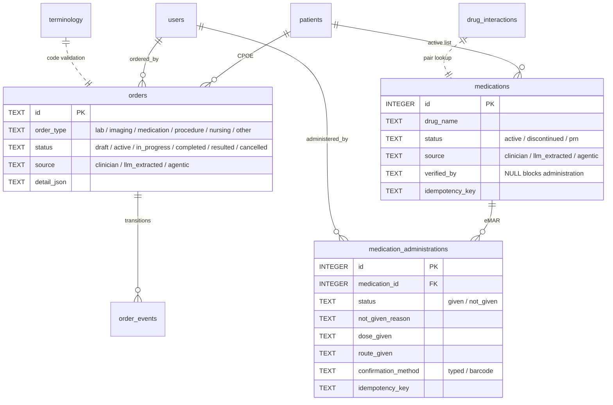
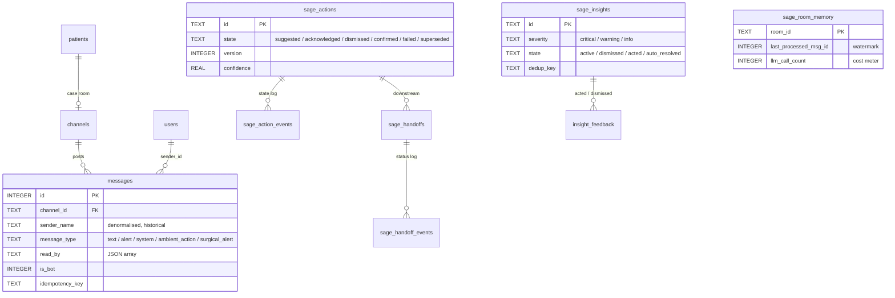
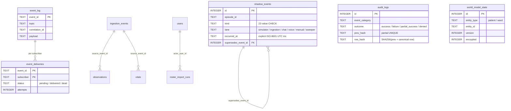

# Chapter 2: The Data Layer

> **Scope.** `server/database.py` (1,764 lines), `server/db_backend.py` (216),
> `server/migrations.py` (314), and the `server/models/` package (418 lines across
> four modules). Everything in this chapter was read from source at the state of
> the repository on 2026-08-02. Where a measurement is quoted as *measured here*,
> it was taken on this machine during the writing of this chapter and the method is
> given so it can be repeated.
>
> **Cross-references.** Two sibling schemas live in the same physical database file
> but are owned by other chapters: the Helix pharmacy tables
> (`server/services/helix_db.py:7-83`) and the retrieval tables
> `clinical_knowledge`, `clinical_knowledge_fts` (FTS5) and `clinical_knowledge_vec`
> (sqlite-vec `vec0`) in `server/services/clinical_knowledge.py:598-640`. They are
> named here where they touch this layer and documented in full elsewhere.

---

## 2.1 The problem this layer solves

Orb is a hospital operating system that runs on one machine. There is no database
server, no replica, no cloud, no network partition to reason about. Protected
health information never leaves the building because there is no path out of it.
Every architectural decision in this chapter is downstream of that single
constraint, plus four more that follow from it:

1. **One process, one file.** All state, clinical records, messaging, audit,
   AI-derived artefacts, the pilot's evidence log, lives in one SQLite file at
   `config.DB_PATH` (`server/config.py:22`), default `server/orb.db`.
2. **One writer.** SQLite serialises writers at the file level. Everything about
   transaction discipline, the executor sizing, and the pooling design is shaped
   by that.
3. **Encryption at rest is on.** The shipping appliance opens the database through
   SQLCipher, so every page read pays AES plus an HMAC-SHA512 verification, and
   every page write pays the same. Disk I/O stopped being cheap on 2026-07-30.
4. **The event loop is sacred.** This repository has shipped three separate
   production freezes caused by blocking the asyncio loop, and two of the three
   were the data layer's fault. The public async entry point `run_db()` exists
   solely because of that history.

The live database as of this writing is **342,577,152 bytes** (≈327 MB) with a
**15,314,072-byte WAL** (≈14.6 MB), all three files at mode `0600`, and the first
sixteen bytes are *not* `SQLite format 3\x00`, the file is genuinely encrypted.
That is the system this chapter describes.

---

## 2.2 Physical layout

### 2.2.1 Files on disk

| File | Contents | Permissions |
|---|---|---|
| `orb.db` | The database. Encrypted when `ORB_DB_ENCRYPTION_KEY` is set. | `0600` |
| `orb.db-wal` | Write-ahead log. Contains committed-but-not-yet-checkpointed pages, i.e. PHI. | `0600` |
| `orb.db-shm` | WAL index shared-memory file. | `0600` |
| `orb.db-journal` | Only present if journal mode is ever rolled back to `DELETE`. | `0600` |

`_harden_db_file_permissions()` (`server/database.py:1171-1189`) chmods all four
suffixes to `0o600`, logging a warning rather than crashing if the chmod fails, 
"failure to lock PHI down is a security-relevant event, but is non-fatal so we do
not crash boot" (`server/database.py:1186-1188`). It is called **twice** from
`init_db()`: once before the schema is applied (`:1221`) and once after (`:1710`),
because `executescript` under WAL creates the `-wal`/`-shm` sidecars during the
call and they would otherwise be born with the process umask.

The docstring at `:1174-1175` still says "It does NOT provide encryption-at-rest.
See the deferred SQLCipher TODO below for the real fix." The block below it
(`:1192-1215`) is no longer a TODO, it is the implementation note for a shipped
feature. That is the first of several stale claims catalogued in §2.16.

An observation from the live machine that belongs in this chapter rather than a
security appendix: `server/orb.db.plaintext-20260730-130128` (90 MB) is still
present next to the encrypted database, three days after the migration. That is
the documented default of the migration tool (`--migrate` keeps the plaintext copy
unless `--no-keep-plaintext` is passed, `server/scripts/encrypt_db.py:16-17`), and
it is at `0600`, but it is a complete unencrypted PHI copy sitting beside the
encrypted one. Encryption at rest is only as good as the operator's cleanup step.

### 2.2.2 One file, three schemas

`orb.db` holds three logically separate schemas that were never separated
physically:

- **Core** (this chapter): 48 tables in the `SCHEMA` literal
  (`server/database.py:20-838`) plus 3 created by the migration framework
  (`schema_migrations`, `shadow_events`, `roster_import_runs`), **51 tables**,
  48 + 20 indexes, 4 triggers, 1 view.
- **Helix pharmacy**: 6 tables prefixed `helix_` (`server/services/helix_db.py:7-83`).
- **Retrieval**: `clinical_knowledge` plus an FTS5 shadow table and a `vec0`
  virtual table (`server/services/clinical_knowledge.py:598-640`).

They share one file, one WAL, one write lock, and one encryption key. The
consequence that matters operationally: a long corpus-embedding transaction in the
retrieval schema and a nurse charting a vital sign contend for the same lock.

---

## 2.3 Opening a connection

Four functions, layered:

```
get_db()                    -> pooled handle, or...
  db_backend.get_pooled()   -> per-(thread, path) cache, or None if pooling off
  _build_connection()       -> _open_raw_connection() + row_factory + 8 PRAGMAs
    _open_raw_connection()  -> driver selection + PRAGMA key
```

### 2.3.1 Driver selection: `_open_raw_connection`

`server/database.py:841-880`. The logic is: if `ORB_DB_ENCRYPTION_KEY` is set, try
`pysqlcipher3.dbapi2`, then `sqlcipher3`; if either imports, connect through it and
apply the key **before any other statement**:

```python
# server/database.py:874-877
conn = driver.connect(str(DB_PATH), timeout=30, factory=factory)
# Key MUST be applied first, before touching any other table/pragma.
conn.execute(f"PRAGMA key = \"x'{_sqlcipher_key_hex(DB_ENCRYPTION_KEY)}'\"")
return conn
```

The ordering is not stylistic. SQLCipher decrypts the first page to read the
schema; any statement issued before `PRAGMA key` sees an unreadable header and
fails with *"file is not a database"*. If no driver is importable, the code calls
`_warn_db_encryption_unavailable()` and **falls through to plaintext `sqlite3`**
(`server/database.py:878-880`). §2.4.4 argues both sides of that choice.

The installed driver is `sqlcipher3-wheels==0.5.7` (`server/requirements.txt:42`),
chosen because it "is the only distribution with a CPython 3.12 arm64 wheel
(sqlcipher3-binary has none)" (`:40-41`), an Apple-silicon appliance constraint
deciding a dependency.

`timeout=30` here is the DB-API-level busy timeout; `_build_connection` also sets
`PRAGMA busy_timeout=30000`. They are the same 30 seconds expressed twice, which is
harmless but redundant.

### 2.3.2 Key derivation: `_sqlcipher_key_hex`

```python
# server/database.py:883-890
def _sqlcipher_key_hex(key: str) -> str:
    import hashlib
    return hashlib.sha256(key.encode("utf-8")).hexdigest()
```

The operator's key string is SHA-256'd once and handed to SQLCipher as a **raw
64-hex-character key**. The docstring states the reason: this "skips SQLCipher's
per-open KDF and accepts any-length input, mirroring the uploads key".

That is worth unpacking, because it is a real trade with a real cost on both sides.
Measured on this machine, the shipped SQLCipher build reports:

```
cipher_version         4.12.0 community
cipher_page_size       4096
cipher_hmac_algorithm  HMAC_SHA512
cipher_kdf_algorithm   PBKDF2_HMAC_SHA512
kdf_iter               256000
```

With a passphrase, every single connection open would run 256,000 rounds of
PBKDF2-HMAC-SHA512, on the order of 100 ms. In a system that (before pooling)
opened a connection *per query*, that is fatal. The raw-key form skips it entirely.

The cost: **the operator's key material gets exactly one round of SHA-256**. There
is no stretching. If someone chooses a guessable key and an attacker obtains the
file, the offline search is as fast as SHA-256 plus one SQLCipher page decryption
per candidate, billions of guesses per second on commodity hardware. The
mitigation is procedural, not technical: `docs/KEY_CEREMONY.md:143` specifies
`ORB_DB_ENCRYPTION_KEY=$(openssl rand -hex 32)`, which is 256 bits of entropy and
makes stretching irrelevant. But `.env.example:84` ships
`ORB_DB_ENCRYPTION_KEY=changeme-db-encryption-key`, and nothing in the code
enforces the ceremony. A four-line entropy floor at boot (reject keys shorter than
N characters or with low character-class diversity, unless an explicit override is
set) would close the gap; it does not currently exist.

### 2.3.3 The row factory: two drivers, two `Row` types

`server/database.py:908-928`. This is a small function guarding a defect that broke
every query in the system the first time encryption was enabled:

```python
# server/database.py:921-924
modules = [(c.__module__ or "") for c in type(conn).__mro__]
if any(m.startswith("sqlcipher3") for m in modules):
    import sqlcipher3.dbapi2 as _drv
    return _drv.Row
```

`sqlite3.Row` is a C type that type-checks its argument and raises
`TypeError: Row() argument 1 must be sqlite3.Cursor, not sqlcipher3.dbapi2.Cursor`.
Verified here: `sqlcipher3.dbapi2.Row is sqlite3.Row` → `False`. Since every
service in the codebase reads columns by name (`row["patient_id"]`), a wrong
factory is a total outage, not a degradation.

The subtle part is *why it walks the MRO instead of checking
`type(conn).__module__`*. Pooled connections are a subclass defined in
`database.py` itself (§2.5.2), so `__module__` on a pooled SQLCipher handle reads
`"database"`, not `"sqlcipher3"`, and the naive check would silently reintroduce
the bug on exactly the configuration that ships. The docstring says so at
`:917-919`. This is a good example of two independent features (pooling,
encryption) interacting to produce a defect neither would produce alone.

### 2.3.4 The PRAGMA block: and what it actually does

```python
# server/database.py:984-991
conn.execute("PRAGMA journal_mode=WAL")
conn.execute("PRAGMA foreign_keys=ON")
conn.execute("PRAGMA busy_timeout=30000")
conn.execute("PRAGMA page_size = 16384")
conn.execute("PRAGMA synchronous = NORMAL")
conn.execute("PRAGMA mmap_size = 30000000000")
conn.execute("PRAGMA cache_size = -256000")
conn.execute("PRAGMA temp_store = MEMORY")
```

Eight statements, plus `PRAGMA key` when encrypted, nine round-trips into the
engine on every connection open. Under the pre-2026-08-01 per-call model that was
nine statements *per query*. This is what the pool's docstring means by "skipping
~8 PRAGMA statements per call" (`server/db_backend.py:107-108`).

Here is what each one is *for*, and, because this is the kind of block that gets
copied forward for years without anyone checking, what it *does*, measured.

| PRAGMA | Intent | Measured reality on this build |
|---|---|---|
| `journal_mode=WAL` | Readers don't block the writer; the writer doesn't block readers. Mandatory for a concurrent API server. | Works. Persistent property of the file; re-issued per connection because it is cheap and idempotent. |
| `foreign_keys=ON` | Enforce `REFERENCES`. SQLite defaults this **off** for backward compatibility; without it every FK in the 51-table schema is decorative. | Works. Per-connection, so it must be re-issued on every handle, a pooled handle inherits it once, a per-call handle pays it every time. |
| `busy_timeout=30000` | On lock contention, retry for 30 s before raising `SQLITE_BUSY`. | Works. §2.7 discusses why 30 s is both necessary and dangerous. |
| `page_size = 16384` | "Larger page size improves performance for the BLOBs and JSON text" (`docs/manual_sections/02_data_layer.md`). | **No-op. The database is 4 KB pages.** See below. |
| `synchronous = NORMAL` | In WAL mode, fsync the WAL at checkpoints but not every commit. Survives a process crash; can lose the last transactions on power loss. | Works (`PRAGMA synchronous` → `1`). |
| `mmap_size = 30000000000` | "~28 GB" of memory-mapped read window (per the existing manual). | **Clamped to 2,147,418,112 (0x7FFF0000 ≈ 2 GB)** on both drivers. And under SQLCipher a mapped page cannot be used directly, it must be decrypted and HMAC-verified into the pager cache first, so the setting is inert on the shipping configuration. |
| `cache_size = -256000` | 256 MB page cache. | Works, **per connection**. See the pooling interaction below. |
| `temp_store = MEMORY` | Sorts and temp tables in RAM. | Works (`→ 2`). |

**The `page_size` finding, in detail.** `PRAGMA page_size` only takes effect on a
database that has not yet been created, and *setting `journal_mode=WAL` materialises
the file header*. Because line 984 runs before line 987, the page size is already
fixed by the time the PRAGMA arrives. Reproduced here on plaintext SQLite:

```
journal_mode=WAL then page_size=16384  ->  page_size = 4096
page_size=16384 then journal_mode=WAL  ->  page_size = 16384
```

On the encrypted path it cannot work at all in this form: SQLCipher takes its page
size from `PRAGMA cipher_page_size`, which must also be set before creation.
Reproduced: an encrypted database built with the exact PRAGMA sequence above
reports `page_size = 4096`, `cipher_page_size = 4096`.

So Orb's database is **4 KB pages** in every configuration, and has been since the
first `orb.db` was created. Does it matter? Moderately, and specifically because of
encryption. SQLCipher attaches a per-page IV and HMAC; the crypto overhead is paid
*per page*, so 4 KB pages mean four times as many HMAC-SHA512 computations per
megabyte read as 16 KB pages would. For a workload dominated by wide row scans over
JSON-ish TEXT columns, which is most of Orb's reads, larger pages would measurably
help. This is a cheap win that is currently being left on the table, and the fix is
not a code change to the PRAGMA order alone: an existing database needs
`cipher_page_size` set at creation, or a `VACUUM` after the change. It is not a
Week-13 blocker, and the honest framing is that nobody has yet paid the cost of
verifying it, not that it was considered and rejected.

**The `cache_size` × pooling interaction.** `cache_size = -256000` is a 256 MB
*per-connection* ceiling. Under per-call connections this was self-limiting (each
connection was short-lived and never filled its cache). Under pooling, one
long-lived connection exists per `(thread, db-path)`, and threads are not scarce:
four in the private DB executor (§2.6), one in `event_bus`'s own executor, plus
FastAPI's anyio worker pool for every `def` route handler. Worst case is dozens of
connections each entitled to 256 MB. In practice the caches fill lazily and the
whole database is 327 MB, so the observed ceiling is far lower, the 15-minute
60-bed soak in pool mode peaked at **220.1 MB RSS**
(`docs/perf/soak-20260801-111452-pool.md`), essentially identical to the per-call
run's 220.6 MB. The risk is real but has not materialised at pilot scale. It should
be re-measured if the database grows past a gigabyte.

**What is missing from this block.** There is no `PRAGMA optimize`, no `ANALYZE`,
no `VACUUM`, no `wal_autocheckpoint` tuning and no `journal_size_limit` anywhere in
the running server, a repository-wide grep finds `wal_checkpoint` exactly once, in
the offline migration tool (`server/scripts/encrypt_db.py:207`). Two consequences:

- **The query planner runs without statistics.** With no `sqlite_stat1` table,
  SQLite uses default cardinality estimates. For the mostly-simple indexed lookups
  in this schema that is usually right, but it is a silent dependency on luck for
  any multi-way join (the patient-story merge is the obvious candidate).
- **The WAL is unbounded by policy.** The default `wal_autocheckpoint` is 1000
  pages = 4 MB at this page size, yet the live WAL is 14.6 MB. Autocheckpoint is
  *passive*: it copies what it can and gives up rather than blocking a reader, and
  it can only truncate the WAL when no reader is on an older snapshot. A pool of
  long-lived connections makes that condition harder to reach. The WAL therefore
  drifts upward, which is the input to the failure in §2.6.4.

### 2.3.5 Driver-agnostic exceptions: `db_backend`'s alias tuples

`server/db_backend.py:46-103`. This is a small module-level block that fixed a
product-wide silent bug, and it is worth reading in full because the failure mode
generalises.

`sqlcipher3` defines its **own** DB-API exception hierarchy rooted at
`builtins.Exception`. It does not subclass the standard library's. Verified here:

```
issubclass(sqlcipher3.dbapi2.IntegrityError, sqlite3.IntegrityError)  ->  False
```

Therefore, on **every encrypted deployment**, i.e. the shipping configuration, 
each `except sqlite3.IntegrityError` in the codebase was dead code. The handlers
looked correct, passed review, and passed the (unencrypted) test suite; in
production a duplicate insert escaped as an unhandled traceback. The repository
records the reproduction: `scripts/create_admin.py` died with a raw
`sqlcipher3.dbapi2.IntegrityError` where it should have printed
*"A user with id 'X' already exists."* and exited 1 (`server/db_backend.py:58-62`).

The fix builds a tuple per exception name across every importable driver:

```python
# server/db_backend.py:87-95
def _alias(name: str) -> tuple:
    """Every installed driver's class for `name`, deduped, as an except-able tuple."""
    ...
DBError, DBDatabaseError, DBIntegrityError = ..., ..., ...
DBOperationalError, DBProgrammingError, DBInterfaceError = ..., ..., ...
```

Tuples rather than a synthesised base class, for two stated reasons
(`server/db_backend.py:64-69`): `except` and `isinstance` both accept tuples, and
one process can legitimately touch both drivers (a migration tool reading a
plaintext file while the app runs encrypted). The class sets are disjoint, so
matching both is always correct and never over-matches.

The rule, *never write `except sqlite3.<X>Error` in this codebase*, is enforced
mechanically by `server/tests/test_db_exception_aliases.py`, which scans every `.py`
under `server/` with comments and docstrings excluded (which is why the comment
block itself is allowed to name the stdlib classes).

**Why this belongs in an architecture manual.** The general lesson is that swapping
a driver behind a compatibility shim leaves one thing un-swapped: the exception
type identity. Any codebase that catches driver exceptions by class and then
changes drivers has this bug, and it is invisible to a test suite that runs the old
driver. `audit_service` had independently worked around it by matching on
`type(exc).__name__ == "IntegrityError"`, which is why the audit chain kept
working on encrypted appliances while everything else silently didn't. That
workaround has since been removed in favour of the alias
(`server/services/audit_service.py:165-178`), with the note that a bare class-name
match "would also swallow an unrelated library's IntegrityError".

---

## 2.4 Encryption at rest

### 2.4.1 What is protected

The whole file, including the WAL and SHM sidecars, is AES-encrypted with
per-page HMAC-SHA512 integrity. Backups inherit it (§2.12). Uploaded media, 
Lens images, Scribe audio, are *not* covered here; they are separately encrypted
with AES-256-GCM under a **different** key, `ORB_UPLOAD_ENCRYPTION_KEY`
(`.env.example:85-87`). Escrowing one key and losing the other loses half the
record; `docs/BACKUP_AND_RESTORE.md:84-85` states this explicitly.

The implementation note in `server/database.py:1192-1215` is unusually honest about
the limits and is worth quoting rather than paraphrasing:

> HONEST LIMITATION: with the key in .env on the same disk, this protects DB
> COPIES (backups, exports, a stolen disk image read on another machine) but not
> a running/stolen appliance whose .env an attacker can also read.
>, `server/database.py:1200-1203`

That is the correct threat model. The control defeats *offline* attacks on copies.
It does nothing against an attacker with read access to the running appliance's
filesystem, because the key is one file away. The stated mitigations, pair with
FileVault, move the key to the OS keychain, are both open.

### 2.4.2 The history, and why it was deferred for so long

The same comment block records the reasons the feature was previously blocked
(`server/database.py:1205-1214`): a heavy native C dependency, and a believed
incompatibility between `pysqlcipher3` and the `sqlite-vec` loadable extension
(`sqlite-vec==0.1.6`) that the RAG path depends on, plus the WAL/mmap PRAGMA
tuning. The recommended path at the time was FileVault-as-documented-control.

That belief turned out to be false, and the correction is recorded at
`server/database.py:854-860`:

> VALIDATED 2026-07-30 on Apple Silicon / Python 3.12 with sqlcipher3-wheels:
> SQLCipher coexists with the sqlite-vec loadable extension (vec0 vector search)
> AND FTS5 AND WAL mode, the earlier concern about an extension conflict does
> not hold on this build.

This is the most useful kind of entry in an engineering record: a documented
blocker that was re-tested and found to be wrong. The cost of the wrong belief was
roughly a month of shipping without at-rest encryption on a PHI system, justified
by an incompatibility nobody had verified. Two modules still carry the stale
version of the belief (§2.16).

### 2.4.3 Migration is not automatic

A pre-existing plaintext `orb.db` **cannot be opened by SQLCipher**. Turning the
key on without migrating produces "file is not a database" on every query. The
migration is a separate, deliberate, offline operation:
`server/scripts/encrypt_db.py --migrate`.

The tool is written defensively (`server/scripts/encrypt_db.py:1-21, 36-56`):

- It **refuses to run against a live server** by probing port 8000, because the
  server holds WAL state and open handles and "swapping the file beneath it
  corrupts both copies" (`:53-55`).
- It keeps the plaintext original until the encrypted copy is verified.
- Verification is clinical, not structural: exact row counts for 14 named tables
  chosen "because each one losing rows silently would be a clinical or compliance
  failure" (`:36-38`), `patients`, `vitals`, `audit_logs`, `orders`, and so on, 
  plus the tamper-evident audit hash chain, vector search, and full-text search.
- `_is_plaintext()` checks the 16-byte SQLite magic; a SQLCipher file encrypts its
  own header, so the magic's *absence* is the on-disk proof of encryption
  (`:33, 44-49`). The same check is used by the test suite
  (`server/tests/test_db_encryption.py:34-37`).

### 2.4.4 Fail-open to plaintext: the argument, both ways

When `ORB_DB_ENCRYPTION_KEY` is set but no SQLCipher driver imports,
`_open_raw_connection` logs one warning and opens the database **unencrypted**
(`server/database.py:878-880`, warning text at `:901-905`).

**The case for fail-open (as implemented).**

- The failure is a *deployment* fault (a missing native wheel), not a data fault.
  Refusing to boot turns a packaging problem into a ward outage. On a single
  appliance with no failover, "the hospital's EHR will not start" is a clinical
  safety event in its own right.
- The condition is loud and monotonic: it cannot silently appear at runtime,
  because driver availability is fixed at process start.
- A plaintext boot is still a working, audited, permission-hardened system. It is
  the exact posture Orb shipped in for months.
- The operator has an out-of-band check: `docs/INSTALL_RUNBOOK.md` §8.5 is
  literally *"Confirm encryption is actually on"*.

**The case against.**

- Nothing in the API surfaces the degraded state. There is no health-check field,
  no admin banner, no heartbeat flag saying "running unencrypted". A single
  `logger.warning` on a machine nobody reads logs from is not a control.
- The failure is *silent in the direction that matters*. An operator who set the
  key believes encryption is on. The system's behaviour is identical. The
  difference only becomes visible when the disk is stolen.
- The repository already has the pattern for the opposite choice, twice:
  `ORB_REQUIRE_UPLOAD_ENCRYPTION=1` makes upload encryption fail closed
  (`docs/INSTALL_RUNBOOK.md:339`), and `ORB_REQUIRE_FIELD_ENCRYPTION=1` does the
  same for field encryption "for regulated deployments"
  (`server/services/field_crypto.py:24-26`). The DB path is the *only* one of the
  three with no fail-closed switch, and it is the one holding the most PHI.
- The asymmetry of consequences favours failing closed. A refused boot is
  discovered in ten seconds by the person doing the install. An unencrypted
  database is discovered by a regulator.

**Assessment.** Fail-open as the default is defensible for an appliance with no
redundancy. Having *no way to opt into fail-closed* is not. The gap is a
five-line change, an `ORB_REQUIRE_DB_ENCRYPTION` env var checked in
`_warn_db_encryption_unavailable`, symmetrical with the two that already exist, 
and its absence looks like an oversight rather than a decision. Second best, and
cheaper still: expose `db_encrypted: bool` in `/api/health` so the degraded state
is machine-visible to the heartbeat that already pages the operator.

### 2.4.5 Alternatives considered

**SQLCipher (chosen).** Transparent to the application, covers the WAL and SHM
sidecars, backups inherit it through the same codec, and, critically, it survived
the compatibility re-test against `sqlite-vec` and FTS5. Cost: a native dependency
with a narrow wheel supply on arm64, a key-management problem, and per-page crypto
on every read.

**FileVault (macOS full-disk encryption).** This was the *recommended* path in the
deferred plan (`server/database.py:1211-1212`) and it has real advantages: zero
application code, zero dependency risk, covers uploads and logs and swap and every
other file the application forgets about, and no per-query cost. It loses on one
decisive point: **FileVault protects a powered-off machine, and an appliance in a
hospital ward is never powered off.** Every backup copied off the machine, every
export, every disk image taken while the system is running, is plaintext. Since the
primary realistic threat to this system is a copy of the database leaving the
building, not someone stealing a running Mac Studio from a locked room, FileVault
protects the wrong end. The correct posture is *both*, and the code says so
(`:1202-1203`).

**Application-level field encryption.** Implemented and shipping, but as a
complement rather than an alternative: `server/services/field_crypto.py` encrypts
individual TEXT columns with AES-256-GCM under `ORB_FIELD_ENCRYPTION_KEY`, falling
back to `ORB_DB_ENCRYPTION_KEY`. It is used for the PHI-derived stores added after
the SQLCipher deferral, `world_model_state.state_json` (see the `encrypted`
column, `server/database.py:643-644`) and the Sage decision cache. Its design is
neat: a `"ORBF1:"` prefix envelope means it drops into an existing TEXT column with
no schema change, and reads sniff the prefix so turning the key on does not orphan
previously-written plaintext rows (`server/services/field_crypto.py:11-24`).

As a *replacement* for whole-database encryption it fails on coverage: it cannot
encrypt indexed columns without destroying the index, it cannot cover the WAL, and
it requires every new PHI column to be individually remembered. Fifty-one tables
of clinical data is too many places to remember. It is the right tool for a handful
of high-value blobs and the wrong tool for a record system.

**sqlite3mc (SQLite3 Multiple Ciphers).** Named as an option in the deferred plan
(`server/database.py:1213`). Not chosen; no recorded rationale. The plausible
reasons are wheel availability on Python 3.12 arm64 (the same constraint that
forced `sqlcipher3-wheels` over `sqlcipher3-binary`) and the fact that SQLCipher's
file format is the one every external audit tool understands.

---

## 2.5 Sessions and transactions

### 2.5.1 `get_db()`

```python
# server/database.py:995-1007
def get_db() -> sqlite3.Connection:
    from db_backend import get_pooled
    pooled = get_pooled(lambda: _build_connection(pooled=True), str(DB_PATH))
    if pooled is not None:
        return pooled
    return _build_connection()
```

Six lines. It asks the pool first; if pooling is disabled the pool returns `None`
and a fresh connection is built. The lambda is the *builder*, so the pool decides
whether to invoke it. Note that the pooled and non-pooled paths build different
connection **classes** (`pooled=True` selects the close-neutered subclass), which
is why the flag has to be threaded down through `_build_connection` and
`_open_raw_connection`.

The docstring at `:999-1001` says the non-pooled path is "the default, thread-safe
model the tests exercise". That was true until 2026-08-01 and is now wrong in the
most consequential way possible, see §2.6.4 and §2.16.

### 2.5.2 `db_session()`: the contract

`server/database.py:1020-1070`. Every service in Orb goes through this. The contract
is:

- **Commit on clean exit, roll back on any exception, then re-raise.**
- **A pooled connection is left open** for reuse; a per-call connection is closed.
- **Nested use on a pooled connection runs inside a SAVEPOINT.**

The outermost branch, in full:

```python
# server/database.py:1050-1070
if pooled:
    _session_nesting.depth = 1
try:
    yield conn
except Exception:
    try:
        conn.rollback()
    except DBProgrammingError:
        if pooled:
            discard_pooled(conn)
    raise
else:
    conn.commit()
finally:
    if pooled:
        _session_nesting.depth = 0
    else:
        conn.close()
```

Two details reward attention. First, the `except DBProgrammingError` around the
rollback: if the handle died mid-frame the rollback itself raises, and masking the
original exception with a secondary one would destroy the diagnosis. Instead the
pool self-heals (`discard_pooled`) and the original exception propagates
(`:1057-1063`). Second, `DBProgrammingError` is the alias tuple from §2.3.5, on an
encrypted appliance the stdlib class would never match.

### 2.5.3 Why nesting exists at all

Under the per-call model, a nested `db_session` opened a *second* connection. If the
outer session held the write lock, the inner one blocked on it, the same thread
waiting for a lock the same thread holds. That resolves only at
`busy_timeout=30000`, i.e. a 30-second stall followed by an error. The shadow
service names this precisely and makes it a written rule:

> If the caller ALREADY holds an open write transaction on this thread, it MUST
> pass `db=<that connection>`. Opening a second connection from inside an open
> write transaction blocks on the WAL write lock the caller itself holds, a
> same-thread self-deadlock that can only end at busy_timeout (30 s).
>, `server/services/shadow_service.py:23-28`

Pooling removes the self-deadlock by construction (there is no second connection),
but replaces it with a different problem: the inner session's `commit()` would
commit the *outer* transaction, and its `rollback()` would destroy the outer's work.
SAVEPOINTs are the answer to that:

```python
# server/database.py:1034-1048
if pooled and depth > 0:
    sp = f"orb_session_{depth}"
    conn.execute(f"SAVEPOINT {sp}")
    _session_nesting.depth = depth + 1
    try:
        yield conn
    except Exception:
        conn.execute(f"ROLLBACK TO SAVEPOINT {sp}")
        conn.execute(f"RELEASE SAVEPOINT {sp}")
        raise
    else:
        conn.execute(f"RELEASE SAVEPOINT {sp}")
    finally:
        _session_nesting.depth = depth
    return
```

Depth is tracked in a `threading.local()` (`server/database.py:1017`) because a
pooled handle is per-thread; the savepoint name embeds the depth so three levels of
nesting produce three distinct names.

Note the failure-mode inversion this creates: **the same call site has two entirely
different pathologies depending on `ORB_DB_POOL`.** Unpooled, a nested write is a
30-second self-deadlock. Pooled, it is a savepoint. The `shadow_service` rule quoted
above is written for the unpooled world and is now describing a hazard that the
default configuration no longer has, while a *different* hazard, §2.5.5, has taken
its place.



### 2.5.4 Case study: the autocommit leak

This is the most instructive bug in the data layer, because every individual piece
of it was reasonable and the composition was not.

**The three ingredients.**

1. **A legacy call idiom.** Plenty of code predating `db_session` does
   `db = get_db()` … `finally: db.close()`.
2. **A manual-transaction idiom.** Two sites need `BEGIN IMMEDIATE` to take the
   write lock *before* reading, `audit_service` (to make the hash-chain
   read-then-write atomic) and `who_checklist` (a read-modify-write). Python's
   `sqlite3` will not let you issue `BEGIN` while it manages transactions, so
   these sites set `conn.isolation_level = None` first, putting the connection in
   autocommit mode, and rely on `close()` to dispose of the connection afterwards.
3. **Pooling.** The connection is no longer disposable. It is shared by every frame
   on that thread, for the life of the thread.

**The composition.** Site 2 flips `isolation_level = None` on a *shared* handle and
then calls `close()`, which under pooling did nothing. The connection stayed in
autocommit mode for every later frame on that thread. In autocommit mode Python's
`sqlite3` never issues an implicit `BEGIN`, so every statement commits as it
executes, and `conn.rollback()` becomes **a silent no-op**. `db_session`'s
exception handler ran, called `rollback()`, got no error, and re-raised. Nothing
looked wrong. The transaction boundary had simply ceased to exist.

**Why that is a clinical-safety defect, concretely.** `emar_service.record_administration`
records a bedside medication administration and writes its audit row **inside the
same transaction**, deliberately:

> clinical_access is fail-closed: the administration row and its audit
> row commit or roll back TOGETHER, so an audit-write failure can never
> leave a committed-but-unaudited dose (which an idempotent replay
> would otherwise return forever without auditing).
>, `server/services/emar_service.py:132-136`

With the autocommit leak in place, that guarantee evaporated. The `INSERT INTO
medication_administrations` committed the moment it executed. If `log_audit_event`
then failed, it raised `AuditWriteError`, `db_session` called `rollback()`, the
rollback did nothing, and the exception propagated, leaving a **committed medication
administration with no audit record**. Worse, because the row carries an
`idempotency_key` with a partial unique index (`server/database.py:250-251`), an
offline client replaying the same request would hit the pre-INSERT dedup check
(`server/services/emar_service.py:100-107`), find the orphaned row, and return it as
`replayed: True`, forever, without ever writing the missing audit row. A dose that
was given, is visible in the chart, and does not exist in the tamper-evident audit
trail. For a system whose entire compliance story is "hash-chained append-only
audit", that is the failure the audit log exists to make impossible.

**The fix, in three parts.** All three are load-bearing and any one of them missing
reopens the hole (`server/db_backend.py:116-125`):

1. Nested sessions use SAVEPOINTs so an inner frame cannot commit or roll back the
   outer transaction (§2.5.3).
2. The pooled connection subclass's `close()` becomes a **lifecycle no-op that
   resets state**:

```python
# server/database.py:946-964  (docstring elided)
def close(self):
    try:
        if self.in_transaction:
            self.rollback()
        self.isolation_level = getattr(self, "_orb_default_isolation", "")
    except Exception:
        logger.debug("pooled close(): state reset failed", exc_info=True)
```

   The driver's own default is captured at build time
   (`conn._orb_default_isolation = conn.isolation_level`, `server/database.py:982`)
   rather than hardcoding `""`, so the reset is correct for whichever driver is in
   play. The real close moves to `pool_close()` (`:966-967`), reachable only by the
   pool's `_retire` (`server/db_backend.py:165-174`).
3. Standalone audit writes **join an already-open pooled transaction** instead of
   issuing `BEGIN IMMEDIATE`, which would raise inside an open transaction and
   whose error path would `ROLLBACK` the outer frame's work
   (`server/services/audit_service.py:205-219`).

And the belt-and-braces restore in the site that caused it, with the incident
recorded at the point of the fix:

```python
# server/services/audit_service.py:236-244
finally:
    # MUST restore before close: on a POOLED handle close() is a
    # neutered no-op and the connection is shared thread-wide: 
    # leaving isolation_level=None put the whole thread in
    # autocommit, turning every later db_session rollback into
    # a silent no-op (an eMAR administration survived its
    # failed audit write exactly this way).
    conn.isolation_level = prev_isolation
    conn.close()
```

**The transferable lesson.** A connection pool changes the *lifetime semantics of
connection-level state*, and connection-level state is invisible in the type
system. `isolation_level`, `foreign_keys`, `row_factory`, loaded extensions,
temporary tables, and prepared-statement caches are all per-connection. Under
per-call connections they are scoped to a request by accident. Under pooling they
are process-lifetime globals shared by every caller on the thread. Any codebase
adding a pool underneath code written without one inherits exactly this class of
bug, and the symptom, a rollback that returns successfully without rolling
anything back, produces no error to trace.

### 2.5.5 The residual hole: SAVEPOINT outside a transaction

The SAVEPOINT mechanism is not complete, and the gap is reproducible with the
repository's own code. The docstring claims:

> Nested use on a pooled connection is safe: inner sessions run
> inside a SAVEPOINT; only the outermost commits/rolls back the transaction.
>, `server/database.py:1026-1027`

That is true only when the outer session has already written something.

**Mechanism.** Python's `sqlite3` in legacy transaction mode
(`isolation_level = ""`) issues an implicit `BEGIN` only before DML, 
`INSERT`/`UPDATE`/`DELETE`/`REPLACE`. `SAVEPOINT` is not DML, so no `BEGIN` is
issued for it. If the outer session has so far executed only `SELECT`s, the
connection is still in autocommit when the inner frame runs `SAVEPOINT
orb_session_1`. Per SQLite's semantics, a `SAVEPOINT` issued outside a transaction
*starts* one, and `RELEASE` of that outermost savepoint **commits it**. The inner
frame's writes are therefore committed at the inner `RELEASE`, and a later failure
in the outer frame has nothing left to roll back.

**Reproduced**, using `database.db_session` unmodified with `ORB_DB_POOL=1` against
a temporary database:

| Outer state when inner opens | Which frame fails | Result |
|---|---|---|
| outer already wrote (txn open) | inner | inner discarded, outer kept ✓ |
| outer already wrote (txn open) | outer | both discarded ✓ |
| outer read-only so far | inner | inner discarded ✓ |
| **outer read-only so far** | **outer** | **inner row SURVIVES ✗** |

Three of four cells are correct. The fourth is the same shape as the bug in
§2.5.4, a write outliving the failure of the frame that was supposed to contain
it, with a narrower trigger.

**Is it currently reachable?** Yes, at least once. A static scan of `server/`
(excluding tests) finds sixteen call sites where a function that opens its own
`db_session` is invoked from inside another `db_session` block. The clearest is:

```python
# server/routes/orders_routes.py:135-156  (abridged)
with db_session() as db:
    episode_id = shadow_service.current_episode(req.patient_id, db=db)   # read
    last_alert = db.execute("SELECT occurred_at FROM shadow_events_current ...")
    ...
    shadow_service.emit_many([...])          # NO db= -> nested db_session
```

The outer frame performs only reads before the nested `emit_many` writes, so this is
exactly row four. In this instance the consequence is benign and arguably desirable:
`shadow_events` is the fail-open observational log, explicitly designed so that "a
shadow write must never fail a clinical action"
(`server/services/shadow_service.py:10-15`), and committing early serves that goal.

But the hazard is generic. `db_session` is used at 294 sites. The next person to nest
a *compliance* write under a read-first outer frame gets the eMAR failure back, and
the docstring will tell them it cannot happen.

**Fix.** One line, in the outermost pooled branch: force the transaction open before
handing the connection out, so a nested `SAVEPOINT` is always genuinely nested, 
e.g. `conn.execute("BEGIN")` when `not conn.in_transaction`, or the cheaper
`conn.isolation_level`-preserving equivalent. The cost is that every `db_session`,
including read-only ones, opens a read transaction and holds a WAL snapshot for its
duration, which would make the WAL-growth problem in §2.3.4 worse. The alternative, 
have the *nested* branch open the transaction if autocommit is still on, is
narrower and cheaper, and is what this chapter would recommend. Either way it needs a
test, and the test must run with `ORB_DB_POOL=1` because unpooled cannot reproduce it.

### 2.5.6 One `db_session` is not one snapshot

A related and independently documented consequence of `isolation_level = ""`: a
`db_session` that begins with a `SELECT` has no transaction and therefore no
consistent snapshot. Two reads inside one session can observe different states of
the database. The repository found this the hard way when a route was moved off the
event loop:

> sqlite3 runs with isolation_level='' and so does not open a
> transaction on a bare SELECT, which means one db_session is not one
> snapshot. While this ran inline on the event loop that did not matter, 
> the loop is single-threaded, so two /act calls could never overlap.
> Executing it in run_db's 4-worker pool removed that, and two clicks on
> the same insight could each read 'active' and each create an action
> card, putting two identical draft orders in the case room.
>, `server/routes/sage_proactive_routes.py:95-102`

The fix there was not to add locking but to make the *claim itself* the arbiter, a
conditional `UPDATE ... WHERE id = ? AND state = 'active'` whose `rowcount` decides
the winner (`:103-111`). That is the right pattern for this data layer generally:
**compare-and-swap in SQL beats read-then-write in Python**, because the former is
atomic under any isolation setting and the latter is atomic only under a discipline
nobody can see.

Note the second-order lesson buried in that comment: moving work off the event loop
to fix a latency problem *introduced* a concurrency problem, because the event loop
had been acting as an accidental global mutex. Every `run_db()` migration in this
codebase carries that risk.

### 2.5.7 Costs

A `db_session` in the pooled configuration costs: one dict lookup, one `SELECT 1`
liveness probe (`server/db_backend.py:203`), the body, and one `COMMIT`. In the
unpooled configuration it costs a full connection open (including the SQLCipher
codec attach), nine PRAGMA statements, the body, a `COMMIT`, and a `close()`, 
where the `close()` may checkpoint the WAL. §2.6.4 is about that last clause.

---

## 2.6 Connection pooling

### 2.6.1 The pool

`server/db_backend.py:150-211`. It is about forty lines and has no configuration
beyond on/off.

```python
# server/db_backend.py:150-156
_pool_env = os.getenv("ORB_DB_POOL", "").strip().lower()
POOL_ENABLED = _pool_env not in ("0", "false", "no", "off")

_local = threading.local()
_pooled_ids: set[int] = set()
```

The cache is keyed by **thread** (via `threading.local`) and then by **db-path**.
Both keys are necessary and the comment says why (`:107-109`): SQLite connections
have thread affinity, so a handle cannot be shared across threads; and a test or
tool that repoints `ORB_DB_PATH` must not reuse a handle to the old file.

```python
# server/db_backend.py:188-211  (abridged)
def get_pooled(make_connection, db_path: str):
    if not POOL_ENABLED:
        return None
    cache = getattr(_local, "conns", None) or {}
    conn = cache.get(db_path)
    if conn is not None:
        try:
            conn.execute("SELECT 1")     # liveness probe; rebuild if the handle died
            return conn
        except Exception:
            cache.pop(db_path, None); _retire(conn)
    conn = make_connection()
    cache[db_path] = conn
    _pooled_ids.add(id(conn))
    return conn
```

This is a *cache*, not a pool in the connection-pool-with-a-queue sense. There is no
maximum size, no checkout/checkin, no waiting. Each thread simply owns one
connection per database path for as long as the thread lives. For a single-writer
embedded database that is the right shape: a queue would only add contention on top
of contention SQLite already manages.

The liveness probe on every acquisition is a deliberate cost, one round-trip per
`get_db()`, bought to guarantee that a handle killed by an external event
(a closed file, a corrupted codec) is rebuilt rather than raising from deep inside
a service.

### 2.6.2 `is_pooled`, `_retire`, `discard_pooled`

`sqlite3.Connection` is a C type that rejects arbitrary attribute assignment, so
membership cannot be tagged on the object. The pool tracks identity instead:

```python
# server/db_backend.py:159-162
def is_pooled(conn) -> bool:
    return id(conn) in _pooled_ids
```

`_retire` (`:165-174`) is the only path that actually closes a pooled handle: it
discards the id, then calls `pool_close()` if present (falling back to `close()` for
a non-pooled handle), swallowing exceptions. `discard_pooled` (`:177-185`) removes
the handle from *this thread's* cache and retires it, the self-heal path invoked by
`db_session` when a rollback finds the handle dead (`server/database.py:1061-1062`).

**A latent defect worth recording.** The comment at `server/db_backend.py:155` says
`_pooled_ids` is "Bounded by threads × db-paths (tiny)". That is only true if
threads do not churn. `_pooled_ids` is a module-level set with no cleanup on thread
death: when a worker thread exits, its `threading.local` storage is dropped, the
connection is deallocated by refcount (CPython's `Connection` destructor closes the
handle at the C level regardless of the neutered Python `close()`, so there is no
file-descriptor leak), but **the integer id stays in `_pooled_ids` forever**.
FastAPI's anyio worker threads, which serve every `def` route handler, expire after
an idle period by design, so churn is real, not hypothetical.

Two consequences, both currently minor:

- The set grows monotonically with lifetime thread count. Each entry is one small
  integer; at ward scale this is kilobytes over months. Harmless, but not the stated
  invariant.
- CPython reuses object addresses. A stale id can alias a *new*, non-pooled
  connection object allocated at the same address, making `is_pooled()` return a
  false positive. Today that is unreachable in practice: when pooling is on,
  `get_db()` never returns a non-pooled handle, and the raw connections that do exist
  (`consistent_backup`'s source and destination) are closed explicitly and never
  passed through `is_pooled`. It is a landmine, not a live bug, but the correct fix
  is small: key the registry off a `WeakSet`-style structure, or attach a marker to
  the pooled *subclass* (which, being a Python subclass, does accept attributes)
  instead of tracking identity at all.

### 2.6.3 The close-neutered subclass

`server/database.py:939-973`. `_pooled_connection_class(base)` builds, and memoises
per base class, a subclass whose `close()` is the state-reset described in §2.5.4
and whose `pool_close()` is the real close. The memoisation matters: without it every
connection would get a fresh class object, defeating the row-factory MRO check and
leaking classes.

Note the subclass is created for whichever base the driver provides
(`sqlite3.Connection` or `sqlcipher3.dbapi2.Connection`), which is why
`_pooled_conn_classes` is a dict keyed by base rather than a single class
(`server/database.py:939, 942`).

### 2.6.4 Case study: why pooling became the default on 2026-08-01

This is the best worked example in the codebase of an "implementation detail" being
architectural, and it is worth the space.

**The symptom.** On 2026-08-01 the appliance froze **permanently** in about
30 seconds under concurrent load on `/api/sage/ward-brief`, `/api/vigil/patients`
and `/api/health/models` during a `vigil.alert.*` storm. The process sat at 0.2 %
CPU. `SIGTERM` was ignored. `kill -9` was the only exit. Three `kill -USR1`
faulthandler dumps taken eight seconds apart were **byte-identical**, which is what
distinguishes a deadlock from slowness. The stacks
(`server/services/loop_watchdog.py:6-20`):

```
MAIN (uvloop)  uv__run_timers -> PyGILState_Ensure -> take_gil -> cvwait
THREAD A       event_bus._mark_delivered -> db_session.__exit__ -> conn.close()
               -> sqlite3WalClose -> unixLock -> __psynch_mutexwait
THREAD B       sage_narrator._build_ward_snapshot -> get_db -> openDatabase
               -> unixOpen -> findReusableFd -> __psynch_mutexwait   (SAME mutex)
THREAD C       downtime nightly FHIR export, json.dump -> _Py_write -> take_gil
```

Read it from the bottom up. Thread A is *closing* a connection; that close is
checkpointing the WAL, which takes SQLite's per-inode VFS mutex. Thread B is
*opening* a connection to the same inode and wants the same mutex. The main event
loop is not in Orb code at all, it is stuck in `take_gil`, waiting for the
interpreter lock that one of the database threads is holding while it blocks on the
mutex. A thread holding the GIL and waiting on a mutex held by a thread that needs
the GIL is a deadlock, and no in-process health check can observe it, because the
health check is served by the loop that is dead.

**The mechanism, precisely.** The repository's account
(`server/db_backend.py:129-141`):

> Per-call connections mean a real `conn.close()` per query. On the SQLCipher
> driver we actually ship (sqlcipher3-wheels), `pysqlite_connection_close`
> holds the GIL across `sqlite3_close_v2`, verified by disassembling the shipped
> binary; upstream CPython's own `_sqlite3` releases it there, this fork does not.
> `sqlite3_close_v2` by the LAST closer checkpoints the WAL, so the whole process
> freezes for ~1 ms per MB of WAL (measured: 17.5 MB WAL -> 17.0 ms of GIL
> denied to every other thread, linear to 300 MB).

I verified this claim independently, without disassembly, using a decisive and
cheap experiment: run a pure-Python busy loop in a background thread, it can only
advance while it holds the GIL, and measure its longest contiguous stall while the
main thread calls `close()` on a connection with a large WAL. Both drivers, same
machine, same page size, `wal_autocheckpoint=0` so the WAL grows, three trials:

| Driver | WAL | `close()` wall time | **Longest GIL stall in the spinner thread** |
|---|---|---|---|
| sqlcipher3 (shipped) | 29.2 MB | 52.6 / 55.0 / 58.4 ms | **40.0 / 42.4 / 39.9 ms** |
| stdlib `sqlite3` | 26.0 MB | 38.7 / 37.5 / 40.9 ms | **0.0 / 0.0 / 0.0 ms** |

The two drivers take comparable wall time to close. The difference is entirely
*whether other threads can run during it*. Upstream CPython releases the GIL around
`sqlite3_close_v2`; this fork does not. The magnitude, ~40 ms of GIL denial for a
29 MB WAL, works out to **1.37 ms per MB**, confirming the repository's ~1 ms/MB
figure and its linear scaling.

Now put the numbers together with the live machine. The WAL on the running
appliance right now is **14.6 MB**. Under the per-call model, *every query* ends in
a `close()`, and whichever caller happens to be the last closer pays a
~20 ms whole-process GIL freeze, while holding the VFS mutex that concurrent
*openers* are waiting for. Under ward-level churn on a 327 MB encrypted database
with dozens of threads opening and closing, the window in which two threads can
interlock is not narrow. It closed on 2026-08-01 and did not reopen.

**Why the fix is "make pooling the default" rather than "fix the driver".** Three
options existed:

1. *Patch or replace the driver.* Correct in principle. Rejected in practice:
   `sqlcipher3-wheels` is the only distribution with a CPython 3.12 arm64 wheel
   (`server/requirements.txt:40-41`), so this means building SQLCipher from source
   on the appliance and maintaining a fork, against a hard Week-13 pilot date, with
   one operator.
2. *Keep the WAL tiny* (aggressive `wal_autocheckpoint`, periodic
   `wal_checkpoint(TRUNCATE)`). Reduces the per-close cost but does not remove the
   open/close mutex contention, and moves the checkpoint cost somewhere else rather
   than eliminating it.
3. *Stop closing connections.* Removes the trigger entirely. One thread, one
   connection, one open, no close until the thread dies.

Option 3 was already implemented and already tested in both modes; the change on
2026-08-01 was one line of default. That is the right call under these constraints,
and the reasoning recorded for *why it is a default rather than a documented
setting* is the part worth learning from:

> Safety must not depend on remembering a line in .env, an appliance that boots
> without it would silently run the freeze-prone path with no warning. So the
> safe path is the default and ORB_DB_POOL=0 is the explicit opt-out.
>, `server/db_backend.py:143-145`

And the accompanying admission, which is the most valuable sentence in the module:

> NOTE the test-suite blind spot this creates: the suite runs PLAINTEXT stdlib
> sqlite3, whose close DOES release the GIL, so it can never reproduce the above.
> **Green tests are not evidence about this failure mode.**
>, `server/db_backend.py:147-149`

My measurements above are the direct confirmation of that blind spot: the stdlib
column of the table is all zeros. A test suite running that column would have to
run forever to find this bug.

The default is asserted as a *safety property* by the test suite, not merely
tolerated (`server/tests/test_migrations.py:59-72`), and the runbook explains it to
operators with a pointer to the incident (`docs/INSTALL_RUNBOOK.md:343-347`). The
stall dump prints `ORB_DB_POOL` in its header specifically so a future responder can
check it in one line (`docs/INSTALL_RUNBOOK.md:815-816`).

**Performance, as a side effect.** The 15-minute 60-bed soak, run in both modes on
the same day, shows pooling is also simply faster
(`docs/perf/soak-20260801-105917-percall.md`, `soak-20260801-111452-pool.md`):

| Series | per-call p50 / p99 (ms) | pooled p50 / p99 (ms) |
|---|---|---|
| health | 4.0 / 62.2 | 4.0 / 45.2 |
| board | 10.9 / 133.1 | 5.3 / 129.1 |
| chart | 23.1 / 330.6 | 14.9 / 213.2 |
| forecast | 8.5 / 587.3 | 4.7 / 140.3 |
| ward_brief | 8.7 / 336.1 | 5.3 / 267.3 |

Both configurations passed every SLO; the tails are what separate them. That is
consistent with the mechanism, the p99 is where you find the request that happened
to be the last closer.

**What pooling does not fix.** Two honest caveats.

- Connections are still closed when threads die, and that close still runs the
  GIL-holding checkpoint. Pooling changes the frequency from *per query* to *per
  thread lifetime*, which is a reduction of many orders of magnitude, not an
  elimination. With anyio's idle worker expiry, thread death is not a rare event.
- The deadlock "is not *proven* impossible" (`server/services/loop_watchdog.py:20-21`),
  which is precisely why the loop watchdog exists and why it observes from outside
  the loop in two independent lanes, one of them a GIL-free C timer. A watchdog that
  shares the fate of the thing it watches is not a watchdog
  (`server/services/loop_watchdog.py:26-28`).

### 2.6.5 Alternatives: per-request, pooled, or a single serialised writer thread

**Connection-per-request (the former default).** Maximally simple, trivially
thread-safe, no shared state to leak, and it is what most of the codebase was
written against. It loses on three counts: nine PRAGMAs per query, a full SQLCipher
codec attach per query, and, decisively, a real `close()` per query on a driver
that holds the GIL through the WAL checkpoint. The first two are performance; the
third is availability. It also has its own correctness failure: a nested
`db_session` opens a second connection and self-deadlocks on the write lock for 30
seconds (§2.5.3).

**Per-thread pooling (chosen).** Fits SQLite's thread affinity exactly, removes the
close churn, amortises the PRAGMAs, and needs no queue. Costs: connection-level
state becomes long-lived and shared (the entire §2.5.4 bug class), nesting needs
SAVEPOINT machinery, and the page cache allocation is multiplied by thread count.
All three costs are now paid and tested; the safety argument makes it the only
defensible default.

**A single serialised writer thread** (all writes marshalled through one thread with
a queue; reads direct). This is the classic embedded-SQLite architecture and it has
genuine advantages: writes are serialised in userspace so `SQLITE_BUSY` disappears,
there is exactly one connection whose state you can reason about, and transaction
boundaries become explicit messages rather than implicit context managers. It was
not chosen, and the rejection is argued in the sizing note for `run_db`:

> WAL lets readers run concurrently, and writers already serialize on
> SQLite's own lock with busy_timeout=30s, hand-serializing every caller
> behind one thread would convoy interactive reads behind background writes.
>, `server/database.py:1081-1083`

The convoy problem is the real objection, and it is specific to this workload: Orb's
background writers are not small. Ingestion batches, the vitals simulator, corpus
embedding and the nightly FHIR export all write in bulk. A clinician opening a
patient chart behind one of those in a FIFO queue waits for it. There is also a
migration cost that a solo operator with a Week-13 date cannot absorb: 294
`db_session` call sites and 123 `run_db` call sites would all have to change shape,
and every one of them is a place to introduce a clinical bug.

The honest counterpoint: a single writer thread would have prevented *both* the
autocommit leak and the close-churn deadlock outright, because there would be one
connection and one owner. If Orb were being designed today with these two incidents
already known, the single-writer design would deserve a much harder look. It is the
right answer for a system that is write-heavy and latency-tolerant; Orb is
read-heavy and latency-critical at the point of care, which is what tips it.

**A real pool with a queue (SQLAlchemy-style).** No advantage here. Pooling exists to
amortise expensive connection setup and to bound concurrency against a *server* that
has connection limits. SQLite has neither property. The per-thread cache captures
all the benefit with none of the checkout machinery.

---

## 2.7 `run_db()`: keeping the loop alive

`server/database.py:1073-1119`. The module comment states the causal chain plainly:

> SQLite work is synchronous, and since encryption-at-rest every page I/O also
> pays HMAC-SHA512 + AES, a `with db_session()` on the event loop now blocks
> the whole API for the duration (the 2026-07-30 wedge: event_bus writes on the
> loop stalled /api/health for minutes; `kill -USR1` named it).
>, `server/database.py:1074-1078`

Note the second-order effect: turning on encryption at rest converted a
*tolerable* synchronous call on the loop into an *intolerable* one. The code did not
change; its cost profile did. This is the general hazard of adding a transparent
cost multiplier under an existing system, every latency assumption anywhere above
it silently re-evaluates.

```python
# server/database.py:1092-1093
_DB_EXECUTOR = _TPE(max_workers=4, thread_name_prefix="orb-db")
_atexit.register(_DB_EXECUTOR.shutdown, wait=False)
```

**Why four workers, and why a private executor.** The sizing note
(`server/database.py:1080-1086`) gives three reasons, each a rejected alternative:

- **Not one worker.** That is the single-serialised-writer design, rejected for the
  convoy reason in §2.6.5.
- **Not unbounded.** Writers serialise on SQLite's lock anyway; more threads past a
  small number buy nothing and multiply the per-connection page-cache allocation and
  the number of pooled handles.
- **Not asyncio's default executor.** "Private, so a background storm cannot drain
  the shared default executor." The default executor is shared with every other
  `run_in_executor` caller in the process and with anyio's `to_thread`; a burst of
  ingestion work in a shared pool would starve unrelated blocking calls. Isolation
  of failure domains, applied to threads.

`event_bus` deliberately keeps its own single-worker executor because "its delivery
bookkeeping relies on ordered execution" (`server/database.py:1085-1086`), a case
where the convoy is the *point*.

**The coroutine guard.** The most interesting eight lines in the function are a type
check:

```python
# server/database.py:1112-1117
if _asyncio.iscoroutinefunction(fn):
    raise TypeError(
        f"run_db() requires a synchronous callable, got coroutine function "
        f"{getattr(fn, '__qualname__', fn)!r}. Await it directly instead, "
        f"passing it here would silently skip the work."
    )
```

The rationale (`:1101-1111`) is the kind of reasoning that only comes from having
thought about the blast radius: calling an `async def` in a worker thread does not
run it, it returns a coroutine object, which `run_db` hands back as a perfectly
ordinary result that nobody awaits. No exception, no log line, the work simply never
happens. Nine call sites pass `log_audit_event` through `run_db`. If that function
ever became `async`, every one of those tamper-evident audit rows would stop being
written and the only symptom would be an audit log quietly missing entries, the
exact failure a hash-chained audit trail exists to make impossible. A guard that
cannot fire today is worth writing when the failure it prevents is undetectable.

**The contract on callers.** `fn` must be pure-sync and must open and close its own
session, "so the transaction begins and ends inside the worker thread"
(`server/database.py:1099-1100`). This is not stylistic: the pooled handle is
thread-affine, so a connection acquired on the loop thread and used in a worker is a
different thread's connection. There are 123 `run_db` call sites; the invariant is
maintained by convention and code review, not by the type system.

---

## 2.8 WAL, `busy_timeout`, and the single-writer reality

SQLite in WAL mode allows **one writer and many concurrent readers**. Readers see a
consistent snapshot as of the last commit they observed; the writer appends to the
WAL without blocking them. This is the property that makes an embedded database
viable behind a concurrent API server at all.

What it does *not* provide is concurrent writers. Every `INSERT`, `UPDATE` and
`DELETE` in Orb, across 51 core tables plus Helix plus the knowledge base, 
serialises on one file-level write lock. The consequences ripple everywhere in this
codebase:

- **`busy_timeout=30000`.** On contention a writer retries for thirty seconds before
  raising. This is generous by design: a clinician's write failing because a
  background job held the lock for 200 ms would be a bad trade. The danger is the
  other direction, a genuine self-deadlock takes the full thirty seconds to
  surface, and to a caller it looks like a hang, not an error. This is why the
  shadow service's self-deadlock rule (§2.5.3) is written in capitals.
- **Batching over chattiness.** `emit_many` inserts a batch of shadow events in one
  transaction rather than one transaction per event
  (`server/services/shadow_service.py:414-427`), one lock acquisition instead of N.
- **Write-lock-first for read-modify-write.** `BEGIN IMMEDIATE` takes the write lock
  *before* the read, so the read-then-write sequence cannot be interleaved. Used in
  `audit_service` for hash-chain sealing (`server/services/audit_service.py:197-200`)
  and `who_checklist` (`server/services/who_checklist.py:122, 139-141`).
- **Compare-and-swap instead of read-then-write** where a lock is too heavy
  (§2.5.6).
- **Database-level uniqueness as the concurrency backstop.** The partial unique index
  on `audit_logs(prev_hash)` makes the *database* reject a second writer chaining off
  a stale head, so a fork of the audit chain is impossible rather than merely
  unlikely (`server/database.py:1237-1267`).

The single-writer reality is also the strongest argument against the horizontal
growth path. There is no sharding story, no read-replica story, and no
multi-appliance story that does not begin with replacing this layer. §2.15 addresses
that directly.

---

## 2.9 The schema

51 tables, 68 indexes, 4 triggers, 1 view. Presented by clinical domain. Every table
in `SCHEMA` and in `migrations.py` appears below; the handful that are trivial say so
in one line rather than being omitted.

### 2.9.1 Identity and access

**`users`** (`server/database.py:22-31`), every human and one machine. `id TEXT PK`
is the employee ID for staff and the patient ID for patients (see
`server/models/user.py:11-12`). `role` is CHECK-constrained to
`doctor | nurse | admin | patient | pharmacist`; adding a sixth role requires a table
rebuild, which is exactly what `helix_db` does for `pharmacist`
(`server/services/helix_db.py:89-114`) and exactly the hazard §2.10.5 warns about.
`password_hash` is NOT NULL; `pin_hash` is nullable and its nullability is a safety
control (below).

Columns added by later migration blocks, all in `init_db`:
`failed_login_attempts`, `login_locked_until` (per-account lockout that survives a
restart and catches credential stuffing spread across IPs that a per-IP limiter
cannot see, `:1275-1284`); `totp_secret`, `totp_enabled`, `token_version`,
`totp_last_step` (`:1614-1628`); `is_active` (`:1630-1635`).

`totp_last_step` deserves a sentence because it is a genuine protocol requirement
rather than a convenience: it records the highest TOTP time-step already consumed so
a captured code cannot be replayed within its validity window, which is RFC 6238
§5.2's single-use requirement. `-1` means nothing consumed.

**The `1234` PIN removal (schema v5).** Before v5, every boot seeded
`pin_hash = SHA256('1234')` for every clinician without a PIN, a single well-known
four-digit code as the sole human gate on agentic medication dispatch. v5 deletes the
seeding and revokes the well-known hash **once**, gated on the ledger so a
deliberately re-provisioned equivalent (e.g. in tests) is not re-revoked on a later
`init_db` (`server/database.py:1286-1307`). A NULL `pin_hash` now means the agentic
co-sign flow is unavailable for that user, fail closed.

**`schema_version`** (`:668-672`), `(version, applied_at, note)`. The auditable
record of which schema a given `orb.db` is at.

### 2.9.2 Patient and encounter

**`patients`** (`:34-53`), the demographic and current-location record. `mrn` is
`UNIQUE NOT NULL` (the hospital-assigned identifier, distinct from the internal
`id`); `bed`/`ward` are the *current* location, denormalised onto the patient row for
board rendering; `status` is CHECK'd to `admitted | discharged | transferred`.
`user_id` optionally links a patient to a login for the patient portal, and
`attending_doctor_id` is the responsible clinician. Later migrations add
`date_of_birth` (`:1507-1511`), contact/identity columns (`:1550-1566`), and
`on_scale_2`, a per-patient NEWS2 Scale 2 flag for COPD / chronic type-2
respiratory failure that switches the SpO2 scoring branch in `vigil_service`
(`:1568-1572`). That last one is a good example of a clinical rule needing a column:
NEWS2 Scale 2 is not a preference, it is a different scoring table, and getting it
wrong on a COPD patient means either constant false alarms or a missed deterioration.

**`admissions`** (`:56-77`), one row per admission episode: source, type,
department, ward, bed, attending, referring clinician, chief complaint, initial
diagnosis, triage severity, admitting and nursing notes, isolation precautions,
`code_status` (default `full_code`), and `initial_vitals_json`. `status` is CHECK'd
to `active | discharged | transferred`.

Note the modelling tension: `patients` also carries `ward`/`bed`/`diagnosis`/`status`.
The patient row is the *current* state and the admissions row is the *episode*
record; nothing enforces agreement between them. For a single-encounter-at-a-time
inpatient ward this is workable and fast. It will not survive concurrent encounters
(outpatient clinic visit during an inpatient stay) without a proper encounter model.

**`patient_profiles`** (`:80-90`), longitudinal narrative, one row per patient
(`patient_id` is the PK): comorbidities, past medical and surgical history, allergies,
current medications, family and social history. All free text. The coded counterparts
live in `patient_allergies` and `problem_list`.

**`patient_allergies`** (`:687-699`), the coded source of truth for order-time
allergy checking in Helix. One row per `(patient, substance)` enforced by a
`UNIQUE(patient_id, substance)` constraint, with substances lowercased on write.
Carries `substance_class` (for class-level matching such as `penicillins`),
`reaction`, `severity` (`mild|moderate|severe|unknown`), `status`
(`active|inactive|resolved`), and `source` (`clinician | llm_extracted |
ingested_fhir`). The free-text `patient_profiles.allergies` is retained for narrative
(`:684-686`). Having two representations of allergy is a real risk, the narrative
can say "penicillin, anaphylaxis" while the coded table is empty, and the schema
comment is explicit that the coded table is the one used for checking.

**`problem_list`** (`:703-715`), active/resolved clinical problems with optional
`icd10_code` and `snomed_code`, `onset_date`, `resolved_at`, and the same `source`
provenance vocabulary.

**`care_bundles`** (`:721-738`), sepsis and deterioration bundle timers. One row per
bundle with a completion timestamp per element (`lactate_at`, `cultures_at`,
`antibiotics_at`, `fluids_at`, `oxygen_at`, `urine_output_at`; NULL = outstanding),
plus who or what triggered it (`triggered_by` may be a user id or `'vigil_auto'`) and
why (`trigger_reason`, e.g. `'NEWS2 >= 7'`). The column-per-element design rather than
a child table is a deliberate simplification: the Sepsis Six is a fixed, six-element
protocol, and a fixed schema makes the 1-hour/3-hour compliance query a single row
read. It does not generalise to a configurable bundle library, and does not need to.

**`patient_snapshots`** (`:745-752`), a durable, local, read-only copy of the
essential clinical picture, so the ward keeps a safe view when the network, the EHR
or the LLM is down. The schema comment names the strategic point: this is "a
capability cloud-only systems structurally cannot offer" (`:743-744`). One JSON blob
plus a human-readable summary line and `created_by` (a user id or `'auto'`).

**`admission_history`** (`:278-291`), denormalised historical admissions (last ~30
days) used to fit the Poisson arrival model for hospital-level forecasting. Not a
clinical record; a modelling input.

### 2.9.3 Observations, vitals and risk

**`vitals`** (`:93-104`), the time series. Seven physiological channels plus
`consciousness` (default `'alert'`, i.e. the AVPU/ACVPU letter). `id` is
`INTEGER PRIMARY KEY AUTOINCREMENT`; the composite index
`idx_vitals_patient (patient_id, timestamp DESC)` (`:456`) is the hot path, "latest
N vitals for this patient" is the single most-executed query in the system.
Migrations add `source` and `source_event_id` for ingestion provenance
(`:1445-1453`) and `on_oxygen` (`:1574-1578`).

`on_oxygen` is a clinical-correctness fix worth calling out: NEWS2 awards +2 for
supplemental oxygen. Before this column that fact had to be carried forward from
somewhere else, meaning the score was computed partly from state that was not on the
row being scored. Persisting it on the vitals row makes the score a pure function of
the observation (`:1574-1575`).

**`observations`** (`:382-403`), structured non-vital results (labs, OBX segments).
`patient_id` and `encounter_id` are deliberately **nullable until resolved**, because
an inbound HL7 message may arrive before its patient can be matched. Carries the
coding triple (`observation_code`, `observation_code_system`, `observation_name`),
both `value_text` and `value_numeric`, `unit`, `reference_range`, `abnormal_flag`,
`status`, panel grouping (`panel_name`, `obr_group_id`), and a link back to the raw
event (`source_event_id REFERENCES ingestion_events(id)`).

The split of `observed_at` (when the specimen/observation happened) from
`recorded_at` (when Orb learned of it) is correct and non-negotiable for lab data, 
a potassium result timestamped at receipt rather than at draw will make any temporal
reasoning wrong.

**`risk_scores`** (`:107-114`), `score REAL` plus a `level` CHECK'd to
`critical | elevated | stable` and a JSON `drivers` array. A trap documented
elsewhere in the repository and worth repeating here because it caused a real
clinical mismatch: **`risk_scores` stores a 0–100 percentage, not NEWS2**
(`docs/perf/SAGE_SPRINT_2026-07-31.md`). When Sage was asked for a NEWS2 score it had
no NEWS2 in its context, re-derived it from raw vitals, and produced 7 where Orb's
deterministic engine computes 11. The schema's column name (`score`) is
under-specified for a table that holds one particular kind of score.

**`forecast_predictions`** (`:254-263`), cached per-patient LSTM output:
`predicted_los_days`, `discharge_probability`, `acuity_trajectory`
(`improving|stable|worsening`), `confidence`, and a `feature_snapshot`. Cache, not
record, regenerable.

**`hospital_forecasts`** (`:266-275`), hospital-level daily/hourly forecasts with a
`ward_breakdown` JSON.

### 2.9.4 Orders, medications and the eMAR

This is the domain with the most clinical-safety machinery in it.

**`orders`** (`:778-794`), CPOE-lite. `order_type` CHECK'd to
`lab|imaging|medication|procedure|nursing|other`; `priority` to `stat|urgent|routine`;
`status` to `draft|active|in_progress|completed|resulted|cancelled`. Codes are
validated against `terminology` on write (`:776-777`). `source` records provenance
(`clinician | llm_extracted | agentic`), `detail_json` carries the order-type-specific
payload, and `result_text`/`result_at` close the loop for resulted orders.

**`order_events`** (`:797-805`), append-by-convention transition log:
`(order_id, prior_status, new_status, actor_id, reason, created_at)`. Note "by
convention": unlike `audit_logs` and `shadow_events`, there is no trigger preventing
`UPDATE` or `DELETE` here.

**`medications`** (`:213-224`), the active medication list. `status` CHECK'd to
`active | discontinued | prn`. Migrations add the provenance triple `source`,
`verified_by`, `verified_at` (`:1581-1591`) and `idempotency_key` (`:1606-1612`).

The provenance rule is a safety interlock, not bookkeeping: "an llm_extracted/agentic
med is NOT active until a clinician verifies it" (`:1582-1583`), and the eMAR
enforces it at administration time, `if med["source"] in _UNVERIFIED_SOURCES and
med["verified_by"] is None: raise ValueError("unverified medication, pharmacist
verification required")` (`server/services/emar_service.py:92-94`).

**`medication_administrations`** (`:233-247`), the eMAR. One row per bedside
administration *attempt*. The design is stated in the schema comment (`:226-232`) and
it is the right one:

> 'given' rows record the five rights as confirmed at the bedside (dose/route
> actually given + how identity was confirmed); 'not_given' rows must carry a
> reason (refused / held / NPO / unavailable...). **Append-only by design:
> corrections are new rows, never UPDATEs**, so the administration record stays a
> faithful history.

`dose_given` and `route_given` are recorded separately from the order's `dosage` and
`route` because what was *given* is not always what was *ordered*, and the record
must say which. `confirmation_method` is CHECK'd to `typed | barcode`, which makes the
barcode-vs-typed distinction queryable, a genuine pilot metric, since typed
confirmation is the weaker control. `idempotency_key` plus the partial unique index
`idx_med_admin_idem ... WHERE idempotency_key IS NOT NULL` (`:250-251`) makes an
offline replay safe.

Two remarks. First, "append-only by design" is a *convention* here, not a database
constraint: unlike `audit_logs` and `shadow_events`, there is no `BEFORE UPDATE`
trigger on this table. For the table that records what drug went into which patient,
that asymmetry is hard to justify, two `CREATE TRIGGER` statements would make the
claim real, exactly as they do two tables away. Second, the `not_given_reason`
requirement ("must carry a reason") is enforced in Python
(`server/services/emar_service.py:81-82`), not by a CHECK constraint. A
`CHECK (status = 'given' OR not_given_reason IS NOT NULL)` would enforce it at the
storage layer; it would also then be immovable (§2.10.5), which may be why it is not
there. No recorded rationale.

**`drug_interactions`** (`:826-835`), data-backed interaction pairs replacing a
hardcoded list, with `match_type` (`class|ingredient`), `severity`, `mechanism` and
`source`. `UNIQUE(term_a, term_b, match_type)`, indexed on both terms. "Symmetric
lookups are the caller's job" (`:825`), the table stores one direction and the caller
queries both, which trades a little caller complexity for half the rows and no
consistency risk between mirrored pairs.

**`terminology`** (`:812-819`), a local subset of ICD-10 / LOINC / SNOMED used to
validate codes on write. `UNIQUE(code_system, code)`. The comment records the
licensing reality that shapes it: "SNOMED CT requires a licence; ICD-10 and LOINC are
freely redistributable" (`:808-809`). Unknown codes are flagged, not silently
accepted.

### 2.9.5 Messaging (Relay)

**`channels`** (`:117-123`), `type` CHECK'd to `case_room | department | direct`,
with an optional `patient_id` linking a case room to its patient.

**`messages`** (`:126-136`), `channel_id`, `sender_id`, denormalised `sender_name`
and `sender_role`, `content`, `message_type` (`text|alert|system|ambient_action|
surgical_alert`), and `read_by` as a JSON array of user IDs. Migrations add `source`
and `is_bot` (`:1645-1652`) and, via migration 2, `idempotency_key` with a partial
unique index (`server/migrations.py:61-74`).

The denormalisation of sender name and role is deliberate: a message is a historical
utterance, and if a nurse later becomes a doctor, the message should still say what
they were when they said it. `read_by` as a JSON array rather than a join table is
the pragmatic choice for ward-sized channels; it does not support "who has not read
this" efficiently and would need a real table at scale.

**What `messages` lacks, and why it matters.** No `patient_id`, no severity level, no
FK to the vital that triggered an alert. The shadow instrumentation notes the
consequence directly: there is no table in which both halves of a clinical episode
appear, `correlation_id` overlap between `audit_logs` and `event_log` is "literally
zero rows", and therefore episodes must be *threaded* by a minted `episode_id` rather
than reconstructed by join (`server/services/shadow_service.py:31-37`). An entire
subsystem exists because of columns that are not on this table.

### 2.9.6 Documentation: Scribe, Lens, discharge

**`scribe_notes`** (`:160-171`), ambient documentation. Holds the `raw_transcript`,
the `structured_note` (JSON), `note_format` (`soap|discharge|handoff|raw`), the audio
path, a `verification_json` report (the anti-hallucination stage) and
`pipeline_meta_json` (timings and model info).

The note lifecycle is added by migration (`:1464-1505`) as twelve columns: `status`,
`version`, `supersedes_note_id`, `signed_by`, `signed_at`, `finalized_at`,
`rejected_by`, `rejected_at`, `rejection_reason`, `last_edited_by`, `last_edited_at`,
`ai_generated`. This is the draft-and-approve model made concrete, an AI-generated
note is a draft until a clinician signs it, and a correction supersedes rather than
overwrites.

The data migration accompanying it is a good example of choosing the safe default:
existing notes created before the lifecycle existed are set to `'signed'`, not
`'draft'`, so that historical notes "are NOT accidentally editable as drafts"
(`:1488-1490`). The guard clause is worth noting for its paranoia, 
`WHERE status IS NULL OR (status = 'draft' AND signed_by IS NULL AND created_at <
datetime('now', '-1 minute'))` (`:1504`), the one-minute window prevents the
migration from sealing a note that a clinician is drafting *right now* if `init_db`
happens to run mid-session.

**`clinical_documents`** (`:149-157`), the general document store used by the RAG
path: `doc_type`, `title`, `content`, `author_id`. Gains `idempotency_key` plus a
partial unique index by migration (`:1598-1605`).

**`lens_analyses`** (`:200-210`), medical image interpretation: `image_path`,
`image_type` (xray/ecg/ct/mri/photo/other), `clinical_context`, the prose `analysis`
and a `findings_json`. The image itself is on the filesystem under `UPLOAD_DIR`,
encrypted separately under `ORB_UPLOAD_ENCRYPTION_KEY`.

**`discharge_summaries`** (`:174-182`), the summary text, a `timeline_json` array of
chronological events, and a QR code path.

**`discharge_access_tokens`** (`:185-197`), patient-facing access to a discharge
summary without an account. This is a small, carefully-built security object:
`token_hash` is the lookup key, `expires_at` bounds the lifetime,
`failed_attempts`/`locked_until` throttle guessing, `verified_at`/`last_accessed_at`
give an access trail, and `revoked_at` allows revocation.

It also carries a one-time scrub migration worth documenting because it is the right
shape for this class of fix (`:1654-1669`): rows created before hashing stored the
**raw URL token** as `token_id` (the primary key) with its SHA-256 in `token_hash`.
Since all lookups now go through `token_hash`, the migration overwrites `token_id`
with the hash. It is idempotent (`WHERE token_id != token_hash`), it destroys the
plaintext secret at rest, and existing patient links keep working because they
resolve via `token_hash`. A secret that was accidentally persisted cannot be
un-persisted by deleting rows, it has to be overwritten in place, and the migration
has to be safe to re-run.

### 2.9.7 Surgery, scheduling and escalation

**`surgeries`** (`:294-314`), `id TEXT PK`, patient, surgeon, procedure, diagnosis,
scheduled date/time, estimated duration, operating room, and a nine-value `status`
CHECK that includes five emergency states
(`emergency_pending`, `emergency_context_generating`, `emergency_ready`,
`emergency_acknowledged`, `emergency_staged`). Plus the planning payloads:
`co_morbidities`, `surgical_checklist`, `instruments_required`, `staff_required`,
`risk_assessment`, `possible_complications`, `success_probability`.

That CHECK constraint is the source of the most instructive migration failure in the
repository (§2.10.3).

**`surgery_team_assignments`** (`:317-324`), `(surgery_id, user_id, role_name)` with
a `status` of `pending|alerted|confirmed|declined`. Small join table; the interesting
part is that it holds an FK to `surgeries`, which is what made the surgeries rebuild
dangerous.

**`surgery_prep_requests`** (`:341-357`), emergency prep escalation. `state` is
`drafted|resolved`, `idempotency_key` is `UNIQUE` (a full unique constraint here, not
a partial index, so at most one NULL is *not* permitted... in SQLite, NULLs are
distinct in a UNIQUE constraint, so multiple NULLs are in fact allowed; the effect is
the same as the partial indexes used elsewhere, reached by a different route).

**`appointments`** (`:327-338`), real bookings from the patient portal and clinician
views. `scheduled_date` is `TEXT` in `YYYY-MM-DD` and `scheduled_time` is `TEXT` in
24-hour `HH:MM`, both annotated as such in the schema. `status` is
`booked|cancelled|completed`. Indexes and the partial unique idempotency index are
added in `init_db` (`:1636-1643`) rather than in the `SCHEMA` literal, a small
inconsistency in where DDL lives, not a defect.

### 2.9.8 Ingestion

**`ingestion_events`** (`:360-379`), the raw provenance and dead-letter table. Every
inbound message lands here **before** parsing: `source_type` (hl7/json/csv_replay/
simulated), `source_name`, `external_message_id` (the sender's dedup key), the raw
patient and encounter identifiers as they arrived, the **full original payload**,
`payload_format`, a `parse_status` CHECK'd to
`received|parsed|partially_parsed|failed|duplicate`, `parse_error`, a SHA-256
`fingerprint` for dedup, `correlation_id`, and counters for what the parse produced
(`vitals_inserted`, `observations_inserted`).

Storing the raw payload before parsing is the correct design for clinical ingestion
and the reason is worth stating: a parser bug that drops a lab result is recoverable
if the original message is on disk and unrecoverable if it is not. The
`fingerprint` index (`:471`) makes dedup a single indexed lookup;
`idx_ingestion_events_status (parse_status, received_at DESC)` (`:472`) makes "show me
what failed" a single index scan.

**`roster_import_runs`** (migration 5, `server/migrations.py:243-274`), one row per
*applied* HIS roster import: who ran it, against which file, with which column
mapping (`mapping_json`), plus row counts for created/updated/unchanged/skipped and an
issue count. Dry runs write nothing. The rationale is precise and is the kind of thing
that only occurs to someone thinking about month 4 of a pilot:

> The audit log records that an import happened; this records what the import
> *was*, so a patient row that turns out wrong months into the pilot can be traced
> back to the exact export and mapping that produced it.
>, `server/migrations.py:247-250`

### 2.9.9 Audit and compliance

**`audit_logs`** (`:406-432`), the compliance record, and the most constrained table
in the schema. Twenty-one descriptive columns (timestamp, correlation, category,
actor, target, patient, encounter, source, request path, HTTP method, IP, user agent,
session, outcome, action type, summary, metadata JSON) plus two that make it
tamper-evident:

```sql
-- server/database.py:428-431
-- Tamper-evidence: per-row SHA-256 hash chain. row_hash = SHA256(prev_hash || canonical(row)).
-- Any altered or deleted row breaks the chain and is detectable on verification.
prev_hash TEXT,
row_hash TEXT
```

`outcome` is CHECK'd to `success|failure|partial_success|denied`.

**Append-only is enforced by the database, not by convention** (`:440-453`):

```sql
CREATE TRIGGER IF NOT EXISTS trg_audit_logs_no_update
BEFORE UPDATE ON audit_logs
BEGIN
    SELECT RAISE(ABORT, 'audit_logs is append-only: UPDATE is forbidden');
END;
```

…and the mirror for `DELETE`. The comment states the intent exactly: this "makes the
'append-only / immutable' claim real rather than aspirational" (`:442`). It is worth
being precise about what it buys and what it does not. It stops the *application*
from mutating audit rows, including a compromised route, a careless migration, or a
service with a bug. It does not stop someone with the encryption key and a `sqlite3`
shell from dropping the trigger. Against that adversary the defence is the hash
chain, not the trigger: a deleted or altered row breaks the linkage and
`verify_audit_chain` reports it.

Five indexes cover the review paths: correlation, action type, patient, timestamp,
and the composite `(event_category, timestamp)` (`:434-438`).

**The chain-fork defence.** `init_db` adds a **partial** unique index on `prev_hash`
(`:1237-1267`). The reasoning is a good illustration of using the storage engine as a
concurrency primitive: two writers chaining off the same `prev_hash` is a fork, so
the unique index makes the database reject the second writer, which lets
`audit_service` retry against the fresh chain head. It is partial
(`WHERE prev_hash IS NOT NULL`) so the genesis row and legacy pre-hash-chain rows stay
legal.

The migration is also written to survive the data it might find. If historical racy
data already contains duplicate `prev_hash` values, `CREATE UNIQUE INDEX` would abort
and aborting inside `init_db` means the appliance does not boot. So the code checks
first and, on finding duplicates, logs a warning and skips, noting that forks remain
detectable via `verify_audit_chain()` (`:1248-1261`). A migration that can brick the
boot of a clinical system on data it did not create is worth this much care.

**`verify_audit_chain`** (`:1713-1760`), recomputes each row's hash from the stored
`prev_hash` plus canonical fields, confirms it matches the persisted `row_hash`, and
confirms `prev_hash` links to the prior row. Rows with NULL `row_hash` (legacy) are
skipped and counted separately, and `last_hash` is reset to `None` at each gap so the
chain "restarts after a legacy gap" (`:1743`) rather than reporting every post-legacy
row as broken. It never raises on a broken chain, it returns
`{ok, rows_total, rows_checked, rows_skipped_legacy, broken_row_ids}`, which is
right: a verification tool that throws is a verification tool you cannot run in
production.

Cost note: it reads **every row** of `audit_logs` into memory with `.fetchall()`
(`:1727-1734`) before iterating. On a pilot-scale audit log that is fine. On a
multi-year appliance it is not, and the fix (stream with a cursor, or verify by date
range) is easy and not yet needed.

### 2.9.10 The AI domain

**`sage_conversations`** (`:139-146`), the chat transcript: `user_id`, `role`
(`user|assistant`), `content`, and a `sources` JSON array of citations.

**`sage_room_memory`** (`:477-494`), one row per case room, bounded. Maintains a
rolling understanding of a conversation: `patient_summary`, `discussion_summary`,
`current_concern`, `likely_next_steps`, `unresolved_questions`, `active_intents`,
`risk_flags`, `participants`, plus the watermark `last_processed_msg_id` and the cost
counters `message_count` and `llm_call_count`. The watermark is what makes ambient
processing incremental rather than re-reading the channel every turn; the counters are
what make its cost visible.

**`sage_observations`** (`:497-506`), append-only, "clinically meaningful only":
`observation_type`, `content`, `confidence`, and `source_message_id`.

**`sage_actions`** (`:511-524`), durable action suggestions. `state` is CHECK'd to
`suggested|acknowledged|dismissed|confirmed|failed|superseded`, with a `version`
counter and `source_msg_id`. This is the draft-and-approve gate for the ambient path:
Sage produces a `suggested` action, a human moves it to `confirmed`.

**`sage_action_events`** (`:548-559`), the transition log for the above:
`(action_id, prior_state, new_state, actor_id, actor_name, actor_role, reason,
source)` where `source` is `ui|system`. Denormalised actor name and role for the same
historical-fidelity reason as `messages`.

**`sage_handoffs`** (`:564-579`) and **`sage_handoff_events`** (`:584-595`), 
downstream delivery of a confirmed action into another module: `target_module`,
`handoff_type`, `payload_json`, `status` (`pending|accepted|failed|unsupported`),
`downstream_ref_id`, `error_summary`, `last_attempted_at`. The `unsupported` status is
a nice piece of honesty in a state machine, it distinguishes "the target module
rejected this" from "the target module has no idea what this is".

**`sage_insights`** (`:529-545`), proactive surveillance findings pushed to the
attending ("Sage noticed X"). `severity` is `critical|warning|info`; `state` is
`active|dismissed|acted|auto_resolved`; `dedup_key` prevents the same finding being
raised repeatedly. Two indexes: the active-work index
`(state, target_user_id, created_at DESC)` and the dedup index
`(dedup_key, state, created_at DESC)`.

`auto_resolved` was added by migration 3 (`server/migrations.py:77-109`) and the
reason is a good product observation: without it, "surveillance could not retire
insights whose condition has cleared", so the ward-brief alert count grew
monotonically. An alert count that only goes up is an alert count nobody reads.

**`insight_feedback`** (`:656-664`), the acceptance-rate learning ledger. Every time
a clinician acts on or dismisses an insight, the outcome is recorded keyed by
*pattern* (`insight_type[:severity]`, e.g. `stewardship` or `deterioration:warning`)
rather than by insight id, so the proactive engine can suppress patterns clinicians
consistently reject. The comment frames it well: "This is the labelled dataset the app
already generates being put to use" (`:654-655`). It is also the cheapest possible
alignment mechanism, no training, no model, just a count.

**`sage_decision_cache`** (`:675-682`), a preloaded per-patient context cache keyed
by `patient_id` with `mews_score`, a `compiled_context` JSON (Channels A, B and C
pre-assembled), `preloaded_at` and `expires_at`. The only table in the schema with an
explicit `ON DELETE CASCADE` (`:681`). It is a cache: safe to truncate.

**`model_registry`** (`:758-772`), governance for every ML/AI surface:
`model_key`, `version`, `task`, `training_data` lineage, `validated` (0/1: externally
validated on held-out *real* data), `validation_metrics`, `calibration_stats`,
`is_active`, and `checkpoint_present`, "is a trained checkpoint actually on disk?".
`UNIQUE(model_key, version)`.

The schema comment calls this "the honesty layer" (`:760`), and `checkpoint_present`
is why. There are currently **no `.pt` files in `server/models/`**, the trained
checkpoints were lost in a machine migration (`server/models/__init__.py:7-11`) and
have not been regenerated. A registry column that says so is the difference between a
UI that shows a prediction and a UI that shows a prediction *with a warning that the
model behind it is untrained*.

### 2.9.11 The event backbone and world model

**`event_log`** (`:598-607`), the persistent log of state transitions across the
system: `event_id TEXT PK`, `topic`, `source_node` (`vigil|relay|sage|scribe`),
`event_type`, nullable `patient_id`, JSON `payload`, ISO-8601 UTC `timestamp`, and a
NOT NULL `correlation_id` that "traces a single clinical workflow across multiple
nodes". Indexed on `(topic, timestamp)`, `patient_id`, and `correlation_id`.

**`event_deliveries`** (`:618-628`), the per-`(event, subscriber)` delivery ledger
that makes delivery at-least-once. `PRIMARY KEY (event_id, subscriber)`, with
`status` (`pending|delivered|dead`), `attempts` and `last_error`. The schema comment
explains the division of labour exactly: `event_log` is the durable write-ahead log,
and this table tracks whether each subscriber actually processed each event, "so a
crash / subscriber exception no longer silently drops an ambient workflow, 
`replay_undelivered()` re-runs any row still 'pending' on startup and on a periodic
poll" (`:613-617`). The index `(status, attempts, created_at)` is the replay query.

This is the standard transactional-outbox pattern, and it is the right one for a
single-process system with no message broker: durability comes from the same database
transaction as the state change, so there is no window where the state changed and
the event was lost.

**`world_model_state`** (`:638-648`), a versioned, evolving snapshot of each patient
and each ward, maintained from the event stream so Sage reasons over a *maintained*
model rather than re-deriving from raw SQL every turn. `entity_type` is
`patient | ward`, `entity_id` is a patient id, a ward name, or the sentinel
`'__hospital__'`. `version` increases monotonically per entity; `state_json` may be
application-layer AES-GCM encrypted (§2.4.5) with the `encrypted` flag saying which;
`summary` is a short PHI-free-ish label for audit and debug; `updated_by` records the
event topic that produced the version. The index
`(entity_type, entity_id, version DESC)` makes "latest state for this entity" a single
seek.

Storing every version rather than updating in place is the right call for a clinical
reasoning substrate: it makes "what did the system believe at 04:00?" answerable, and
that question is the entire basis of any retrospective safety review. The cost is
unbounded growth with no retention policy in the schema.

### 2.9.12 The shadow log: the pilot's instrument

**`shadow_events`** (migration 4, `server/migrations.py:112-240`) is the most
carefully-specified table in the database, because it is the only evidence instrument
the pilot has. It deserves proportionate space.

One row per observation in a clinical episode, threaded by a minted `episode_id`.
Columns: `kind` (a 22-value CHECK vocabulary spanning
`episode.*`, `alert.*`, `context.compiled`, `sage.*`, `action.*`, `clinical.action`,
`outcome.*`, `adjudication.recorded`), `occurred_at` and `recorded_at`, `lane`
(`simulator|ingestion|chat|voice|manual|sweeper`), patient/encounter/ward, actor,
subject (`subject_type`/`subject_id`), `payload_json`, `phi_json`,
`supersedes_event_id` and `correction_reason`, `source_correlation_id`, and
`schema_v`.

**Four design decisions, each argued in the source.**

**(a) It is deliberately NOT the compliance record.**

> This is deliberately NOT the compliance record, `audit_logs` is, and stays
> fail-closed. This is the OBSERVATIONAL record that produces the composite
> scorecard: it is fail-OPEN by design (a lost shadow row must never fail a
> clinical action), which is exactly why it cannot be the compliance record.
>, `server/migrations.py:120-123`

Two logs with opposite failure policies, because they answer different questions. A
system that tried to serve both from one table would have to choose one policy and
would get the other question wrong.

**(b) Explicit timestamps, never `DEFAULT CURRENT_TIMESTAMP`.** Both `occurred_at`
and `recorded_at` are `TEXT NOT NULL` written from Python as ISO-8601 UTC at
millisecond resolution. The reason is a scar:

> That default is what left risk_scores / messages / event_log in two
> incompatible formats at 1-second resolution and forced every cross-table
> comparison through julianday().
>, `server/migrations.py:126-129`

This is worth generalising. `DEFAULT CURRENT_TIMESTAMP` in SQLite produces
`YYYY-MM-DD HH:MM:SS`, local-ish, space-separated, second-resolution, while Python
`datetime.isoformat()` produces `YYYY-MM-DDTHH:MM:SS.ffffff+00:00`. Mixing them in one
database means no two tables sort together, no two tables compare with `<`, and every
join across time needs a conversion function. **Forty-five columns** in the core
`SCHEMA` literal use the default. The shadow table is where that stopped, and the
forty-five are still there, which is why the shadow scorecard threads episodes by id
rather than correlating by time.

**(c) The uniqueness index deviates from the design DDL twice, and both deviations
were live bugs** (`server/migrations.py:182-207`):

```sql
CREATE UNIQUE INDEX IF NOT EXISTS idx_shadow_once
ON shadow_events(episode_id, kind, IFNULL(subject_type,''), IFNULL(subject_id,''))
WHERE supersedes_event_id IS NULL AND kind IN
  ('alert.persisted','action.approved','action.declined','action.abandoned',
   'alert.expired','episode.closed','episode.opened')
```

- **`IFNULL(...)`** because SQLite treats NULLs as distinct in a UNIQUE index. The
  design's plain column list would have deduped *nothing* for `episode.opened` and
  `episode.closed`, "whose subject is NULL by definition", precisely the two kinds a
  restart-racing registry is most likely to double-emit, "and a second episode.opened
  row silently doubles every per-episode denominator in the scorecard". A duplicate
  row that halves a headline metric is worse than a missing row, because it is not
  visible as an error.
- **`AND supersedes_event_id IS NULL`** because without it the index makes the
  correction mechanism unusable for exactly the kinds it guards: a corrected
  `action.approved` carries the same `(episode, kind, subject)` as the row it
  supersedes and would be refused. "Append-only + no corrections = no way to fix a
  wrong row at all."

The index is also *not* global, `alert.fired`, `clinical.action` and `sage.drafted`
legitimately repeat within an episode, which is why the `kind IN (...)` clause
enumerates the seven at-most-once kinds explicitly.

**(d) Append-only, with one surgical exception.** `trg_shadow_no_update` blocks all
updates and directs the writer to insert a correcting row instead
(`server/migrations.py:210-217`). `trg_shadow_no_delete` blocks deletes **only for
non-simulator rows**:

```sql
CREATE TRIGGER IF NOT EXISTS trg_shadow_no_delete
BEFORE DELETE ON shadow_events
WHEN OLD.lane <> 'simulator'
BEGIN
    SELECT RAISE(ABORT, 'shadow_events: non-simulator rows are immutable');
END
```

So retention pruning can run against synthetic traffic while every row of real pilot
data is immutable at the storage layer. The stated purpose is what makes this
strategic rather than tidy: it is "the property that makes the export an evidentiary
artefact rather than a report" (`server/migrations.py:220-222`). A CIO can be told
that the numbers were not editable, and the statement is checkable.

**`shadow_events_current`** (`server/migrations.py:234-240`), a view that resolves
corrections once, in one place:

```sql
CREATE VIEW IF NOT EXISTS shadow_events_current AS
SELECT e.* FROM shadow_events e
WHERE NOT EXISTS (SELECT 1 FROM shadow_events s WHERE s.supersedes_event_id = e.id)
```

"EVERY scorecard query reads this view, never the base table" (`:233`). This is the
correct way to ship a correction mechanism: make the corrected view the default
surface, so no analyst has to remember the rule.

Six indexes support it, including two partial ones. The most interesting is:

```sql
CREATE INDEX IF NOT EXISTS idx_shadow_open_by_patient ON shadow_events(patient_id, id DESC)
WHERE kind = 'episode.opened'
```

with the rationale "Without this it is a scan of the busiest table in the pilot on
every cold-path alert" (`server/migrations.py:174-176`). A partial index over the one
kind a hot query filters on is exactly the right tool, and it costs almost nothing to
maintain because `episode.opened` is a small fraction of rows.

### 2.9.13 Ledgers and small tables

**`schema_migrations`** (`server/migrations.py:33-40`), `(version PK, name,
applied_at)`. The forward migration ledger.

**`schema_version`** (`server/database.py:668-672`), `(version PK, applied_at,
note)`. The *older* ledger, recording `SCHEMA_VERSION` (currently 5,
`server/database.py:17`).

Two ledgers coexist, and the reason is historical rather than designed: the
`init_db` additive blocks predate the framework and one of them
(the `1234` PIN revocation, `:1294-1296`) reads `schema_version` as its idempotency
gate. Neither is redundant today, but a reader should know that "what schema is this
database at?" has two answers and they mean different things: `schema_version` tracks
the hand-written baseline, `schema_migrations` tracks the ordered framework.

### 2.9.14 Entity relationships

The full 51-table graph is unreadable as one diagram. Here it is by domain, with key
columns only. Note that many logical relationships in the Sage and shadow domains are
**not** declared as foreign keys, `sage_insights.patient_id`,
`world_model_state.entity_id`, `shadow_events.patient_id` and the whole `sage_*`
`room_id` family carry no `REFERENCES` clause. Those are shown as dashed
relationships in prose below rather than as FK edges.

**Clinical core**



**Orders, medications, eMAR**



**Messaging, ambient AI, handoff**



**Evidence: audit, events, shadow**



### 2.9.15 Index inventory and one redundancy

68 indexes total: 48 in the `SCHEMA` literal, 5 created in `init_db`, 15 in the
migration framework. Broadly they fall into four shapes:

- `(patient_id, <time> DESC)` for every per-patient timeline, vitals, risk scores,
  forecasts, snapshots, observations, medication administrations.
- `(patient_id, status)` for every per-patient work queue, medications, allergies,
  problems, bundles, orders.
- Partial unique indexes on nullable idempotency keys, five of them:
  `medication_administrations`, `clinical_documents`, `medications`, `appointments`,
  `messages`. All follow the pattern
  `CREATE UNIQUE INDEX ... WHERE <key> IS NOT NULL` so key-less inserts and legacy
  rows are exempt. This is the correct SQLite idiom and it is applied consistently.
- Partial indexes over a filtered subset, three of them: `audit_logs(prev_hash)
  WHERE NOT NULL`, `shadow_events(supersedes_event_id) WHERE NOT NULL`, and
  `shadow_events(patient_id, id DESC) WHERE kind = 'episode.opened'`.

**One redundancy.** `idx_audit_patient_id ON audit_logs(patient_id)`
(`server/database.py:436`) and `idx_audit_patient ON audit_logs(patient_id)`
(`server/migrations.py:57`) are the same index under two names. Migration 1 added the
second without noticing the first. The cost is one extra B-tree update on every
insert into the highest-volume append-only table in the system, small, but paid on
the hot path, forever. Dropping `idx_audit_patient` in a future migration is safe and
free.

---

## 2.10 Migrations

### 2.10.1 Two mechanisms, one ordering

Schema evolution happens in two places, in this order inside a single transaction:

1. **`init_db()`'s additive blocks** (`server/database.py:1226-1687`), roughly 460
   lines of hand-written, introspection-guarded, idempotent migrations accumulated
   before the framework existed. They still run on every boot.
2. **The versioned framework** (`server/migrations.py`), invoked at the end
   (`server/database.py:1693-1698`).

```python
# server/database.py:1689-1698
# All NEW schema changes go through server/migrations.py (ordered,
# ledgered, re-runnable) rather than another ad-hoc block above. Runs
# inside this same transaction so a failure rolls the whole init back.
try:
    from migrations import run_pending_migrations
    run_pending_migrations(conn)
except Exception as e:
    logger.error("Migration framework failed during init_db: %s", e)
    raise
```

The whole of `init_db` runs inside one `with db_session() as conn` (`:1223`), so
in principle a failure anywhere rolls everything back. In practice that guarantee is
weaker than it looks, for two reasons documented below: DDL in SQLite is
transactional, but `conn.commit()` appears explicitly inside the surgeries rebuild
(`:1409`), and `executescript()` in Python's `sqlite3` issues an implicit `COMMIT`
before running its script. Both punch holes in the enclosing transaction. This is not
currently causing harm because every block is idempotent and re-runnable, but "the
whole init is atomic" is not accurate.

### 2.10.2 The framework

Thirty lines of machinery (`server/migrations.py:27-45, 286-314`):

```python
class Migration(NamedTuple):
    version: int
    name: str
    apply: Callable[[object], None]
```

`run_pending_migrations(conn)` reads the applied set from `schema_migrations`, applies
every unapplied migration in ascending version order, and records each on success. It
runs **inside the caller's transaction**, the caller commits, "so a failure rolls
the whole init back rather than leaving a half-applied schema" (`:289-290`).

The stated invariant is doubled-up on purpose:

> Migrations MUST be idempotent (use `IF NOT EXISTS` etc.): the ledger prevents
> re-application, but idempotency keeps them safe even if the ledger is reset.
>, `server/migrations.py:16-17`

That belt-and-braces is tested directly: `test_pending_applies_a_fresh_ledger` wipes
`schema_migrations` and asserts that re-running applies everything again without
error (`server/tests/test_migrations.py:75-83`).

The design choice here is "Alembic-style versioning without the SQLAlchemy weight the
app doesn't use" (`server/migrations.py:4-5`). Given there is no ORM (§2.15.2),
pulling in SQLAlchemy solely for Alembic would import an entire object-relational
layer to get an integer counter and a loop. Thirty lines is the right size.

The two limitations worth naming: **there is no down-migration**, and there is no
mechanism to run a migration *outside* the caller's transaction (which SQLite
occasionally needs, e.g. for `VACUUM`). Neither has bitten yet. The absence of
down-migrations is defensible for an appliance, the rollback path is a restore from
the verified backup (`docs/DATA_LAYER.md:53-55`), and a down-migration on a PHI
database is a data-loss operation dressed as a convenience.

### 2.10.3 What you cannot do, and the case study

**SQLite cannot alter a CHECK constraint.** There is no `ALTER TABLE ... DROP
CONSTRAINT`. Widening a CHECK requires the standard four-step dance: create a new
table with the new constraint, copy, drop the old, rename. That dance is where this
repository lost data, twice, and the fixed code carries the post-mortems inline.

**Failure 1, the probe that always failed.** Both the `messages` and `surgeries`
CHECK migrations originally detected "does the constraint need widening?" by
attempting a throwaway `INSERT` wrapped in `PRAGMA foreign_keys = OFF`. Two things
were wrong:

- **`PRAGMA foreign_keys` is a no-op inside an open transaction.** `init_db` runs
  inside one. So the FK stayed on.
- Consequently the probe INSERT always failed, on the channel/sender foreign key,
  *not* on a CHECK violation, and the destructive rebuild fired on **every single
  `init_db()` call** (`server/database.py:1313-1319`).

**Failure 2, the hardcoded column list.** Once extra columns (`source`, `is_bot`)
were added, the rebuild's fixed 9-column copy crashed with *"table messages has 9
columns but 11 values were supplied"* (`:1319-1321`).

**Failure 3, rename-before-create.** The original implementation renamed the live
table *first*. `ALTER TABLE ... RENAME` is an implicit COMMIT. If the subsequent
`CREATE` failed for any reason, the data was stranded in a `*_old` table with no
recovery path (`:1340-1343`).

**Failure 4, the FK hazard, and this is the serious one.** For `surgeries`,
`ALTER TABLE surgeries RENAME TO surgeries_old` **rewrites child foreign-key
references**: `surgery_team_assignments`'s FK was silently retargeted to
`surgeries_old`. When `surgeries_old` was then dropped, that FK was left dangling,
corrupting the schema so that later FK-checked operations failed with *"no such
table: surgeries_old"* (`server/database.py:1382-1387`).

This behaviour is SQLite's *correct* modern semantics (it is trying to keep your
schema consistent across a rename) and it is exactly wrong for the
rename-copy-drop idiom. The escape hatch is `PRAGMA legacy_alter_table = ON`, which
restores the old behaviour of leaving child references alone.

**The fixed shape**, applied identically to both tables
(`server/database.py:1332-1376` and `:1389-1443`), has four properties and each one
corresponds to a failure above:

1. **Gated on the table's actual DDL text**, not a probe:
   ```python
   row = conn.execute("SELECT sql FROM sqlite_master WHERE type='table' AND name='messages'").fetchone()
   return any(tok not in row[0] for tok in tokens)
   ```
   This makes the migration a true no-op once the tokens are present, and since the
   shipped `SCHEMA` already includes them, a fresh database never rebuilds at all.
2. **Create the new table FIRST**, copy, then drop and rename. Nothing destructive
   happens until the new table is proven to exist and be populated.
3. **Copy the intersection of columns**, computed at runtime from
   `PRAGMA table_info`, so column drift cannot crash the copy.
4. **`PRAGMA legacy_alter_table = ON`** around the rename so child FKs are not
   rewritten, plus `PRAGMA foreign_keys = OFF` for the duration.
   ([Both are restored afterwards, `:1375-1376`, `:1442-1443`.])

There is one residual subtlety in the fixed code worth flagging: the canonical column
list for the rebuild is **hardcoded in the migration**
(`server/database.py:1350-1351`, `:1403-1407`). The *copy* adapts to drift, but the
*new table definition* does not. If a future `ALTER TABLE messages ADD COLUMN` lands
in `init_db` above this block and the rebuild ever fires again, the new column is
silently dropped. It cannot fire on a current database (the tokens are present), so
this is a latent hazard rather than a live bug, but it is the same class of trap
that produced failure 2, one level up.

**The same trap still exists, unfixed, one file away.** `server/services/helix_db.py`
rebuilds the `users` table to widen its role CHECK, using the old pattern: a
trial-INSERT probe, `ALTER TABLE users RENAME TO users_old` first, and
`INSERT INTO users SELECT * FROM users_old` with a hardcoded 7-column table
definition (`server/services/helix_db.py:88-114`). `users` now has roughly fifteen
columns including `pin_hash`, `totp_secret`, `token_version` and
`failed_login_attempts`. If that rebuild ever fires, the `SELECT *` will raise a
column-count error inside the `except` handler, loud, not silent, which is the one
mercy, but the appliance will not boot until someone edits the file. It cannot fire
on a current database because the shipped CHECK already includes `pharmacist`. It is
dead code with a live detonator, and the cheapest fix is to delete it.

### 2.10.4 Other things SQLite will not let you do

Beyond CHECK constraints, the practical restrictions that shape this schema:

- **`ALTER TABLE` supports only** `RENAME TO`, `RENAME COLUMN`, `ADD COLUMN`, and
  `DROP COLUMN` (recent versions). Everything else is a rebuild.
- **`ADD COLUMN` cannot add a `NOT NULL` column without a constant default**, and
  cannot add a `UNIQUE` column at all. This is why every migrated column in this
  schema is nullable or has a literal default, and why uniqueness is always added as
  a *separate* `CREATE UNIQUE INDEX` afterwards, see the five idempotency keys.
- **A partial unique index is the only way to have "unique when present"**, because
  a `UNIQUE` constraint in SQLite treats NULLs as distinct (which happens to give the
  same effect, but only by accident of NULL semantics, the partial index states the
  intent).
- **Dropping a column drops its indexes silently.**
- **Types are advisory.** `TEXT`, `INTEGER` and `REAL` are affinities, not
  constraints. `scheduled_date TEXT` holding `YYYY-MM-DD` is enforced by convention
  and by the comment next to it (`server/database.py:331`), nothing more.

### 2.10.5 How to add a migration

1. Append `Migration(N, "short_name", _mN_short_name)` to `MIGRATIONS`
   (`server/migrations.py:277-283`). **Never renumber a shipped version**, the
   ledger stores integers, and renumbering silently re-applies or skips.
2. Write `_mN_...(conn)` to be idempotent: `CREATE TABLE IF NOT EXISTS`,
   `CREATE INDEX IF NOT EXISTS`, and introspection-guarded `ALTER`
   (`PRAGMA table_info` → check → add), exactly as migration 2 does
   (`server/migrations.py:68-70`).
3. Do not commit inside it. The caller owns the transaction.
4. If the change needs a CHECK constraint altered, follow migration 3's shape
   (`server/migrations.py:77-109`) and read §2.10.3 first, particularly the FK
   rewrite hazard if the table has children. Migration 3 is safe *because
   `sage_insights` has no child FKs*; it does not use `legacy_alter_table` and would
   be wrong for a table that did.
5. Add a test to `server/tests/test_migrations.py` asserting the post-condition
   (the existing tests check for created indexes and columns by name).

---

## 2.11 `server/models/`: the package

Four modules, 418 lines, sharing a directory for historical rather than logical
reasons. `server/models/__init__.py:1-12` is candid about it: the package contains
"Pydantic API schemas (user.py, message.py)" and "Neural-net architectures
(vigil_cfc.py, forecast_lstm.py)", two entirely unrelated concerns under one name.
Notably, **`models/` contains no database models**, because there is no ORM (§2.15.2).
A reader arriving from a Django or SQLAlchemy codebase will look here for the schema
and not find it; the schema is the SQL string in `database.py`.

The `__init__` also records something important:

> NOTE: This package was reconstructed from the training scripts, services, and
> docs (docs/archive/orb_system_overview.md) after the original source was
> lost in a machine migration. The architectures match every call site; trained
> checkpoints must be regenerated via scripts/train_vigil_cfc.py and
> scripts/train_forecast.py (the old .pt checkpoints were not recovered).
>, `server/models/__init__.py:7-11`

Verified: there are **no `.pt` files** in `server/models/`. Both networks run at
random initialisation unless a checkpoint is trained. §2.11.3 explains why that is
safe.

### 2.11.1 API schemas: `user.py`, `message.py`

Trivial by design; documented in one paragraph each.

`server/models/user.py` defines five Pydantic v2 models: `UserLogin`
(`employee_id`, `password`, optional `totp_code`), `MfaEnrollBody`,
`MfaDisableBody` (password **and** a live code, "defence in depth"),
`UserOut` (the public-safe projection, id, name, role, department, registration
number, and deliberately **no** hashes, no TOTP secret, no lockout state), and
`TokenResponse`. Two details carry real behaviour: `employee_id` doubles as the
patient ID for patient logins (`:11-12`), and a correct password with no code on an
MFA account returns 401 with `detail="mfa_required"` so the client knows to prompt
rather than treating it as a bad password (`:15-17`).

`server/models/message.py` defines exactly one model, `MessageCreate` (`content`,
`message_type` defaulting to `"text"`), with a comment pointing at the database CHECK
constraint that constrains the valid values (`:12`). The constraint is not
duplicated in the Pydantic model, a mismatch here would surface as a 500 from the
database rather than a 422 from validation, which is a small ergonomic cost accepted
in exchange for having one source of truth.

### 2.11.2 `vigil_cfc.py`: closed-form continuous-time networks

`server/models/vigil_cfc.py`, 148 lines. Vigil's *learned* risk overlay; the displayed
risk in Phase 1 is rule-based NEWS2 (`:14-16`).

**The design, and why each choice was made** (`:5-12`):

- **One model per outcome.** Separate `OrbVigilCfC` instances for `deterioration`,
  `sepsis`, `mortality` (`:43`), each trained on the dataset appropriate to that
  outcome, "so each can be trained, swapped, and improved on its own (and so a weak
  label for one doesn't pollute another)". The alternative, one multi-head network, 
  is more parameter-efficient and is the usual choice, but couples the outcomes: a
  noisy sepsis label degrades the mortality head through shared representations. For
  a system where each label will be acquired at a different time and quality during a
  pilot, decoupling is worth the parameter cost.
- **Multi-horizon output.** Each model predicts risk within 1/3/6/12/24 hours
  (`HORIZONS_HOURS`, `:40`), "a risk *trajectory*, not a single number". Clinically
  this is the difference between "this patient is sick" and "this patient will need
  intervention within the hour", which is the only version a nurse can act on.
- **Continuous time.** The CfC consumes the elapsed Δt between observations
  explicitly, "so irregular sampling is handled natively" (`:11-12`). This is the
  actual reason for choosing a CfC over an LSTM or GRU here. Ward vitals are not
  sampled on a grid, they arrive every 4 hours when stable and every 15 minutes when
  not, and the *sampling rate itself* is clinical signal. A discrete-time RNN either
  ignores Δt or needs it hand-fed as a feature; a CfC has it in the state update.

**The cell** (`server/models/vigil_cfc.py:56-84`) implements
`h(t) = (Wx·x(t)) ⊙ exp(-f(x,h;θ)·Δt) + g(x,h;θ)`:

```python
# server/models/vigil_cfc.py:80-84
combined = torch.cat([x, h], dim=-1)
decay_rate = F.softplus(self.f(combined))     # strictly positive
steady = self.g(combined)
decay = torch.exp(-decay_rate * dt)           # dt broadcasts over hidden
return self.Wx(x) * decay + steady
```

`softplus` on the decay rate is the invariant that makes the model stable: a negative
decay rate would make `exp(-rate·Δt)` grow without bound as the gap between
observations widened, so a patient with no vitals for twelve hours would produce an
exploding hidden state. Forcing positivity means longer gaps always mean *more* decay
toward the steady-state term `g`, which is also the clinically sensible prior, old
observations should matter less.

**The `return_logits` flag** (`:110-135`) is a training-correctness fix, not an API
convenience, and the docstring explains it precisely: reconstructing logits from
clamped sigmoids via `log(p/(1-p))` "is numerically lossy and caps the effective logit
at ~±13.8, which kills gradients on confidently-wrong saturated predictions". So
inference returns probabilities and training must pass `return_logits=True` to feed
`BCEWithLogitsLoss` directly. This is the kind of detail that silently caps model
quality and never produces an error.

**The production feature contract** (`:45-53`) pins the exact feature order
(`heart_rate, spo2, temperature, systolic_bp, map, diastolic_bp, respiratory_rate,
avpu, age`) and the normalisation constants, with the instruction that it "MUST stay
in sync with services/vigil_service.py (`_CFC_FEATURE_*`)". Two copies of a contract
kept in sync by a comment is a latent defect; a shared constant or a test asserting
equality would cost nothing. Optional labs are handled at the feature-assembly layer
via zero-fill plus a missingness mask channel, keeping the model agnostic to which
labs a given site has (`:24-26`), the right call for a product that must work at
sites with different lab panels.

### 2.11.3 `forecast_lstm.py`: multi-task BiLSTM with attention

`server/models/forecast_lstm.py`, 202 lines. Consumes a 48-step patient time series
and predicts four milestones simultaneously: length of stay (`Softplus`, so
non-negative by construction), discharge probability within 24 h (`Sigmoid`), acuity
trajectory (3 logits), and ICU transfer within 3 hours (`Sigmoid`).

Architecture (`:11-14`, implemented `:76-100`): `LayerNorm(D)` → 2-layer bidirectional
LSTM (64 hidden, dropout 0.3) → temporal attention (`tanh` scoring → `softmax` over
timesteps) → 128-d context → four linear heads. `INPUT_DIM = 19` decomposed in the
comment as "vitals(6) + demographics(3) + ward(4) + severity(3) + ops markers(3)"
(`:41`), and the constructor accepts a larger `input_dim` so a richer dataset can be
used without touching the rest of the network.

The attention layer is doing real work here rather than being decoration: length of
stay depends on *when* in the admission something happened, and a mean-pooled or
last-step context cannot express "the deterioration was on day 2 and they have been
stable since". The softmax weights are also the natural explanation surface, though
nothing currently surfaces them.

**Two provenance flags, and the fail-closed head.** This is the most interesting part
of the module and it is a clinical-safety control expressed in a model class:

```python
# server/models/forecast_lstm.py:145-152
# FAIL CLOSED on the ICU-transfer head: only expose it when the loaded
# checkpoint actually trained icu_head against a labelled ICU-transfer
# target. Otherwise it is sigmoid(random-init): a clinical-safety defect
# if surfaced as a 3h transfer probability. Omit the key entirely so no
# caller mistakes noise for a prediction.
if self.icu_head_trained:
    result["icu_transfer_risk_3h"] = round(float(out["icu_transfer_prob"][0, 0].item()), 4)
```

`self.trained` says a checkpoint was loaded at all; `self.icu_head_trained` says the
checkpoint *declared* that its ICU head was trained against a real label
(`:64-73`, set from `ckpt.get("icu_head_trained", False)` at `:182`). The synthetic
trainer never sets it, so the head stays gated off even on a "trained" checkpoint.

The design detail that makes this correct rather than merely careful: the key is
**omitted from the result dict entirely**, not set to `None` or `0.0`. A `None` would
be rendered as ", " by some caller and as `0%` by another; an absent key forces every
consumer to handle its absence explicitly. Meanwhile `model_trained` is *always*
present in the output (`:143`), so the honesty flag travels with the prediction
rather than being something the caller has to remember to look up.

**Loading** (`:155-202`): device selection prefers Apple's MPS backend and falls back
to CPU (`:162-163`), the appliance is a Mac. The checkpoint's own `input_dim` is
honoured so an extended feature schema loads correctly (`:167-175`). Missing or
corrupt checkpoints log and return an untrained model rather than raising, "so the
backend still boots before the model has been trained" (`:158-160`), the same
fail-open-with-a-flag posture as the DB encryption path, but here the degradation is
made visible in the API response via `model_trained`, which is exactly what §2.4.4
argues the encryption path is missing.

`torch.load(..., weights_only=True)` (`:171-174`) is a security control with a stated
rationale: "our checkpoints are plain dicts of tensors + JSON-safe scalars, so we
don't need (and shouldn't allow) arbitrary pickle execution when loading a file from
disk". A `.pt` file is a pickle, and an unpickle is arbitrary code execution. On an
appliance where checkpoints arrive by file copy, that flag is the difference between
loading a model and running whatever was in the file.

---

## 2.12 Online backup: `consistent_backup`

`server/database.py:1144-1168`. Twenty-four lines that have to be right.

```python
# server/database.py:1156-1168  (abridged)
encrypted = bool(DB_ENCRYPTION_KEY)
src = _open_raw_connection()                              # codec-aware for the live DB
dst = _open_raw_connection_at(dest_path, apply_key=encrypted)
try:
    with dst:
        src.backup(dst)
    ok = dst.execute("PRAGMA integrity_check").fetchone()[0] == "ok"
finally:
    src.close(); dst.close()
if not ok:
    raise RuntimeError("backup failed integrity check")
```

Three properties, each necessary:

- **It uses SQLite's online backup API**, not a file copy. A file copy of a live WAL
  database produces a torn snapshot; `src.backup(dst)` produces a transactionally
  consistent one while writers continue.
- **Both connections are codec-aware.** `_open_raw_connection_at`
  (`server/database.py:1122-1141`) mirrors the main opener for an arbitrary path, so
  the backup is written **encrypted with the same key** when the live DB is
  encrypted. The docstring names the failure this avoids: "the stdlib sqlite3 driver
  cannot read an encrypted file, 'file is not a database'" (`:1149-1151`). A backup
  routine that used the stdlib driver would either fail loudly or, worse, succeed at
  writing plaintext PHI to disk.
- **It verifies before returning.** `PRAGMA integrity_check` on the fresh copy, and a
  `RuntimeError` if it is not `"ok"`.

That last point is the load-bearing one operationally. The backup subsystem verifies
*before it rotates*, "size floor, opens the result with the key, runs
`PRAGMA integrity_check`, and asserts real row counts in `patients`, `vitals`,
`audit_logs` and `users`. **If verification fails it exits 2 and rotates
nothing**" (`docs/BACKUP_AND_RESTORE.md:49-52`). The reason that discipline exists is
recorded in the project's history: after encryption was switched on, the backups were
silently destroying themselves, writing an unreadable file and then rotating the
last good one away. A backup you have not opened is not a backup.

Note one thing `consistent_backup` does *not* do: it opens **raw** connections
(`_open_raw_connection`, not `get_db`), so it does not participate in the pool and its
`close()` is a real close. On a large WAL that close pays the GIL cost from §2.6.4.
Backups run nightly rather than per-request, so the exposure is one ~20 ms freeze per
night, acceptable, and worth knowing about if backup frequency ever increases.

---

## 2.13 The backend seam and the Postgres question

`server/db_backend.py:24-44` selects the backend from `ORB_DB_BACKEND` at import.
Unsupported values raise; `postgres`/`postgresql`/`pg` raise with a specifically
actionable message:

> Orb's SQL currently uses SQLite-specific syntax (INSERT OR IGNORE,
> AUTOINCREMENT, PRAGMA, FTS5, sqlite-vec). See docs/DATA_LAYER.md for the
> migration path. Use ORB_DB_BACKEND=sqlite until then.
>, `server/db_backend.py:31-34`

Failing fast rather than silently falling back is right for a PHI store, "misconfiguration
should not silently fall back to the wrong store for a PHI database" (`:22-23`).

`PLACEHOLDER` (`:44`) is `?` for SQLite and `%s` for Postgres, so query builders can be
backend-agnostic. It is honest scaffolding rather than working abstraction: the
placeholder is the *easiest* of the differences, and nothing in the codebase actually
uses `PLACEHOLDER` yet.

**What a Postgres port would actually cost.** The dialect list understates it. In
addition to `INSERT OR IGNORE` → `ON CONFLICT DO NOTHING`, `AUTOINCREMENT` →
`GENERATED ... AS IDENTITY`, and the PRAGMA block disappearing entirely:

- **FTS5 and sqlite-vec have no drop-in equivalents.** They become `tsvector` and
  `pgvector`, with different ranking behaviour, which means the retrieval quality
  work would need re-doing and re-evaluating.
- **`sqlite3.Row` disappears**, so every `row["col"]` call site depends on
  `RealDictCursor` being configured.
- **The savepoint/nesting machinery changes meaning**, because Postgres has real MVCC
  and no single-writer lock.
- **The triggers change syntax**: `RAISE(ABORT, ...)` is not Postgres, and the
  append-only enforcement would be rewritten as `RAISE EXCEPTION` in PL/pgSQL.
- **Most importantly, the appliance gains a second process to install, monitor,
  back up, and explain to a hospital IT department**, which is the thing the whole
  product architecture is trying to avoid.

The seam's real value is not that it makes the port easy. It is that it makes the port
*localised and visible*: the failure is one loud error at import instead of a hundred
subtle behaviour changes discovered in production.

---

## 2.14 Testing this layer

- `server/tests/test_migrations.py`, every registered migration is in the ledger
  after `init_db`; re-running applies nothing and records no duplicates; migrations 1
  and 2 created what they claim; a wiped ledger re-applies everything; and the backend
  seam defaults are asserted **including `POOL_ENABLED is True`**, framed explicitly
  as a safety property rather than a preference (`:59-72`).
- `server/tests/test_db_encryption.py`, hermetic, `pytest.importorskip("sqlcipher3")`
  so a checkout without the native driver skips rather than fails. It pins the four
  facts the rest of the codebase leans on: the Row factory must match the opening
  driver, the helpers really write and read an encrypted file and reject a bad key,
  `vec0` and FTS5 still work through the codec, and with no key configured the
  behaviour is byte-for-byte the old plaintext path (`:1-18`). Notably it derives keys
  through `database._sqlcipher_key_hex` rather than hand-rolling, so a change to the
  derivation would break these tests rather than silently orphaning production data
  (`:41-47`).
- `server/tests/test_db_exception_aliases.py`, scans every `.py` under `server/` and
  fails on any reintroduction of `except sqlite3.<X>Error`.

**The gaps.** Three, in order of importance:

1. **The suite runs plaintext stdlib `sqlite3`**, so it cannot reproduce the
   close/GIL failure at all (`server/db_backend.py:147-149`), and it exercises the
   codec only in the one file that skips without the driver. The default production
   configuration, encrypted, pooled, is the least-tested combination.
2. **No test covers the nested-session semantics** in §2.5.5. The four-cell matrix in
   that section is exactly the test that should exist, and it must run with
   `ORB_DB_POOL=1`.
3. **No test asserts the PRAGMA outcomes.** A five-line test asserting
   `PRAGMA page_size` and `PRAGMA mmap_size` on a freshly built connection would have
   caught both findings in §2.3.4 the day they were introduced.

---

## 2.15 The load-bearing alternatives

### 2.15.1 SQLite vs Postgres vs DuckDB for an appliance

**SQLite (chosen).**

For: it is a *file*. There is no service to install, no port to open, no user to
provision, no separate process to monitor, no version-skew between the app and the
server, and, decisively for this product, **nothing for a hospital IT department to
approve**. The install runbook is "copy a directory". Backup is a file copy through an
API that guarantees consistency. Restore is a file copy back. Encryption at rest is
one library and one PRAGMA. On a single appliance with one writer and a few dozen
concurrent readers, its performance is not merely adequate; it is better than a
client/server database, because there is no IPC or serialisation between the query and
the data. The 60-bed soak numbers in §2.6.4, p50 of 5 ms for a ward board, 15 ms for
a full patient chart, are the evidence.

Against: **one writer**. Everything in §2.8 is a consequence. No network access, so
the appliance is the only thing that can read the data (which is also a feature, given
the PHI constraint). No built-in replication, so the warm-standby story is
file-shipping (`docs/WARM_STANDBY.md`). Advisory types. No `ALTER` to speak of
(§2.10.4). And the operational failure modes are unusual enough that they surprise
experienced engineers, as two of this chapter's case studies demonstrate.

**Postgres.**

For: real MVCC and concurrent writers, so the single-writer serialisation and the
30-second `busy_timeout` both disappear. Actual `ALTER TABLE`, including CHECK
constraints, which would delete §2.10.3 from this chapter entirely. `pgvector` and
`tsvector` are more capable than `sqlite-vec` and FTS5. Mature backup tooling,
point-in-time recovery, logical replication for a standby that is genuinely warm.
Column-level encryption options. Strict types.

Against, in this specific context: it is a **second daemon on the appliance**. That
means a second thing that can fail to start, a second thing to patch, a second set of
credentials, a second log to watch, a second memory budget on a machine whose RAM is
mostly committed to a 27B-parameter model, and a second conversation with hospital IT
about what is running on the box. Point-in-time recovery is a real advantage, but the
recovery story that actually gets exercised in a one-operator deployment is "restore
last night's verified file", which SQLite does better. And crucially, none of
Postgres's advantages address the constraint that actually binds: Orb is not
write-throughput-limited, it is *local-inference*-limited. The 27B model takes seconds
per response; the database takes milliseconds.

The honest version: **Postgres is the right answer the moment Orb runs on more than
one machine, and the wrong answer until then.** The seam in `db_backend.py` exists to
make that transition a project rather than a rewrite, and this chapter's assessment is
that it only partly succeeds (§2.13).

**DuckDB.**

For: excellent analytics. The shadow scorecard, the forecasting feature assembly, the
capacity simulation and any retrospective outcome analysis are all
scan-heavy aggregate queries, and DuckDB is one to two orders of magnitude faster than
SQLite at those. Also embedded, also a file, also no daemon. Excellent Parquet and
Arrow interop, which would make the pilot's evidence export trivial.

Against: it is **columnar and optimised for bulk analytics, not for the
single-row OLTP that is 95 % of Orb's workload**. "Insert one vital sign, read the
last twenty for this patient" is the shape of almost every query in this system, and
that is SQLite's home ground and DuckDB's weakest case. Its concurrency model
(single-process writer, and historically weaker multi-process support) is no better
than SQLite's for this purpose. There is no SQLCipher equivalent, DuckDB's
encryption story is much younger, which alone disqualifies it as the PHI store here.
And the ecosystem around clinical-grade durability is thinner.

The interesting option nobody has taken: **DuckDB as a read-side analytics attachment
to the SQLite file**, which it can do natively via its `sqlite_scanner` extension. The
scorecard queries over `shadow_events_current` are exactly the workload that would
benefit, and it would require no change to the write path. That is a genuine future
option rather than a rejected alternative; there is no recorded consideration of it.

### 2.15.2 ORM vs raw SQL

Orb uses raw SQL everywhere. There is no SQLAlchemy, no Django ORM, no Peewee, no
dataclass mapper. `server/models/` contains Pydantic API schemas and PyTorch modules
and nothing resembling a table class. The 51-table schema is a Python string literal
(`server/database.py:20-838`) executed by `executescript`.

**What this buys.**

- **The SQL is the SQL.** Every one of the SQLite-specific constructs this system
  depends on, partial unique indexes with expressions, `RAISE(ABORT)` triggers,
  `PRAGMA legacy_alter_table`, `IFNULL(...)` in an index, FTS5 and `vec0` virtual
  tables, `INSERT OR IGNORE`, is either unsupported or awkward through an ORM. The
  `idx_shadow_once` index (§2.9.12) is not expressible in most ORM schema languages
  at all.
- **No hidden queries.** An ORM's lazy loading turns one line of Python into N
  queries. On an event loop where a single blocking query has caused three production
  freezes, an invisible N+1 is not a performance problem, it is an availability
  problem.
- **No session/identity-map semantics on top of SQLite's already-subtle transaction
  semantics.** §2.5 is difficult enough with one layer.
- **Migration control.** The rename-copy-drop dance with `legacy_alter_table` and a
  runtime-computed column intersection (§2.10.3) is exactly the sort of thing an ORM
  migration tool generates *wrong*, and this codebase has already paid for getting it
  wrong by hand.
- **Reviewability.** A reviewer looking for "what does this touch?" reads SQL, not a
  query-builder expression whose emitted SQL depends on the loaded object graph.

**What it costs, and the costs are real.**

- **No compile-time safety at all.** Column names are strings. A typo in
  `row["dose_given"]` is a `KeyError` at runtime, in a worker thread, possibly during
  a medication administration. There are 294 `db_session` call sites and no static
  check across them.
- **Schema and code drift silently.** Adding a column requires finding every
  `SELECT *` and every `INSERT INTO ... VALUES (...)` by hand. The `messages` rebuild
  crash, "table messages has 9 columns but 11 values were supplied", is precisely
  this failure.
- **The contract duplication problem**, visible in `vigil_cfc.PRODUCTION_FEATURE_ORDER`
  needing to match `vigil_service._CFC_FEATURE_*` by comment (§2.11.2).
- **No dialect portability**, which is most of why §2.13's Postgres path is expensive.
- **Repeated boilerplate.** Row-to-dict conversion, parameter tuples, and `try/except
  DBIntegrityError` appear hundreds of times.

**Assessment.** For a system this size with one operator, raw SQL is the right choice
and the reasoning holds up: the SQLite-specific constructs Orb depends on are load-bearing,
and the availability risk of hidden queries on the event loop is exactly the risk that
has actually materialised three times. The mitigation Orb has *not* adopted, and
which would cost very little, is a thin typed row layer, a per-table `TypedDict` or
`NamedTuple` generated from the schema, so `row["dose_given"]` becomes checkable
without importing an ORM. That is a few hundred lines and would close most of the
first cost above while keeping all of the benefits.

---

## 2.16 Discrepancies between the documentation and the code

Every item below was verified against source at the state described. This list is the
chapter's deliverable to a due-diligence reader as much as the architecture is.

| # | Claim | Where | Reality |
|---|---|---|---|
| 1 | "`ORB_DB_POOL` … Off by default. The default per-call-connect model is correct and thread-safe" | `docs/DATA_LAYER.md:26-32` | **Inverted since 2026-08-01.** Pooling is the default (`server/db_backend.py:150-151`), and the per-call path is the one that deadlocked the appliance (`:129-141`). This is the most dangerous stale claim in the set: it tells an operator to prefer the freeze-prone path. |
| 2 | "Off by default; the per-call model is thread-safe. `# ORB_DB_POOL=0`" | `.env.example:320-322` | Same inversion, in the file an operator copies to make their `.env`. The runbook has it right (`docs/INSTALL_RUNBOOK.md:343-347`); the example file does not. |
| 3 | "returns a fresh connection per call (the default, thread-safe model the tests exercise)" | `server/database.py:999-1001` | Same inversion, in the docstring of `get_db`. |
| 4 | "orb.db and UPLOAD_DIR hold PHI in cleartext on disk. HIPAA addressable encryption-at-rest is unmet." | `server/config.py:23-26` | **False since 2026-07-30.** Verified: the live `orb.db` header is not the SQLite plaintext magic; the file is SQLCipher-encrypted, and uploads are AES-256-GCM. |
| 5 | "The whole-DB encryption-at-rest gap (SQLCipher) is deferred because it conflicts with the sqlite-vec loadable extension and the WAL/mmap PRAGMA tuning" | `server/services/field_crypto.py:3-5` | The conflict was re-tested and does not hold on this build (`server/database.py:854-860`). Field encryption is still useful, but its stated justification is obsolete. |
| 6 | "It does NOT provide encryption-at-rest. See the deferred SQLCipher TODO below for the real fix." | `server/database.py:1174-1175` | The block below is no longer a TODO; it is the implementation note for a shipped feature (`:1192-1215`). |
| 7 | "`page_size = 16384` … Larger page size improves performance for the BLOBs and JSON text" | `docs/manual_sections/02_data_layer.md`, and the PRAGMA at `server/database.py:987` | **No-op.** The database is 4 KB pages in every configuration, because `journal_mode=WAL` is issued first (§2.3.4). Reproduced both ways on plaintext and confirmed on SQLCipher. |
| 8 | "`mmap_size = 30000000000` … ~28 GB" | `docs/manual_sections/02_data_layer.md`, PRAGMA at `server/database.py:989` | Clamped by SQLite to 2,147,418,112 (≈2 GB) on both drivers, measured. Under SQLCipher a mapped page must still be decrypted into the pager cache, so the setting is inert on the shipping configuration. |
| 9 | "Nested use on a pooled connection is safe: … only the outermost commits/rolls back the transaction." | `server/database.py:1026-1027` | True only if the outer frame has already written. If it has executed only `SELECT`s, the nested `SAVEPOINT` starts its own transaction and its `RELEASE` **commits**, reproduced (§2.5.5). |
| 10 | "`_pooled_ids` … Bounded by threads × db-paths (tiny)" | `server/db_backend.py:155` | Unbounded in the presence of thread churn; nothing removes ids on thread death, and anyio's worker threads expire by design (§2.6.2). Harmless today, but not the stated invariant. |
| 11 | `medication_administrations` is "Append-only by design" | `server/database.py:230-232` | True as a convention and enforced in service code, but **not enforced by the database**, unlike `audit_logs` and `shadow_events` which have `BEFORE UPDATE`/`BEFORE DELETE` triggers. Two triggers would make the claim structural. |
| 12 | `init_db` "Runs inside this same transaction so a failure rolls the whole init back" | `server/database.py:1691-1692` | Weakened by an explicit `conn.commit()` at `:1409` and by `executescript()`'s implicit COMMIT. Currently harmless because every block is idempotent, but the atomicity guarantee is not what the comment says. |
| 13 | Duplicate index | `server/database.py:436` and `server/migrations.py:57` | `idx_audit_patient_id` and `idx_audit_patient` are the same index on `audit_logs(patient_id)` under two names. |
| 14 | Dead migration with a live detonator | `server/services/helix_db.py:88-114` | Rebuilds `users` from a hardcoded 7-column definition with `INSERT INTO users SELECT *`; `users` now has ~15 columns. Guarded by a probe that currently always passes, so it cannot fire, but it is the exact pattern `database.py` fixed in its own migrations. |

Items 1–3 should be corrected before the next operator touches an `.env`. Items 9
and 11 are the two with clinical-safety consequences if left. The rest are accuracy
debt.

---

## 2.17 Operational numbers

Everything a reader needs to reason about cost, gathered in one place.

**Measured on this machine (2026-08-02), method given in the cited section:**

| Quantity | Value | Source |
|---|---|---|
| Live database size | 342,577,152 B (≈327 MB) | §2.2.1 |
| Live WAL size | 15,314,072 B (≈14.6 MB) | §2.2.1 |
| Actual page size | 4,096 B (not 16,384) | §2.3.4 |
| Effective `mmap_size` | 2,147,418,112 B (not 30 GB) | §2.3.4 |
| SQLCipher build | 4.12.0, HMAC-SHA512, PBKDF2-HMAC-SHA512, `kdf_iter` 256000 (skipped via raw key) | §2.3.2 |
| `close()` GIL stall, sqlcipher3, 29.2 MB WAL | 39.9 to 42.4 ms (**1.37 ms/MB**) | §2.6.4 |
| `close()` GIL stall, stdlib sqlite3, 26.0 MB WAL | 0.0 ms, 3/3 trials | §2.6.4 |
| PRAGMA statements per connection open | 8, or 9 encrypted | §2.3.4 |

**From the repository's own instrumentation:**

| Quantity | Value | Source |
|---|---|---|
| Ward board p50 / p99 (pooled, 60 beds) | 5.3 / 129.1 ms | `docs/perf/soak-20260801-111452-pool.md` |
| Full patient chart p50 / p99 (pooled) | 14.9 / 213.2 ms | ditto |
| `/api/health` p99 (pooled, 1,797 probes) | 45.2 ms, zero failures | ditto |
| Peak RSS, 15-min 60-bed soak | 220.1 MB | ditto |
| Boot to healthy | 2.7 s | ditto |

**Structural counts:**

| Quantity | Value |
|---|---|
| Tables in `orb.db` from this chapter's scope | 51 (48 in `SCHEMA`, 3 from migrations) |
| Indexes | 68 (48 + 5 + 15) |
| Triggers | 4 (2 on `audit_logs`, 2 on `shadow_events`) |
| Views | 1 (`shadow_events_current`) |
| `db_session()` call sites (non-test) | 294 |
| `run_db()` call sites (non-test) | 123 |
| `get_db()` call sites (non-test) | 48 |
| DB executor workers | 4 |
| `busy_timeout` | 30,000 ms |
| Applied framework migrations | 5 |
| `SCHEMA_VERSION` | 5 |

---

## 2.18 Summary for the reader who skipped to the end

The data layer is one encrypted SQLite file, opened through a per-thread connection
cache, accessed through a context manager with SAVEPOINT-based nesting, evolved by two
migration mechanisms, and kept off the event loop by a four-worker private executor.
It holds 51 tables spanning every clinical, operational and evidentiary concern in the
product.

The three things a new engineer must internalise before touching it:

1. **Never open a `db_session` on the event loop.** Use `run_db()`. Since encryption
   at rest, every page I/O carries HMAC-SHA512 plus AES, and a synchronous query on
   the loop stalls the entire hospital.
2. **Connection-level state is process-lifetime state now.** `isolation_level`,
   PRAGMAs, and anything else you set on a connection outlives your function and is
   shared by every later caller on your thread. §2.5.4 is what happens when you
   forget.
3. **If you already hold a write transaction, pass `db=` rather than opening a
   nested session.** Unpooled, the nested open self-deadlocks for thirty seconds.
   Pooled, it takes a SAVEPOINT, which is usually right and, in one reproducible
   case, is not (§2.5.5).

And the one thing an acquirer's technical reviewer should take away: the failure
modes in this layer were found by instrumenting production, not by testing. The
close/GIL deadlock cannot be reproduced by the test suite and is documented as such
in the source. The team's response, write the incident into the code next to the
fix, make the safe path the default, and build a watchdog that observes from outside
the loop, is the correct response, and it is why this chapter could be written from
primary sources at all.

---

*Chapter 2 ends. Chapter 3 covers security, authentication and audit; the audit
service whose write path is analysed here in §2.5.4 is documented in full there.
The request lifecycle is Chapter 1.*
