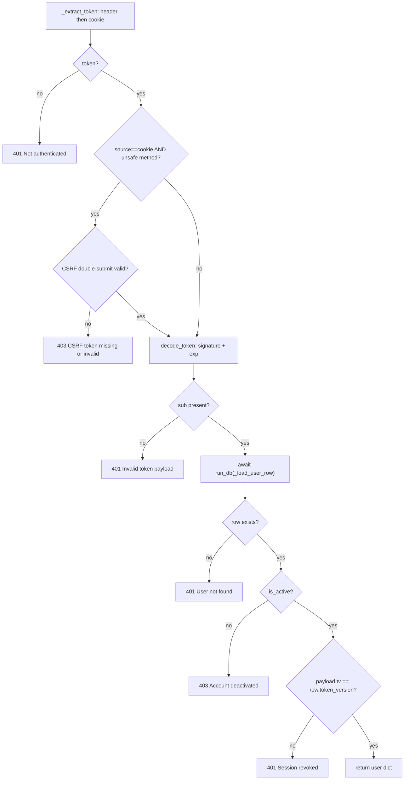
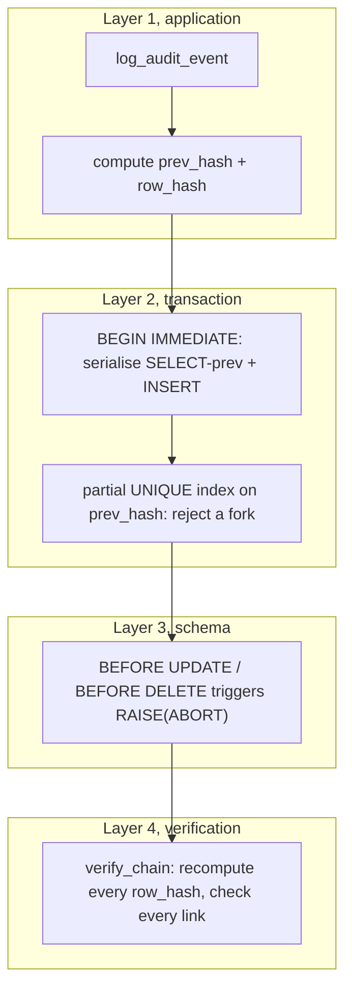

# 3. Security, Authentication, and Audit

*Modules owned by this chapter: `server/auth.py`, `server/permissions.py`,
`server/routes/auth_routes.py`, `server/services/mfa_service.py`,
`server/services/audit_service.py`, `server/services/audit_middleware.py`,
`server/services/crypto_service.py`, `server/services/field_crypto.py`,
`server/routes/admin_users_routes.py`. Supporting material is cited from
`server/config.py`, `server/database.py`, `server/main.py`,
`server/services/flight_recorder_service.py`, `server/services/pin_security.py`
and the shipped web client.*

---

## 3.1 Scope, threat model, and the constraints that produced this design

### 3.1.1 What this subsystem is responsible for

Orb is the system of record for two hospital wards. It holds patients,
admissions, vitals, orders, medications, clinical notes, documents, messages and
its own audit log in a single SQLite file, plus imaging and consultation audio in
a directory beside it. There is no second copy anywhere. Everything in this
chapter exists to answer three questions on every request:

1. **Who is this?** (§3.3–§3.7, passwords, tokens, MFA)
2. **May they do this?** (§3.8, RBAC)
3. **Can we prove afterwards that they did it?** (§3.10, the audit chain)

and one question about the disk itself:

4. **If the machine leaves the building, what does the thief get?** (§3.12, 
   encryption and key custody)

### 3.1.2 The constraints

Six facts about the deployment shape almost every decision below. They are worth
stating once, because the rest of the chapter refers back to them constantly.

| Constraint | Consequence for this subsystem |
|---|---|
| **One machine, no cloud, no horizontal scale.** A single Mac Studio on the hospital LAN. | There is no second process to share session state with, no Redis, no identity provider. Stateless JWTs and in-memory rate-limit state are *adequate* here in a way they would not be in a fleet. |
| **SQLite with SQLCipher; one writer.** Every page read costs HMAC-SHA512 + AES. | The audit chain's serialisation strategy (`BEGIN IMMEDIATE`) is cheap *because* there is only one writer to serialise. Every synchronous DB call is more expensive than it looks. |
| **The event loop is sacred.** Three production freezes have been traced to blocking it. | `get_current_user` pushes its user-row read to a worker thread (`server/auth.py:210`). The audit middleware does not (§3.10.9), a real, measured, unfixed asymmetry. |
| **Clinical safety: draft-and-approve, never autonomous action.** | Authorization failures must be loud and recorded; the second-factor signing PIN exists so that "the JWT was stolen" is not sufficient to commit an order. |
| **One solo operator.** No SOC, no 24/7 on-call, no second administrator on a fresh appliance. | Every lockout mechanism needs a recovery path that one person can execute at the console. This is the entire reason the MFA enrolment ticket exists (§3.7.4). |
| **A hard pilot date (Week 13).** | Several controls are explicitly "good enough for the pilot". They are marked as such rather than dressed up. |

### 3.1.3 Threat model, stated plainly

**In scope.** A stolen or shoulder-surfed password. A curious clinician reading a
chart they have no business in. An insider editing history after the fact. A
stolen backup drive or a pulled SSD. An XSS or a compromised npm dependency
trying to exfiltrate a session. CSRF from a malicious page a logged-in clinician
opens in another tab. Online password guessing against a known employee ID.

**Explicitly out of scope.** A network attacker on the LAN with the ability to
run code on the appliance, at that point the SQLCipher key is in the process's
memory and in `/opt/orb/.env` on the same disk, and nothing here helps. A
determined forensic adversary with the raw database file *and* the hashing
algorithm can recompute a self-consistent audit chain offline; the chain is
tamper-*evident* against in-band mutation, not notarised (§3.10.11). There is no
external anchoring, no WORM export, and no retention policy. `docs/SECURITY_ONEPAGER.md`
says this out loud, which is the right call.

---

## 3.2 The identity record

Everything hangs off one row in `users`. The base schema is small
(`server/database.py:22-31`):

```sql
CREATE TABLE IF NOT EXISTS users (
    id TEXT PRIMARY KEY,
    name TEXT NOT NULL,
    role TEXT NOT NULL CHECK (role IN ('doctor','nurse','admin','patient','pharmacist')),
    ...
    password_hash TEXT NOT NULL,
    pin_hash TEXT,
```
`server/database.py:22-30`

Everything security-relevant beyond that arrived as additive `ALTER TABLE`
migrations, which is why so much code in this chapter defensively checks
`"col" in user_row.keys()` before reading:

| Column | Type / default | Added at | Purpose |
|---|---|---|---|
| `pin_hash` | TEXT | base schema `server/database.py:29`; migration `:1269-1273` | Signing PIN for order confirmation (§3.3.5) |
| `failed_login_attempts` | INTEGER DEFAULT 0 | `server/database.py:1279-1281` | Persistent per-account lockout counter |
| `login_locked_until` | REAL | `server/database.py:1282-1284` | Unix timestamp; NULL when unlocked |
| `totp_secret` | TEXT | `server/database.py:1618-1619` | base32 TOTP secret |
| `totp_enabled` | INTEGER DEFAULT 0 | `server/database.py:1620-1621` | 0 until a live code is proven |
| `token_version` | INTEGER DEFAULT 0 | `server/database.py:1622-1623` | Session revocation counter |
| `totp_last_step` | INTEGER DEFAULT -1 | `server/database.py:1627-1628` | Highest consumed TOTP time-step (anti-replay) |
| `is_active` | INTEGER DEFAULT 1 | `server/database.py:1633-1635` | 0 disables login without deleting the row |

The `is_active` design deserves one sentence of justification: a terminated
clinician's row is never deleted, because deleting it would orphan every audit
row that names them as actor. Deactivation is a flag plus a `token_version` bump
(§3.9.3).

**Note the `role` CHECK constraint.** It permits exactly five values. The
permission map (§3.8) also defines a sixth key, `clinician`, as an alias for
`doctor`, but no `users` row can ever hold that value, because the CHECK would
reject it. The alias exists for tokens and for code paths that historically used
the word; it is dead weight in the database.

---

## 3.3 Passwords

### 3.3.1 Hashing

```python
def hash_password(password: str) -> str:
    """Hash password using salted bcrypt."""
    pwd_bytes = password.encode('utf-8')
    salt = bcrypt.gensalt()
    hashed = bcrypt.hashpw(pwd_bytes, salt)
    return hashed.decode('utf-8')
```
`server/auth.py:107-112`

`bcrypt.gensalt()` defaults to cost factor 12 in the `bcrypt` package, i.e. 2¹²
rounds. No cost factor is configured anywhere in the repo, so the library default
governs. On Apple silicon that is roughly 200–300 ms per hash, which is the
right order of magnitude for an interactive login and, importantly, is also the
reason the boot-time "shipped default password" sweep in
`server/services/bootstrap_service.py` runs on its own daemon thread and is
described in its own docstring as "a minute of bcrypt on a cold box"
(`server/services/bootstrap_service.py:661-668`).

Bcrypt silently truncates input at 72 bytes. `admin_users_routes` caps password
fields at 200 characters and explicitly declines to pre-truncate, deferring to
the library (`server/routes/admin_users_routes.py:52-53`). That is a defensible
choice, pre-truncating would be a behaviour change with no security benefit, 
but it does mean two passwords differing only after byte 72 are the same
password to Orb. For a hospital with human-chosen passwords this never fires.

### 3.3.2 Verification, and the legacy SHA-256 path

```python
def verify_password(password: str, hashed: str) -> bool:
    if not hashed.startswith('$2'):
        legacy_hash = hashlib.sha256(password.encode()).hexdigest()
        return hmac.compare_digest(legacy_hash, hashed)
    try:
        return bcrypt.checkpw(password.encode('utf-8'), hashed.encode('utf-8'))
    except Exception:
        return False
```
`server/auth.py:115-126`

Three things are load-bearing here.

**The format discriminator is the `$2` prefix.** Every modern bcrypt variant
(`$2a$`, `$2b$`, `$2y$`) starts with it; a hex SHA-256 digest never can, because
hex digits do not include `$`. So the branch is unambiguous without a version
column.

**The legacy branch uses `hmac.compare_digest`, not `==`.** The comment at
`server/auth.py:118-119` explains why: `==` on Python `str` short-circuits on the
first differing byte, which leaks a timing signal proportional to the length of
the matching prefix. Against an unsalted SHA-256 that signal is genuinely useful
to an attacker who can measure it. This is a small, correct hardening of a path
that should not exist at all.

**The bcrypt branch swallows every exception into `False`.** `bcrypt.checkpw`
raises `ValueError` on a malformed salt. Returning `False` is fail-closed and
correct; the cost is that a corrupted `password_hash` column presents to the
operator as "wrong password" rather than "your database is damaged". Given that
the alternative is a 500 on the login route, this is the right trade.

**Why the legacy path exists at all.** Early Orb stored bare SHA-256 digests.
Unsalted SHA-256 is catastrophically weak for passwords: it is fast (billions of
guesses/second on a GPU), unsalted (so one rainbow table breaks every account
simultaneously), and offers no work-factor tuning. The path is retained purely so
that an appliance carrying pre-migration rows still lets those users log in, 
once, at which point:

### 3.3.3 Auto-upgrade on successful login

```python
if not user["password_hash"].startswith('$2'):
    try:
        new_hash = hash_password(credentials.password)
        db = get_db()
        db.execute("UPDATE users SET password_hash = ? WHERE id = ?", (new_hash, user["id"]))
        db.commit(); db.close()
        logger.info("Password hash upgraded to bcrypt for user %s", user["id"])
    except Exception as e:
        logger.warning("Failed to upgrade password hash for user %s: %s", user["id"], e)
```
`server/routes/auth_routes.py:369-379`

The algorithm is trivial; the *placement* is the whole design. Login is the only
moment in the system's life when the plaintext password exists in memory
alongside a proven-correct match. A background migration cannot do this, it has
the hash, not the password. So the upgrade is opportunistic and lazy: an account
that never logs in keeps its weak hash forever.

The `try/except` that swallows the failure is deliberate: an upgrade failure
(disk full, lock contention) must not turn a valid login into a 500. The user
logs in on their old hash and the upgrade is retried next time.

**Ordering matters and is correct.** The upgrade sits *after* the MFA gate
(`:340-362`) and after lockout clearing (`:364-367`), so a login that fails MFA
never rewrites the hash. If it had been placed immediately after
`verify_password`, an attacker who knew a legacy account's password but not its
TOTP code could still force a hash rewrite, harmless, but sloppy.

**Verification gap.** `server/scripts/access_review.py:20-22` reports "a legacy
non-bcrypt password hash (pre-migration accounts)" as a finding, which is the
right operational answer: the operator can see who has not yet been upgraded and
force a reset. There is no test in `server/tests/` that pins the upgrade
behaviour itself.

### 3.3.4 Alternatives considered: bcrypt vs argon2 vs scrypt vs PBKDF2

**Argon2id** is the current consensus recommendation (Password Hashing
Competition winner, OWASP's first choice). It is memory-hard, which specifically
defeats the GPU/ASIC advantage bcrypt only partially blunts. **It would be the
better algorithm here**, and the honest reason it was not used is that bcrypt was
already in the tree and the pilot date is fixed.

The argument for staying on bcrypt is nevertheless real and worth writing down:

- **Dependency weight on a locked appliance.** `argon2-cffi` is a native
  extension. This machine already carries a native SQLCipher driver, a native
  vector-search extension, PyTorch and Whisper; the repo's memory of dependency
  pain (`server/db_backend.py:50-61` documents a whole class of bugs caused by
  the SQLCipher driver's exception hierarchy) makes "one fewer native dependency"
  a genuine argument rather than laziness.
- **The migration would need a third hash format.** `verify_password` currently
  discriminates on two. Adding Argon2 means a three-way branch and a second
  lazy-upgrade path, on a codebase that is about to freeze for a pilot.
- **The threat model does not reward it much.** Argon2's advantage is against
  *offline* cracking of a stolen hash file. On this appliance the hash file is
  inside a SQLCipher-encrypted database; an attacker who can read it has already
  defeated at-rest encryption, and at that point they hold every chart in
  plaintext anyway. The password hashes are not the crown jewels here, the
  patient records are.

**scrypt** (available in the Python stdlib via `hashlib.scrypt`, so zero new
dependencies) is the alternative that would have cost nothing to adopt and is
memory-hard. No recorded rationale for skipping it; the plausible reason is
simply that nobody revisited the choice after the initial bcrypt commit.

**PBKDF2-HMAC-SHA256** (also stdlib) would have been a *downgrade* from bcrypt, 
it is not memory-hard and is the friendliest of the four to GPU cracking. Not a
serious candidate.

**Recommendation for the record:** if this is ever revisited, `hashlib.scrypt` is
the highest value-per-risk move, because it adds no dependency and reuses the
existing two-format lazy-upgrade machinery to become three-format.

### 3.3.5 The second credential: the signing PIN

Passwords authenticate a *session*. Orb has a second, narrower credential that
authorises a *clinical commitment*: the signing PIN, used to confirm an
AI-drafted order.

`server/services/pin_security.py` mirrors the password design deliberately:

- New PINs are salted bcrypt via `auth.hash_password` (`server/services/pin_security.py:44-47`).
- Verification is constant-time on both formats, with the same legacy SHA-256
  branch and the same lazy upgrade (`server/services/pin_security.py:62-80`).
- **A NULL or empty `pin_hash` never verifies** (`server/services/pin_security.py:73-74`).
  This is the fail-closed property that made removing "universal PIN seeding"
  safe: before provisioning, the answer is "no PIN exists", not "any PIN works".
- A per-user sliding-window limiter, 5 failures / 15 minutes, throttles online
  PIN guessing, with the same in-memory caveat as the login limiter
  (`server/services/pin_security.py:38-42`).

The threat this closes is precise: a stolen JWT (or an unlocked, unattended
workstation) gets you a session, but not the ability to sign an order into
existence. That is why `POST /api/admin/users/{id}/pin` requires the caller's
**password** when setting their own PIN, "a signing credential must not be
mintable from a stolen JWT alone" (`server/routes/admin_users_routes.py:341-349`,
enforced at `:360-366`).

---

## 3.4 Tokens and sessions

### 3.4.1 Token minting

```python
payload = {
    "sub": user_id,
    "role": role,
    "tv": int(token_version),
    "jti": str(uuid.uuid4()),
    "exp": datetime.now(timezone.utc) + timedelta(hours=JWT_EXPIRY_HOURS),
    "iat": datetime.now(timezone.utc),
}
return jwt.encode(payload, JWT_SECRET, algorithm=JWT_ALGORITHM)
```
`server/auth.py:145-153`

HS256, 24-hour expiry, secret from `ORB_JWT_SECRET` (`server/config.py:49-58`).
The secret is **fail-closed in production**: absent it, `config.py` raises at
import time unless `ORB_DEPLOYMENT_PROFILE=dev` or pytest is loaded
(`server/config.py:50-56`). A dev fallback string exists and is named
`"orb-local-dev-secret-key-change-in-prod"`, which is the correct way to make a
dangerous default self-documenting in a log line.

Each claim earns its place:

- `sub`, the user id. The only claim authorisation actually trusts, and only as
  a *lookup key*.
- `role`, **carried for convenience, not trusted.** `server/auth.py:134-136`
  states this explicitly, and it is true in code: `get_current_user` returns the
  DB row, and `require_permission` reads `user.get("role")` from that row
  (`server/permissions.py:218`). A token minted before a demotion cannot widen
  access. This is the single most important non-obvious property of the design,
  because it is what makes 24-hour tokens tolerable.
- `tv`, the revocation counter (§3.4.4).
- `jti`, a per-token UUID. **Nothing consumes it.** There is no blocklist table,
  no replay check. It exists so that a token is individually *identifiable* in a
  log if one is ever pasted into an incident report. Calling that out is more
  honest than implying it does work it does not do.
- `exp` / `iat`, validated by PyJWT during `decode`.

`create_token` will read `token_version` itself if the caller does not supply it
(`server/auth.py:137-144`), opening a fresh `db_session` to do so. Both real
callers (`login` at `:381-382`, `refresh` at `:647-648`) already hold the row and
pass it, so this fallback is only exercised by tests and by
`issue_mfa_enroll_ticket`'s callers. The docstring says as much.

### 3.4.2 Token verification

```python
def decode_token(token: str) -> dict:
    try:
        return jwt.decode(token, JWT_SECRET, algorithms=[JWT_ALGORITHM])
    except jwt.ExpiredSignatureError:
        raise HTTPException(status_code=401, detail="Token expired")
    except jwt.InvalidTokenError:
        raise HTTPException(status_code=401, detail="Invalid token")
```
`server/auth.py:156-162`

`algorithms=[JWT_ALGORITHM]` is pinned to a single-element list. This is the
correct defence against the classic JWT algorithm-confusion attack, where an
attacker re-signs a token with `alg: none` or swaps HS256 for RS256 to abuse a
public key as an HMAC secret. Passing a list that PyJWT will *match against*,
rather than reading the algorithm out of the untrusted header, is the whole fix.

### 3.4.3 `get_current_user`: the hottest path in the process

Every authenticated request passes through this one dependency
(`server/auth.py:185-232`). Its order of operations is not arbitrary:



**Why CSRF is checked before signature verification.** Cheaper first. A
cross-site forgery attempt carries a *valid* session cookie by definition, the
browser attached it, so checking the signature first would do the expensive work
on a request that is going to be rejected anyway. More importantly, the CSRF
check is placed *here* rather than in a global middleware, and
`server/main.py:637-642` explains why: enforcing it globally would falsely block
endpoints that authenticate by other means (the discharge-access token flow, the
`X-API-Key` ingestion path) whenever a logged-in clinician's browser happened to
be carrying a session cookie. Putting it inside the one dependency that *knows*
the request was authenticated by cookie makes the check exactly as wide as the
risk.

**The single-snapshot invariant.** `_load_user_row` is a module-level function,
not a closure, and it deliberately performs *one* statement in *one* session:

```python
    ONE session, ONE statement, deliberately. get_current_user makes three
    decisions off this row (exists / is_active / token_version) and they must all
    be judged against the SAME snapshot. Splitting the read into separate
    run_db() hops would put an await between them, letting an admin
    deactivation or a logout-driven token_version bump land in the gap
```
`server/auth.py:172-177`

This is a genuine TOCTOU argument, not decoration. Under `asyncio`, every `await`
is a yield point; three separate `run_db` calls would give an interleaved
`deactivate_user` request (which sets `is_active=0` *and* bumps `token_version`
in one statement, `server/routes/admin_users_routes.py:269-275`) a window in
which the request under evaluation reads the old `is_active` and the new
`token_version`, or vice versa. One statement, one snapshot, no window.

The comment about not rebuilding a closure per call is a micro-optimisation and
says so; it is worth a sentence only because it flags how hot this path is.

**Off the loop.** `row = await run_db(_load_user_row, user_id)`
(`server/auth.py:210`). `run_db` hands the callable to a dedicated executor
(`server/database.py:1118-1119`) and refuses coroutine functions loudly
(`server/database.py:1112-1117`). The refusal is not paranoia: that docstring
notes that *nine* call sites pass `log_audit_event` through `run_db`, and if it
ever became `async def`, every one of those tamper-evident rows would silently
stop being written, with no exception and no log line. Making that a `TypeError`
at the boundary is exactly right.

The reason this particular read must be off the loop is the encryption
constraint: since SQLCipher, each page read costs HMAC-SHA512 + AES, and this
statement runs on *every authenticated request*. On the loop, it would serialise
the entire API behind one SQLite lock (`server/auth.py:206-209`).

### 3.4.4 Session revocation: how `token_version` actually works

There is no session table, no blocklist, no denylist. Revocation is one integer.

- Every minted token embeds `tv` = the user's `token_version` at mint time
  (`server/auth.py:148`).
- Every request compares the token's `tv` against the live row
  (`server/auth.py:227-230`). A mismatch is a 401 with
  `"Session revoked; please log in again"`.
- Anything that should kill sessions bumps the counter:

| Action | Site | Bumps? |
|---|---|---|
| `POST /api/auth/logout` | `server/routes/auth_routes.py:613-618` | Yes |
| Self password change | `server/routes/admin_users_routes.py:476-483` | Yes |
| Admin password reset | `server/routes/admin_users_routes.py:314-322` | Yes |
| Admin deactivate | `server/routes/admin_users_routes.py:265-275` | Yes |
| Admin MFA break-glass reset | `server/routes/auth_routes.py:577-583` | Yes |
| Admin **activate** | `server/routes/admin_users_routes.py:291-293` | No, correct; re-enabling should not invalidate anything |
| `PATCH /{id}` role change | `server/routes/admin_users_routes.py:432-434` | **No**, see below |

**Logout is logout-everywhere.** `POST /api/auth/logout` bumps `token_version`,
which invalidates the token on the phone in the clinician's pocket, the token in
the ward tablet, and the token in the browser they are looking at
(`server/routes/auth_routes.py:606-612`). This is unusual, most systems make
logout local to the device, and it is the *right* default for a shared-ward
appliance where "log me out" most often means "I am leaving this workstation and
I do not know what else I am signed into". `docs/SECURITY_ONEPAGER.md` states it
as a feature. The cost is that a clinician using both a tablet and a desktop is
signed out of both; the pilot's shift pattern makes that acceptable.

**Role change does not revoke.** `PATCH /api/admin/users/{id}` changes `role`
without bumping `token_version`. This is *safe* only because of the
"role-from-DB-not-from-token" property (§3.4.1): the very next request re-reads
the row and the new role takes effect immediately. It is worth stating explicitly
because a reader who assumed the token's `role` claim was authoritative would
correctly flag this as a privilege-escalation-persistence bug. It is not one, 
but it is one refactor away from becoming one, and there is no test pinning the
invariant "authorization never reads `payload['role']`".

**Deactivation is enforced twice.** Once at login (`server/routes/auth_routes.py:291-300`)
and once on every request (`server/auth.py:220-221`). The login check is
positioned *after* password verification specifically so that an unauthenticated
caller cannot enumerate which employee IDs are deactivated
(`server/routes/auth_routes.py:288-290`). The per-request check is what makes
deactivation instant rather than "instant for new logins, up to 24 hours for
existing ones".

Note that `server/routes/admin_users_routes.py:23-27` carries a **stale
SECURITY NOTE** claiming "the login handler does NOT currently reject
`is_active=0` users". It does, `server/routes/auth_routes.py:291`. The comment
predates the fix and should be deleted. `server/tests/test_auth_lockout_active.py:62`
(`test_deactivated_user_cannot_login`) and `:71`
(`test_deactivation_blocks_existing_token`) pin both halves.

### 3.4.5 Cookie vs Authorization header: the duality

Orb accepts the same JWT through two transports (`server/auth.py:95-104`):

```python
    auth = request.headers.get("authorization") or request.headers.get("Authorization")
    if auth and auth.lower().startswith("bearer "):
        return auth[7:].strip(), "header"
    cookie = request.cookies.get(SESSION_COOKIE)
    if cookie:
        return cookie, "cookie"
    return None, "none"
```
`server/auth.py:98-104`

**Why the cookie was added.** The previous design put the JWT in
`localStorage`. Any script running on the origin, an XSS, or a compromised
transitive npm dependency, could read it and exfiltrate a clinician's 24-hour
session. An `HttpOnly` cookie is invisible to JavaScript, so that entire class of
attack stops working (`server/auth.py:15-25`).

**Why the header stayed.** Machine clients, the test suite (which uses
`TestClient` and Bearer tokens throughout), and backward compatibility. Header
auth is also the transport for the MFA enrolment ticket (§3.7.4).

**The CSRF consequence, and the double-submit answer.** Cookies are attached by
the browser automatically, including on cross-site form posts, which
reintroduces CSRF, a risk `localStorage` did not have. The answer is a
double-submit token: login sets a second, deliberately **JS-readable** cookie
`orb_csrf`, and the SPA echoes its value in the `X-CSRF-Token` header on every
mutation.

```python
def csrf_token_valid(request: Request) -> bool:
    cookie = request.cookies.get(CSRF_COOKIE)
    header = request.headers.get(CSRF_HEADER)
    if not cookie or not header:
        return False
    return hmac.compare_digest(cookie, header)
```
`server/auth.py:79-87`

The security argument is that a cross-site attacker can *cause* the cookie to be
sent but cannot *read* it (same-origin policy) and therefore cannot set the
matching header. `hmac.compare_digest` keeps the comparison constant-time, which
matters less here than elsewhere but costs nothing.

Bearer-authenticated mutations are CSRF-exempt by design
(`server/auth.py:194-197`): a cross-site attacker cannot add an `Authorization`
header to a form post or an `` load, so the header is itself proof of
non-forgery. `server/tests/test_cookie_auth_csrf.py:84`
(`test_bearer_mutation_is_csrf_exempt`) pins this.

**Cookie flags** (`server/auth.py:58-71`):

| Flag | Session cookie | CSRF cookie | Why |
|---|---|---|---|
| `httponly` | **True** | False | The session is the credential; the CSRF token is not |
| `secure` | per-request | per-request | See below |
| `samesite` | `lax` | `lax` | Blocks cross-site POST; still allows top-level GET navigation |
| `max_age` | `JWT_EXPIRY_HOURS * 3600` | same | Cookie lifetime tracks token lifetime |
| `path` | `/` | `/` | The API and the SPA share an origin |

`secure` is resolved per request by `cookie_secure` (`server/auth.py:45-55`),
which honours `ORB_COOKIE_SECURE` as a hard override and otherwise sniffs the
effective scheme, including `X-Forwarded-Proto` from a terminating proxy
(`server/auth.py:36-42`). The reason is deployment-shaped and worth quoting:
hard-coding `Secure=True` would make cookies silently vanish on a plain-HTTP LAN
pilot; hard-coding `False` would leak the session over an ngrok HTTPS tunnel.
Auto-detection with an explicit override is the honest answer for an appliance
whose transport is not yet decided.

**`samesite="lax"` is not `strict`.** With `lax`, a top-level GET navigation from
another site carries the cookie. Since every mutation is a POST/PUT/PATCH/DELETE
and every one of those additionally requires the CSRF header, the practical
exposure is limited to GET endpoints, which are read-only. `strict` would break
the "click the link in the handover email and land signed in" flow. No recorded
rationale, but this is the standard trade and it is the right side of it here.

### 3.4.6 The bug the duality caused: NULL actors on browser-originated audit rows

This is the most important defect in the chapter, and it is **live in the code as
read**.

The shipped web client no longer persists the JWT:

```ts
  // NOTE: we deliberately do NOT persist data.token, the session lives in the
  // HttpOnly `orb_session` cookie the server set on this response, unreadable to
  // JS. Storing the JWT in localStorage is exactly the XSS-exfiltration hole this
  // change closes.
```
`src/api/client.ts:481-484`

`getToken()` therefore returns `null` in the normal browser flow
(`src/api/client.ts:12-24`), and `buildHeaders` consequently attaches **no
`Authorization` header** (`src/api/client.ts:148-153`). Requests authenticate by
cookie plus `credentials: 'include'` (`src/api/client.ts:174-180`).

The audit middleware, however, identifies the actor from the header *only*:

```python
def _actor_from_request(request) -> tuple[str | None, str | None]:
    """Best-effort decode of the bearer JWT to (user_id, role). Never raises."""
    auth = request.headers.get("authorization") or request.headers.get("Authorization")
    if not auth or not auth.lower().startswith("bearer "):
        return None, None
```
`server/services/audit_middleware.py:30-34`

It never reads `request.cookies.get(SESSION_COOKIE)`, and it does not use
`auth._extract_token`. The result: **every browser-originated mutation writes an
`api_mutation` audit row with `actor_user_id = NULL` and `actor_role = NULL`.**

This is not a theoretical reading. Querying the live appliance database:

```
event_category='api_mutation', grouped by user-agent class:
  user_agent NULL (internal/bots) : 15198 rows,  0 NULL actor
  Python-urllib/3.12 (tests/tools): 12314 rows,  0 NULL actor
  python-httpx/0.28.1             :   160 rows,  0 NULL actor
  browser (Mozilla/...)           :    43 rows, 42 NULL actor
  curl/8.7.1                      :    39 rows,  1 NULL actor
```

Every browser row but one has no actor. Sample rows include
`POST /api/emar/medications/104/administer` and
`POST /api/ipass/PAT-A73E5E98/save`, a medication administration and a handover
save, both recorded with no idea who did them. The single non-NULL browser row
predates the localStorage change (or came from a client that still carried a
token).

**Why it did not show up sooner.** The browser share of traffic on a development
appliance is tiny, 43 rows out of 27,757. Everything else is the test suite and
the simulation bots, both of which use Bearer tokens, so the middleware looks
correct in every automated check. The metric that would have caught it is exactly
the one nobody thought to write: "no `api_mutation` row from a browser user-agent
may have a NULL actor."

**Why it matters more than it looks.** §3.10.7 explains that the middleware is
the *safety net*, the mechanism whose whole purpose is that no mutation goes
unlogged when a route forgets its own audit call. For browser traffic, the safety
net currently records that *something* happened, not *who* did it. Route-level
audit events are unaffected (they take the actor from the resolved `user` dict,
e.g. `server/routes/admin_users_routes.py:101-102`), so the richer events are
correct, which is precisely why the gap is easy to miss.

**The fix is four lines.** `_actor_from_request` should call
`auth._extract_token(request)` (which already prefers header, falls back to
cookie, and returns the source) instead of parsing the header itself. There is no
downside: the cookie is already validated by `get_current_user` on the same
request, and the middleware's decode is best-effort with a bare `except` around
it (`server/services/audit_middleware.py:40-41`).

A second, smaller consequence of the same root cause: `GET /api/admin/users`
computes `last_login` from `audit_logs` rows where
`action_type='login_success'` (`server/routes/admin_users_routes.py:150-159`).
Those rows come from the *route*, not the middleware, so they carry the actor
correctly. The admin user list is not affected. But any future dashboard that
tries to attribute mutations to users from `api_mutation` rows will silently
under-count browser activity.

### 3.4.7 `POST /api/auth/refresh`

```python
    _tv = user["token_version"] if "token_version" in user.keys() and ... else 0
    token = create_token(user["id"], user["role"], token_version=_tv)
    set_session_cookies(response, request, token, generate_csrf_token())
```
`server/routes/auth_routes.py:647-649`

Sliding-window session extension. It runs behind `get_current_user`, so an
expired, revoked or deactivated session cannot refresh itself, it 401s in the
dependency before the handler runs. Because it is a cookie-authenticated POST, it
requires the CSRF header, enforced in the same dependency
(`server/routes/auth_routes.py:644-646`). It also **rotates the CSRF token** on
every refresh, which is free defence-in-depth.

Note the absence of a *refresh token* in the OAuth sense. There is one token
class, and refreshing means re-minting it at the current `token_version`. A
stolen session can be refreshed indefinitely by the thief, the mitigation is
`token_version` revocation, not short-lived access tokens. For an appliance with
no cloud attack surface and a physically controlled network, this is a defensible
simplification; for anything internet-facing it would not be.

### 3.4.8 Alternatives: JWT vs server-side sessions

**Server-side sessions** (a `sessions` table, opaque cookie, row lookup per
request) is the alternative a competent engineer would push hardest. Its
advantages are real and they matter *here*, not in the abstract:

- **Per-device revocation.** Orb cannot revoke one device today. `token_version`
  is all-or-nothing. A session table would let a clinician kill "the tablet in
  Bay 4" without signing out their own desktop. `docs/SECURITY_ONEPAGER.md`
  lists "revocation is per-user, not per-device" as a known gap.
- **Instant, complete revocation with no counter gymnastics.** Delete the row.
- **No secret-rotation problem.** Rotating `ORB_JWT_SECRET` today invalidates
  every outstanding token at once, with no graceful path.
- **The "stateless" advantage is worth nothing on one machine.** JWT's headline
  benefit, any node can verify without shared state, is a distributed-systems
  benefit. Orb has one node.

The reasons JWT won anyway:

1. **Orb already does a DB read per request.** `get_current_user` loads the full
   `users` row on every call (`server/auth.py:180-182`). The theoretical
   "stateless = no DB hit" saving does not exist in this codebase. But note the
   corollary: *since the read happens anyway, a session table would cost almost
   nothing extra*, one indexed lookup on the same connection. This is the
   strongest argument that the choice was inherited rather than reasoned.
2. **The Socket.IO handshake reuses `decode_token`.** The realtime channel
   authenticates from the same JWT (`src/api/client.ts:29-40` describes the
   handshake contract). A session table would need a parallel path.
3. **Pilot date.** Migrating auth is a high-blast-radius change with no
   user-visible benefit, three weeks from a go-live.

**Verdict:** the honest summary is that JWT is not clearly the right answer here
the usual reason to pick it does not apply, but the incremental cost of the
existing design is one integer bump and one missing feature (per-device
revocation), and that is a fair price for not touching auth before a pilot. If
per-device revocation is ever required, the migration path is clean: add a
`sessions` table keyed by `jti`, which the token already carries and nothing
currently reads.

**A third option, opaque tokens with a server-side lookup but no cookie**, is
strictly worse than either, combining the revocation story of sessions with the
XSS exposure of `localStorage`.

---

## 3.5 The login decision ladder

`POST /api/auth/login` (`server/routes/auth_routes.py:218-412`) is a single
function with eleven decision points in a specific order. The order is the
design; getting it wrong leaks information or creates a bypass. Read top to
bottom:

| # | Check | Site | Failure | Counts toward lockout? | Audited? |
|---|---|---|---|---|---|
| 1 | Per-IP rate limit | `:232-245` | 429 | n/a | `login_rate_limited` |
| 2 | Look up `users` row by id | `:250-252` | falls through to #4 | n/a | n/a |
| 3 | Per-account lock active | `:259-267` | 429 | n/a | `account_locked` |
| 4 | Password verify (or no such user) | `:269-285` | 401 `"Invalid credentials"` | **Yes**, both IP and account | `login_failure` |
| 5 | `is_active` | `:291-300` | 403 | No | `login_denied_inactive` |
| 6 | Role mandates MFA and account unenrolled | `:311-338` | 403 `"mfa_enrollment_required"` + ticket header | No | `mfa_enrollment_ticket_issued` |
| 7 | MFA enabled, no code supplied | `:341-346` | 401 `"mfa_required"` | **No**, deliberate | **No** |
| 8 | MFA code invalid or replayed | `:347-362` | 401 `"Invalid MFA code"` | Yes (IP only) | `mfa_failure` |
| 9 | Clear lockout state | `:364-367` | n/a | n/a | n/a |
| 10 | Legacy hash upgrade | `:369-379` | swallowed | n/a | n/a |
| 11 | Mint token, set cookies, audit, return | `:381-412` | n/a | n/a | `login_success` |

Several of these orderings are load-bearing:

**#3 before #4.** The account-lock check happens before password verification, so
a locked account costs the attacker no bcrypt work and reveals nothing about the
password. It *does* reveal that the account exists and is locked, a minor
enumeration oracle, accepted in exchange for the 429 being informative to a
legitimate locked-out user.

**#4 merges "no such user" and "wrong password".** `if not user or not
verify_password(...)`, one branch, one message. But note the timing asymmetry: a
nonexistent user skips bcrypt entirely and returns in microseconds, while a real
user pays ~250 ms. That is a **user-enumeration timing oracle**, and it is real,
though exploiting it over a hospital LAN against a five-role appliance with a
known employee-ID scheme buys an attacker very little. The standard fix is to
verify against a dummy hash when the user is absent. Not implemented; not
recorded as a known gap anywhere. Flagging it here.

**#5 after #4.** Deliberate, and commented (`:288-290`): checking `is_active`
before the password would let an unauthenticated caller enumerate deactivated
accounts.

**#7 does not count toward lockout, and #8 does.** The comment at `:342-344` is
the reasoning: a password-correct login with no code yet is the *normal* first
half of a two-step flow, not a guess. Penalising it would lock out every MFA user
on their first submit. A *wrong* code is a guess and is penalised. This is
correct and subtle.

**#7 is not audited.** `mfa_required` returns without writing an audit row. That
is arguably right (it is a UI state transition, not a security event) and
arguably wrong (a burst of `mfa_required` responses for one account is a signal
that someone has the password). Since `login_success` and `mfa_failure` bracket
it, the signal is recoverable. Low priority.

---

## 3.6 Rate limiting and lockout

Two independent mechanisms with different threat models. Both are needed; neither
subsumes the other.

### 3.6.1 The in-memory per-IP limiter

```python
LOGIN_ATTEMPTS = defaultdict(list)
MAX_LOGIN_ATTEMPTS = 5
LOCKOUT_DURATION_SECONDS = 900  # 15 minutes
_MAX_TRACKED_IPS = 10000
```
`server/routes/auth_routes.py:32-36`

A sliding window, not a fixed one: `is_ip_rate_limited` filters the IP's
timestamp list to entries newer than 900 s and compares the length against 5
(`server/routes/auth_routes.py:60-64`). Five failures in any 15-minute window
locks the IP for as long as five failures remain in the window, so the lock
decays naturally rather than expiring on a clock boundary.

**Memory bounding.** `_prune_login_attempts` (`server/routes/auth_routes.py:39-51`)
runs on every check and does two things: it deletes buckets whose newest entry
has aged out, and if the dict is still over 10,000 keys (an active spray from
many source IPs) it evicts the least-recently-touched buckets. This was added in
response to an explicit finding ("unbounded dict of every attacking IP"), the
comment says so at `:42-43`.

**Dev-profile exemption.** Localhost is exempt when
`DEPLOYMENT_PROFILE == "dev"` (`server/routes/auth_routes.py:57-59`). Correctly
gated on the profile, so a production appliance does not exempt itself.

Now the honest accounting, most of which the code states about itself
(`server/routes/auth_routes.py:22-31`):

**What a restart means.** The state is a module-level dict. Restart the process, 
a deploy, a crash, a `launchd` respawn, and every lock evaporates instantly. An
attacker who can *cause* a restart, or who simply waits for the operator's next
deploy, gets a free reset. On this appliance the practical consequence is small:
the persistent per-account lockout (§3.6.2) survives restarts and is the control
that actually protects a *specific* account. The IP limiter's job is to make
broad spraying expensive, and losing that on restart costs an attacker one
window, not the account.

**What a reverse proxy means.** The limiter keys on `request.client.host`, the
raw TCP peer. Behind a reverse proxy that is the proxy's address, so the ward
shares one bucket: five failures anywhere on the ward locks the whole ward out
for fifteen minutes. Behind the *same* proxy with `X-Forwarded-For` unread, an
attacker's real IP is invisible, so per-IP limiting does nothing at all. Both
failure modes are recorded at `:24-26`. The recommended fix, resolve the client
IP from a trusted proxy header *only when behind a known proxy*, is deferred.

**What "per-IP" cannot see.** Credential stuffing distributed across many source
IPs against one account is completely unthrottled by this mechanism. That is
precisely the gap §3.6.2 fills.

**Thread-safety, unstated in the code.** `login` is declared `def`, not
`async def` (`server/routes/auth_routes.py:219`), so Starlette runs it in the
threadpool, several logins can execute concurrently on different threads.
`LOGIN_ATTEMPTS` is a plain `defaultdict` mutated without a lock, and
`_prune_login_attempts` builds its stale list by iterating `.items()`
(`server/routes/auth_routes.py:44-45`). A concurrent insert during that
comprehension raises `RuntimeError: dictionary changed size during iteration`,
which would propagate out of `is_ip_rate_limited` and 500 the login. This is a
narrow race, it needs two logins to interleave inside a few microseconds of list
comprehension, and it has not been observed. A `threading.Lock` around the three
mutating functions would close it for essentially no cost. Not currently present.

*(Being `def` rather than `async def` is otherwise a deliberate good thing: it
keeps the ~250 ms of bcrypt and several blocking `get_db()` calls off the event
loop for free. See §3.10.9 for the place where this discipline was not applied.)*

### 3.6.2 The persistent per-account lockout

```python
ACCOUNT_MAX_FAILURES = 8
ACCOUNT_LOCK_SECONDS = 900  # 15 minutes
```
`server/routes/auth_routes.py:76-77`

Backed by `users.failed_login_attempts` and `users.login_locked_until`. The
mechanics are a counter that increments on each failure and, at the threshold,
**resets to 0 and sets an absolute unlock timestamp** in one statement:

```python
            if fails >= ACCOUNT_MAX_FAILURES:
                db.execute(
                    "UPDATE users SET failed_login_attempts = ?, login_locked_until = ? WHERE id = ?",
                    (0, time.time() + ACCOUNT_LOCK_SECONDS, user_id),
                )
```
`server/routes/auth_routes.py:100-104`

Resetting the counter at lock time is the right shape: after the 15-minute lock
expires, the attacker gets a fresh budget of 8 rather than being permanently
locked at 8. That converts a denial-of-service (attacker locks a doctor out
forever by failing 8 logins twice a day) into a throttle. The trade is that a
patient attacker gets 8 guesses per 15 minutes, i.e. 768/day, indefinitely. For a
password of any reasonable entropy that is not a threat; for `password` it is
game over in seconds, which is why the boot-time shipped-default-password sweep
exists (`server/services/bootstrap_service.py`).

**Threshold asymmetry (8 vs 5) is deliberate and correct.** The per-account
counter must be *looser* than the per-IP counter, because a legitimate user
fumbling their password from one workstation trips the IP limiter first, the
narrower, more recoverable lock. The account lock is reserved for the pattern the
IP limiter cannot see: many IPs, one account.

**`_account_is_locked` is defensive to a fault** (`server/routes/auth_routes.py:80-88`):
it checks column presence via `user_row.keys()`, treats NULL as unlocked, and
swallows `TypeError`/`ValueError` from the float conversion into "not locked".
Fail-*open* on a malformed timestamp. Given that the alternative is locking a
clinician out of a chart because a column contains junk, this is the right side
of the trade for a clinical system, but it is worth naming as a deliberate
fail-open in an otherwise fail-closed area.

**Both writers swallow every exception** (`server/routes/auth_routes.py:113-114`
and `:128-129`), with the comment "lockout must never 500 a login". Correct
priority; the cost is that a persistently failing lockout write degrades silently
to no account lockout at all, visible only as a `logger.warning`.

**No unlock endpoint.** There is no admin "unlock this account" route. The
operator's options are: wait 15 minutes, or reset the password (which does not
clear `login_locked_until` either, `server/routes/admin_users_routes.py:316-322`
touches only `password_hash` and `token_version`). A locked-out clinician
mid-shift waits. For a two-ward pilot with a 15-minute window this is tolerable;
it is the kind of thing that becomes a support burden at scale. Worth noting that
`_clear_account_failures` (`server/routes/auth_routes.py:117-129`) already exists
and does exactly what an unlock endpoint would need, it is called only on
successful login (`:367`).

### 3.6.3 Alternatives

**A persistent `login_attempts` table** keyed on (ip, timestamp) is what the code
itself recommends (`server/routes/auth_routes.py:26-31`). It would fix the
restart-amnesia and make the limiter work under multiple workers. The reason it
was deferred is stated: it needs a schema change, and *"the server currently runs
single-process (uvicorn workers=1), so the in-memory limiter is functional for
the present deploy"*. That is an honest "good enough for Week 13".

The counter-argument nobody wrote down: a persistent table means a DB write per
failed login attempt, i.e. an attacker can drive write amplification against a
SQLCipher database with one writer. The in-memory limiter is *also* a
DoS-resistance choice, whether or not it was chosen for that reason.

**Fail2ban / OS-level firewall rules** would push IP blocking below the
application entirely and survive restarts. It was not chosen; no recorded
rationale. The plausible reasons: it is a second system for one operator to
maintain, and it cannot see the account dimension at all.

**Exponential backoff per account** (1 s, 2 s, 4 s … before responding) instead of
a hard lock avoids the DoS-by-lockout problem entirely while making guessing
expensive. It would be a strictly better design for a clinical system, where
locking out a doctor at 3 a.m. has a patient-safety cost that locking out a
webmail user does not. Not implemented; the reset-counter-at-lock behaviour is a
partial approximation of the same goal.

---

## 3.7 Multi-factor authentication

### 3.7.1 A stdlib TOTP implementation, and why

`server/services/mfa_service.py` is 113 lines and imports nothing outside the
standard library: `base64`, `hashlib`, `hmac`, `os`, `struct`, `time`,
`urllib.parse`. The docstring gives the reason at `:3-5`, enabling MFA must not
pull a new native or pip dependency onto the appliance.

That is a bigger deal than it sounds. `pyotp` is the obvious choice and is pure
Python, so the "native dependency" argument does not literally apply to it; the
real arguments are (a) supply-chain surface on a machine that will not be
patched frequently, and (b) TOTP is ~40 lines of well-specified arithmetic that
can be read in full by one reviewer. For a security control on an appliance with
one operator, "auditable in ten minutes" beats "someone else maintains it".

Parameters are the authenticator-app defaults (`server/services/mfa_service.py:24-28`):
6 digits, 30-second period, SHA-1, ±1 step of skew. SHA-1 here is *correct*, not a
weakness: HOTP/TOTP use HMAC-SHA1, whose security does not depend on SHA-1's
collision resistance, and every authenticator app assumes it.

**`generate_secret`** returns 20 random bytes (160 bits, the RFC 6238
recommendation for SHA-1) base32-encoded with padding stripped
(`server/services/mfa_service.py:31-38`). Padding is stripped because
`otpauth://` URIs conventionally omit it; `_b32decode` restores it on the way
back in (`:41-46`).

**`_hotp`** is a textbook RFC 4226 implementation, big-endian 8-byte counter,
HMAC-SHA1, dynamic truncation using the low nibble of the last byte as an offset,
mask the high bit, modulo 10⁶, zero-pad (`server/services/mfa_service.py:49-59`).
Nothing clever, which is what you want.

**`verify_code_step`** is the interesting one:

```python
    for step in range(-_SKEW_STEPS, _SKEW_STEPS + 1):
        try:
            candidate = _hotp(secret, counter + step)
        except Exception:
            return None
        if hmac.compare_digest(candidate, code):
            return counter + step
    return None
```
`server/services/mfa_service.py:83-90`

It returns the *matched time-step*, not a boolean. That return value is the entire
anti-replay mechanism (§3.7.2). Input is validated before any crypto (digits
only, exactly 6, `:78-80`), so malformed input costs nothing and cannot raise.
Comparison is `hmac.compare_digest`, so a timing attack cannot walk the code digit
by digit. The loop always runs to completion on a miss (three HMACs), so a wrong
code takes constant time regardless of which step it nearly matched.

`verify_code` (`:93-100`) is the boolean wrapper, and its docstring is explicit
that it does **not** enforce single-use. Grep confirms nothing in the request path
calls it; `server/tests/test_mfa_service.py` is the only consumer. Keeping a
footgun in the module with a warning label is defensible; deleting it would be
better.

### 3.7.2 Single-use enforcement

RFC 6238 §5.2 requires that a validated OTP not be accepted a second time. Orb
implements it in `consume_totp`:

```python
        row = db.execute("SELECT totp_last_step FROM users WHERE id = ?", (user_id)).fetchone()
        last = row["totp_last_step"] if row and row["totp_last_step"] is not None else -1
        if step <= last:
            return False  # replay: this step was already consumed
        db.execute("UPDATE users SET totp_last_step = ? WHERE id = ?", (step, user_id))
```
`server/routes/auth_routes.py:149-153`

The invariant is monotonicity: a code is accepted only if its time-step is
**strictly greater** than the highest step already consumed. This is stronger than
"reject the exact code again", because it also rejects the *earlier* code still
inside the ±1 skew window, closing the 30-second replay hole that a naive
implementation leaves open.

The user-visible cost is real and documented in `docs/USER_MANUAL.md:354`: signing
in twice inside 30 seconds requires waiting for the next code. That is a correct
and honest thing to tell a clinician.

**Concurrency.** The read of `totp_last_step` and the write are not in an explicit
transaction, `get_db()`, `SELECT`, `UPDATE`, `commit()`, `close()`. Two
simultaneous logins with the same code could in principle both read `last` before
either writes, and both succeed. Exploiting it requires an attacker who already
has the password *and* the current code, racing a legitimate login within
milliseconds. Given that, the practical risk is negligible, but the fix is one
`BEGIN IMMEDIATE`, exactly as `log_audit_event` uses (§3.10.4), and the pattern is
already in the codebase. Worth doing.

`server/tests/test_auth_mfa_revocation.py:89` (`test_totp_code_cannot_be_replayed`)
pins the sequential case.

### 3.7.3 Enrolment: two phases, so nobody bricks themselves

`POST /api/auth/mfa/enroll/begin` (`server/routes/auth_routes.py:462-487`)
generates a secret, writes it with `totp_enabled = 0`, and returns the secret plus
an `otpauth://` URI for QR display. Re-calling before confirmation *rotates* the
pending secret, so a user who half-scanned a QR can simply start again.

`POST /api/auth/mfa/enroll/confirm` (`:490-520`) requires a live code through
`consume_totp` and only then sets `totp_enabled = 1`.

The invariant: **`totp_enabled` never becomes 1 until the server has seen a code
the user's app actually produced.** A mis-scanned QR, a clock-skewed phone, a
wrong-issuer entry, all fail at confirm, with the account still fully usable by
password. That is the difference between "MFA enrolment" and "MFA enrolment that
locks people out".

The confirm step also consumes a step, so the code used to enrol cannot
immediately be replayed to log in, which is why the client's post-enrolment flow
explicitly tells the user to wait for the next code
(`src/pages/Login.tsx:329-331`).

### 3.7.4 The enrolment ticket, and the bootstrap deadlock it solves

This is the most interesting piece of design in the authentication half of the
chapter.

**The deadlock.** Set `ORB_MFA_REQUIRED_ROLES=admin`. Login now refuses a session
to any admin without a TOTP factor (`server/routes/auth_routes.py:311`). But both
enrolment endpoints sit behind a session, and no admin endpoint provisions TOTP
for another user. On a fresh appliance the only admin is the one you just locked
out. There is nobody to "contact your administrator" about, you *are* the
administrator. The appliance is bricked, recoverable only by editing the database
directly or restarting without the env var. The code says exactly this at
`server/routes/auth_routes.py:161-167`.

**The bridge.** A correct password on a mandated-but-unenrolled account mints a
short-lived **enrolment ticket** instead of a session:

```python
def _mfa_enroll_key() -> str:
    """Signing key for enrolment tickets: derived from, and never equal to, the
    session-token secret."""
    from config import JWT_SECRET
    return hashlib.sha256(f"{JWT_SECRET}|{_MFA_ENROLL_SCOPE}".encode()).hexdigest()
```
`server/routes/auth_routes.py:178-182`

Four properties make this safe, and all four are necessary:

1. **A different signing key.** The ticket is signed with SHA-256(`JWT_SECRET` ‖
   `"mfa_enroll"`), never `JWT_SECRET` itself. `auth.decode_token` verifies
   against `JWT_SECRET` and therefore rejects the ticket's signature outright on
   every other route in the system. This is domain separation done properly: a
   scope *claim* alone would be one forgotten check away from a full session
   token; a different *key* makes the failure mode "signature invalid" everywhere
   by default.
2. **A scope claim, checked.** `_decode_mfa_enroll_ticket` additionally requires
   `scope == "mfa_enroll"` and a non-empty `sub` (`:213-214`). Belt and braces.
3. **600-second TTL** (`:175`), long enough to open an authenticator app and scan
   a QR, short enough not to linger.
4. **Re-validated against the live row.** `_enrolment_principal`
   (`server/routes/auth_routes.py:425-459`) re-checks existence, `is_active`, and
   `token_version` exactly as `get_current_user` does (`:451-457`). So deactivating
   a user or bumping their `token_version` revokes outstanding tickets too. A
   ticket is not a bearer capability that outlives the account.

The ticket travels in a **response header** on the 403
(`server/routes/auth_routes.py:334-338`), not the body, because the SPA branches
on `detail == "mfa_enrollment_required"` and that string had to stay stable.

**The cross-origin failure this caused.** A response header is invisible to
`fetch()` unless the server lists it in CORS `expose_headers`. Single-origin
deployments (SPA served from `:8000`) worked by accident; the Vite dev server on
`:5173` and any split-origin/LAN deployment did not, and the failure is *silent*,
because the header is simply absent. `server/main.py:600-609` documents this and
fixes it:

```python
_EXPOSE_HEADERS = [MFA_ENROLL_TICKET_HEADER]
```
`server/main.py:609`

The client handles the absent-header case explicitly rather than pretending
(`src/pages/Login.tsx:129-134`): it tells the operator to sign in from the
appliance URL itself, instead of the dead-end "contact your administrator".

**Only two endpoints accept it.** `_enrolment_principal` is the dependency for
`/mfa/enroll/begin` and `/mfa/enroll/confirm` and nothing else. It falls through
to `get_current_user` when the header is not a valid ticket, so a normal session
works on those endpoints too.

**Why the ticket has no CSRF exposure.** It arrives in an `Authorization` header,
not a cookie, so a cross-site attacker cannot cause the browser to send it
(`server/routes/auth_routes.py:436-438`).

### 3.7.5 Disable and break-glass reset

`POST /api/auth/mfa/disable` (`server/routes/auth_routes.py:523-559`) requires the
current **password** *and* a live **code**. Requiring both means neither a stolen
session nor a borrowed phone alone can strip the second factor.

Note the deliberate use of **400, not 401**, for wrong password / wrong code
(`:530-533`): the caller is already authenticated, so a 401 would trip the web
client's global "session expired" interceptor and blow away their session instead
of showing an inline form error. The same convention appears at
`server/routes/admin_users_routes.py:361-362` and `:467-469`. This is a good
example of an HTTP-semantics decision driven by client architecture, correctly
reasoned and correctly documented at each site.

`POST /api/auth/mfa/reset/{user_id}` (`server/routes/auth_routes.py:562-603`) is
the break-glass path: an admin clears another user's factor so they can re-enrol.
It exists for the case the enrolment ticket does *not* cover, a clinician who
enrolled and then **lost** their authenticator. For them, `/mfa/disable` needs a
live code and login needs one too; without this route they are locked out
permanently.

The reset statement is worth reading:

```sql
UPDATE users
   SET totp_enabled = 0, totp_secret = NULL, totp_last_step = NULL,
       token_version = COALESCE(token_version, 0) + 1
 WHERE id = ?
```
`server/routes/auth_routes.py:578-581`

Clearing `totp_last_step` back to NULL is necessary: a new secret starts a new
step sequence, and leaving a high watermark from the old factor would reject valid
codes until wall-clock time caught up. Bumping `token_version` in the same
statement revokes any session still riding the old factor at the same instant.

It is gated on `require_permission("admin.overview")` and writes an audit row with
`target_type="user"` (`:588-602`). The one thing it does **not** do is require the
admin's own re-authentication or PIN, an admin with a hijacked session can strip
any user's MFA. Given that the same admin can already reset that user's password
(`server/routes/admin_users_routes.py:305`), this does not widen the blast radius.

### 3.7.6 `ORB_MFA_REQUIRED_ROLES`: mandatory in code, empty in the box

```python
MFA_REQUIRED_ROLES = [
    r.strip() for r in os.getenv("ORB_MFA_REQUIRED_ROLES", "").split(",") if r.strip()
]
```
`server/config.py:63-65`

State it precisely, because this is exactly the kind of claim a due-diligence
reviewer will check:

- **The mechanism is real and complete.** A role in the list cannot obtain a
  session without an enrolled TOTP factor (`server/routes/auth_routes.py:311`),
  and the enrolment ticket makes turning it on recoverable rather than
  self-destructive.
- **The default is the empty string**, and `.env.example:53` ships
  `ORB_MFA_REQUIRED_ROLES=` with nothing after the `=`. The live `.env` on this
  appliance does not set it at all.
- **Therefore, today, MFA is voluntary.** Adoption is *reported*, not enforced:
  `server/services/compliance_service.py:105-135` computes per-role enrolment
  counts and a `required_gap` list, and the Trust Center badges it. With an empty
  mandate list, `required_gap` is always empty and the control always reads
  green-ish, which is why `compliance_service.py:294-296` emits the explicit
  recommendation string *"Set ORB_MFA_REQUIRED_ROLES=admin,doctor,nurse to
  require MFA for …"*.
- **Boot warns but does not enforce.** If no admin has a TOTP factor,
  `bootstrap_service` logs a warning every single boot, *"A single stolen
  password is full admin access to every chart"*, and deliberately does not force
  the setting, because "forcing it at boot would lock out the admin mid-pilot"
  (`server/services/bootstrap_service.py:642-651`).
- **The console path exists.** `server/scripts/create_admin.py --enroll-mfa`
  enrols a factor at the keyboard, with the same two-phase confirm and the same
  `totp_last_step` bookkeeping the HTTP path uses
  (`server/scripts/create_admin.py:81-154`). This is what makes
  "enable the mandate" a five-minute operator task rather than a build.

`docs/CIO_SECURITY_QUESTIONNAIRE.md:75-92` and `docs/SECURITY_ONEPAGER.md` both
describe this accurately, including the "ships empty" part. That is the correct
posture and it is rarer than it should be.

`docs/USER_MANUAL.md:366` is **stale** on this point: it tells a user hitting the
mandate to "Contact your administrator to enroll", which is the dead end the
enrolment ticket was built to remove. The shipped client self-enrols
(`src/pages/Login.tsx:116-137`).

### 3.7.7 Alternatives: TOTP vs WebAuthn/passkeys vs SMS vs push

**WebAuthn / passkeys** is the technically superior answer and would be my
recommendation for any greenfield system. It is phishing-resistant in a way TOTP
fundamentally is not (the credential is origin-bound, so a relay attack fails),
it removes shared secrets from the database entirely, and on a ward full of
iPhones and Macs the platform authenticator is already there.

It loses here for reasons that are all about this specific deployment:

1. **Origin binding versus an appliance with an unsettled URL.** WebAuthn
   credentials are bound to an RP ID (a domain). This appliance is reached by LAN
   IP today, possibly by hostname later, possibly through an ngrok tunnel during
   support. Every change of origin invalidates every registered credential. TOTP
   does not care what URL you reach the server on. Given that
   `docs/SECURITY_ONEPAGER.md` says TLS is opt-in and the shipped certificate is
   self-signed and must be replaced before go-live, the origin is *not yet
   stable*, and enrolling a hospital's staff against an RP ID you intend to
   change is a self-inflicted wound.
2. **Shared workstations.** A ward computer is used by every nurse on shift. A
   platform authenticator (Touch ID, Windows Hello) is bound to the *device's*
   user, which does not map onto "twelve nurses share this tablet". Roaming
   authenticators (YubiKeys) solve that but mean buying and managing physical
   keys for a pilot.
3. **Server-side complexity.** WebAuthn needs CBOR parsing, attestation
   verification, credential storage and a challenge/counter protocol. The
   dependency-free-TOTP argument (§3.7.1) inverts completely: this is a library
   you must take, and it is not 40 auditable lines.
4. **Recovery.** A lost YubiKey with one admin and no cloud is a worse version of
   the deadlock in §3.7.4.

**SMS OTP** is not a serious candidate. It requires an SMS gateway, i.e. an
outbound internet dependency and a third party, on an appliance whose entire
value proposition is that nothing leaves the building. It is also the weakest
common second factor (SIM swap, SS7). Rejecting it is easy and the deployment
constraint makes it automatic.

**Push approval** (a companion app that pops "Approve?") needs a push service,
which means Apple/Google infrastructure and an internet path. Same rejection, same
reason. It also has a well-documented failure mode, MFA fatigue, that is worse
in a hospital, where staff are interrupted constantly and trained to dismiss
prompts.

**Verdict:** TOTP is the correct choice *for this appliance*, and the reasoning
holds up without special pleading. The honest caveat is that TOTP is
phishing-*able*; on an air-gapped LAN with no email client on the workstation,
that is a much smaller hole than it would be on the open internet. If Orb ever
gets a stable hostname and a real certificate, WebAuthn becomes worth revisiting, 
and it should be added *alongside* TOTP, not instead of it, so the recovery story
stays intact.

---

## 3.8 Role-based access control

### 3.8.1 The permission vocabulary

`server/permissions.py:34-85` defines **34 permission constants**, grouped by
domain: clinical (`patient.read_all`, `patient.write`, `vitals.read`,
`vitals.write`, `alert.read`, `medication.write`), scribe (5), AI modules
(`sage.query`, `lens.analyze`, `lens.read`), discharge (3), relay (3), forecast
and surgery (4), the patient portal (`bridge.read_own`, `bridge.ask`), pharmacy
(2), orders (2), and governance (`audit.read`, `audit.trace`, `ingest.monitor`,
`admin.overview`).

Verified against the live module: 34 constants defined, 34 granted to at least one
role, none orphaned.

Two grants encode clinical policy rather than software convenience, and the
comments say so:

- `vitals.write` is held by nurses but is **deliberately not bundled into
  `patient.write`**, "a nurse charts obs but does not edit the patient record"
  (`server/permissions.py:106-107`).
- `medication.write` is held by **both** doctors and nurses
  (`server/permissions.py:96`, `:108`). In a hospital, a nurse administering a
  prescribed drug is a medication *write*. The permission name is doing double
  duty for "prescribe" and "administer", which is a modelling smell, the two
  actions have very different safety profiles, but the eMAR path has its own
  interlocks (the signing PIN, the medication safety gate) so the coarse
  permission is not the last line of defence.

### 3.8.2 The role map

```python
ROLE_PERMISSIONS: dict[str, set[str]] = { "doctor": {...}, "nurse": {...},
    "pharmacist": {...}, "admin": {...}, "patient": {...} }
ROLE_PERMISSIONS["clinician"] = ROLE_PERMISSIONS["doctor"]
```
`server/permissions.py:94-141`

Measured cardinality:

| Role | Permissions | Shape |
|---|---|---|
| `doctor` | 26 | Full clinical: read/write chart, prescribe, sign notes, publish discharge, orders, surgery |
| `clinician` | 26 | Alias for `doctor`, *the same set object*, not a copy |
| `nurse` | 20 | Chart obs, administer meds, draft (not sign) notes, orders, surgery; no `patient.write`, no `scribe.sign`, no discharge generate/publish |
| `admin` | 19 | Governance + **read-only** clinical + pharmacy + surgery writes |
| `pharmacist` | 3 | `sage.query`, `helix.read`, `helix.write`, nothing else |
| `patient` | 2 | `bridge.read_own`, `bridge.ask` |

**The `clinician` alias is by reference, not by value.** `ROLE_PERMISSIONS["clinician"]`
and `ROLE_PERMISSIONS["doctor"]` are the *same* `set` object. `get_permissions_for_role`
returns `.copy()` (`server/permissions.py:161`) so external callers cannot mutate
it, but any code that did `ROLE_PERMISSIONS["clinician"].add(...)` would silently
grant the permission to doctors too. Combined with the fact that no `users` row
can hold `clinician` (the CHECK constraint at `server/database.py:25` forbids it),
this alias is a latent footgun guarding nothing.

**The admin role is the interesting one, and the one-pager is right to flag it.**
An admin cannot `patient.write`, `vitals.write`, `medication.write`,
`scribe.sign`, `discharge.generate`, `discharge.publish`, `order.write`, or
`relay.execute_action`. The chart is read-only to governance. That is the correct
separation and it is genuinely enforced.

But an admin **does** hold `helix.write` and `surgery.write`
(`server/permissions.py:128-129`). `helix.write` includes verifying an AI-drafted
medication into an active order. So the governance role can, today, commit a
pharmacy action. `docs/SECURITY_ONEPAGER.md` names both exceptions explicitly and
offers to split the role, which is the right way to handle a known imperfection
in front of a CIO.

**No object-level scoping.** `patient.read_all` is literally all patients. There
is no "my ward", no "my team", no break-glass-with-justification for reading
outside your assignment. `server/permissions.py:43` even annotates
`SCRIBE_READ_ALL` with "(future: team-scoped)". For two wards with a named user
list this is defensible; it is the single largest authorization gap for a
hospital-wide rollout, and detection rather than prevention is the current
answer, every read of a chart is on the audit chain.

### 3.8.3 `require_permission`

```python
    async def _checker(request: Request, user: dict = Depends(get_current_user)) -> dict:
        role = user.get("role", "")
        user_perms = ROLE_PERMISSIONS.get(role, set())
        missing = [p for p in permissions if p not in user_perms]
        if missing:
            log_audit_event(... event_category="authorization",
                            action_type="permission_denied", outcome="denied", ...)
            raise HTTPException(status_code=403, detail={...})
        return user
```
`server/permissions.py:202-255`

Design notes:

- **AND semantics.** `require_permission("a", "b")` requires both. There is no
  OR form; a route needing "either" must check inline.
- **Unknown role → empty set → deny everything.** `.get(role, set())` fails
  closed. A `users` row with a typo'd role locks that user out of everything
  rather than defaulting to anything.
- **The role comes from the DB row**, because `user` is `get_current_user`'s
  return value, which is the live `users` row (§3.4.1). This is the property that
  makes the JWT's `role` claim decorative.
- **The 403 body is structured**, `{error, message, required, missing}`
  (`server/permissions.py:243-251`), and the web client parses it
  (`src/api/client.ts:188-193`). Telling the client exactly which permission was
  missing is a mild information disclosure to an authenticated user about the
  permission vocabulary; in a system where the vocabulary is in a public file, it
  is worth the debuggability.

`require_patient_self` (`server/permissions.py:262-299`) is the portal's guard: it
requires `role == "patient"` and audits the denial the same way. Note what it does
*not* do despite its name: it does not verify that the requested resource belongs
to the caller. That scoping happens in the service layer, using the `user_id` from
the returned dict. The docstring says "combines permission checking with ownership
validation", which overstates it, this dependency does the first half and hands
the caller what it needs for the second.

`require_role` (`server/auth.py:235-251`) is the deprecated predecessor. Its
docstring is unusually good: it says it "bypasses both [the central map and the
audit-on-denial] and is kept only for backward compatibility… Do not protect new
endpoints with this helper." It is still imported by
`server/routes/forecast_routes.py:12` and `server/routes/relay_routes.py:7`. Those
are the remaining migration debt: a denial on those routes produces a bare 403
with **no audit row**.

### 3.8.4 Where enforcement lives, and why hiding a tab is not access control

162 `require_permission(...)` call sites across 37 route modules, the count is
mechanical (`grep -c 'require_permission('` across `server/routes/`, which excludes
the `from permissions import ...` line each module also carries), concentrated in
`vigil_routes.py` (16), `surgery_routes.py` (14), `scribe_routes.py` (13) and
`relay_routes.py` (12). 160 of the 162 are `Depends(require_permission(...))`.

The frontend also has a role map: `docs/USER_MANUAL.md:389` says "The interface
mirrors the same map, tabs and buttons you cannot use are simply not shown."
That sentence is accurate about what the UI *does*, and it is important to be
precise about what it *means*:

**Hiding a tab is a usability feature. It is not a security control.** The SPA is
JavaScript delivered to the client. A user can open devtools and call
`fetch('/api/audit/logs')` directly; nothing about the rendered navigation
prevents it. The only thing that stops a nurse reading the audit log is
`Depends(require_permission("audit.read"))` on
`server/routes/audit_routes.py:22`, evaluated on the server, on every request,
against a role read fresh from the database.

Orb gets this right, and `server/tests/test_rbac.py` pins it from the *API* side,
not the UI side, 21 tests asserting 200-vs-403 for specific (role, route) pairs,
including `test_doctor_cannot_read_audit_logs` (`:105`),
`test_admin_cannot_prescribe_medication` (`:200`), and
`test_unauthenticated_gets_401_on_protected_route` (`:265`). That test file is the
single best artifact to hand a reviewer who asks "is authorization real?".

### 3.8.5 Audit on denial

Every `require_permission` and `require_patient_self` denial writes an audit row
before raising (`server/permissions.py:222-241`, `:271-297`) carrying actor,
role, path, method, IP, user-agent, and, in metadata, the required and missing
permission lists.

This is the detection half of the authorization story, and given the absence of
object-level scoping (§3.8.2) it is doing more work than usual. On the live
appliance the `authorization` category is the second-largest in the audit log:
14,103 rows, all with a non-NULL actor.

`server/tests/test_rbac.py:215` (`test_permission_denial_generates_audit_log`)
pins that the row is actually written.

**One gap:** `event_category="authorization"` is **not** in
`_FAIL_CLOSED_CATEGORIES` (§3.10.6). If the audit write fails, the 403 is still
raised, the *user* is still denied, but the denial goes unrecorded. That is the
right priority ordering (deny first, record best-effort) but it means the denial
trail is not guaranteed complete. Still true after the 2026-09-04 correction of the
set, which added `authentication` and `ai_inference` and left `authorization`
fail-soft.

### 3.8.6 Alternatives: RBAC vs ABAC vs ReBAC

**ABAC** (attribute-based: decisions computed from attributes of subject, object
and context, "a doctor may read a patient *on their ward* *during their shift*")
is what a large hospital actually needs, and it is the natural home for the
object-level scoping Orb lacks.

Why it lost:

1. **There is no attribute source.** ABAC needs ward assignments, shift rosters,
   care-team membership. Orb's roster import
   (`server/services/roster_import.py`) is new and the pilot's user list is a
   spreadsheet of ~20 people. Building a policy engine over attributes that do
   not exist yet is building the second thing first.
2. **Debuggability with one operator.** An RBAC denial is explainable in one
   sentence: "your role lacks `audit.read`." An ABAC denial requires evaluating a
   policy against a context, and when a nurse cannot open a chart at 3 a.m. the
   operator needs the answer in seconds, not a policy trace.
3. **Clinical override is a policy problem, not an engine problem.** The hard
   part of ward-scoping in a hospital is not the check, it is break-glass: the
   cross-cover doctor who legitimately must read a chart outside their ward. ABAC
   without a designed break-glass flow makes the system *less* safe, because
   staff route around it. Orb's current position, everyone with the role can
   read, every read is on the chain, is the "audit rather than prevent" answer,
   and for two wards with named staff it is a defensible one.

**ReBAC** (relationship-based, Zanzibar-style: "may read *because* they are on
the care team") models clinical reality best of all and is what a Google-scale
system would build. It needs a relationship store, a graph evaluator, and
consistency guarantees across it, three new subsystems on an appliance with one
SQLite file and one operator. Not remotely proportionate.

**A middle path that was not taken and would be cheap:** keep RBAC for the verb
and add a single ward-scope predicate to the handful of `read_all` routes. That
covers the 80% case (a nurse browsing patients they have no relationship with)
without a policy engine, and it leaves break-glass as an explicit,
audit-logged, justification-carrying route. No recorded rationale for not doing
it; the plausible reason is that the pilot's two wards make the distinction
nearly meaningless, with 60 beds across two wards and 20 staff, "everyone can
see everything" is close to correct.

---

## 3.9 Administrative user lifecycle

`server/routes/admin_users_routes.py` is the CRUD surface that replaced
"accounts exist only if the seed script made them".

### 3.9.1 The endpoints

| Method + path | Guard | Effect | Audit action |
|---|---|---|---|
| `GET ""` | `require_permission("admin.overview")` | List users + auth activity | none (read) |
| `POST ""` | same | Create with bcrypt password | `user_created` |
| `POST "/{id}/deactivate"` | same | `is_active=0` + `token_version++` | `user_deactivated` |
| `POST "/{id}/activate"` | same | `is_active=1` | `user_activated` |
| `POST "/{id}/reset-password"` | same | New bcrypt hash + `token_version++` | `user_password_reset` |
| `POST "/{id}/pin"` | `get_current_user` **+ inline check** | Provision signing PIN | `user_pin_provisioned` / `user_pin_provision_denied` |
| `PATCH "/{id}"` | `require_permission("admin.overview")` | Change role / department | `user_updated` |
| `POST "/me/password"` | `get_current_user` | Self-service password change | `user_self_password_change` |

Everything is gated on `admin.overview`, the same permission that guards the
governance dashboard, held only by `admin` (`server/permissions.py:132`). That is
a deliberate coupling: user management *is* governance.

### 3.9.2 `GET ""`: the list, and one subtle correctness fix

The projection explicitly excludes `password_hash`, `pin_hash` and `totp_secret`
(`server/routes/admin_users_routes.py:140-146`), and
`server/tests/test_admin_ops.py:42` (`test_admin_users_shape_and_no_secrets`) pins
that they never appear.

The interesting part is the failed-login counter:

```python
        # login_failure rows carry NO actor_user_id (the account may not exist);
        # the attempted id is in metadata_json.attempted_id. Grouping by
        # actor_user_id would bucket every failure under NULL and report 0 for
        # every real user: defeating the brute-force column.
```
`server/routes/admin_users_routes.py:160-164`

This is a genuine bug that was found and fixed. `login_failure` is written
*before* the identity is established, so it cannot carry an actor, the attempted
id lives in `metadata_json.attempted_id` (`server/routes/auth_routes.py:283`). The
query therefore uses `json_extract(metadata_json, '$.attempted_id')` as the group
key (`:168`). Grouping by `actor_user_id` would have produced a column of zeros
that looked like "no brute-force activity", a security dashboard that fails
silently in the reassuring direction is worse than no dashboard.

`last_login` uses `MAX(timestamp)` over `login_success` rows, which *do* carry an
actor (`:150-159`). Two different grouping strategies for two categories of row,
each correct for its data. Note this is also a *dependency on audit-log content
for an operational feature*: an append-only compliance log doubling as a
reporting table. It works, and on 55k rows the `GROUP BY` is fast, but the
category-timestamp index (`server/database.py:438`) is doing real work here and
this query will get slower monotonically forever, because audit rows are never
deleted.

### 3.9.3 Deactivate / activate

```python
    if user_id == user.get("id"):
        raise HTTPException(status_code=400, detail="You cannot deactivate your own account")
```
`server/routes/admin_users_routes.py:262-263`

Self-deactivation is refused. The stated reason is twofold: it would end the
operator's own live session, and it "could orphan the last admin account"
(`:260-261`). The second reason is the important one, this is the same
bricked-appliance class of failure as the MFA deadlock, and the boot-time
invariant check in `bootstrap_service` (`server/services/bootstrap_service.py:622-639`)
exists as the backstop that screams `NO LOGIN-CAPABLE ADMINISTRATOR ON THIS
APPLIANCE` if it ever happens anyway.

Note the guard is *not* "you cannot deactivate the last admin", two admins can
still deactivate each other in sequence. The bootstrap check catches the
resulting state at next boot and writes a notice file; it does not prevent it.

Deactivate bumps `token_version` in the same `UPDATE` as `is_active=0`
(`:269-275`), so the two facts change atomically, which is exactly the
single-snapshot property `_load_user_row` depends on (§3.4.3).

### 3.9.4 Password paths

Admin reset (`:305-328`) and self-service change (`:455-489`) both write a bcrypt
hash and bump `token_version` in one statement. Self-service additionally:

- requires the current password (`:470-471`), a stolen session cannot change the
  password;
- refuses a no-op change (`:472-473`);
- returns `{"status": "password_changed", "relogin": true}` (`:489`), because the
  `token_version` bump revokes *the session making the request*. Telling the
  client that explicitly is better than letting the next call 401 mysteriously.

There is no password-complexity policy beyond `min_length=8`
(`server/routes/admin_users_routes.py:53`), no history check, no expiry. For a
pilot with a named user list and a boot-time sweep for shipped defaults, that is a
reasonable place to stop; NIST SP 800-63B would agree that length-plus-blocklist
beats complexity rules, but the blocklist half is not implemented (the boot sweep
checks only Orb's own demo passwords).

### 3.9.5 PIN provisioning: the one endpoint with inline authorization

`POST /{user_id}/pin` (`server/routes/admin_users_routes.py:334-399`) is guarded by
plain `get_current_user`, with the authorization decision made in the body:

```python
    is_self = user_id == user.get("id")
    if not is_self and not has_permission(user.get("role", ""), "admin.overview"):
        _audit(request, user, "user_pin_provision_denied", "denied", ...)
        raise HTTPException(status_code=403, detail="Only an admin can set another user's PIN")
```
`server/routes/admin_users_routes.py:351-358`

This is the "admin OR self" pattern that `require_permission`'s AND-only semantics
cannot express (§3.8.3). The important detail is that the inline path
**replicates the audit-on-denial behaviour** rather than skipping it, the comment
at `:354` says so explicitly. Every other place in the codebase that hand-rolls an
authorization check should be measured against this one.

Self-service additionally requires the password (`:360-366`), for the reason in
§3.3.5. The PIN format check is `re.fullmatch(r"\d{4,8}", body.pin, re.ASCII)`,
with a comment explaining the `re.ASCII` flag: bare `\d` also matches Unicode
digits such as `١٢٣٤` (`:368-370`). That is a real bug class, a PIN entered in
Arabic-Indic digits would pass validation and then never match on a keypad, and
catching it deserves the one-line comment it got.

The audit row for a successful provision uses `event_category="security"`
(`:380-398`), which **is** in `_FAIL_CLOSED_CATEGORIES`, so provisioning a
signing credential cannot succeed unaudited. Every other endpoint in this module
uses `event_category="user_management"` via the `_audit` helper
(`:91-109`), which is **not** fail-closed. That asymmetry appears deliberate (the
PIN is the credential that authorises clinical commitments) but it is nowhere
documented, and it means creating an admin account is a fail-soft audit while
setting that admin's PIN is fail-closed.

---

## 3.10 The audit chain

This is the compliance backbone. It has four layers, and the strength of the
guarantee is the strength of the weakest one:



### 3.10.1 The table

`audit_logs` (`server/database.py:406-431`) is 22 columns: an autoincrement `id`,
an ISO-8601 `timestamp`, a `correlation_id`, then the who/what/where fields, an
`outcome` CHECK-constrained to `('success','failure','partial_success','denied')`,
a free-text `summary_message`, a JSON `metadata_json`, and the two chain columns
`prev_hash` / `row_hash`.

Five indexes support the read path (`server/database.py:434-438`): correlation id,
action type, patient id, timestamp, and the composite `(event_category, timestamp)`
that the compliance and admin queries rely on.

### 3.10.2 What the hash covers

```python
_HASH_FIELDS = (
    "timestamp", "correlation_id", "event_category", "actor_user_id", "actor_role",
    "target_type", "target_id", "patient_id", "encounter_id", "source_type",
    "source_event_id", "request_path", "http_method", "ip_address", "user_agent",
    "session_id", "outcome", "action_type", "summary_message", "metadata_json",
)
```
`server/services/audit_service.py:45-50`

**Twenty of the twenty-two columns.** The two that are *not* hashed are `id` and
`row_hash` itself, `id` because it is assigned by the database after the hash is
computed, `row_hash` for the obvious reason. `prev_hash` is not in the tuple
either, but it is mixed in separately as the chain link (below).

The comment at `:43-44` states that order and membership are part of the chain
contract and must not be reordered without a schema bump. That is correct and
worth understanding: the canonical form is
`json.dumps({...}, sort_keys=True)`, so the *tuple* order does not actually affect
the output, but the *membership* absolutely does. Adding a column to the tuple
would make every historical row fail verification. This is a real migration
hazard and the warning is well placed, even if it slightly overstates the
mechanism.

### 3.10.3 The hash construction

```python
def compute_audit_row_hash(row: dict[str, Any], prev_hash: Optional[str]) -> str:
    canonical = json.dumps({k: row.get(k) for k in _HASH_FIELDS},
                           sort_keys=True, separators=(",", ":"), default=str)
    h = hashlib.sha256()
    h.update((prev_hash or "").encode("utf-8"))
    h.update(canonical.encode("utf-8"))
    return h.hexdigest()
```
`server/services/audit_service.py:53-68`

`row_hash = SHA256(prev_hash ‖ canonical_json(20 fields))`.

Canonicalisation matters and is done correctly: `sort_keys=True` makes key order
deterministic regardless of dict insertion order, `separators=(",", ":")` removes
whitespace variability, and `default=str` guarantees the encoder never raises on
an unexpected type (it would rather stringify it than fail the audit write). The
genesis row has `prev_hash = None`, which hashes the empty string.

**One structural weakness worth naming.** Concatenating `prev_hash` and the
canonical JSON without a length prefix or separator is technically ambiguous, 
`H(a ‖ b)` collisions are possible if `a` can vary in length. Here `prev_hash` is
either the empty string or exactly 64 hex characters, and the canonical JSON
always begins with `{`, so no ambiguity can arise in practice. It is a
theoretical nit, not a finding, but a reviewer will ask.

**Why the same function is used for writing and verifying.**
`flight_recorder_service` imports `compute_audit_row_hash` rather than
reimplementing it, and says why: *"Reuse the EXACT sealing algorithm, do not
reinvent it, or verification would silently diverge from how rows were written"*
(`server/services/flight_recorder_service.py:30-32`). Correct. A verifier that can
disagree with the writer is worse than no verifier.

### 3.10.4 The write path

`log_audit_event` (`server/services/audit_service.py:71-256`) has three execution
modes, chosen by how the caller has arranged its transaction. Understanding why
there are three is understanding the whole concurrency story.

The core insert is the same in all three (`server/services/audit_service.py:140-163`):

```python
        def _do_insert(conn):
            prev = conn.execute(
                "SELECT row_hash FROM audit_logs WHERE row_hash IS NOT NULL ORDER BY id DESC LIMIT 1"
            ).fetchone()
            prev_hash = prev[0] if prev else None
            row_hash = compute_audit_row_hash(row, prev_hash)
            conn.execute("""INSERT INTO audit_logs (...) VALUES (...)""", (...))
```

**The hazard.** That `SELECT` and that `INSERT` must be atomic with respect to
other audit writers. If two threads both read the same chain head and both insert,
both rows carry the same `prev_hash` and the chain **forks**, and a fork is
indistinguishable, to a naive verifier, from tampering. This is not hypothetical:
the comment at `:196-199` records the observed symptom, *"dozens of spurious
'chain broken' links on a busy DB, not tampering, a read-then-write race"*. That
race is also why `server/scripts/reseal_audit_chain.py` exists at all.

**Mode 1, caller owns the transaction** (`db=` passed;
`server/services/audit_service.py:180-191`). The caller already holds the write
lock, so their transaction serialises the read and the insert. This mode exists
because of a same-thread self-deadlock rule that governs the whole codebase: if a
caller already holds an open write transaction and this function opened a *second*
connection, it would block on the WAL write lock the caller itself holds, and only
unblock at `busy_timeout` (30 s). `server/services/shadow_service.py:26-31`
documents the identical rule for the shadow log.

**Mode 2, pooled connection already in a transaction**
(`server/services/audit_service.py:204-219`). With `ORB_DB_POOL=1` (set on this
appliance, `.env:46`) `get_db()` returns a per-thread shared handle. If that
handle is already inside another frame's transaction, `BEGIN IMMEDIATE` would
raise, and the `except`-`ROLLBACK` below would **destroy the outer frame's work**.
So this mode writes inside the open transaction, exactly like mode 1.

**Mode 3, standalone** (`server/services/audit_service.py:220-244`), the common
case for routes, bots and background sweeps:

```python
                conn.execute("BEGIN IMMEDIATE")
                _do_insert(conn)
                conn.execute("COMMIT")
```

`BEGIN IMMEDIATE` acquires SQLite's RESERVED lock *before* the `SELECT`, so
sealers serialise against each other. `BEGIN DEFERRED` (the default) would not:
the read would take a shared lock, the write would try to upgrade, and two
upgraders deadlock into `SQLITE_BUSY`. Choosing IMMEDIATE is the correct and
non-obvious call.

**The belt-and-braces backstop** is a partial unique index created at migration
time (`server/database.py:1263-1267`):

```sql
CREATE UNIQUE INDEX IF NOT EXISTS idx_audit_prev_hash_unique
ON audit_logs(prev_hash) WHERE prev_hash IS NOT NULL
```

Two rows can never share a `prev_hash`, so a fork is rejected by the *database*
even if the application-level serialisation is bypassed. It is **partial** so that
the genesis row and any legacy pre-hash-chain rows (both `NULL`) stay legal.

The migration is defensive about its own creation (`server/database.py:1245-1262`):
it first checks whether duplicate `prev_hash` values already exist from the
historical race, because `CREATE UNIQUE INDEX` on dirty data would **abort boot**.
If duplicates are found it logs and skips, leaving forks detectable by verification
but the index absent. On the live appliance the index is present and there are zero
duplicate groups.

**The retry.** On an integrity error, the whole read-prev + insert is retried once
against the fresh chain head (`server/services/audit_service.py:232-235`). One
retry, not a loop, under `BEGIN IMMEDIATE` a collision should be impossible, so
a *second* collision means something is structurally wrong and should surface as
an exception rather than spin.

**`_is_integrity_error` and a bug class worth reading twice**
(`server/services/audit_service.py:165-178`). This used to match on
`type(exc).__name__ == "IntegrityError"` as a workaround for SQLCipher drivers
raising their *own* `dbapi2.IntegrityError` that does not subclass the stdlib's.
The consequence, recorded in the comment: *"that workaround is why this one call
site kept working on encrypted appliances while every other
`except sqlite3.IntegrityError` in the codebase was silently dead."* The fix was
`db_backend.DBIntegrityError`, a union that covers every installed driver
(`server/db_backend.py:50-78`). Keep this in mind reading any exception handler in
this repo: on an encrypted appliance, `except sqlite3.X` may catch nothing.

**The `isolation_level` restore, and the incident behind it.** Mode 3 sets
`conn.isolation_level = None` to take manual transaction control and restores it
in a `finally`:

```python
                finally:
                    # MUST restore before close: on a POOLED handle close() is a
                    # neutered no-op and the connection is shared thread-wide: 
                    # leaving isolation_level=None put the whole thread in
                    # autocommit, turning every later db_session rollback into
                    # a silent no-op (an eMAR administration survived its
                    # failed audit write exactly this way).
```
`server/services/audit_service.py:236-243`

Read the parenthesis again: **a medication administration was committed even
though its audit write failed and the surrounding transaction was supposed to roll
back.** That is the exact failure mode a fail-closed audit design exists to
prevent, and it was caused not by the audit logic but by leaked connection state
on a pooled handle. It is the single best argument in this codebase for why
connection pooling and manual transaction control are a dangerous combination, and
why `finally` blocks around shared state are not optional.

**Simulation suppression** (`server/services/audit_service.py:105-109`): events
are dropped when `AUDIT_SIMULATION_EVENTS` is false and either `source_type` or
`event_category` is `"simulation"`. The comment records that an earlier version
also suppressed on `actor_role == "system"` and calls it "a latent footgun: the day
a system/automated actor mutates real PHI, its audit row would silently vanish."
Removing that clause is exactly right, suppression must key on the *data's*
synthetic-ness, never on who the actor is.

**Measured cost.** On the live appliance (55,540 existing rows, SQLCipher, WAL,
pooled), 20 standalone `log_audit_event` calls took 9 ms total, **~0.5 ms each**.
That is cheap. The number to be careful with is the *tail*: `busy_timeout` is 30 s
(`server/database.py:986`), so a write that collides with a long-running
transaction can block for a very long time. Under normal load the mean is what
matters; under a stall the tail is what kills you (see §3.10.9).

### 3.10.5 Append-only at the database layer

```sql
CREATE TRIGGER IF NOT EXISTS trg_audit_logs_no_update
BEFORE UPDATE ON audit_logs
BEGIN
    SELECT RAISE(ABORT, 'audit_logs is append-only: UPDATE is forbidden');
END;
```
`server/database.py:443-453` (the `no_delete` trigger is identical for DELETE)

This is what turns "append-only" from a code convention into an enforced property.
Any `UPDATE` or `DELETE`, from a route, from a bug, from an operator with a
`sqlite3` shell and the key, aborts. The schema comment cites HIPAA
§164.312(b)/(c) and says the point plainly: *"This makes the 'append-only /
immutable' claim real rather than aspirational."*

**What it does not stop.** SQLite triggers are enforced by the SQLite library, so
they bind anyone going *through* SQLite. They do not bind someone who edits the
file with a hex editor, drops the trigger first (`DROP TRIGGER` is not itself
blocked), or replaces the file wholesale. That is exactly why the hash chain
exists as a second layer, and exactly what
`server/tests/test_audit_fixes.py:75-113` simulates: it drops the trigger, mutates
a row, asserts the verifier catches it, then restores both.

The `IF NOT EXISTS` on the trigger definitions is worth one note: they are created
by `executescript(SCHEMA)` on every `init_db`, so a dropped trigger is silently
recreated at next boot. Convenient, and also a small tell, an attacker who drops
the triggers, tampers, and lets the app restart leaves no trace *in the schema*.
The chain is the only detector.

### 3.10.6 Fail-closed categories: and the gap between intent and code

```python
_FAIL_CLOSED_CATEGORIES = frozenset({
    "security", "clinical_access", "phi_access", "authentication", "ai_inference",
})
```
`server/services/audit_service.py:43-45`, as corrected on 2026-09-04. Until then the set
read `{"security", "clinical_access", "auth", "phi_access", "ai_egress"}`, and the
discrepancy analysis below was written against that earlier set; the resolution is at
the end of this section.

If a write in one of these categories fails, `log_audit_event` raises
`AuditWriteError` (`server/services/audit_service.py:250-255`) so the caller can
abort the action. Everything else logs `CRITICAL` and continues
(`:245-249:256`).

The canonical consumer is the PHI media endpoint:

```python
    except AuditWriteError:
        raise HTTPException(status_code=503, detail="Audit temporarily unavailable; media not served")
```
`server/main.py:779-780`

An X-ray is not served if the access cannot be recorded. That is the control
working exactly as designed.

**Now the discrepancy as it stood in August 2026, and it was a real one.** Comparing the frozenset against
every `event_category=` literal in the codebase:

| Category in the fail-closed set | Emitted anywhere? | Where |
|---|---|---|
| `security` | Yes, 15 sites | incl. PIN provisioning (`server/routes/admin_users_routes.py:382`) |
| `clinical_access` | Yes, 5 sites | chart reads |
| `phi_access` | Yes, 5 sites | media views (`server/main.py:769`) |
| `auth` | **No, zero sites** | n/a |
| `ai_egress` | **No, zero sites** | n/a |

And conversely, the categories that a reader would *assume* are fail-closed:

| Category actually emitted | In the set? | Volume on the live appliance |
|---|---|---|
| `authentication` (login, logout, MFA, 11 sites) | **No** | 195 rows |
| `authorization` (every permission denial, 2 sites) | **No** | 14,103 rows |
| `user_management` (create/deactivate/reset) | **No** | n/a |
| `api_mutation` (the middleware safety net) | **No** | 27,757 rows |

So: **login and MFA events are fail-soft.** A failed audit write does not block a
login. `docs/SECURITY_ONEPAGER.md` states this defect openly, *"login and MFA
events are not in that set today… That is a defect we found while writing this
document and it is on the fix list"*, which is the right disclosure, and it
confirms the reading.

The two dead entries have different explanations:

- **`auth`** looks like a naming mismatch: the intent was clearly to cover login,
  and `auth_routes` writes `"authentication"`. A one-word fix.
- **`ai_egress`** is vestigial. Its comment
  (`server/services/audit_service.py:33-35`) describes gating *hosted* AI calls on
  a durable audit record. There is no hosted lane any more, it was removed in
  July 2026 (`docs/USER_MANUAL.md:202`), and
  `server/services/ai_governance.py:326` writes `event_category="ai_inference"`,
  whose own docstring says it is *"fail-soft: an audit hiccup must never take down
  the offline/PHI engine"* (`server/services/ai_governance.py:290-292`). So the
  set names a category that cannot occur, describing a lane that no longer exists.

**Judgement.** Making `authentication` fail-closed is correct and cheap, but it is
not free of risk: a fail-closed login means a database problem locks every
clinician out of the appliance simultaneously. In a hospital that is a
patient-safety event of its own. The right answer is probably fail-closed on
`authorization` and `user_management` (where the action can be refused without
denying care) and a *deliberate*, documented fail-soft on `authentication`, the
opposite of today's accidental arrangement, but with the reasoning written down.

**Resolution (2026-09-04).** The set was corrected to the five names printed at the
top of this section, and `server/tests/test_audit_fail_closed_categories.py` now
asserts that every name in it is emitted by at least one real call site, so a
renamed category cannot silently go dead again. The fix did not take the path the
judgement above recommended: `authentication` is now fail-closed, and
`authorization` and `user_management` remain fail-soft. Three consequences, stated
precisely:

- `authentication` is fail-closed end to end. None of the 27 `authentication` sites
  in `server/routes/auth_routes.py` catch `AuditWriteError`, so a failed audit write
  during login, PIN login or device bind surfaces as an unhandled error (HTTP 500)
  and no token or cookie is issued. The availability trade the judgement warned
  about is therefore live. For the MFA, device and PIN admin routes the DB mutation
  is committed before the audit call (`mfa_admin_reset` commits at `:818` and audits
  at `:822`, `admin_unlock_account` at `:888` and `:892`, `enroll_device` at `:1057`
  and `:1061`), so on an audit failure the mutation persists and the client sees 500.
- `ai_inference` is fail-closed at the audit layer only. All three `record_inference`
  callers (`server/services/sage_service.py:1396`, `server/routes/sage_routes.py:3173`,
  `server/services/sage_narrator_service.py:293`) catch the exception and serve the
  turn. Do not claim that AI inference is refused on an audit outage.
- `authorization` (six sites, all permission denials), `user_management`,
  `system_administration` and the operational categories are unchanged and
  fail-soft.

### 3.10.7 The middleware safety net

```python
_AUDIT_METHODS = {"POST", "PUT", "PATCH", "DELETE"}
_SKIP_PATHS = {"/api/auth/login"}
```
`server/services/audit_middleware.py:22-27`

Registered globally at `server/main.py:634`. Its rationale is stated at
`server/services/audit_middleware.py:5-9`: rather than hand-wire an audit call
into every route, *"the prior state: only ~4 of 18 route modules logged
anything"*, record every state-changing request generically. Richer route-level
events still fire where they exist; this guarantees a floor.

Three design points:

**GETs are not logged.** Deliberate (`:11-13`): too high-volume, and reads are
better audited at the sensitive-endpoint level (which is what
`clinical_access` and `phi_access` rows are). The consequence is that the
generic safety net covers *changes*, not *access*. A clinician browsing charts
they should not is caught by the route-level `clinical_access` events, not by
this middleware.

**Login is skipped** to avoid double-logging, `auth_routes` writes a richer event
and because at middleware time the request carries no token anyway.

**Logging happens in a `finally`** (`server/services/audit_middleware.py:61-69`)
with `status` pre-initialised to 500, so a route that raises an *unhandled*
exception is still audited. That is a genuinely thoughtful detail: the requests
most worth having a record of are the ones that crashed.

Outcome mapping is `success` (<400), `denied` (401/403), `failure` (everything
else), `server/services/audit_middleware.py:72`.

The whole audit call is wrapped in `except Exception` with a `logger.debug`
(`:87-88`): *"audit must never break the request"*. Fail-open by construction,
regardless of category, note this means the middleware's `api_mutation` rows
could not be made fail-closed without restructuring, since it has already returned
the response by then.

**Two defects, one covered above:**

1. **NULL actor on browser traffic**, §3.4.6. Live, empirically confirmed.
2. **It runs on the event loop**, §3.10.9.

### 3.10.8 Reading and verifying the chain

**Reading.** `GET /api/audit/logs` (`server/routes/audit_routes.py:11-67`),
gated on `audit.read`, held only by `admin` (`server/permissions.py:132`).
Filters on patient, correlation id, action type, category, outcome and a date
range; paginates with `limit` (≤1000) and `offset`. Parameters are bound, not
interpolated. The total-count query is derived by string surgery on the filter
query (`:58-59`), `query.replace("SELECT *", "SELECT COUNT(id) as total", 1)` then
splitting on `" ORDER BY"`, which is fragile but not injectable, since only the
static prefix is manipulated and the parameters are re-bound.

This route is also the module's only content: there is no
`GET /api/audit/verify`. **Chain verification is not exposed as its own
endpoint.** It reaches the UI through the compliance posture
(`server/services/compliance_service.py:74-83`) and the Flight Recorder, both of
which call `flight_recorder_service.verify_chain()`.

**Verifying, and there are two verifiers that do not agree.**

`database.verify_audit_chain()` (`server/database.py:1713-1760`) walks rows in
`id` order, recomputes each `row_hash`, checks the `prev_hash` link, and returns
`{ok, rows_total, rows_checked, rows_skipped_legacy, broken_row_ids}`. It is used
by four test files and nothing in the request path.

`flight_recorder_service.verify_chain()` (`server/services/flight_recorder_service.py:112-135`,
walking via `_broken_audit_ids` at `:73-107`) is what the *application* uses.

They differ in exactly one place, and the difference is the whole point:

```python
            if sealing_began:
                broken.append(d["id"])
                checked += 1
            else:
                last_hash = None  # legitimate pre-sealing legacy prefix
```
`server/services/flight_recorder_service.py:95-100`

`database.verify_audit_chain` treats **any** NULL `row_hash` as a legacy row: it
skips it and resets `last_hash = None`, which restarts the chain
(`server/database.py:1741-1744`). `flight_recorder_service` allows NULL hashes only
as a contiguous *prefix* of pre-sealing rows; once any sealed row has appeared, a
later NULL is flagged as broken, and `last_hash` is deliberately **not** reset so
the following row's link mismatch is also caught.

The attack this closes is explicit in the comment at
`server/services/flight_recorder_service.py:88-94`: *"the exact move used to hide a
tampered row while letting the chain 'restart'."* An attacker edits a row and
nulls its `row_hash`; the weak verifier calls it legacy, skips it, and reports the
chain intact.

**Therefore `database.verify_audit_chain` has a known evasion, and it is still in
the tree, still exported, and still what four test files call.**
`server/tests/test_audit_fixes.py:75` (`test_audit_chain_null_hash_evasion_detected`)
pins the *strict* verifier against this attack, using
`flight_recorder_service`, correctly. The weak one is not deprecated, not marked,
and its docstring does not mention the limitation. A future developer reaching for
the obviously-named `verify_audit_chain` in `database.py` gets the wrong one. This
should be reduced to a thin wrapper over the strict implementation, or deleted.

**Measured cost.** On the live appliance: `verify_chain()` over **55,540 rows in
0.805 s**. That is 14.5 µs per row including the SQLCipher page reads, the JSON
canonicalisation and the SHA-256. It is O(n) with no incremental checkpointing, so
at ten times the volume it becomes an 8-second synchronous call, and it is
invoked from the compliance posture endpoint, which an admin can refresh. At pilot
volumes this is a non-issue; at a year of production it needs either a cached
watermark ("verified intact up to row N at time T") or a background job. Worth
recording now, because it degrades silently into a slow admin page rather than an
error.

### 3.10.9 The middleware is on the event loop

`audit_mutations` is `async def` (`server/services/audit_middleware.py:44`) and
calls `log_audit_event` **synchronously** in its `finally` block (`:73-86`). No
`run_db`, no `to_thread`.

So every `POST`/`PUT`/`PATCH`/`DELETE` to `/api/*` performs, on the event loop:

1. `get_db()`, a pooled or fresh SQLCipher connection;
2. `BEGIN IMMEDIATE`, acquiring the write lock;
3. a `SELECT … ORDER BY id DESC LIMIT 1` against a 55k-row table;
4. a SHA-256 over the canonical JSON;
5. an `INSERT`;
6. `COMMIT`.

Measured at ~0.5 ms on an idle database. That is small, and the mean is not the
problem. The problem is the tail: this is a *write-lock acquisition* on a database
with one writer and `busy_timeout=30000` (`server/database.py:986`). Any
long-running write elsewhere, an ingestion batch, a backup, a bulk import, makes
this block, and blocking here blocks **the entire API**, because it is on the
loop. Every other request in the process stops.

That is precisely the failure signature of the three production freezes this repo
has already shipped, documented in `docs/PILOT_ROADMAP.md` and `docs/perf/`. The
repo's own rule is stated twice, in `server/auth.py:206-209` and
`server/services/shadow_service.py:15-19`: *"Never on the event loop. Since
encryption-at-rest every page I/O pays HMAC-SHA512 + AES; a `db_session()` on the
loop stalls the whole API."*

The audit middleware is the one place that rule was not applied. It is not
mentioned in any perf document. The fix is mechanical, `await run_db(log_audit_event, ...)`,
which is already the pattern at nine other call sites
(`server/database.py:1107-1108`), with one wrinkle: it would move the write after
the response has been handed to the client, which for a fail-*soft* category is
fine.

I am flagging this as an unrecorded latent risk rather than a proven incident: no
post-mortem attributes a freeze to it, and 0.5 ms is genuinely fast. But it is the
same shape as three faults that did happen.

### 3.10.10 Re-sealing, and why the tool is dangerous

`server/scripts/reseal_audit_chain.py` recomputes `prev_hash` and `row_hash` for
every row in `id` order, dropping and recreating the append-only triggers around
the rewrite. It exists because databases written by the pre-fix `log_audit_event`
accumulated forked links from the read-then-write race, breaks that are *not*
tampering but do turn the Trust Center badge red in a demo
(`server/scripts/reseal_audit_chain.py:4-11`).

Its guards are appropriate to what it is: it refuses to run without `--force`, and
it refuses outside `ORB_DEPLOYMENT_PROFILE=dev` unless `--i-understand` is also
passed (`:12-16`). The docstring is blunt: *"it must NEVER be run against a
production audit log that holds real events, re-sealing there would erase genuine
tamper evidence."*

That is the correct framing. A re-sealed chain is internally consistent and
therefore *indistinguishable from an untampered one*, which means this script is,
by construction, the tool an insider would use to launder an edit. Its existence
is a legitimate operational necessity and simultaneously the strongest argument
for §3.10.11's external-anchoring discussion: a chain whose sealing key is the
algorithm itself can always be recomputed by anyone holding the file.

### 3.10.11 Alternatives: hash chain vs WORM vs external notary vs Merkle+anchor

**What the hash chain actually guarantees.** Given the file, an attacker who can
run `UPDATE` (or edit the bytes) cannot alter a row without invalidating that
row's hash and every subsequent link, *unless* they also recompute the chain,
which requires only the algorithm, which is in the repo. So the guarantee is:
**tamper-evident against an adversary who does not re-seal; not tamper-proof
against one who does.** `docs/SECURITY_ONEPAGER.md` says exactly this. Combined
with the DB triggers (which stop the casual case) and file permissions
(`0600`, hardened at `server/database.py:1220-1221`), this is a meaningful control
against a curious insider and a weak one against a determined one.

**Alternative 1, append-only WORM storage.** Write audit rows to
write-once media, or to a filesystem with immutability flags
(`chattr +a` on Linux, or macOS's SIP-protected paths), so the OS refuses
modification.

- *For:* stops the re-seal attack outright, because the historical bytes cannot be
  rewritten at all.
- *Against, here:* macOS has no good `chattr +a` equivalent for an
  application-writable path. WORM media means a second device, a second failure
  mode, and a second thing that can fill up during a night shift with nobody
  watching. And the audit log lives *inside* the same SQLite file as the clinical
  data, separating it means a second database, losing transactional atomicity
  between "the medication was administered" and "the administration was audited",
  which is the property §3.10.4's whole design exists to preserve.
- *Verdict:* the atomicity argument is decisive. A separate WORM store would make
  the audit weaker where it matters most.

**Alternative 2, an external notary / timestamping authority.** Periodically
submit the chain head to an RFC 3161 timestamp authority or a public transparency
log.

- *For:* this is the actual fix for the re-seal attack. A notarised head at time T
  means no one can rewrite history before T without the notary's signature
  disagreeing.
- *Against, here:* **it requires the internet.** The entire product promise is
  that this appliance has no outbound dependency for clinical function, and the
  hospital's firewall may block it entirely. A notary that is unreachable during a
  network outage either fails open (useless) or fails closed (a firewall change
  stops the hospital charting).
- *A local variant that would work:* print the chain head daily and have the ward
  sister sign it into a paper log, or write it into the same sealed envelope
  procedure as the encryption keys (`docs/KEY_CEREMONY.md`). Cheap, offline,
  legally meaningful, and no code. **This is the recommendation.** It is
  approximately eight lines of Python plus a line in the daily checklist, and it
  converts the guarantee from "tamper-evident to someone who has not re-sealed" to
  "tamper-evident, full stop, back to the last signature."

**Alternative 3, a Merkle tree instead of a linear chain.** Batch rows into a
tree, publish the root.

- *For:* O(log n) inclusion proofs, you can prove one row's membership without
  handing over the whole log. Verification of a single row does not require
  walking 55,540 rows (§3.10.8's 0.8 s becomes microseconds).
- *Against, here:* the query "prove this one row is authentic without revealing the
  others" is not one anybody asks of a single-hospital appliance; the auditor has
  the whole database or none of it. And a linear chain is ~15 lines that one
  reviewer can verify by reading; a Merkle implementation with correct batching
  and root persistence is a subsystem.
- *Verdict:* correct rejection. Revisit only if selective disclosure ever becomes a
  requirement (e.g. handing one patient's audit trail to a regulator without the
  rest).

**Alternative 4, do nothing; rely on the DB triggers alone.** The triggers already
block `UPDATE`/`DELETE` through SQLite. Why hash at all?

Because the triggers are enforced by the library, not the file. `sqlite3 orb.db
"DROP TRIGGER ..."` is one command, and `init_db` will helpfully recreate it at
next boot leaving no schema trace (§3.10.5). The chain is what survives the file
leaving SQLite's control, restored from a backup, copied to another machine,
edited with a hex editor. The two layers cover disjoint attacks; neither is
redundant.

---

## 3.11 Fail-closed and fail-open: the clinical-safety argument

Orb has two logging systems with **deliberately opposite** failure behaviour, and
the contrast is one of the clearest pieces of reasoning in the codebase.

| | `audit_logs` (this chapter) | `shadow_events` (`server/services/shadow_service.py`) |
|---|---|---|
| Purpose | Compliance record | Pilot measurement instrument |
| On write failure | **Raises** for security / clinical_access / phi_access / authentication / ai_inference (the last two since 2026-09-04) | **Swallows** everything, returns `None` |
| Consequence | The PHI action does not proceed | The clinical action proceeds; the instrument records its own breakage |
| Stated at | `server/services/audit_service.py:31-36` | `server/services/shadow_service.py:10-14` |

Shadow mode's rule is stated first in its module docstring, in priority order:

> **1. A shadow write must never fail a clinical action.** This log is the
> observational record, not the compliance record (`audit_logs` is that, and stays
> fail-closed).
>, `server/services/shadow_service.py:10-13`

**Why these must differ, spelled out.**

An audit row is *part of the control*. "Access to PHI is recorded" is not a
reporting feature; it is the mechanism by which unauthorised access is deterred
and detected. An unrecorded access is not a degraded access, it is an
*unaccountable* one. If the record cannot be written, the honest options are
"refuse the action" or "perform an action nobody can ever be held responsible
for". For PHI, refusing is right, and `server/main.py:779-780` refusing to serve
an X-ray is that principle in one line.

A shadow row is a *measurement of* the control. Its job is to tell the pilot
whether Orb's alerts were any good. If the instrument breaks, the correct
behaviour is for the hospital to keep working and for the breakage to be counted, 
which shadow mode does, in `STATS` (`server/services/shadow_service.py:133-137`,
*"The instrument's own failures are themselves data. A scorecard built on a…"*).
Failing a nurse's observation entry because a research log could not be written
would be a patient-safety event caused by a research instrument. That is
indefensible.

The general rule, and it generalises well beyond this codebase: **fail closed when
the write is the control; fail open when the write is the observation.** Getting
this backwards produces either a system that stops treating patients because a log
is full, or a compliance log with silent holes. Orb states the rule in both
modules and implements it; the exception documented in §3.10.6 was closed on
2026-09-04, with the `ai_inference` caveat recorded there.

The one place the rule is applied *incorrectly* is `authentication`: login is an
event where the write is arguably the control (an unrecorded login is an
unaccountable session) but is currently fail-soft. §3.10.6 argues that the fix
needs thought rather than a one-word change, because fail-closed login means a
disk problem locks out the whole ward.

---

## 3.12 Encryption

Three independent layers with three independent key materials, none of which
protects against a live, unlocked machine.

### 3.12.1 The database (SQLCipher)

Covered in depth in the data-layer chapter; summarised here because key custody is
shared.

When `ORB_DB_ENCRYPTION_KEY` is set *and* a SQLCipher driver is importable, the DB
opens through it and the key is applied before any other statement
(`server/database.py:862-877`):

```python
            conn = driver.connect(str(DB_PATH), timeout=30, factory=factory)
            # Key MUST be applied first, before touching any other table/pragma.
            conn.execute(f"PRAGMA key = \"x'{_sqlcipher_key_hex(DB_ENCRYPTION_KEY)}'\"")
```

`_sqlcipher_key_hex` is SHA-256 of the operator's key string, formatted as a raw
64-hex key (`server/database.py:883-889`). Using `PRAGMA key = "x'...'"` skips
SQLCipher's own per-open KDF, which is a deliberate performance choice, the KDF
runs 256,000 PBKDF2 iterations by default and would be paid on every connection
open, which on a pooled-but-per-thread design is many times per process.

**The trade:** skipping the KDF means the effective key is exactly SHA-256 of the
operator's string, with no salt and no work factor. If the operator supplies a
weak string, it is one unsalted SHA-256 away from the key. `docs/KEY_CEREMONY.md:44-56`
turns this into an operational warning that is exactly right and worth quoting the
shape of: *never write a plain SHA-256 of a key onto the escrow sheet as a
"checksum", that digest is not a checksum of the key, it is the key.* Correct,
and the kind of thing that only gets written down by someone who thought about the
ceremony rather than just the code.

**Fail-open on a missing driver.** If the key is set but no driver is importable,
the code logs a warning and falls back to plaintext `sqlite3`
(`server/database.py:877`, `:897-905`). The operator who set a key gets an
unencrypted database and a log line. `docs/SECURITY_ONEPAGER.md` names this as
partial and says the startup log must be checked, not assumed. **This is the wrong
default**, there is a `ORB_REQUIRE_UPLOAD_ENCRYPTION` pattern already in the tree
for exactly this (§3.12.2) and no equivalent for the database. A
`ORB_REQUIRE_DB_ENCRYPTION` that refuses to boot would take ten lines and remove
the single most consequential silent-downgrade in the system.

### 3.12.2 Uploaded media (`crypto_service`)

Self-describing envelope, one file, no sidecar metadata
(`server/services/crypto_service.py:1-21`):

```
b"ORBENC1\n" + 12-byte nonce + AES-256-GCM ciphertext(+16-byte tag)
```

**Why AES-GCM.** Authenticated encryption: tampering with the file on disk fails
decryption rather than returning corrupted plaintext to a radiologist. For medical
imaging that distinction is not academic.

**Why a magic prefix rather than a column flag.** Reads sniff the first 8 bytes
(`server/services/crypto_service.py:72-74`) and pass non-envelopes through
unchanged (`:118-119`). The consequences are the whole reason for the design:

- Turning encryption **on** does not orphan previously-written plaintext files.
- Turning it **off** still reads already-encrypted files, as long as the key
  remains configured.
- No migration, no schema change, no backfill. On an appliance with one operator
  and a fixed pilot date, "the switch is safe to flip in both directions" is worth
  more than elegance.

**The nonce.** 12 random bytes per file from `os.urandom`
(`server/services/crypto_service.py:105`). With a single fixed key, GCM nonce reuse
is catastrophic (it leaks the authentication key). At 96 random bits the birthday
bound is ~2⁴⁸ files before a collision is likely, irrelevant at hospital volumes.
A counter would be *stronger* but needs persistent state; random is the right call
here.

**Key derivation** is SHA-256 of `ORB_UPLOAD_ENCRYPTION_KEY`
(`server/services/crypto_service.py:67-69`), the same shape, and the same caveat,
as the DB key.

**Fail-open by default, with an opt-in hard fail:**

```python
    if not is_encryption_enabled():
        if _require_encryption():
            raise RuntimeError("ORB_REQUIRE_UPLOAD_ENCRYPTION is set but upload encryption is "
                               "unavailable ... Refusing to store PHI in cleartext.")
        _warn_once()
        return plaintext
```
`server/services/crypto_service.py:95-103`

`ORB_REQUIRE_UPLOAD_ENCRYPTION` (`:77-84`) is read **live**, not cached at import,
so it can be toggled by tests and deploys. This is the fail-closed escape hatch
that the database layer lacks (§3.12.1). It is not set on this appliance.

**`write_encrypted` chmods to `0o600`** (`server/services/crypto_service.py:134-143`),
with the chmod in a `try/except` that swallows failures, correct on filesystems
that do not support it, slightly worrying on ones that do.

**`materialize_plaintext`** (`server/services/crypto_service.py:155-187`) is the
clever piece. Whisper and the vision model take a *path*, not bytes. So:

- If the file is plaintext, yield the original path, **no copy at all**.
- If it is an envelope, decrypt into `tempfile.mkstemp`, chmod `0600`, yield the
  temp path, and `os.remove` it in a `finally`.

This lets at-rest encryption sit underneath path-based ML consumers without
changing their APIs. The residual exposure is honest and unavoidable: the
plaintext exists on disk in `/tmp` for the duration of the inference. On a
single-user appliance with `0600` that is acceptable; a `tmpfs`/RAM-disk would
close it, at the cost of a deployment prerequisite. The `finally` guarantees
cleanup on exception; it does not guarantee cleanup on `SIGKILL`, so a hard crash
during a Whisper run can leave a decrypted audio file behind. Worth a line in the
runbook.

### 3.12.3 Field-level encryption (`field_crypto`)

Same cipher, string-in/string-out, base64 envelope prefixed `ORBF1:`
(`server/services/field_crypto.py:36`, `:81-99`), so it drops into an existing TEXT
column with no schema change. Key is `ORB_FIELD_ENCRYPTION_KEY` falling back to
`ORB_DB_ENCRYPTION_KEY` (`:49-50`), *"an operator who already set a DB key gets
field encryption for free"*. `ORB_REQUIRE_FIELD_ENCRYPTION` provides the same
fail-closed opt-in (`:57-58`).

**Its stated premise is now false.** The module docstring opens:

> The whole-DB encryption-at-rest gap (SQLCipher) is deferred because it conflicts
> with the sqlite-vec loadable extension and the WAL/mmap PRAGMA tuning
>, `server/services/field_crypto.py:3-5`

But `server/database.py:853-857` records the opposite, with a date:

> VALIDATED 2026-07-30 on Apple Silicon / Python 3.12 with sqlcipher3-wheels:
> SQLCipher coexists with the sqlite-vec loadable extension (vec0 vector search)
> AND FTS5 AND WAL mode, the earlier concern about an extension conflict does not
> hold on this build.

SQLCipher is enabled on this appliance (`ORB_DB_ENCRYPTION_KEY` is set in `.env`).
So `field_crypto` is a mitigation for a gap that no longer exists, and its
docstring will mislead the next reader into thinking whole-DB encryption is off.

**Its stated scope is also overstated.** The docstring claims it covers *"the
persistent world model, the warm decision cache"*
(`server/services/field_crypto.py:6-8`). Grep finds exactly one consumer:
`server/services/world_model_service.py:31,171,198`. There is no decision-cache
call site.

Is the module now redundant? Not quite, it defends in depth against a database
opened by someone with the SQLCipher key but not the field key, and it is the only
protection if the DB key is ever removed. But it is one call site, its rationale is
stale, and it carries a second key to escrow. This is the module I would most
expect a due-diligence reviewer to ask about, and the answer today is
"historically necessary, currently marginal, documented wrongly."

`server/tests/test_field_crypto.py` pins round-trip, plaintext pass-through,
read-after-key-enabled, the hard-fail flag, and tamper detection, five tests, all
correct.

### 3.12.4 Key management and escrow

Three key materials, all read from environment variables, all sourced in practice
from `/opt/orb/.env` on the appliance:

| Variable | Protects | Derivation | Set on this appliance? |
|---|---|---|---|
| `ORB_DB_ENCRYPTION_KEY` | `orb.db` + WAL + every backup | SHA-256 → raw SQLCipher key | Yes |
| `ORB_UPLOAD_ENCRYPTION_KEY` | Lens images, Scribe audio | SHA-256 → AES-256-GCM key | Yes |
| `ORB_FIELD_ENCRYPTION_KEY` | World-model JSON columns | SHA-256 → AES-256-GCM key | No (falls back to the DB key) |
| `ORB_JWT_SECRET` | Session tokens (and, derived, MFA tickets) | used directly / SHA-256 for tickets | Yes |

**What this protects and what it does not.** The keys live on the same disk as the
data they protect. That is not an oversight, there is nowhere else to put them on
a machine that must boot unattended after a power cut with no operator present. The
consequence, stated correctly in `docs/SECURITY_ONEPAGER.md`, is that encryption
protects **copies**, a backup, an export, a pulled SSD, not a running or unlocked
stolen machine. FileVault is the control for a powered-down theft, and it is the
hospital's responsibility.

**Escrow.** `docs/KEY_CEREMONY.md` is a 580-line in-person procedure with three
people minimum: a chair, an operator (the only one who touches the keyboard), a
hospital custodian and an off-site custodian. Two sealed envelopes, both keys in
each, because *"escrowing one and losing the other still loses patient data"*
(`docs/KEY_CEREMONY.md:31`). `.env` is deliberately excluded from backups, because
*"a backup containing its own key is not encrypted in any meaningful sense"*
(`:40-42`). The document opens with a statement to be read aloud: if every copy of
the key is lost, every record on the appliance and in every backup is permanently
unreadable.

**The ceremony has not happened.** `docs/SECURITY_ONEPAGER.md` lists it under
honest gaps: *"the key-escrow ceremony (two sealed envelopes, both keys) has not
happened yet, until it does, the whole record depends on one file on one Mac."*
This is the single highest-severity open risk in this chapter, higher than the
NULL-actor bug, higher than the fail-soft login audit, because it is the only one
whose failure mode is *unrecoverable*. A missed audit row is a gap in a record; a
lost key is the loss of every record.

**No rotation mechanism exists in code.** `docs/KEY_CEREMONY.md` §9 describes
rotation as a ceremony step, and `server/scripts/encrypt_db.py --migrate` handles
the plaintext→encrypted transition, but there is no tested
re-key path (`PRAGMA rekey`) and no re-encryption sweep for already-written upload
envelopes. A key compromise today means: restore from backup under a new key, and
re-encrypt every media file by hand.

### 3.12.5 Alternatives: key custody

**A hardware token (YubiKey / smartcard) holding the DB key, unlocked at boot.**
Removes the key from disk entirely.
*Against:* the appliance must boot unattended after a power cut in a hospital
basement at 3 a.m. with nobody present. A key that requires a human to insert
hardware converts a five-minute outage into a several-hour one. For a system of
record on two wards, that is a worse risk than the one it fixes.

**macOS Keychain / Secure Enclave.** Genuinely attractive on this hardware: the
key would be sealed to the machine and to the logged-in user, and never present in
a plain file.
*Against:* it binds the key to *this* Mac. The warm-standby plan
(`docs/WARM_STANDBY.md`) requires restoring to a *second* machine, and a
Secure-Enclave-sealed key cannot move. It would also break the escrow model
entirely, you cannot put a Secure Enclave key in an envelope. The disaster-recovery
requirement beats the theft requirement here, and the reasoning is sound.

**A network KMS / HashiCorp Vault.** Rejected by the product's first constraint:
no cloud, and no outbound dependency for boot.

**FileVault plus a file, which is what shipped.** The key sits in a `0600` file on
a FileVault-encrypted volume, escrowed in two sealed envelopes. Simple, movable to
a standby machine, recoverable by a non-technical custodian, and understandable by
the hospital's CIO. Its weakness, an attacker with code execution or an unlocked
console gets everything, is the weakness of every option except the hardware
token, which fails the unattended-boot requirement.

**Verdict:** the choice is correct for the constraints. The gap is not the design;
it is that the ceremony has not been performed, which turns a two-envelope system
into a one-file system.

---

## 3.13 Consolidated findings

Everything above, in one table, so a reviewer can triage. "Live" means confirmed in
the code as read on 2026-08-02, and where marked, confirmed against the live
database.

### 3.13.1 Defects

| # | Finding | Severity | Site | Evidence |
|---|---|---|---|---|
| D1 | **Audit middleware reads only the `Authorization` header**, so every browser-originated mutation is logged with `actor_user_id = NULL`. The shipped client authenticates by cookie only. | **High** | `server/services/audit_middleware.py:30-34` vs `src/api/client.ts:481-484` | Live DB: 42 of 43 browser-UA `api_mutation` rows have NULL actor, incl. a medication administration |
| D2 | **The key-escrow ceremony has not been performed.** Both encryption keys exist in one `.env` on one machine. | **High** (unrecoverable failure mode) | `docs/KEY_CEREMONY.md`; gap named in `docs/SECURITY_ONEPAGER.md` | n/a |
| D3 | **`authentication` and `authorization` audit events are fail-soft**, despite the design intent that auth events be fail-closed. `"auth"` is in the frozenset but is never emitted. **Fixed 2026-09-04 for `authentication`:** the set now names `authentication` and `ai_inference` in place of `auth` and `ai_egress` (§3.10.6). `authorization` remains fail-soft. | Medium | `server/services/audit_service.py:43-45` vs `server/routes/auth_routes.py` (27 sites, all `"authentication"`) | Disclosed in `docs/SECURITY_ONEPAGER.md`; pinned by `server/tests/test_audit_fail_closed_categories.py` |
| D4 | **`database.verify_audit_chain` has a known NULL-hash evasion** that the flight-recorder verifier closes. It is undeprecated, unmarked, and is what four test files call. | Medium | `server/database.py:1741-1744` vs `server/services/flight_recorder_service.py:88-100` | `server/tests/test_audit_fixes.py:75` pins only the strict verifier |
| D5 | **The audit middleware performs a synchronous SQLCipher write transaction on the event loop** on every mutation. ~0.5 ms measured; unbounded tail under lock contention. | Medium | `server/services/audit_middleware.py:44,73` | Violates the rule at `server/auth.py:206-209`; same shape as three past freezes |
| D6 | **DB encryption fails open**: key set + driver missing ⇒ plaintext database with a log warning. No `ORB_REQUIRE_DB_ENCRYPTION`. | Medium | `server/database.py:877,897-905` | The uploads path has exactly this escape hatch (`crypto_service.py:77-84`) |
| D7 | **User-enumeration timing oracle at login**: absent user skips bcrypt (~µs), present user pays ~250 ms. | Low | `server/routes/auth_routes.py:269` | Not recorded anywhere |
| D8 | **`consume_totp`'s read-then-write is not transactional**; a concurrent race could accept one code twice. | Low | `server/routes/auth_routes.py:149-153` | `BEGIN IMMEDIATE` pattern already exists in `audit_service` |
| D9 | **`LOGIN_ATTEMPTS` is mutated from multiple threadpool threads without a lock**; `_prune_login_attempts` iterates `.items()` and could raise. | Low | `server/routes/auth_routes.py:39-51,63` | `login` is `def`, so it runs in the threadpool |
| D10 | **No account-unlock endpoint.** A locked account waits 15 minutes; password reset does not clear `login_locked_until`. | Low | `server/routes/admin_users_routes.py:316-322` | `_clear_account_failures` already exists, unexposed |
| D11 | **`require_role` still in use** on two route modules; its denials write no audit row. | Low | `server/routes/forecast_routes.py:12`, `server/routes/relay_routes.py:7` | Deprecated at `server/auth.py:236-245` |
| D12 | **`ROLE_PERMISSIONS["clinician"]` aliases `["doctor"]` by reference**, and no `users` row can hold `clinician` (CHECK constraint). Latent mutation footgun guarding nothing. | Informational | `server/permissions.py:141`, `server/database.py:25` | n/a |

### 3.13.2 Stale documentation and comments

| # | Claim | Where | Reality |
|---|---|---|---|
| S1 | *"the login handler does NOT currently reject `is_active=0` users"* | `server/routes/admin_users_routes.py:23-27` | It does, `server/routes/auth_routes.py:291-300`, pinned by `test_auth_lockout_active.py:62` |
| S2 | *"whole-DB encryption-at-rest… is deferred because it conflicts with the sqlite-vec loadable extension"* | `server/services/field_crypto.py:3-5` | Disproved and dated: `server/database.py:853-857` (VALIDATED 2026-07-30). SQLCipher is **on** in this deployment |
| S3 | field_crypto covers *"the persistent world model, the warm decision cache"* | `server/services/field_crypto.py:6-8` | One consumer only: `server/services/world_model_service.py:31,171,198` |
| S4 | `ai_egress` is fail-closed *"a hosted AI call may only proceed once its per-inference record is durably on the hash chain"* | `server/services/audit_service.py:33-36` | No hosted lane exists; the category was never emitted. `ai_governance.py` writes `"ai_inference"`, which was fail-soft until 2026-09-04, when it replaced `ai_egress` in the set and the comment was corrected (§3.10.6) |
| S5 | *"This account must set up an authenticator app… Contact your administrator to enroll."* | `docs/USER_MANUAL.md:366` | The client self-enrols via the enrolment ticket (`src/pages/Login.tsx:116-137`). "Contact your administrator" is the dead end the ticket removed |
| S6 | *"What is not yet in place… backup and disaster recovery"* | `docs/USER_MANUAL.md:286` | Backups are implemented and verified-before-rotate (`server/routes/backup_routes.py`, `docs/BACKUP_AND_RESTORE.md`); the standby machine is the outstanding half |
| S7 | Audit module docstring lists fail-closed as *"security/clinical_access"*; the function docstring lists four; the frozenset has five | `server/services/audit_service.py:11-14, 99-101, 36` | Three different lists in one file |

Note by contrast that `docs/SECURITY_ONEPAGER.md` and
`docs/CIO_SECURITY_QUESTIONNAIRE.md` were checked line by line against the code for
this chapter and were found **accurate**, including their self-declared partials.
That is unusual and worth saying.

### 3.13.3 What a reviewer should actually run

1. `pytest server/tests/test_rbac.py`, 21 role×route assertions. The single best
   evidence that authorization is server-side and real.
2. `pytest server/tests/test_cookie_auth_csrf.py`, 8 tests covering the cookie /
   Bearer duality and the double-submit CSRF check.
3. `pytest server/tests/test_auth_mfa_revocation.py`, logout-everywhere,
   enrolment, TOTP anti-replay.
4. `pytest server/tests/test_auth_lockout_active.py`, account lockout and
   deactivation on both paths.
5. `pytest server/tests/test_audit_fixes.py::test_audit_chain_null_hash_evasion_detected`
   and `::test_audit_chain_intact_under_concurrent_writes`, the two properties
   that matter most in §3.10.
6. `python -c "from services.flight_recorder_service import verify_chain; print(verify_chain())"`
   on this appliance: 55,540 rows, intact, 0.8 s.
7. **The test that does not exist and should:** assert that no `api_mutation` audit
   row originating from a browser user-agent has a NULL `actor_user_id`. That is
   the check that would have caught D1.

---

*Cross-references: the SQLCipher open path, connection pooling, `run_db` and
`db_session` are covered in the data-layer chapter; shadow-mode instrumentation in
the pilot-measurement chapter; the signing-PIN interlock and medication safety gate
in the orders/eMAR chapter; `bootstrap_service`'s boot-time access invariants in
the operations chapter.*
