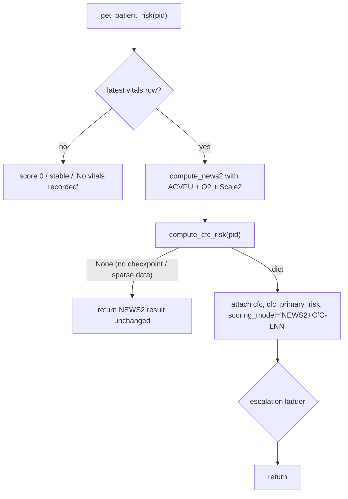

# Chapter 4: Vigil: monitoring, risk and alerting

> **Scope of this chapter.** `server/services/vigil_service.py` (791 lines),
> `server/models/vigil_cfc.py` (148), `server/models/forecast_lstm.py` (202),
> `server/routes/vigil_routes.py` (791), and `src/pages/panels/VigilPanel.tsx` (2,298).
> The alerting *paths* are owned here even though they physically live in three other
> modules, `server/services/bot_service.py` (932), the alert half of
> `server/services/ingestion_service.py` (1,070), and
> `server/services/nurse_shift_service.py`, because there is no single "alert engine"
> in this codebase and a reader who is only shown `vigil_service.py` will form a
> materially wrong picture of how a patient gets paged for. `services/nervous_system_triggers.py`,
> `services/shadow_service.py`, `services/sepsis_bundle_service.py`,
> `services/forecast_service.py` and `services/vitals_source/*` are cited where the
> boundary matters and documented in full elsewhere.
>
> Every factual claim carries a `file:line` anchor. Where code and prose
> documentation disagree, the disagreement is stated; §4.13 consolidates them.

---

## 4.0 How to read this chapter

Vigil is the module a hospital buys Orb for, and it is the module with the
smallest amount of clever code in it. That is deliberate and it is the single
most important thing to understand before reading further: **the live clinical
risk logic in this product is 130 lines of `if`/`elif` implementing a published
lookup table** (`server/services/vigil_service.py:234-365`). The neural
networks, the CfC liquid net and the forecast LSTM, are real, are wired in, and
are, at the time of writing, **inert**, because no checkpoint file exists on disk
(§4.7.12). Everything a clinician sees today comes from the lookup table.

That is not a criticism. It is the architecture's central claim: a deterministic,
auditable, externally-published score is the *floor*, and learned models may only
ever be an overlay that escalates above it. §4.7.7 traces the code that enforces
the one-directionality.

| § | Subject | Primary modules |
|---|---|---|
| 4.1 | Module inventory | n/a |
| 4.2 | The clinical problem, and why NEWS2 | n/a |
| 4.3 | The deterministic scoring engine | `services/vigil_service.py` |
| 4.4 | **The pinning law**, deterministic scores must be in the prompt | `services/sage_service.py` |
| 4.5 | `get_patient_risk`, the chart-open path | `services/vigil_service.py` |
| 4.6 | Trend detection | `services/vigil_service.py` |
| 4.7 | The ML models: CfC and forecast LSTM | `models/vigil_cfc.py`, `models/forecast_lstm.py` |
| 4.8 | Alerts: what they are, the three birth paths, what is not recorded | `bot_service`, `ingestion_service`, `nurse_shift_service` |
| 4.9 | Alert storms, the SagePreloader, and the two fixes | `nervous_system_triggers` |
| 4.10 | The HTTP surface | `routes/vigil_routes.py` |
| 4.11 | The frontend | `src/pages/panels/VigilPanel.tsx` |
| 4.12 | Alternatives considered and why they lost | n/a |
| 4.13 | Discrepancies found while writing this chapter | n/a |

Read §4.4 even if you read nothing else. It documents an incident whose
generalisation, *any score Orb computes deterministically must be in the model's
context and pinned as authoritative*, is one of the load-bearing rules of the
whole system, and this chapter is its home.

---

## 4.1 Module inventory

Total coverage; nothing in scope is silently skipped.

| File | Lines | What it actually is |
|---|---|---|
| `server/services/vigil_service.py` | 791 | NEWS2 engine, CfC loader + inference, chart-open risk, trend, two LLM helpers. The module docstring says "MEWS + CfC", stale, it has scored NEWS2 since the RCP table was implemented (`vigil_service.py:1-6` vs `:234`). |
| `server/models/vigil_cfc.py` | 148 | The closed-form continuous-time cell and the per-outcome multi-horizon head. Pure model code, no I/O. |
| `server/models/forecast_lstm.py` | 202 | BiLSTM + temporal attention + 4 task heads, and `load_model()`. Belongs to Forecast, reached from Vigil's chart open. |
| `server/routes/vigil_routes.py` | 791 | 15 endpoints. Despite the name it is the *patient chart* router, notes, meds, discharge, QR, admission, not a monitoring router. |
| `src/pages/panels/VigilPanel.tsx` | 2,298 | The ward board and the full patient chart. One React file; the largest in the frontend. |
| `server/services/bot_service.py` | 932 | The vitals **simulator** and alert birth path A. Also the lab and imaging demo bots. |
| `server/services/ingestion_service.py` (alert half) | ~250 of 1,070 | Alert birth path B, for real device/feed data. |
| `server/services/nurse_shift_service.py` (obs half) | ~200 | Alert birth path C, which produces **no alert**. §4.8.4. |
| `server/services/nervous_system_triggers.py` | 616 | The SagePreloader subscriber that a critical alert wakes. §4.9. |

---

## 4.2 The clinical problem

A reader with no clinical background needs this section to reason about the code
at all. Skip to §4.3 if you already know what NEWS2 is and what it is bad at.

### 4.2.1 What actually goes wrong on a ward

Most inpatients who arrest, are emergency-transferred to intensive care, or die
unexpectedly on a general ward do not do so without warning. They deteriorate
over a period typically measured in hours, and the deterioration shows up in the
vital signs, a rising respiratory rate, a falling blood pressure, a creeping
tachycardia, a new confusion, before it shows up as an arrest. The failure is
rarely one of knowledge. It is a failure of *noticing*: the observations are
taken, charted on paper or in a system nobody is watching, and the pattern across
them is never assembled by a single person at a single moment. Night shifts, low
nurse-to-patient ratios, and the fact that the deteriorating patient is usually
not the one anybody is currently worried about all make this worse.

The countermeasure the world converged on is the **track-and-trigger system**: a
fixed arithmetic rule that converts a set of vital signs into a single number,
plus a fixed policy that says what response each number band demands. The point
is not that the number is a good predictor in a statistical sense. The point is
that it is *mechanical*: it converts a judgement call taken by a tired junior
nurse at 03:00 into an escalation that the ward's protocol makes mandatory.

### 4.2.2 NEWS2 specifically

**NEWS2** is the second version of the UK Royal College of Physicians' *National
Early Warning Score*. It scores seven parameters, each contributing 0 to 3
points:

| Parameter | Why it is in the score |
|---|---|
| Respiratory rate | The single most sensitive early sign of deterioration and the most commonly *not* recorded. |
| Oxygen saturation (SpO₂) | Direct measure of the thing respiratory failure destroys. |
| Supplemental oxygen (yes/no) | A patient maintaining a saturation *on oxygen* is sicker than one maintaining it on air. |
| Systolic blood pressure | Falls late, but falling is close to definitive. |
| Pulse | Rises early in sepsis and hypovolaemia; falls catastrophically in a peri-arrest bradycardia. |
| Temperature | Both fever and hypothermia are markers of sepsis. |
| Consciousness (ACVPU) | New confusion is a red flag with an enormous likelihood ratio. |

The aggregate maps to a response band. Orb implements the bands at
`server/services/vigil_service.py:334-339`: **≥7 critical**, **≥5 or any single
parameter scoring 3 → elevated**, otherwise **stable**. The single-parameter rule
exists because one catastrophically deranged vital (SpO₂ of 85%) is an emergency
even when everything else is normal and the total is only 3.

NEWS2 is not proprietary, is published as a table, and is mandated across the NHS.
That property, *the scoring rule is a public document a hospital's own clinicians
already know*, is the reason it is in this product, and §4.12.1 argues that case
against the alternatives.

### 4.2.3 What NEWS2 is bad at

An honest manual has to state these, because the code inherits every one of them
and the UI's own disclaimer (`src/pages/panels/VigilPanel.tsx:2014-2017`) is
carefully worded around them.

1. **It is an ordinal trigger, not a calibrated probability.** NEWS2 7 does not
   mean "a 7% chance of arrest". It means "the protocol says urgent review". Orb
   is unusually disciplined about this: the alert text prints `NEWS2 7 (critical)`
   rather than a percentage, and the code comment explaining why is at
   `server/services/bot_service.py:476-480`, an earlier build printed
   `{score:.0%}`, which both implied a probability the rule does not provide and
   capped the sickest patients at 100%.
2. **It is a snapshot.** It has no memory. A patient whose NEWS2 has gone
   2 → 3 → 4 over six hours is deteriorating fast and scores "stable" at every
   step. Orb partially compensates with a separate trend computation (§4.6) and
   would fully compensate with the CfC overlay if it were trained (§4.7).
3. **It was derived and validated on a UK acute-medical population.** The pilot
   is in India. Baseline vital-sign distributions, case mix (dengue, TB, snakebite,
   obstetric emergencies), and age structure all differ. Nothing in the repo
   recalibrates for this and nothing should without data, but a reviewer should
   know the score is being used outside its derivation population.
4. **It is weak in specific groups**: pregnancy (physiological tachycardia and
   low BP), chronic type-2 respiratory failure (addressed by Scale 2, §4.3.3),
   young children (NEWS2 explicitly does not apply), and patients on rate-control
   drugs such as beta-blockers, whose heart rate cannot rise.
5. **Its performance depends entirely on observation frequency and completeness.**
   A score computed from a partial observation set is not a NEWS2, §4.3.6 traces
   exactly how Orb handles this and why the handling is a live risk.
6. **Alert fatigue.** At scale a 24/7 automatic scorer generates far more
   escalations than a human observer would, and a ward that learns to dismiss them
   is worse off than one with no system. This is why the cooldown at
   `server/services/bot_service.py:392-421` exists, why shadow mode measures the
   false-alert rate before anyone is asked to act (see `docs/SHADOW_MODE.md` §1.1),
   and why §4.8.9 flags the care-bundle auto-open as a genuine fatigue hazard.

---

## 4.3 The deterministic scoring engine

`server/services/vigil_service.py:234-365`.

### 4.3.1 Contract

```python
def compute_news2(hr, sbp, rr, temp, spo2, consciousness="alert", on_oxygen=False,
                  on_scale_2=False) -> dict:
```
`server/services/vigil_service.py:234-235`

Pure function. No I/O, no globals, no randomness, no clock. Given the same eight
arguments it returns the same dict forever, on any machine, in any process. That
property is the entire reason this function is the product's clinical core rather
than the neural net: it can be unit-tested exhaustively at every band boundary
(`server/tests/test_news2.py`), it can be reproduced by hand by a clinician
holding the RCP chart, and it can be quoted verbatim to a regulator.

Note also what it does *not* take: a patient id, or a database handle. Every
caller must assemble the seven parameters itself. §4.3.8 shows that this is
exactly where the divergences are.

### 4.3.2 The accumulator

```python
def add(points, msg, *, parameter=None, value=None):
    nonlocal score, any_param_3
    score += points
    if points == 3:
        any_param_3 = True
```
`server/services/vigil_service.py:256-260`

A closure over three accumulators: `score` (the integer aggregate), `any_param_3`
(the single-parameter escalation flag), and two output lists. Every band branch
calls `add()` exactly once, including the zero-point branches, that is
deliberate, because `add()` also appends to `breakdown` (`:264-269`), and a
parameter that scored zero still needs a row in the "why this score" table so the
clinician can see that the value *was* considered.

`drivers` (`:262`) is appended to only when `points > 0` and a message exists, so
it is the human-readable subset. It is truncated to three entries on return
(`:358`) because that is what the alert template and the chart panel display.

### 4.3.3 The bands, parameter by parameter

Each block below is the code as written, checked against the RCP table.

**Respiratory rate**, `:271-277`

| RR | Points | Code |
|---|---|---|
| ≤8 | 3 | `if rr <= 8` |
| 9–11 | 1 | `elif rr <= 11` |
| 12–20 | 0 | `elif rr <= 20` |
| 21–24 | 2 | `elif rr <= 24` |
| ≥25 | 3 | `else` |

Correct against RCP. Note the ordering: because the branches are a descending
`elif` cascade with `<=` cutoffs, a non-integer RR (the simulator produces
`round(..., 1)` floats, `bot_service.py:173`) is banded on its **true** value, not
on the value the driver string displays. `f"{rr:.0f}"` in the message rounds, the
comparison does not: RR 8.4 falls through `rr <= 8` into `rr <= 11` and scores
**1**, while the driver text it would have produced reads "RR 8". Verified by
calling `compute_news2` directly: RR 8 → 3, RR 8.4 → 1, RR 11.5 → 0. A clinician
reading a breakdown row of "Respiratory rate 8.4, 1 point" against the RCP chart
(which is defined on integers) will not immediately reconstruct that; rounding the
input to an integer before banding, as the paper chart does, would remove the
whole class of question.

**SpO₂, Scale 1 (default)**, `:293-297`

| SpO₂ | Points |
|---|---|
| ≥96 | 0 |
| 94–95 | 1 |
| 92–93 | 2 |
| ≤91 | 3 |

**SpO₂, Scale 2 (COPD / chronic type-2 respiratory failure)**, `:284-292`

Scale 2 exists because in a patient whose respiratory drive has adapted to chronic
CO₂ retention, *over*-oxygenation is dangerous, pushing the saturation to 98% on
supplemental oxygen can suppress the drive to breathe and precipitate a
hypercapnic arrest. So the target band is 88–92%, and values *above* it score
points, but only when the patient is on oxygen:

```python
elif spo2 <= 92: add(0, "", ...)              # target range
elif not on_oxygen: add(0, "", ...)           # >=93 on air is fine
elif spo2 <= 94: add(1, "Over-target SpO2 on O2 ...")
elif spo2 <= 96: add(2, ...)
else:            add(3, "Over-oxygenation on O2 ...")
```
`server/services/vigil_service.py:288-292`

The scale is selected per patient from the `patients.on_scale_2` column, added by
a migration at `server/database.py:1570-1572`. The label written into the
breakdown row becomes `"SpO2 (Scale 2)"` (`:283`) so the chart always shows which
table produced the number, a good decision, because a Scale 2 patient's score is
otherwise inexplicable to a clinician reading the standard chart.

**Supplemental oxygen**, `:299-301`. Flat +2 whenever `on_oxygen` is truthy, in
both scales. Correct.

**Systolic BP**, `:303-309`: ≤90 → 3, 91–100 → 2, 101–110 → 1, 111–219 → 0,
≥220 → 3. Correct.

**Pulse**, `:311-318`: ≤40 → 3, 41–50 → 1, 51–90 → 0, 91–110 → 1, 111–130 → 2,
≥131 → 3. Correct.

**Temperature**, `:320-326`: ≤35.0 → 3, 35.1–36.0 → 1, 36.1–38.0 → 0,
38.1–39.0 → 1, ≥39.1 → 2. Correct. (The asymmetry is real: hypothermia scores
3 and high fever only 2, because hypothermia in an infected patient is the worse
sign.)

**Consciousness (ACVPU)**, `:328-331`:

```python
cons = str(consciousness or "alert").lower()
if cons not in ("alert", "a", ""):
    add(3, "Altered consciousness (ACVPU)", ...)
```

This is a whitelist, and it is the right shape: anything that is not recognisably
"alert" scores 3. An unrecognised string, a typo, a value from a feed using a
different vocabulary, `"AVPU: A"`, fails *toward* the alert, not away from it.
That is fail-closed on the clinical path, correctly.

The cost of the whitelist is that it cannot distinguish "Confusion" from
"Unresponsive": both are 3, which matches NEWS2 (all non-alert ACVPU levels score
3), so nothing is lost.

### 4.3.4 Banding

```python
if score >= 7:                        level = "critical"
elif score >= 5 or any_param_3:       level = "elevated"
else:                                 level = "stable"
```
`server/services/vigil_service.py:334-339`

Three bands where RCP defines four response tiers (0, 1–4, 5–6 or single-3, ≥7).
Orb collapses 0 and 1–4 into `stable`. The consequence is that a NEWS2 of 4, 
which under RCP triggers a minimum 4–6 hourly observation frequency and a
registered-nurse review, is presented as `stable` and generates no alert
(`bot_service.py:380-381`, `ingestion_service.py:862-863`). The observation
*schedule* is handled separately for nurses (`nurse_shift_service.obs_schedule`,
called at `:575`), so the escalation-frequency half of the RCP response is not
lost; the *band label* is.

This is a defensible simplification for a three-colour ward board, but a reviewer
should know that Orb's `stable` is wider than RCP's green.

### 4.3.5 The normalized index, and why the denominator changed

```python
_NEWS2_MAX_AGGREGATE = 20.0
...
normalized = min(1.0, score / _NEWS2_MAX_AGGREGATE)
```
`server/services/vigil_service.py:230`, `:348`

`score` in the returned dict is this 0–1 index; `raw_news2` is the integer.
The comment at `:226-229` records that the denominator used to be 10, which meant
NEWS2 10, 14 and 20 all rendered as 1.0, the sickest patients on the ward were
indistinguishable from each other and the board could not sort them. The maximum
*realistic* aggregate is 19 (RR 3 + SpO₂ 3 + O₂ 2 + SBP 3 + HR 3 + Temp 2 + ACVPU 3);
20 is used as a round number above it.

The index is a **ranking convenience only**. The comment at `:341-347` is
explicit that the band decision is taken from the raw integer and never from the
index, and the code obeys that. The frontend, however, still shows the index as a
percentage on the ward board rows:

```tsx
{(p.risk_score * 100).toFixed(0)}%
```
`src/pages/panels/VigilPanel.tsx:347`

so a NEWS2 of 11 reads as "55%" on the board. The patient chart is correct
(`:1081` prints `NEWS2 11 · CRITICAL`), the gauge is correct (`:2048` prints the
raw integer), and `docs/USER_MANUAL.md:671-672` explains the distinction, but
the board row remains the one surface where a clinician sees a number that looks
like a probability and is not one. That is the highest-value single-line UI fix in
this module.

### 4.3.6 Missing values: the silent zero

Every parameter block is wrapped in `if <param> is not None:`. A missing value
therefore contributes **zero points and no breakdown row**. There is no
"insufficient data" state, no minimum-parameter count, and no flag in the returned
dict saying how many of the seven were present.

Trace the consequences per caller:

* **Simulator**, all six numeric vitals are always generated
  (`bot_service.py:168-173`), so the only absent parameter is never absent. No exposure.
* **Real ingestion**, `_persist_vitals_row` carries forward anything the feed
  omitted from the patient's most recent row (`ingestion_service.py:185-218`), so
  a device that only sends SpO₂ still scores against the last known HR/BP/RR. This
  is the right trade (a fresh SpO₂ plus a 20-minute-old BP is more informative than
  no score), but it means the displayed NEWS2 can be built from values of very
  different ages with nothing on screen saying so. Since 2026-10-03 the ages are
  bounded: a value is carried only while its measurement is younger than its limit
  (HR, BP, SpO₂, RR 4 h; temperature 8 h; ACVPU and O₂ 12 h; `services/vitals_carry.py`),
  measured from `vitals.carried_from`, and is `None` (not measured) after that. The
  simulator applies the same 12 h limit to the ACVPU and O₂ it carries. Nothing on
  screen shows a carried value's age yet.
* **Nurse observation**, `_clean_obs` explicitly permits a partial set
  ("a nurse may legitimately record a partial set, e.g. no BP on an agitated
  patient", `nurse_shift_service.py:518-520`) and passes `None` straight through
  (`:526`). The only guard is that at least *one* field must be present (`:542-544`).

  So a nurse who charts HR 96 and SpO₂ 95 and nothing else gets **NEWS2 2,
  "stable"**, a score that silently asserts the respiratory rate, blood pressure,
  temperature and consciousness were normal. Respiratory rate is the parameter
  most often omitted in real wards and the most predictive one.

* **Fully empty**, if every parameter is `None`, `drivers` falls back to
  `["All vitals within normal range"]` (`vigil_service.py:349-350`). That string
  is actively false in that case. `get_patient_risk` guards the *no row at all*
  case with `"No vitals recorded"` (`:392-394`), but a row of NULLs is not
  guarded.

**Recommendation (not implemented).** `compute_news2` should return
`parameters_scored: int` and `parameters_missing: list[str]`, the UI should render
"NEWS2 2 (4 of 7 parameters)", and the alert path should refuse to call a score
built from fewer than some threshold `stable`. This is a genuine clinical-safety
gap, not a cosmetic one, and it is cheap to close.

### 4.3.7 Cost and concurrency

Roughly 40 comparisons and a handful of list appends: sub-microsecond, no
allocation of consequence. It holds no lock, touches no shared state, and is
therefore safe to call from an event-loop coroutine, a `run_db` worker thread, or
a test, and it is called from all three. Because it is pure, the fact that
`bot_service._generate_vitals` calls it inside an open SQLite write transaction
(`bot_service.py:186`) costs nothing.

### 4.3.8 The callers, and where they diverge

This is the most important table in the chapter. Seven call sites compute NEWS2,
and **they do not all compute the same score for the same patient.**

| Call site | `consciousness` | `on_oxygen` | `on_scale_2` |
|---|---|---|---|
| `vigil_service.get_patient_risk` `:401-405` | from latest vitals row | from latest vitals row | **from `patients.on_scale_2`** |
| `nurse_shift_service._score_from_vitals` `:330-339` | from row | from row | **from `patients.on_scale_2`** |
| `nurse_shift_service.score_observation` / `record_observation` `:570`, `:631` | from the nurse's entry | from the nurse's entry | **from `patients.on_scale_2`** |
| `bot_service._generate_vitals` / `_next_reading` `:252`, `:215` | carried forward | carried forward | **from `patients.on_scale_2`** (fixed 2026-10-02) |
| `ingestion_service._insert_vitals` `:236`, `:850` | carried forward | carried forward | **from `patients.on_scale_2`** |
| `sage_service._assemble_patient_context` `:1066-1069` | **hardcoded `"alert"`** | **hardcoded `False`** | from `patients.on_scale_2` |
| `downtime_service` `:186` | (see that chapter) | | |

Two defects were found in this table:

**(a) The alert path ignored Scale 2 (FIXED: ingestion first, then the simulator and
the admission baseline on 2026-10-02; pinned by `tests/test_news2_scale2_lanes.py`).**
For a COPD patient flagged `on_scale_2`, the score that fired the alert and (in
ingestion mode) was written to `risk_scores` was computed on Scale 1, while the
chart computed Scale 2. At SpO₂ 90% on air Scale 1 scored 3 (→ `elevated` via the
single-parameter rule) and Scale 2 scores 0, so the board and the alert said
elevated while the chart said stable. At SpO₂ 97% on O₂ the error ran the other
way: Scale 1 scored SpO₂ 0 where Scale 2 scores 3 for over-oxygenation, so the
patient was never paged. Both call sites had the patient's *vitals* row in hand
but not the *patient* row. They now read `patients.on_scale_2`, and an AST guard in
the same test file fails any `compute_news2` / `score_vitals_row` call in
`services/`, `routes/`, `ws/` or top-level `server/*.py` that omits it, and any
call to the Scale-1-only `compute_mews`.

**(b) Sage's "authoritative" NEWS2 can be wrong.** `sage_service.py:1066-1069`
passes `"alert"` and `False` literally, even though the row it is reading
(`SELECT * FROM vitals`, `:1024`) contains real `consciousness` and `on_oxygen`
columns. For a confused patient on oxygen, Sage will state a NEWS2 five points
below the chart's, and it will state it under the label
`"NEWS2 (computed by Orb's deterministic engine, AUTHORITATIVE, never
recalculate or estimate this from the vitals)"` (`sage_service.py:1449-1450`).
This is the *same class of bug* the pinning fix (§4.4) was written to eliminate,
reintroduced one layer down. It is the single most serious finding in this chapter.

### 4.3.9 `compute_mews`

```python
def compute_mews(hr, sbp, rr, temp, spo2, consciousness="alert") -> dict:
    """Deprecated alias, Orb now scores with NEWS2 (UK standard)."""
    return compute_news2(hr, sbp, rr, temp, spo2, consciousness)
```
`server/services/vigil_service.py:368-370`

A one-line shim. It cannot express oxygen or Scale 2, and it returns a
`raw_mews` key that is really a NEWS2 aggregate (`:356` sets
`"raw_mews": score` as an alias). It has no non-test callers. Trivial; kept for
the legacy key alias in the returned dict, which several older readers still use
via `risk.get("raw_news2", risk.get("raw_mews"))` (e.g. `bot_service.py:390`).

### 4.3.10 The test file is the release gate

`server/tests/test_news2.py` asserts every band edge, the single-parameter rule,
the +2 oxygen contribution, the ACVPU rule, both SpO₂ scales, and the banding.
Its docstring is unusually candid about why it exists:

> "the ML models are not trained, so this IS the live clinical decision logic.
> Before this file, no test imported or called it; every threshold boundary was
> unverified, so a one-character inequality change could silently mis-triage
> patients."
>, `server/tests/test_news2.py:4-8`

That is the correct framing. Treat any change to `compute_news2` as a change to a
medical device.

---

## 4.4 The pinning law

> **Any value Orb computes deterministically must be placed in the language
> model's context and explicitly pinned as authoritative. A model that is not
> given the number will derive it, and it will derive it wrong.**

This is the general rule the rest of the system depends on, and this section is
its home. The evidence is a measured incident.

### 4.4.1 The incident

Measured 2026-07-31 and recorded in `docs/perf/SAGE_SPRINT_2026-07-31.md:17`:

| Probe | Before | After |
|---|---|---|
| "NEWS2 asked of a real patient" | `"7"` (engine says 11) | `"11"` ✓ |

Asked for a named patient's NEWS2 score, Sage answered **7**. The deterministic
engine computes **11** for the same patient at the same instant.

### 4.4.2 Root cause

`docs/perf/SAGE_SPRINT_2026-07-31.md:62-65`:

> "**NEWS2 was never in the prompt.** `risk_scores` stores a 0–100 percentage,
> not NEWS2. Asked for a NEWS2 score, the model had no choice but to re-derive it
> ... **11**. It read the vitals correctly and did the arithmetic wrong."

Precisely: the patient-context assembler put `RISK SCORE: 0.55 (critical), [...]`
into the prompt, the normalized index of §4.3.5, and the raw NEWS2 integer
appeared nowhere. The model was given the vitals and a question about a scoring
table it knows, so it did the only thing available: it recalled the RCP table from
its weights and applied it. It read every vital correctly. It mis-added.

Three properties of this failure make it worse than an ordinary hallucination:

1. **It is confident and plausible.** 7 is a real NEWS2 value in a real band. A
   clinician has no signal that anything is wrong.
2. **It is inconsistent with the chart in the next tab.** The chart says
   `NEWS2 11 · CRITICAL`; Sage says 7. Two authoritative-looking Orb surfaces
   disagreeing about a number is worse for trust than either being absent.
3. **It is not fixable by making the model better.** A larger model does the
   arithmetic right more often. "More often" is not a clinical-safety property.

### 4.4.3 The fix, in two halves

**Half one, supply the number.** `sage_service._assemble_patient_context` now
recomputes NEWS2 from the same deterministic engine at context-assembly time:

```python
# risk_scores stores a 0-100 risk percentage, not NEWS2, so it is recomputed here
# from the same deterministic engine Vigil uses (a pure function: no torch, no
# CfC overlay). Without this the model had no NEWS2 in context at all and
# re-derived it from raw vitals, answering 7 where Orb computes 11.
context["risk"]["news2"] = _n.get("raw_news2", _n.get("raw_mews"))
```
`server/services/sage_service.py:1046-1070`

Note *how* it is supplied: not read from a table, but **recomputed by calling
`compute_news2` directly**. That is deliberate, `risk_scores.score` is the
normalized index, and reading it would have re-introduced the same ambiguity in a
different shape. It also means the pure-function property of §4.3.7 is what makes
the fix possible at all: `compute_news2` can be called from inside a read
transaction on the Sage path with no torch import, no model load, and no cost.

**Half two, forbid re-derivation.** The context line names the number and its
authority in the same breath:

```python
f"NEWS2 (computed by Orb's deterministic engine, AUTHORITATIVE, "
f"never recalculate or estimate this from the vitals): {_r['news2']}"
```
`server/services/sage_service.py:1449-1450`

and the rule is restated in all three system prompts, 
`sage_service.py:197` (detailed contract), `:223-224` (fast simple), `:292-293`
(fast patient). The comment at `:275-277` marks that clause as **load-bearing**:
"never recalculating a supplied score (the model answered NEWS2 7 where Orb
computes 11, that line fixed it)".

Both halves are needed. Supplying the number without forbidding re-derivation
leaves the model free to "check the working" and disagree with itself; forbidding
without supplying leaves it with nothing to quote.

### 4.4.4 The general law and its scope

Generalised, the rule is:

> If Orb can compute a value deterministically, the language model must never be
> in a position where deriving that value is its best available move. Put the
> value in context, label it as Orb's computed value, and forbid recomputation.

The values in Orb that this covers today, or should:

| Value | Deterministic source | In context and pinned? |
|---|---|---|
| NEWS2 aggregate | `compute_news2` | ✅ `sage_service.py:1447-1451`, with the ACVPU/O₂ defect of §4.3.8(b) |
| NEWS2 band | `compute_news2` | ✅ carried in the same risk line `:1438` |
| Risk drivers | `compute_news2` breakdown | ✅ `:1438` |
| Trend direction | `get_vitals_trend` | ⚠️ a hand-rolled arrow string is supplied instead (`sage_service.py:1032-1035`), computed by *different* logic than `get_vitals_trend` (`vigil_service.py:466-485`). Two trend definitions, one shown to the clinician and one shown to the model. |
| CfC horizon risks | `compute_cfc_risk` | ❌ never reaches Sage's context at all |
| Medication interaction severity | `medication_safety_gate` | (see the Sage chapter) |
| Length of stay | forecast LSTM / heuristic | ❌ not in context |

The trend row deserves a second look during any future prompt work: it is the same
failure shape as the NEWS2 incident (a number the system computes, supplied to the
model in a *different* derivation), just with a lower blast radius because the
output is an arrow rather than an integer.

### 4.4.5 Alternatives considered

**Tool-calling, let the model request the score.** The obvious modern answer:
expose `compute_news2` as a function the model can call. Rejected implicitly by
the architecture, and correctly, for three reasons specific to this appliance.
First, latency: a tool round-trip is a second full prefill of the 27B, and the
measured prefill cost of the *system prompt alone* is 1.2–3.4 s
(`sage_service.py:204-211`); patient turns already sit at 13.3 s to first words
(`docs/PILOT_ROADMAP.md:78`). Second, reliability: tool-call emission is a
generation behaviour and can fail, and a *silently skipped* tool call degrades to
exactly the hallucination it was meant to prevent. Third, the value is cheap, 
`compute_news2` costs microseconds, so unconditionally including it costs ~15
tokens and is strictly better than making it conditional on the model asking.

**Post-hoc validation, parse the answer, extract any NEWS2 the model states,
compare to the engine, and regenerate on mismatch.** Rejected on cost and
brittleness: it doubles worst-case latency on the slowest query class, and the
extraction regex becomes a second thing that can be wrong. It is, however, the
right *test* strategy, and that is where it lives, the sprint doc records the
probe as a repeated measurement (`docs/perf/SAGE_SPRINT_2026-07-31.md:17`).

**Refuse to answer score questions and deep-link to the chart.** Rejected for
product reasons: "what's his NEWS2?" is one of the highest-frequency questions a
clinical assistant will get, and a refusal there is a credibility loss on the
first turn. Also insufficient, the model will still use an implicitly wrong score
when *reasoning* about the patient, even if it never states one.

**Remove the normalized index entirely so there is only one number.** Genuinely
tempting, and probably where this should end up. It fails today only because
`risk_scores.score REAL NOT NULL` (`server/database.py:111`) and the board's sort
(`vigil_routes.py:294`) both consume it, and the ordering `ORDER BY rs.score DESC`
would need to become a band-then-aggregate sort. Deferred, not refuted.

---

## 4.5 `get_patient_risk`: the chart-open path

`server/services/vigil_service.py:373-437`.

Reads the patient's single most recent vitals row and their `on_scale_2` flag in
one session (`:382-390`), scores it, then attaches the CfC overlay.



Two things to note.

**It is the only NEWS2 caller that assembles all seven parameters correctly**
(§4.3.8), which is why it is the chart's number and why §4.4's fix recomputes
rather than reading a stored score.

**Its docstring contains a false claim:**

```python
"""...
Does NOT write to risk_scores (that's done by the bot).
"""
```
`server/services/vigil_service.py:380`

The bot does not write to `risk_scores`. Grepping every `INSERT INTO risk_scores`
in the repository yields exactly three non-test writers:
`nurse_shift_service.py:652`, `ingestion_service.py:267`, and
`admission_service.py:156`. `bot_service.py` writes `vitals` and `messages` and
nothing else.

The consequence is a real, visible product defect in simulation mode. The ward
board's risk columns come from a `LEFT JOIN` on the newest `risk_scores` row
(`vigil_routes.py:287-290`), so in simulation mode they are **frozen at the
admission-time score forever**. The frontend patches them live from the
`vitals:update` socket event (`VigilPanel.tsx:105-109`), and then the 30-second
poll (`:140`) replaces page-one rows with server data and throws the live values
away again. A ward board in simulation mode therefore shows correct risk for up to
30 seconds at a time and then snaps back to the admission value. In ingestion mode
the join is fresh, because `_persist_risk_score` runs per reading
(`ingestion_service.py:797`).

There is also a related retention issue: the simulator's housekeeping prunes
`risk_scores` to the newest 100 rows per patient (`bot_service.py:228-235`) with
**no source filter**, unlike the adjacent `vitals` prune which is carefully
restricted to `source = 'simulated'` (`:220-227`, with a comment explaining that
real clinical vitals must never be row-capped). In hybrid mode the simulator's
prune will therefore delete real, nurse-recorded and ingestion-recorded risk
history. `risk_scores` has no `source` column to filter on
(`server/database.py:107-114`), which is why.

---

## 4.6 `get_vitals_trend`

`server/services/vigil_service.py:441-492`.

Compares the mean of the last `hours` (default 6) against the mean of the
preceding `hours`, over four channels, and scores three binary concerns:

```python
if hr_delta > 10: concern_score += 1
if sbp_delta < -10: concern_score += 1
if spo2_delta < -2: concern_score += 1
```
`server/services/vigil_service.py:475-478`

≥2 concerns → `deteriorating`; 0 concerns *and* |Δ HR| < 5 → `stable`; otherwise
`improving` if SpO₂ rose >1 or SBP rose >5, else `stable` (`:480-485`).

Honest assessment: this is a heuristic with no published provenance and no
recorded rationale for its six constants. It is not NEWS2, it is not validated,
and it is displayed to clinicians as "↘ Deteriorating"
(`VigilPanel.tsx:1177-1179`). Two properties keep it defensible: it is
*observational* rather than a trigger (nothing escalates off it), and averaging
over 6-hour windows makes it robust to single spurious readings in a way the
snapshot score is not.

Two real weaknesses. First, `if not recent or not previous or recent["avg_hr"] is
None` (`:466`) collapses "no data" and "no HR data" into
`{"trend": "insufficient_data"}`, but the frontend's ternary
(`VigilPanel.tsx:1178`) maps anything that is not `deteriorating`/`improving` to
"→ Stable", so **insufficient data renders as "Stable"**. A patient with no vitals
history shows a reassuring arrow. Second, respiratory rate, the most predictive
trend channel, is queried (`:453`) and never used in the concern score.

Cost: two `AVG()` aggregates over a `patient_id` + `timestamp` range. On the
encrypted database this is the dominant cost of a chart open after the bundle
query, which is why `vigil_routes.py:390` pushes it to a thread.

---

## 4.7 The machine-learning models

### 4.7.1 Why a learned overlay exists at all

NEWS2's structural weakness (§4.2.3) is that it is memoryless. The patient the
system exists to catch is the one whose vitals are individually unremarkable but
whose *trajectory* over the last six hours is unmistakable, and no lookup table
can see that. A sequence model can.

The design commitment, stated in the model docstring and enforced in code, is that
the learned model is an **overlay that may escalate and may never de-escalate**:

> "Phase 1 the displayed risk is NEWS2 (rule-based, see services/vigil_service.py)
> with these CfC models as a learned overlay. The long-term goal is for the CfC
> ensemble to surpass NEWS2 as real data accrues."
>, `server/models/vigil_cfc.py:14-16`

### 4.7.2 The CfC: what a closed-form continuous-time network is

Ordinary RNNs assume a fixed time step. Clinical observations are not on a fixed
time step: a stable ward patient is observed 4-hourly, a deteriorating one every
15 minutes, and the *change in observation frequency is itself clinical
information*. Feeding such a sequence to a GRU makes "4 hours later" and "15
minutes later" indistinguishable.

Neural ODEs solve this by integrating the hidden state forward over the actual
elapsed Δt, at the cost of running a numerical solver inside every forward pass, 
too slow, and a solver is one more thing to tune. **Closed-form Continuous-time
(CfC)** networks (Hasani et al.) are the trick that removes the solver: the ODE's
solution is approximated by an explicit closed-form expression, so you get
continuous-time semantics at the cost of an ordinary RNN step.

Orb's specified update is written at `server/models/vigil_cfc.py:18-19`:

```
h(t) = (Wx·x(t)) ⊙ exp(-f(x,h;θ)·Δt) + g(x,h;θ)
```

and implemented literally:

```python
combined = torch.cat([x, h], dim=-1)
decay_rate = F.softplus(self.f(combined))     # strictly positive
steady = self.g(combined)
decay = torch.exp(-decay_rate * dt)           # dt broadcasts over hidden
return self.Wx(x) * decay + steady
```
`server/models/vigil_cfc.py:80-84`

Reading it as an engineer: `g` produces a per-unit *steady-state target* the state
relaxes toward; `f` (forced positive by `softplus`, `:81`) produces a per-unit
*decay rate*; and `exp(-rate·Δt)` is how much of the input-driven excursion
survives the elapsed time. Long gaps drive `decay → 0` and the state collapses to
`g`, the model forgets the specifics of an observation from six hours ago but
retains the trend `g` encodes. Short gaps preserve the input term. That is exactly
the semantics you want for ward observations, and it costs one `exp` per step.

Note the numerical property that matters here: `decay_rate` is strictly positive
and `dt` is clamped non-negative at assembly (`vigil_service.py:163`), so
`exp(-rate·dt) ∈ (0, 1]` and the recurrence cannot explode. There is no gating,
no clipping and no layer norm inside the cell; stability comes from the physics of
the parameterisation rather than from machinery.

`CfCCell` is 3 linear layers plus two 2-layer MLPs (`:65-76`). With
`input_dim=9, hidden_dim=64` that is roughly 20k parameters.

### 4.7.3 `OrbVigilCfC`: one model per outcome, five horizons

```python
VIGIL_OUTCOMES = ("deterioration", "sepsis", "mortality")
HORIZONS_HOURS = (1, 3, 6, 12, 24)
```
`server/models/vigil_cfc.py:40-43`

Three *independent* models, one per clinical outcome, each emitting five sigmoid
risks (risk of that event within h hours). The reasoning is recorded at `:6-8`:
each can be "trained, swapped, and improved on its own (and so a weak label for
one doesn't pollute another)". That is the correct call for this project's data
situation, the three outcomes have completely different label availability
(§4.7.8), and a shared multi-task trunk would have made the sepsis model hostage
to the absence of a mortality label.

The head is `Linear(64,64) → ReLU → Dropout(0.2) → Linear(64,5)` (`:105-108`);
the encoder runs the cell over the sequence and reads out from the final hidden
state only (`:126-132`), no attention, no pooling.

One detail in `forward` is worth pausing on:

```python
def forward(self, vitals, dt, return_logits=False):
    """...Pass ``return_logits=True`` during training so the raw per-horizon
    logits can be fed straight into ``nn.BCEWithLogitsLoss``, reconstructing
    logits from clamped sigmoids (log(p/(1-p))) is numerically lossy and caps the
    effective logit at ~±13.8, which kills gradients on confidently-wrong
    saturated predictions."""
```
`server/models/vigil_cfc.py:110-119`

This is a real bug class, correctly identified and correctly fixed by an API
choice rather than a comment: inference gets probabilities by default, training
must opt into logits. In float32, `sigmoid` saturates to exactly 1.0 around
logit ≈ 16.6 and the recovered logit caps near 13.8; a model that is confidently
*wrong* then produces near-zero gradient and never learns its way out.

`predict_trajectory` (`:137-148`) is the inference convenience: `@torch.no_grad`,
`self.eval()`, returns `{outcome, risk_by_horizon: {"1h": p, ...}, peak_risk}`.

### 4.7.4 Feature assembly

`server/services/vigil_service.py:120-173`.

The production schema is 9 channels, declared twice, once in the model module
(`vigil_cfc.py:48-53`) and once in the service (`vigil_service.py:42-45`), with
a comment in each demanding they stay in sync. Duplicating a contract and
defending it with a comment is a smell; a shared constant would be one import.

```
["heart_rate", "spo2", "temperature", "systolic_bp",
 "map", "diastolic_bp", "respiratory_rate", "avpu", "age"]
```

Assembly steps, in order:

1. Read the **last 24** vitals rows plus `patients.age` in one session
   (`:126-134`). Reversed to chronological (`:139`).
2. Refuse if fewer than 3 rows (`:136-137`), returns `(None, None)`, which the
   caller treats as "skip this outcome".
3. Per row: pull the six numeric vitals, substituting a **population default**
   for any missing one (`:146-149`, defaults at `:46-50`). Note this differs from
   NEWS2's silent-zero: here a missing HR becomes 80.0, not "absent". For a model
   this is the standard imputation choice, but it is imputation without a
   missingness mask channel, so the model cannot distinguish "HR was 80" from "HR
   was never taken". The module docstring says masks are the intended design for
   *labs* (`vigil_cfc.py:24-26`) but no mask exists for vitals.
4. Derive MAP: `dbp + (sbp - dbp)/3` (`:150`). See §4.7.8 for why this line is a
   train/serve hazard.
5. Map ACVPU to a graded 0–3 float via `_AVPU_MAP` (`:52-53`, applied `:152`).
   Unlike NEWS2's binary treatment, the model gets an ordinal.
6. Z-normalise with the checkpoint's own mean/std (`:155-156`), falling back to
   the module constants.
7. Build the Δt sequence in **hours** from ISO timestamps, first element 0.0,
   clamped non-negative, defaulting to 1.0 on any parse failure (`:159-169`).

Returns `(1, seq, 9)` and `(1, seq, 1)` tensors on the CfC device.

Cost: one indexed query returning ≤24 rows plus one point lookup, then ~216
float operations. Trivial next to the SQLCipher page reads.

### 4.7.5 Checkpoint loading

`server/services/vigil_service.py:56-117`. Idempotent, guarded by a
module-global `_cfc_loaded` flag set *before* the work (`:61`) so a failed load is
not retried on every chart open.

```python
_CFC_CHECKPOINTS = {
    "deterioration": ["vigil_cfc_deterioration.pt", "vigil_cfc_checkpoint.pt"],
    "sepsis": ["vigil_cfc_sepsis.pt"],
    "mortality": ["vigil_cfc_mortality.pt"],
}
```
`server/services/vigil_service.py:34-38`

Each outcome takes the first filename that exists; the legacy single-checkpoint
name maps to `deterioration`. Missing files are skipped silently (`:82-83`); a
checkpoint that fails to load logs an error and the other outcomes continue
(`:112-113`).

Three implementation details carry real reasoning:

**`torch.set_num_threads(1)`** (`:74-77`):

> "these models are tiny (hidden≈64) and score in milliseconds, but torch's
> default intra-op pool spawns one OpenMP thread per core, and those threads
> compete for the GIL/cores with the API process."

On a Mac Studio that is a dozen-plus threads created to multiply a 9×64 matrix.
The same guard is repeated in the forecast path (`forecast_service.py:45-49`).

**Device selection** (`:79`): MPS if available else CPU. For models this small
the MPS transfer overhead probably exceeds the compute saving; there is no
recorded measurement either way.

**`weights_only=False`** (`:93`), with an eight-line security note above it
(`:86-92`):

> "weights_only=False deserializes arbitrary pickle, so a tampered .pt is RCE at
> load time, bad for an on-prem product that ships/swaps per-outcome checkpoints.
> Proper fix: save plain state_dicts and load with weights_only=True, storing
> input_dim/horizons/feature stats in a JSON sidecar."

The reason it is still `False` is that the checkpoint dict currently *carries*
that metadata (`:94-96`, `:105-107` read `input_dim`, `hidden_dim`, `horizons`,
`feature_order`, `feature_mean`, `feature_std` out of it), so fixing it requires
changing the trainer and the format together. The forecast LSTM does it correctly
already, `weights_only=True` at `models/forecast_lstm.py:174`, with a comment
saying exactly why (`:171-173`), which proves the safe pattern is available and
this is deferred work, not an oversight. Threat model: an attacker who can write
into `server/models/` on the appliance. That is a high bar, but "swap in a new
checkpoint" is a documented operational action, so the file is a supply-chain
surface.

### 4.7.6 Inference and the schema gate

`server/services/vigil_service.py:176-224`.

```python
if meta["input_dim"] != len(_CFC_FEATURE_ORDER):
    continue  # schema mismatch, not runnable on live vitals yet
```
`:193-194`

A checkpoint trained on a richer feature set (e.g. sepsis + labs) is loaded but
**refuses to run** against the 9-channel production assembler. This is the right
fail-closed behaviour: silently zero-padding a lab channel the model was trained
to rely on produces a number that looks like a prediction and is not one.

Data sufficiency is **per model**, and the comment records that it used not to be:

> "Data-sufficiency is PER-MODEL: one sparse outcome must not suppress the whole
> overlay (previously `return None` here disabled every outcome for the patient
> the moment any single one lacked data)."
> `server/services/vigil_service.py:198-201`

Inference runs under `vram_guard` (`:207`, from `services/gpu_coordinator.py:38`,
which forces `gc.collect()` + `torch.mps.empty_cache()` + MLX cache clears on
exit) and `torch.no_grad` (`:208`). The `vram_guard` is arguably overkill for a
20k-parameter model, but it is the house rule for anything that touches the GPU on
a box where a 17 GB LLM is resident, and consistency there is worth more than the
microseconds.

Aggregation (`:218-224`): `primary_risk` is the `deterioration` model's peak
across horizons if that outcome ran, else the max peak across whichever did.

### 4.7.7 The escalation ladder

`server/services/vigil_service.py:415-435`. This is the safety-critical part.

| Condition | Effect |
|---|---|
| `primary ≥ 0.9` and level is `stable` or `elevated` | → `critical`, driver prepended: "CfC: high near-term deterioration risk" |
| `primary ≥ 0.85` and level is `elevated` | → `critical` (no driver added) |
| `primary ≥ 0.7` and level is `stable` | → `elevated`, driver prepended: "CfC: rising near-term deterioration risk" |

There is no branch that lowers a level. The NEWS2 band is a floor by construction,
not by convention.

The comment at `:415-419` records that the magnitude-scaled ladder replaced a
fixed single-step jump, and explains why: a clinically-quiet, NEWS2-stable patient
with a very high learned risk, "the precise case a learned overlay exists to
catch", must be able to reach `critical` rather than being capped at `elevated`.

Two honest observations. The thresholds 0.9 / 0.85 / 0.7 have **no recorded
rationale**; the plausible reasons are (a) they are round numbers chosen pending
calibration data, and (b) any threshold is arbitrary until a validation set exists.
They should be config, and they should be set from a held-out ROC once there is
one. Second, the 0.85-rule silently adds no driver, so a patient escalated
`elevated → critical` by that branch alone shows no explanation of why, the
chart's driver list will contain only the NEWS2 reasons.

### 4.7.8 Training provenance

`server/scripts/train_vigil_cfc.py:1-22`:

| Outcome | Dataset | Status |
|---|---|---|
| `sepsis` | PhysioNet/CinC 2019 Sepsis Challenge | Open, runnable now |
| `deterioration` | ICU transfer / rapid response | Needs MIMIC-IV / eICU |
| `mortality` | In-hospital death | Needs MIMIC-IV / eICU |

with an explicit licensing warning that MIMIC-IV and eICU are credentialed and
licensed "scientific research only", "fine for R&D/validation, NOT for
commercial deployment" (`:11-13`). For a company planning to sell an appliance,
this is the binding constraint on the entire learned-risk roadmap, and stating it
in the trainer's docstring rather than burying it is exactly right.

Two train/serve skews are already known:

**AVPU.** PhysioNet has no consciousness field, so it is imputed as 0 (alert)
across the whole training set (`train_vigil_cfc.py:16-17`). A model trained that
way has never seen the ACVPU channel vary and will assign it no weight, which
removes the single strongest NEWS2 escalator from the learned model's vocabulary.

**MAP.** Recorded in the trainer as an explicit TODO:

> "PhysioNet provides MAP directly, but production (services/vigil_service.py)
> derives MAP = DBP + (SBP-DBP)/3. Pick ONE definition across train + serve
> (either always measured or always derived) or this channel is skewed at
> inference."
> `server/scripts/train_vigil_cfc.py:56-60`

That is a genuine distribution shift on one of nine channels, in a model with
~20k parameters, and it is the kind of thing that quietly costs a few points of
AUROC and is nearly impossible to debug later. Documented, not fixed.

### 4.7.9 The forecast LSTM

`server/models/forecast_lstm.py`. Different model, different module, different
purpose, length-of-stay and discharge planning, not deterioration, but it shares
Vigil's chart-open path and its startup pre-warm, so it belongs here.

Architecture (`:77-100`): `LayerNorm(19) → BiLSTM(2 layers, 64 hidden, dropout
0.3) → temporal attention (tanh→softmax over timesteps) → 128-d context → 4 heads`.
Input is 48 timesteps × 19 channels (`:41`: 6 vitals, 3 demographics, 4 ward
one-hots, 3 severity one-hots, 3 operational markers).

The attention (`:89-94`, applied `:110-111`) is a single learned scoring MLP
softmaxed over time and used to weight-sum the BiLSTM outputs. For a 48-step
window this is a cheap way to let the model concentrate on the informative part of
the stay rather than the most recent step, and it is the one piece of the model
that could be turned into an explanation ("the model is looking at hours 12–18"), 
it is not currently surfaced anywhere.

Four heads (`:113-118`): LoS via `softplus` (guarantees ≥0 days), discharge
probability via sigmoid, acuity via 3 logits, ICU-transfer probability via sigmoid.

**The ICU head is gated off, and the gate is the most instructive thing in the
file.** Two provenance flags live on the module (`:64-73`): `trained` and
`icu_head_trained`. `predict()` omits the ICU key entirely unless the second is
set:

```python
# FAIL CLOSED on the ICU-transfer head: only expose it when the loaded checkpoint
# actually trained icu_head against a labelled ICU-transfer target. Otherwise it
# is sigmoid(random-init): a clinical-safety defect if surfaced as a 3h transfer
# probability. Omit the key entirely so no caller mistakes noise for a prediction.
if self.icu_head_trained:
    result["icu_transfer_risk_3h"] = ...
```
`server/models/forecast_lstm.py:145-151`

Omitting the key, rather than returning `None` or `0.0`, is the correct choice: a
`None` invites a `or 0` somewhere downstream, and a `0.0` is indistinguishable
from a confident negative prediction. The synthetic trainer does not set the flag
(`:69-73`), so the head is off even for a "trained" checkpoint.

### 4.7.10 `load_model` and the fallback to determinism

`server/models/forecast_lstm.py:155-202`. Three outcomes:

1. **Checkpoint exists and loads** → `trained=True`, `icu_head_trained` from the
   file, `input_dim` honoured from the file so extended schemas work (`:174-182`).
2. **No checkpoint** → construct at random init, `trained` stays `False`, log a
   `WARNING` naming the training script (`:189-195`).
3. **Load raises** → same as (2) but log an `ERROR` (`:196-198`).

The backend always boots. What makes this safe rather than merely convenient is
the *service-layer* gate:

```python
# FAIL CLOSED on the untrained network: until a validated checkpoint is loaded the
# LSTM is at random init and model.predict() would emit/persist meaningless
# LOS/discharge/acuity numbers that the UI presents as neural predictions.
if not getattr(model, "trained", False):
    result = _heuristic_prediction(patient_id)
    result["model_trained"] = False
    result["prediction_source"] = "heuristic"
```
`server/services/forecast_service.py:276-287`

The heuristic (`:316-355`) is a ward-baseline table, ICU 7.0 days, W1 4.0, W2
3.0, W3 3.5, minus days already admitted, with `confidence: 0.45`. Transparent,
explicable, and *labelled*: `prediction_source: "heuristic"` travels with the
result so no caller can attribute it to a neural network.

This is the failure-to-deterministic-path the chapter brief asks to be traced. The
same shape exists in Vigil: when `_load_cfc_models()` finds nothing it returns
`False` (`vigil_service.py:115-117`), `compute_cfc_risk` returns `None` (`:184-185`),
`get_patient_risk` skips the whole overlay block (`:408-409`), `scoring_model`
stays `"NEWS2"`, and the clinician sees a pure NEWS2 score with no indication that
an overlay was ever intended. That last part is arguably a gap, the chart could
say "learned overlay: not installed", but nothing false is shown.

### 4.7.11 Pre-warming at startup

```python
# Pre-load the CfC risk checkpoints + forecast LSTM in the background: their lazy
# first load (3× torch.load + MPS device init) was measured at ~12s by the soak
# harness: paid by whichever clinician opened the FIRST patient chart after boot.
# Warming here makes every chart open equal.
async def warmup_torch_models():
    from services.vigil_service import _load_cfc_models
    await asyncio.to_thread(_load_cfc_models)
    from services.forecast_service import get_model
    await asyncio.to_thread(get_model)
```
`server/main.py:391-401`

The independently-recorded figure is wider, "their lazy first load cost the first
chart open 12–30 s" (`docs/perf/SAGE_SPRINT_2026-07-31.md:74-75`).

Why the first load is that expensive on this box: the first `import torch` in a
process pays the framework import; the first MPS tensor pays Metal device and
command-queue initialisation; and `torch.load` × 3 (`vigil_service.py:93`) plus
the forecast checkpoint each unpickle and copy weights. None of that is
parallelisable and all of it lands on whichever request touches the code first.

Three properties of the fix matter:

* It runs on a **lifespan task** (`main.py:405` via `_spawn`), not inline in
  startup, so a slow or broken torch import cannot delay the server accepting
  connections.
* It uses `asyncio.to_thread`, so the several-second blocking load never touches
  the event loop, the exact discipline this repository has had to learn three
  times (`docs/PILOT_ROADMAP.md:85-100`).
* It swallows every exception at `debug` level (`:402-403`). Defensible for a
  pure optimisation, but it means a *broken* checkpoint is invisible at startup
  and only shows up as a per-chart-open `_load_cfc_models` error later.

### 4.7.12 What actually happens today

```
$ ls server/models/*.pt
zsh: no matches found
```

**There is no checkpoint on disk.** Neither `vigil_cfc_*.pt` nor
`forecast_checkpoint.pt` exists in the working tree. Both are `.gitignore`d by
design, `docs/MODEL_CARD_forecast_lstm.md:32-41` states that weights are
deliberately never committed and "the runtime falls back to the transparent
heuristic ... whenever no checkpoint is present, so a clean checkout is safe by
default."

So, in the repository as it stands:

* `compute_cfc_risk` returns `None` on every call. The CfC overlay never fires.
  `scoring_model` is always `"NEWS2"`.
* `load_model()` returns an untrained network; `predict_patient_los` always
  returns the ward-baseline heuristic.
* `warmup_torch_models` still imports torch and initialises MPS, it just finds
  nothing to load.

There is one more trap for an operator who *does* train a model. The synthetic
harness writes `server/models/checkpoints/forecast_lstm_synth_v1.pt`
(`server/scripts/train_forecast_synth.py:20`), while `load_model()`'s default path
is `server/models/forecast_checkpoint.pt` (`models/forecast_lstm.py:48`), and
`forecast_service.get_model()` calls `load_model()` with no argument (`:50`).
The script prints the remedy, "(or copy/symlink to models/forecast_checkpoint.pt
for the default path)" (`train_forecast_synth.py:314`), but running the trainer
alone does not make the model live.

`docs/ORB_TECHNICAL_MANUAL.md:207` states the overall position honestly and it is
worth quoting because it is the correct posture:

> "the **machine-learning models are not yet trained on real clinical data** ...
> Throughout the code you will see *gates* that deliberately **hide or refuse to
> emit AI outputs that would be untrustworthy** when a model is untrained ...
> This is a deliberate safety stance ... not a bug."

### 4.7.13 Alternatives for the learned model

**Gradient-boosted trees (XGBoost/LightGBM) on windowed features.** On tabular
clinical data with a few thousand patients, GBMs beat sequence models more often
than not, train in seconds on CPU, need no GPU, produce SHAP explanations a
clinician can read, and have no checkpoint-format or RCE surface. The honest
answer is that this is probably the *better* choice for the pilot's data volume.
Why it lost: no recorded rationale. The plausible reasons are (a) irregular
sampling is the stated modelling problem and a GBM requires hand-built window
features that throw the Δt information away, (b) the multi-horizon output shape
(5 horizons × 3 outcomes = 15 models for a GBM, versus 3 models with 5 outputs
here), and (c) the CfC is the differentiating claim in the pitch. (c) is not an
engineering reason; a technical due-diligence reader should weigh it as such.

**A plain GRU/LSTM with Δt as an input feature.** The cheap approximation: append
elapsed time as a tenth channel and let the network learn what to do with it.
Loses the *structural* guarantee that state decays with elapsed time, the network
can learn to ignore the channel, but is one line simpler and uses a
battle-tested cuDNN/MPS kernel path. The forecast LSTM is exactly this design, so
the codebase contains both answers.

**A time-aware transformer.** Rejected on data volume, and correctly: a
transformer over 24 observations with a few thousand training sequences will
overfit, and it costs orders of magnitude more to serve on a box that is already
holding a 27B model resident.

**Neural ODE (true solver).** The thing CfC approximates. Rejected implicitly by
choosing CfC; a solver in the forward pass is 10–100× the cost and introduces
tolerance tuning as a hyperparameter. Correct call.

**Buy a validated commercial deterioration model.** Not available as an on-prem,
offline, redistributable artifact at this price point, and would defeat the
"everything runs locally" claim. Not a real option.

---

## 4.8 Alerts

### 4.8.1 What an alert is

There is no alerts table.

An Orb deterioration alert is a **row in `messages`** with
`message_type = 'alert'`, `sender_id = 'bot_vigil'`, and a `content` column
holding formatted human prose:

```python
db.execute(
    """INSERT INTO messages (channel_id, sender_id, sender_name, sender_role,
       content, message_type, is_bot, source)
       VALUES (?, ?, ?, ?, ?, 'alert', 1, 'bot')""",
    (channel["id"], 'bot_vigil', 'Orb Vigil', 'intelligence', alert["content"])
)
```
`server/services/bot_service.py:324-328` (and identically at
`server/services/ingestion_service.py:300-305`)

The schema is `server/database.py:126-136`: id, channel_id, sender ids and names,
`content TEXT`, `message_type` (a CHECK-constrained enum including `'alert'`),
`timestamp TIMESTAMP DEFAULT CURRENT_TIMESTAMP`, and `read_by TEXT DEFAULT '[]'`.

The prose itself is assembled in `evaluate_and_dispatch_alerts`. Since 2026-10-02 the
reason line comes from `vigil_service.news2_reason_line`, which all three alert lanes
share, so its words are the NEWS2 driver text:

```
⚠️ VIGIL ALERT: Moderate hypoxia (SpO2 88%); Tachypnea (RR 24); Hypotension (SBP 92) (+2 more)
Current vitals: HR 118 · BP 92/60 · SpO2 88% · Temp 38.4°C · RR 24
NEWS2 10 (critical). Immediate review recommended.
```

with one of three randomly-chosen templates (`:484-490`), a demo affordance that
survived into the shipping path.

An alert lands in the patient's **case room**: the channel with
`type = 'case_room'` created at admission (`vigil_routes.py:744-748`).

### 4.8.2 Birth path A: the simulator

`server/services/bot_service.py:239-571`, driven by `SimulatorSource` on a
5-second tick (`services/vitals_source/simulator_source.py:86-102`), which is
registered only when `ORB_INGESTION_MODE` is `simulation` or `hybrid`
(`server/main.py:173`).

```mermaid
sequenceDiagram
    participant Loop as SimulatorSource loop (5s)
    participant Gen as _generate_vitals (run_db worker)
    participant Eval as evaluate_and_dispatch_alerts (event loop)
    participant Rec as generate_ai_recommendation (4B)
    participant Shadow as shadow_service
    participant Pers as _persist_alerts (run_db worker)
    participant Bus as event_bus

    Loop->>Gen: batch: walk vitals for every admitted patient
    Gen->>Gen: compute_news2 per patient (no Scale 2)
    Gen-->>Eval: emit_queue [{vitals, risk}]
    loop per non-stable patient
        Eval->>Eval: stamp fired_at BEFORE any gate
        Eval->>Eval: cooldown / escalation check
        Eval->>Rec: (critical only) await one-sentence garnish
    end
    Eval->>Shadow: arecord_batch, alert.fired / alert.suppressed
    Eval->>Pers: one transaction, all alerts + alert.persisted / alert.dropped
    Eval->>Bus: publish vigil.alert.critical per alert
    Eval->>Eval: sio.emit message:new + shadow alert.delivered
```

The steps that carry real reasoning:

**Detection time is stamped first.** `fired_at = shadow_service.utc_now()`
(`:389`) is taken the instant NEWS2 is known to be above threshold, before the
cooldown gate, before the INSERT, before the bus publish. The comment (`:383-388`)
explains that the nearest existing timestamp, `event_log.timestamp`, is stamped
*after* the DB write and would therefore "build the DB's own write latency into
the pilot's headline lead-time number". For a product whose central claim is
"we detected it N minutes early", this is the difference between a defensible
number and an unfalsifiable one.

**The cooldown, with two exemptions.** `ALERT_COOLDOWN_SECONDS = 120` (`:24`),
tracked per patient in a process-local dict of `(timestamp, level)` (`:23`).
A worsening trajectory always breaks through:

```python
escalated = _LEVEL_RANK.get(risk_level, 0) > _LEVEL_RANK.get(last_level, 0)
if (risk_level != "critical" and not escalated
        and now - last_ts < ALERT_COOLDOWN_SECONDS):
```
`server/services/bot_service.py:398-404`

`critical` is exempt from the cooldown entirely, so a deteriorating critical
patient (SpO₂ 88 → 80) re-pages immediately. Note the state is only written on
dispatch (`:528`), never on suppression, so `last_level` means "the level of the
last alert actually sent". A consequence: a patient who goes
critical → stable → elevated within two minutes is suppressed, because
`elevated` does not out-rank the remembered `critical`. Rare, and it fails toward
silence, worth knowing.

`_alert_cooldowns` is process-local and dies with the process; the code says so
(`:20-22`) and cross-references the deferred multi-worker finding. After a
restart the first cycle re-alerts every non-stable patient on the ward.

**Suppression is recorded as data.** The suppressed branch does not simply
`continue`; it emits `alert.suppressed` to the shadow log first (`:408-421`),
with the reason and the seconds since the last alert. The comment (`:406-407`) is
the right instinct stated plainly: without it, *"how many deteriorations did Vigil
see but not surface?" would be unanswerable, and the suppression rate would look
like zero.*

**The reason line is cosmetic and must never gate dispatch.** This function's
old ad-hoc cutoffs (SpO₂ < 94, HR > 100, SBP < 85, …) once decided *whether*
to alert, which silently swallowed genuinely `elevated` NEWS2 patients whose
trigger was new confusion, mild bradypnea, or borderline hypotension. The only
gate is now `risk_level != "stable"`, and since 2026-10-02 the cutoffs are
gone altogether: the reason line comes from `vigil_service.news2_reason_line`,
the same helper the nurse and feed lanes call, and falls back to the band alone
if it ever raises. This is a good example of the general pattern: two sources
of truth for the same decision, one of them accidental.

**Persist-then-emit.** All DB work happens in one `run_db` transaction
(`:539-540` → `_persist_alerts`, `:287-356`); socket emits and bus publishes
happen after it returns (`:542-571`). The docstring on `_persist_alerts` explains
that shadow rows are written with `db=db` on the *same* connection because "a
second connection from inside this open write transaction would block on the WAL
lock this function holds" (`:290-294`), the self-deadlock class this codebase has
hit repeatedly.

**A missing case room is recorded, not swallowed.** `:316-323`:

> "A NEGATIVE, and one that is invisible everywhere else in Orb: Vigil fired and
> the alert reached nobody because the patient has no case room. Silently
> `continue`-ing here is exactly how a scorecard ends up measuring only the alerts
> that worked."

**The residual defect in this path: the garnish is serial and inline.** For
critical patients the loop awaits a one-sentence MedGemma recommendation
*inside* the per-patient loop (`:493-495`), and `alerts_to_send` is not persisted
until the loop finishes. So on a ward with ten critical patients, the alert for
patient #10 is not written until the recommendations for #1–#9 have each resolved.
`generate_ai_recommendation` bounds each wait, a 5-second queue acquire timeout
(`vigil_service.py:744-747`) and a 30-second HTTP timeout (`:749`), plus a
circuit breaker that trips after three consecutive connection failures and skips
for 120 s (`:701-703`, `:773-781`), plus a residency guard that returns the static
fallback if the operator has evicted the 4B tier (`:732-734`). Worst realistic
case is still several seconds × N critical patients of *delay to delivery*.
`fired_at` is unaffected, so the shadow log's detection time stays honest, but the
nurse's phone buzzes later. This is a genuine "cosmetic garnish on the critical
path" problem and the obvious fix (persist first, patch the recommendation in
afterwards) has not been made.

### 4.8.3 Birth path B: real ingestion

`server/services/ingestion_service.py:710-995`. Reached from
`/api/ingest/*` and from every `VitalsSource` via the shared sink
(`services/vitals_source/sink.py:143-167`), whose docstring states the intent:

> "There is exactly ONE persistence path for clinical vitals in this process:
> `services.ingestion_service.ingest_payload`. ... A second writer for monitor
> data would drift from all of it silently."
> `server/services/vitals_source/sink.py:3-9`

That is true of *persistence*. It is **not** true of alerting: `bot_service` is a
second alert writer, and §4.8.5 shows how far the two have drifted.

The path: `_persist_vitals_row` inserts with carry-forward (`:152-240`), audit
row, then the **backfill stop line**:

```python
if backfill:
    # ...persisted, but live risk/alert/emit skipped.
```
`server/services/ingestion_service.py:768-789`

A reading older than what is already held, a monitor replaying its buffer after a
reconnect, is stored in full and audited, but does not recompute the risk score,
does not alert, and is not emitted to the live board. The comment (`:757-767`)
enumerates each reason separately and ends with the right sentence: *"None of that
is a judgement call about the data, the reading is real and kept. It just is not
news."* Staleness is decided upstream, in the sink's per-(source, patient)
high-water marks (`vitals_source/sink.py:99-134`), with the deliberately
asymmetric rule that a payload mixing stale and fresh readings counts as live, 
"under-suppressing shows a clinician one redundant reading, over-suppressing hides
a real deterioration, and only one of those is survivable" (`:104-106`).

Then NEWS2 (`:794`), a `risk_scores` INSERT (`:797`), an audit row
(`news2_recomputed`, `:799-811`), a department-scoped socket emit (`:829-835`),
and `_check_ingested_alert` (`:838`).

`_check_ingested_alert` (`:843-995`) mirrors the simulator's wording logic
line-for-line but differs in what surrounds it, see the next section.

### 4.8.4 Birth path C: the nurse observation, which produces no alert

`server/services/nurse_shift_service.record_observation` (`:578-706`) is the path
a nurse's bedside observation set takes. In one transaction it writes the `vitals`
row (`source='nurse_manual'`), the `risk_scores` row, and a fail-closed audit
entry (`:637-687`). Post-commit it calls `maybe_autostart` for a sepsis bundle
(`:690-697`).

It does **not** write a Relay alert. It does **not** open a shadow episode. It does
**not** publish to the event bus.

So a nurse who charts an observation set scoring NEWS2 9 gets: a sepsis bundle
timer, a fresh `risk_scores` row that will re-colour the ward board, an audit
entry, and **no page to anybody**. The alert channel that exists for
machine-measured and simulated vitals does not exist for the most trustworthy
data source in the building.

Whether that is a defect depends on a product decision nobody has recorded. The
argument for it: the nurse taking the observation *is* the human who would receive
the alert, so paging them about the number they just typed is noise, and the entry
screen already shows the live NEWS2 as they type (`score_observation`, `:556-575`).
The argument against: the alert's purpose is to reach the *doctor*, and a
nurse-detected NEWS2 9 is precisely the case where escalation matters most. The
shadow-mode consequence is unambiguous and worse: nurse-detected deteriorations
are **entirely absent from the shadow log**, so the pilot's detection-lead-time
denominator silently excludes them.

A related smaller finding: `nurse_manual` is written into `vitals.source`
(`nurse_shift_service.py:48`) but is **not** in `_LABEL_KIND`
(`services/vitals_source/base.py:67-84`), whose comment claims
"tests/test_vitals_source.py asserts this covers every literal the repo writes".
The test actually only iterates the ingestion feed labels
(`server/tests/test_vitals_source.py:362-367`), so `nurse_manual` slips through and
`classify_source_label("nurse_manual")` returns `UNKNOWN`. Every nurse-taken
observation is therefore unattributable in the scorecard's provenance breakdown, 
the exact failure the module was written to prevent.

### 4.8.5 The two paths are not equivalent

| | **A, simulator** (`bot_service`) | **B, ingestion** (`ingestion_service`) |
|---|---|---|
| Gate | `risk_level != "stable"` `:380` | `risk_level != "stable"` `:862` |
| NEWS2 Scale 2 honoured | ❌ `:186` | ❌ `:794` |
| Cooldown | 120 s per patient, escalation + critical exempt `:398-404` | **none**, every non-stable reading alerts |
| MedGemma recommendation | critical only `:493-495` | never |
| Writes `risk_scores` | ❌ | ✅ `:797` |
| Shadow episode | batch `arecord_batch` `:533` | per-reading `aopen_episode` + `aemit` `:874-894` |
| `alert.suppressed` negatives | ✅ `:408-421` | n/a (no cooldown to suppress) |
| Publishes `vigil.alert.critical` | ✅ `:546-559` | ❌ **never** |
| → SagePreloader context warm | ✅ | ❌ |
| → Sepsis Six bundle auto-open | ✅ (see §4.8.9) | ❌ |
| Hash-chain audit rows for the alert | ❌ | ✅ `relay_alert_generated` + `vigil_alert_generated` `:974-995` |
| `patient_status_update` socket emit | ❌ | ✅ `:962-968` |
| Backfill guard | n/a | ✅ `:768-789` |
| `alert.dropped` when no case room | ✅ `:316-323` | ✅ `:338-345` |

Read the two rows in bold. The **real** data path, the one that will run in the
hospital, has no rate limiting at all, and never wakes the SagePreloader or the
care bundle. The **synthetic** path has both. Whatever demo behaviour was built
and tuned against the simulator does not describe what the ward will experience.

Concretely, at a 1-minute monitor cadence a single persistently-critical patient
produces 60 alert rows per hour in path B, where path A would produce at most 30
(and fewer for `elevated`). Across a 60-bed ward with five deteriorating patients,
that is a case room filling with near-identical prose faster than anyone can read
it, the textbook alert-fatigue failure that `docs/SHADOW_MODE.md:44-49` names as
a patient-safety hazard in its own right.

The reason is legible from the history: the cooldown lives in `bot_service` because
that is where alerting was first written, and `_check_ingested_alert` was
implemented later as a mirror of the *wording* logic without the *state* logic
(process-local dicts do not port cleanly into a path that may be called
concurrently from several ingestion workers). The correct fix is a shared alert
policy module owning the cooldown, the escalation override, the shadow emission
and the event-bus publish, with both paths calling it, which is precisely what a
real alerts table (§4.8.6) would make natural.

### 4.8.6 What is not recorded

Three absences, each with consequences.

**(1) No alerts table.** `server/database.py` defines no `alerts` relation. An
alert is a `messages` row, so:

* Querying "all alerts for patient X between two dates" means a `LIKE` over prose
  or a `message_type='alert'` scan joined through channels.
* The alert's *structured* content, NEWS2 value, band, drivers, which vitals
  triggered it, which scale was used, exists only as formatted text inside
  `content`. It is reconstructible by regex and by nothing else.
* Alert state is not modellable. There is no `status` column, no assignee, no
  escalation chain, no expiry.
* Referential integrity is inherited from `messages`, which requires a
  `channel_id`, hence the "no case room ⇒ alert reaches nobody" branch in both
  paths.

**(2) No fire time distinct from write time.** `messages.timestamp` defaults to
`CURRENT_TIMESTAMP` (`server/database.py:134`), stamped by SQLite at INSERT. The
moment NEWS2 crossed threshold is computed (`fired_at`, `bot_service.py:389`) and
passed to the shadow log, but it is **never written to the messages row**. The
gap between them is the cooldown decision, up to N serial LLM garnish calls
(§4.8.2), and the WAL write itself. On the clinical record, an alert's only
timestamp is when it hit the disk.

Additionally, `messages.timestamp` is SQLite's `CURRENT_TIMESTAMP` format
(`YYYY-MM-DD HH:MM:SS`, 1-second resolution, no timezone marker) while
`shadow_events` uses explicit millisecond ISO-8601 with an offset, the shadow
module's docstring calls this out as the reason it refuses the default:

> "Never `DEFAULT CURRENT_TIMESTAMP`, that default is what left risk_scores /
> messages / event_log in two incompatible formats at 1-second resolution, so
> every cross-table comparison has to go through julianday()."
> `server/services/shadow_service.py:156-160`

**(3) No acknowledgement.** There is an acknowledgement endpoint, and it does not
apply to Vigil alerts:

```python
row = db.execute("SELECT * FROM messages WHERE id = ? AND message_type = 'alert'", ...)
...
content = json.loads(row["content"])
```
`server/routes/relay_routes.py:634-641`

`_apply_alert_resolution` selects any `message_type='alert'` row and immediately
`json.loads` its content. Vigil alert content is prose beginning with `⚠️`, so this
raises `JSONDecodeError`, which is not caught anywhere in the call chain
(`resolve_alert`, `:721-743`) and would surface as a 500.

In practice nothing sends it, because the frontend only renders Confirm/Escalate
for content that parses as JSON *and* carries `is_structured`:

```tsx
const looksLikeJson = typeof m.content === 'string' && m.content.trimStart().startsWith('{');
if (m.message_type === 'alert' && looksLikeJson) {
  payload = JSON.parse(m.content);
  if (payload && payload.is_structured) isStructuredAlert = true;
}
```
`src/pages/panels/RelayPanel.tsx:395-401`

and the only backend producer of `is_structured` is `surgery_service.py:291`. The
comment at `RelayPanel.tsx:388-393` states the design explicitly: prose is "a
complete alert, not a parse failure". `docs/USER_MANUAL.md:1604-1606` matches, 
it scopes actionable cards to "certain workflows, most prominently surgery
preparation". So the documentation is honest; the capability simply does not exist
for deterioration alerts.

There is a second, quieter consequence. The "⚠️ Action Required" inbox
(`GET /api/relay/alerts` → `relay_service.get_user_alerts`, `:100-147`) parses
every alert-type message as JSON inside a `try` and `continue`s on failure
(`:142-145`). Every Vigil alert fails that parse. **Deterioration alerts never
appear in the alerts inbox at all**, they exist only as messages inside the
patient's case room, which a clinician has to be looking at.

The best a Vigil alert gets is the *passive* signal: opening the case room marks
its messages read and emits a shadow `alert.viewed`
(`relay_service.mark_channel_read`, `:254-294`), inheriting the lane from the
`alert.persisted` row so a simulated alert cannot be laundered into the clinical
lane (`shadow_alert_episodes`, `:201-241`). That is "someone opened the room",
not "a clinician saw this alert and decided something".

**Honest summary of the consequences.** Orb today cannot answer, from its clinical
record: how many alerts fired last week; how many were acted on; median time from
alert to clinician response; which alerts nobody ever saw; what the false-alert
rate is. The shadow log answers most of these, that is why it exists, but the
shadow log is an *instrument*, explicitly fail-open (`shadow_service` counts its
own drops, `:133-144`) and excluded from the clinical record. It is the right tool
for a pilot and the wrong foundation for a product.

### 4.8.7 Alternatives: a real alerts table vs messages-as-alerts

**What was built.** An alert is a message. The reasoning is not recorded, but it is
easy to reconstruct and it is not stupid: the case room already existed, messages
already had real-time delivery, read state, RBAC-scoped channel access, and a UI, 
so alerting shipped in an afternoon by reusing all of it, and it put the alert
*in the conversation where the clinical discussion happens*, which is genuinely
the right product instinct. For a Week-13 pilot date, this is a defensible trade.

**What it costs.** Everything in §4.8.6, plus: two divergent birth paths with no
shared policy object to hang the cooldown on (§4.8.5); a `resolve` endpoint that
would 500 on the alert type that matters most; an alerts inbox that silently
excludes deterioration; and a scorecard that has to be built on a parallel
instrument rather than on the record itself.

**The alternative: a real `alerts` table.** Roughly:

```sql
CREATE TABLE alerts (
    id INTEGER PRIMARY KEY,
    patient_id TEXT NOT NULL REFERENCES patients(id),
    fired_at TEXT NOT NULL,          -- ms ISO-8601, stamped in Python at threshold crossing
    persisted_at TEXT NOT NULL,      -- ms ISO-8601, stamped at INSERT
    source TEXT NOT NULL,            -- simulator | ingestion | nurse_manual
    trigger TEXT NOT NULL,           -- news2_threshold | cfc_overlay | ...
    level TEXT NOT NULL,
    raw_news2 INTEGER,
    spo2_scale INTEGER,
    single_param_3 INTEGER,
    drivers TEXT,                    -- JSON
    vitals_id INTEGER REFERENCES vitals(id),
    message_id INTEGER REFERENCES messages(id),   -- the prose rendering, still posted
    status TEXT NOT NULL DEFAULT 'open',          -- open|acknowledged|resolved|escalated|expired
    acknowledged_by TEXT, acknowledged_at TEXT,
    suppressed_by TEXT               -- cooldown | backfill | no_case_room
);
```

The prose message stays, it is the right UX, but becomes a *rendering* of a
first-class record rather than the record itself. Everything §4.8.6 says is
unanswerable becomes a single indexed query. The cooldown moves from a
process-local dict to `SELECT max(fired_at) ... WHERE patient_id = ? AND
status != 'suppressed'`, which makes it restart-safe and shared between paths for
free. Suppressed and dropped alerts get rows, so the negatives are in the clinical
record and not only in the instrument.

**Argument against it, stated fairly.** (a) It is a second write per alert on a
single-writer encrypted SQLite, real but small; the alert path already does three
or four. (b) It duplicates what `shadow_events` already stores, and the shadow log
is more carefully designed (controlled vocabulary, key-whitelisted payloads,
PHI-minimised). (c) The pilot is *shadow-first*, so for Weeks 1–13 the shadow log
is genuinely sufficient and the table buys nothing that is needed before go-live.

**What this manual argues.** Build it, after the pilot's shadow phase and before
clinicians are asked to act on alerts. The tell is (b): the shadow log had to
invent `alert.persisted`, `alert.dropped`, `alert.suppressed`, `alert.viewed`,
`alert.acknowledged` and `alert.expired`
(`server/services/shadow_service.py:86-114`) purely to reconstruct a state machine
the clinical schema does not have. When a measurement instrument has to model your
domain object because your domain model does not, the domain model is the thing
that is missing. The moment an alert can change care, "who saw this and what did
they do" stops being a research question and becomes a medico-legal one, and the
answer cannot live in a fail-open instrument.

### 4.8.8 The care-bundle side effect, and a threshold defect

The `vigil.alert.critical` event has a second subscriber effect beyond the
SagePreloader: it opens a **Sepsis Six** care bundle.

```python
raw = event.payload.get("raw_news2")
def _open_bundle():
    if raw is not None:
        return maybe_autostart(patient_id, {"raw_news2": raw})
    # No raw score in payload, but this IS the critical event → open one.
    return start_bundle(patient_id, triggered_by="vigil_auto",
                        trigger_reason="Critical Vigil alert", source="vigil_auto")
```
`server/services/nervous_system_triggers.py:36-42`

`maybe_autostart` gates on the RCP threshold: `if raw is not None and raw >= 7`
(`services/sepsis_bundle_service.py:167-177`).

**But the payload does not contain `raw_news2`.** The publisher sends only
`score`, `level`, `drivers`, `message_id`:

```python
payload={"score": alert["score"], "level": alert["risk_level"],
         "drivers": alert["drivers"], "message_id": item["msg_id"]}
```
`server/services/bot_service.py:551-557`

So `raw` is always `None`, the `else` branch always runs, and `start_bundle` is
called **unconditionally for every alert that reaches this subscriber**. And the
publisher publishes for every alert in the batch regardless of band
(`:542-559` has no `level` check), despite the topic being named
`vigil.alert.critical`.

Net effect: **a NEWS2 5 patient auto-opens a Sepsis Six bundle**, with the
trigger reason recorded as `"Critical Vigil alert"`. `start_bundle` is idempotent
per active bundle (`sepsis_bundle_service.py:47-54`) so it does not stack, and a
clinician can cancel it, but a time-boxed sepsis protocol appearing on the chart
of every mildly-elevated patient is a meaningful contribution to alert fatigue,
and the recorded trigger reason is factually wrong.

The fix is two lines: add `"raw_news2": raw_news2` to the published payload, and
delete the `else` branch so an event without a score does not open a bundle.
Note that `docs/USER_MANUAL.md:227` documents the correct behaviour, 
"NEWS2 scores of 7 or higher automatically open a time-tracked Sepsis Six care
bundle", which is true of the nurse path (`nurse_shift_service.py:690-697` calls
`maybe_autostart` with a real score) and false of the simulator path.

---

## 4.9 Alert storms

### 4.9.1 The shape of a storm

At 60 beds across two wards with a critical case mix, a 5-second simulator tick or
a 1-minute monitor cadence produces a continuous stream of non-stable NEWS2
results. Each one that dispatches does, per patient per cycle: an LLM call (path A,
critical only), a `messages` INSERT, several shadow rows, a socket emit, an
event-bus publish, and the bus subscriber then does a **context compile**:
patient facts from SQLite plus a BGE-M3 embedding and a cross-encoder rerank
against the guideline corpus (`nervous_system_triggers._compile_context`,
`:121-133`).

The compile is the expensive one. It blocks its thread on the single-worker
knowledge child process, where embedding and reranking serialise.

`docs/PILOT_ROADMAP.md:76` lists "API wedge under the alert storm" as priority-1
pilot blocker.

### 4.9.2 The executor fix

The compiles used to run on asyncio's **shared default executor**:

> "each one blocks its thread on the single-worker knowledge child (embed + rerank
> serialize there). A ward-wide alert storm parked every default-executor thread
> in compiles, and unrelated to_thread work, chart opens' risk/trend computation, 
> queued behind them for 10-25 s (measured by scripts/soak_test.py at 60-bed
> census). Two workers is deliberately more than the knowledge child can serve
> concurrently; the queue lives HERE now, where it only delays prefetches."
> `server/services/nervous_system_triggers.py:61-68`

```python
_WARM_EXECUTOR = ThreadPoolExecutor(max_workers=2, thread_name_prefix="orb-sage-warm")
atexit.register(_WARM_EXECUTOR.shutdown, wait=False)
```
`server/services/nervous_system_triggers.py:69-70`

The insight is *queue placement*, not thread count. The knowledge child can serve
one compile at a time regardless, so the queue must exist somewhere; the only
question is whether it forms in a shared resource (where it starves chart opens)
or a private one (where it only delays prefetches). Two workers is deliberately
slightly over-provisioned so the child is never idle while work is waiting.

The same reasoning appears three lines apart on a different call: the sepsis-bundle
open goes through `run_db`, *not* `asyncio.to_thread`, "because to_thread's
default executor is shared process-wide" (`:43-49`). `run_db`'s own lane is a
private 4-worker pool (`server/database.py:1092`) sized with an explicit argument
against both single-worker serialisation and the shared default
(`server/database.py:1080-1086`).

### 4.9.3 The freshness gate

```python
if reason != "manual" and await run_db(_cache_is_fresh, patient_id, ttl_minutes):
    logger.debug("[SagePreloader] cache still fresh for %s, skipping recompile", patient_id)
    return True
```
`server/services/nervous_system_triggers.py:170-172`

`_cache_is_fresh` (`:99-118`) returns true only while the cached entry exists, has
not expired, **and is still in the young half of its TTL**. Since a critical alert
re-fires every vitals cycle, the naive behaviour was one embed+rerank per patient
per cycle, "the compile storm behind the chart-open latency tail" (`:161-165`).

The half-TTL rule is the interesting part. It is not "skip if not expired": that
would let every entry go stale right before it is needed. It is "skip while young,
recompile in the second half", which spreads recompiles over time and keeps a
warm entry genuinely warm.

The gate is explicitly advisory (`:166-169`): it can go stale between the read and
the write, but the loser just recompiles unnecessarily, and the write is
`INSERT OR REPLACE` (`:139-143`) so a concurrent warm can only overwrite the row
with an equally valid one. This is the right way to reason about a cache race, 
name the failure mode and show it is benign, rather than adding a lock.

Manual warms always recompile (`reason == "manual"` bypasses the gate), which is
correct: an explicit request should not be answered with cached work.

### 4.9.4 Result, and the theory that was wrong

`docs/PILOT_ROADMAP.md:85-100`: re-tested 2026-07-31 with 15 critical patients,
the SagePreloader compiling, and a background LLM job every ~700 ms, 
**380/380 `/api/health` probes returned 200, median 33 ms**, and a Sage query
mid-storm returned in 20.7 s with 142 streamed events "where before it never
returned at all". No single fix owns it; the roadmap credits the cumulative
perf-debt work.

The follow-up is the part worth reading, because it is a documented **wrong
hypothesis** and those are the most useful entries in any engineering record.
The 20.7 s was not queue wait, the log shows the interactive lane acquired
immediately and held. The hypothesis was KV-cache eviction at storm volume. It was
A/B tested on 2026-08-01 with a byte-identical 2,021-token prompt, fixed
`num_predict=128`, in A-B-A-B blocks: **30/30 repeats hit the cache, including
repeats overlapping storm GPU work by 94%** (`docs/PILOT_ROADMAP.md:113-119`).

The reason was anatomical: instrumenting the actual calls showed every storm LLM
call goes to `medgemma:4b`, not the 27B, 554 calls, peak 57/min, 76% GPU duty
cycle from the 4B alone. Two models are two processes with two KV caches, so the
storm was *structurally incapable* of evicting Sage's (`:120-125`).

What is actually happening: the storm degrades **decode, not prefill**, at >60%
overlap, prefill drops 8% while decode drops 26% (`:127-131`). That is GPU
contention, and the lever is bounding background-job *volume*, not caching.

The relevance to this chapter is direct: those 554 4B calls are Vigil's per-alert
recommendation garnish (§4.8.2) and its neighbours. **The single largest
identified contributor to Sage being slow during a deterioration event is Vigil's
cosmetic one-sentence recommendation.** The roadmap's own sentence is the right
one to end on: *"a clinician asking Sage during a deterioration event, the exact
moment the product exists for, still gets the slowest answer of the day"*
(`:133-135`).

---

## 4.10 The HTTP surface

`server/routes/vigil_routes.py`. Fifteen endpoints; despite the module name this
is the patient-chart router.

The file opens with a structural rule worth quoting in full, because it encodes
the most expensive lesson in the repository:

> "Every synchronous SQLite body reached from an `async def` lives out here, not
> nested inside the route. Two reasons: it keeps 'no DB call inside an async def'
> mechanically checkable (the shape that stalled the API on 2026-07-30), and it
> forces each body to be a single, self-contained unit of work, a whole
> read-then-write stays inside ONE session in ONE executor hop, so introducing the
> await cannot open a window between the check and the write."
> `server/routes/vigil_routes.py:18-25`

Eleven module-level `_load_*` / `_insert_*` bodies follow (`:27-228`), each pure
sync, each dispatched via `run_db`.

| Endpoint | Notes |
|---|---|
| `GET /patients` `:254` | The ward board. **Plain `def`**, FastAPI threadpools sync routes, so no `run_db` hop is needed (`:255-256`). Department-scoped, paginated, `X-Total-Count` header, `ORDER BY rs.score DESC NULLS LAST`. The risk columns come from the `risk_scores` join, see §4.5 for why they are stale in simulation mode. |
| `GET /discharged` `:345` | Plain `def`, same reasoning. |
| `GET /patients/{id}/story` `:361` | Delegates to `patient_story_service` via `asyncio.to_thread`. |
| `GET /patients/{id}` `:377` | The chart bundle: patient, ≤288 vitals, notes, scribe notes, ≤50 risk history, lens analyses, meds, one `run_db` hop (`:381`), then `get_patient_risk` and `get_vitals_trend` each on their own thread (`:389-390`). The comment at `:383-387` explains the offload (CfC torch/MPS inference is synchronous) and carries an open TODO to serve the baseline from `risk_scores` instead of recomputing per chart open. Also stamps `unverified` on AI-extracted, pharmacist-unverified medications (`:420-429`) so the UI can never present one as equal to a clinician order. |
| `GET /patients/{id}/vitals` `:433` | Sparkline data, `hours` param. |
| `GET/POST /patients/{id}/notes` `:454`, `:461` | POST is idempotent on an `Idempotency-Key` header; the lookup and INSERT are one `run_db` body so a replay cannot land in the gap (`:119-153`), with a `DBIntegrityError` branch for the genuinely concurrent case. |
| `GET /patients/{id}/analysis` `:483` | SSE stream of the LLM narrative. **The 5-minute cache is commented out** (`:496-510`) with the note "Disable cache temporarily for debugging". The docstring above still advertises it (`:487-488`). In-flight dedup via a per-patient `asyncio.Lock` still runs (`:512-538`), but since nothing ever writes `_analysis_cache`, the "wait for the in-flight one then serve cache" branch finds nothing and falls through to a second generation. Every chart open therefore costs a fresh 27B stream. |
| `GET /patients/{id}/medication-reconciliation` `:551` | Deterministic; requires `discharge.generate`. |
| `POST /patients/{id}/discharge` `:565` | The admitted-status check is explicitly documented as advisory, not a lock (`:577-581`). |
| `GET /patients/{id}/discharge-summary` `:619` | |
| `POST /patients/{id}/medications` `:637` | Safety gate **before** any write (`:663-669`); 428 until the clinician re-submits with an audited `safety_ack`. Screening deliberately precedes the idempotency pre-check so a replay screens identically. |
| `GET /patients/{id}/qr` `:678` | Carries a security post-mortem in its docstring (`:683-691`): this endpoint previously had **no auth dependency**, and the QR embeds a plaintext long-lived discharge access token, an unauthenticated requester with a patient id could recover the bearer secret guarding the discharge summary. Now gated on `discharge.read`. |
| `POST /patients` `:698` | Creates the user, patient, case-room channel and admission message in one transaction. Also carries a security fix (`:722-726`): the old code seeded a shared default password `patient123`; now a per-patient `secrets.token_urlsafe(9)` returned exactly once. |
| `GET /patients/{id}/timeline-projection` `:770` | Sage-deduced expected course. |
| `GET /test-stream` `:231` | Debug SSE endpoint replaying a hardcoded sentence about a named patient. Permission-gated but dead code in a clinical product; should be deleted. |

Two structural observations. First, this router creates patients, discharges
patients, and orders drugs, it is not a monitoring router and the name misleads.
Second, `get_patient` does three `run_db`/`to_thread` hops for one chart open,
each with a thread handoff; the TODO at `:386-387` is the right fix and would also
remove the per-chart-open CfC inference.

---

## 4.11 The frontend

`src/pages/panels/VigilPanel.tsx`, 2,298 lines, two components in one file: the
ward board (`VigilPanel`, `:60-303`) and the chart (`PatientDetailView`,
`:370-1917`), plus small helpers.

### 4.11.1 The ward board

Paginated fetch with a hand-rolled `fetch` rather than the shared client, because
the client discards headers and the board needs `X-Total-Count` (`:27-50`).
Auth and the 401 → `orb:session-expired` contract are mirrored by hand (`:41-45`), 
duplicated contract, one of the few places in the frontend that re-implements the
client.

**Failure is rendered, not swallowed.** The comment at `:65-68` states the
principle:

> "An empty board and a board we simply could not reach look identical
> ('0 Critical'), so the failure has to be rendered, a silent zero here reads as
> 'no deteriorating patients'."

`boardUnavailable` replaces the metric tiles with `, ` (`:198-199`) and the list
with an explicit "This is a load failure, not an empty ward, patient risk is
unknown until it succeeds" (`:272-274`). A *partial* failure (refresh failed over
existing rows) keeps the rows and adds a staleness banner (`:252-265`). This is
exactly right for a clinical dashboard and it is rarer than it should be.

**Live updates are throttled to 2 s** (`:99-113`) and patch only `risk_level` and
`risk_score` in place. **Row memoisation** (`:325`) is paired with a stable
`useCallback` (`:76-79`); the comment at `:321-324` records the bug it fixes, 
a fresh per-row closure defeated `memo` and re-rendered all ~100 rows every tick.

**Sorting.** By `risk_score` or admission date, then a second stable pass floats
`critical` rows to the top (`:169-178`). The comment records that the previous
build pinned `PAT007` as a permanent fake emergency.

**Polling** is visibility-aware (`useVisiblePolling`, `:140`) so a backgrounded tab
stops hitting the appliance, meaningful on a box that is also running a 27B model.

The known problems: the `%` on each row (§4.3.5), and the 30-second poll
overwriting live socket state with stale `risk_scores` values (§4.5).

### 4.11.2 The chart

Around forty pieces of state in one component. The parts that belong to this
chapter:

**Risk badge** (`:1077-1083`), `NEWS2 11 · CRITICAL`, with a title attribute that
says "not a validated probability".

**`RiskGauge`** (`:2024-2053`), the ring fills proportionally to the 0–1 index but
the *number* in the centre is the raw NEWS2 integer, with a comment saying exactly
that (`:2026-2028`). Falls back to `, ` when `raw_news2` is absent rather than
showing the index.

**`News2Attribution`** (`:1962-2022`), the "Why NEWS2 11?, per-parameter
contribution" disclosure. Renders the server's `breakdown` array (§4.3.2) filtered
to non-zero contributors, worst first, colour-coded by points. Shows the
single-parameter-3 warning when applicable (`:2009-2013`) and closes with:

> "Deterministic RCP NEWS2 scoring table. A decision-support aid, **not a
> clinically-validated deterioration probability**; use clinical judgement."
> `:2014-2017`

This is the single best-designed element in the module. It makes a rule-based
score fully explicable at the point of care, from server-computed data, with no
client-side re-derivation, the frontend expression of §4.4's law.

**Trend line** (`:1177-1179`), with the "insufficient data renders as Stable"
defect of §4.6.

**Sparklines** (`:1006-1058`), hand-rolled SVG polylines over the last 40
points, min/max labels, 6-hour framing. Cheap and correct.

**Lab trends** (`:764-956`), real per-analyte trends parsed out of `lab_result`
document prose with a regex (`:775`) when labs exist; otherwise a **seeded
synthetic estimator** keyed on diagnosis and MRN (`:828-954`). The synthetic path
is labelled loudly: an amber "Estimated" badge (`:1197-1204`), dashed trend lines
(`:1250`), and a tooltip saying values are "model-estimated from diagnosis, not
measured". Given that fabricated lab values are being drawn on a clinical chart at
all, the labelling is about as good as labelling can be, but a reviewer should
note that the fallback exists.

**Dead forecast fetch.** `getPatientForecast` is called on every chart open
(`:480`) and stored in state (`:429`) that **is never read anywhere in the file**.
Server-side that call runs `predict_patient_los` → (today) the heuristic → and a
`forecast_predictions` INSERT (`forecast_service.py:286`, `:358-370`). So every
chart open costs an authenticated round trip, a threadpool hop and a write to the
encrypted database whose result is discarded. It also requires the
`forecast.read` permission (`routes/forecast_routes.py:40`), so for roles without
it the call 403s and is swallowed by the client's `catch` (`api/client.ts:536-538`).

**Presence** (`:488-502`), `enter_patient` / `leave_patient` with re-emit on
reconnect, rendering "N others viewing". A genuinely good ward feature.

**Modals portal to `<body>`** (`:308-317`) because `.shell__main` is an isolated
stacking context, so an in-place scrim would dim only part of the chrome.

---

## 4.12 Design decisions and why the alternatives lost

### 4.12.1 NEWS2 vs MEWS vs qSOFA vs a learned score

**MEWS (Modified Early Warning Score).** The predecessor, and the one this module
was originally built around, the docstring still says so
(`vigil_service.py:1-6`) and the deprecated alias survives (`:368-370`). MEWS has
no oxygen-saturation and no supplemental-oxygen parameter, which for a
respiratory-failure-heavy inpatient population is disqualifying. It also has no
single national standard: "MEWS" denotes a family of locally-modified tables, so
"we compute MEWS" tells a reviewer nothing checkable. NEWS2 has one published
table. **Lost on specificity and on auditability.**

**qSOFA.** Three binary criteria (RR ≥22, altered mentation, SBP ≤100), trivially
computable, and specifically validated for mortality in suspected infection. Two
disqualifiers here. It is a *sepsis* screen, not a general deterioration score, 
Vigil watches every admitted patient, not only suspected infections. And it is
deliberately tuned for specificity over sensitivity, which is the wrong direction
for an early-warning system whose entire job is catching the patient nobody is
worried about yet. **Lost on scope and on the sensitivity/specificity trade.**
Note it is not *absent* from the product: the NEWS2 ≥7 auto-bundle
(`sepsis_bundle_service.py:167-177`) covers the same clinical ground.

**A learned score as the primary.** The thing the CfC ensemble is intended to
become. It cannot be primary today for four independent reasons, any one of which
is sufficient. (1) There is no training data, the pilot has not run and MIMIC-IV
is licensed research-only (`train_vigil_cfc.py:11-13`). (2) There is no local
validation, so any number it emitted would be unvalidated output presented as
clinical guidance. (3) A CIO and a clinical governance committee can read the RCP
table; they cannot audit a 20k-parameter recurrent network, and this product is
sold on being auditable. (4) A rule cannot silently regress when the input
distribution shifts; a learned model can. **Correctly lost, for now.** The
overlay architecture (§4.7.7) is the right way to stage the transition: the
learned model earns trust by being measurably right about escalations while the
rule remains the floor.

**Both, hybrid, what was actually built.** Rule as floor, learned model as
one-directional escalator. The cost is a system whose displayed risk is a function
of two different mechanisms, which is harder to explain than either alone; the
mitigation is that the driver list names the CfC explicitly when it escalates
(`vigil_service.py:428`, `:434`).

### 4.12.2 Deterministic rules vs pure ML for the live path

Restating in this system's terms rather than in general:

* **One machine, no cloud.** Retraining, monitoring and drift detection all have
  to happen on the appliance or not at all. A rule has no drift.
* **Encrypted single-writer SQLite.** Every ML feature assembly is page I/O that
  costs HMAC-SHA512 + AES. `compute_news2` needs one row that the caller already
  has.
* **The event loop is sacred.** Three production freezes came from blocking it
  (`docs/PILOT_ROADMAP.md:85-100`). A pure function is safe to call anywhere; torch
  inference needs a thread hop (`vigil_routes.py:383-390`) and a `vram_guard`.
* **Clinical safety.** Draft-and-approve everywhere; a rule that a clinician can
  re-derive by hand is the strongest possible form of that.
* **One solo operator, hard pilot date.** The rule was days of work including an
  exhaustive test file. The learned path is a multi-month data-licensing and
  validation program.

### 4.12.3 The simulator as a first-class `VitalsSource`

Worth calling out as a good decision. `SimulatorSource` implements the same
`VitalsSource` ABC as the HL7 monitor and manual entry
(`services/vitals_source/base.py:256-311`), with the same lifecycle, the same
health counters, and the same provenance obligation. The module docstring makes
the ethical point:

> "Where a vital sign came from is a clinical fact, not an implementation detail.
> A NEWS2 of 7 built from a monitor's SpO2 trace and a NEWS2 of 7 a nurse typed at
> the bedside are different evidence, and the shadow scorecard has to be able to
> tell them apart after the fact, otherwise 'Orb detected deterioration 40
> minutes early' is an unfalsifiable claim."
> `server/services/vitals_source/base.py:3-8`

`SourceKind.SIMULATOR` is a *peer* of MONITOR and MANUAL, not a special case
(`:46-48`), and `is_machine_measured` returns true only for MONITOR (`:98-100`), 
"the scorecard's honesty test". The gap is that the alerting layer did not inherit
this discipline (§4.8.5): the sources are peers, the alert paths are not.

---

## 4.13 Discrepancies found while writing this chapter

Ordered by clinical severity. Each is a place where code, comment, or user-facing
documentation disagrees with reality.

| # | Location | Issue |
|---|---|---|
| 1 | `services/sage_service.py:1066-1069` | Sage's NEWS2, labelled AUTHORITATIVE at `:1449-1450`, hardcodes `consciousness="alert"` and `on_oxygen=False` although the row it reads has both columns. For a confused patient on oxygen it can under-report by 5 points. Same failure class as the incident the pinning fix was written for (§4.3.8b, §4.4.4). |
| 2 | `services/bot_service.py:215`, `services/ingestion_service.py:850` | FIXED 2026-10-02: the alert paths pass `on_scale_2` (§4.3.8a). An AST guard in `tests/test_news2_scale2_lanes.py` fails any scoring call that omits it. |
| 3 | `services/ingestion_service.py:843-995` | The real-data alert path has **no cooldown at all**, every non-stable reading alerts. The simulator has one. §4.8.5. |
| 4 | `services/bot_service.py:551-557` + `services/nervous_system_triggers.py:36-42` | `raw_news2` is missing from the published payload, so every alert (including `elevated`) unconditionally opens a Sepsis Six bundle, bypassing the documented ≥7 gate. `docs/USER_MANUAL.md:227` documents the gated behaviour. §4.8.9. |
| 5 | `services/vigil_service.py:349-350` | A fully-empty observation returns the driver `"All vitals within normal range"`, which is false. §4.3.6. |
| 6 | `services/nurse_shift_service.py:578-706` | A nurse-recorded observation raises no alert, opens no shadow episode, and publishes no event, so nurse-detected deterioration is invisible to the pilot scorecard. §4.8.4. |
| 7 | `services/vigil_service.py:380` | Docstring: "Does NOT write to risk_scores (that's done by the bot)". The bot does not write `risk_scores`; only `nurse_shift_service:652`, `ingestion_service:267` and `admission_service:156` do. Consequence: the ward board's risk is frozen at admission value in simulation mode. §4.5. |
| 8 | `docs/ORB_TECHNICAL_MANUAL.md:1566` | "Computed risk scores for patients, generated by Vigil after each vitals update", true for ingestion, false for the simulator. Same root cause as #7. |
| 9 | `routes/relay_routes.py:641` | `_apply_alert_resolution` does `json.loads` on any `message_type='alert'` row. Vigil alerts are prose, so the resolve endpoint would 500 on them. Unreachable today only because the UI never offers the control. §4.8.6. |
| 10 | `services/relay_service.py:112-145` | The "Action Required" inbox parses alert content as JSON and `continue`s on failure, so **deterioration alerts never appear in the alerts inbox**. §4.8.6. |
| 11 | `services/vitals_source/base.py:65-66` | Comment claims a test "asserts this covers every literal the repo writes". The test (`tests/test_vitals_source.py:362-367`) only iterates ingestion feed labels; `nurse_manual` is written but unmapped, so nurse observations classify as `UNKNOWN`. §4.8.4. |
| 12 | `routes/vigil_routes.py:487-510` | Docstring advertises a 5-minute analysis cache; the cache read is commented out for debugging and nothing writes the cache, so every chart open runs a fresh 27B stream. The in-flight dedup branch can never hit. §4.10. |
| 13 | `services/vigil_service.py:529` | Comment reads "DEMO MODE: Build human-readable clinical assessment (no LLM call)" immediately above code that builds a prompt and streams from the LLM (`:632-674`). Stale by one refactor. |
| 14 | `services/vigil_service.py:1-6` | Module docstring says "MEWS + CfC Liquid Neural Network". The module scores NEWS2 and the CfC is inert. |
| 15 | `src/pages/panels/VigilPanel.tsx:347` | Ward board rows render the normalized index as `%`, the one surface where a clinician sees a probability-shaped number that is not a probability. The chart, gauge and user manual are all correct. §4.3.5. |
| 16 | `src/pages/panels/VigilPanel.tsx:429`, `:480` | Per-chart-open forecast fetch whose result is never rendered; server-side it runs a prediction and writes `forecast_predictions`. §4.11.2. |
| 17 | `services/vigil_service.py:466-467` + `src/pages/panels/VigilPanel.tsx:1178` | `get_vitals_trend` returns `{"trend": "insufficient_data"}`, and the frontend ternary maps anything that is not `deteriorating`/`improving` to "→ Stable", so a patient with no vitals history shows a reassuring trend arrow. §4.6. |
| 18 | `services/bot_service.py:228-235` | The simulator's `risk_scores` prune has no source filter, unlike the adjacent `vitals` prune, so it will delete real nurse/ingestion risk history in hybrid mode. §4.5. |
| 19 | `services/vigil_service.py:86-93` | `weights_only=False` on CfC checkpoint load is RCE-on-load from a tampered `.pt`. Known, documented, deferred because the checkpoint format carries metadata. The forecast loader already does it safely (`models/forecast_lstm.py:174`). §4.7.5. |
| 20 | `routes/vigil_routes.py:231-250` | `GET /test-stream` is a debug endpoint replaying hardcoded prose about a named patient. Dead code in a clinical router. |

### 4.13.1 The three that should be fixed before the pilot

**#1 and #2** because they make two Orb surfaces disagree about a clinical number,
which is the specific failure §4.4 exists to prevent, and both are two-line fixes.

**#3** because an uncapped alert rate on the real data path is an alert-fatigue
hazard that the shadow phase will measure and the ward will remember.

**#6** because a shadow-mode scorecard that silently excludes nurse-detected
deterioration is not measuring what it claims to measure, and the pilot's entire
evidentiary value rests on that claim.
