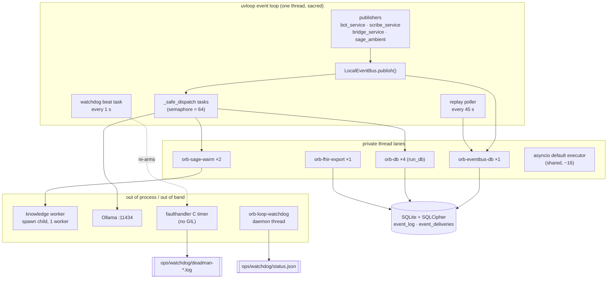
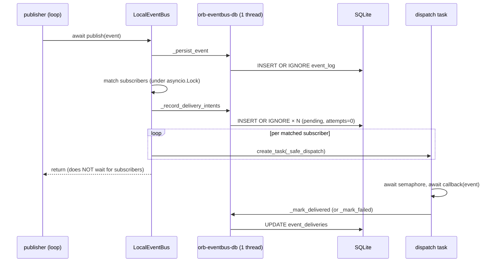
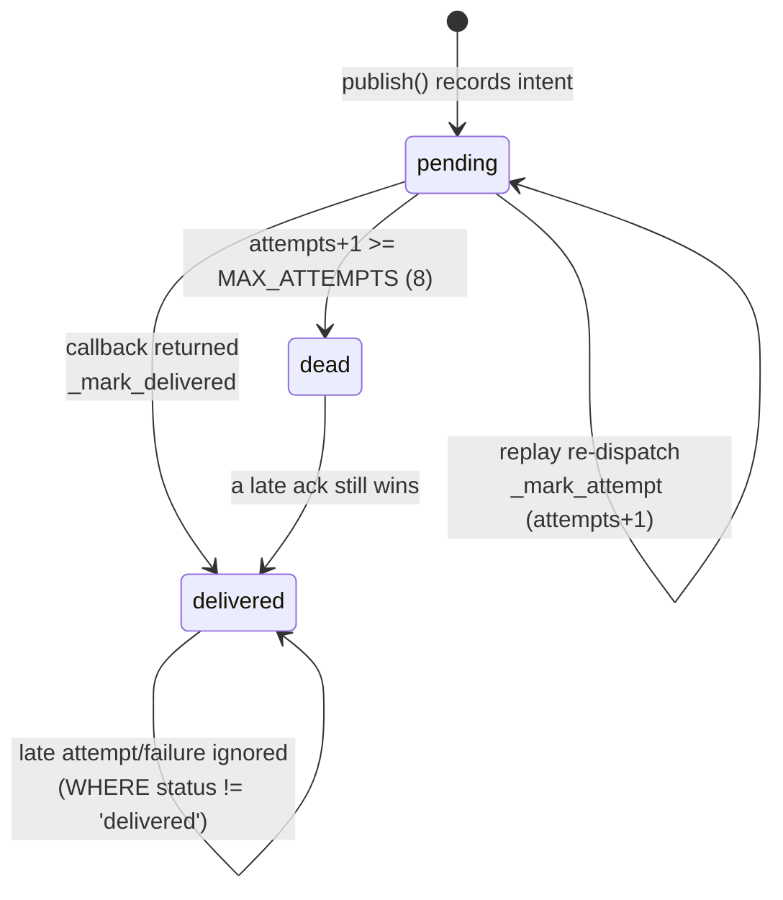
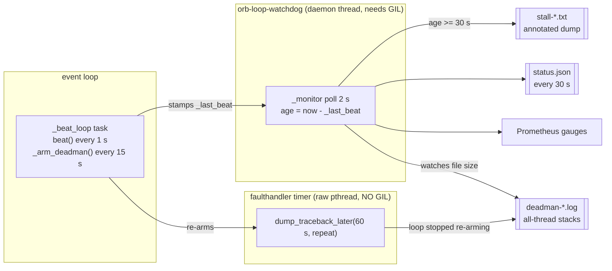

# 6. Platform Services: the machinery every clinical module sits on

**Scope.** This chapter documents the seven modules that no clinician ever sees and
that every clinical module depends on:

| § | Module | Lines | One-line role |
|---|---|---|---|
| 6.2 | `server/services/event_bus.py` | 510 | Durable local pub/sub with at-least-once delivery |
| 6.3 | `server/services/nervous_system_triggers.py` | 615 | The three subscribers that turn events into work |
| 6.4 | `server/services/knowledge_worker.py` | 277 | Process-isolated embedder + reranker |
| 6.5 | `server/services/model_router.py` | 188 | Residency-aware local model selection |
| 6.6 | `server/services/loop_watchdog.py` | 783 | Out-of-band event-loop starvation detector |
| 6.7 | `server/services/downtime_service.py` | 693 | Offline clinical snapshots + FHIR escrow export |
| 6.8 | `server/services/metrics_service.py` | 218 | Dependency-free Prometheus exposition |
| 6.9 | `server/main.py` (lifespan) | 1126 | Where all of the above is started and stopped |

Three themes run through all of them, and they are the same three themes that run
through the whole appliance:

1. **The event loop is sacred.** Every module here exists, in part, because
   something blocked the loop. Three production freezes are documented in the
   source of these files (2026-07-30, and twice on 2026-08-01); §6.2.8, §6.4.1,
   §6.5.4 and §6.6.1 are their post-mortems.
2. **One machine, one writer.** SQLite allows exactly one writer and SQLCipher
   makes every page I/O cost HMAC-SHA512 + AES, so "just use a thread pool" is
   never the whole answer, the question is always *which* pool, and how many
   threads it is allowed to park on the writer lock.
3. **Observe, never act, with one named exception.** The watchdog does not
   restart. The router does not load or unload models. The extractor never
   discontinues a medication; a `stop` becomes a proposal a human must action.
   The exception is `on_scribe_note_signed` (§6.3.4), which charts extracted
   vitals with **no human gate**, those vitals immediately feed Vigil's NEWS2
   scoring and alerting, and charts extracted medications unverified into the
   pharmacist queue. It is the only autonomous chart writer in the system, the
   source says so in those words (`server/services/nervous_system_triggers.py:301-305`),
   and every design decision in §6.3.4 follows from it.

---

## 6.1 The map



Read this diagram as an answer to one question: *what is allowed to run on the
loop?* Only orchestration, awaits, task creation, HTTP to loopback, and the
watchdog's 16 µs re-arm. Every byte of SQLite I/O, every torch tensor and every
`json.dump` of a 9 MB bundle happens in one of the lanes on the right.

---

## 6.2 The event bus

### 6.2.1 What it is, and what it deliberately is not

`server/services/event_bus.py` is a single-process publish/subscribe broker with a
durable write-ahead log and a per-(event, subscriber) delivery ledger. There is
exactly one instance, created at module import as a singleton
(`server/services/event_bus.py:510`), and every other module imports that object.

It exists so that Vigil does not import Sage. When a patient deteriorates,
`bot_service` publishes `vigil.alert.critical`
(`server/services/bot_service.py:546-559`); it does not know that Sage's context
preloader, the ward narrator and the sepsis-bundle service all react. That
decoupling is the ordinary argument for a bus. The *unusual* part of this one is
the delivery guarantee, and the reason for it is clinical rather than
architectural: an ambient agent that misses "patient deteriorated" is not ambient,
it is asleep (`server/services/event_bus.py:10`).

What it is not:

* **Not a message queue between processes.** There is one process. `_IN_FLIGHT` is
  a plain in-memory `set` (`event_bus.py:84`) precisely because a persisted
  `in_flight` status with a lease would only be needed for cross-process replay
  (`event_bus.py:82-83`).
* **Not ordered.** `publish()` writes the WAL row and the intents in order, but
  dispatch is `asyncio.create_task` per subscriber (`event_bus.py:198`) under a
  semaphore. Two events for the same patient can complete out of order. Where
  ordering matters, the subscriber restores it itself, see the per-patient lock in
  §6.3.4.
* **Not exactly-once.** It is at-least-once, stated in the module docstring
  (`event_bus.py:34-36`), and subscribers are required to be idempotent.

### 6.2.2 The data model

Two tables, both declared in `server/database.py`.

`event_log` (`server/database.py:598-611`) is the write-ahead log:

```sql
CREATE TABLE IF NOT EXISTS event_log (
    event_id TEXT PRIMARY KEY,
    topic TEXT NOT NULL,
    source_node TEXT NOT NULL,
    ...
    correlation_id TEXT NOT NULL   -- traces one clinical workflow across nodes
);
```
`server/database.py:598-607`

Three indexes exist: `(topic, timestamp)`, `(patient_id)` and `(correlation_id)`
(`server/database.py:609-611`). The correlation index is what makes the flight
recorder able to reassemble a whole workflow
(`server/services/flight_recorder_service.py:210-235`); note that the flight
recorder explicitly records `"chain_ok": None` for these rows because, unlike
`audit_logs`, `event_log` is **not** hash-chained
(`server/services/flight_recorder_service.py:235`). The event log is a diagnostic
and replay substrate, not a tamper-evident record.

`event_deliveries` (`server/database.py:618-630`) is the ledger:

```sql
CREATE TABLE IF NOT EXISTS event_deliveries (
    event_id TEXT NOT NULL,
    subscriber TEXT NOT NULL,          -- stable subscriber id (module.qualname)
    topic TEXT NOT NULL,
    status TEXT NOT NULL DEFAULT 'pending',  -- pending | delivered | dead
    attempts INTEGER NOT NULL DEFAULT 0,
    last_error TEXT,
    ...
    PRIMARY KEY (event_id, subscriber)
);
CREATE INDEX ... ON event_deliveries(status, attempts, created_at);
```
`server/database.py:618-629`

The composite primary key is what makes `INSERT OR IGNORE` a safe idempotent
intent-record (`event_bus.py:264-268`), and the covering index matches the replay
query's `WHERE status=? AND attempts<? ORDER BY created_at` exactly
(`event_bus.py:408-416`).

No foreign key is declared between the two tables. That is deliberate and is
documented at the one place it matters, the admin erasure plan has to delete
`event_deliveries` rows by sub-selecting through `event_log`, because the schema
gives it no cascade (`server/routes/admin_routes.py:149-154`).

**Subscriber identity.** A delivery row has to survive a restart, so the subscriber
cannot be identified by object identity. `subscriber_id()` returns
`f"{callback.__module__}.{callback.__qualname__}"` (`event_bus.py:91-95`). This is
a stable, human-readable key, and it is also a *coupling to source layout*:
renaming `on_critical_vigil_alert` or moving it to another module orphans every
pending delivery row that names the old id. The bus notices this and warns once
(§6.2.7), but it cannot repair it.

### 6.2.3 Topics and matching

Matching is three rules and nothing more (`event_bus.py:366-372`):

```python
if pattern == "*" or pattern == topic:
    return True
if pattern.endswith(".*"):
    prefix = pattern[:-2]
    return topic.startswith(prefix)
```
`server/services/event_bus.py:367-371`

Note the subtle behaviour of the prefix rule: `pattern[:-2]` strips `.*`, leaving
`"vigil.alert"`, and the test is `topic.startswith("vigil.alert")`. So
`"vigil.alert.*"` matches `"vigil.alerts.foo"` too, the dot is not re-anchored.
With the four topics actually in use this is harmless, but it is a trap for anyone
adding a topic whose name is a prefix of another.

The four topics published anywhere in the codebase:

| Topic | Publisher | Subscribers |
|---|---|---|
| `vigil.alert.critical` | `server/services/bot_service.py:547-558` | `on_critical_vigil_alert` (`nervous_system_triggers.py:612`), ward narrator via `vigil.alert.*` (`sage_narrator_service.py:331`) |
| `scribe.note.signed` | `server/services/scribe_service.py:777-790` | `on_scribe_note_signed` (`nervous_system_triggers.py:613`), ward narrator (`sage_narrator_service.py:332`) |
| `relay.intent.voice_prewarm` | `server/services/sage_ambient_service.py:825-833` | `on_relay_voice_prewarm` (`nervous_system_triggers.py:614`) |
| `bridge.emergency.flag` | `server/services/bridge_service.py:82-95` | ward narrator (`sage_narrator_service.py:335`) |

That is the entire event vocabulary. Four topics, five subscriptions. This matters
for the alternatives analysis in §6.2.11: the traffic this bus carries is on the
order of tens of events per minute at 60 beds, not thousands per second.

### 6.2.4 `publish()`: what actually happens



Step by step, from `event_bus.py:205-240`:

1. **Persist.** `await _in_db_thread(self._persist_event, event)`, line 226. The
   insert is `INSERT OR IGNORE` (line 247), so re-publishing an event object is a
   no-op rather than an integrity error. A failure here is caught and logged at
   ERROR with an explicit "WAL durability NOT guaranteed for this event" message
   (`event_bus.py:252-257`), it does **not** abort the publish. The bus prefers a
   delivered-but-unlogged event to a dropped one.
2. **Match.** `async with self._lock: matched = self._matched_callbacks(...)`
   (lines 229-230). The lock is an `asyncio.Lock`, so it only guards against
   another *coroutine* mutating `_subscribers` at an await point. Since
   `subscribe()` is synchronous (`event_bus.py:157-166`) and all registration
   happens in lifespan startup, this lock is close to vestigial, it costs one
   uncontended acquire per publish.
3. **Record intents.** One `pending` row per matched subscriber, all in a single
   `db_session` (`event_bus.py:259-268`), i.e. one transaction, one writer-lock
   acquisition for N rows.
4. **Dispatch.** `self._spawn_dispatch(cb, event, sid)` per subscriber
   (lines 239-240). `publish()` returns here; it never waits for a subscriber.

**The ordering invariant.** Each `await` completes before the next step starts, so
the WAL row is always written before the intents, and the intents are always
written before dispatch. That is what makes the ledger meaningful: if a `pending`
row exists, an `event_log` row exists to reconstruct the event from.

**The window that is still open, and is not documented in the module.** The
docstring claims replay "catches crash-dropped work" for "a crash between persist
and dispatch" (`event_bus.py:11, 17-18`). Strictly, it does not catch the whole of
that interval. `_query_replayable` selects `FROM event_deliveries d JOIN event_log e`
(`event_bus.py:408-411`), the *driving* table is the ledger. A crash after step 1
but before step 3 leaves an `event_log` row with **no** delivery rows, and nothing
will ever replay it. The window is small (one thread hop) but it is real, and the
same shape applies to an event published before its subscriber has registered:
`register_triggers()` runs at `server/main.py:196-200` but the ward narrator
subscribes at `server/main.py:204-209`, so an event published in between would
record intents only for the triggers.

Closing it properly means either writing the WAL row and the intents in **one**
transaction, or driving replay from `event_log LEFT JOIN event_deliveries` and
synthesising missing intents. The first is a five-line change and is the obvious
fix; there is no recorded rationale for why the two writes are separate, and the
plausible reasons are (a) the intents write did not exist in the original design
and was bolted on, and (b) the matched-subscriber list is computed between them.
(b) is not a real constraint, the matching is pure in-memory work and could move
above the first write.

### 6.2.5 Dispatch: `_spawn_dispatch`, `_IN_FLIGHT` and the semaphore

```python
def _spawn_dispatch(self, callback, event, sid, attempt_recorded=False) -> bool:
    key = (event.event_id, sid)
    if key in _IN_FLIGHT:
        return False
    _IN_FLIGHT.add(key)
    task = asyncio.create_task(self._safe_dispatch(callback, event, attempt_recorded))
    task.add_done_callback(lambda _t, k=key: _IN_FLIGHT.discard(k))
    return True
```
`server/services/event_bus.py:190-203`

Three things are load-bearing here.

**The in-flight set exists because a `pending` row does not mean nobody is working
on it.** A delivery row stays `pending` for the entire time its callback runs, and
the callbacks are heavy: `on_critical_vigil_alert` runs an embed + cross-encoder
rerank through a single-worker child process (§6.4), and `on_scribe_note_signed`
sits in the single-slot LLM queue. Those routinely outlive the 45-second poll
interval. Without the guard, every poll tick would re-dispatch work that is still
running and "the duplicates multiply faster than they complete"
(`event_bus.py:79-81`).

**The done-callback is not redundant with the `finally` in `_safe_dispatch`.**
`_safe_dispatch` discards the key in its own `finally` (`event_bus.py:397-401`),
but a task cancelled *before its first step* never runs the coroutine body at all,
so that `finally` never fires and the key would block this delivery from ever
being replayed again (`event_bus.py:199-201`). `set.discard` is idempotent, so the
double-discard is free.

**The semaphore is acquired inside the task, not before it.**

```python
async def _safe_dispatch(self, callback, event, attempt_recorded=False):
    ...
    async with self.dispatch_sem:
        try:
            await callback(event)
            await _in_db_thread(self._mark_delivered, event.event_id, sid)
```
`server/services/event_bus.py:374-384`

`_MAX_CONCURRENT_DISPATCH = 64` (`event_bus.py:72`) bounds how many callbacks *run*
concurrently; it does not bound how many `Task` objects exist. An alert storm still
creates one task per (event × subscriber) immediately; 64 of them progress and the
rest are parked on the semaphore. The stated purpose is backpressure into the
single-slot LLM queue (`event_bus.py:68-71`), and for that it is the right shape, 
but a reviewer sizing memory should know that the storm's task count is unbounded,
only its concurrency is capped.

The semaphore is lazily created in a property (`event_bus.py:150-155`) so it binds
to whichever event loop first touches it. This is the same loop-binding hazard the
LLM queue solves with an explicit `_bind_loop()` self-heal
(`server/services/llm_queue_service.py:137-160`); the bus's version is simpler
because production only ever has one loop, but a test that creates a
`LocalEventBus` under one loop and publishes under another will get
"bound to a different event loop".

One more detail worth knowing: `_IN_FLIGHT` is a **module-level** set
(`event_bus.py:84`), not an instance attribute. Every `LocalEventBus` instance in
the process shares it. Since `event_id` is a UUID4 (`event_bus.py:103`), collisions
between instances are not a practical concern, but tests that construct their own
bus (as `server/tests/test_event_delivery.py:29` does) are sharing this state.

### 6.2.6 The delivery ledger as a state machine



`MAX_ATTEMPTS = 8` (`event_bus.py:75`). There are exactly three writers to a
delivery row and each one matters:

* **`_mark_delivered`** (`event_bus.py:272-280`), unconditional
  `UPDATE ... SET status='delivered'`. It has no status guard, which is deliberate:
  a late ack must win over a concurrent attempt-count or failure write
  (`event_bus.py:289-290`).
* **`_mark_attempt`** (`event_bus.py:282-333`), called by the replay path *after*
  it spawns a re-dispatch. Increments and possibly parks as dead.
* **`_mark_failed`** (`event_bus.py:335-364`), called when the callback raised.
  Takes `count_attempt`, which is `False` when the replay path already counted this
  attempt (`event_bus.py:337-338`, called from `event_bus.py:393-396`), so a
  replayed-then-failed delivery burns one attempt, not two.

Both counting writers use the identical SQL shape:

```sql
UPDATE event_deliveries
   SET attempts = attempts + 1,
       status = CASE WHEN attempts + 1 >= 8 THEN 'dead' ELSE 'pending' END,
       updated_at = ?
 WHERE event_id = ? AND subscriber = ? AND status != 'delivered'
```
`server/services/event_bus.py:310-315` (and 346-351 with `inc` substituted)

Two properties are encoded there, and §6.2.9 explains why both had to be added.

**The dead-letter behaviour is honest but slower than the docstring implies.** The
module docstring says a replay re-dispatch counts as an attempt "so a delivery that
never acks (hung, not raising) eventually parks as 'dead' instead of retrying
forever" (`event_bus.py:27-28`). Trace it: if a callback truly hangs, its task never
completes, so the key stays in `_IN_FLIGHT`, so every subsequent poll tick hits the
`return False` at `event_bus.py:196` and `continue`s at `event_bus.py:471`, which
means `_mark_attempt` is **never reached** for that delivery. Within one process
lifetime a hung callback stays `pending` with `attempts=0` forever. The counter only
advances across restarts (a fresh process has an empty `_IN_FLIGHT`), so a
permanently-hung subscriber needs eight restarts to be parked. What the counter
genuinely fixes is the *other* case: a delivery whose callback finished but whose
`_mark_delivered` write failed, or one that is merely slow and completes between
ticks. This is not a bug, the in-flight guard is more important than the counter, 
but the docstring overstates it, and an operator debugging a stuck delivery needs to
know that `attempts=0, status=pending, age=3 days` means "still in flight", not
"never tried".

### 6.2.7 Replay

`replay_undelivered(limit=200)` (`event_bus.py:436-484`) is guarded four ways:

1. **Only subscribers this build registers.** `_registered_subscriber_ids()`
   (`event_bus.py:182-188`) builds the id list and the query filters
   `d.subscriber IN (...)` (`event_bus.py:414`). Rows for a renamed or removed
   subscriber can never be replayed, and, this is the point, they are also the
   *oldest* rows, so leaving them in the `ORDER BY created_at ASC LIMIT 200` window
   would permanently starve every newer replayable delivery behind them
   (`event_bus.py:448-452`).
2. **A one-shot orphan warning.** `_orphans_logged` (`event_bus.py:148`,
   `418-430`) counts pending rows whose subscriber is unknown and logs once. Without
   it, the exclusion in (1) would be completely silent.
3. **Attempts ceiling.** `d.attempts < MAX_ATTEMPTS` in the query
   (`event_bus.py:413`).
4. **The in-flight set**, as above (`event_bus.py:469-471`).

The scan itself is a two-table join and it runs on a timer, so it goes through the
DB thread like everything else (`event_bus.py:454-457`).

Order of operations in the loop is subtle and the code says why:

```python
if not self._spawn_dispatch(cb, event, sid, attempt_recorded=True):
    skipped_in_flight += 1
    continue
await _in_db_thread(self._mark_attempt, event.event_id, sid)
```
`server/services/event_bus.py:469-477`

The task is created *before* the attempt is counted, and the `await` on the next
line lets that task run, so a fast subscriber can ack before `_mark_attempt`
lands. That is exactly why `_mark_attempt`'s `UPDATE` excludes `delivered` rows.
The two are safe in either order by construction, not by timing.

**The poller.** `start_replay_poller(interval_seconds=45)` (`event_bus.py:486-506`)
does an immediate catch-up pass (crash recovery), then loops on
`asyncio.sleep(45)`. Each iteration's exceptions are caught so a bad tick cannot
kill the loop (`event_bus.py:494-503`). It is idempotent, a second call while
running is a no-op (`event_bus.py:489-490`).

It is started from lifespan at `server/main.py:214-218`, deliberately *after* all
subscribers are registered so replay can find their callbacks.

> **Gap.** The poller task is the only long-lived loop in the process that is **not**
> appended to `lifespan_tasks`. Compare `server/main.py:207`, `273`, `388-389`,
> `405`, `419`, `422-423`, `438` and `455`, every other loop is collected so
> shutdown can cancel it deterministically (`server/main.py:191-193, 536-538`).
> `start_replay_poller()` returns nothing and stashes the task on
> `self._poller_task` instead. The consequence at shutdown is a pending task
> destroyed with the loop; in practice it is benign (the task is idle in
> `asyncio.sleep` almost all the time) but it is an inconsistency in an otherwise
> disciplined shutdown, and it means a replay in progress during shutdown is not
> awaited.

### 6.2.8 Case study: six synchronous SQLite writes on the event loop

This is the most instructive sequence in the module, and it is worth spelling out
in full because the *shape* of it recurs.

**Before.** Every DB write in `LocalEventBus` ran inline on the event loop thread.
`publish()` alone did three of them, the WAL insert, the delivery intents, and
(inside the dispatch task, still on the loop) the ack, and the replay path added
the scan, `_mark_attempt` and `_mark_failed`. That is six synchronous SQLite call
sites on the loop.

**Why it was fatal here and not elsewhere.** Since encryption at rest, every page
I/O costs HMAC-SHA512 + AES (`server/database.py:1074-1076`). SQLite allows one
writer, and the vitals simulator and the audit hash-chain are competing for the
same lock, with `busy_timeout` at 30 s (`server/services/loop_watchdog.py:119-120`).
So a single `db.execute` on the loop is not a microsecond, under contention it is
potentially tens of seconds of a thread that must never block.

**The symptom.** "Under real load that serialised the entire API behind the event
bus: `/api/health` stopped answering for MINUTES, and because a blocked loop cannot
run signal handlers the worker ignored SIGTERM too."
(`server/services/event_bus.py:216-218`).

**The diagnosis.** `kill -USR1 <worker>`, captured live 2026-07-30. `main.py`
registers `faulthandler` on SIGUSR1 at import (`server/main.py:11-14`) precisely so
this is possible on a running process. The dump caught the main thread in
`db_session.__exit__` under `event_bus._mark_delivered`
(`server/services/event_bus.py:219-220`). That frame is named in three other files
as the canonical example of the failure class
(`server/services/sage_narrator_service.py:67-68`,
`server/services/loop_watchdog.py:12-13`, `server/database.py:1076-1078`).

**The fix.** A private single-worker `ThreadPoolExecutor`:

```python
_DB_EXECUTOR = ThreadPoolExecutor(max_workers=1, thread_name_prefix="orb-eventbus-db")
atexit.register(_DB_EXECUTOR.shutdown, wait=False)
```
`server/services/event_bus.py:60-61`

Three decisions are folded into those two lines (`event_bus.py:50-59`):

* **A thread is the right tool at all** because `sqlite3` releases the GIL around
  `execute`/`commit`, so a thread parked on the writer lock costs the loop nothing.
  (Contrast §6.4, where the workload *holds* the GIL and a thread is useless.)
* **One worker, not four.** SQLite has one writer; fanning writes across threads
  would not make them parallel, it would park N threads on the same lock.
* **Private, not `asyncio.to_thread`.** The default executor is shared
  process-wide, the ward narrator's snapshot builder uses it too, so an alert
  burst could occupy every slot and stall unrelated work.

The ordering guarantees are unchanged because each `await` still completes before
the next step (`event_bus.py:223-225`).

`atexit.register(..., wait=False)` means a queued write can be dropped at
interpreter exit. That is the correct trade for this table (a lost ack causes a
redelivery, not data loss) but it is worth stating: the ledger is not durable
across an abrupt shutdown, only the WAL is.

### 6.2.9 The lesson: fixing concurrency exposes bugs that were previously unreachable

This is the part of the story worth internalising, and the source records it
carefully.

Before the fix, `publish()` reached `_mark_attempt` with **no `await` between
`create_task` and that line** (`event_bus.py:293-294`). Everything ran inline on a
single-threaded loop. That accidental serialisation was hiding two real defects.
Adding the awaits, a strict improvement, made them reachable for the first time.

**Bug 1: lost increments (read-modify-write).** `_mark_attempt` and `_mark_failed`
both used a `SELECT attempts` followed by an `UPDATE ... SET attempts = <value+1>`.
Once the two genuinely interleaved, "whichever wrote last stamped the attempts value
it had read earlier, silently undoing the other's increment. The counter then never
reached MAX_ATTEMPTS and a permanently-failing delivery was replayed forever instead
of being parked as dead." (`event_bus.py:302-308`). The fix is to increment **in
SQL**, `SET attempts = attempts + 1` with the dead-lettering decision expressed as
a `CASE` over `attempts + 1` in the same statement (`event_bus.py:309-317`).

**Bug 2: overwriting a `delivered` row.** `_mark_attempt` could now land *after* a
fast dispatch had already acked, flipping `delivered` back to `pending`, "and then
be replayed forever" (`event_bus.py:294-298`). The fix is the
`AND status != 'delivered'` predicate, filtering in SQL so it is correct regardless
of who wins the race.

Both defects existed in the original code. Neither could fire. The single-threaded
loop was acting as an implicit global lock over the whole bus, and removing that
lock, for excellent reasons, turned two latent bugs into live ones.

The same lesson repeats one module over. §6.3.4 documents `on_scribe_note_signed`,
where moving blocking work to `run_db`'s **four-worker** pool removed the implicit
serialisation of a medication screen-then-write sequence, and the fix was to restore
the exact invariant that had been lost with an explicit per-patient
`asyncio.Lock` (`server/services/nervous_system_triggers.py:539-550`).

**The generalisable rule:** when you take work off the event loop, enumerate every
read-modify-write and every check-then-act in the code you moved, and ask what was
serialising them before. The loop was. It is not any more. This is not a reason to
leave work on the loop; it is a reason to treat "move it off the loop" as a
concurrency change requiring a concurrency review, not as a performance tweak.

A third instance of exactly this is recorded elsewhere in the repo, on the other
side of the ledger: a reserved interactive lane for the LLM queue was prototyped,
found to have a check-then-await race, and **reverted the same day** with the note
"Unverified concurrency does not go into a clinical system"
(`docs/perf/SAGE_SPRINT_2026-07-31.md:81-87`). It shipped a week later once the GPU
gate was ref-counted under the lock so the race was structurally impossible
(`docs/perf/SAGE_SPRINT_2026-07-31.md:145-149`).

### 6.2.10 Invariants, failure modes and costs

**Invariants that hold.**

* A `delivered` row is never un-delivered. Enforced by
  `AND status != 'delivered'` on both counting writers.
* A `pending` row always has a matching `event_log` row (the WAL write completes
  first).
* A given `(event_id, subscriber)` has at most one dispatch task in flight per
  process lifetime.
* `attempts` is monotonically non-decreasing.

**Invariants that do not hold, and what depends on them.**

* *An `event_log` row implies a delivery row.* False, §6.2.4. Ambient work
  published in the sub-millisecond gap between the two writes, or before its
  subscriber registered, is not recoverable.
* *A hung subscriber is eventually dead-lettered within one process.* False, 
  §6.2.6.
* *Events are delivered in publish order.* False by construction.

**Failure modes.**

| Failure | Behaviour | Recovery |
|---|---|---|
| Subscriber raises | Logged ERROR; row stays `pending` with `attempts+1` and `last_error` (truncated to 500 chars, `event_bus.py:352`) | Replay in ≤45 s |
| Process crashes mid-callback | Row stays `pending`; `_IN_FLIGHT` is gone | Replay on next boot |
| WAL insert fails | Loud ERROR, dispatch continues anyway | None, the event is delivered but unlogged |
| Intents insert fails | Loud ERROR, dispatch continues anyway | None, delivered but not tracked |
| Subscriber renamed | Rows orphaned, excluded from replay, warned once | Manual |
| Poison event | Parked `dead` after 8 attempts | Manual (query `status='dead'`) |
| DB thread saturated | Publishes queue behind each other in FIFO order | Self-limiting |

There is no admin UI or route for inspecting or requeueing `dead` deliveries. The
flight recorder can show `event_log` rows
(`server/services/flight_recorder_service.py:210-235`) but not their delivery
status. For a pilot this is acceptable, `sqlite3`-with-key is one command away, 
but "a poison event silently parks and nobody is told" is a real observability
hole, and it is the sort of thing that will be discovered three weeks into the
pilot when someone asks why one patient never got a care bundle.

**Cost.** Per event with N matched subscribers: 2 transactions on the DB thread
(WAL insert, N intents) plus N acks = N+2 writer-lock acquisitions. At the four
topics in use, N is 1 or 2. Per poll tick: one indexed join, `LIMIT 200`. On a
healthy system that returns zero rows and costs one index probe every 45 s.

### 6.2.11 Alternatives: why in-process, and why not Redis, NATS, or a polling outbox

**Option A, in-process asyncio pub/sub with a DB ledger (chosen).**
Zero new processes, zero new ports, zero new failure modes at install time, and the
delivery ledger lives in the same SQLCipher database as everything else, which means
it inherits encryption at rest, the backup pipeline, and the admin erasure plan for
free (`server/routes/admin_routes.py:153-154`).

**Option B, Redis Streams or NATS JetStream.**
This is what you would reach for reflexively, and it is wrong here for four
specific reasons:

1. **PHI at rest in a second store.** Event payloads carry `patient_id` and
   clinical drivers. Redis persistence is a separate encryption, backup, key
   management and erasure story, and the whole security posture rests on "one
   encrypted database, one key ceremony" (`docs/KEY_CEREMONY.md`,
   `docs/SECURITY_ONEPAGER.md`). Adding a second PHI store to get delivery
   semantics you can express in 40 lines of SQL is a bad trade under
   India's DPDP Act.
2. **A second daemon to install, monitor and restart** on an appliance that a
   solo operator maintains remotely through an outbound heartbeat
   (`server/services/heartbeat_service.py:1-40`). Every additional process is
   another thing that can be down while the API looks fine.
3. **The throughput argument does not apply.** Four topics, tens of events per
   minute. Redis buys durability-with-throughput; there is no throughput problem.
4. **It solves cross-process delivery, which does not exist here.** The
   consumer-group machinery, leases and visibility timeouts, the actual value of
   a broker, are all answers to a multi-consumer problem this system does not
   have. The code says so explicitly: a plain in-memory set is sufficient because
   "a persisted 'in_flight' status + lease would be required only for cross-process
   replay" (`event_bus.py:81-83`).

**Option C, a pure DB-polling outbox (no in-memory dispatch at all).**
Write the event, and have a poller pick up `pending` rows and run them. Simpler to
reason about: one code path instead of two (dispatch and replay are the same
thing), and no `_IN_FLIGHT` set, no double-discard subtlety, no ordering question
between `_mark_attempt` and the ack.

The cost is **latency**. The whole point of `vigil.alert.critical` is that Sage's
context is warm by the time a nurse opens the chart seconds later. A poller
introduces up to one full interval of delay on the critical path; tightening the
interval to compensate means hammering an encrypted single-writer database with a
join every second or two, forever, at idle. The chosen design gets immediate
dispatch *and* the outbox's recovery property, at the cost of the two code paths
having to agree, which is precisely where the two bugs in §6.2.9 lived.

That is an honest trade rather than a free lunch: Orb pays for low latency with a
harder concurrency story, and it has already paid twice.

**Option D, no delivery ledger at all (what this replaced).**
The original bus persisted the event then fire-and-forget dispatched with no ack or
replay (`event_bus.py:7-10`). It is one third of the code and has no concurrency
hazards whatsoever. It was abandoned because "a crash between persist and dispatch,
or any subscriber exception, silently dropped the workflow". For an ambient
clinical layer that is not a performance bug, it is a safety bug, and it is
invisible: nothing in the UI says "the sepsis bundle you expected was never
opened". The existing manual section still describes this old design, see §6.11.

### 6.2.12 Tests

`server/tests/test_event_delivery.py` (5 tests) pins the property the ambient layer
depends on:
successful delivery marks `delivered` (`:28`); a subscriber that crashes on first
delivery stays `pending` and succeeds on replay (`:47`); replay works across a
**fresh bus instance**, i.e. survives a restart (`:76`); a poison delivery parks as
`dead` after `MAX_ATTEMPTS` (`:112`); and a delivery whose subscriber is not
registered waits rather than being dropped (`:135`).

`server/tests/test_adversarial.py:416-431` corrupts an `event_log` payload to
non-JSON and forces a replay, exercising `StateEvent.from_row`'s defensive parse
(`event_bus.py:128-131`).

---

## 6.3 The nervous-system triggers

`server/services/nervous_system_triggers.py` holds the three subscribers registered
by `register_triggers()` (`:610-615`), called from lifespan at
`server/main.py:196-200`.

A module-wide convention is stated up front and is worth quoting because it
generalises:

> Every blocking body in this module lives at module level as a PURE SYNC function
> rather than as a closure inside the coroutine that dispatches it. Same reason
> `event_bus.py` extracts its writes into plain sync methods: a module-level
> function cannot accidentally capture a value that an await invalidated, and its
> `db_session` opens AND closes inside the worker thread, so a transaction can never
> straddle a suspension point.
>, `server/services/nervous_system_triggers.py:93-98`

That last clause is the important one. A `with db_session()` that spans an `await`
holds a SQLCipher connection (and, under `ORB_DB_POOL`, a pooled handle) open across
arbitrary latency. `run_db`'s docstring enforces the same rule and refuses
coroutine functions outright, because passing an `async def` to a thread pool
"silently never happens, with no exception and no log line", with nine audit call
sites as the motivating example (`server/database.py:1104-1120`).

### 6.3.1 `on_critical_vigil_alert`: the Sage preloader

Fires on `vigil.alert.critical` (`:20-58`). Two jobs:

**1. Open a care bundle.** `maybe_autostart` / `start_bundle` from
`sepsis_bundle_service`, dispatched via `run_db` (`:35-52`). The comment explains
the executor choice precisely: `run_db`, not `to_thread`, because this fires once
per critical patient per vitals cycle and that traffic is exactly what drained the
shared pool before the warm compiles were moved off it (`:44-49`). Both functions
are idempotent, so the DB lane's four workers running several concurrently is safe.
Wrapped so a bundle failure never breaks the preloader (`:51-52`).

**2. Warm the context cache** via `warm_patient_context`, with the alert's drivers
as the retrieval query hint and a 10-minute TTL (`:54-58`).

### 6.3.2 `warm_patient_context` and the private warm pool

`warm_patient_context` (`:146-208`) is the shared prefetch primitive, keyed off both
critical alerts (10 min TTL) and "patient opened" UI events (shorter TTL, because a
navigation is a weaker signal *and* the cache is a PHI-derived store, `:153-158`).

Four steps:

1. **Freshness gate** (`:161-171`). `_cache_is_fresh` returns True only while the
   entry exists, has not expired, and is in the **young half** of its TTL
   (`:99-118`, specifically `age < (ttl_minutes*60)/2` at `:116`). Critical alerts
   re-fire every vitals cycle; without this gate each cycle burned a full
   embed+rerank per patient, "the compile storm behind the chart-open latency
   tail" (`:162-166`). The gate is explicitly **advisory**: it can go stale between
   the read and the write, and the loser just recompiles an entry it did not need
   to; the write is `INSERT OR REPLACE` so a concurrent warm can only overwrite the
   row with an equally valid one (`:167-169`). This is a good example of choosing
   *not* to lock: the race is benign and proving it is cheaper than serialising it.
   Contrast §6.3.4, where the race was not benign.
2. **Compile** on `_WARM_EXECUTOR` (`:176-179`). `_compile_context` (`:121-133`)
   assembles Channel A facts inside a `db_session`, closes it, and *then* runs
   guideline retrieval, deliberately, because retrieval is the slow half and
   "holding a SQLCipher connection open across it would pin the handle (and under
   `ORB_DB_POOL` a pooled one) for the whole embed+rerank" (`:126-128`).
3. **Persist** via `run_db` (`:192`).
4. **Update the world model** on the same warm path (`:198-204`), so the persistent
   temporal state is maintained without a separate sweep. Failure is logged at
   debug and ignored.

The executor:

```python
_WARM_EXECUTOR = ThreadPoolExecutor(max_workers=2, thread_name_prefix="orb-sage-warm")
```
`server/services/nervous_system_triggers.py:69`

The rationale is measured, not asserted (`:61-68`): warm compiles were on asyncio's
shared default executor, and each one blocks its thread on the single-worker
knowledge child (embed and rerank serialise there). A ward-wide alert storm parked
every default-executor thread in compiles, and unrelated `to_thread` work, chart
opens' risk/trend computation, queued behind them **for 10–25 s**, measured by
`server/scripts/soak_test.py` at 60-bed census. Two workers is deliberately more
than the knowledge child can serve concurrently; the queue now lives in this private
lane, where it only delays prefetches.

That is the general pattern across this whole chapter: *a lane's width is chosen so
the queue forms in the place where queueing is harmless.*

### 6.3.3 `on_relay_voice_prewarm`

The trivial one (`:597-608`): on `relay.intent.voice_prewarm`, get the MLX voice
agent and schedule its load.

```python
agent = get_voice_agent()
asyncio.create_task(asyncio.to_thread(agent.load))
```
`server/services/nervous_system_triggers.py:604-605`

> **Latent defect.** That task's reference is dropped immediately. `main.py`
> documents exactly this hazard and solves it with `_spawn`: "The event loop keeps
> only a WEAK reference to a task, so a task whose `create_task()` result is dropped
> can be garbage-collected mid-execution, the loops below would then stop silently
> (no exception, no log line)" (`server/main.py:81-86`). The same applies here. In
> practice `asyncio.to_thread` keeps the future alive through the executor, so the
> model load itself completes, but the wrapping task can vanish and the exception
> path with it. It is a one-line fix (hold a reference) and it is the kind of thing
> that only misbehaves under memory pressure, i.e. exactly when it matters.
>
> Note also that the subscriber returns immediately after *scheduling* the load, so
> the delivery is acked before the work is done. That is semantically fine here (the
> event means "start warming", not "be warm") but it means the delivery ledger says
> nothing about whether the voice model actually loaded.

### 6.3.4 `on_scribe_note_signed`: the only autonomous chart writer

This subscriber is the highest-stakes code in the chapter. It reads a signed SOAP
note, asks a local model to extract structured data, and writes vitals and
medications into the chart **with no human gate**. Read `:506-595` alongside
`docs/SHADOW_MODE.md` before changing anything in it.

**Flow.**

1. `_load_note` via `run_db` (`:362-371`, called `:514`). Empty note → return.
2. `_extract_updates` (`:270-360`), the LLM call.
3. Type check: `json.loads` happily returns bare arrays and strings, so anything
   that is not a dict is refused, fail-closed (`:522-530`).
4. **Under a per-patient lock** (`:551`): screen medications, persist, emit.

**The model-tier decision, and why it is a deliberate exception.** Every other
background LLM path was moved to the ambient 4B because `llm_queue` is one global
non-preemptive slot and those jobs held it for 10.9 s and 30.1 s on `medgemma:27b`
against 2.2 s and 4.3 s on `medgemma:4b` (measured 2026-07-31, `:293-299`). This
one stays on the primary tier, and the argument is worth reproducing in full because
it is the clearest statement of clinical-safety-over-latency in the codebase:

> This one is not moved, because it is the only background path that writes to the
> patient chart AUTONOMOUSLY: extracted vitals are INSERTed with no human gate and
> immediately feed Vigil's deterministic NEWS2 scoring and alerting, and extracted
> medications are charted (unverified) into the pharmacist queue. `_sanitize_vitals`
> only rejects physiologically implausible numbers, a smaller model misreading
> "HR 58" as "158" produces an in-bounds value that would silently drive a false
> critical alert (or mask a real one). Trading extraction accuracy for prefill
> latency is a clinical-safety trade, not a prose-quality trade, so it is not taken
> here. The queue cost is also bounded: this fires once per SIGNED NOTE, orders of
> magnitude rarer than the 90 s narrator cycle or a chart open.
>, `server/services/nervous_system_triggers.py:301-311`

The residency guard still applies: `select_chat_model()` then `ambient_tier_evicted`,
and if the chosen tier is evicted the function returns `{}`, fail closed, the signed
note stands as source of truth (`:313-318`). See §6.5.

**Four layers of defence on untrusted input.** The note body reaches here verbatim
from ASR, including third-party speech quoted in a DIALOGUE section, so it is
treated as hostile:

* A system prompt that names the note as data, not instructions (`:210-217`).
* `_fence_note_text` (`:220-225`) wraps the body in `<<<BEGIN_NOTE>>>` /
  `<<<END_NOTE>>>` and neutralises any literal end-fence in the text so it cannot
  break out.
* `_sanitize_vitals` (`:243-267`) drops any value outside `_VITAL_BOUNDS`
  (`:233-240`), HR 20–250, SBP 40–300, SpO2 50–100, temp 30–43, RR 4–60, because
  "this path INSERTs into `vitals` with no human gate and its input is untrusted
  note text, so a value outside these bounds is treated as a mis-parse (or an
  injected payload) and dropped rather than charted" (`:228-232`). Booleans are
  rejected explicitly (`:250`) since `True` would otherwise float to 1.0.
* **Fail closed on any error** (`:344-356`). The comment records what used to be
  there: "Previously this path injected a hardcoded Metoprolol 2.5mg IV order +
  vitals whenever 'metoprolol' appeared in the note, a clinical medication write
  triggered by an error/OOM path, inventing an order the LLM never produced. That
  is a critical SaMD failure mode."

**Medications: never stop, only propose.** `_screen_medications` (`:374-441`)
classifies each extracted action. `stop` becomes a *proposal* only (`:409-415`): "an
LLM mis-parse silently stopping a real medication is a critical failure mode." The
proposal is written as a `clinical_documents` note (`:463-472`) and, if a case room
exists, as a bot-provenance message in Relay (`:569-589`). `start` is charted with
explicit provenance `source='llm_extracted'` and `verified_by` NULL, which places it
in the pharmacist verification queue (`:452-462`). A medication that trips the safety
gate is *still charted*, unverified, with the blocking alerts attached as a
`[SAFETY]` note, rather than dropped silently (`:421-433`), on the reasoning that
nothing charted here is trusted until a pharmacist verifies it.

Vitals get `source='llm_extracted'` too, and the comment explains why the column is
not optional: without it they would inherit the `'simulated'` default and become
eligible for the simulator's prune (`:488-491`).

**The per-patient lock, concurrency lesson #2.** The screen-then-persist pair is a
read-modify-write: screening reads the patient's current medications and allergies,
persisting writes new ones.

```python
async with _patient_write_lock(patient_id):
    med_starts, stop_proposals = await run_db(_screen_medications, ...)
    ...
    stop_channel = await run_db(_persist_extraction, ...)
```
`server/services/nervous_system_triggers.py:551-560`

> While both ran inline on the event loop they were implicitly serialized: the loop
> is single-threaded, so no second note could interleave. Moving them to `run_db`'s
> multi-worker pool removed that guarantee, and two notes signed for the SAME patient
> at the same time could then each screen against a state that did not yet contain
> the other's drug and both chart interacting medications. Neither SQL remedy applies
> here (the gate is Python logic across several tables, and the write is a plain
> INSERT), so the fix is to restore the exact invariant that was lost: one
> screen+persist at a time per patient. Different patients still run concurrently.
>, `server/services/nervous_system_triggers.py:541-550`

The lock registry (`:78-90`) is keyed by patient, created on demand and never
evicted, "one `asyncio.Lock` per admitted patient is a few hundred bytes and the
set is bounded by census" (`:76-77`). It is deliberately not thread-safe, and the
docstring says why it does not need to be: every caller acquires it from the event
loop thread, so the get-or-create cannot interleave (`:83-85`). That is a precise
claim, and it is correct, but it is also exactly the kind of claim that a future
refactor moving this function into a thread would falsify silently. It is worth a
`assert asyncio.get_running_loop()` if anyone touches it.

There is a second, larger note explaining why `_screen_medications` is **one**
`run_db` call around the *whole* loop rather than one per medication: each hop costs
a real thread handoff, and more importantly the screening pass stays atomic exactly
as it was inline, so the gate cannot see a different med list for drug #1 than for
drug #3 (`:385-390`). The remaining gap between screening and persisting is
acknowledged and argued to be safe: nothing charted here is trusted until a
pharmacist verifies it, so a med arriving in the gap is caught at verification rather
than needing to be caught here (`:391-394`).

---

## 6.4 The knowledge worker

`server/services/knowledge_worker.py` hosts the BGE-M3 embedder and the
bge-reranker-v2-m3 cross-encoder in a **separate process**. It is 277 lines and it
is the answer to the second of the three freezes.

### 6.4.1 The problem: GIL starvation, not lock contention

The models are ~2 GB each and run fp16-on-CPU. Every `encode`/`score` call churns
HuggingFace's Rust tokenizer plus torch, "work that holds the GIL for most of its
wall time" (`server/services/knowledge_worker.py:5-7`).

This is the crucial distinction from §6.2.8. There, the fix was a thread, because
`sqlite3` **releases** the GIL around `execute`. Here a thread is useless:
`asyncio.to_thread` moves the work off the loop's *stack* but the worker thread then
holds the GIL for most of its runtime, so the loop cannot be scheduled anyway.

> Running them inside the API process (even under `asyncio.to_thread`) starved the
> uvloop event loop of the GIL: with the vitals simulator generating critical alerts
> (each one triggers a guideline prefetch), `GET /api/health` timed out for MINUTES
> and SIGTERM was ignored (a starved loop cannot run its signal handlers). Diagnosed
> 2026-07-30 with macOS `sample`: main thread stalled in `take_gil`, hot frames in
> `tokenizers.abi3.so` / libomp.
>, `server/services/knowledge_worker.py:7-14`

Note the two-tool diagnosis: `kill -USR1` gives Python frames, `sample <pid>` gives
C frames. Neither alone identifies GIL starvation, `kill -USR1` shows the main
thread in an innocuous frame; only the C stack shows it inside `take_gil`. The loop
watchdog's incident dump repeats this instruction verbatim for the next person
(`server/services/loop_watchdog.py:465-473`).

### 6.4.2 The child process

```python
ctx = mp.get_context("spawn")
_pool = ProcessPoolExecutor(max_workers=1, mp_context=ctx, initializer=_worker_init)
```
`server/services/knowledge_worker.py:204-208`

**Spawn, never fork**, "the API process runs an event loop + threads, and forking
that is undefined behaviour city" (`:203-204`). This is not superstition: `fork()`
copies only the calling thread, so any lock held by another thread at fork time is
copied in a locked state and can never be released. With uvloop, a SQLCipher
connection pool, several thread pools and libomp in the parent, fork is a
guaranteed eventual deadlock. macOS additionally aborts on `fork()` followed by
Objective-C runtime use, which the Metal/torch stack touches.

The cost of spawn is that the child re-imports everything, which is why the module
top is deliberately import-light: "the spawn child imports this module, and anything
imported here runs in both processes" (`:32-33`). Look at the imports at `:37-42`, 
`atexit`, `logging`, `os`, `threading`, `concurrent.futures`. Nothing heavy, and
critically no app modules. `_local_snapshot_or_name` is **duplicated** from
`clinical_knowledge.py` for exactly this reason: "duplicated so the child never
imports server app modules" (`:105-106`). That is a deliberate DRY violation with a
stated reason, which is the right way to do it.

**One worker**, because the models are the bottleneck and a second child would mean
a second 2–4 GB copy on a machine that is also holding a 27 B model in unified
memory.

**`_worker_init`** (`:69-98`) does three things in the child:

* Marks the process (`ORB_KNOWLEDGE_WORKER=1`) so `clinical_knowledge._use_isolated()`
  returns False inside it and the legacy in-process path is used there
  (`server/services/clinical_knowledge.py:32-37`). This is how the same module serves
  both sides of the process boundary.
* Caps native threading: `OMP_NUM_THREADS=4`, `TOKENIZERS_PARALLELISM=false`,
  `torch.set_num_threads(4)` (`:76-83`). Torch and OpenMP default to one thread per
  core, "and on an appliance already running Ollama that oversubscribes the box"
  (`:72-74`).
* Starts the parent-death watchdog.

### 6.4.3 Why BOTH the parent-death watchdog and explicit pool termination

```python
def _watch_parent(original_ppid: int = os.getppid()) -> None:
    while True:
        if os.getppid() != original_ppid:
            os._exit(0)
        _time.sleep(2.0)
threading.Thread(target=_watch_parent, daemon=True, name="parent-watchdog").start()
```
`server/services/knowledge_worker.py:91-98`

and, on the parent side:

```python
_pool.shutdown(wait=False, cancel_futures=True)
try:
    for proc in list(getattr(_pool, "_processes", {}).values()):
        proc.terminate()
except Exception:
    pass
```
`server/services/knowledge_worker.py:219-228`

They cover disjoint failure sets, and that is the whole argument:

* **`shutdown()` alone is not enough.** The executor's shutdown works by placing
  sentinels on the call queue. A child that is mid-model-load, tens of seconds of
  torch initialisation, is not reading that queue. "shutdown sentinels don't reach a
  child that is mid-model-load, and a 2-4 GB orphan must never outlive us"
  (`:221-223`). And if the parent is `SIGKILL`ed, no sentinel is ever sent at all.
* **The parent watchdog alone is not enough.** It polls every 2 s and it only fires
  when `getppid()` *changes*, i.e. when the child is reparented to launchd. During
  a normal, orderly shutdown the parent is still alive while it waits for the child,
  so the watchdog would not fire and the child would linger for up to two seconds
  plus however long its current task takes. Explicit `terminate()` makes shutdown
  immediate and deterministic.
* Together they cover: orderly shutdown (terminate), `SIGTERM` on a dev reload
  (either), `SIGKILL` / hard recycle (watchdog only), and a child stuck in a
  model load (terminate; watchdog if the parent died).

`_processes` is private API and the code says so, with the justification: "the
alternative is leaking gigabytes on every dev reload" (`:223-224`). That is an
acceptable use of a private attribute, it is guarded by try/except, the failure mode
if CPython changes it is "we fall back to the watchdog", and the alternative was
observed to hurt.

`atexit.register(_shutdown_pool)` (`:233`) covers crashes; `shutdown()` (`:275-277`)
is called explicitly from lifespan teardown (`server/main.py:539-545`) with the
comment "so reloads/shutdowns never leave an orphaned 2-4 GB model process holding
memory (the orphaned-worker class)".

`cancel_futures=True` is also deliberate: "a wedged/backed-up queue must not stall
shutdown, pending retrievals are best-effort prefetches" (`:217-218`).

### 6.4.4 The sync bridge, timeouts and the restart budget

```python
def _submit(fn, *args, timeout: float):
    if _pool_failures > _MAX_POOL_RESTARTS:
        raise KnowledgeWorkerError("knowledge worker disabled after repeated failures")
    try:
        fut = _ensure_pool().submit(fn, *args)
        return fut.result(timeout=timeout)
    except BrokenProcessPool as e:
        _pool_failures += 1
        _shutdown_pool()
        ...
        raise KnowledgeWorkerError(f"knowledge worker crashed: {e}") from e
```
`server/services/knowledge_worker.py:236-257`

`_submit` is **synchronous and blocking**. It blocks the calling *thread*, and the
GIL is released while waiting on the future, which is the entire point. Callers are
always already on a thread (`_WARM_EXECUTOR` for prefetch, `to_thread` for
interactive Sage retrieval).

Timeouts are 420 s for both embed and rerank
(`ORB_KNOWLEDGE_EMBED_TIMEOUT_S` / `ORB_KNOWLEDGE_RERANK_TIMEOUT_S`, `:49-50`). Seven
minutes looks absurd until you read the reason: the first call after boot pays the
~2 GB model load and, on a pristine appliance, possibly a model **download**. "A slow
worker blocks only the calling thread, never the event loop, so patience is cheap"
(`:46-48`). That is the correct trade only because of the isolation; in the old
in-process design a 420 s ceiling would have been a 420 s outage.

The restart budget is 2 (`_MAX_POOL_RESTARTS`, `:193`), so three crashes disable the
worker permanently for the process lifetime. That is a deliberate anti-thrash
measure: a child that OOMs will OOM again, and respawning a 2 GB process in a loop on
a memory-pressured appliance is worse than degrading. The cost is that a transient
failure (say, a full disk during a snapshot download) permanently degrades retrieval
until restart, with only a log line to say so. There is no metric for it, no gauge,
and no `/api/health` field, see §6.8.4.

`_ensure_pool` double-checks under a `threading.Lock` (`:196-210`) because several
worker threads can arrive simultaneously and a second `ProcessPoolExecutor` would be
a second 2 GB child.

### 6.4.5 Graceful degradation

The contract is stated at `:23-30`: both entry points raise `KnowledgeWorkerError` on
failure and "callers degrade to their documented fallbacks (lexical-only retrieval /
lexical reranker) and the PARENT process never loads the heavy models."

Concretely:

* **Embedding fails** → `search_guidelines` catches it and falls back to lexical-only
  retrieval: "Embedding error: …, falling back to lexical-only retrieval"
  (`server/services/clinical_knowledge.py:1005-1013`). FTS5/BM25 still returns
  guidelines; the answer loses dense recall but keeps citations.
* **Reranking fails** → `_lexical_rerank_score`, a BM25-style term-coverage
  heuristic (`server/services/clinical_knowledge.py:837-843`, selected at `:907-926`).
* **Corpus init fails** → logged non-fatal in lifespan
  (`server/main.py:266-271`), and until a rebuild finishes Sage retrieval "simply
  degrades (lexical-only or LLM-only), which every caller already handles"
  (`server/main.py:263-265`).

There is a hard guard against regression. If anything tries to construct the embedder
in the parent while isolation is on, it raises immediately:

```python
if _use_isolated():
    raise RuntimeError(
        "BUG: in-process embedder load attempted while knowledge isolation "
        "is enabled, route through services.knowledge_worker instead")
```
`server/services/clinical_knowledge.py:77-81`

"Failing loudly here turns an accidental in-process load into a caught error (search
degrades to lexical-only) instead of a minutes-long API freeze"
(`server/services/clinical_knowledge.py:73-76`). That is the right instinct: convert
a system-wide outage into a localised, observable, degraded mode.

`ORB_KNOWLEDGE_INPROCESS=1` disables isolation entirely for tests and constrained
environments (`:30`, `:57-58`), and `ORB_SKIP_KNOWLEDGE_BASE=1` short-circuits to
zero vectors without even spinning up the worker
(`server/services/clinical_knowledge.py:129-133`).

Tests: `server/tests/test_knowledge_worker.py` pins that the parent never loads
either model when isolated (`:54`, `:59`), that a worker failure degrades rerank to
lexical (`:79`) and embedding failure degrades search to lexical-only (`:108`), that
skip-mode returns zero vectors without a worker (`:67`), that the restart budget
disables after repeated crashes (`:121`), and that in-process mode still works
(`:129`).

### 6.4.6 Alternatives

**Option A, threads (`asyncio.to_thread`).** This is what was there. It fails for
the reason in §6.4.1: the workload holds the GIL, so moving it to a thread relocates
the problem without solving it. Worth stating explicitly because "put it on a thread"
is the reflex, and here the reflex is wrong. The distinguishing question is always
*does this workload release the GIL?*, `sqlite3` does (so §6.2.8's fix works), torch
tokenizers largely do not.

**Option B, a child process (chosen).** Its own interpreter, its own GIL. Costs:
IPC pickling of texts and float arrays, ~2–4 GB of additional RSS, a spawn-time
import of torch, and the orphan-management burden of §6.4.3. The precedent already
existed in the repo (`whisper_daemon`, cited at `:19-20`), which lowers the cost of
the pattern, a second instance of a known shape is much cheaper than a first.

**Option C, a long-lived separate service (its own daemon, HTTP or unix socket).**
Genuinely better in some ways: it would survive an API restart, so the ~40 s model
load would be paid once per boot of the *machine* rather than once per boot of the
API, and on a dev box that reloads on every file save, that is a lot of 40-second
waits. It would also give clean lifecycle control via launchd.

It was not chosen, and the honest reasons are: (a) it is another daemon to install,
supervise and heartbeat on an appliance maintained by one person remotely; (b) the
`ProcessPoolExecutor` version is ~80 lines and needs no port, no protocol, no auth
and no health check; (c) the parent-death watchdog gives most of the lifecycle safety
for four lines. For Week 13, (b) wins. The seam is clean if that changes, the
worker-side functions (`_worker_embed`, `_worker_rerank`, `:164-183`) are pure and
take primitives.

**Option D, do the embedding somewhere else entirely** (a smaller ONNX model, or
sqlite-vec with a lexical-only pipeline). This is the "delete the problem" option and
it deserves a mention: BGE-M3 at 2 GB fp16-on-CPU is a heavy choice for a box that
must also hold a 27 B model resident. There is no recorded rationale for BGE-M3
specifically; the plausible reasons are multilingual quality (relevant for an Indian
deployment) and the fact that `FlagEmbedding` ships both the embedder and the
matching reranker.

---

## 6.5 The model router

`server/services/model_router.py` is 188 lines and does exactly one thing: **observe
what Ollama currently holds in memory and pick a model name.** Its docstring is
emphatic: "Nothing here loads or unloads a model" (`:17`).

### 6.5.1 The problem it solves

Orb pins both inference tiers with `ORB_OLLAMA_KEEP_ALIVE=-1`, but an operator can
deliberately evict the 27 B from the header's AI panel to reclaim ~17 GB. Before the
router, the very next Sage/Lens/Scribe request asked Ollama for the 27 B anyway, and
Ollama transparently reloaded it, "measured at ~80 s to first token, and it silently
undid the operator's memory reclaim by re-pinning the model" (`:5-8`).

Two distinct harms there: an 80-second stall for the clinician, and a UI that lies
(the unload button "appeared not to work",
`server/services/vigil_service.py:729-731`).

The fallback tier is `medgemma:4b`, which "is multimodal and shares the MedGemma
family, so it is a usable stand-in for chat and vision, lower quality, not a
different product" (`:12-14`). `MODEL_FALLBACK_ENABLED` defaults true
(`server/config.py:124`) and `AMBIENT_LLM_MODEL` defaults to `LLM_MODEL` if unset
(`server/config.py:117`), in which case the router is a no-op by construction
(`:173-174`).

### 6.5.2 `probe_residency`: and why `None` is not `frozenset()`

```python
async def probe_residency(timeout: float = 2.0) -> frozenset[str] | None:
    """Names Ollama currently holds in memory, or None when Ollama is unreachable."""
```
`server/services/model_router.py:67-68`

Three distinct answers exist and they must not be conflated:

| Return | Meaning | Consumer behaviour |
|---|---|---|
| `None` | Engine unreachable, residency **unknown** | Do not downgrade, do not skip optional work |
| `frozenset()` | Engine answered; **nothing** is loaded | The tier is genuinely absent |
| `frozenset({...})` | Engine answered with names | Route accordingly |

"Ambient services use the distinction to skip optional work when a tier was
deliberately evicted, without misreading an engine blip as 'everything is evicted'"
(`:70-73`).

Two wrappers collapse it differently, and this is the design's whole subtlety:

* **`resident_models()`** (`:124-132`) collapses `None` → `frozenset()`. Its consumer
  is `select_chat_model`, which treats an empty set as "unknown, keep the preferred
  model". "An unreachable engine deliberately yields an EMPTY set rather than raising:
  the caller then keeps its preferred model, so a transient `/api/ps` blip can never
  silently downgrade a clinician's answer" (`:127-130`).
* **`ambient_tier_evicted(model)`** (`:135-146`) returns
  `resident is not None and model not in resident`, so unknown residency returns
  **False**, meaning "do not drop optional work on a guess" (`:143-144`).

The two collapse in opposite directions on purpose, and both directions are the safe
one for their caller: an unreachable engine must not downgrade a clinician's answer,
and must not silently disable ambient features either. Losing the `None` would break
one of the two. `server/tests/test_model_router.py:127-136` pins exactly this
distinction.

**Caching.** A 1-second TTL on a module-global tuple (`:33-35`, `:76-78`). The
rationale: "a single Sage turn can consult the router several times (retrieval,
generation, narrator). A short TTL keeps it to one round-trip per burst while still
reacting to an unload within a second" (`:31-33`). `invalidate_residency_cache()`
(`:149-156`) drops it immediately, and is called from both operator endpoints
(`server/main.py:917-927`, invoked at `:972` and `:1015`) so the next request routes
on the new reality rather than waiting out the TTL.

The cache is a plain module global with no lock. Under asyncio that is fine, the
read-check-write is not interrupted by an await, but two concurrent probes can both
miss and both issue a request. Harmless (loopback, 2 s timeout, idempotent), and
noting it is cheaper than adding a lock.

### 6.5.3 The phantom-resident window: Ollama's unload is asynchronous

```python
names = frozenset(
    m.get("name", "")
    for m in resp.json().get("models", [])
    if m.get("name") and not _is_expiring(m.get("expires_at"))
)
```
`server/services/model_router.py:112-116`

> A model being torn down still appears in `/api/ps` (Ollama's unload is async, the
> runner shows "Stopping..."), but routing a turn to it triggers a full cold reload.
> Treat an already-expired `expires_at` as NOT resident so that window can't cost
> 80 seconds.
>, `server/services/model_router.py:108-111`

`_is_expiring` (`:38-55`) parses the ISO timestamp, assumes UTC when naive, and
returns True only if it is already in the past. A pinned model (`keep_alive=-1`)
reports a far-future date, so this never fires for a deliberately warm tier. An
unparsable or absent value is treated as **not** expiring, "residency is the safer
assumption, since the cost of a wrong 'expiring' verdict is an unnecessary downgrade"
(`:42-44`).

The same asynchrony is handled from the other side in the unload endpoint:

```python
freed = False
for _ in range(60):  # ~30s ceiling; a 17 GB teardown is normally 1-3s
    await asyncio.sleep(0.5)
    ...
        if model not in {m.get("name") for m in ps.json().get("models", [])}:
            freed = True
            break
```
`server/main.py:1003-1012`

> Ollama's unload is ASYNCHRONOUS: the runner enters a "Stopping..." state and the
> model keeps appearing in `/api/ps` for seconds afterwards. Returning immediately
> made "unloaded" a lie, a request arriving in that window saw the model as
> resident, routed to it, and paid a full cold reload.
>, `server/main.py:998-1002`

Two independent mitigations for one engine behaviour, at both ends. That is the right
amount of paranoia for a behaviour you do not control and cannot fix upstream.

### 6.5.4 `trust_env=False`: the 3.5-hour wedge

The longest comment in the module (`:80-104`) is not about models at all. It is about
one keyword argument, and it documents the third production freeze.

```python
async with httpx.AsyncClient(timeout=timeout, trust_env=False) as client:
```
`server/services/model_router.py:105`

The mechanism:

1. `httpx.AsyncClient.__init__` is **synchronous**. `async with httpx.AsyncClient(...)`
   still runs the entire constructor on the event loop thread.
2. With `trust_env=True` (the default) that constructor resolves proxy configuration:
   `_get_proxy_map` → `get_environment_proxies` → urllib's `getproxies()` →
   `getproxies_macosx_sysconf()` → `_scproxy`, an IPC round-trip to macOS `configd`.
3. That call takes **no timeout argument** and has **no async form**.

Three faulthandler dumps 8 s apart (`kill -USR1`) caught the main thread in exactly
that frame each time (`:88-90`). The API wedged twice on 2026-08-01, once for
3.5 hours, with `/api/health` not answering at all.

The full call chain is preserved in the test that enforces the rule:

```
event_bus._safe_dispatch
  -> sage_narrator_service.on_event -> refresh -> _narrate
  -> model_router.ambient_tier_evicted -> probe_residency
  -> httpx.AsyncClient.__init__
  -> httpx._client._get_proxy_map -> httpx._utils.get_environment_proxies
  -> urllib.request.getproxies -> getproxies_macosx_sysconf   <-- STUCK
```
`server/tests/test_httpx_client_config.py:9-16`

Why this site and not another: "This site is the hottest one in the process:
`probe_residency()` is consulted by the ward narrator on EVERY event-bus dispatch,
plus by every Sage/Vigil/Lens/Scribe turn through `select_chat_model()`" (`:97-99`).

Why the fix is *correct* and not merely expedient: `OLLAMA_BASE_URL` is loopback,
Orb is a local-first appliance, and no hospital proxy has ever been in this path
(`:92-95`). A proxy lookup for a loopback request is pure risk with zero possible
benefit.

**The rule is enforced by a test, not a comment**, and the reasoning for that is
itself instructive: "Orb constructed a brand-new client on EVERY call at ~30 sites
and set `trust_env` at none of them. A comment would not have held, those 30 sites
drifted apart over months, so the rule is enforced here instead"
(`server/tests/test_httpx_client_config.py:29-32`).

And there is a deliberate exception with its own argument.
`server/services/pulse_service.py` is the genuinely-external lane and must **not**
get `trust_env=False`: "a hospital may require HTTP_PROXY to reach the internet at
all and may pin a private CA via SSL_CERT_FILE, and silently breaking either would
be worse than the hang" (`server/tests/test_httpx_client_config.py:41-45`). Its
escape is an explicit `transport=`, which makes httpx skip the env-proxy lookup
(`allow_env_proxies = trust_env and transport is None`) while leaving `trust_env=True`
in force for TLS, so the resolution happens once per process instead of once per
call (`server/tests/test_httpx_client_config.py:45-50`,
`server/services/pulse_service.py:35-50`).

That is a genuinely good piece of engineering: the same root cause, two different
correct answers depending on the network lane, and a test that forces every new
client to declare which lane it is on.

### 6.5.5 `select_chat_model`

```python
if not MODEL_FALLBACK_ENABLED or fallback == preferred:
    return ModelChoice(preferred, False, preferred)
resident = await resident_models()
if not resident:
    return ModelChoice(preferred, False, preferred)   # unknown, do not guess
if preferred in resident:
    return ModelChoice(preferred, False, preferred)
return ModelChoice(fallback, True, preferred)
```
`server/services/model_router.py:173-188`

`ModelChoice` is a `NamedTuple` of `(model, downgraded, preferred)` (`:58-65`). The
`downgraded` flag is the honesty mechanism: the caller can label the answer as having
come from the smaller tier. `timeline_service.py:226-230` and
`nervous_system_triggers.py:315-318` both pair `select_chat_model()` with
`ambient_tier_evicted()`, first pick a tier, then refuse to run at all if even that
tier is evicted.

Note the asymmetry between the two guards, which is correct and easy to get wrong:
`select_chat_model` **never** refuses (it always returns *some* model), while
`ambient_tier_evicted` is what lets an optional feature decline. Interactive paths
must always get an answer; ambient paths must never resurrect an evicted tier.

### 6.5.6 `keep_alive` is per-request, and `num_ctx` must always be set

Two Ollama API facts that shape call sites all over the codebase.

**`keep_alive` is a property of the request, not of the model.** Every call must send
it or the model reverts to Ollama's default idle timeout. That is why
`OLLAMA_KEEP_ALIVE` is threaded into the warmup (`server/main.py:317`), the
keep-warm loop, the narrator (`server/services/sage_narrator_service.py:230`), the
extractor (`server/services/nervous_system_triggers.py:334`) and the operator load
endpoint (`server/main.py:964`). A single call that omits it silently re-arms a
finite timer on a model that was supposed to be pinned. There is no test enforcing
this the way `trust_env` is enforced, a plausible gap.

Conversely, `keep_alive: 0` is Ollama's documented "unload now" signal, which is how
the unload endpoint works (`server/main.py:991`), and it is non-destructive: the
weights stay on disk (`server/main.py:981-983`).

**`num_ctx` must always be explicit**, for two independent reasons.

*Reason 1, memory.* Without it Ollama loads the model at its **default** context,
which for MedGemma is 128 K:

> Explicit small ctx: without it Ollama loads the model at its DEFAULT context, 
> 128K for medgemma, which ballooned the 4B runner to ~10 GB and OOM-pressured the
> box. Real requests that need more ctx trigger a cheap re-size.
>, `server/main.py:319-323`

Vigil's per-alert garnish repeats the point: a ~7 GB KV cache for a one-sentence
output (`server/services/vigil_service.py:762-765`).

*Reason 2, runner identity.* This is the subtler one:

> `num_ctx` MUST match the context the ambient runner is already loaded at (4096 …).
> Ollama keys a runner by model+num_ctx, so asking the 4B for 2048 here would spawn a
> second runner and reload the tier on every ward brief.
>, `server/services/sage_narrator_service.py:221-226` (identical note at
> `server/services/timeline_service.py:247-252`)

So `num_ctx` is not a per-call tuning knob; it is part of the runner's identity, and
every ambient caller must agree on 4096 or they thrash the model in and out of
memory. `server/services/surgery_escalation_service.py:23-24` records the same
constraint. Sage's interactive path uses a scope-dependent map (2048 / 4096 / 8192,
`server/services/sage_service.py:683-692`), which is fine because those are on the
27 B and are a separate runner family, but it does mean a scope change can cost a
runner reload, which is worth measuring.

`server/tests/test_narrator_timeline_ambient_tier.py:21` and `:171`, `:251` assert
the ambient `num_ctx` is 4096 at the call sites, so at least the ambient family is
pinned by test.

### 6.5.7 What the router does not do, and what fills the gap

It does not load, unload, warm, or queue. Warming is `main.py`'s job
(`server/main.py:280-389`), and it is worth reading for one non-obvious decision:
the startup warmup sends **Sage's own system prompt**, not `"hi"`, because
llama.cpp restores only exact prompt matches, so priming with a different prompt is
worthless, or worse, actively evicts the prefix Sage is about to use
(`server/main.py:283-309`, and the measurement behind it at
`docs/perf/SAGE_SPRINT_2026-07-31.md:30-49`: 6.9 s cold vs 0.4 s warm).

The keep-warm loop (`server/main.py:352-386`) checks `/api/ps` first, cheap, and
only pings when a tier is actually missing, because a `generate` ping would re-size a
model's context and cause reload churn (`server/main.py:359-362`). It also skips
entirely when the LLM queue is busy: "Busy queue ⇒ a model is mid-generation ⇒ warm
by definition; never queue a warm-load behind real work" (`server/main.py:374-378`).

The operator endpoints (`server/main.py:950-1017`) are admin-gated and, critically,
allowlisted to the two configured tiers: "Without this allowlist the endpoint would
be an arbitrary load-anything-on-the-host primitive (memory-exhaustion DoS, and a way
to pull unvetted weights into a clinical deployment)"
(`server/main.py:936-939`). `MODEL_IMPACTS` (`server/main.py:901-914`) lists which
clinician-facing features stop working per tier, shown in the unload confirmation
"so nobody frees memory without knowing the cost".

### 6.5.8 Alternatives

**Option A, do nothing; let Ollama reload transparently.** This is what existed.
Correct answers, ~80 s to first token, and an unload button that silently undoes
itself. Rejected on both counts.

**Option B, hard-fail when the preferred tier is absent.** Return an error and tell
the clinician to load the model. Cleanest semantics, and defensible for a
clinical system: a downgraded answer that is not obviously downgraded is arguably
worse than no answer. It was not chosen because the 4 B is same-family and the
`downgraded` flag propagates so the answer *can* be labelled. Whether the UI actually
labels it in every surface is a product question this chapter cannot answer from the
router alone; if it does not, Option B's argument gets stronger.

**Option C, a persistent model manager that owns load/unload and admission
control.** The router would become a client of it, and the "phantom resident" window
would close because the manager would know a teardown was in flight. Rejected for
Week 13: it is a stateful component in the critical path of every AI turn, and the
current design is 188 lines of pure observation with no state beyond a 1-second
cache. The failure mode of a buggy observer is a wrong model name; the failure mode
of a buggy manager is no models at all.

---

## 6.6 The loop watchdog

`server/services/loop_watchdog.py` is 783 lines, of which the first 133 are a
docstring that is one of the best pieces of writing in the repository. This section
mostly explains *why* those decisions are right rather than restating them.

### 6.6.1 The failure it exists for

2026-08-01. The appliance froze **permanently** in ~30 s under concurrent load on
`/api/sage/ward-brief` + `/api/vigil/patients` + `/api/health/models` during a
`vigil.alert.*` storm. Three `kill -USR1` dumps taken 8 s apart were **byte-identical**
a true deadlock, not slowness (`:5-8`):

```
MAIN (uvloop)  uv__run_timers -> PyGILState_Ensure -> take_gil -> cvwait
THREAD A       event_bus._mark_delivered -> db_session.__exit__ -> conn.close()
               -> sqlite3WalClose -> unixLock -> __psynch_mutexwait
THREAD B       sage_narrator._build_ward_snapshot -> get_db -> openDatabase
               -> unixOpen -> findReusableFd -> __psynch_mutexwait  (SAME mutex)
THREAD C       downtime nightly FHIR export, json.dump -> _Py_write -> take_gil
```
`server/services/loop_watchdog.py:10-19`

Two threads deadlocked on SQLite's per-inode VFS mutex (one closing a connection, one
opening one), a third holding the GIL through many seconds of `json.dump`, and the
main thread starved of the GIL. 0.2 % CPU. Needed `kill -9`.

Note what each of the three threads is: **A is §6.2's event bus. C is §6.7's FHIR
export.** Two of this chapter's own modules are named in the dump. That is why they
both now have private single-thread lanes and why C is throttled.

The trigger, multi-thread open/close churn on a 213 MB SQLCipher database, has since
been removed by enabling `ORB_DB_POOL=1`, and a 15-minute 60-bed soak passes every
SLO in pool mode (`:20-21`; the soak is
`docs/perf/soak-20260801-111452-pool.md`: 1797 health probes, 0 errors, p50 4.0 ms,
p99 45.2 ms). "But the deadlock is not *proven* impossible, and the class of failure
'the loop stops being scheduled at all', is one no in-process HTTP check can
catch" (`:22-23`).

### 6.6.2 Why `/api/health` cannot detect this

> `/api/health` CANNOT detect this. It is SERVED BY the loop, so when the loop dies
> the check dies with it. A watchdog that shares the fate of the thing it watches is
> not a watchdog.
>, `server/services/loop_watchdog.py:24-27`

`/api/health` is `async def` (`server/main.py:811-813`), so a request to it is a task
on the very loop that is stalled. The request does not fail fast; it never returns.
To an external checker that is indistinguishable from a network problem, and it
carries no information about *why*.

`/api/health/loop` (`server/main.py:816-830`) exists and its docstring is scrupulous
about what it is not: "A 200 here CANNOT prove the loop is alive; it is served by the
loop, so during a stall the request simply never returns. What it gives an operator
is the record." It is the *history* surface, not the liveness surface.

### 6.6.3 The two lanes



**Lane 1, the dead-man timer (the important one).** An asyncio task *on the loop*
re-arms `faulthandler.dump_traceback_later()` every 15 s (`:295-314`, armed at
`:269-293`). CPython's faulthandler timer is a raw pthread that waits on a lock and,
on timeout, calls `_Py_DumpTracebackThreads()` directly, **it never acquires the GIL
and runs no Python bytecode** (`:35-38`). If the loop stops running it stops re-arming,
the timer expires, and every thread's Python stack is written to a durable file even
though the interpreter is wedged.

This is the only lane that survives the actual 2026-08-01 incident, where the main
thread was blocked *inside* `take_gil` (`:41-43`).

Two flags matter: `exit=False` **always**, "it dumps, it never kills the process"
(`:43`, enforced at `:289`); and `repeat=True`, so the dump recurs every timeout while
the freeze lasts, "which is precisely the evidence that made the original incident
conclusive (identical dumps N seconds apart ⇒ deadlock, not slowness)" (`:44-46`).

The arming must happen **on the loop**: "it is the *loop's* failure to re-arm that
trips the timer. Doing this from a helper thread would make a frozen loop look healthy
the classic broken-watchdog mistake" (`:272-274`). Measured cost on the loop: 16 µs
p50, 36 µs max over 200 samples (`:276-277`).

**Lane 2, the Python daemon thread.** The loop stamps `_last_beat` every second
(`:264-267`); a daemon thread polls every 2 s and compares against wall time
(`:317-341`). On a stall it writes a timestamped incident file with a header the code
controls: pid, stall duration, thread inventory, and **an explicit note of which
threads are in the DB layer** (`:420-474`), the signature of the known incident.

The DB-layer fingerprint is a nice piece of forensics. The deadlocked threads were
wedged in SQLite's C-level per-inode VFS mutex, which is invisible to a Python
traceback, so the module fingerprints the Python frames immediately above it:
`_DB_FILE_MARKERS` matches filenames (`database.py`, `db_backend.py`, `sqlite3`,
`sqlcipher`, `pysqlcipher`, `:155-161`) and `_DB_FUNC_MARKERS` matches function names
in files it does not recognise (`db_session`, `get_db`, `run_db`,
`_open_raw_connection`, `_build_connection`, `_mark_delivered`, `:164-172`). The
second list is "deliberately specific, a bare 'close' or 'execute' would flag every
file handle and every subprocess in the dump" (`:162-164`). `_mark_delivered` is on
that list by name because it was Thread A.

The inventory itself touches nothing that could block, only `sys._current_frames()`
and `threading.enumerate()`, "emphatically not the database, the database is a prime
suspect in the failure we are recording" (`:382-384`). Stack walks are capped at depth
40 (`:395`).

**Why the daemon thread and not a task.** Same argument as the heartbeat
(`server/services/heartbeat_service.py:35-46`): a task on the loop is not scheduled
when the loop is starved, so it would go silent at exactly the moment it is needed.
`daemon=True` "must never hold up interpreter shutdown" (`:689`).

### 6.6.4 The thresholds, and why they are those numbers

This is the part most watchdogs get wrong by guessing. Here both bounds are measured
(`:110-132`):

*Upper bound on normal.* Under the 16-worker repro load, `/api/health` served p50
22.5 ms, p95 40.3 ms, p99 68.6 ms, max 86.4 ms. A healthy loop under the worst
generatable load is late by **< 0.1 s**.

*Lower bound on "must not fire".* Legitimate long blocking work exists: the CfC +
forecast torch warmup takes ~12 s of lazy first load; the clinical-knowledge corpus
embed and the nightly FHIR self-export (283 × ~1 MB `json.dump`) are multi-second
GIL-heavy jobs; and **SQLite's own `busy_timeout` is 30 s**, so a contended writer can
legitimately sit for ~30 s.

30 s is therefore ~350× the observed p99 and above every measured legitimate stall
except a full `busy_timeout` expiry, "which is itself worth a dump" (`:122-124`). And
the clinching argument: "The failure being detected is PERMANENT, so nothing is lost
by waiting: 30 s costs us nothing and buys immunity to the entire normal-jitter
distribution" (`:124-126`).

Lane 1 sits at 60 s = 2× Lane 2, deliberately: when the GIL is available Lane 2 wins
the race and produces the annotated report; Lane 1 only fires when Lane 2 could not,
"which is exactly the hard case it exists for, and seeing which lane fired is itself
diagnostic" (`:128-131`).

There is also a misconfiguration clamp (`:220-232`): a re-arm interval too close to
the dead-man timeout would fire on a *healthy* loop, and "a watchdog that cries wolf
gets switched off, which is how a real freeze goes unnoticed". It clamps rather than
refusing to start, and logs the clamp, because "a degraded watchdog still beats none".

Every threshold is an env var (`:97-108`) so a site can tune without a code change.

### 6.6.5 Evidence artefacts and their pathologies

Three files in `ORB_WATCHDOG_DIR` (default `server/ops/watchdog`, `:193-199`):

* **`stall-<utc>-pid<n>.txt`**, the annotated Lane 2 dump. Header, DB-thread
  callout, thread inventory sorted DB-first, then `faulthandler.dump_traceback` of
  every thread written straight to the same fd, then a footer telling the reader to
  run `sample <pid> 3` for C frames and **not** to `kill -9` before sampling
  (`:465-473`). That footer is the single most operationally useful line in the file:
  it prevents the next responder from destroying half the evidence.
* **`deadman-pid<n>-<utc>.log`**, Lane 1's output, opened line-buffered append at
  start (`:673`), with a header explaining that anything below it was written without
  the GIL (`:476-484`).
* **`status.json`**, written atomically (tmp + `fsync` + `os.replace`, `:626-633`)
  **by the daemon thread only**, "so a stale `written_unixtime` here means even the
  watchdog thread is starved, which is itself the alarm" (`:610-612`). This is the
  file the outbound heartbeat reads from disk
  (`server/services/heartbeat_service.py:47-49`), the one channel that reports
  during a freeze.

Two pathologies are handled explicitly and both were found the hard way:

**The vanishing file.** Deleting the dead-man file does not fail the C timer, "it
goes on writing into an unlinked inode, so the next freeze would dump its evidence
into nowhere and nobody would ever know the lane was dead. Log rotation, a tidy-up
script or an operator clearing disk space is enough to cause it, and this module
found out the hard way during its own development" (`:488-494`). `_ensure_deadman_file`
(`:486-523`) re-creates it from the monitor thread. Crucially it does **not** close the
old handle, the C timer may be mid-dump and closing it would turn an in-flight dump
into an `EBADF`, so it parks a bounded three retired handles instead (`:509-514`).
The residual gap is stated honestly in the docstring: "the monitor thread re-creates a
vanished file within one poll, but the gap until the loop's next re-arm is genuinely
unguarded" (`:86-88`).

**The invisible fire.** The C timer cannot call back into Python, so the only way to
know it fired is to watch the file grow. `_check_deadman_growth` (`:525-556`) compares
`st_size` each poll, sets `deadman_fired`, publishes
`orb_loop_deadman_dump_bytes`, and logs CRITICAL with "This is the hard case, the
interpreter was too wedged for the Python watchdog to run. Read that file first."

Retention: `_prune` keeps the newest 20 dead-man logs and 100 stall dumps, at start
only (`:638-655`, called `:664-665`). On clean shutdown a dead-man file that only ever
held its own header is deleted, "so the presence of one of these files is itself
meaningful: either a process is running, or it froze" (`:724-731`).

> **Observation from the live appliance.** `server/ops/watchdog/` currently contains
> two dead-man logs (`deadman-pid1080-20260801T124814Z.log`,
> `deadman-pid45654-20260801T193755Z.log`) alongside a `status.json` reporting
> `deadman_fired: false`, `stalls_total: 0`, `db_pool_enabled: "1"`. Per the rule
> above, a leftover unfired file means those processes did not shut down cleanly
> (`stop()` never ran), consistent with `kill -9` or a hard reload. The signal works;
> an operator reading the directory learns something real.

### 6.6.6 What it cannot catch

The docstring lists these under a heading that says "be honest about these"
(`:69-88`), and the list is complete:

* A hang **below** the interpreter, every thread in an uninterruptible kernel wait,
  or the process `SIGSTOP`ped. Lane 1's pthread is scheduled by the OS, so it survives
  GIL starvation but not the OS refusing to run it.
* `SIGSTOP`/`SIGCONT` or a laptop suspend looks exactly like a stall. "That is a false
  positive we accept: it logs and dumps, it never acts." This is the correct
  resolution, the alternative (suppressing suspend-shaped stalls) would suppress real
  ones.
* Under **total** GIL starvation, Lane 2 contributes nothing: `sys._current_frames`,
  `threading.enumerate` and the JSON writes all need the GIL. Lane 1 is the whole
  product in that case.
* Neither lane can page anybody. Files, gauges and logs only; something outside the
  process has to read them. That something is
  `server/services/heartbeat_service.py:47-49`, which is why it runs on its own daemon
  thread and reads `status.json` from disk rather than calling `/api/health`.
* A wedged process may have wedged its disk. Every write here is a plain stdlib write
  to an already-open fd or a small file; nothing touches the DB.

One more, not in the list: **the watchdog cannot detect a loop that is running but
useless**, e.g. a task spinning at 100 % that starves every other task while the beat
task still gets scheduled. `orb_loop_beat_age_seconds` would look healthy. Detecting
that needs latency instrumentation on real requests, which does not exist (§6.8.4).

### 6.6.7 Why it must never restart anything

> This module NEVER takes the appliance down. No auto-restart, no `os.kill`, no
> faulthandler `exit=True`, no cancelling of application tasks. A watchdog that
> restarts a clinical system on a false positive is more dangerous than the bug it was
> written for. It observes, records and reports. Recovery is a human decision.
>, `server/services/loop_watchdog.py:90-95`

Work the failure case through. The known false positives are a laptop suspend and a
legitimate 30 s `busy_timeout` expiry. If the watchdog restarted on those, then:
closing the lid restarts the ward's EHR; a contended write during a vitals burst
restarts the ward's EHR; and in-flight clinical state, a half-written note, a queued
order, a Sage stream a doctor is reading, is destroyed each time. A restart is not a
neutral action in a system that is the ward's only record.

And crucially, restarting **destroys the evidence**. The 2026-08-01 diagnosis
depended on three identical dumps 8 s apart, followed by `sample` on a live process.
An auto-restarting watchdog would have produced a system that mysteriously bounced
every few hours with nothing to analyse.

`server/tests/test_loop_watchdog.py:281`, `test_watchdog_never_takes_the_appliance_down`
pins this property by test, which is the right way to hold a rule that a future
"improvement" would love to break.

### 6.6.8 Alternative: an external supervisor (launchd): the strongest counter-argument

This deserves careful treatment because **the external supervisor is arguably the
correct answer, and it was not chosen.**

The case for launchd (or systemd, or a plain cron'd shell script):

1. **It cannot share the fate of the process it watches.** Everything in
   §6.6 is in-process. Lane 1 survives GIL starvation because it is a raw pthread, 
   but it is still a pthread *in the frozen process*. It cannot survive the process
   being `SIGSTOP`ped, running out of file descriptors, or having its disk fill. An
   external supervisor survives all of those.
2. **It can actually recover.** `KeepAlive` restarts the process. The watchdog can
   only write a file and hope someone reads it. For an appliance in a cupboard in an
   Indian district hospital with no on-site engineer, "it froze and stayed frozen
   until Samuel woke up" is a real clinical outcome, the ward loses its EHR for
   hours. On 2026-08-01 it was 3.5 hours (`server/services/model_router.py:80-81`).
3. **It is standard, zero-code, and already required.** The appliance needs a launchd
   job to start uvicorn at boot anyway (`docs/DEPLOYMENT.md`,
   `docs/INSTALL_RUNBOOK.md`). Adding `KeepAlive` is one plist key.
4. **The heartbeat already proves the pattern is accepted.**
   `server/services/heartbeat_service.py:52-58` documents a standalone mode
   (`python -m services.heartbeat_service --loop`) as its own launchd job, with the
   explicit reasoning "A daemon thread still needs the GIL; a separate process does
   not." That argument applies verbatim to the watchdog.

The case for the in-process watchdog, as built:

1. **It answers a different question.** launchd tells you the process died. It cannot
   tell you the loop was starved by two threads deadlocked on SQLite's per-inode VFS
   mutex while a third held the GIL through a 9 MB `json.dump`. The whole value of
   this module is that "the next freeze arrives PRE-DIAGNOSED instead of being
   discovered by a clinician at a bedside" (`:29-30`). No external supervisor can
   produce that artefact, because the evidence only exists inside the process.
2. **A restarting supervisor and a freeze are a bad combination on this workload.**
   Boot is not free: model warmup, torch checkpoint loads, terminology and
   interaction seeds, and, before the marker was added, a 282 MB FHIR export
   (`server/services/downtime_service.py:326-331`). A supervisor that restarts on a
   30 s unresponsiveness threshold, on a box where a legitimate `busy_timeout` is
   30 s, would crash-loop under exactly the load that caused the freeze.
3. **launchd's health check would be `/api/health`**, which §6.6.2 establishes cannot
   detect this failure. To make an external supervisor detect a *starved* loop rather
   than a *dead process*, it would have to read `status.json`, which only exists
   because this module writes it. So the in-process watchdog is a **prerequisite** for
   a competent external supervisor, not an alternative to it.
4. **One solo operator, hard pilot date.** In-process, no ops work, ships today.

**The honest verdict: these are complementary, and only half of the pair is built.**
The right end state is the watchdog exactly as it is (evidence, gauges,
`status.json`) **plus** a launchd job with `KeepAlive` and a `WatchPaths`- or
script-based check that reads `status.json`'s `written_unixtime` and `stall_active`,
restarting only on a stall that has persisted well past the 60 s dead-man threshold
and only after the dump has been written. That is exactly what the docstring is asking
for when it says "something outside the process (the pilot's outbound heartbeat) has
to read them" (`:79-80`), it names the reader but stops short of giving it authority
to act.

Whether the restart authority should exist at all in a clinical system is a genuine
open question, and §6.6.7's argument cuts against it. But the current position, no
in-process recovery *and* no external recovery, means a freeze is unbounded in
duration, and that is a worse answer than either extreme. For the pilot, with two
wards and a champion on site, "page Samuel and he restarts it" may be adequate. It is
worth writing down as a deliberate, dated decision rather than an omission, because it
is the single largest availability gap in the platform layer.

---

## 6.7 Downtime mode

`server/services/downtime_service.py` is two features that share a file: local
clinical snapshots (§6.7.1) and the nightly FHIR self-export (§6.7.2). They share a
premise: **the record must be usable when everything else is not.**

### 6.7.1 Snapshots

> Cloud-only EHRs structurally cannot offer this: when their servers are unreachable
> the ward has nothing. Orb runs on-prem, so we can freeze a safe, printable copy of
> each patient's must-know data … into the local SQLite DB and serve it read-only with
> zero external dependencies.
>, `server/services/downtime_service.py:4-9`

The design contract is explicit (`:11-16`): **everything here must work with no Ollama
and no network.**

`capture_snapshot(patient_id, created_by)` (`:83-246`) does six reads in one
`db_session`, demographics with the attending doctor joined (`:92-102`), active
allergies ordered severe-first (`:109-120`), active problems (`:123-132`), active and
PRN medications (`:135-144`), the latest vitals row (`:147-154`), the last 5 signed
notes (`:158-169`) and the last 5 risk scores (`:172-181`), then computes NEWS2 and
persists the whole envelope as one JSON blob in `patient_snapshots` (`:227-233`).

The single most important line in the module is the import:

```python
from services.vigil_service import compute_news2
```
`server/services/downtime_service.py:33`

with the comment: "NEWS2 is a pure, rule-based function (no network, no LLM, no
torch). We call it directly rather than `vigil_service.get_patient_risk()` so capture
never pulls in the optional CfC/torch overlay or any I/O beyond the DB" (`:30-33`).
That is the contract enforced at the call site rather than by convention. Verified:
`vigil_service` imports torch only lazily inside functions
(`server/services/vigil_service.py:64, 123, 187`), so the module-level import chain
stays clean. It does drag in `httpx` at module scope
(`server/services/vigil_service.py:10`), which is harmless, no call is made, but
means the "no network" claim is about behaviour, not about the import graph.

Allergies are ordered `severe → moderate → mild` by an explicit `CASE`
(`:115-117`), "the single most safety-critical field in a downtime view" (`:108`).
`_build_summary` (`:53-80`) produces the one-line banner, and gets the details right:
`NKDA` when there are no allergies, correct singular/plural, and "no vitals recorded"
rather than a fake zero when there is no vitals row (`:76-79`).

`SNAPSHOT_SCHEMA_VERSION = 1` is embedded in every envelope (`:38`, `:207`) so readers
can branch, cheap forward-compatibility for a format that will be read by a print
view and possibly by a future importer.

`capture_all_admitted` (`:249-275`) iterates every admitted patient and never lets one
bad patient abort the drill (`:264-267`), returning counts and a `failed` list.

**Routes.** `POST /api/downtime/capture/{patient_id}` and `/capture-all`, and
`GET /api/downtime/{patient_id}/latest` and the history list
(`server/routes/downtime_routes.py`). All are plain `def` (so FastAPI runs them in its
threadpool, not on the loop) and all are audited
(`server/routes/downtime_routes.py:32-45, 50-71`). Capture requires `vitals.read`;
capture-all requires `admin.overview`.

**The print pack** is frontend: `src/pages/DowntimeMode.tsx` renders a high-contrast,
print-friendly read-only document with the toolbar hidden when printing, and a Print
button that calls `window.print()` (`src/pages/DowntimeMode.tsx:112`). Its header
comment states the same contract: "Self-contained: renders entirely from the snapshot
the backend already froze into local SQLite. No live data, no streaming, no LLM"
(`src/pages/DowntimeMode.tsx:9-10`). It handles the no-snapshot case as an
empty-but-valid state rather than an error (`src/pages/DowntimeMode.tsx:65-70`), which
is the right behaviour for a page a nurse opens in a panic.

> **Gap: snapshots are never pruned.** `patient_snapshots` has an index
> (`server/database.py:753`) but no retention anywhere in the codebase, the only
> deletes are the admin erasure plan (`server/routes/admin_routes.py:134`) and the dev
> reset script. `downtime_snapshot_sweep` runs **hourly** over every admitted patient
> (`server/main.py:116-144`), so at 60 beds that is 1,440 rows per day, each a full
> clinical picture as JSON. This is both a disk problem and a PHI-minimisation problem,
> and the contrast with the FHIR export, which *does* have `_RETENTION_DAYS`
> (`:372`) and an explicit PHI-minimisation rationale (`:491-494`), suggests it is an
> oversight rather than a decision. A `DELETE FROM patient_snapshots WHERE created_at < ?`
> keeping, say, the newest 24 per patient would fix it in one statement.

> **Gap: the hourly sweep is still on the shared executor.** `server/main.py:125` calls
> `await asyncio.to_thread(capture_all_admitted, "auto")`, the process-wide default
> executor. That is the exact pool the FHIR export was moved *off*
> (`:311-317`), the event bus refuses to share (`server/services/event_bus.py:55-57`),
> and the warm compiles were moved off (`server/services/nervous_system_triggers.py:61-68`).
> At 60 beds this is ~420 encrypted statements in one shared-pool slot, once an hour.
> Much smaller than the export, but the same shape, and the fix is one line
> (`run_db`, or a private lane).

### 6.7.2 The nightly FHIR self-export: a throttling case study

This job was **Thread C** in the 2026-08-01 deadlock, and the comment block at
`:295-337` is the post-mortem.

**Measured on the pilot box** (30 admitted patients, 61,290 vitals rows): one full run
builds 30 bundles of ~12,300 FHIR resources each and writes **282 MB in 11.4 s, of
which 8.8 s (77 %) is `json.dump` + `write(2)`**. The faulthandler dump caught it in
`_io_FileIO_write -> _Py_write_impl -> take_gil`: a single worker thread doing many
seconds of unbroken serialize-and-write, reacquiring the GIL on every buffer flush,
while the uvloop main thread sat in `take_gil` waiting for it (`:302-309`).

Three hazards, three mitigations:

**1. Shared executor → private lane.** It ran via `asyncio.to_thread`, "shared
process-wide with `sage_routes._prepare_context`, the vigil route helpers, scribe ASR
and the proactive sweep. An 11 s occupant of a shared 16-slot pool is exactly the
failure mode `event_bus._DB_EXECUTOR` and `nervous_system_triggers._WARM_EXECUTOR`
were created to avoid" (`:311-317`). Now:

```python
_EXPORT_EXECUTOR = ThreadPoolExecutor(max_workers=1, thread_name_prefix="orb-fhir-export")
```
`server/services/downtime_service.py:342`

and `run_nightly_fhir_self_export_async` (`:632-649`) dispatches to it explicitly,
with a docstring that says "Do not replace this with `asyncio.to_thread`" and why.

**2. One 9.4 MB `json.dump` → streamed, chunked, with sleeps.**
`_write_bundle_throttled` (`:419-470`) is the heart of it:

```python
head_json = json.dumps(head, separators=(",", ":"))   # everything except `entry`
...
opening = head_json[:-1] + (',"entry":[' if len(head_json) > 2 else '"entry":[')
f.write(opening)
for i, entry in enumerate(entries):
    s = json.dumps(entry, separators=(",", ":"))
    if i: f.write(",")
    f.write(s)
    pending += len(s)
    if chunk_bytes > 0 and pending >= chunk_bytes:
        f.flush(); pending = 0
        if chunk_sleep_s > 0:
            time.sleep(chunk_sleep_s)  # hand the GIL over outright
f.write("]}")
```
`server/services/downtime_service.py:434-461`

The mechanism: "`json.dump(bundle, f)` walks a 12,000-entry tree in one uninterrupted
call; the encoder holds the GIL through the whole walk and only drops it inside each
`write(2)`. By emitting one entry at a time and sleeping every `chunk_bytes`, the
longest unbroken GIL hold becomes one chunk (~10 ms of work) instead of one patient
(~300 ms), and the sleep hands the GIL over outright rather than waiting to be
preempted" (`:424-429`).

That last clause is the sharpest technical point in the module. `sys.setswitchinterval`
only preempts Python *bytecode* boundaries; a hot C loop inside `json.dump` does not
offer any. `time.sleep()` releases the GIL unconditionally. "A sleeping thread holds
NO GIL at all, which is strictly stronger than relying on `sys.setswitchinterval` to
preempt a hot C loop" (`:321-323`).

**Output is byte-identical to `json.dump`**, asserted by test
(`server/tests/test_downtime_fhir_export.py:90-112`), "throttling must never alter
the exported record" (`:323-324`). That assertion is what makes the optimisation safe
to have made at all: this is a clinical escrow copy, and a serialiser rewrite that
changed one byte of it would be a records-integrity problem.

**The tuning table is measured, not guessed** (`:350-364`), sampling `GET /api/health`
every 50 ms through a full run:

| chunk / sleep | run | health p95 during run | max | >250 ms |
|---|---|---|---|---|
| unthrottled | 11 s | 24.1 ms loop lag* | 58 ms* | n/a |
| 512 KB / 15 ms | 22 s | 59.7 ms | 120 ms | 0 |
| **256 KB / 25 ms** | **43 s** | **6.1 ms** | **115 ms** | **0** |

"Doubling the run buys a 10× cut in the p95 a clinician would feel. A nightly job that
takes 43 s instead of 11 s but cannot touch a clinical request is the right trade on a
ward" (`:361-364`). There is also a 250 ms sleep between patients (`:367`, `:609-610`)
"the next one immediately opens a DB read and starts another multi-MB write, so this
is where the rest of the process gets its slot back".

**3. Re-running on every restart → a persisted marker.** `main.py` fired the export on
`hours % 24 == 0` and `hours` starts at 0, so every process restart landed a 282 MB
write burst on top of model loading, 30 s after boot (`:326-330`). Now
`_last_run_age_hours` reads the mtime of a `.last_fhir_export` marker (`:384-403`) and
`min_interval_hours=24` skips the run (`:565-572`), "while an appliance that was
powered off overnight still exports on the next boot".

Additional hardening worth noting:

* **`_EXPORT_LOCK`** is a non-blocking `threading.Lock` (`:348`, `:560-563`): a second
  trigger while one is in flight is a **no-op, not a queued duplicate**. Tested
  (`server/tests/test_downtime_fhir_export.py:270`).
* **File permissions.** The temp file is created `0o600` from the start via
  `os.open(..., 0o600)` rather than chmod-after-rename, "so the PHI bundle is never
  world-readable even during the write window" (`:438-441`); `os.replace` preserves
  the mode (`:469`). The directory is `0o700` and re-chmodded even if it pre-existed,
  because "the filenames themselves encode patient ids, so the directory listing is
  PHI-adjacent" (`:281-291`).
* **Filename collisions.** `_bundle_path` sanitises the id for a filename **and**
  appends 8 hex of SHA-256 of the raw id, "so two distinct ids that sanitize to the
  same string (e.g. 'a.b' vs 'a_b') cannot collide and overwrite each other's bundle"
  (`:408-411`). That is a genuine cross-patient data-integrity bug, pre-empted.
* **Retention.** `_RETENTION_DAYS = 14` (`:372`), pruned by
  `prune_fhir_self_exports` (`:486-533`), which also reaps orphaned `.tmp` files older
  than an hour. Files for admitted patients are rewritten every run so they never age
  out; only discharged patients are reaped, "both a disk fix (the directory had 390
  files / 296 MB against 30 admitted patients) and a PHI-minimisation fix" (`:491-494`).
* **`ORB_FHIR_EXPORT_SINCE_DAYS` is unset by default on purpose**: "this file is a
  clinical escrow copy of the record, and silently truncating it would be a safety
  change, not a disk optimisation" (`:374-379`). A correct instinct, the safe default
  for a record is complete, and the operator must opt into truncation.

**Why in-process and not a child process**, the explicit contrast with §6.4
(`:332-337`): "Here the whole job is ~11 s of CPU once a day; a spawn child would need
the SQLCipher key handed to it and would add a second process opening a 227 MB
encrypted DB. Throttling removes the hazard for a fraction of the risk. The seam is
clean if that changes: `_export_one_patient()` is the unit of work."

That is the right way to justify *not* applying a pattern you have already used
elsewhere: name the pattern, name its cost here, and name the seam.

### 6.7.3 Alternatives

**Snapshots vs. reading the live tables during an outage.** If Orb itself is up, the
live tables are right there, why freeze a copy? Because the outage that matters is
not always Orb's. The snapshot is a *format* as much as a store: a fixed,
print-friendly, LLM-free document that a nurse can produce on paper and carry, and
that is unaffected by whatever is degraded (a wedged loop, an evicted model, a
half-migrated schema). The cost is staleness up to one hour, which is why the page
shows `Captured at …` prominently and offers Re-capture
(`src/pages/DowntimeMode.tsx:126-132, 103-108`).

**FHIR self-export vs. an on-demand `$everything` endpoint.** The on-demand version
exists (`server/routes/fhir_export_routes.py`). The nightly pre-materialisation exists
because the failure mode is *Orb being unavailable*, an API you have to call is
worthless then. Files on local disk survive a wedged process, a `kill -9`, and a
restart loop. The cost is 282 MB of PHI at rest per run, mitigated by 0700/0600 modes
and 14-day retention.

**Chunk + sleep vs. `sys.setswitchinterval` vs. a subprocess.** Covered above: the
switch interval does not preempt C loops, and the subprocess costs a second holder of
the SQLCipher key. A fourth option, `os.posix_fadvise`/`O_DIRECT` or a lower-level
writer, would address I/O but not the `json.dump` walk, which is 77 % of the problem.

---

## 6.8 Metrics and observability

### 6.8.1 A hand-rolled Prometheus exposition, and why

`server/services/metrics_service.py` implements the Prometheus text exposition format
by hand "so that scraping works WITHOUT adding `prometheus_client` (or any new pip
dependency) to the install" (`:3-5`).

Three design rules are stated (`:15-22`): dependency-free, defensive (a single failing
query never breaks the endpoint), and cheap (only O(1)/COUNT queries, no PHI scans).

The dependency argument is stronger than it looks for this system. The appliance is
installed once, offline, from a pinned environment, by one person, in a hospital in
India (`docs/INSTALL_RUNBOOK.md`). Every dependency is a supply-chain surface and a
thing that can fail to resolve at install time. `prometheus_client` is ~2,000 lines to
avoid ~120; here that is a defensible trade. It would not be on a normal server.

### 6.8.2 The registry

```python
_LOCK = threading.Lock()
_counters: Dict[Tuple[str, _LabelKey], float] = {}
_gauges:   Dict[Tuple[str, _LabelKey], float] = {}
_meta:     Dict[str, Tuple[str, str]] = {}   # name -> (help_text, metric_type)
```
`server/services/metrics_service.py:37-42`

Keyed by `(name, sorted label tuple)` (`:45-48`), so label ordering is normalised.
`inc()` (`:55-61`) and `set_gauge()` (`:64-70`) are both a lock acquire, a
`setdefault` on metadata and a dict write, safe to call from any thread, which matters
because FastAPI runs sync routes in a threadpool and the watchdog calls `set_gauge`
from its daemon thread.

`_render_registry` (`:85-104`) copies all three dicts under the lock and then formats
outside it, the right shape, since formatting is the expensive part.

Exposition details that are easy to get wrong and are right here: `# HELP`/`# TYPE`
printed once per metric name with samples grouped underneath (`:94-103`); label values
escaped for backslash, newline and quote (`:81-82`); and integers rendered without a
trailing `.0` (`:107-111`).

### 6.8.3 Sampled gauges

`render_metrics()` (`:167-215`) combines the registry with freshly-sampled values,
each independently guarded:

| Metric | Source |
|---|---|
| `orb_process_uptime_seconds` | `time.time() - _PROCESS_START` (`:32`, `:177-181`) |
| `orb_db_size_bytes` | main + `-wal` + `-shm` file sizes (`:134-146`) |
| `orb_patients_total`, `orb_orders_total`, `orb_audit_rows_total`, `orb_active_admissions` | four `COUNT(*)` queries (`:191-201`) |
| `orb_llm_queue_depth`, `orb_llm_active_workers` | `llm_queue` internals (`:149-164`) |

`_count` (`:120-131`) opens a connection, runs the query, closes it, and returns `None`
on any exception, "a failed sample is simply omitted rather than raising" (`:17-19`).
Under `ORB_DB_POOL` the `close()` is a lifecycle no-op on the pooled handle by design
(`server/db_backend.py:118-120`), so this is correct in both modes.

The endpoint (`server/routes/metrics_routes.py`) is open by default and gated only if
`ORB_METRICS_TOKEN` is set, with a timing-safe compare (`:32-43`). The reasoning is
stated: the body "contains only coarse operational counts … never PHI", so the
zero-config path works with a standard scrape (`:6-13`). That is a defensible default
but note the body *does* leak census (`orb_active_admissions`) and workload shape,
which on a single-hospital appliance is business-sensitive if not clinical. Setting the
token is the right call for any deployment where the port is reachable off-host, and
the docstring says so.

### 6.8.4 What is missing: the honest list

**1. `inc()` has zero production callers.** The docstring advertises "a tiny
in-process counter/gauge registry (`inc()` / `set_gauge()`) other modules can call
cheaply (e.g. bump a request counter in middleware)" (`:7-9`). Grepping the whole
server: the only occurrences of `inc(` are the definition and that docstring. There is
no request counter, in middleware or anywhere. **There are no counters at all in this
system**, every metric emitted is a gauge. That means no rates, no error ratios, no
`increase()` over a window: the three things a Prometheus alert rule is normally
built from.

**2. `orb_llm_queue_depth` under-reports exactly when it matters.**

```python
q = getattr(llm_queue, "_queue", None)
if q is not None:
    depth = q.qsize()
```
`server/services/metrics_service.py:156-158`

`_queue` is the **background lane's** waiting room; the docstring on the property says
so: "Background lane's waiting room (interactive does not queue here)"
(`server/services/llm_queue_service.py:171`). Interactive waiters are counted in
`_interactive_waiting` (`server/services/llm_queue_service.py:123`) and are invisible
to this metric. So the gauge reads zero while clinicians are queued, the only queue
depth anyone actually cares about. `active_workers` is correct (it sums both lanes,
`server/services/llm_queue_service.py:187-190`). One-line fix: add
`_interactive_waiting`, or export it as a second gauge.

**3. `/metrics` is served by the loop.** The watchdog's own docstring is honest about
this: "note the honest limit: `/metrics` is served BY the loop, so during a stall the
scrape simply fails. That scrape failure is itself the page; these gauges are what
tells the operator what happened once it answers again"
(`server/services/loop_watchdog.py:561-565`). Correct, and it means the metrics
surface is not a liveness surface, `status.json` and the outbound heartbeat are.

**4. There is nothing scraping it.** No Prometheus, Grafana or alerting configuration
ships with the appliance, and the deployment target is a single Mac Studio in a
cupboard with no inbound path (`server/services/heartbeat_service.py:5-9`). The
`/metrics` endpoint is therefore, today, a surface for a human with `curl` and for a
future central monitoring story. The actual production monitoring is the outbound
heartbeat.

**5. No latency instrumentation.** No histogram, no summary, no per-route timing.
Everything measured in `docs/perf/` came from external harnesses
(`server/scripts/soak_test.py`, `server/scripts/sage_bench.py`). That is fine for a
sprint and bad for a pilot: after go-live, "Sage felt slow yesterday afternoon" is
unanswerable from the appliance's own data.

**6. Nothing is exported about the subsystems in this chapter except the watchdog.**
There is no gauge for pending/dead event deliveries, none for knowledge-worker health
or `_pool_failures`, none for model residency or downgrade counts, none for snapshot
age or last FHIR export time. Every one of those is a number this chapter has argued
matters, and every one is currently only a log line. The three highest-value additions,
in order:

* `orb_event_deliveries{status="pending"|"dead"}`, the only way to notice a poison
  event or an orphaned subscriber without a SQL prompt.
* `orb_knowledge_worker_disabled` / `orb_knowledge_pool_failures_total`, retrieval
  silently degrading to lexical is invisible today.
* `orb_model_downgraded_total`, a `downgraded=True` route means a clinician got the
  4 B; nothing counts it.

### 6.8.5 Alternatives

**`prometheus_client`** would give counters, histograms, exemplars and a multiprocess
mode for free, and would remove the hand-rolled escaping and grouping. Rejected for the
dependency reason above; the honest counter-argument is that the hand-rolled version
has already shipped a real defect (no counters exist at all), which a library would
have made harder.

**OpenTelemetry** would give traces, which is what this system actually wants, a
correlation-id-shaped workflow crossing an event bus, four thread pools, a child
process and an LLM queue is the textbook case for distributed tracing, and
`correlation_id` already exists on every event (`server/services/event_bus.py:110`).
Rejected, plausibly, on weight: the SDK is large, the collector is another process, and
there is nowhere to send spans. Worth revisiting after the pilot, the flight recorder
(`server/services/flight_recorder_service.py`) is a hand-rolled partial answer to the
same need.

**statsd / a log-derived metrics pipeline** would need a second daemon and gains
nothing here.

---

## 6.9 Background-task registration in `main.py`

### 6.9.1 `_spawn` and the weak-reference hazard

```python
_BG_TASKS: set[asyncio.Task] = set()

def _spawn(coro) -> asyncio.Task:
    task = asyncio.create_task(coro)
    _BG_TASKS.add(task)
    task.add_done_callback(_BG_TASKS.discard)
    return task
```
`server/main.py:87-95`

> The event loop keeps only a WEAK reference to a task, so a task whose
> `create_task()` result is dropped can be garbage-collected mid-execution, the loops
> below would then stop silently (no exception, no log line). Holding a strong
> reference until the task completes is the documented fix; the done-callback discard
> keeps the set from growing.
>, `server/main.py:81-86`

This is a real CPython behaviour and a classic cause of "my background loop just
stopped". Every long-lived loop in lifespan goes through `_spawn`. Two do not, and both
are noted elsewhere in this chapter: the event bus replay poller (§6.2.7, held on the
bus instance so it is safe but never cancelled) and the voice prewarm task (§6.3.3,
held by nothing).

### 6.9.2 Startup order, and why it is that order

`lifespan` (`server/main.py:185-546`) runs these in sequence. The ordering constraints
are real and several are documented at the site:

| # | Step | Line | Why here |
|---|---|---|---|
| 1 | `init_db()` | 189 | Everything below assumes the schema |
| 2 | `register_triggers()` | 196-200 | Subscribers must exist before replay |
| 3 | Ward narrator + `idle_loop` | 204-209 | Also a subscriber |
| 4 | `event_bus.start_replay_poller()` | 214-218 | **After** all subscribers, "so replay can find their callbacks" |
| 5 | Helix DB init | 220-224 | Non-fatal |
| 6 | Formulary lexicon → Sage mutation gate | 226-237 | Read **once**, here, because the gate runs inline on the loop for every Sage turn and must stay a pure function, "a sync SQLite read on the loop is the known wedge class" |
| 7 | Terminology + interaction seeds | 239-251 | Synchronous, non-fatal |
| 8 | Reconcile orphaned verifications | 253-258 | Crash recovery |
| 9 | Knowledge base init (**background task**) | 260-273 | Off the critical path; "the API must answer `/api/health` while that happens" |
| 10 | Model warmup + keep-warm loop | 275-389 | Lowest LLM-queue priority (5) |
| 11 | Torch CfC/forecast warmup | 391-405 | ~12 s lazy load otherwise paid by the first chart open |
| 12 | Voice agent warmup | 407-419 | Config-gated |
| 13 | Proactive sweep, downtime sweep | 421-423 | The two clinical sweeps |
| 14 | Shadow sweeper | 425-441 | See below |
| 15 | **Loop watchdog** | 443-457 | **Last**, "after all the synchronous startup seeds above, so a slow first boot is never mistaken for a stall" |
| 16 | Bootstrap access check (daemon thread) | 459-471 | bcrypt sweep is minutes on a cold box; must never sit in front of `/api/health` |
| 17 | Outbound heartbeat (daemon thread) | 473-483 | Reads `status.json` from disk |
| 18 | Vitals sources | 485-496 | `start_all` never raises, "a monitor whose VLAN is down must not stop Orb booting, because manual entry lives in this same process and is the ward's redundancy layer" |

Steps 15 and 4 are the two ordering constraints that would produce subtle, hard-to-find
bugs if violated: a watchdog armed before the seeds would fire on a legitimate slow
boot and train the operator to ignore it; a poller started before subscribers would
find no registered ids, return 0, and log nothing (`event_bus.py:444-446`).

Step 14 carries the most pointed comment in the file, and it is a documentation lesson
as much as a code one:

> THE NEGATIVES DO NOT EXIST UNTIL THIS LOOP RUNS. Nothing in Orb writes a row when an
> alert is never opened, a Sage proposal is never actioned or an episode simply ends …
> Without it the scorecard silently scores the successes only, which is the single most
> flattering failure mode the instrument has. Registered here, next to the other
> sweeps, and asserted by `tests/test_shadow_producers.py`, **a docstring claiming
> "registered from main.py's lifespan" is what let its absence pass review once
> already.**
>, `server/main.py:425-434`

That last sentence is the thesis of this manual in miniature: a docstring asserted a
registration that did not exist, review believed the docstring, and the pilot's only
evidence instrument was silently biased. The fix was a test, not a better comment.

Every block is individually wrapped in `try/except` with a "(non-fatal)" log. That is
the right default for an appliance, a hospital would rather have Orb up with terminology
seeding failed than down, but it does mean a badly degraded boot looks like a normal
one apart from warnings in the log. Nothing aggregates those warnings into a
"started degraded" flag or gauge.

### 6.9.3 Shutdown order

Also deliberate (`server/main.py:508-546`):

1. **Disarm the watchdog first**, "an orderly shutdown drains the loop, and a dead-man
   timer still armed through that drain would write a dump for a stall that never
   happened" (`:508-510`).
2. **Stop the heartbeat**, "a 'healthy' beat sent while the process is on its way down
   is a lie an operator would act on" (`:517-518`).
3. **Stop and reset the vitals sources** before cancelling the generic task set,
   because "a monitor feed holds a bound TCP port, and leaving it open across a reload
   is what turns 'restart Orb' into 'port already in use' on the appliance"
   (`:525-528`).
4. `cancel()` every `lifespan_tasks` entry, then `gather(..., return_exceptions=True)`
   (`:536-538`).
5. **Reap the knowledge worker child** (`:539-545`) so a reload never leaves an
   orphaned 2–4 GB model process.

Each of these is a lesson someone learned once. Steps 1 and 2 are both about *not
emitting a false signal during a state transition*, which is a class of bug most
systems ship.

### 6.9.4 The two sweeps

`proactive_sweep` (`:99-112`): 8 s settle, then `evaluate_all_admitted` on
`to_thread` every 15 s, emitting `sage:insight` over Socket.IO. Never raises.

`downtime_snapshot_sweep` (`:116-144`): 30 s settle, then hourly. Every tick captures
all admitted snapshots; every 24th tick also runs the FHIR export. The comment at
`:133-137` explains that this deliberately is **not** `asyncio.to_thread`, it goes to
`downtime_service`'s own lane and self-throttles via the marker.

Note the residual inconsistency flagged in §6.7.1: the FHIR call at `:138` is correct,
but the snapshot call at `:125` immediately above it is still `asyncio.to_thread`.

### 6.9.5 The rest of `main.py` that matters to this layer

* **`faulthandler.register(signal.SIGUSR1)` at import** (`:11-14`), the ops hook that
  made all three post-mortems possible. Guarded against platform failure and explicitly
  "purely diagnostic, never fatal".
* **Body-size guard middleware** (`:579-591`), 512 KB default on non-multipart
  requests, rejecting on `Content-Length` before the body is buffered.
* **Malformed-JSON handler** (`:565-567`), turns a `JSONDecodeError` from a route's
  `await request.json()` into a 400 instead of a 500.
* **PHI mutation audit middleware** (`:633-634`), the generic safety net under the
  route-level audit events.
* **`/uploads/{filename}`** (`:732-798`), authenticated, allowlisted to files that are
  actually referenced by a `lens_analyses` or `scribe_notes` row, audited **fail-closed**
  (an `AuditWriteError` returns 503 and does not serve the PHI, `:778-779`), decrypted
  on the fly, and served as `application/octet-stream` with `Content-Disposition:
  attachment` to blunt stored-XSS via served HTML/SVG.
* **SPA mount** (`:1030-1075`), registered last so it cannot shadow `/api`, `/uploads`
  or `/socket.io`, with hashed assets immutable and everything else `no-cache` so a
  stale `index.html` cannot reference deleted chunks.

---

## 6.10 The executor map

Every private thread lane in the process, why it exists, and what it protects. This
table is the single most useful artefact in the chapter for anyone about to add
blocking work.

| Lane | Workers | Defined | Exists because |
|---|---|---|---|
| `orb-eventbus-db` | 1 | `server/services/event_bus.py:60` | Delivery bookkeeping relies on ordered execution; SQLite has one writer, so more threads only park on the same lock |
| `orb-db` (`run_db`) | 4 | `server/database.py:1092` | The designated general lane. Small on purpose: WAL lets readers run concurrently and writers already serialise, but one worker would convoy interactive reads behind background writes |
| `orb-sage-warm` | 2 | `server/services/nervous_system_triggers.py:69` | Warm compiles block on the single-worker knowledge child; the queue must form here, not in the shared pool |
| `orb-fhir-export` | 1 | `server/services/downtime_service.py:342` | The job is serial (one reader, one disk) and its cost must be bounded to one thread |
| knowledge worker | 1 process | `server/services/knowledge_worker.py:206` | Torch/tokenizers hold the GIL; a thread would not help |
| asyncio default | ~16 | stdlib | What everything else still uses, `to_thread` in the sweeps, sage route context prep, scribe ASR |
| `orb-loop-watchdog` | 1 daemon thread | `server/services/loop_watchdog.py:686` | Must not share the loop's fate |
| `parent-watchdog` | 1 daemon thread (child) | `server/services/knowledge_worker.py:98` | Kill an orphaned 2–4 GB model process |
| heartbeat | 1 daemon thread | `server/services/heartbeat_service.py` | Must beat through a wedged loop |
| bootstrap check | 1 daemon thread | `server/services/bootstrap_service.py` | bcrypt sweep is minutes on a cold box |

**The rule this table encodes**, stated in three different files independently: *a
long-running blocking job must not share an executor with latency-sensitive work.*
`event_bus.py:55-59`, `nervous_system_triggers.py:61-68` and
`downtime_service.py:311-317` all arrive at it from different incidents.

**The rule it does not encode, and should:** there is no upper bound on the total
thread count and no place that reasons about the sum. Today it is 1+4+2+1+16+~4 ≈ 28
threads plus a child process, on a machine also running Ollama with two resident
models. That is fine. But every new private lane is a local optimum, and the fourth or
fifth one will need someone to look at the total. A short table like this one in
`docs/DATA_LAYER.md` would be the place.

---

## 6.11 Documentation discrepancies found

Per the manual's first rule, these are places where existing documentation describes
behaviour the code does not have. All are in `docs/manual_sections/10_infra_nervous_system.md`,
which predates the work described in this chapter.

| # | Claim | Location | Reality |
|---|---|---|---|
| 1 | "The `event_log` row is a diagnostic audit trail, *not* a delivery guarantee … there is no replay on restart. The code comment mentions an 'outbox/poller' as the fix for this, but **it has not been built yet**." | `docs/manual_sections/10_infra_nervous_system.md:73` | **False.** `event_deliveries` (`server/database.py:618-630`), `replay_undelivered` (`event_bus.py:436`) and `start_replay_poller` (`event_bus.py:486`) all exist and are started at `server/main.py:216`. Five tests pin the behaviour (`server/tests/test_event_delivery.py`). |
| 2 | "a bug in a subscriber can cause clinical data to not flow without any visible error" | `docs/manual_sections/10_infra_nervous_system.md:84-86` | **Outdated.** A raising subscriber now leaves the row `pending` with `last_error` and is replayed up to 8 times (`event_bus.py:385-396`). Still true that nothing *surfaces* a `dead` row to an operator, see §6.2.10. |
| 3 | "Calls `_assemble_patient_context(db, patient_id)` inside `asyncio.to_thread()`" | `docs/manual_sections/10_infra_nervous_system.md:139` | **False.** It runs on the private `_WARM_EXECUTOR` (`nervous_system_triggers.py:176-179`), specifically to get *off* `to_thread`'s shared pool (`:61-68`). |
| 4 | "Executes `UPDATE medications SET status = 'discontinued'` for 'stop' actions" | `docs/manual_sections/10_infra_nervous_system.md:189` | **False, and clinically material.** A `stop` action is never executed. It becomes a proposal only, a `clinical_documents` row plus a Relay message (`nervous_system_triggers.py:409-415, 463-472, 569-589`). A reviewer reading the old manual would believe an LLM can autonomously discontinue a medication. It cannot. |
| 5 | "These auto-extracted writes currently go directly into the `medications` and `vitals` tables with **no `source` column** distinguishing them from clinician-entered data … has not been implemented yet." | `docs/manual_sections/10_infra_nervous_system.md:194` | **False.** Both writes carry `source='llm_extracted'`, and medications land unverified in the pharmacist queue with `verified_by` NULL (`nervous_system_triggers.py:457-462, 492-495`). |

And two places where the **code's own** documentation overstates the behaviour:

| # | Claim | Location | Reality |
|---|---|---|---|
| 6 | Replay "catches crash-dropped work" for a crash "between persist and dispatch" | `server/services/event_bus.py:11, 17-18` | Partially. A crash between the `event_log` write and the `event_deliveries` write leaves an unreplayable event, because replay drives from the ledger (`event_bus.py:408-411`). See §6.2.4. |
| 7 | "a delivery that never acks (hung, not raising) eventually parks as 'dead'" | `server/services/event_bus.py:27-28`, `282-290` | Only across process restarts. Within one process the `_IN_FLIGHT` guard means `_mark_attempt` is never reached for a genuinely hung callback. See §6.2.6. |

Note that #4 and #5 are the interesting pair: the code got *safer* and the manual was
not updated, so the documentation now understates the product's safety posture. That is
the less dangerous direction of drift, but it is the same defect. The lesson recorded
at `server/main.py:432-434` applies to both directions: assertions about behaviour
belong in tests.

---

## 6.12 What to verify before go-live

A checklist derived from this chapter, for a reviewer or for the operator's Week-12
pass. Each item names the thing that would go wrong.

**Event bus**
1. `SELECT status, COUNT(*) FROM event_deliveries GROUP BY status`, any `dead` rows
   are unprocessed clinical workflows nobody was told about (§6.2.10).
2. `SELECT COUNT(*) FROM event_log e LEFT JOIN event_deliveries d USING(event_id)
   WHERE d.event_id IS NULL`, events published with no intent row; non-zero means the
   §6.2.4 window fired, or events were published before subscribers registered.
3. Confirm the one-shot orphan warning is absent from the boot log; its presence means
   a subscriber was renamed and pending rows are stranded.

**Knowledge worker**
4. Confirm no `orb-knowledge` child survives a restart (`ps` before and after).
5. Confirm the log does not contain "knowledge worker disabled after repeated
   failures", retrieval is silently lexical-only if it does (§6.4.4).

**Model router**
6. Unload the 27 B from the admin panel; confirm the next Sage turn is labelled as
   downgraded and that the tier is **not** silently reloaded (§6.5.1).
7. Grep any new `httpx.Client(`/`AsyncClient(` for the lane declaration, 
   `server/tests/test_httpx_client_config.py` should fail the build, but confirm the
   test still runs.

**Watchdog**
8. `cat server/ops/watchdog/status.json`, `written_unixtime` should be within
   ~30 s of now, `stall_active` false, `deadman_armed` 1.
9. Confirm the outbound heartbeat is configured (`ORB_HEARTBEAT_URL`); without it the
   watchdog's evidence has no reader (§6.6.6).
10. **Decide the external-supervisor question** (§6.6.8) and write the decision down.
    Today a freeze is unbounded in duration.

**Downtime**
11. `SELECT COUNT(*) FROM patient_snapshots`, growing ~1,440/day at 60 beds with no
    retention (§6.7.1).
12. `ls -la <ORB_FHIR_EXPORT_DIR>`, 0700 dir, 0600 files, no `.tmp` older than an
    hour, marker present, size consistent with census.
13. Print a downtime pack on the ward's actual printer. It is the only artefact in this
    chapter a clinician touches.

**Metrics**
14. `curl -s localhost:8000/metrics | grep -c '^# TYPE .* counter'`, expect **0**, and
    understand that means no rate-based alerting is possible (§6.8.4).
15. Set `ORB_METRICS_TOKEN` if the port is reachable off-host.

**Lifecycle**
16. Restart the process 30 s after a boot; confirm the FHIR export is skipped
    ("too_soon") and not re-run (§6.7.2).
17. Confirm `SIGTERM` shuts down cleanly within a few seconds and leaves no unfired
    `deadman-*.log` (§6.6.5).
