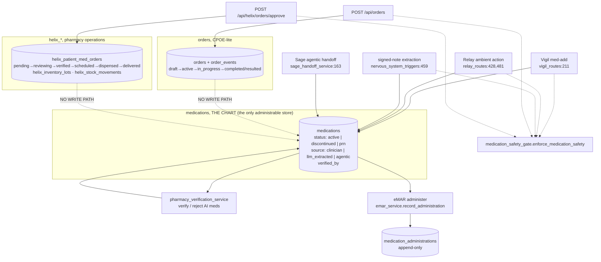

# Chapter 10: Orders, eMAR and Pharmacy

*This is the most safety-critical chapter in the manual. Everything else in Orb
either observes (Vigil, the shadow instrument), advises (Sage), or moves data
around (ingestion, export). This chapter is the one place where the software sits
between a clinician's intent and a drug entering a patient. A bug in Chapter 5
produces a wrong sentence. A bug here produces a wrong dose.*

*So the standard for this chapter is different: for every guard, it states what
the guard catches, **what it does not catch**, and where the guard actually
lives, because a guard in the browser is a suggestion, and a guard in the
service is a rule.*

Everything below is traced to source. Where the code and the prose documentation
disagree, or where a guard is weaker than its own docstring implies, the
disagreement is recorded in §10.12 rather than smoothed over.

---

## 10.1 The map: there is no single "medication order" in Orb

The first thing to understand, and the thing that surprises everyone who reads
this subsystem expecting a clean CPOE→pharmacy→eMAR pipeline, is that Orb has
**three unrelated tables that each represent "a medication order"**, written by
three different subsystems, and *none of them writes into the others*.

| Table | Owner | What it means | Who writes it |
|---|---|---|---|
| `medications` | the chart | The drug is **on the patient's chart** and (if `status='active'`) administrable | `routes/vigil_routes.py:211`, `routes/relay_routes.py:428,481`, `services/nervous_system_triggers.py:459`, `services/sage_handoff_service.py:163` |
| `orders` (`order_type='medication'`) | CPOE-lite | A provider **ordered** something, tracked through a state machine | `services/orders_service.py:132-141` only |
| `helix_patient_med_orders` | Helix pharmacy ops | A **pharmacy workflow item**: review → verify → dispense → deliver | `services/helix_service.py:121-124` only |

`server/database.py:213-226` defines `medications`; `services/helix_db.py:27-44`
defines `helix_patient_med_orders`; the `orders` table is written and read only
through `orders_service`.

**Only `medications` is administrable.** `emar_service.record_administration`
takes a `med_id` and resolves it as `SELECT * FROM medications WHERE id = ?`
(`server/services/emar_service.py:124`). A Helix order that a pharmacist has
walked all the way to `delivered`, and a CPOE `orders` row that has reached
`completed`, are both invisible to the eMAR. Conversely, a nurse can administer a
`medications` row that no pharmacist ever saw and no CPOE order ever created,
provided its `source` is not one of the AI provenances (§10.5.4).

This is stated first because every later claim in this chapter is scoped by it.
When §10.4 says "pharmacist verification", it means
`pharmacy_verification_service` operating on `medications` rows, **not** the
Helix `reviewing → verified` transition, which is a different verification, on a
different table, with no path to the bedside.



The dotted "NO WRITE PATH" edges are the honest part of the diagram. They are
argued about in §10.11.1.

### 10.1.1 What each subsystem is actually for, today

* **`orders`** is a *provider order record*: a lab, an imaging study, a procedure,
  a nursing instruction, a medication order. It exists so a clinician's intent is
  recorded with a coded concept, a priority, and an auditable state history
  (`order_events`). It does not execute anything.
* **Helix** is *pharmacy operations*: a master formulary
  (`helix_medication_master`), inventory lots with expiry
  (`helix_inventory_lots`), FIFO dispensing that decrements stock
  (`helix_service._atomic_dispense`, `:264-301`), and a movement ledger
  (`helix_stock_movements`). Its dispense/deliver states write `is_mock_event = 1`
  (`services/helix_service.py:207-208`), which is the code telling you that the
  physical fulfilment half is a demonstration, not an integration.
* **`medications`** is *the chart*. It is what Sage reads for a patient's drug
  list, what the drug-interaction screen compares a new drug against
  (`services/drug_safety_service.py:251-254`), what the discharge summary and
  FHIR export read, and, the point of this chapter, the only thing eMAR can
  administer.

---

## 10.2 The order lifecycle and its state machine

### 10.2.1 `orders`: the CPOE-lite state machine

Declared as a dict, not scattered through `if` branches
(`server/services/orders_service.py:32-39`):

```python
LEGAL_TRANSITIONS = {
    "draft":        ["active", "cancelled"],
    "active":       ["in_progress", "resulted", "cancelled"],
    "in_progress":  ["completed", "resulted", "cancelled"],
    "completed":    [],   # terminal
    "resulted":     [],   # terminal
    "cancelled":    [],   # terminal
}
```

Four properties are enforced around it, and each closes a specific hole:

1. **Creation is restricted to non-terminal, pre-progress states.**
   `create_order` refuses any status other than `draft` or `active`
   (`:98-102`) with the reason spelled out in the code: allowing creation
   directly into `completed`/`resulted`/`cancelled`/`in_progress` "would let
   callers skip required states and forge the audit trail (a lab could be born
   'resulted' with no ordering event)" (`:93-97`). The state machine is the only
   path forward.
2. **Transitioning to the current status is an idempotent no-op** that writes no
   event (`:167-169`). This matters for an offline client that replays a
   transition: a second `active → active` returns the order unchanged rather than
   producing a duplicate `order_events` row that would read as a second clinical
   decision.
3. **`resulted` is type-gated.** Only `lab` and `imaging` orders may be resulted
   (`RESULTABLE_ORDER_TYPES`, `:43`; enforced at `:178-183` and again in
   `add_result` at `:208-212`). A nursing order cannot acquire a result.
4. **Every transition writes an `order_events` row** with prior status, new
   status, actor and reason (`_record_event`, `:57-62`), called from creation
   (`:141`), transition (`:189`) and result attachment (`:228`). `add_result` is
   careful to write the event only when the status actually moved (`:226-228`),
   so re-attaching a result to an already-`resulted` order updates the text
   without inventing a second transition.

**Terminology validation is a write-time gate, not a hint.** `create_order`
rejects a code that is not present in the local `terminology` subset
(`:107-114`, via `terminology_service.validate_code`), and requires a code at all
for `lab`/`imaging`/`medication`/`procedure`, only `nursing` and `other` may be
free-text (`CODELESS_ORDER_TYPES`, `:46`; enforced `:115-119`). There is a
companion read endpoint `GET /api/orders/terminology/validate`
(`server/routes/orders_routes.py:48-61`) so the create form can validate before
submitting; note the comment at `:44-45` explaining why that route is declared
*before* `/{order_id}`, otherwise the path parameter shadows it.

### 10.2.2 The `pre_persist_gate` seam

`create_order` accepts a `pre_persist_gate` callable and invokes it after all
validation and immediately before the INSERT (`:81`, `:121-125`):

```python
# Caller-supplied gate (e.g. the route's medication drug-safety screen)
# runs after ALL validation and immediately before the write, so a blocked
# order never persists and an invalid order never triggers a screen.
if pre_persist_gate is not None:
    pre_persist_gate()
```

The route passes it only for medication orders
(`server/routes/orders_routes.py:102`), and the closure it passes assigns into a
`nonlocal safety` so the screen result can be attached to the response
(`:81-89`). The ordering is doing two jobs: a blocked order never leaves a
half-written row, and a *malformed* order (bad code, bad type) never wastes a
safety screen or, worse, produces an audited "drug safety screen for
`<garbage>`" event.

**Alternative: screen inside `orders_service`.** Rejected implicitly by the
design, `orders_service` has no notion of medications beyond a string
`order_type`, and pulling `medication_safety_gate` into it would make the CPOE
service depend on the pharmacology layer and on `fastapi.HTTPException` (the gate
raises 428/503 directly, `services/medication_safety_gate.py:133`, `:152`). The
callback keeps the HTTP concern in the route and the persistence concern in the
service. The cost is that the guarantee is *conventional*, not structural: a
future caller of `orders_service.create_order` that forgets to pass a gate gets
an unscreened medication order. §10.11.2 argues this properly.

### 10.2.3 Helix: the pharmacy state machine

`server/services/helix_service.py:14-23`:

```python
LEGAL_TRANSITIONS = {
    "pending":               ["reviewing"],
    "reviewing":             ["verified", "rejected", "substitute_suggested"],
    "substitute_suggested":  ["reviewing"],
    "verified":              ["scheduled"],
    "scheduled":             ["dispensed"],
    "dispensed":             ["delivered"],
    "rejected":              [],      # Terminal
    "delivered":             [],      # Terminal
}
```

This is a strictly linear pipeline with one loop (`substitute_suggested` back to
`reviewing`) and one terminal branch (`rejected`). It is enforced by the same
shape as `orders`, a dict plus `_is_legal_transition` (`:26-27`), but with
three additional behaviours:

* **Idempotency by key, not by state.** `transition_order_status` takes an
  `idempotency_key`; if a `helix_transitions` row already exists for that key it
  returns the existing transition with `already_applied: True` and touches
  nothing (`:148-161`). The key is `UNIQUE` in the schema
  (`services/helix_db.py:73`). When the caller supplies none, one is *generated*
  with a random suffix (`:145-146`), which means an unkeyed replay is **not**
  deduplicated. That is a deliberate-looking default with a real consequence:
  two clicks on "Verify" from a client that does not send a key produce two
  transitions. (The first is legal `reviewing → verified`; the second fails the
  legality check, so the damage is bounded to an error rather than a double
  dispense, but the same is *not* true for `scheduled → dispensed`, where the
  second attempt is also illegal and therefore safe. The bound is luck of the
  state machine, not of the idempotency design.)
* **Dispense decrements inventory atomically, inside the transition.**
  `_atomic_dispense` (`:264-301`) selects the oldest non-empty lot by
  `expiration_date ASC`, FIFO by expiry, which is the correct pharmacy
  discipline, decrements it by one unit, and writes a `helix_stock_movements`
  row. Insufficient stock raises `ValueError` *before* the status is applied
  (`:179-181`), so the order cannot reach `dispensed` without stock having moved.
* **Verification posts a system message into the patient's Relay case room**
  (`:228-249`), so the ward sees "Pharmacy has verified the order for X" without
  polling. Written on the same connection inside the same transaction as the
  transition.

`pre_flight_inventory_check` (`:303-318`) and `pre_flight_alternative_suggestion`
(`:320-389`) support a stockout flow: the latter first looks for a different
strength/form sharing the same `generic_name`, then falls back to a hardcoded
`SOP_SUBSTITUTIONS` map of class-level swaps (`:327-334`). That map is
therapeutically loose, it offers `warfarin` as an alternative to `heparin`, and
`sodium chloride` or `magnesium sulfate` for `potassium`, and is best read as
demo scaffolding rather than a clinical substitution protocol. It is not wired
into any automatic path; it only ever *suggests*.

**Trivia, marked as trivial:** `helix_service` calls `conn.commit()` explicitly
at `:125` and `:251` even though `db_session` is a context manager. Harmless
(SQLite commits are idempotent against an already-committed transaction and the
session commits again on exit), and inconsistent with every other service in the
repo, which relies on the context manager.

**Trivia:** `datetime.utcnow()` at `:185` is the deprecated naive form; every
other timestamp in this subsystem uses `datetime.now(timezone.utc)`
(`orders_service:50`, `emar_service` via SQL default, `pharmacy_verification_service:33`).
The stored `reviewed_at` is therefore naive-UTC while its neighbours are
offset-aware. Nothing currently compares them.

### 10.2.4 The Helix schema migration, and why it is written the way it is

`services/helix_db.py:85-118` runs an additive initialiser. Two parts are worth
reading because they are unusual:

* **The pharmacist-role migration is a probe, not a version check** (`:88-112`).
  It attempts to insert a throwaway user with `role='pharmacist'`; if the CHECK
  constraint rejects it, the whole `users` table is renamed, recreated with
  `pharmacist` in the CHECK, copied and dropped. This is the standard SQLite
  "you cannot ALTER a CHECK constraint" dance, driven by a functional test rather
  than a schema version. It is idempotent and self-healing, and it is also a
  full-table rewrite of the `users` table triggered by a failed INSERT, which
  is why it is gated behind a try/except that only fires once.
* **Both migration helpers swallow their exceptions and log at ERROR**
  (`:145-147`, `:169-170`), with the comment "a failed migration leaves the
  schema in an unknown state." That is honest labelling of a real risk: boot
  continues with a half-migrated Helix schema. It is the right trade for a
  non-clinical-path subsystem (Helix is pharmacy ops, and the chart lives
  elsewhere) and would be the wrong trade for `medications`.

---

## 10.3 The drug-safety screen: what it knows

Everything the platform knows about pharmacology lives in three modules, and
their honesty about their own limits is the most valuable property they have.

### 10.3.1 The class map: twelve classes, substring-matched

`server/services/drug_safety_service.py:28-48` maps a drug class name to a list
of lowercased substrings:

```python
_DRUG_CLASS_PATTERNS: dict[str, list[str]] = {
    "penicillins": ["penicillin", "amoxicillin", "ampicillin", "flucloxacillin",
                    "co-amoxiclav", "augmentin", "piperacillin", "tazocin"],
    ...
}
```

`classify_drug` (`:75-84`) lowercases the drug name and returns **every** class
whose patterns appear as substrings, a drug may belong to several. The complete
set of classes it can ever emit is twelve:

`ace_inhibitors`, `aminoglycosides`, `anticoagulants`, `carbapenems`,
`cephalosporins`, `macrolides`, `nsaids`, `opioids`, `penicillins`, `potassium`,
`statins`, `sulfonamides`.

Two design notes carried in the code:

* The opioid list deliberately includes combination brand products whose names do
  not contain the ingredient string, `co-codamol`, `solpadol`, `kapake`,
  `tylex`, `zapain` (`:39-41`). Substring matching on ingredient names alone
  would classify `co-codamol` as nothing, and a patient with a documented codeine
  anaphylaxis would get no alert.
* `aspirin` is inside `nsaids` (`:35-36`). That is pharmacologically defensible
  for interaction purposes (it is an NSAID) and is the mechanism by which
  `warfarin + aspirin` fires, see §10.3.4.

### 10.3.2 Cross-reactivity is stored undirected and expanded symmetrically

`:55-63`:

```python
_CROSS_REACTIVITY_PAIRS = [
    ("penicillins", "cephalosporins", "moderate"),  # ~1-3% cross-reactivity
    ("penicillins", "carbapenems", "moderate"),
]
_CROSS_REACTIVITY = {}
for _a, _b, _sev in _CROSS_REACTIVITY_PAIRS:
    _CROSS_REACTIVITY.setdefault(_a, []).append((_b, _sev))
    _CROSS_REACTIVITY.setdefault(_b, []).append((_a, _sev))
```

The comment states the reason for the expansion: "a cephalosporin-allergic
patient prescribed a penicillin must alert just as a penicillin-allergic patient
prescribed a cephalosporin does" (`:52-54`). Declaring the pair once and deriving
both directions is the cheapest way to make it impossible to add a one-directional
cross-reactivity by accident.

### 10.3.3 Name matching, and the 4-character floor

`names_overlap` (`:111-127`) is the allergen-to-drug string comparison, and it
runs a three-step ladder:

1. exact equality,
2. **token containment**, the allergen appears as a whole word token in the drug
   name, or vice versa (`_tokens`, `:107-108`, on `[a-z0-9][a-z0-9'\-]*`),
3. **free substring**, but only when *both* strings are at least
   `_MIN_SUBSTRING_MATCH = 4` characters (`:102`, `:125-126`).

The floor is explained at length at `:91-101`, and the explanation is the single
best statement of this subsystem's design philosophy:

> a 2–3 character allergy record substring-matches a large, arbitrary slice of
> the formulary in BOTH directions, "pen" is inside meroPENem, PENtazocine …
> An interlock that fires on unrelated drugs is not a stricter interlock, it is
> the documented alert-fatigue hazard: staff learn to click through, and the real
> anaphylaxis alert dies with the noise.

Sub-4-character allergen records are neither matched nor dropped. They are
reported separately as *uninterpreted* by the administration interlock
(`services/allergy_interlock.py:286-295`), so a nurse sees "there is an allergy
record this system could not interpret" rather than a clean screen it did not
earn.

Substring matching survives above the floor because it is what catches
`"sulfa"` → `"sulfamethoxazole"` and `"amoxicillin"` → `"amoxicillin 500mg"`
(`:116-118`).

### 10.3.4 The interaction table: and the reachability gap

Drug–drug interactions moved out of a hardcoded list into a real table,
`drug_interactions`, seeded from `services/interaction_db.py:37-169`. The seed is
55 curated pairs, each with `(term_a, term_b, match_type, severity, mechanism)`
and an inline clinical source comment (BNF, Stockley's, FDA labelling,
CredibleMeds, MHRA). `match_type` is either `class` (terms are drug classes) or
`ingredient` (terms are specific active ingredients), `:14-19`.

Seeding is idempotent via `ON CONFLICT(term_a, term_b, match_type) DO UPDATE`
(`:184-187`) and lazy: `ensure_seeded` (`:201-204`) seeds only when the table is
empty, and `check_interactions` calls it on every screen (`drug_safety_service.py:249`).

`lookup_interactions` (`:207-240`) is symmetric by construction, it queries
`(term_a IN A AND term_b IN B) OR (term_a IN B AND term_b IN A)` (`:224-229`), 
so callers never need to know pair ordering.

**Now the gap, and it is a large one.** `check_interactions`
(`drug_safety_service.py:237-273`) is the only production caller, and it feeds
`lookup_interactions` with **class names produced by `classify_drug`**, on both
sides:

```python
new_classes = set(classify_drug(drug_name))      # :246
if not new_classes:
    return alerts                                 # :247-248
...
existing_classes = set(classify_drug(existing))   # :257
for hit in interaction_db.lookup_interactions(new_classes, existing_classes):
```

`classify_drug` can emit exactly twelve strings (§10.3.1). Therefore a curated
pair can only ever fire if **both** of its terms are among those twelve. Running
that intersection over the seed set gives **7 of 55 pairs reachable**:

| term_a | term_b | severity |
|---|---|---|
| anticoagulants | nsaids | severe |
| anticoagulants | anticoagulants | severe |
| ace_inhibitors | potassium | moderate |
| ace_inhibitors | nsaids | moderate |
| statins | macrolides | moderate |
| opioids | opioids | moderate |
| nsaids | nsaids | moderate |

Thirty-six distinct terms in the table can never be produced by `classify_drug`
and are therefore dead rows: `warfarin`, `aspirin`, `digoxin`, `lithium`,
`methotrexate`, `theophylline`, `ssri`, `maoi`, `azoles`, `benzodiazepines`,
`qt_prolonging`, `beta_blockers`, `verapamil`, `amiodarone`, `spironolactone`,
`trimethoprim`, `metronidazole`, `clopidogrel`, `proton_pump_inhibitors`,
`fluoroquinolones`, `gabapentinoids`, `triptans`, `tramadol`, `thiazides`,
`diuretics`, `fibrates`, `ciclosporin`, `allopurinol`, `azathioprine`,
`metformin`, `iodinated_contrast`, `nitrates`, `sildenafil`, `antipsychotics`,
`sympathomimetics`, `potassium_sparing_diuretics`.

Every `match_type='ingredient'` row is dead, because `classify_drug` returns
class names, never ingredient names, `classify_drug("warfarin")` returns
`["anticoagulants"]`, so the term `"warfarin"` is never on either side of a
lookup.

This is *not* the same as saying those interactions are missed. `warfarin +
ibuprofen` still fires, at `severe`, because both drugs classify
(`anticoagulants`, `nsaids`) and the class-level pair exists. What is missed is
everything whose only representation in the table is an unreachable term:
opioid + benzodiazepine (an FDA black-box combination, `interaction_db.py:137-138`),
SSRI + MAOI (`:91-92`), digoxin + amiodarone (`:105-106`), lithium + NSAID
(`:143-144`), QT-prolongation stacking (`:125-132`), nitrate + sildenafil
(`:161-162`), allopurinol + azathioprine (`:163-164`).

The test suite documents the discrepancy without naming it:
`server/tests/test_interaction_db.py:60-61` asserts
`lookup_interactions({"opioids"}, {"benzodiazepines"})` returns hits, and
`:80` asserts the same for `{"ciprofloxacin"}, {"theophylline"}`, both by calling
`lookup_interactions` **directly with literal terms no production path can
generate**. The table's symmetry is tested; its reachability is not.

The fix is a one-line-per-class extension of `_DRUG_CLASS_PATTERNS` plus (for
ingredient rows) passing the drug name itself alongside its classes into
`lookup_interactions`. It is recorded as a gap here, not fixed, because
`drug_safety_service.py` is under concurrent edit by the allergy-interlock
workstream.

### 10.3.5 `check_medication_safety`: and the "not screened ≠ clean" rule

`:276-307` composes the two screens and returns:

```python
{
  "drug": drug_name,
  "allergy_alerts": [...],
  "interaction_alerts": [...],
  "max_severity": "none|mild|moderate|severe",
  "blocking": max_sev == "severe",
  "safe": not all_alerts,
  "interaction_screened": bool(classify_drug(drug_name)),
  "coverage_note": None | "'<drug>' is outside the interaction knowledge base, …",
}
```

`interaction_screened` is the honest bit, and the docstring says exactly why
(`:283-286`): "an unscreened drug returning zero alerts previously looked
identical to a clean screen." A drug that classifies to nothing, 
`paracetamol`, `metformin`, `ondansetron`, most of the formulary, returns
`interaction_screened: False` plus a `coverage_note` telling the clinician to
verify manually. Allergy matching still runs regardless, because a direct name
match does not need a class (`:284-286`).

> **The signal is narrower than its own wording, and the wording is what leaks
> into the UI.** `interaction_screened = bool(classify_drug(drug_name))`
> (`drug_safety_service.py:353`) detects only drugs that map to no class. It says
> nothing about whether the interaction table holds a single pair touching that
> drug's classes. So a drug that classifies cleanly but has no curated pair
> returns `interaction_screened: True`, no `coverage_note`, and zero alerts, 
> presented to the clinician as screened and clean. Given `_BUILTIN` is 55 pairs
> over 12 classes, that is the common case, not an edge case. The
> `coverage_note` string ("… is outside the interaction knowledge base …") is
> therefore doubly misleading: it names the wrong condition, and it implies the
> converse holds. Widening this means asking `interaction_db` whether any row
> touches the drug's classes before declaring it screened, and the user-facing
> docs (USER_MANUAL §8.5) now state the limit explicitly rather than waiting for
> that fix.

Every consumer surfaces the distinction: the pharmacist queue carries
`interaction_screened`, `coverage_note` and `screen_failed` per row
(`services/pharmacy_verification_service.py:107-111`), and the safety gate audits
`interaction_screened` on every screen
(`services/medication_safety_gate.py:74`, `:85`).

Note the shape of the honesty: it is not a disclaimer in a footer. It is a field
in the API contract that the UI must render, and that the audit chain records for
every order.

---

## 10.4 The order-time gate: `enforce_medication_safety`

`services/medication_safety_gate.py` is "the single enforcement point for
order-time drug safety" (`:3`). Its contract, from the module docstring
(`:10-26`):

| Situation | Interactive caller | Non-interactive caller |
|---|---|---|
| severity < severe | proceed; alerts returned and audited | proceed |
| severity == severe, no ack | **HTTP 428** with full safety payload | **`MedicationSafetyBlocked`** |
| severity == severe, acknowledged | proceed; override written to the hash chain | *impossible*, never acknowledgeable |
| screen itself errored | **HTTP 503** | **`MedicationSafetyBlocked`** |

The 428 pattern is deliberate reuse: the module docstring says it "mirrors the
Scribe sign gate's 428 pattern" (`:10`), and the eMAR allergy route later reuses
it a third time (`routes/emar_routes.py:9-14`). A client that understands one
understands all three.

### 10.4.1 The failure path is fail-closed, and asymmetric by design

`:113-140`. If `check_medication_safety` raises, the gate synthesises a payload
that is *deliberately not empty*:

```python
failed = {..., "max_severity": "unknown", "blocking": True, "safe": False,
          "interaction_screened": False, "screen_failed": True,
          "coverage_note": "Drug-safety screening is unavailable, do not assume this order was checked."}
```

`blocking: True` and `safe: False` mean a failed screen behaves exactly like a
severe alert. The interactive caller gets a **503**, not a 428, the distinction
is that a 428 says "acknowledge and resubmit" while the 503 says "resolve the
fault or use the pharmacist verification path" (`:137`). There is no
acknowledgement that clears a broken screen at order time.

### 10.4.2 The acknowledgement is three-part

`:143-144`:

```python
ack_reason = (safety_ack or {}).get("reason", "").strip() if safety_ack else ""
acknowledged = bool(safety_ack) and bool(ack_reason) and bool((safety_ack or {}).get("acknowledged"))
```

An override requires the object, a non-empty trimmed reason, **and** an explicit
`acknowledged` truthy flag. A client cannot override by sending
`{"reason": ""}` or `{"acknowledged": true}` alone. Compare this with the
administration-time interlock (§10.6.6), which applies a *much* stronger reason
test, this asymmetry is discussed in §10.11.4.

### 10.4.3 Audit is fail-open here, and that is a deliberate inversion

`_audit` (`:51-93`) wraps `log_audit_event` in a bare try/except with the comment
"Clinical-safety events are fail-open for auditing (the audit middleware still
records the mutation), a logging failure must not block care" (`:62-64`). This
is the opposite of the eMAR administration path, which audits inside the write
transaction under the fail-closed `clinical_access` category
(`emar_service.py:211-250`, and see Chapter 3 for the category table at
`services/audit_service.py:36`).

The justification is coherent but worth stating precisely: the drug-safety screen
is an *advisory* event about an action that the audit middleware will record
anyway; the administration is *the* clinical event, and an unaudited dose is
unacceptable. The category strings reflect this, `clinical_safety` for the gate,
`clinical_access` for the dose.

### 10.4.4 The five callers

Every write path into `medications` (and the CPOE medication order) routes through
the gate:

| Entry point | Call site | `interactive` |
|---|---|---|
| `orders.cpoe` | `routes/orders_routes.py:83-89` | True |
| `helix.approve` | `routes/helix_routes.py:113-119` | True |
| Vigil med-add | `routes/vigil_routes.py:667` | True |
| Relay ambient action (×2) | `routes/relay_routes.py:420`, `:471` | True |
| Relay (fourth site) | `routes/relay_routes.py:1200` | True |
| Scribe signed-note extraction | `services/nervous_system_triggers.py:418` | **False** |

The `entry_point` string is carried into every audit record (`:74`, `:82`), so
"which surface charted this drug" is answerable from the chain alone.

The non-interactive case is the interesting one.
`nervous_system_triggers._extract` (`:416-438`) catches
`MedicationSafetyBlocked` and *still charts the med*, but unverified, with the
blocking alerts stapled into its notes:

```python
except MedicationSafetyBlocked as blocked:
    # An autonomous path must never ACTIVATE a severe-alert med: 
    # but nothing charted here is trusted until a pharmacist
    # verifies it, so chart it unverified with the blocking alerts
    # attached rather than dropping the extraction silently.
```

That is the correct resolution of a genuine dilemma: silently discarding a
medication a doctor dictated into a note is its own safety failure, and
auto-activating a severe-alert drug is worse. The third option, chart it, mark
it unverified, attach the reason, route it to a pharmacist, is the one taken.
The same file refuses outright to autonomously *stop* a medication (`:409-413`):
"an LLM mis-parse silently stopping a real medication is a critical failure mode"
stops are only ever proposed.

---

## 10.5 Pharmacist verification

### 10.5.1 What "unverified" means

Two provenance values mark a medication as AI-originated:

```python
_UNVERIFIED_SOURCES = ("llm_extracted", "agentic")
```

declared twice, deliberately mirrored, `services/pharmacy_verification_service.py:29`
and `services/emar_service.py:39`, the latter with the comment "(mirrors
`pharmacy_verification_service._UNVERIFIED_SOURCES`)". The `source` column
defaults to `'clinician'` (`server/database.py:1585-1586`), so anything charted
before the provenance migration, and anything charted by a human surface, is
`clinician` and needs no verification.

A med is **pending verification** when `source IN _UNVERIFIED_SOURCES AND
verified_by IS NULL` (`:93-95`). Agentic paths chart with a placeholder dose of
`'REVIEW REQUIRED'` (`:6-7`, and see `nervous_system_triggers.py:435-437` where
missing dosage and frequency both default to that literal), so the queue item is
visibly incomplete rather than plausibly wrong.

### 10.5.2 The queue

`list_pending_verification` (`:78-113`) joins each pending med to its patient name
and then runs a *fresh* safety screen per row (`:104`), annotating
`safety_alerts`, `max_severity`, `interaction_screened`, `coverage_note` and
`screen_failed`. The screen is re-run at read time rather than cached, so a queue
left open across a shift shows the alerts as they are now, not as they were when
the med was charted.

`_safety_alerts` (`:36-56`) is the queue's private wrapper and it **never
raises**, "the queue must stay visible" (`:41`), but it fails *closed in
meaning*: a screen error yields `max_severity: "unknown"`, `blocking: True`,
`safe: False`, `screen_failed: True`. The docstring states the invariant: "an
unscreened med must never look identical to a clean one" (`:42-43`).

### 10.5.3 Verify: the two-session dance and the re-guard

`verify_medication` (`:126-221`) is structured in three phases, and the shape is
forced by a real constraint:

1. **Session 1 (`:145-152`)**, read the med and validate: it must exist, be of
   AI/agentic provenance, and be unverified. A second verification raises.
2. **Screen, outside any session (`:154-189`)**, because
   `check_medication_safety` opens its own connections (`:154-155`). This is the
   `db_session`-reentrancy discipline described in Chapter 2: you do not open a
   nested session from inside an open one. A severe alert, *or a failed screen*,
   requires an `ack_reason` (`:158`); without one it raises a `ValueError` whose
   message is prefixed `severe_ack_required:` and which carries the screen on an
   `.safety` attribute (`:163-168`) so the route can render it as a 428
   (`routes/pharmacy_routes.py:60-70`). With one, the override is written to the
   hash chain as `pharmacy_verify_override` / `partial_success` (`:169-188`).
3. **Session 2 (`:191-212`)**, re-read and **re-guard**, with the reason spelled
   out at `:192-194`: "another pharmacist may have verified (or an admin purge
   deleted the med) while the screen, or the acknowledgement round-trip, was
   in flight." The UPDATE itself carries `AND verified_by IS NULL` (`:209`), so
   even if two verifications interleave past both guards, only one wins at the
   database.

That last belt-and-braces is the right instinct: the check-then-act window here
is not microseconds, it is *however long a human takes to type an acknowledgement
reason*.

### 10.5.4 Reject

`reject_medication` (`:224-269`) sets `status='discontinued'`, stamps
`verified_by`/`verified_at` (the decision was made by this pharmacist, even
though the decision was "no"), and *appends*, never replaces, a rejection note:

```python
rejection_note = f"[REJECTED by {pharmacist_id} @ {stamp}] {reason}"
new_notes = f"{prior_notes}\n{rejection_note}".strip() if prior_notes else rejection_note
```

A non-empty reason is mandatory (`:234-236`). The UPDATE carries the same
`AND verified_by IS NULL` optimistic guard (`:255`).

Note the consequence for eMAR: a rejected med has `status='discontinued'`, so the
eMAR active-order guard (§10.6.2) refuses it, *and* it now has a non-NULL
`verified_by`, so the unverified-AI guard would have let it through. The two
guards are independent and the discontinuation is what stops it. That is fine,
but it means the unverified-AI guard cannot be relied on to block rejected meds;
the status guard does that work.

### 10.5.5 Who may verify

`POST /api/pharmacy/{med_id}/verify` and `/reject` require `helix.write`
(`routes/pharmacy_routes.py:44`, `:102`). From the role table
(`server/permissions.py:116-133`), `helix.write` is held by **`pharmacist` and
`admin` only**. Doctors and nurses do not have it. Conversely the `pharmacist`
role holds *only* `sage.query`, `helix.read` and `helix.write` (`:116-120`), a
pharmacist cannot read the patient board, cannot write vitals, and cannot
administer.

That is a genuine separation of duties: the person who charts an AI-extracted med
cannot be the person who verifies it, because no role holds both
`medication.write` and `helix.write`. (`admin` holds `helix.write` but *not*
`medication.write`, `:121-133`.)

Both routes audit under `clinical_record` with a rich metadata block including
`max_severity`, `safety_alert_count`, `interaction_screened`, `screen_failed` and
`acknowledged` (`routes/pharmacy_routes.py:73-96`, `:114-132`).

---

## 10.6 Every administration interlock in force

This is the heart of the chapter. A dose reaches
`medication_administrations` only through
`emar_service.record_administration`, and only through
`POST /api/emar/medications/{med_id}/administer`. There is no second writer, 
`grep` finds no other `INSERT INTO medication_administrations` in the tree
outside tests.

The guards, in execution order:

| # | Guard | Where | Raises | Catches | Does **not** catch |
|---|---|---|---|---|---|
| 0 | Permission `medication.write` | `routes/emar_routes.py:49` | 403 | pharmacist/admin/patient accounts | anything about *which* patient |
| 1 | Status enum | `emar_service.py:113-114` | `ValueError`→422 | a third status | n/a |
| 2 | Confirmation-method enum | `:115-118` | `ValueError`→422 | an invented method string | whether any check happened |
| 3 | Mandatory not-given reason | `:119-121` | `ValueError`→422 | a blank withhold | a meaningless one ("x") |
| 4 | Medication exists | `:124-126` | `ValueError`→422 | a bad id | n/a |
| 5 | **Active order** | `:127-130` | `ValueError`→422 | discontinued / prn-only | an active order for the wrong patient |
| 6 | **Unverified AI medication** | `:131-132` | `ValueError`→422 | an LLM-charted, unverified drug | a *clinician*-sourced wrong drug |
| 7 | Idempotency replay | `:147-153`, `:184-193` |, (returns) | double-charting on replay | a genuine second dose with a new key |
| 8 | **Allergy interlock** | `:161-166` | `AllergyInterlockBlocked`→428 | severe same-drug/class/cross-reactive match; unreadable allergy list | an allergy nobody charted |
| 9 | Fail-closed audit | `:219-250` | any → rollback | a committed-but-unaudited dose | n/a |
| n/a | **Five rights** | `AdministerModal.tsx:104-129` |, (display only) | nothing; it is a *prompt* | everything |
| n/a | **Type-the-drug-name** | `AdministerModal.tsx:49`, `:207` |, (disables a button) | a mis-click on the wrong row | a client that does not use this modal |

The last two rows are the ones a reader must not skim.

### 10.6.1 The five rights are a display, not a check

`src/components/vigil/AdministerModal.tsx:104-129` renders a `<dl>` of five
lines: Patient (+ bed), Drug, Dose, Route, Time (rendered as `now`). It is
labelled in the source as "Five rights, verify each line against the med in
hand" (`:104`).

**Nothing is verified.** Every value is read from the medication row the caller
already selected (`med.drug_name`, `med.dosage`, `med.route`) and from props
(`patientName`, `patientBed`). The modal cannot know what is in the nurse's hand.
Its function is cognitive: it forces the five facts into one place at the moment
of decision, which is exactly what the five-rights discipline is for. Calling it
an *interlock* would be wrong; calling it useless would also be wrong.

The server never receives four of the five. It receives `dose_given` and
`route_given` (defaulted from the order when absent, `emar_service.py:136-138`),
the actor from the session, and the medication id. Patient identity is *derived*
from the med row (`:179` writes `med["patient_id"]`), never accepted from the
client, which is the right call, and means guard #5's "wrong patient" gap is not
reachable through this route: you cannot administer med 42 to a patient other
than med 42's owner. What you *can* do is select the wrong med row for the right
patient, which is precisely what guards #6 and #8 and the type-to-confirm exist
to reduce.

### 10.6.2 Type-the-drug-name is client-side only

`AdministerModal.tsx:49`:

```ts
const confirmed = confirmText.trim().toLowerCase() === med.drug_name.trim().toLowerCase()
```

and the "Given" button is `disabled={busy || !confirmed}` (`:207`) with a
`title` explaining why (`:208`). The hint calls it a "Barcode-style check"
(`:146-148`). The modal is used by both surfaces that administer: the Vigil
patient panel (`src/pages/panels/VigilPanel.tsx:1859`) and the nurse med round
(`src/pages/panels/nurse/MedRoundSheet.tsx:192`), so there is one implementation.

The request body then carries `confirmation_method: 'typed'`, a *literal*, hard
coded at `AdministerModal.tsx:62` and `:67`. The server validates only that the
string is one of `("typed", "barcode")` (`emar_service.py:40`, `:115-118`).

**So the server has no evidence that anyone typed anything.** `curl` with
`{"status":"given","confirmation_method":"typed"}` and a valid session records a
dose with the confirmation method asserted, not proven. This is a real limitation
and it is the correct one to accept, a server cannot verify a keystroke, but it
must be stated plainly, because the field name invites the opposite reading. What
the stored value actually means is: *the client claims a typed confirmation
happened.* Its evidentiary weight is the weight of the client.

`'barcode'` is aspirational. Grep finds no barcode scanning anywhere in `src/`, 
the only occurrences of the word are this enum
(`server/database.py:244`, `emar_service.py:40`, `emar_routes.py:36`), a test
(`server/tests/test_emar.py:108-112`) and the "barcode-style" prose in the modal.
The column is ready for a scanner that does not exist.

### 10.6.3 The active-order check

`emar_service.py:127-130`:

```python
if med["status"] != "active":
    raise ValueError(f"medication {med_id} is not an active order (status={med['status']})")
```

`medications.status` is CHECK-constrained to `('active', 'discontinued', 'prn')`
(`server/database.py:221`). Note the consequence: **a `prn` medication cannot be
administered through eMAR at all.** "As required" drugs, analgesia, antiemetics,
rescue bronchodilators, are exactly the class a ward gives most often outside a
scheduled round, and the guard refuses them by strict equality with `'active'`.
This is not documented anywhere in the module. It is either an oversight or an
unstated decision that PRN doses are out of scope for the pilot; the code does
not say which. Recorded in §10.12.

### 10.6.4 The verification requirement

`:131-132`:

```python
if med["source"] in _UNVERIFIED_SOURCES and med["verified_by"] is None:
    raise ValueError("unverified medication, pharmacist verification required")
```

This closes the loop opened in §10.4.4: the Scribe extraction path charts a
severe-alert medication rather than dropping it, and *this* guard is what stops
that medication reaching a patient before a pharmacist has looked at it.

What it does **not** catch: a wrong drug charted by a human. `source='clinician'`
skips the check entirely. That is intentional, requiring pharmacist verification
of every clinician order would be a different product, and a district hospital
does not have the pharmacist coverage for it, but it means the "AI can't chart a
drug that reaches a patient unchecked" guarantee is exactly that narrow. It is a
guarantee about *AI provenance*, not about correctness.

### 10.6.5 Idempotency, and why the replay check comes before the allergy screen

The `Idempotency-Key` header (`routes/emar_routes.py:50`) flows into the service
and is enforced by a partial unique index:

```sql
CREATE UNIQUE INDEX IF NOT EXISTS idx_med_admin_idem
    ON medication_administrations(idempotency_key) WHERE idempotency_key IS NOT NULL;
```
(`server/database.py:249-251`)

Two layers handle a replay:

* a pre-INSERT `SELECT` on the key (`:147-153`) returns the existing hydrated
  record with `replayed: True`;
* a `DBIntegrityError` catch around the INSERT (`:184-193`) handles the race where
  two replays pass the SELECT concurrently. If no key was supplied, the
  integrity error is re-raised rather than swallowed (`:191-192`), an
  integrity failure with no key is a genuine bug, not a replay.

The **ordering**, replay check before allergy screen, is argued in the code
(`:140-146`) and the argument is good:

> A replay means this dose was already given and already screened; re-screening
> it can only produce a NEW verdict (the ward charted an allergy in the
> meantime), and blocking a replay would not un-give the dose, it would only
> wedge the offline client into retrying a delivery it can never complete.

This is the general shape of correct offline-first design: the client is
reporting a *fact that already happened in the physical world*. Refusing the
report does not undo the event; it only destroys the record of it.

### 10.6.6 The allergy interlock

This is guard #8, it is the newest, and it is the subject of §10.7 in full.
Structurally, at the eMAR call site (`emar_service.py:155-170`):

* it runs **on the caller's connection**, inside the same transaction, after the
  idempotency check and immediately before the INSERT, so it sees the allergy
  list as of the instant of the dose, and so an override row cannot commit
  without the dose it authorised (`:156-160`);
* it runs **only for `status='given'`** (`:162`). Withholding a dose is never
  interlocked, which the module docstring justifies bluntly: "withholding a dose
  must always be easy" (`:104`);
* the compact screen is serialised onto the administration row as
  `allergy_check_json` (`:167-170`, column added by migration 6,
  `server/migrations.py:299-300`);
* a **new** override (not one carried forward) writes its own ledger row in the
  same transaction, linked to the administration id (`:198-207`).

It raises `AllergyInterlockBlocked`, deliberately **not** `ValueError`, the
docstring gives the reason at `:95-97`: "the caller must be able to tell 'you may
not do this' from 'you may do this, but say why'". The route maps the two to
different HTTP codes: 428 with the full screen for the interlock
(`routes/emar_routes.py:76-86`), 422 with a string for everything else
(`:87-88`).

### 10.6.7 The audit is inside the transaction, and that is the point

`emar_service.py:211-250` calls `log_audit_event(..., db=db)`, on the *caller's*
connection. The comment (`:211-218`) explains both halves:

> after our INSERT this connection holds the write lock, so the prev-hash read +
> audit insert are serialized … the administration row and its audit row commit
> or roll back TOGETHER, so an audit-write failure can never leave a
> committed-but-unaudited dose (which an idempotent replay would otherwise return
> forever without auditing).

That parenthetical is the subtle part. Without the shared transaction, a dose
could commit, its audit could fail, and every subsequent replay of that
idempotency key would return the existing record from `:147-153`, a permanently
unauditable dose that looks successful forever.

A second audit event, `medication_allergy_override`, is written in the same
transaction whenever an override was used *or* the decision was BLOCK
(`:256-290`), carrying the fingerprint, whether the reason was carried forward,
the source override id, and the full alert list. It is written under the
fail-closed `clinical_access` category rather than the fail-open
`clinical_safety` one, with the reason stated at `:252-255`: "'the dose committed
but the reason for overriding the allergy did not' is not a reachable state."

### 10.6.8 Append-only, and what `_hydrate` refuses to invent

`medication_administrations` is append-only by design, the schema comment says
"corrections are new rows, never UPDATEs, so the administration record stays a
faithful history" (`server/database.py:230-232`). There is no UPDATE or DELETE
against the table anywhere in the service.

`_hydrate` (`emar_service.py:54-71`) parses `allergy_check_json` back into an
object, and its handling of NULL is a small, exemplary piece of the same
philosophy:

```python
d["allergy_check"] = None   # when raw is falsy
```

with the docstring (`:57-60`): "`allergy_check` is None for a dose recorded
before the interlock existed (and for 'not_given' rows, which are never
screened). That NULL is meaningful and is left as None rather than defaulted to
an empty screen: a dose nobody checked must not read like a dose that came back
clean." A malformed JSON blob becomes
`{"decision": "unknown", "parse_error": True}` (`:68`) rather than silently
`None`, three distinguishable states where a lazier implementation would have
one.

---

## 10.7 The allergy interlock in detail

`server/services/allergy_interlock.py` (543 lines) is the most carefully argued
module in this subsystem. Its docstring opens with "THE LAST LINE OF DEFENCE"
(`:3`) and then spends fifty lines explaining why a check that already exists at
order time needed to exist again at administration time.

### 10.7.1 Why the order-time screen was not enough

`:9-30`, condensed:

1. **Allergy lists change after the order.** "The admitting antibiotic is ordered
   in ED at 02:00; the patient's daughter arrives at 09:00 and reports the
   penicillin reaction; the allergy is charted then. The order was screened
   against an allergy list that did not yet contain the allergy."
2. **Not every order goes through the gate.** Downtime mode, HIS/FHIR ingestion,
   a migration, a direct fix, "eMAR is the single write path for a dose, so it
   is the one place a check cannot be routed around."
3. **The prescriber's override is not the nurse's decision.** "A doctor
   acknowledging 'amoxicillin despite penicillin label' at 02:00 does not
   transfer to whoever draws it up at 06:00."

Point 2 is the architectural argument and it is the strongest one. Chapter 2's
account of the ingestion path and the FHIR adapter (`ingestion_adapters.FHIRAdapter._parse_medication_request`)
makes it concrete: there really are writers into the chart that never touch
`medication_safety_gate`.

### 10.7.2 Alert fatigue as a safety hazard, engineered against

`:34-53` names three mechanisms:

* **One vocabulary.** Matching runs through
  `drug_safety_service.match_allergies`, the same class map, the same
  cross-reactivity pairs, the same 4-character floor as the order-time gate
  (`allergy_interlock.py:71`, `:274`). No second drug ontology.
* **Graded response.** Only a severe (or unknown-and-not-obviously-trivial)
  match is a hard stop.
* **Order-scoped override.** Once a clinician has typed a reason for *this order*
  against *this allergy picture*, later doses of the same order do not re-prompt.

### 10.7.3 Formulary resolution: brand → ingredient

`resolve_ingredients_bulk` (`:133-189`) reads `helix_medication_master`, the
hospital's own catalogue, to map a charted drug name onto its
generic/ingredient names. The clinical motivation is at `:138-141`: a charted
"Monocef 1g" resolves to "Ceftriaxone", which the shared class map then places in
`cephalosporins`; "without this the brand name classifies as nothing at all and a
penicillin-allergic patient's cross-reactivity alert never fires."

Four implementation properties:

* **One query for the whole set** (`:143-145`), "this runs on the ward board
  across every patient × every medication, so a per-drug lookup would be an N+1."
* **Matching is prefix/equality on both directions plus a first-token prefix**
  (`:176-185`), the last guarded at 4 characters for the same alert-fatigue reason
  as `names_overlap`.
* **A formulary read failure is caught and degrades** (`:157-163`): "The
  formulary is an ENRICHMENT, not the allergy source. Losing it degrades
  brand-name resolution; it does not blind the screen." Contrast with the allergy
  read itself, which fails closed (§10.7.6).
* It handles both `sqlite3.Row` and plain tuples (`:167-168`), which is the
  `db_backend` abstraction leaking slightly, see Chapter 2.

### 10.7.4 Effective severity: believing the reaction over the column

`effective_severity` (`:198-218`) is where clinical judgement is encoded, and the
precedence order is the interesting part:

1. **Reaction text describes an airway/circulatory/severe-cutaneous event →
   severe**, whatever the severity column says. The regex `_ANAPHYLAXIS_RE`
   (`:100-106`) matches `anaphyla`, `angio-?\s?o?edema`, `laryng`,
   `bronchospasm`, `airway`, throat/tongue swelling, respiratory or cardiac
   arrest, cardiovascular collapse, `\bshock\b`, Stevens-Johnson / `\bsjs\b`,
   toxic epidermal / `\bten\b`, `\bdress\b`, `epipen`, `adrenaline`,
   `epinephrine`, `resuscitat`, `\bitu\b`, `\bicu admission\b`. The comment at
   `:96-99`: "'anaphylaxis, severity: mild' is a data-entry artefact, not a
   clinical judgement, believe the reaction."
2. **An explicitly recorded mild/moderate/severe → that value.**
3. **severity `unknown` + a reaction that reads as an intolerance → mild.**
   `_INTOLERANCE_RE` (`:112-117`) matches nausea, vomiting, GI upset,
   indigestion, dyspepsia, diarrhoea, constipation, headache, drowsiness,
   dizziness, `intoleran`, metallic taste, loose stool, bad taste, bloating. The
   comment (`:108-111`): "nausea with codeine is an intolerance, not an allergy.
   Blocking every opioid dose on it is exactly how an interlock gets trained out
   of existence." Applied **only** when no severity was recorded, an explicitly
   clinician-graded `severe` is never talked down.
4. **`unknown` with nothing else to go on → severe (fail safe).**

The returned tuple carries a `basis` string, 
`reaction_is_anaphylaxis_grade` / `recorded_severity` /
`reaction_reads_as_intolerance` / `severity_unknown_fail_safe`, which is stored
per-alert (`:280`) and surfaced in `summarize` (`:534`). A nurse can therefore see
not just *that* the system graded a reaction severe but *why*, which is the
difference between an alert and an argument.

**Regex trivia, marked as trivia but worth knowing:** `\bten\b` (for toxic
epidermal necrolysis) will match the English word "ten" in a free-text reaction
like "rash after ten minutes", escalating it to severe. `\bshock\b` will match
"no shock". These are false-positive-toward-safety, which is the correct
direction for this particular expression, but they are worth knowing about when a
ward complains the interlock is noisy.

### 10.7.5 Decision and fingerprint

`decide` (`:221-235`) is three lines of logic and eleven lines of justification:
direct or same-class match at severe → BLOCK; cross-reactivity at severe → BLOCK
("~1–3% of penicillin-allergic patients react to a cephalosporin; with an
anaphylaxis history that is a stop-and-decide, not a footnote", `:225-228`);
everything else → WARN.

`_fingerprint` (`:238-257`) is the identity of "this drug against this allergy
picture": a SHA-256 (truncated to 32 hex chars) over the drug key plus, for each
alert, `allergy_id | substance | match | effective_severity | decision`, sorted
so ordering cannot change it. Its purpose (`:241-244`):

> An override is carried forward only while the fingerprint holds. Adding an
> allergy, escalating a severity, or editing a reaction into anaphylaxis
> territory all change it, which RE-ARMS the interlock rather than letting a
> stale acknowledgement cover a new hazard.

The `drug_key` includes the resolved ingredient names (`:297`), so a formulary
change that newly resolves a brand to an ingredient also re-arms.

### 10.7.6 Fail-closed, and the deliberate refusal to be un-overridable

`_failed_screen` (`:317-340`) returns `decision: BLOCK`, `screen_failed: True`,
`allergies_on_file: None` and, crucially, `fingerprint: None`, with the inline
comment "never carried forward: an unreadable screen is not a decision anyone
made about a known risk" (`:333-334`). An unreadable allergy list can never
inherit a previous override.

The module docstring's closing paragraph (`:55-61`) is the clearest statement in
the repo of a hard design principle:

> If the allergy data cannot be read, the screen does NOT return "no allergies".
> It returns `screen_failed` with decision `block`, which is overridable only
> with the same explicit typed reason a real alert needs. **A total unoverridable
> block would be its own hazard (you must still be able to give adrenaline during
> a partial outage)**, but nothing proceeds *silently*.

### 10.7.7 The override: what it costs to type one

`validate_override_reason` (`:400-422`) rejects, in order:

* empty / whitespace-only;
* membership in `_JUNK_REASONS` (`:86-90`), a 24-entry set that includes not
  only `ok`, `yes`, `y`, `n/a`, `asdf` and punctuation, but the *clinically*
  empty phrases: `override`, `no reason`, `as discussed`, `per doctor`,
  `as per doctor`, `doctor said`, `verbal order`;
* a string with one distinct non-space character (`aaaa`, `....`), `:415-416`;
* anything shorter than `MIN_OVERRIDE_REASON_CHARS = 10` (`:85`, `:417-421`).

The error message for the junk case *teaches the expected form*: "(e.g. 'allergy
de-labelled by immunology 12/06, challenge tolerated')" (`:413`).

`screen_for_administration` (`:425-475`) then applies the precedence:

1. **A fresh typed reason always wins** (`:448-456`), "it is a new, explicit
   decision". Sets `requires_override_write: True` so a ledger row is written.
2. **Otherwise, look for a carried-forward override** for this med id and this
   fingerprint (`:458-462`, via `find_carried_override`, `:367-397`). A carried
   override sets no `requires_override_write`, the decision is already on record.
3. **Otherwise raise**, with a message that names the conflicting substances
   (`:470-475`) or, for a failed screen, says the dose "has not been checked
   against the patient's allergies" (`:464-469`).

`find_carried_override` fails closed in the direction that stops a dose: if the
override-lookup query itself errors, it returns `None` and the interlock stays
armed (`:383-387`).

`record_override` (`:478-512`) writes `medication_allergy_overrides` on the
caller's connection, "deliberately inside the SAME transaction as the
administration row: the dose and the record of why it was allowed commit together
or not at all" (`:489-491`). The row carries `medication_id`, `patient_id`,
`administration_id`, `alert_fingerprint`, `decision`, `reason`, `overridden_by`
and the full `alerts_json`.

### 10.7.8 Migration 6

`server/migrations.py:277-323` is additive and idempotent:

* `ALTER TABLE medication_administrations ADD COLUMN allergy_check_json TEXT`
  (`:299-300`), nullable, "doses charted before this migration are honestly NULL
  ('not screened'), which is different from an empty screen" (`:286-288`).
* `CREATE TABLE medication_allergy_overrides` (`:302-315`) with two indexes: the
  carry-forward lookup key `(medication_id, alert_fingerprint)` (`:316-319`) and
  a patient/time index for review (`:320-323`).

Registered as `Migration(6, "allergy_interlock", _m6_allergy_interlock)` at
`:332`.

### 10.7.9 Status: in flight as of 2026-08-02

The interlock landed **on 2026-08-02**, in the same session that produced this
manual, and the workstream is still open at the time of writing: `services/`
and `routes/` are wired (`emar_service.py:161-166`, `emar_routes.py:76-86`), the
nurse-board payload surfacing is complete, and the test + full-suite regression
pass in both DB modes is still running. The `docs/WORKLOG.md:474` standing-items
table still lists "Allergy interlock at administration | Decision needed |
Pre-existing gap; every other guard fires."

**That WORKLOG line is now stale, and it is the honest record of what this
chapter is about.** Until 2026-08-02, Orb screened a drug for allergies when it
was *ordered* and never again. Every other bedside guard fired. A patient whose
penicillin allergy was charted after the antibiotic was ordered, the single most
common real-world sequence in an emergency admission, would have had the dose
recorded with no allergy check at all, and the record would have looked
identical to one that had been checked. The `allergy_check_json` NULL (§10.6.8)
is the artefact that makes those doses distinguishable in retrospect.

---

## 10.8 The frontend surfaces

### 10.8.1 `HelixPanel` and its children

`src/pages/panels/HelixPanel.tsx` (101 lines) is a thin three-tab shell:
`dashboard` / `patients` / `formulary` (`:9`, `:52-71`), loading orders,
inventory and catalogue in one `Promise.all` (`:21-25`) and re-loading after any
transition (`:40-43`). It renders `HelixDashboard`, `HelixPatientBoard`,
`HelixFormulary`, and a modal `HelixOrderReviewModal` (`:78-98`).

The state machine is mirrored in the modal rather than derived from the server:
`STATUS_CONFIG` (`HelixOrderReviewModal.tsx:31-40`) gives a badge per status, and
`getNextActions` (`:47-…`) hard-codes the legal next transitions per state, 
`pending → [reviewing]`, `reviewing → [verified, rejected, substitute_suggested]`,
`substitute_suggested → [reviewing]`, and so on, matching
`helix_service.LEGAL_TRANSITIONS` exactly. Two copies of one state machine is a
drift risk; the server is authoritative and rejects an illegal transition with a
400 (`routes/helix_routes.py:166-167`), so the failure mode is a button that
errors rather than an illegal state.

The pharmacist verification queue for *AI-charted meds* is a separate component,
`src/components/helix/PharmacyVerifyQueue.tsx` (477 lines), the largest piece of
this UI, and the one that must render the `interaction_screened` /
`coverage_note` / `screen_failed` distinctions §10.3.5 exists to preserve.

### 10.8.2 `AdministerModal`

Covered in §10.6.1–10.6.2. Structural points worth recording:

* It portals to `document.body` (`:78`, `createPortal`), the shell-wide fix
  described in the design chapter, so a modal cannot be clipped by a transformed
  ancestor.
* It uses `useFocusTrap` with the close handler (`:47`), and the close handler
  refuses while a request is in flight (`:44-46`).
* The not-given flow is a two-step reveal: "Not given" swaps the button for a
  reason `<select>` plus a detail field (`:150-178`, `:184-202`), and
  `notGivenValid` requires a selection and, for `Other`, non-empty detail
  (`:50`). The five reasons are `Refused`, `Held, clinical decision`, `NPO`,
  `Unavailable`, `Other` (`:34`).
* On error it renders the server's message inline in a `role="alert"` div
  (`:98-102`) and re-enables the form (`:74`), so a 422 from a guard is a
  correctable state, not a dead modal.

**Gap:** the modal does not yet implement the 428 allergy-override round trip.
It has no `allergy_override_reason` field, so an interlock BLOCK currently
surfaces to the nurse as the raw 428 message text through the generic error path
(`:72-75`). Completing that round trip is the remaining half of the in-flight
workstream.

---

## 10.9 Alternatives: where the interlocks should live

*Three real options were available. The argument below is against this system's
constraints: one process, one SQLite writer, a solo operator, a 13-week pilot,
and a ward where a false block is a clinical event of its own.*

### 10.9.1 Alternative A: interlocks in the route layer

Put the guards in `emar_routes.administer_medication`: read the med, check
status, check verification, screen allergies, then call a dumb service to write.

**What it wins.** HTTP semantics live where HTTP lives, no `ValueError` →
422 translation, no `AllergyInterlockBlocked` → 428 translation, no exception
type carrying a `.screen` payload for the route to unpack
(`allergy_interlock.py:120-129`). The route becomes readable end to end.

**Why it loses here.** The guard would then protect *the route*, not *the
action*. Orb already has five distinct code paths that write medications
(§10.4.4), a downtime mode, a FHIR ingestion path, and a nervous-system trigger
that charts drugs autonomously. The one thing the eMAR design gets right is that
`record_administration` is the single choke point for a dose, the allergy
module's own justification for existing leans on it ("eMAR is the single write
path for a dose, so it is the one place a check cannot be routed around",
`allergy_interlock.py:25-26`). Moving the guards up one layer would forfeit
precisely that property, and the *next* administration surface, a tablet round,
an offline replay endpoint, a downtime reconciliation job, would have to
re-implement six guards correctly or silently omit one.

The compromise actually taken is visible in the code: the guards live in the
service, and only the *HTTP shape* lives in the route. `emar_routes.py:76-88` is
nine lines of translation and nothing else.

### 10.9.2 Alternative B: interlocks in the database

Enforce with CHECK constraints and triggers: a `BEFORE INSERT` trigger on
`medication_administrations` that raises when the joined medication is not
active, or when it is unverified-AI, or when a matching active allergy exists.

**What it wins.** Genuinely unbypassable. Not by a new route, not by a migration
script, not by a developer at a `sqlite3` prompt at 02:00 fixing a ward problem.
For the two structural guards, active order, unverified AI, this is achievable
today: both are pure joins on `medications`, and SQLite's `RAISE(ABORT, ...)`
would produce a real integrity failure.

**Why it loses here.** Four reasons, in decreasing order of force:

1. **The allergy guard is not expressible.** It needs substring and token
   matching against a class map, symmetric cross-reactivity expansion, regex
   grading of free-text reaction descriptions, formulary brand→ingredient
   resolution, a SHA-256 fingerprint and a carried-override lookup
   (§10.7). Encoding that in SQL triggers would mean either registering custom
   Python functions on every connection, which puts application logic inside
   the database's execution path and inside SQLCipher's, on a connection pool
   that Chapter 2 explains was already the site of a production deadlock, or
   writing an unreadable pile of `LIKE` clauses that no clinician could review.
2. **The error message is part of the guard.** `record_administration` raises
   `"medication 42 is not an active order (status=discontinued)"` and the
   interlock raises `"allergy interlock: Amoxicillin conflicts with a documented
   allergy (penicillin), a typed reason is required to administer"`. A trigger
   raises a string with no structure. The 428 body carrying the full screen
   (`emar_routes.py:79-85`) is what lets a client render the alert, and no
   trigger can produce it.
3. **Overrides need to be conditional, not absolute.** A trigger that blocks
   cannot be told "unless the caller typed a reason ≥ 10 characters that is not
   in a junk list". You would end up passing the override in as a session
   variable or a temp table, which is a worse version of a function argument.
4. **Migration risk on an appliance with no DBA.** `helix_db.py:88-112`
   already shows what changing a CHECK constraint costs in SQLite: a full table
   rename-copy-drop. Adding triggers to `medication_administrations` makes every
   future schema change on `medications` a trigger-compatibility question, on a
   system whose migration framework (`migrations.py`) is deliberately
   additive-only.

**What should be taken from it anyway.** Guards #5 and #6 *are* database-shaped,
and a `BEFORE INSERT` trigger enforcing them would cost nothing and close the
"someone writes a second administration path" hole for the two guards where it is
cheap. That is a genuine improvement this codebase has not made, and the honest
reason is time, not principle.

### 10.9.3 Alternative C: interlocks in the service (chosen)

The guards live in `emar_service.record_administration` and
`allergy_interlock`, executing on one connection inside one transaction.

**Why it wins here.** It is the only option that can express the allergy logic,
produce structured errors the UI can act on, support conditional overrides with
graded friction, and commit the dose, its screen and its override atomically
(`emar_service.py:172-290`). Its weakness, a new writer could bypass it, is
mitigated by there being exactly one writer today, and is *detectable*: the
`allergy_check_json` NULL (§10.6.8) makes an unscreened dose visible in the data
forever.

---

## 10.10 Alternatives: the drug knowledge base

### 10.10.1 Alternative A: a real drug ontology (RxNorm / SNOMED CT / dm+d)

Load RxNorm, normalise every charted drug to an RxCUI, resolve ingredients and
classes through the ontology's own relationships, and drive interactions from a
licensed source keyed on those identifiers.

**What it wins.** Everything the local table gets wrong. `classify_drug`'s
substring matching is a heuristic that will mis-classify at some point, the
4-character floor (§10.3.3) exists precisely because the naive version was
dangerous. Brand names need a hand-maintained formulary table to resolve
(§10.7.3). The interaction table has 36 unreachable terms (§10.3.4) purely
because two vocabularies drifted. An ontology fixes the class of problem, not one
instance.

The repo is not naive about this: `services/rxnorm_corrector.py` and
`services/rxnorm_reconciler.py` exist, and `drug_safety_service`'s own docstring
says "For production it must be backed by a licensed/maintained source (e.g. an
openFDA/DDInter-derived table loaded into a DB)" (`:11-13`).

**Why it loses for the pilot.** Three specific reasons:

* **RxNorm is US-centric and this hospital is Indian.** The Indian formulary is
  dominated by brand names (`Monocef`, `Augmentin`, `Zifi`) and by fixed-dose
  combinations that RxNorm covers unevenly. dm+d is British. The ontology that
  would actually cover this ward's stock is the hospital's own dispensing list, 
  which is exactly what `helix_medication_master` is, and exactly what
  `resolve_ingredients_bulk` reads (`allergy_interlock.py:138-141`: "the
  hospital's OWN catalogue … rather than inventing a second drug dictionary").
* **Ontology load is a data-supply problem, not a code problem.** RxNorm's full
  release is hundreds of megabytes of relationship tables; the appliance has one
  SQLite file and a `sqlite-vec` extension already competing for it (Chapter 2).
  And a licensed interaction source (Stockley's, First Databank, Micromedex) is a
  commercial contract with a per-site fee, the exact recurring cost the
  appliance model exists to avoid (Chapter 1, §1.2.2).
* **It does not remove the need for the local table.** Even with RxNorm, the
  *policy* layer, which severity blocks, what counts as an intolerance, what
  cross-reactivity rate justifies a stop, is local and hand-written. RxNorm
  tells you `amoxicillin` is a penicillin; it does not tell you whether a
  documented "rash" 20 years ago should stop tonight's dose.

**The seam that was left.** `check_allergies` and `check_interactions` read live
`patient_allergies` and live active `medications` and consult a *table*, not a
literal, `drug_safety_service.py:11-14` states it: "The check functions read the
live patient_allergies + active medications, so swapping the KB for a bigger
table is the only change needed." And `interaction_db` supports bulk-loading
non-builtin rows with `source != 'builtin'` (`:10-11`). The migration path is
real; only the data is missing.

### 10.10.2 Alternative B: a local formulary table (chosen)

Twelve hand-curated classes, two cross-reactivity pairs, 55 curated interaction
pairs with cited mechanisms, plus the hospital's own dispensing catalogue for
brand resolution.

**Why it wins here.** It is auditable by one pharmacist in an afternoon; every
row carries its clinical source inline (`interaction_db.py:39-168`); it costs
nothing; it loads in milliseconds; and it catches the high-consequence common
cases, penicillin/cephalosporin cross-reactivity, warfarin + NSAID, ACE-I +
potassium, which is what a pharmacist would look for in the first minute of a
demo (`drug_safety_service.py:5-6`).

**What it costs, stated without hedging.** Coverage. Seven of 55 curated
interaction pairs are reachable (§10.3.4). Twelve classes cover perhaps a few
hundred of the thousands of products a hospital stocks. Any drug outside the
class map returns `interaction_screened: False`, and the fact that the system
*says so* is the only reason this is a limitation rather than a defect.

### 10.10.3 Alternative C: call an external drug-safety API at order time

openFDA, DrugBank, or a national formulary service, queried per order.

**Why it loses immediately.** It sends the patient's drug list off the appliance.
Chapter 1, §1.2 establishes that "PHI never leaves the building" is the product
thesis and the CIO's first question. A drug list plus a patient identifier is
PHI; a drug list alone is a re-identification risk on a 60-bed ward. And it makes
the safety screen depend on a district-hospital uplink at exactly the moment the
screen matters. `medication_safety_gate`'s 503 path (§10.4.1) shows what an
unavailable screen costs: every order blocked until the fault clears.

A *bulk offline load* from openFDA is a different proposition and is the one the
code actually names as the production path
(`drug_safety_service.py:11-13`, `interaction_db.py:10-11`).

---

## 10.11 The override question, argued properly

*The task brief puts this correctly: "a block with no override is clinically
wrong and an override with no friction is no block at all." This section works
through each guard class and states where Orb landed.*

### 10.11.1 Why an unoverridable block is wrong

The clearest statement is in the interlock's own docstring (`:59-61`): "A total
unoverridable block would be its own hazard (you must still be able to give
adrenaline during a partial outage)."

Generalise it. Every one of these is a real ward situation in which the "correct"
action is the one the guard forbids:

* A penicillin allergy label that immunology de-labelled last week, where the
  chart update has not landed. The patient needs the antibiotic.
* A supervised desensitisation protocol: the whole point is to give the drug the
  patient reacts to, under controlled conditions.
* A documented "allergy" that is a childhood rash, in a septic patient for whom
  the alternative agent is unavailable at 03:00 in a district hospital.
* An allergy screen that cannot run because a background job holds a lock, in a
  patient who needs adrenaline now.

A system that cannot be overridden in these cases produces one of two outcomes,
both worse than an override: the clinician does not give the drug (harm by
omission), or the clinician gives it and charts it somewhere else (the record
becomes a lie, which destroys the audit trail *and* the shadow scorecard's
evidence base).

### 10.11.2 Why a frictionless override is not a block

The counter-argument is equally well established: alert fatigue. The interlock
names it (`:34-38`): "An interlock that fires on everything is worse than no
interlock, because staff learn to clear it reflexively and then clear the real
one." A single "OK" button on an allergy alert, pressed forty times a shift,
trains the exact reflex that will clear the anaphylaxis alert too.

### 10.11.3 Where Orb landed, per guard class

| Guard | Overridable? | Friction | Assessment |
|---|---|---|---|
| Status enum, confirmation-method enum | **No** | n/a | Correct. These are input validation, not clinical decisions. There is no situation where a third status is right. |
| Medication exists | **No** | n/a | Correct. |
| **Active order** (`status != 'active'`) | **No** | n/a | *Probably wrong at the edges.* Discontinued-drug refusal is right. PRN refusal (§10.6.3) is a silent scope limitation. There is no path to give a PRN dose at all, overridable or not. |
| **Unverified AI medication** | **No** at the bedside | n/a | Correct, and the override exists *elsewhere*: a pharmacist verifies (§10.5.3), which is the right person and the right moment. A bedside override here would defeat the entire AI-provenance guarantee. |
| Mandatory not-given reason | **No** | free text, any non-empty | Weak. A blank is refused (`:119-121`); `"x"` is accepted. Compare the allergy override's 10-character + junk-list test. The asymmetry is defensible, withholding a dose is the *safe* direction and must stay easy (`:104`), but the reason is a clinical record and "x" is not one. |
| **Order-time severe alert** | **Yes** | `{acknowledged: true, reason: <non-empty after strip>}` (`medication_safety_gate.py:143-144`) | **Under-frictioned.** `"ok"` clears it. The gate applies no length floor and no junk list. |
| **Order-time failed screen** | **No** (503) | n/a | Correct: a broken screen is an ops fault, not a clinical judgement, and there is a documented alternative route ("use the pharmacist verification path", `:137`). |
| **Pharmacist verify: severe or failed screen** | **Yes** | non-empty `ack_reason` after strip (`pharmacy_verification_service.py:157-168`) | Under-frictioned, same as above. But the *actor* is a pharmacist making an explicit decision, and the override is audited with the full alert list, the friction is partly social. |
| **Administration allergy BLOCK** | **Yes** | ≥10 chars, not in a 24-entry junk list, not a repeated character (`allergy_interlock.py:400-422`) | **This is the model.** |
| **Administration failed screen** | **Yes**, same friction | ≥10 chars etc.; and never carried forward (`:333-334`) | Correct. Stronger than the order-time equivalent, appropriately, this is the last line. |

### 10.11.4 The asymmetry is a defect, and it is the right kind of defect

Three override gates exist. One of them, the newest, at the bedside, applies a
real friction test. The other two accept `"ok"`.

That is not a design; it is a chronology. `medication_safety_gate` and
`pharmacy_verification_service` predate `allergy_interlock`, and the friction
test was invented while building the last one. The fix is small and obvious:
export `validate_override_reason` from `allergy_interlock` (or move it to a
shared module) and call it from the other two gates.

It is recorded here rather than fixed because `drug_safety_service.py` and
`emar_service.py` are under concurrent edit. It should be the first thing done
after that workstream lands.

### 10.11.5 The friction that is *not* a length check

Two mechanisms in the interlock do more work than the length floor, and they are
the more interesting half of the answer:

* **Carry-forward.** An override typed once for this order against this allergy
  picture is not re-prompted for subsequent doses (`:458-462`). This is what makes
  the friction affordable: a nurse types a real sentence *once per clinical
  decision*, not once per dose. Without it, a 10-character floor on a QDS
  antibiotic would be four sentences a day and would be gamed within a week.
* **Fingerprint re-arming.** The carry-forward is scoped to an unchanged allergy
  picture (`:238-257`). A newly charted allergy, an escalated severity, or a
  reaction edited into anaphylaxis territory all invalidate the carried decision
  and re-prompt. The override is bound to the *hazard*, not to the order.

Together these are a better answer to the override question than any friction
knob: the system asks for a real justification exactly when a *new* decision is
being made, and does not ask again when it is not.

---

## 10.12 Documentation and code discrepancies found while writing this chapter

Recorded per Rule 1. These are places where prose in the repo contradicts the
code, or where a guard is weaker than its own description implies, as of
2026-08-02.

1. **`docs/WORKLOG.md:474` lists the allergy interlock as an open decision.** It
   landed on 2026-08-02 (`services/allergy_interlock.py`, migration 6,
   `emar_service.py:161-166`, `emar_routes.py:76-86`). The row should move to a
   completed record with the remaining work named (UI round trip, test
   regression).

2. **`services/interaction_db.py`'s docstring over-claims reach.** It describes
   ">40 clinically important class/ingredient pairs" (`:8`) used by "the
   order-time safety gate" (`:9`). Only 7 of the 55 seeded pairs are reachable
   from `check_interactions`, and **every `match_type='ingredient'` row is dead**,
   because `classify_drug` emits class names only (§10.3.4). The docstring's
   design note at `:16-19` describes the intended mechanism accurately and the
   implementation does not deliver it.

3. **`server/tests/test_interaction_db.py:60-61, 80` test unreachable paths.**
   `lookup_interactions({"opioids"}, {"benzodiazepines"})` and
   `({"ciprofloxacin"}, {"theophylline"})` are called with literal terms no
   production caller can produce. The tests pass and prove the table is
   symmetric; they do not prove any of those pairs can fire.

4. **`emar_service.record_administration` silently excludes PRN medications.**
   `medications.status` permits `'prn'` (`server/database.py:221`), and the guard
   is `!= 'active'` (`emar_service.py:127`). No docstring, comment, route
   description or user document mentions that PRN doses cannot be charted through
   eMAR. `docs/USER_MANUAL.md:729` describes the Administer button as available
   on "each active medication" without noting the exclusion.

5. **`confirmation_method` reads as a verified fact and is an unverified claim.**
   The client hard-codes `'typed'` (`AdministerModal.tsx:62,67`) and the server
   validates only membership in `("typed","barcode")` (`emar_service.py:115-118`).
   The database column comment
   (`server/database.py:228-232`) says `'given'` rows record "how identity was
   confirmed", which reads as evidence. It is an assertion.

6. **`'barcode'` is an enum value with no implementation.** No barcode scanning
   exists anywhere in `src/`. Only the enum, the schema CHECK
   (`server/database.py:244`) and one test (`server/tests/test_emar.py:108-112`)
   reference it.

7. **`docs/USER_MANUAL.md:1908` and `docs/TRAINING.md:357` describe the
   Administer dialog as "enforcing" the five rights.** It displays them
   (`AdministerModal.tsx:104-129`); it enforces none of them.
   `docs/TRAINING.md:714` gets this right, "The confirm box is a check, **not** a
   barcode scanner. Do the five rights.", so the repo contradicts itself in two
   documents written for the same audience.

8. **Three parallel medication stores with no write path between them** (§10.1).
   `docs/manual_generated/08-orders-emar.md` and the user manual both describe
   the loop as "CPOE → pharmacist verification → administration", which is true
   only for the `medications` + `pharmacy_verification_service` half. A Helix
   order verified by a pharmacist never becomes an administrable chart entry, and
   a CPOE medication order never does either.

9. **Override friction is inconsistent across three gates** (§10.11.4).
   `medication_safety_gate.py:143-144` and
   `pharmacy_verification_service.py:157` accept any non-empty reason;
   `allergy_interlock.validate_override_reason` (`:400-422`) requires ≥10
   characters, rejects 24 junk phrases and rejects single-character repeats. The
   two weaker gates guard the *earlier*, more recoverable decisions, so the
   direction of the asymmetry is at least not inverted, but `"ok"` should not
   clear a severe drug-interaction alert.

10. **`helix_service.transition_order_status` generates a random idempotency key
    when none is supplied** (`:145-146`), which makes an unkeyed replay
    non-idempotent. The docstring calls the function an "idempotent state
    transition engine" (`:139`) without qualifying that the guarantee requires
    the caller to supply the key. `HelixOrderReviewModal` does not appear to send
    one.

11. **`helix_service` uses `datetime.utcnow()`** (`:185`), producing a naive
    timestamp in `reviewed_at`, while every neighbouring service uses
    `datetime.now(timezone.utc)`. Cosmetic today; a comparison across the two
    would raise.

12. **`drug_safety_service`'s docstring says the built-in KB is "a SMALL,
    hand-curated, clearly-extensible starter set"** (`:7-8`). Accurate for the
    class map; the interaction set is no longer built in (it moved to
    `interaction_db`), and the paragraph at `:65-70` correctly records the move.
    The two are consistent, noted only because a reader skimming the top
    docstring would look for an interaction list that is not there.

---

*Chapter 11 turns to the forecasting and command-centre half of the platform, 
what is predicted, by which network, from what training data, and what happens
on an appliance where the checkpoint does not exist.*
