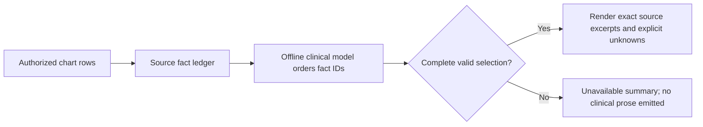

# Patient summary source contract

The clinical checkpoint is unchanged. The summary output contract changes from model-written clinical prose to an extractive record draft: the model orders supplied fact IDs, and Orb renders the corresponding source excerpts.

The ledger carries the patient, source table, row, fields, actual recorded timestamp and retrieval bounds. Sage refreshes the ledger on summary cache hits. The snapshot service retains its admission, source revision and 30-minute freshness controls. Its new prompt version prevents reuse of earlier free-form drafts.

Every supplied fact must appear exactly once in the selection. Unknown IDs, omitted or repeated facts, duplicate JSON keys, extra prose or fields, malformed output and mismatched patient evidence fail closed. Summary output is buffered until this validation completes. The renderer quotes source text and preserves values, negations, dates, held/discontinued states, verification status and simulated-source labels. Missing vital parameters remain explicitly unknown.

Unknowns are generated independently of the model:

- No current medication rows supplied does not establish whether medication changes occurred.
- No reviewed imaging report supplied does not establish whether imaging was performed.
- No signed note supplied does not establish whether tasks remain.

The current Sage source window does not retrieve a complete medication-change history or formal outstanding-task ledger. These domains stay unknown. Bounds on observations, lab documents, notes and reviewed imaging remain visible. Oversized evidence fails rather than being silently truncated. This is evidence preservation within the supplied record, not proof that the source chart is correct or complete, or that a model can safely prioritize clinical care.

The quality fixture independently captures authorized evidence before inference. It verifies the exact rendered answer, complete fact selection, source fingerprint, references and unknowns. It includes one populated synthetic chart with held medication, observations, a signed note containing negation and a simulated laboratory result, plus 99 empty charts. Its tests reject the earlier source-incorrect statements that passed lexical keyword checks.

The performance run still measures model completion, full retrieval and the entire validated response. A deterministic record view, partial stream, rejected selection or unavailable cached draft does not count as a successful fresh AI answer. The complete-answer targets remain 3/5/15 seconds for general/patient/department queries.
